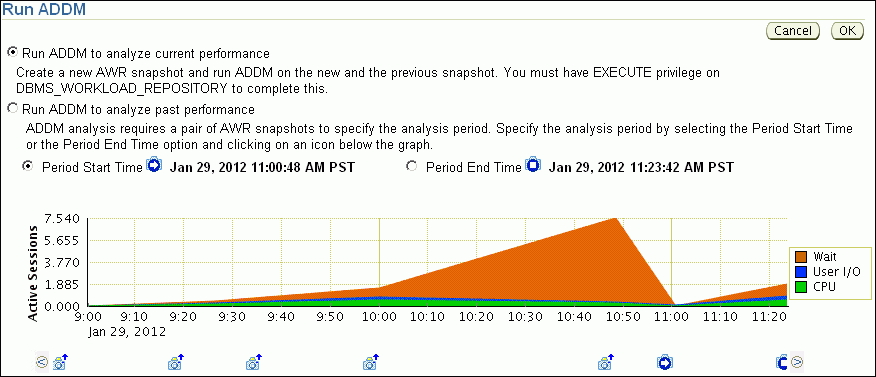
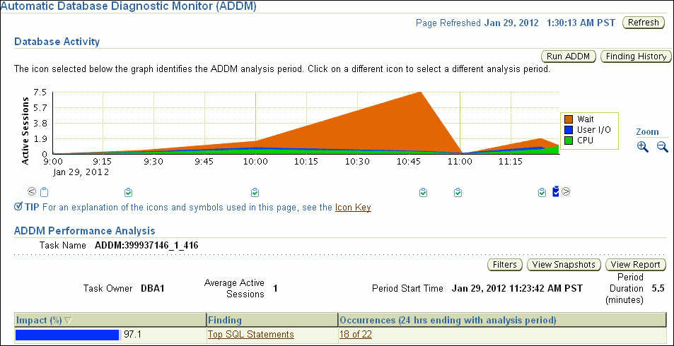
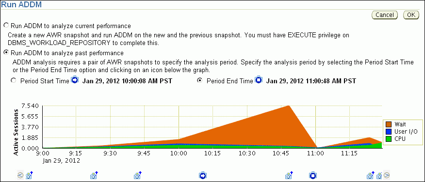
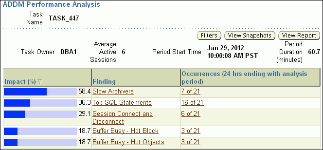
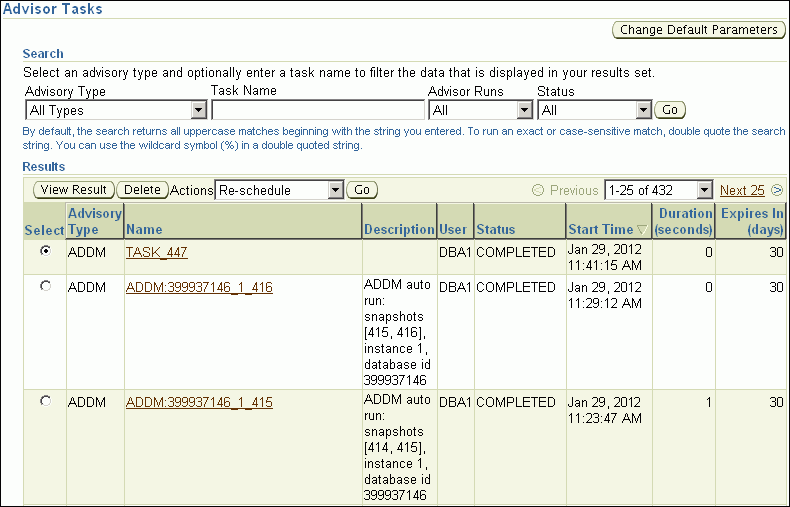

You can run the Automatic Database Diagnostic Monitor (ADDM) manually to monitor current and historical database performance. Typically, you use the automatic diagnostic feature of ADDM to identify performance problems with the database. As described in [Automatic Database Performance Monitoring](automatic-database-performance-monitoring.md), ADDM runs once every hour by default. You can configure ADDM to run at a different time interval. However, in some cases you may want to run ADDM manually.

You can run ADDM manually to analyze a time period that is longer than one ADDM analysis period. For example, you may want to analyze database performance in a workday by analyzing 8 consecutive hours. You could analyze each of the individual ADDM periods within the workday, but this approach may become complicated if performance problems appear in only some ADDM periods. Alternatively, you can run ADDM manually with a pair of Automatic Workload Repository (AWR) snapshots that encompass the 8-hour period. In this case, ADDM identifies the most critical performance problems in the entire time period.

This chapter contains the following sections:

### Manually Running ADDM to Analyze Current Database Performance

By default, ADDM runs every hour to analyze snapshots taken by AWR during this period. In some cases you may notice performance degradation that did not exist in the previous ADDM analysis period, or a sudden spike in database activity on the Performance page, as described in [Monitoring Real-Time Database Performance](monitoring-real-time-database-performance.md) . If the next ADDM analysis is not scheduled to run for 30 minutes, then you can run ADDM manually to identify and resolve the performance problem.

When you run ADDM manually, a manual AWR snapshot is created automatically. This manual run may affect the ADDM run cycle. For example, if you scheduled ADDM to run hourly at the start of each hour and the last ADDM run was at 8:00 p.m., running ADDM manually at 8:30 p.m. causes the next scheduled run to start at 9:30 p.m., not 9:00 p.m. Subsequent ADDM runs continue on the new run cycle, occurring hourly at the half-hour instead of the start of each hour.

To analyze current database performance by manually running ADDM:

1. Access the Database Home page.
	See " [Accessing the Database Home Page](introduction.md) " for more information.
2. From the Performance menu, select Advisors Home.
	If the Database Login page appears, then log in as a user with administrator privileges. The Advisor Central page appears.
3. Under Advisors, select ADDM. The Run ADDM page appears.
	

> The Run ADDM page is shown.
>
> The Cancel and OK buttons are right-justified at the top of the page.
>
> You can make the following selections: Run ADDM to analyze current performance, or Run ADDM to analyze past performance. If you take the latter option, then you can set the Period Start Time and Period End Time. In the screenshot, the Period Start Time is Jan 29, 2012 11:00:48 AM PST. The Period End time is Jan 29, 2012 11:23:42 AM PST.
>
> A line chart is shown. The y-axis units are average active sessions and the range is from 0 to 7.54. The x-axis units are times of day, shown in 10-minute intervals, and range from 9 a.m. to 11:30 a.m. Waits peaked significantly between 10 and 11.
>
> End of description.

	In this example, the average active sessions with wait events rose at 10:00 a.m., peaking at 10:50 a.m. The number dipped at 11:00 a.m. and then started to rise again at 11:10 a.m.
4. Select Run ADDM to analyze current performance and click OK.
	The Confirmation page appears.
5. Click Yes.
	The Processing: Run ADDM Now page appears while the database takes a new AWR snapshot.
	An ADDM run occurs for the time period between the new and the previous snapshot. After ADDM completes the analysis, the Automatic Database Diagnostic Monitor (ADDM) page appears with the results.
	

> The Automatic Database Diagnostic Monitor (ADDM) page is shown.
>
> A label-value pair is at the top right of the page. The label is Page Refreshed and the value is Jan 29, 2012 1:30:13 AM PST. The Refresh button is to the right of the value.
>
> The Database Activity section has the Run ADDM and Finding History on the right. Below that button is the text, "The icon selected below the graph identifies the ADDM analysis period. Click on a different icon to select a different analysis period."
>
> The section has a line chart. The y-axis units are average active sessions and range from 0 to 7.5. The x-axis units are times of day, shown in 15-minute intervals, and range from 9 a.m. to 11:30 a.m. Waits peaked significantly between 10 and 11. Below the chart is a series of task icons. Below them is the text, "Tip For an explanation of the icons and symbols used in this page, see the Icon Key." The words "Icon Key" are a link.
>
> The ADDM Performance Analysis section is shown. It has a label-value pair. The label is Task Name and the value is ADDM:399937146\_1\_416. On the right are three buttons: Filters, View Snapshots, and View Report.
>
> Below the buttons are four label-value pairs. The labels and values are the following:
>
> - Task Owner, DBA1
> - Average Active Sessions, 1
> - Period Start Time, Jan 29, 2012 11:23:42 AM PST
> - Period Duration (minutes) 5.5
>
> Below the buttons is a table that has the following columns: Impact (%), Finding, Occurrences (24 hrs ending with analysis period). The values in the Finding and Occurrences columns are links. The table shows one row. The values in the row are the following: 97.1, Top SQL Statements, 18 of 22.
>
> End of description.

6. Click View Report.
	The View Report page appears.
7. Optionally, click Save to File to save the results of the ADDM task in a report for later access.

See Also:

- " [Reviewing the Automatic Database Diagnostic Monitor Analysis](automatic-database-performance-monitoring.md) "

### Manually Running ADDM to Analyze Historical Database Performance

You can run ADDM manually to analyze historical database performance by selecting a pair or range of AWR snapshots as the analysis period. This technique is useful when you have identified a previous time period when database performance was poor.

In the Performance page, you can monitor historical performance by selecting Historical from the View Data list. In the Historical view, you can monitor database performance in the past, up to the duration defined by the AWR retention period. If you notice performance degradation, then you can drill down from the Performance page to identify historical performance problems with the database, as described in [Monitoring Real-Time Database Performance](monitoring-real-time-database-performance.md) . If you identify a problem, then you can run ADDM manually to analyze a particular time period.

To analyze historical database performance by manually running ADDM:

1. Access the Database Home page.
	See " [Accessing the Database Home Page](introduction.md) " for more information.
2. From the Performance menu, select Advisors Home.
	If the Database Login page appears, then log in as a user with administrator privileges. The Advisor Central page appears.
3. Under Advisors, select ADDM. The Run ADDM page appears.
4. Select Run ADDM to analyze past performance.
5. Specify a time period for analysis by selecting a pair of AWR snapshots. Complete the following steps:
	1. Select Period Start Time.
		2. Below the chart for the starting snapshot, click the snapshot you want to use for the start time.
		A play icon (displayed as an arrow) appears over the snapshot icon.
		In this example, database activity peaked from 10 a.m. to 11 a.m., so the snapshot taken at 10 a.m. is selected for the start time.
		3. Select Period End Time.
		4. Below the chart for the ending snapshot, click the snapshot you want to use for the end time.
		A stop icon (displayed as a square) appears over the snapshot icon.
		In this example, the ending snapshot is at 11:00 a.m.
	

> The Run ADDM page is shown.
>
> The Cancel and OK buttons are right-justified at the top of the page.
>
> You can make the following selections: Run ADDM to analyze current performance, or Run ADDM to analyze past performance. If you make the latter suggestions, then you can set Period Start Time and Period End Time. In the screenshot, the Period Start Time is Jan 29 2009 10:00:08 AM PST. The Period End time is one hour later.
>
> A line chart is shown. The y-axis units are average active sessions and range from 0 to 7.54. The x-axis units are times of day, shown in 15-minute intervals, and range from 9:00 a.m. to 11:30 a.m. Wait times (shown in red) peaked significantly between 10:00 and 11:00.
>
> End of description.

6. Click OK.
	After ADDM completes the analysis, the Automatic Database Diagnostic Monitor (ADDM) page appears with the results of the ADDM run.
	Figure 7-1 Analyzing Historical Database Performance
	

> The ADDM Performance Analysis section of the Automatic Database Diagnostic Monitory (ADDM) page is shown. At the upper left is a label-value pair. The label is Task Name and the value is TASK\_447. At the right are three buttons: Filters, View Snapshots, View Report.
>
> Below the buttons are four label-value pairs. The labels and values are the following:
>
> - Task Owner, DBA1
> - Average Active Sessions, 6
> - Period Start Time, Jan 29, 2012 10:00:08 AM PST
> - Period Duration (minutes) 60.7
>
> Below the label-value pairs is a table with the following columns: Impact (%), Finding, Occurrences (24 hrs ending with analysis period). The Findings and Occurrences values are links. The table shows 5 rows.
>
> Row 1 has the following values: 58.4, Slow Achievers, 7 of 21.
>
> Row 2 has the following values: 36.3, Top SQL Statements, 16 of 21.
>
> Row 3 has the following values: 29.1, Session Connect and Disconnect, 6 of 21.
>
> Row 4 has the following values: 18.7, Buffer Busy - Hot Block, 3 of 21.
>
> Row 5 has the following values: 18.7, Buffer Busy - Hot Objects, 3 of 21.
>
> End of description.

7. Click View Report.
	The View Report page appears.
8. Optionally, click Save to File.

See Also:

- " [Reviewing the Automatic Database Diagnostic Monitor Analysis](automatic-database-performance-monitoring.md) "

### Accessing Previous ADDM Results

If you ran ADDM manually to analyze current or historical database performance, the results are displayed on the Automatic Database Diagnostic Monitor (ADDM) page after the ADDM run has completed.

You can access the ADDM results at a later time, or access the ADDM results from previous run cycles.

To access the ADDM results:

1. Access the Database Home page.
	See " [Accessing the Database Home Page](introduction.md) " for more information.
2. From the Performance menu, select Advisors Home.
	If the Database Login page appears, then log in as a user with administrator privileges. The Advisor Central page appears.
3. Complete the following steps:
	1. Under Advisor Tasks, select ADDM from the Advisory Type list.
		2. Select the appropriate search criteria.
		For example, you can select All in the Advisor Runs list to view all ADDM tasks.
		3. Click Go.
	

> The Advisor Tasks page is shown.
>
> The Change Default Parameters button is at the upper right.
>
> The Search section is shown. A line of text says, "Select an advisory type and optionally enter a task name to filter the data that is displayed in your results set."
>
> Below the text are four lists. The Advisory Type list has a value of ADDM. The Task Name list shows a null value. The Advisor Runs list shows a value of All. The status list shows the value of All. The Go button appears to the right of the lists.
>
> Below the lists is text that says, "By default, the search returns all uppercase matches beginning with the string you entered. To run an exact or case-sensitive match, double quote the search string. You can use the wildcard symbol (%) in a double quoted string."
>
> The Results section includes a table.
>
> Above the table are the View Result and Delete buttons. The Actions list shows the Re-schedule value. To the right of this list is the Go button. At the far right is a field that shows the number of the currently selected 25 results. The value in the list is 1-25 of 432. To the left of the field is a greyed-out Previous arrow. To the right of the field is a Next 25 arrow.
>
> The table has the following columns: Select, Advisory Type, Name, Description, User, Status, Start Time, Duration (seconds), and Expires In (days). The Name values appear as links. The Select values appear as selectable options.
>
> Row 1 contains the following values: (option, shown selected), ADDM, TASK\_447, null, DBA1, COMPLETED, Jan 29 2012, 0, 30.
>
> Row 2 contains the following values: (option), ADDM, ADDM:399937146\_1\_416, ADDM auto run, DBA1, COMPLETED, Jan 29 2012 11:29:12 AM, 1, 30.
>
> Row 3 contains the following values: (option), ADDM, ADDM:399937146\_1\_415, ADDM auto run, DBA1, COMPLETED, Jan 29 2012 11:23:12 AM, 0, 30.
>
> End of description.

	The ADDM tasks are displayed under Results.
4. To view an ADDM result, select the desired ADDM task and click View Result.
	The results from the selected ADDM task are shown in the Automatic Database Diagnostic Monitor (ADDM) page.
	See Also:
	- " [Reviewing the Automatic Database Diagnostic Monitor Analysis](automatic-database-performance-monitoring.md) "