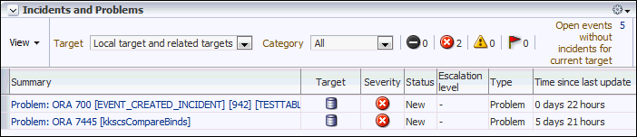
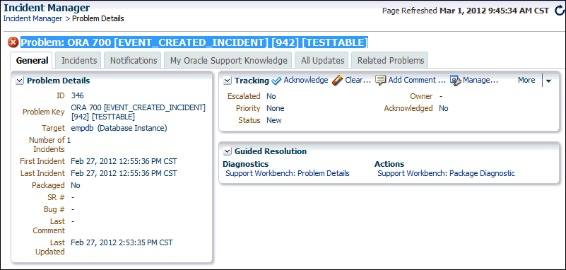

Oracle Database includes a built-in alerts infrastructure to notify you of impending problems with the database. Alerts are a type of event and events comprise incidents. A problem is a special type of incident.

By default, Oracle Database enables some alerts, including the following:

- Archive Area Used
- Current Open Cursors Count
- Recovery Area Free Space
- Tablespace Space Used

In addition to these default alerts, you can set metric thresholds so that Oracle Database generates alerts to notify you about the database performance conditions that you specify.

This chapter contains the following sections:

See Also:

- [Oracle Database Administrator's Guide](https://docs.oracle.com/pls/topic/lookup?ctx=en/database/oracle/oracle-database/21/tdppt&id=ADMIN11007) for information about incidents and how to monitor and manage them

### Setting Metric Thresholds for Performance Alerts

A metric is the rate of change in a cumulative statistic. This rate can be measured against a variety of units, including time, transactions, or database calls. For example, the number of database calls per second is a metric. You can set thresholds on a metric so that an alert is generated when the threshold is passed.

Performance alerts are based on metrics that are performance-related. These alerts are either environment-dependent or application-dependent.

Environment-dependent performance alerts may not be relevant on all systems. For example, the `AVERAGE_FILE_READ_TIME` metric generates an alert when the average time to read a file exceeds the metric threshold. This alert may be useful on a system with only one disk. On a system with multiple disks, however, the alert may not be relevant because I/O processing is spread across the entire subsystem.

Application-dependent performance alerts are typically relevant on all systems. For example, the `BLOCKED_USERS` metric generates a performance alert when the number of users blocked by a particular session exceeds the metric threshold. This alert is relevant regardless of how the environment is configured.

To obtain the most relevant information from performance alerts, set the threshold values of performance metrics to values that represent desirable boundaries for your system. You can then fine-tune these values over time until your system meets or exceeds your performance goals.

To set thresholds for performance metrics:

1. Access the Database Home page.
	See " [Accessing the Database Home Page](introduction.md) " for more information.
2. From the Oracle Database menu, select Monitoring, and then Metric and Collection Settings.
	If the Database Login page appears, then log in as a user with administrator privileges. The Metric Settings page appears.
3. For each performance metric relevant for your system, click the Edit icon.
	The Edit Advanced Settings page appears.
4. Follow the steps of the wizard to set the threshold value.

See Also:

- " [Setting Metric Thresholds for Baselines](resolving-performance-degradation-over-time.md) "

### Responding to Alerts

When an alert is generated by Oracle Database, it appears in the Incidents and Problems section of the Database Home page.

Figure 6-1 shows the Incidents and Problems section of the Database Home page. The section is below the SQL Monitor - Last Hour section in the default layout of the page.

Figure 6-1 Incidents and Problems Section of the Database Home Page

> The screenshot shows the Incidents and Problems section of the Database Home page.
>
> The title of the section is Incidents and Problems. At the top right of the section is the an icon for the View Actions menu.
>
> Below the title are the following lists:
>
> - The View list.
> - The Target list with the following value selected: Local target and related targets.
> - The Category list with the following value selected: All.
>
> Next are the following label-value pairs:
>
> - Fatal icon: 0
> - Critical icon: 2
> - Warning icon: 0
> - Escalated icon: 0
> - Open events without incidents for current target: 5
>
> A table has the following columns: Summary, Target, Severity, Status, Escalation Level, Type, Time Since Last Update. The values in the Summary column are links. The values in the Target column are icons; the target name appears when you place the cursor on the icon. The values in the rows are the following:
>
> - Row 1: Problem: ORA 700 \[EVENT\_CREATED\_INCIDENT\] \[942\] \[TESTTABLE\], (Database Instance icon), (Critical icon), New, -, Problem, 0 days 22 hours.
> - Row 2: Problem: ORA 7445 \[kkscsCompareBinds\], (Database Instance icon), (Critical icon), New, -, Problem, 5 days 21 hours.
>
> End of description.

Oracle Enterprise Manager Cloud Control (Cloud Control) enables you to configure alerts to be sent by email, pager, or text messaging.

To respond to an alert:

1. Access the Database Home page.
	See " [Accessing the Database Home Page](introduction.md) " for more information.
2. In the table in the Incidents and Problems section, find the alert that you want to investigate and click the link in the Summary column.
	If the Database Login page appears, then log in as a user with administrator privileges. An Incident Manager page appears that contains further information about the alert. For example, clicking the value in the first row of the Summary column in Figure 6-1 causes the Incident Manager Problem Details page shown in Figure 6-2 to appear. The General sub-page is selected.
	Figure 6-2 Incident Manager Problem Details Page
	

> The screenshot shows the Incident Manager Problem Details page for Problem: ORA 700 \[EVENT\_CREATED\_INCIDENT\] \[942\] \[TESTTABLE\].
>
> The title of the page is Incident Manager. Below the title are the locator links Incident Manager > Problem Details. At the top right of the page is the label Page Refreshed with the value Mar 1, 2012 9:45:34 AM CST.
>
> Below the locator links is the problem key: Problem: ORA 700 \[EVENT\_CREATE\_INCIDENT\]\[942\]\[TESTTABLE\] preceded by a Critical icon.
>
> The tabs on the page are General (selected), Incidents, My Oracle Support Knowledge, Updates, and Related Problems.
>
> In the Problem Details section are the following label-value pairs:
>
> - ID: 346
> - Problem Key: ORA 700 \[EVENT\_CREATE\_INCIDENT\]\[942\]\[TESTTABLE\]
> - Target: empdb (Database Instance)
> 	The target value empdb is a link.
> - Number of Incidents: 1
> - First Incident: Feb 27, 2012 12:55:36 PM CST
> - Last Incident: Feb 27, 2012 12:55:36 PM CST
> - Packaged: No
> - SR #: -
> - Bug #: -
> - Last Comment: -
> - Last Updated: Feb 27, 2012 2:53:35 PM CST
>
> In the Tracking section are the following buttons: Acknowledge, Clear..., Add Comment..., Manage..., More. The section has the following label-value pairs:
>
> - Escalated: No
> - Priority: None
> - Status: New
> - Owner: -
> - Acknowledged: No
>
> The Guided Resolution section has the following groups:
>
> - Diagnostics
> - Actions
>
> Under Diagnostics is the link Support Workbench: Problem Details.
>
> Under Actions is the link Support Workbench: Package Diagnostic.
>
> End of description.

3. Do one or more of the following:
	- Click the other tabs to see information on the subpages.
		- Perform one or more of the actions in the Tracking section on the General subpage.
		- In the Guided Resolution section, view diagnostic information by clicking Support Workbench: Problem Details. To package and upload diagnostic data to Oracle Support, click Support Workbench: Package Diagnostic.
		- Run Automatic Database Diagnostic Monitor (ADDM) or another advisor to get more detailed diagnostics of the system or object behavior.

### Clearing Alerts

Most alerts, such as the CPU Utilization alert, are cleared automatically when the cause of the problem disappears. However, other alerts, such as the Generic Alert Log Error or Generic Incident alert, must be acknowledged.

After taking the necessary corrective measures, you can clear an alert.

To clear alerts:

1. Access the Database Home page.
	See " [Accessing the Database Home Page](introduction.md) " for more information.
2. In the Incidents and Problems section, click the link in the Summary column of the table. See Figure 6-1 for a screenshot of the section.
	The Incident Manager Problem Details page appears. If the incident or problem can be manually cleared, the Clear button appears in the Tracking section.
	What happens if the Clear button does not appear. How is the problem cleared?
3. In the Tracking section, click Clear.