The Automatic Database Diagnostic Monitor (ADDM) automatically identifies performance problems with the database, as described in [Automatic Database Performance Monitoring](automatic-database-performance-monitoring.md). Information on performance appears on the Performance page in Oracle Enterprise Manager Cloud Control (Cloud Control).

By drilling down to other pages from the Performance page, you can identify database performance problems in real time. If you find a problem, then you can run ADDM manually to analyze it immediately without having to wait until the next ADDM analysis. To learn how to run ADDM manually, see " [Manually Running ADDM to Analyze Current Database Performance](manual-database-performance-monitoring.md) ".

This chapter describes how to monitor some aspects of database activity. It contains the following sections:

### Monitoring User Activity

As described in [Oracle Database Performance Method](oracle-database-performance-method.md) , database time (DB time) is an indicator of the total database instance workload. The average active sessions for a time period equals the total database time of all user sessions during the period divided by the elapsed time (wall-clock time) for the period.

The Average Active Sessions graph on the Performance Hub page shows the average active sessions for CPU usage and wait classes in the time period. You can drill down by clicking on the graph to identify the causes of instance-related performance issues and resolve them.

To monitor user activity:

1. Access the Database Home page.
	See " [Accessing the Database Home Page](introduction.md) " for more information.
2. From the Performance menu, select Performance Hub and ASH Analytics.
	If the Database Login page appears, then log in as a user with administrator privileges. The Performance Hub page appears.
3. Locate any spikes or other areas of interest in the Average Active Sessions stacked area chart.
	Figure 4-1 shows an example of one dimension of the Average Active Sessions chart on the Performance Hub page.
	Figure 4-1 Average Active Sessions by Wait Class
	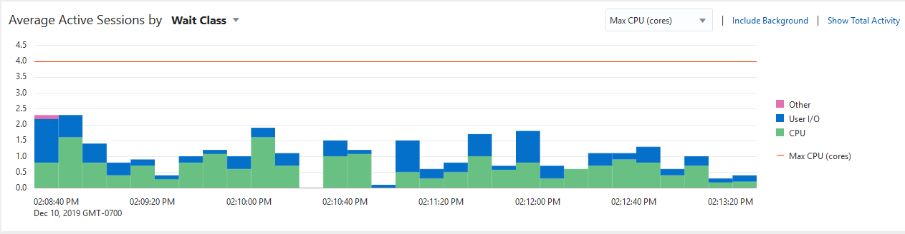

> A stacked area chart labeled Average Active Sessions is shown. Next to the label of the chart are two options: Foreground Only, Foreground + Background. Foreground Only is selected.
>
> The units of the x-axis of the chart are times of the day, shown in 5-minute intervals. The x-coordinates shown range from 1:20 p.m. to 2:20 p.m. The units of the y-axis are average active sessions. The y-coordinates shown range from 0.0 to 2.8. A line at the 2.0 mark is labeled CPU Cores.
>
> A legend to the right of the chart shows the types of events that could appear in the chart. The types of events are the following: Other, Cluster, Queueing, Network, Administrative, Configuration, Commit, Application, Concurrency, System I/O, User I/O, Scheduler, CPU Wait, CPU.
>
> The activity shown in the chart is described in the surrounding text.
>
> End of description.

	Each color-filled area on the stacked area chart shows the average active sessions for the specified event at the specified time. In the chart, the average active sessions amount for each event is stacked upon the one below it. The events appear on the chart in the order shown in the legend, with CPU starting at zero on the y-axis and the other events stacked in ascending order, from CPU Wait to Other. The wait classes show how much database activity is consumed by waiting for a resource such as disk I/O.
	The CPU Cores line at 2 on the y-axis indicates the number of CPUs on the host system. When the CPU value reaches the CPU Cores line, the database instance is consuming 100 percent of CPU time on the system.
	The last item in the graph title Average Active Sessions by Wait Class is a drop-down menu for other dimensions to view the performance. Wait Class is the default.
	The main dimensions are:
	- Wait Class
		- Wait Event
		- Instance
		- Service
		- Module
		- Action
		- User Session
		- SQL ID
	The Active Sessions Working page shows a 1-hour timeline. Details for each wait class are shown in 5-minute intervals.
	You can view the details of wait classes in different dimensions by proceeding to one of the following sections:
	- Monitoring Top Dimensions
		- Monitoring SQL
		- Monitoring PL/SQL
		- Monitoring Resource Consumption
		- Monitoring Session Identifiers
		- Monitoring Session Attributes
4. To change the selected time interval, use the Performance Hub view and drag start and end times to a different interval.
	Figure 4-2 Average Active Sessions by "Wait Class"
	

> This screenshot shows the top portion of the Active Sessions Working: CPU + CPU Wait page.
>
> In the top right corner of the screenshot is the following list: View Data. The value shown is Real Time: 15 Second Refresh.
>
> A line chart labeled Active Sessions is shown. The units of the x-axis are times of day in 10-minute intervals. The x-coordinates shown range from 9:08 a.m. to 9:58. The units of the y-axis are: number of active sessions. The y-coordinates shown range from 0 to 2.4. A line at the 2.0 mark is labeled Maximum CPU. The following types of information are plotted in the chart: CPU + CPU Wait. The chart indicates that the highest spike in CPU usage was 2.2 at 9:59. A shaded box indicates the selected five minute interval, which is from 9:59 to 10:04.
>
> Underneath the line chart is the Detailed for Selected 5 Minute Interval section. The Start Time is Jan 13, 2012 9:59:09.
>
> The Detail section contains the following subsections: Top Working SQL, and Top Working Sessions.
>
> The Top Working SQL section contains the Actions list, which shows Schedule SQL Tuning Advisor. Next to it is the Go button. Below the Actions list are the options Select All and Select None.
>
> Underneath the options is a table. The table contains the following columns: Select, Activity (%), SQL ID, and SQL Type. The Select column contains check boxes. Values in the Activity column are displayed as a horizontal bar chart with an associated number. Values in the SQL ID column are links.
>
> Seven rows are shown in the table. In each row, the check box in the Select column is clear. The remaining values of the rows are as follows:
>
> Row 1: 60.00, 94fzm3jx1c1yp, PL/SQL EXECUTE.
>
> Row 2: 15.40, ddthrb7j9a63f, SELECT.
>
> Row 3: 11.50, 95adfchfv58a5, UPDATE.
>
> Row 4: 10.63, 357p6hzg9gat, PL/SQL EXECUTE.
>
> Row 5: 9.98, axabnfyfp4r3p, SELECT.
>
> Row 6: 4.99, f8ybh6brs1uq2, SELECT.
>
> Row 7: 4.12, dsv6nf68zgkuc, INSERT.
>
> The Top Working Sessions section contains the View list, which shows Top Sessions. Underneath the list is a table. The table contains the following columns: Activity (%), Session ID, User Name, and Program. Values in the Activity column are displayed as a horizontal bar chart with an associated number. Values in the Session ID and User Name columns are links.
>
> 7 rows are shown in the table. The values of the row are as follows:
>
> Row 1: 44.93, 31, HR, sqlplus@dbhost (TNS V1-V3).
>
> Row2: 37.57, 32, HR, sqlplus@dbhost (TNS V1-V3).
>
> Row 3: 4.17, 34, SYS, oracle@dbhost (M000).
>
> Row 4: 1.19, 127, SYS, JDBC Thin Client.
>
> Row 5:.80, 8, SYS, oracle@dbhost (LGO1).
>
> Row 6:.40, 6, SYS, oracle@dbhost (LGWR).
>
> Row 7:.40, 9, SYS, oracle@dbhost (LGO2).
>
> End of description.

	The information contained in the Average Active Sessions is automatically updated to display the selected time period.

If you discover a performance problem, then you can attempt to resolve it in real time. On the Performance page, do one of the following:

- Below the Average Active Sessions chart, click the snapshot corresponding to the time when the performance problem occurred to run ADDM for this time period.
	For information about ADDM analysis, see " [Reviewing the Automatic Database Diagnostic Monitor Analysis](automatic-database-performance-monitoring.md) ".
- Click Run ADDM Now to create a snapshot manually.
	For information about creating snapshots manually, see " [Creating Snapshots](automatic-database-performance-monitoring.md) ". For information about running ADDM manually, see " [Manually Running ADDM to Analyze Current Database Performance](manual-database-performance-monitoring.md) ".
- Click Run ASH Report to create an Active Session History (ASH) report to analyze transient, short-lived performance problems.
	For information about ASH reports, see " [Active Session History Reports](resolving-transient-performance-problems.md) ".

#### Monitoring Top Dimensions

The Average Active Sessions by drop-down contains a Top Dimensions fly-out with the following common views:

- Wait Class
- Wait Event
- Instance
- Service
- Module
- Action
- User Session
- SQL ID

To monitor a Top Dimension:

1. Access the Performance Hub page, as explained in " Monitoring User Activity ".
2. Click on the drop-down in Average Active Sessions by, mouse onto Top Dimensions, and select the desired view.
	- Wait Class
		- Wait Event
		- Instance
		- Service
		- Module
		- Action
		- User Session
		- SQL ID
	Graphs, tables, and information on the page are updated to reflect the selected criteria.

#### Monitoring SQL

The Average Active Sessions by drop-down contains a SQL fly-out with the following common views:

- SQL ID
- Top Level SQL ID
- SQL Force Matching Signature
- SQL Plan Hash Value
- SQL Full Plan Hash Value
- SQL Plan Operation
- SQL Plan Operation Line
- SQL Opcode
- Top Level SQL Opcode

To monitor SQL:

1. Access the Performance Hub page, as explained in " Monitoring User Activity ".
2. Click on the drop-down in Average Active Sessions by, mouse onto SQL, and select the desired view from the fly-out.
	- SQL ID
		- Top Level SQL ID
		- SQL Force Matching Signature
		- SQL Plan Hash Value
		- SQL Full Plan Hash Value
		- SQL Plan Operation
		- SQL Plan Operation Line
		- SQL Opcode
		- Top Level SQL Opcode
	Graphs, tables, and information on the page are updated to reflect the selected criteria.

See Also:

- " [Viewing Details of SQL Statements](unresolvable-reference.md) "
- " [Tuning SQL Statements](tuning-sql-statements.md) "
- " [Tuning SQL Statements Using SQL Tuning Advisor](tuning-sql-statements.md) "

#### Monitoring PL/SQL

The Average Active Sessions by drop-down contains a PL/SQL fly-out with the following common views:

- PL/SQL
- Top Level PL/SQL

To monitor PL/SQL:

1. Access the Performance Hub page, as explained in " Monitoring User Activity ".
2. Click on the drop-down in Average Active Sessions by, mouse onto PL/SQL, and select the desired view from the fly-out.
	- PL/SQL
		- Top Level PL/SQL
	Graphs, tables, and information on the page are updated to reflect the selected criteria.

#### Monitoring Resource Consumption

The Average Active Sessions by drop-down contains a Resource Consumption fly-out with the following common views:

- Wait Class
- Wait Event
- Object
- Blocking Session

A session is a logical entity in the database instance memory that represents the state of a current user login to the database. A session lasts from the time a user logs in to the database until the user disconnects. For example, when a user starts SQL\*Plus, the user must provide a valid database user name and password to establish a session. If a single session is consuming the majority of database activity, then you should investigate it.

To monitor resource consumption:

1. Access the Performance Hub page, as explained in " Monitoring User Activity ".
2. Click on the drop-down in Average Active Sessions by, mouse onto Resource Consumption, and select the desired view from the fly-out.
	- Wait Class
		- Wait Event
		- Object
		- Blocking Session
	Graphs, tables, and information on the page are updated to reflect the selected criteria.

#### Monitoring Session Identifiers

The Average Active Sessions by drop-down contains a Sessions Identifiers fly-out with the following common views:

- Instance
- Service
- User Session
- Parallel Process
- User Name
- Program
- Session Type

A service is a group of applications with common attributes, service-level thresholds, and priorities. For example, the `SYS$USERS` service is the default service name used when a user session is established without explicitly identifying a service name. The `SYS$BACKGROUND` service consists of all database background processes. If a service is using the majority of the wait time, then you should investigate it.

A session is a logical entity in the database instance memory that represents the state of a current user login to the database. A session lasts from the time a user logs in to the database until the user disconnects. For example, when a user starts SQL\*Plus, the user must provide a valid database user name and password to establish a session. If a single session is consuming the majority of database activity, then you should investigate it.

To monitor session identifiers:

1. Access the Performance Hub page, as explained in " Monitoring User Activity ".
2. Click on the drop-down in Average Active Sessions by, mouse onto Session Identifiers, and select the desired view from the fly-out.
	- Instance
		- Service
		- User Session
		- Parallel Process
		- User Name
		- Program
		- Session Type
	Graphs, tables, and information on the page are updated to reflect the selected criteria.

#### Monitoring Session Attributes

The Average Active Sessions by drop-down contains a Sessions Attributes fly-out with the following common views:

- Consumer Group
- Module
- Action
- Client
- Client Host Name
- Client Host Port
- Transaction ID
- Execution Context ID
- Database Operation

A client can be a web browser or any client process that initiates a request for the database to perform an operation. If a single client is using the majority of the wait time, then you should investigate it.

Modules represent the applications that set the service name as part of the workload definition. For example, the `DBMS_SCHEDULER` module may assign jobs that run within the `SYS$BACKGROUND` service. If a single module is using the majority of the wait time, then it should be investigated.

To monitor session attributes:

1. Access the Performance Hub page, as explained in " Monitoring User Activity ".
2. Click on the drop-down in Average Active Sessions by, mouse onto Sessions Attributes, and select the desired view from the fly-out.
	- Consumer Group
		- Module
		- Action
		- Client
		- Client Host Name
		- Client Host Port
		- Transaction ID
		- Execution Context ID
		- Database Operation
	Graphs, tables, and information on the page are updated to reflect the selected criteria.

### Monitoring Instance Activity

Below the Average Active Sessions chart on the Performance page are other charts that you can use to monitor database instance activity. As explained in " [Customizing the Database Performance page](unresolvable-reference.md) ", you can also customize the Performance page so that the most useful instance activity charts are displayed by default.

You can use the instance activity charts to perform the following tasks:

- Monitoring Throughput
- Monitoring I/O
- Monitoring Parallel Execution
- Monitoring Services

#### Monitoring Throughput

Database throughput measures the amount of work the database performs in a unit of time. The Throughput charts show any contention that appears in the Average Active Sessions chart.

Compare the peaks on the Throughput charts with the peaks on the Average Active Sessions chart. If the Average Active Sessions chart displays a large number of sessions waiting, indicating internal contention, but throughput is high, then the situation may be acceptable. The database is probably also performing efficiently if internal contention is low but throughput is high. However, if internal contention is high but throughput is low, then consider tuning the database.

To monitor throughput:

1. Access the Database Home page.
	See " [Accessing the Database Home Page](introduction.md) " for more information.
2. From the Performance menu, select Performance Home.
	If the Database Login page appears, then log in as a user with administrator privileges. The Performance page appears.
3. Click the Throughput tab.
4. Select one of the following Instance Throughput Rate options.
	- Per Second
		Two charts appear. One shows the number of logons and transactions per second and the other shows the physical reads and redo size per second.
		Figure 4-3 shows the Throughput charts with the Instance Throughput Rate of Per Second selected. The bar in the middle of the figure indicates a portion of the charts (from approximately 1:37 to 1:52) that has been removed for space considerations. In Figure 4-3, the most transactions occurred from 1:15 to 1:27 p.m. and from 2:08 to 2:12 p.m.
		- Per Transaction
		One chart appears that shows the number of physical reads and redo size per transaction.

Figure 4-3 Monitoring Throughput

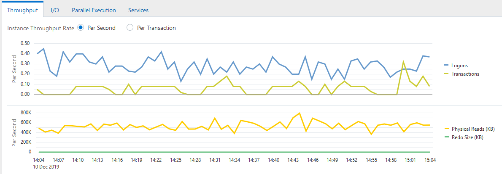

> The screenshot show the Throughput tab selected. The Instance Throughput Rate can be set to Per Second (shown selected) or Per Transaction. The other tabs are: I/O, Parallel Executions, Services.A line chart is shown. The units of the y-axis are: total number per second. The units of the x-axis are times of the day, shown in 5-minute intervals. The x-coordinates shown range from 1:15 p.m. to 2:10 p.m. The y-coordinates shown range from 0 to 1200. The following types of information are plotted in the chart: Logons, Transactions. The chart indicates that the most transactions occurred from 1:15 to 1:27 p.m. and from 2:08 to 2:12 p.m.A second line chart is shown. The units of the y-axis are: total number per second. The y-coordinates shown range from 0 to 2400. The following types of information are plotted in the chart: Physical Reads (KB), and Redo Size (KB). The chart indicates that a spike in physical reads occurred at 1:19 p.m and again at 2:10 p.m.
>
> End of description.

#### Monitoring I/O

The I/O charts show I/O statistics collected from all database clients. The I/O wait time for a database process represents the amount of time that the process could have been doing useful work if a pending I/O had completed. Oracle Database captures the I/O wait times for all important I/O components in a uniform fashion so that every I/O wait by any Oracle process can be derived from the I/O statistics.

Figure 4-4 Monitoring I/O

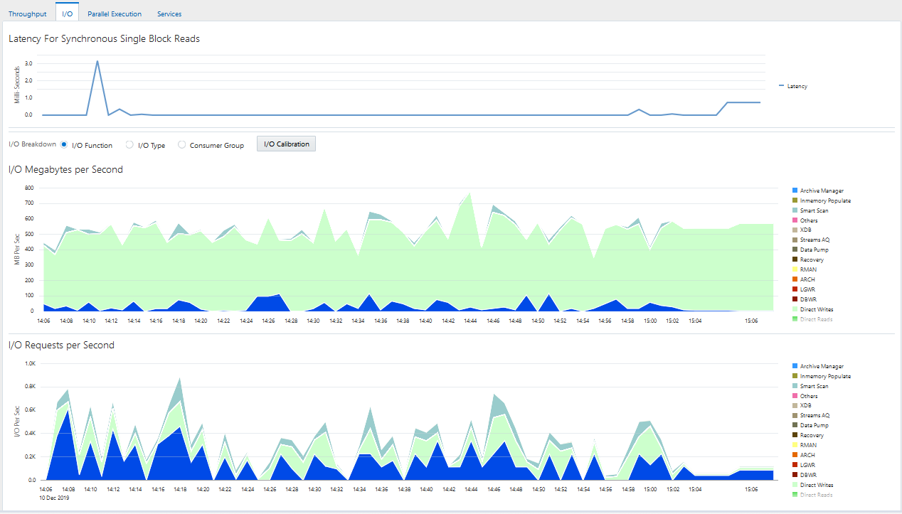

> The I/O charts are shown.
>
> The top section is Latency for Synchronous Single Block Reads.
>
> A line chart is displayed. The y-axis units are milliseconds. The values range from 0 to 10. The x-axis units are hours of the day, shown in 3-hour intervals. The x-axis values range from 5:00 a.m. to 2:00 a.m. The chart tracks Latency information. The chart shows little activity, with a spike of about 2 at 2:00.
>
> The I/O breakdown options are: I/O Function (shown selected), I/O Type, and Consumer Group.
>
> A line chart labeled I/O Megabytes per Second by I/O Function is shown. The y-axis units are megabytes per second. The y-axis values range from 0 to 50. The legend for the types of information that can appear in the chart contains the following: Archive Manager, Others, XDB, Streams AQ, Data Pump, Recovery, RMAN, ARCH, LGWR, DBWR, Direct Writes, Direct Reads, Buffer Cache Reads. The chart shows activity in Others, LGWR, and DBWR, with a spike in Others at 2:00 and in LGWR at 4:00.
>
> A line chart labeled I/O Requests per Second by I/O Function is shown. The y-axis units are I/O per second. The y-axis values range from 0 to 1200. The legend for the types of information that can appear in the chart contains the following: Archive Manager, Others, XDB, Streams AQ, Data Pump, Recovery, RMAN, ARCH, LGWR, DBWR, Direct Writes, Direct Reads, Buffer Cache Reads. The chart shows activity in LGWR and DBWR, with the biggest spike in LGWR at 4:00.
>
> End of description.

The Latency for Synchronous Single Block Reads chart shows the total perceived I/O latency for a block read, which is the time difference between when an I/O request is submitted and when the first byte of the transfer arrives. Most systems are performing satisfactorily if latency is fewer than 10 milliseconds. This type of I/O request is the best indicator of I/O performance for the following reasons:

- Write operations may exhibit good performance because of write caches in storage.
- Because multiblock I/O requests have varying sizes, they can take different amounts of time.
- The latency of asynchronous I/O requests does not represent the full I/O wait time.

The other charts shown depend on your selection for I/O Breakdown, as described in the following sections:

- Monitoring I/O by Function
- Monitoring I/O by Type
- Monitoring I/O by Consumer Group

##### Monitoring I/O by Function

The I/O Function charts determine I/O usage level by application or job. The component-level statistics give a detailed view of the I/O bandwidth usage, which you can then use in scheduling jobs and I/O provisioning. The component-level statistics fall in the following categories:

- Background type
	This category includes ARCH, LGWR, and DBWR.
- Activity
	This category includes XDB, Advanced Queuing (AQ), Data Pump, Recovery, and RMAN.
- I/O type
	The category includes the following:
	- Direct Writes
		This write is made by a foreground process and is not from the buffer cache.
		- Direct Reads
		This read is physical I/O from a data file that bypasses the buffer cache and reads the data block directly into process-private memory.
		- Buffer Cache Reads
- Others
	This category includes I/Os such as control file I/Os.

To monitor I/O by function:

1. Access the Performance page, as explained in " Monitoring User Activity ".
2. In the instance activity chart, click I/O.
	The Latency for Synchronous Single Block Reads, I/O Megabytes per Second, and I/O Requests per Second charts appear.
3. For I/O Breakdown, select I/O Function.
	The I/O Megabytes per Second by I/O Function and I/O Requests per Second by I/O Function charts appear.
	The example in Figure 4-4 shows that a significant amount of I/O is being performed by the log writer. The log writer activity peaked at approximately 600 I/O requests per second.
4. Click the largest colored area on the chart or the corresponding function in the legend to drill down to the function with the highest I/O rate.
	An I/O Throughput by I/O Function page appears with details about the selected category.
	You can view real-time or historical data for details on I/O megabytes or I/O requests.

See Also:

- [Oracle Database Concepts](https://docs.oracle.com/pls/topic/lookup?ctx=en/database/oracle/oracle-database/21/tdppt&id=CNCPT1249) to learn about database background processes such as ARCH, LGWR, and DBWR

##### Monitoring I/O by Type

The I/O Type charts enable you to monitor I/O by the types of read and write operations. Small I/Os are requests smaller than 128 KB and are typically single database block I/O operations. Large I/Os are requests greater than or equal to 128 KB. Large I/Os are generated by database operations such as table/index scans, direct data loads, backups, restores, and archiving.

Figure 4-5 Performance Monitoring I/O by Type

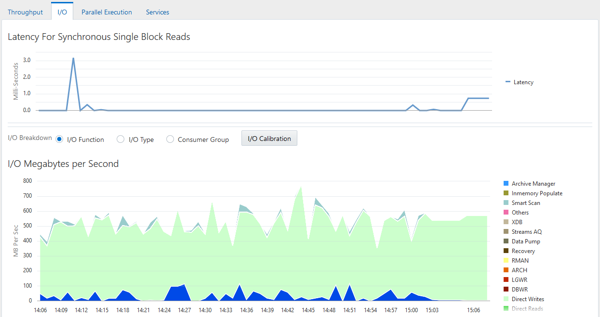

> The I/O breakdown options are: I/O Function, I/O Type (selected), and Consumer Group.
>
> A line chart labeled I/O Megabytes per Second by I/O Type is shown. The y-axis units are MB per second. The y-axis values range from 0 to 50. The following types of information are tracked in the chart: Large Writes, Small Writes, Large Reads, and Small Reads. The chart shows large and small writes activity from 1:00 to 4:30 a.m., with the largest spikes at 2:00 and 4:00 a.m.
>
> A line chart labeled I/O Requests per Second by I/O Type is shown. The y-axis units are I/O per second. The y-axis values range from 0 to 600. The following types of information are tracked in the chart: Large Writes, Small Writes, Large Reads, and Small Reads. The chart shows small writes activity from 1:00 to 4:30 a.m. with the largest spike in activity at 4:00.
>
> End of description.

When optimizing for short transaction times, such as in an OLTP environment, monitor latency for small I/Os. High latencies typically indicate that the storage system is a bottleneck.

When optimizing for large queries, such as in a data warehouse, performance depends on the maximum throughput the storage system can achieve rather than the latency of the I/O requests. In this case, monitor the I/O megabytes per second rather than the synchronous single-block I/O latencies.

To monitor I/O by type:

1. Access the Database Home page.
	See " [Accessing the Database Home Page](introduction.md) " for more information.
2. From the Performance menu, select Performance Home.
	If the Database Login page appears, then log in as a user with administrator privileges. The Performance page appears.
3. In the instance activity area, click I/O tab.
	The I/O Megabytes per Second and I/O Requests per Second graphs appear.
4. For I/O Breakdown, select I/O Type.
	The I/O Megabytes per Second by I/O Type and I/O Requests per Second by I/O Type charts appear.
5. Click the largest colored area on the chart or the corresponding function in the legend to drill down to the function with the highest I/O rate.
	The I/O Details page appears.
	You can view real-time or historical data for details on I/O megabytes or I/O requests.

##### Monitoring I/O by Consumer Group

When Oracle Database Resource Manager is enabled, the database collects I/O statistics for all consumer groups that are part of the currently enabled resource plan. The Consumer Group charts enable you to monitor I/O by consumer group.

A resource plan specifies how the resources are to be distributed among various users (resource consumer groups). Resource consumer groups enable you to organize user sessions by resource requirements. Note that the `_ORACLE_BACKGROUND_GROUP_` consumer group contains I/O requests issued by background processes.

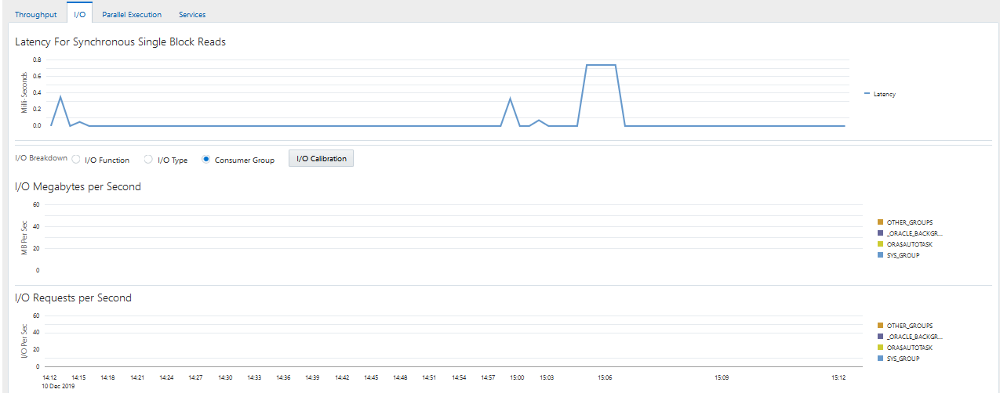

> The Consumer Group tab is shown.
>
> Two line charts are shown.
>
> In the first chart, the y-axis units are MB per second. The y-axis values range from 0 to 50. The x-axis units are hours of day, shown in hour intervals. The values range from 1:30 p.m. to 2:00 a.m. The following consumer groups are shown: ORA$AUTOTASK\_SQL\_GROUP, SYS GROUP, ORA$DIAGNOSTICS, ORA$AUTOTASK\_URGENT\_GROUP, ORA$AUTOTASK\_HEALTH\_GROUP, \_ORACLE\_BACKGROUND\_GROUP, OTHER\_GROUPS, ORA$AUTOTASK\_MEDIUM\_GROUP, ORA$AUTOTASK\_STATS\_GROUP, ORA$AUTOTASK\_SPACE\_GROUP. The \_ORACLE\_BACKGROUND\_GROUP goes from 0 to 5 from 1:30 to 1:45 p.m, stays at 5 until 4:00 p.m. when it spikes at 28. It then falls evenly to 0 at 10:00 p.m.
>
> In the second chart, the y-axis units are I/O per second. The y-axis values range from 0 to 2200. The x-axis units are hours of day, shown in hour intervals. The values range from 1:30 p.m. to 2:00 a.m. The following consumer groups are shown: ORA$AUTOTASK\_SQL\_GROUP, SYS GROUP, ORA$DIAGNOSTICS, ORA$AUTOTASK\_URGENT\_GROUP, ORA$AUTOTASK\_HEALTH\_GROUP, \_ORACLE\_BACKGROUND\_GROUP, OTHER\_GROUPS, ORA$AUTOTASK\_MEDIUM\_GROUP, ORA$AUTOTASK\_STATS\_GROUP, ORA$AUTOTASK\_SPACE\_GROUP. The \_ORACLE\_BACKGROUND\_GROUP goes from 0 to 300 from 1:30 to 1:45 p.m, stays at 5 until 4:00 p.m. when it spikes at 2000. It then falls evenly to 0 at 10:00 p.m.
>
> End of description.

To monitor I/O requests by consumer group:

1. Access the Database Home page.
	See " [Accessing the Database Home Page](introduction.md) " for more information.
2. From the Performance menu, select Performance Home.
	If the Database Login page appears, then log in as a user with administrator privileges. The Performance page appears.
3. In the instance activity area, click I/O tab.
	The I/O Megabytes per Second and I/O Requests per Second graphs appear.
4. For I/O Breakdown, select Consumer Group.
	The I/O Megabytes per Second by Consumer Group and I/O Requests per Second by Consumer Group graphs appear.

#### Monitoring Parallel Execution

The Parallel Execution charts show system metrics related to parallel queries. Metrics are statistical counts per unit. The unit could be a time measure, such as seconds, or per transaction, or session.

A parallel query divides the work of executing a SQL statement across multiple processes. The charts show parallel queries that were waiting for a particular wait event that accounted for the highest percentages of sampled session activity.

Figure 4-6 Monitoring Parallel Execution

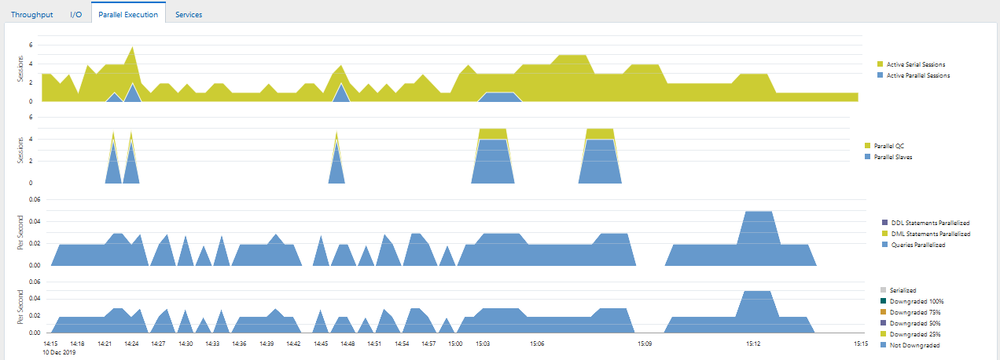

> The Parallel Execution tab is shown.
>
> Four line charts are shown.
>
> In the first chart, the y-axis units are sessions. The y-axis values range from 0 to 4. The x-axis units are hours of day, shown in 3-hour intervals. The values range from 5:00 a.m. to 2:00 a.m. The following types of information are tracked in the chart: Active Serial Sessions and Active Parallel Sessions. The chart shows that serial sessions remained at around 1 until 1:00 p.m when they spiked at 3.75. They dropped to 2 at 1:30 and then rose to 4 at 2:00 p.m. They then fell gradually back to 1 by 4:30 p.m. Parallel session activity began at 12:30 p.m., spiked at 1 at 1:00 p.m., and fell back to 0 by 1:30 p.m. Parallel session activity rose gradually to 1.5 beginning at 1:30 p.m and fell back to 0 by 4:00 p.m.
>
> In the second chart, the y-axis units are sessions. The y-axis values range from 0 to 20. The x-axis units are hours of day, shown in 3-hour intervals. The values range from 5:00 a.m. to 2:00 a.m. The following types of information are tracked in the chart: Parallel QC and Parallel Slaves. Parallel slave activity began at 12:30 p.m., spiked at 1 at 1:00 p.m., and fell back to 0 by 1:30 p.m. Parallel slave activity then rose to 4 by 2:00 p.m., stayed at 4 until 3:30 p.m., and then fell back to 0 by 4:00 p.m. There is minor Parallel QC activity from 2:00 p.m. to 4:00 p.m.
>
> In the third chart, the y-axis units are queries per second. The y-axis values range from 0 to 3. The x-axis units are hours of day, shown in 3-hour intervals. The values range from 5:00 a.m. to 2:00 a.m. The following types of information are tracked in the chart: DDL Statements Parallelized, DML Statements Parallelized, and Queries Parallelized. The parallel queries activity spiked at 1.2 per second at 1:00 p.m. and again at 3 per second at 2:30 p.m.
>
> In the fourth chart, the y-axis units are queries per second. The y-axis values range from 0 to 3. The x-axis units are hours of day, shown in 3-hour intervals. The values range from 5:00 a.m. to 2:00 a.m. The following types of information are tracked in the chart: Serialized, Downgraded 100%, Downgraded 75%, Downgraded 50%, Downgraded 25%, and Not Downgraded. The Downgraded 50% activity spiked at 1.2 per second at 1:00 p.m. and again at 3 per second at 2:30 p.m.
>
> End of description.

To monitor parallel execution:

1. Access the Database Home page.
	See " [Accessing the Database Home Page](introduction.md) " for more information.
2. From the Performance menu, select Performance Home.
	If the Database Login page appears, then log in as a user with administrator privileges. The Performance page appears.
3. In the instance activity chart, click Parallel Execution tab.
	The Parallel Execution charts appear.
	Two pairs of charts are shown. The first pair shows the number of sessions on the y-axis, whereas the second pair shows the per second rate on the y-axis.

#### Monitoring Services

Services represent groups of applications with common attributes, service-level thresholds, and priorities. For example, the `SYS$USERS` service is the default service name used when a user session is established without explicitly identifying a service name.

Figure 4-7 Monitoring Services

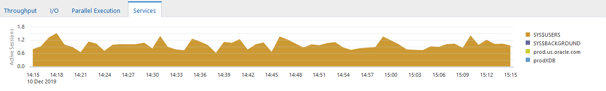

> The Services tab is shown.
>
> One line chart is shown.
>
> In the first chart, the y-axis units are active sessions. The y-axis values range from 0 to 3.2. The x-axis units are hours of day, shown in 3-hour intervals. The values range from 5:00 a.m. to 2:30 a.m. The following types of information are tracked in the chart: SYS$BACKGROUND, SYS$USERS, and emtst. The chart shows that SYS$USERS activity occurred between 12:15 p.m. and 4:40 p.m., with a spike of 2.4 sessions at about 1:00 p.m. and a spike of 3.2 sessions at 2:00 p.m.
>
> End of description.

To monitor services:

1. Access the Database Home page.
	See " [Accessing the Database Home Page](introduction.md) " for more information.
2. From the Performance menu, select Performance Home.
	If the Database Login page appears, then log in as a user with administrator privileges. The Performance page appears.
3. In the instance activity chart, click Services.
	The Services chart appears. The Services chart shows services waiting for the corresponding wait event during the time period shown. Only active services are shown.
	In Figure 4-7, the `SYS$USERS` service has the greatest number of active sessions.
4. Click the largest colored area on the chart or the corresponding service in the legend to drill down to the service with the highest number of active sessions.
	The Service page appears, showing the Activity subpage.
	You can view real-time data showing the session load for all wait classes associated with the service.

### Monitoring Host Activity

The Host chart on the Performance page displays utilization information about the system hosting the database.

To determine if the host system has enough resources available to run the database, establish appropriate expectations for the amount of CPU, memory, and disk resources that your system should be using. You can then verify that the database is not consuming too many of these resources.

To view details about CPU, memory, and disk utilization:

1. From the Targets menu, select Hosts.
	The Hosts page appears.
2. In the list of hosts, click the name of the host on which your database resides.
	The hostname page appears, where hostname is the name of the host.
3. Determine whether sufficient resources are available and whether your system is using too many resources.
	For example, determine the amount of CPU, memory, and disk resources the database uses in the following scenarios:
	- When your system is idle, or when little database and nondatabase activity exists
		- At average workloads
		- At peak workloads
	Workload is an important factor when evaluating the level of resource utilization for your system. During peak workload hours, 90 percent utilization of a resource, such as a CPU with 10 percent idle and waiting time, can be acceptable. However, if your system shows high utilization at normal workload, then there is no room for additional workload.
	Perform the following tasks to monitor the host activity for your database:
	- Monitoring CPU Utilization
		- Monitoring Memory Utilization
		- Monitoring Disk I/O Utilization
4. Set the appropriate threshold values for the performance metrics so the system can automatically generate alerts when these thresholds are exceeded.
	For information about setting metric thresholds, see " [Setting Metric Thresholds for Performance Alerts](monitoring-performance-alerts.md) ".

#### Monitoring CPU Utilization

To address CPU problems, first establish appropriate expectations for the amount of CPU resources your system should be using. You can then determine whether sufficient CPU resources are available and recognize when your system is consuming too many resources. This section describes how to monitor CPU utilization.

To monitor CPU utilization:

1. Access the hostname page as explained in " Monitoring Host Activity ".
2. From the Host drop-down menu, select Monitoring, and then CPU Details.
	The CPU Details page appears.
	This page contains statistics about CPU utilization, I/O wait times, and load gathered over the last hour. The top 10 processes are listed based on CPU utilization.
3. Verify the current CPU utilization using the CPU Utilization chart.
	The CPU Utilization chart shows CPU utilization over the last hour and a half. The current value is displayed below the chart. During standard workload hours, the value should not exceed the critical threshold.
4. Under the graph for CPU Utilization, click the link CPU Utilization.
	This page contains CPU utilization statistics and related alerts generated over the last 24 hours.
	If you notice an unexpected spike in this value that is sustained through normal workload hours, then the CPU performance problem should be investigated.
5. Return to the CPU Details page. From the Host menu, select Monitoring, and then CPU Details.
6. Verify the current CPU I/O wait time using the CPU I/O Wait chart.
	The CPU I/O Wait chart shows CPU I/O wait time over the last hour and a half. The current value is displayed below the chart. During normal workload hours, the value of CPU I/O wait should not exceed the warning threshold.
	CPU I/O wait represents the average number of jobs waiting for I/O during an interval.
7. Under the graph for CPU I/O Wait, click the link CPU I/O Wait.
	The CPU in I/O Wait page appears.
	This page contains CPU I/O wait statistics and related alerts generated over the last 24 hours.
	If you notice an unexpected increase in this value that is sustained through standard workload hours, then a CPU performance problem may exist.
8. Return to the CPU Details page. From the Host menu, select Monitoring, and then CPU Details.
9. Verify the current CPU load using the CPU Load chart.
	The CPU Load chart shows the CPU load over the last hour and a half. The current value is displayed below the chart. During standard workload hours, the value of CPU load should not exceed the warning threshold.
	CPU load represents the average number of processes waiting to be scheduled for CPU resources in the previous minute, or the level of CPU contention time over time.
10. Under the graph for CPU Load, click the link CPU Load.
	The Run Queue Length (5 minute average) page appears.
	This page contains CPU load statistics and related alerts generated over the last 24 hours.
	If you notice an unexpected spike in this value that is sustained through normal workload hours, then a CPU performance problem might exist.
11. Return to the CPU Details page. From the Host menu, select Monitoring, and then CPU Details.
12. Review the Top 10 Processes (ordered by CPU) table.
	If a process is consuming too much of the CPU utilization percentage, then investigate that process.
13. If a CPU performance problem is identified, then you can try to resolve the issue by doing the following:
	- Use Oracle Database Resource Manager to reduce the impact of peak-load-use patterns by prioritizing CPU resource allocation
		- Avoid running too many processes that use a large amount of CPU
		- Increase hardware capacity, including changing the system architecture

See Also:

- [Oracle Database Performance Tuning Guide](https://docs.oracle.com/pls/topic/lookup?ctx=en/database/oracle/oracle-database/21/tdppt&id=TGDBA95150) for information about resolving CPU issues
- [Oracle Database Administrator's Guide](https://docs.oracle.com/pls/topic/lookup?ctx=en/database/oracle/oracle-database/21/tdppt&id=ADMIN027) for information about Oracle Database Resource Manager

#### Monitoring Memory Utilization

Operating system performance issues commonly involve process management, memory management, and scheduling. This section describes how to monitor memory utilization and identify problems such as paging and swapping.

To monitor memory utilization:

1. Access the hostname page as explained in " Monitoring Host Activity ".
2. From the Host drop-down menu, select Monitoring, and then Memory Details.
	The Memory Details page appears.
	This page contains statistics about memory utilization, page scan rates, and swap utilization gathered over the last hour. The top 10 processes are also listed ordered by memory utilization. Figure 4-8 shows a portion of the Memory Details page. The Top 10 Processes (ordered by Memory) section is not shown.
	Figure 4-8 Memory Details Page
	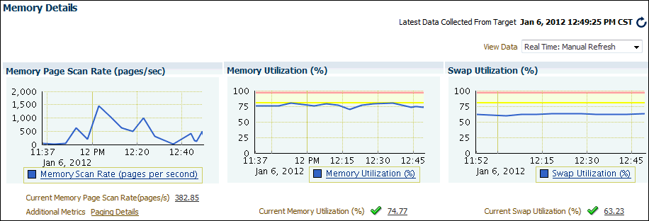

> The Memory Details page is shown.
>
> This page contains four sections: Memory Page Scan Rate (pages/sec), Memory Utilization (%), Swap Utilization (%), and Top 10 Processes (ordered by Memory). The Top 10 Processes are not shown in the screenshot.
>
> The Memory Page Scan Rate chart has pages per second on the y-axis, with gradations of 500 from 0 to 2,000. The x-axis units are hours of day, shown in 20-minute intervals. The values range shown from 11:37 a.m. January 6, 2012 to 12:40 p.m. January 6. The scan rate stays at 0 from 11:37 to about 11:50 when it goes to about 600. It drops to 250 by 11:55 then climbs to 1500 by about 12:03. It drops to 500 at 12:18, climbs to 1000 by 12:23, then drops back to 0 at 12:37. It rises to 480 at 12:44, drops to 100 at 12:47 at rises to 500 by 12:50. Below the graph is a link to the Memory Page Scan Rate (per second) page. Below that are two label-value pairs. The labels and values are Current Memory Page Scan Rate (pages/s), 382.85, and Additional Metrics, Paging Details. The Paging Details value is a link.
>
> The Memory Utilization chart has percentages as the units of the y-axis with gradations of 25. The x-axis units are hours of day, shown in 20-minute intervals. The values shown range from 11:37 a.m. January 6, 2012 to 12:45 p.m. January 6. The memory utilization is 75% most of the time with rises to about 78% at 12:53 and 12:08 and steadily at about 78% from about 12:25 to 12:35. Below the graph is a link to the Memory Utilization (%) page. Below that is a label-value pair. The label is "Current Memory Utilization (%)" and a green check mark icon. The value is 74.77.
>
> The Swap Utilization chart has percentages as the units of the y-axis with gradations of 25. The x-axis units are hours of day, shown in 20-minute intervals. The values shown range from 11:52 a.m. January 6, 2012 to 12:45 p.m. January 6. The swap utilization is about 62% with little variation over time. Below the graph is a link to the Swap Utilization (%) page. Below that is a label-value pair. The label is "Current Swap Utilization (%)" and a green check mark icon. The value is 63.23.
>
> End of description.

3. Verify the current memory page scan rate using the Memory Page Scan Rate chart.
	The current value of the memory page scan rate is displayed below the chart. On UNIX and Linux, this value represents the number of pages scanned per second. On Microsoft Windows, this value represents the rate at which pages are read from or written to disk to resolve hard page faults. This value is a primary indicator of the types of faults that may be causing system-wide delays.
4. Click Memory Scan Rate (pages per second).
	The Memory Page Scan Rate page appears.
	This page contains memory page scan rate statistics and related alerts over the last 24 hours.
	If you notice an unexpected increase in this value that is sustained through standard workload hours, then a memory performance problem might exist.
5. Return to the Memory Details page. From the Host drop-down menu, select Monitoring, and then Memory Details.
6. Using the Memory Utilization chart, verify the current memory utilization.
	The Memory Utilization chart shows how much memory is being used. The current value of memory utilization is displayed below the chart. During standard workload hours, the value should not exceed the warning threshold (shown in yellow).
7. Click Memory Utilization (%).
	The Memory Utilization page appears.
	This page contains memory utilization statistics and related alerts generated over the last 24 hours.
	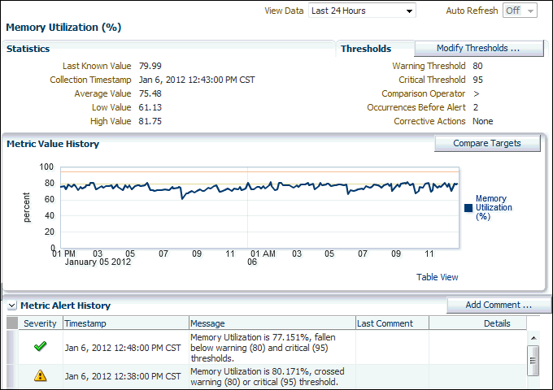

> The Memory Utilization (%) page is shown.
>
> At the upper right of the page, the View Data list shows Last 24 hours and the Auto Refresh list shows Off.
>
> The Statistics section contains five label-value pairs. The labels and values are the following.
>
> Last Known Value: 79.99
>
> Collection Timestamp: Jan 6, 2012 12:43:00 PM CST
>
> Average Value: 75.48
>
> Low Value: 61.13
>
> High Value 81.75
>
> The Thresholds section contains the Modify Thresholds button and five label-value pairs. The labels and values are the following.
>
> Warning Threshold 80
>
> Critical Threshold: 95
>
> Comparison Operator: >
>
> Occurrences Before Alert: 2
>
> Corrective Action: None
>
> The Metric Value History section contains the Compare Targets button and a line chart. The y-axis units are percentages. The x-axis units are hours of day, shown in 2-hour intervals. The values are a 24 hour range from 1:00 p.m. January 5, 2012 to 1:00 p.m. January 6. A yellow line at 80% indicates the warning threshold. An orange line at 95 indicates the critical threshold. The chart shows memory utilization fluctuating between 60 and 82 per cent with most activity between 75 and 80 per cent.
>
> The Metric Alert History section contains the Add Comment button and a table
>
> The table contains the following columns: Severity, Timestamp, Message, Last Comment, and Details. The table contains two rows. The row values are the following:
>
> Row 1: (check mark icon), Jan 6, 2012 12:48:00 PM CST, Memory Utilization is 77.151%, fallen below warning (80) and critical (95) thresholds, null, and null.
>
> Row 2: (exclamation point icon), Jan 6, 2012 12:38:00 PM CST, Memory Utilization is 80.171%, crossed warning (80) or critical (95) threshold, null, and null.
>
> End of description.

	In this example, memory utilization has exceeded 80%, so warnings appear in the Metric Alert History table.
	If you notice an unexpected spike in this value that is sustained through normal workload hours, then a memory performance problem might exist.
8. Return to the Memory Details page. From the Host drop-down menu, select Monitoring, and then Memory Details.
9. Using the Swap Utilization chart, verify current swap utilization.
	The Swap Utilization chart shows how much swap space is being used. The current value of swap utilization is displayed below the chart. During normal workload hours, the value should not exceed the warning threshold.
10. Click Swap Utilization (%).
	The Swap Utilization page appears.
	This page contains swap utilization statistics and related alerts generated over the last 24 hours.
	If you notice an unexpected spike in this value that is sustained through normal workload hours, then a memory performance problem might exist.
11. Return to the Memory Details page. From the Host drop-down menu, select Monitoring, and then Memory Details.
12. Review the top processes in the Top 10 Processes (ordered by Memory) table.
	If a process is taking up too much memory, then this process should be investigated.
13. If a memory performance problem is identified, then you can attempt to resolve the issue by doing the following:
	- Use Automatic Memory Management to automatically manage and distribute memory between the System Global Area (SGA) and the aggregate program global area (PGA aggregate).
		- Use the Memory Advisor to set SGA and PGA memory target values.
		- Use Automatic PGA Management to manage SQL memory execution.
		- Avoid running too many processes that consume large amounts of memory.
		- Reduce paging or swapping.
		- Reduce the number of open cursors and hard parsing with cursor sharing.

See Also:

- [Oracle Database Administrator's Guide](https://docs.oracle.com/pls/topic/lookup?ctx=en/database/oracle/oracle-database/21/tdppt&id=ADMIN11011) for information about using Automatic Memory Management
- [Oracle Database Performance Tuning Guide](https://docs.oracle.com/pls/topic/lookup?ctx=en/database/oracle/oracle-database/21/tdppt&id=TGDBA291) for information about resolving memory issues

#### Monitoring Disk I/O Utilization

Because the database resides on a set of disks, the performance of the I/O subsystem is very important to database performance. Important disk statistics include the disk I/Os per second and the length of the service times. These statistics show if the disk is performing optimally or if the storage system is being overworked. This section describes how to monitor disk I/O utilization.

To monitor disk I/O utilization:

1. Access the hostname page as explained in " Monitoring Host Activity ".
2. From the Host drop-down menu, select Monitoring, and then Disk Details.
	The Disk Details page appears.
	This page contains disk I/O utilization and service time statistics, and the top disk devices ordered by the percentage of time that they were in use.
	Figure 4-9 Disk Details
	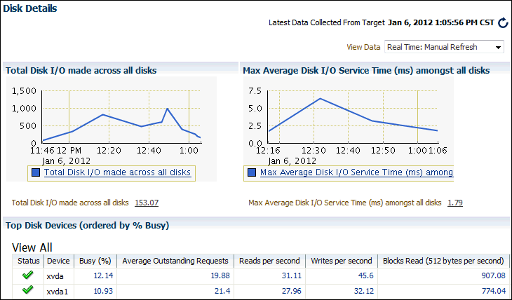

> The Disk Details page is shown.
>
> On the top right of the screenshot is a label-value pair. The label is Latest Data Collected From Target and the value is Jan 6, 2012 1:05:56 p.m. CST. Next to the value is a refresh button.
>
> Below the label-value pair is the View Data list, with Real Time: Manual Refresh showing.
>
> This page contains three sections: Total Disk I/O Made Across All Disks, Max Average Disk I/O Service Time (ms) Among All Disks, and Top Disk Devices (ordered by % Busy).
>
> The Total Disk I/O Made Across All Disks chart ranges from 0 to 1500 on the y-axis and 11:46 AM to 1:00 p.m. on the x-axis. The chart measure Total I/Os per second across all disks. The chart shows a jagged line ranging from about 100 at 11:46 up to 800 at about 12:17, to a peak at 1000 at 12:50, and then down to 200 at 1:10. Below the x-axis is the date Jan 6, 2012. Below the date is a link: Total Disk I/O made across all disks. Below the chart is a label-value pair. The label is Total I/O made across all disks per second and the value is 153.07.
>
> The Max Average Disk I/O Service Time (ms) Among All Disks chart ranges from 0 to 7.5 on the y-axis and from 12:16 to 1:06 on the x-axis. The chart measures the maximum average disk I/O service time in milliseconds among all disks. The chart shows a jagged line ranging from 2 at 12:16 up to around 6 at 12:35, and then down to 2 at 1:06. Below the x-axis is the date Jan 6, 2012. Below the date is a link: Max Average Disk I/O Service Time (ms) among. Below the chart is a label-value pair. The label is Max Average Disk I/O Service Time (ms) among all disks and the value is 1.79.
>
> The Top Disk Devices (ordered by % Busy) section includes a table. The columns of the table are: Status, Device, Busy (%), Average Outstanding Requests, Reads per second, Writes per second, Blocks Read (512 bytes per second). Other columns not visible in this screenshot of the page are: Blocks Written (512 bytes per second, Average Wait Time (ms), Average Service Time (ms).
>
> Two rows are visible in the table. The values in the columns are the following:
>
> Row 1: (check mark icon), xvda, 12.14, 19.88, 31.11, 45.6, 907.08.
>
> Row 2: (check mark icon), xvda1, 10.93, 21.4, 27.96, 32.12, 774.04.
>
> End of description.

3. Verify the current disk I/O utilization using the Total Disk I/O Made Across All Disks chart.
	The Total Disk I/O Made Across All Disks chart shows how many disk I/Os are being performed per second. The current value for total disk I/O per second is displayed below the chart. In Figure 4-9 the value is 153.07.
4. Click Total Disk I/O made across all disks (per second).
	The Total Disk I/O Made Across All Disks (Per Second) page appears.
	This page contains disk utilization statistics and related alerts generated over the last 24 hours.
	If you notice an unexpected spike in this value that is sustained through standard workload hours, then a disk I/O performance problem might exist and should be investigated.
5. Verify the current I/O service time using the Max Average Disk I/O Service Time (ms) Among All Disks chart.
	The Max Average Disk I/O Service Time (ms) Among All Disks chart shows the longest service time for disk I/Os in milliseconds. The current value for longest I/O service time is displayed below the chart. In Figure 4-9 the value is 1.79.
6. Return to the Disk Details page. From the Host drop-down menu, select Monitoring, and then Disk Details.
7. Click Max Average Disk I/O (ms) Service Time Among All Disks.
	This page contains I/O service time statistics and related alerts generated over the last 24 hours.
	If you notice an unexpected spike in this value that is sustained through normal workload hours, then a disk I/O performance problem might exist and should be investigated.
8. Return to the Disk Details page. From the Host drop-down menu, select Monitoring, and then Disk Details.
9. On the Disk Details page, verify the disk devices in the Top Disk Devices (ordered by % Busy) table.
	If a particular disk is busy a high percentage of the time, then this disk should be investigated.
10. If a disk I/O performance problem is identified, you can attempt to resolve the problem by doing the following:
	- Use Oracle Automatic Storage Management (Oracle ASM) to manage database storage.
		- Stripe everything across every disk to distribute I/O.
		- Move files such as archived redo logs and online redo logs to separate disks.
		- Store required data in memory to reduce the number of physical I/Os.

See Also:

- [Oracle Database Performance Tuning Guide](https://docs.oracle.com/pls/topic/lookup?ctx=en/database/oracle/oracle-database/21/tdppt&id=TGDBA015) for information about resolving disk I/O issues

### Determining the Cause of Spikes in Database Activity

If you see a spike in database activity in the Performance page, then you can access the ASH Analytics page to find out which sessions are consuming the most database time. This page provides stacked area charts to help you visualize the active session activity from various dimensions, such as Wait Class, Module, Actions, SQL ID, Instance, User Session, Consumer Group, and others. You can drill down into specific members of a dimension (vertical zooming), and zoom in and out of any time period (horizontal zooming).

To view active session activity on the ASH Analytics page:

1. Access the Database Home page.
	See " [Accessing the Database Home Page](introduction.md) " for more information.
2. From the Performance menu, select Performance Hub and then ASH Analytics.
	If the Database Login page appears, then log in as a user with administrator privileges. The ASH Analytics page appears.
	Figure 4-10 shows an example of the ASH Analytics page.
	Figure 4-10 ASH Analytics Page
	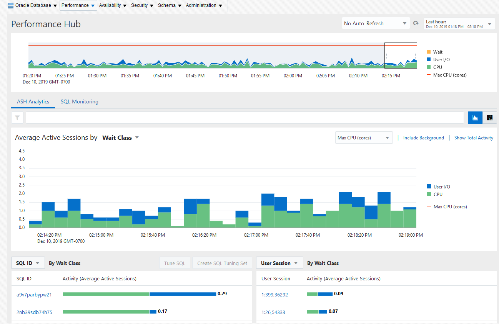

> The ASH Analytics page is shown.
>
> At the top of the page are the following elements:
>
> - Save icon
> - Page Refreshed field showing the time at which the page was last refreshed
> - Auto Refresh list with 15 seconds selected
>
> Below those elements is a stacked area chart that shows the average active sessions in a specified time period. The units of the y-axis of the chart are average active sessions, which range from 0 to 1.2. The units of the x-axis are times of the day, shown in 5-minute intervals. The marked times range from 12:55 p.m. to 1:50 p.m. A shaded slider area covers the time from about 1:31to 1:37.
>
> Above the chart are the following options: Hour (selected), Day, Week, Month, Calendar, Custom.
>
> Below the chart is the Filters list with the value None.
>
> Below that are the Activity and Load Map tabs. The Activity tab is selected.
>
> At the top of the Activity section is a list of activities with Wait Class selected. Next to that list are the Show options: Total Activity and CPU Cores. Both options are selected.
>
> A stacked area chart shows details about the activities for the selected time period.
>
> The units of the x-axis of the chart are times of the day, shown in 30-second intervals. The x-coordinates shown range from 1:30:45 p.m. to 1:35:15 p.m. The units of the y-axis are average active sessions. The y-coordinates shown range from 0 to about 3.4. A line at the 2 mark indicates the number of CPU Cores.
>
> A legend to the right of the chart shows the types of events that could appear in the chart. The types of events are the following: Other, Configuration, Commit, Concurrency, System I/O, User I/O, CPU.
>
> The number of average active sessions is mostly between 1 and 1.2 with a sharp spike up to 3.4 at about 1:33:35. The activity is predominately CPU with some configuration and commit. The spike shows CPU, system I/O, concurrency, commit, configuration, and other activity.
>
> The page has two tables that show more information about the dimension selected for the Activities chart. Above each table is a dimensions list. For the table on the left, SQL ID is selected so the table shows SQL ID activity by wait class. For the table on the right, User Session is selected so the table shows User Session activity by wait class.
>
> The columns of the table on the left are Select, SQL ID, and Activity (Average Active Sessions). The values in the Select column rows are check boxes, and in the Activity (Average Active Sessions) column rows the values are horizontal bar charts and associated numbers. The bar chart shows the type and relative amount of activity. Two rows are visible in the table. The values of the rows are the following.
>
> Row 1: Not selected, 5a457c2y2wwm3, the bar chart shows about 80% CPU and about 20% configuration activity and the number is 1.
>
> Row 2: Not selected, 0s8qqvi1hob34, bar, <.01, the bar chart shows about 60% CPU and about 40% configuration activity.
>
> The columns of the table on the right are User Session and Activity (Average Active Sessions). The values in the Activity (Average Active Sessions) column rows are horizontal bar charts and associated numbers. Two rows are visible in the table. The values of the rows are the following.
>
> Row 1: 1:12,4923, the bar chart shows about 80% CPU and about 20% configuration activity and the number is 1.
>
> Row 2: 1:88.1, the bar chart shows about 100% CPU activity and the number is.03.
>
> End of description.

3. To view a high-level perspective of top activity during a selected time period, drag the entire shaded slider area in the top chart to the desired time period.
	Tip:
	You can change the amount of time selected in the shaded slider area by selecting the control at either edge of the slider and dragging it to the left or right.
	You can select a time period within the default setting of one hour or you can use the selector buttons above the chart to display time periods of one day, one week, or one month. You can also use the Calendar and Custom buttons to display a time period other than one of the preset choices.
4. To view a more detailed perspective of your selected time period, use the Activity chart on the page. By default, the chart shows a breakdown of workload activity by wait classes.
5. Investigate the impact by viewing detailed statistics for the top activity sessions that are adversely affecting the system.
	To view detailed statistics for a session:
	1. Select the largest spike in the chart or the corresponding wait class in the legend beside the chart. The viewer now filters out everything in the chart except for the wait class of interest.
		For example, if the chart shows that the Concurrency wait class has the biggest spike, select the chart area of the legend for Concurrency. The viewer refreshes the chart and now only shows the Concurrency value and displays a Wait Class: Concurrency icon in the Filters bar.
		Tip:
		You can create an unlimited number of filters.
		2. In the Activity section, select Top Dimensions from the dimensions list. The chart refreshes in response to your selection, displaying values for the particular category you selected.
		For instance, if you create a filter for Concurrency as described above, then select Top Dimensions from the list, and then select User Session, the chart shows user sessions only for Concurrency.
		Figure 4-11 shows the list of activities with Top Dimensions selected.
		Figure 4-11 List of Activities
		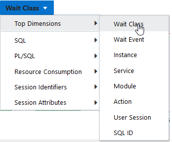

> The dimensions list in the Activities section is shown. The current selection is Wait Class.
>
> The items in the dimensions list are the following: Top Dimensions, SQL, PL/SQL, Resource Consumption, Session Identifiers, Session Attributes.
>
> The cursor is pointing to Top Dimensions. The items in the Top Dimensions list are Wait Class, Wait Event, Instance, Service, Module, Action, User Session, SQL ID.
>
> End of description.

6. Optionally, use the Load Map for a graphical view of system activity.
	The Load Map is useful for viewing activity in a single- or multi-dimensional layout when you are not interested in seeing how activity has changed over time during the selected period.
	Figure 4-12 shows the load map for activity by wait class and wait events.
	Figure 4-12 Load Map on the ASH Analytics Page
	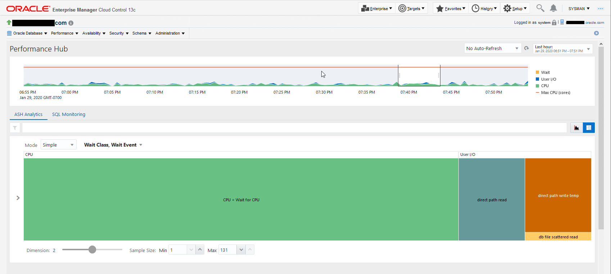

> The ASH Analytics page is shown.
>
> At the top of the page are the following elements:
>
> - Save icon
> - Page Refreshed field showing the time at which the page was last refreshed
> - Auto Refresh list with 15 seconds selected
>
> Below those elements is a stacked area chart that shows the average active sessions in a specified time period. The units of the y-axis of the chart are average active sessions, which range from 0 to 1.2. The units of the x-axis are times of the day, shown in 5-minute intervals. The marked times range from 1:55 p.m. to 2:45 p.m. A shaded slider area covers the time from about 2:02 to 2:07.
>
> Above the chart are the following options: Hour (selected), Day, Week, Month, Calendar, Custom.
>
> Below the chart is the Filters list with the value None.
>
> Below that are the Activity and Load Map tabs. The Load Map tab is selected.
>
> In the Mode field, Simple is selected. In the field of dimensions, Wait Class, Wait Event is selected.
>
> Below those fields is an area that contains rectangular boxes that represent dimensions. Each box has a label that indicates the dimension category. A box may be subdivided into other boxes that the type of activity in that category. The relative area of a box indicates the amount of the average active sessions consumed by the dimension or category. In the middle of each box is a label for the category. The visible boxes, the dimension and category labels, and the percentage of the total area occupied by the box are the following:
>
> - CPU dimension, CPU + Wait for CPU category, 66%
> - Other dimension 22%, null event category 11%, oracle thread bootstrap category 11%
> - System I/O dimension, log file parallel write category 11%
>
> End of description.
