To achieve optimal performance for data-intensive queries, materialized views and indexes are essential for SQL statements. However, implementing these objects does not come without cost. Creation and maintenance of these objects can be time-consuming. Space requirements can be significant. SQL Access Advisor enables you to optimize query access paths by recommending materialized views and view logs, indexes, SQL profiles, and partitions for a specific workload.

A materialized view provides access to table data by storing query results in a separate schema object. Unlike an ordinary view, which does not take up storage space or contain data, a materialized view contains the rows from a query of one or more base tables or views. A materialized view log is a schema object that records changes to a master table's data, so that a materialized view defined on the master table can be refreshed incrementally. SQL Access Advisor recommends how to optimize materialized views so that they can be rapidly refreshed and make use of the query rewrite feature.

SQL Access Advisor also recommends bitmap, function-based, and B-tree indexes. A bitmap index reduces response time for many types of ad hoc queries and can also reduce storage space compared to other indexes. A function-based index computes the value of a function or expression involving one or more columns and stores it in the index. B-tree indexes are commonly used to index unique or near-unique keys.

Using SQL Access Advisor involves the following tasks:

See Also:

- " [Identifying High-Load SQL Statements](identifying-high-load-sql-statements.md) "
- " [Tuning SQL Statements](tuning-sql-statements.md) " for information about SQL Tuning Advisor
- [Oracle Database Concepts](https://docs.oracle.com/pls/topic/lookup?ctx=en/database/oracle/oracle-database/21/tdppt&id=CNCPT411) to learn about materialized views
- [Oracle Database Concepts](https://docs.oracle.com/pls/topic/lookup?ctx=en/database/oracle/oracle-database/21/tdppt&id=CNCPT721) to learn about indexes

### Running SQL Access Advisor

This section describes how to run SQL Access Advisor to make recommendations for a SQL workload.

To run SQL Access Advisor:

1. Select the initial options, as described in " Selecting the Initial Options ".
2. Select the workload source you want to use for the analysis, as described in " Selecting the Workload Source ".
3. Define the filters options, as described in " Applying Filter Options ".
4. Choose the types of recommendations, as described in " Specifying Recommendation Options ".
5. Schedule the SQL Access Advisor task, as described in " Specifying Task and Scheduling Options ".

#### Selecting the Initial Options

The first step in running SQL Access Advisor is to select the initial options on the SQL Access Advisor: Initial Options page.

To select initial options:

1. Access the Database Home page.
	See " [Accessing the Database Home Page](introduction.md) " for more information.
2. From the Performance menu, select Advisors Home.
	If the Database Login page appears, then log in as a user with administrator privileges. The Advisor Central page appears.
3. Click SQL Advisors.
	The SQL Advisors page appears.
4. Click SQL Access Advisor.
	The SQL Access Advisor: Initial Options page appears.
5. Do one of the following:
	- Select Verify use of access structures (indexes, materialized views, partitioning, and so on) only to verify existing structures.
		- Select Recommend new access structures to use the recommended options defined in the Oracle Enterprise Manager Cloud Control (Cloud Control) default template.
		If you select this option, then you can optionally complete the following steps:
		- Select Inherit Options from a previously saved Task or Template to use the options defined in an existing SQL Access Advisor task or another template.
				- In Tasks and Templates, select the task or template that you want to use.
	In this example, Recommend new access structures is selected.
	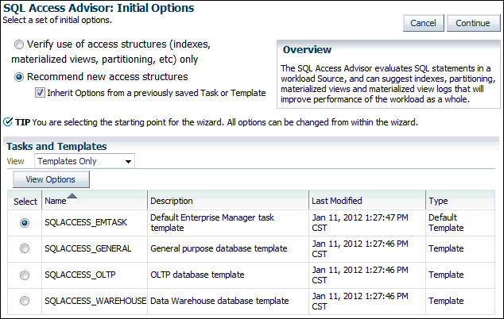

> The screenshot shows the SQL Access Advisor: Initial Options page.
>
> Below the title of the page is the text, "Select a set of initial options." The two options are: Verify Use of Access Structures (Indexes, Materialized Views, Partitioning, etc.) Only and Recommend New Access Structures (selected). Associated with the Recommend New Access Structures is the Inherit Options from a Previously Saved Task Or Template check box. It is selected.
>
> The Cancel and Continue buttons are on the far right.
>
> An Overview section has the following text: The SQL Access Advisor evaluates SQL statements in a workload Source, and can suggest indexes, partitioning, materialized views and materialized view logs that will improve performance of the workload as a whole.
>
> A Tip says, "You are selecting the starting point for the wizard. All options can be changed from within the wizard.
>
> The Task and Templates section has a View list, with the value Templates Only. Below that is the View Options button.
>
> A table in the section has the following columns: Select, Name, Description, Last Modified, and Type. The values in the Select column are options. The values of the rows are the following.
>
> Row 1: (selected), SQLACESS\_EMTASK, Default Enterprise Manager task templates, Jan 11 2012 1:27:47 PM CST, Default Template.
>
> Row 2: (not selected), SQLACCESS\_GENERAL, General purpose database template, Jan 11 2012 1:27:46 PM CST, Template.
>
> Row 3: (not selected), SQLACCESS\_OLTP, OLTP database template, Jan 11 2012 1:27:46 PM CST, Template.
>
> Row 4: (not selected), SQLACCESS\_WAREHOUSE, Data Warehouse database template, Jan 11 2012 1:27:46 PM CST, Template.
>
> End of description.

6. Click Continue.
	The SQL Access Advisor: Workload Source page appears.
7. Proceed to the next step, as described in " Selecting the Workload Source ".

#### Selecting the Workload Source

After initial options are specified for SQL Access Advisor, select the workload source that you want to use for the analysis, as described in the following sections:

- Using SQL Statements from the Cache
- Using an Existing SQL Tuning Set
- Using a Hypothetical Workload

##### Using SQL Statements from the Cache

You can use SQL statements from the cache as the workload source. However, only current and recent SQL statements are stored in the SQL cache, so this workload source may not be representative of the entire workload on your database.

To use SQL statements from the cache as the workload source:

1. Select the initial options, as described in " Selecting the Initial Options ".
2. On the SQL Access Advisor: Workload Source page, select Current and Recent SQL Activity.
	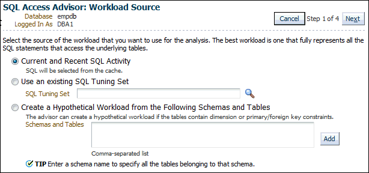

> The screenshot shows the SQL Access Advisor: Workload Source page.
>
> Below the title of the page are the following label-value pairs: Database is empdb, Logged In As is DBA1.
>
> The Cancel and Next buttons are on the right. Between the buttons is the text "Step 1 of 4".
>
> The following text describes a set of options: "Select the source of the workload that you want to use for the analysis. The best workload is one that fully represents all the SQL statements that access the underlying tables."
>
> The options are the following:
>
> - Current and Recent SQL Activity
> 	The option has the associated text, "SQL will be selected from the cache."
> - Use an Existing SQL Tuning Set
> 	The option has the associated SQL Tuning Set field. To the right of the field is a search icon.
> - Create a Hypothetical Workload from the Following Schemas and Tables
> 	The option has the associated text, "The advisor can create a hypothetical workload if the tables contain dimension or primary/foreign key constraints." It also has the Schemas and Tables field. The field has an associated Add button and the text, "Comma-separated list." The option has the associated tip, "Enter a schema name to specify all the tables belonging to that schema."
>
> End of description.

3. Proceed to the next step, as described in " Applying Filter Options ".

##### Using an Existing SQL Tuning Set

You can use an existing SQL tuning set as the workload source. This option is useful because SQL tuning sets can be used repeatedly as the workload source for SQL Access Advisor and SQL Tuning Advisor.

To use a SQL tuning set as the workload source:

1. Select the initial options, as described in " Selecting the Initial Options ".
2. On the SQL Access Advisor: Workload Source page, select Use an existing SQL Tuning Set.
3. Click the SQL Tuning Set search icon to use an existing SQL tuning set.
	The Search and Select: SQL Tuning Set dialog box appears.
4. In the Schema field, enter the name of the schema containing the SQL tuning set you want to use and then click Go.
	A list of SQL tuning sets contained in the selected schema appears.
5. Select the SQL tuning set to be used for the workload source and click Select.
	The Search and Select: SQL Tuning Set dialog box closes and the selected SQL Tuning Set now appears in the SQL Tuning Set field.
6. Proceed to the next step, as described in " Applying Filter Options ".

See Also:

- " [Managing SQL Tuning Sets](tuning-sql-statements.md) "

##### Using a Hypothetical Workload

A dimension table stores all or part of the values for a logical dimension in a star or snowflake schema. You can create a hypothetical workload from dimension tables containing primary or foreign key constraints. This option is useful if the workload to be analyzed does not exist. In this case, SQL Access Advisor examines the current logical schema design, and provides recommendations based on the defined relationships between tables.

To use a hypothetical workload as the workload source:

1. Select the initial options, as described in " Selecting the Initial Options ".
2. On the SQL Access Advisor: Workload Source page, select Create a Hypothetical Workload from the Following Schemas and Tables.
3. Leave Schemas and Tables empty and then click Add to search for tables.
	The Workload Source: Search and Select Schemas and Tables page appears.
4. In the Tables section, enter a schema name in the Schema field and then click Search.
	A list of tables in the selected schema is displayed.
5. Select the tables to be used in creating the hypothetical workload and then click Add Tables.
	The selected tables now appear in the Schemas and Tables field.
6. Click OK.
	The SQL Access Advisor: Workload Source page appears with the selected tables now added.
7. Proceed to the next step, as described in " Applying Filter Options ".

See Also:

- [Oracle Database Concepts](https://docs.oracle.com/pls/topic/lookup?ctx=en/database/oracle/oracle-database/21/tdppt&id=CNCPT411) for an overview of materialized views

#### Applying Filter Options

After the workload source is selected, you can optionally apply filters to reduce the scope of the SQL statements found in the workload. Filters are beneficial for the following reasons:

- Using filters directs SQL Access Advisor to make recommendations based on a specific subset of SQL statements from the workload, which may lead to better recommendations.
- Using filters removes extraneous SQL statements from the workload, which may greatly reduce processing time.

To apply filters to the workload source:

1. Select initial options, as described in " Selecting the Initial Options ".
2. Select the workload source, as described in " Selecting the Workload Source ".
3. On the SQL Access Advisor: Workload Source page, click Filter Options.
	The Filter Options section expands.
4. Select Filter Workload Based on these Options.
	The Filter Options section is enabled.
5. Define the filters you want to apply, as described in the following sections:
	- Defining Filters for Resource Consumption
		- Defining Filters for Users
		- Defining Filters for Tables
		- Defining Filters for SQL Text
		- Defining Filters for Modules
		- Defining Filters for Actions
6. Click Next.
	The Recommendation Options page appears.
7. Proceed to the next step, as described in " Specifying Recommendation Options ".

##### Defining Filters for Resource Consumption

The resource consumption filter restricts the workload to include only the number of high-load SQL statements that you specify.

To define a filter for resource consumption:

1. On the SQL Access Advisor: Workload Source page, under User Resource Consumption, enter the number of high-load SQL statements in the Number of Statements field.
2. From the Order by list, select one of the methods by which the SQL statements are to be ordered.

##### Defining Filters for Users

The users filter restricts the workload to include or exclude SQL statements executed by users that you specify.

To define a filter for users:

1. On the SQL Access Advisor: Workload Source page, under Users, select Include only SQL statements executed by these users or Exclude all SQL statements executed by these users.
2. To search for available users, click the Users search icon.
	The Search and Select: Users dialog box appears.
3. Select the users whose SQL statements you want to include or exclude and then click Select.
	The Search and Select: Users dialog box closes and the selected tables now appear in the Users field.
	In this example, a filter is defined to include only SQL statements executed by the user `SH`.
	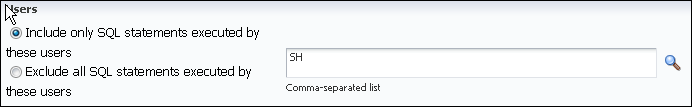

> The screenshot shows the Users section under Filter Options on the SQL Access Advisor: Workload Source page.
>
> The section has following options:
>
> - Include Only SQL Statements Executed by These Users (selected)
> - Exclude All SQL Statements Executed by These Users
>
> To the right of the options is a field, which contains the text "SH." To the right of the field is a search icon. The field has the associated text, "Comma-separated list."
>
> End of description.


##### Defining Filters for Tables

The tables filter restricts the workload to include or exclude SQL statements that access a list of tables that you specify. Table filters are not permitted if you selected the Create a Hypothetical Workload from the Following Schemas and Tables option, as described in " Using a Hypothetical Workload ".

To define a filter for tables:

1. To include only SQL statements that access a specific list of tables, enter the table names in the Include only SQL statements that access any of these tables field.
2. To exclude all SQL statements that access a specific list of tables, enter the table names in the Exclude all SQL statements that access any of these tables field.
3. To search for available tables, click the Tables search icon.
	The Search and Select: Schema and Table dialog box appears.
4. Select the tables for which you want to include or exclude SQL statements and click Select.
	The Search and Select: Schema and Table dialog box closes and the selected tables now appear in the corresponding Tables field.

##### Defining Filters for SQL Text

The SQL text filter restricts the workload to include or exclude SQL statements that contains SQL text substrings that you specify.

To define a filter for SQL text:

1. To include only SQL statements that contains specific SQL text, enter the SQL text to be included in the Include only SQL statements containing these SQL text substrings field.
2. To exclude all SQL statements that contain specific SQL text, enter the SQL text to be excluded in the Exclude all SQL statements containing these SQL text substrings field.

##### Defining Filters for Modules

The module filter restricts the workload to include or exclude SQL statements that are associated with modules that you specify.

To define a filter for module ID:

1. Do one of the following:
	- To include only SQL statements associated with a specific module ID in the workload, select Include only SQL statements associated with these modules.
		- To exclude all SQL statements associated to a specific module ID from the workload, select Exclude all SQL statements associated with these modules.
2. In the Modules field, enter the names of the modules for which associated SQL statements are included or excluded.

##### Defining Filters for Actions

The actions filter restricts the workload to include or exclude SQL statements that are associated with actions that you specify.

To define a filter for actions:

1. Do one of the following:
	- To include only SQL statements associated with a specific action in the workload, select Include only SQL statements associated with these actions.
		- To exclude all SQL statements associated with a specific action from the workload, select Exclude all SQL statements associated with these actions.
2. In the Actions field, enter the actions for which associated SQL statements are included or excluded.

#### Specifying Recommendation Options

To improve the underlying data access methods chosen by the optimizer for the workload, SQL Access Advisor provides recommendations for indexes, materialized views, and partitioning. Using these access structures can significantly improve the performance of the workload by reducing the time required to read data from the database. However, you must balance the benefits of using these access structures against the cost to maintain them.

To specify recommendation options:

1. Select initial options, as described in " Selecting the Initial Options ".
2. Select the workload source, as described in " Selecting the Workload Source ".
3. Define the filter options, as described in " Applying Filter Options ".
4. On the SQL Access Advisor: Recommendation Options page, under Access Structures to Recommend, select the type of access structures to be recommended by SQL Access Advisor:
	- Indexes
		- Materialized Views
		- Partitioning
	In this example, all of the preceding access types are selected.
	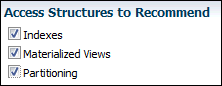

> This screenshot shows the Access Structures to Recommend section on the SQL Access Advisor: Recommended Options page. The following check boxes are selected: Indexes, Materialized Views, and Partitioning.
>
> End of description.

5. Under Scope, select the mode in which SQL Access Advisor runs. Do one of the following:
	- Select Limited.
		In limited mode, SQL Access Advisor focuses on SQL statements with the highest cost in the workload. The analysis is quicker, but the recommendations may be limited.
		- Select Comprehensive.
		In comprehensive mode, SQL Access Advisor analyzes all SQL statements in the workload. The analysis can take much longer, but the recommendations are exhaustive.
	In this example, Limited Mode is selected.
	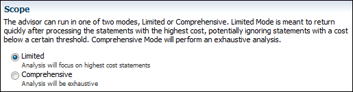

> This screenshot shows the Scope section on the SQL Access Advisor: Recommended Options page. Text describing the options in the section says: "The advisor can run in one of two modes, Limited or Comprehensive. Limited Mode is meant to return quickly after processing the statements with the highest cost, potentially ignoring statements with a cost below a certain threshold. Comprehensive Mode will perform an exhaustive analysis."
>
> The section has the following options:
>
> - Limited (selected)
> 	Text associated with the option is, "Analysis will focus on highest cost statements."
> - Comprehensive
> 	Text associated with the option is, "Analysis will be exhaustive."
>
> End of description.

6. Optionally, click Advanced Options.
	The Advanced Options section expands. This section contains the following subsections:
	- Workload Categorization
		In this section, you can specify the type of workload for which you want a recommendation. The following categories are available:
		- Workload Volatility
			Select Consider only queries if the workload primarily contains read-only operations, as in data warehouses. Volatility data is useful for online transaction processing (OLTP) systems, where the performance of `INSERT`, `UPDATE`, and `DELETE` operations is critical.
				- Workload Scope
			Select Recommend dropping unused access structures if the workload represents all access structure use cases.
		- Space Restrictions
		Indexes and materialized views increase performance at the cost of space. Do one of the following:
		- Select No, show me all recommendations (unlimited space) to specify no space limits. When SQL Access Advisor is invoked with no space limits, it makes the best possible performance recommendations.
				- Select Yes, limit additional space to and then enter the space limit in megabytes, gigabytes, or terabytes. When SQL Access Advisor is invoked with a space limit, it produces only recommendations with space requirements that do not exceed the specified limit.
		- Tuning Prioritization
		This section enables you to specify how SQL statements are tuned. Complete the following steps:
		- From the Prioritize tuning of SQL statements by list, select a method by which SQL statements are to be tuned and then click Add.
				- Optionally, select Consider access structures creation costs recommendations to weigh the cost of creating access structures against the frequency and potential improvement of SQL statement execution time. Otherwise, creation cost is ignored. You should select this option if you want specific recommendations generated for SQL statements that are executed frequently.
		- Default Storage Locations
		Use this section to override the defaults defined for schema and tablespace locations. By default, indexes are in the schema and tablespace of the table they reference. Materialized views are in the schema and tablespace of the first table referenced in the query. Materialized view logs are in the default tablespace of the schema of the table that they reference.
7. Click Next.
	The SQL Access Advisor: Schedule page appears.
8. Proceed to the next step, as described in " Specifying Task and Scheduling Options ".

### Reviewing the SQL Access Advisor Recommendations

SQL Access Advisor graphically displays the recommendations and provides links so that you can quickly see which SQL statements benefit from a recommendation. Each recommendation produced by the SQL Access Advisor is linked to the SQL statement it benefits.

To review the SQL Access Advisor recommendations:

1. Run SQL Access Advisor to make the recommendations, as described in " Running SQL Access Advisor ".
2. Access the Database Home page.
	See " [Accessing the Database Home Page](introduction.md) " for more information.
3. From the Performance menu, select Advisors Home.
	If the Database Login page appears, then log in as a user with administrator privileges. The Advisor Central page appears.
4. Select the SQL Access Advisor task for review and click View Result.
	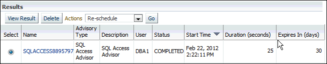

> The screenshot shows the Results table for the SQL Access Advisor task. Below the heading Results are the View Result and Delete buttons, the Actions list, and the Go button. The value selected in the Actions list is Reschedule. The table has the following columns: Select, Name, Advisory Type, Description, User, Status, Start Time, Duration (seconds), and Expires in (days). The values of the Select column are options. The values of the Name column are links.
>
> The table has one row, which has the values (selected), SQLACCESS8895797, SQL Access Advisor, SQL Access Advisor, DBA1, COMPLETED, Feb 22 2012 2:22:11 PM, 25, 30.
>
> End of description.

	If the task is not displayed, then you may need to refresh the screen. The Results for Task page appears.
5. Review the Summary subpage, which provides an overview of the SQL Access Advisor analysis, as described in " Reviewing the SQL Access Advisor Recommendations: Summary ".
6. Review the Recommendations subpage, which enables you to view the recommendations ranked by cost improvement, as described in " Reviewing the SQL Access Advisor Recommendations: Recommendations ".
7. Review the SQL statements analyzed in the workload, as described in " Reviewing the SQL Access Advisor Recommendations: SQL Statements ".
8. Review the details of the workload, task options, and the SQL Access Advisor task, as described in " Reviewing the SQL Access Advisor Recommendations: Details ".

#### Reviewing the SQL Access Advisor Recommendations: Summary

The Summary subpage displays an overview of the SQL Access Advisor analysis.

To review the recommendations summary:

1. Access the Results for Task page, as described in " Reviewing the SQL Access Advisor Recommendations ".
2. Click Summary.
	The Summary subpage of the Results for Tasks page appears.
	In this example, Limited Mode is selected so that SQL Access Advisor analyzes the highest cost statements rather than all statements.
	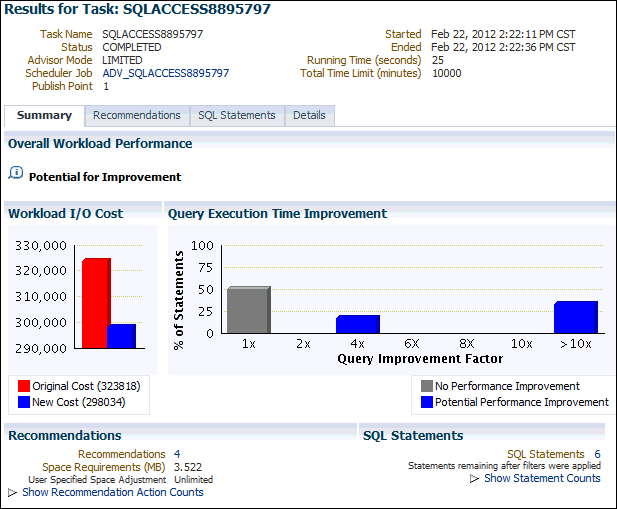

> The screenshot shows the Results for Task: SQLACCESS8895797 page with the Summary subpage selected. The tabs for the other subpages are Recommendations, SQL Statements, and Details.
>
> At the top of the page are the following label-value pairs: Task Name is SQLACCESS8895797, Status is COMPLETED, Advisor Mode is LIMITED, Scheduler Job is ADV\_SQLACCESS8895797, Publish Point is 1, Started is Feb 22 2012 2:22:11 PM CST, Ended is Feb 22 2012 2:22:36 PM CST, Running Time (seconds) is 25, Total Time Limit (minutes) is 10000.
>
> The Overall Workload Performance section has an information icon (the letter i in a chat bubble) followed by the words, "Potential for Improvement."
>
> The Workload I/O Cost section has a bar chart that compares the workload I/O cost for the Original Cost (323818), indicated by a red bar, with the New Cost (298034)), indicated by a smaller blue bar. The vertical axis measures the workload I/O cost, with values from 290,000 to 330,000 in increments of 10,000.
>
> The Query Execution Time Improvement section also has a bar chart. The vertical axis is the percentage of statements, and has values from 0 to 100 incrementing by 25. The horizontal axis measures the Query Improvement Factor with values of 1x, 2x, 4x, 6x, 8x, 10x, and >10x. The legend contains only 2 entries: No Performance Improvement, represented by the gray bars and Potential Performance Improvement, represented by the blue bars. The graph indicates that 50% of the queries would see no improvement, as indicated by the large gray bar at 1x. Approximately 20% of the statements have a potential query execution time improvement of 4x, and approximately 29% of the statements have a potential query execution time improvement of greater than 10x, as indicated by the blue bars at 4x and >10x. There are no other bars on the chart.
>
> The Recommendations section displays the following information:
>
> - Recommendations: 4 (a link)
> - Space Requirements (MB): 3.522
> - User Specified Space Adjustment: Unlimited
> - Show Recommendation Action Counts (a link and unexpanded)
>
> The SQL Statements section displays the following information:
>
> - SQL Statements: 6 (a link), followed by the descriptive text "Statements remaining after filters were applied."
> - Show Statement Counts (a link and unexpanded)
>
> End of description.

3. Under Overall Workload Performance, assess the potential for improvement in implementing the recommendations.
4. Use the Workload I/O Cost chart to compare the original workload I/O cost with the new cost.
	In this example, the workload I/O cost decreases from 107.1 million to 43.1 million by implementing the recommendations.
5. Use the Query Execution Time Improvement chart to compare the improvement in query execution time.
	This chart shows the percentage of SQL statements in the workload whose execution time improves by accepting the recommendations. The SQL statements are grouped by the projected improvement factor along the horizontal axis on the chart (1x to >10x). The percentage of SQL statements that improve by the projected improvement factor are along the vertical axis (0% to 100%).
	In this example, approximately 62 percent of SQL statements in the workload do not improve execution time, but about 25 percent have the potential for improvement of over 4x or more.
6. Under Recommendations, click Show Recommendation Action Counts.
	In the following example, creating 2 indexes, 4 materialized views, and 4 materialized view logs is recommended.
	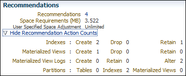

> The screenshot shows the Recommendations section of the previous screenshot, but with the Show Recommendation Action Counts link in expanded form. Once expanded the link name changes to Hide Recommendation Action Counts and displays the following additional information:
>
> - Indexes: Create 1 Drop 0 Retain 0
> - Materialized Views: Create 4 Drop 0 Retain 0
> - Materialized View Logs: Create 6 Retain 0 Alter 0
> - Partitions: Tables 0 Indexes 0 Materialized Views 0
>
> End of description.

7. Under SQL Statements, click Show Statement Counts to display the type of SQL statement.
	In the following example, 25 `SELECT` statements are analyzed.
	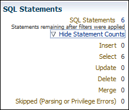

> The screenshot shows the SQL Statements section of the Summary subpage of the Results for Tasks page. The section has the following label-value pair: SQL Statements, 6. The Show Statement Counts link is expanded. Once expanded the link name changes to "Hide Statement Counts" and displays the following label-value pairs:
>
> - Insert, 0
> - Select, 6
> - Update, 0
> - Delete, 0
> - Merge, 0
> - Skipped (Parsing or Privilege Errors), 0
>
> End of description.


#### Reviewing the SQL Access Advisor Recommendations: Recommendations

The Recommendations subpage ranks the SQL Access Advisor recommendations by cost improvement. You can also view details about each recommendation.

To review recommendation details:

1. Access the Results for Task page, as described in " Reviewing the SQL Access Advisor Recommendations ".
2. Click Recommendations.
	The Recommendations subpage appears.
	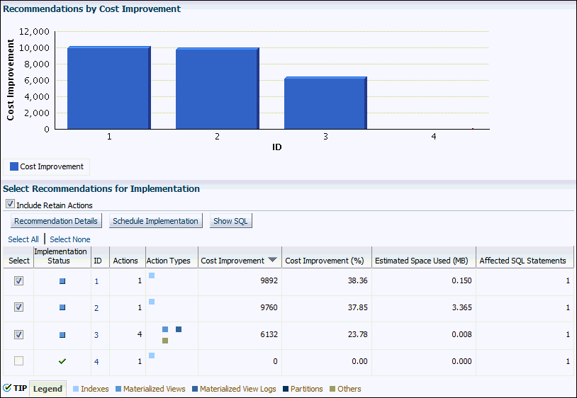

> The screenshot shows the Recommendations subpage of the Results for Tasks page. There are two sections on the subpage: Recommendations by Cost Improvement and Select Recommendations for Implementation.
>
> The Recommendations by Cost Improvement section contains a bar chart. The vertical axis measures the Cost Improvement, with values from 0 to 12,000 incrementing by 2,000. The horizontal axis shows the ID, with values, from left to right, of 1, 2, 3, and 4. The legend shows that blue bars measure Cost Improvement. All the bars in the graph are blue.
>
> - For ID 1, the cost improvement is 10,000.
> - For ID 2, the cost improvement is 10,000.
> - For ID 3, the cost improvement is 6,0000.
> - For ID, the cost improvement is 0.
>
> The Select Recommendations for Implementation section contains a table. Just below the section heading is the Include Retain Actions option, which is selected. Below this option are the Recommendation Details, Schedule Implementation, and Show SQL buttons. Below the Recommendation Details button are two links, Select All and Select None.
>
> The columns of the table are: Select, Implementation Status, ID, Actions, Action Types, Cost Improvement, Cost Improvement (%), Estimated Space Used (MB), and Affected SQL Statements. The values of the Select column are check boxes. The values in the Implementation Status column are icons. The values in the ID column are links. The values in the Action Types column are colored squares. A legend below the table identifies the following action types: Indexes, Materialized Views, Materialized View Logs, Partitions, and Others. The rows in the table have the following values:
>
> - Row 1: (selected), (pending), 1, 1, Indexes, 9892, 38.36, 0.150, 1.
> - Row 2: (selected), (pending), 2, 1, Indexes, 9760, 37.85, 3.365, 1.
> - Row 3: (selected), (pending), 3, 4, Materialized Views, Materialized View Logs, and Others, 6132, 23.78, 0.008, 1
> - Row 4: (not selected), (completed), 4, 1, Indexes, 0, 0.00, 0.000, 1
>
> End of description.

3. Use the Recommendations by Cost Improvement chart to view recommendations ordered by the cost improvement.
	Under Select Recommendations for Implementation, each recommendation is listed with its implementation status, recommendation ID, cost improvement, space consumption, and the number of affected SQL statements for each recommendation. Implementing the top recommendation has the biggest benefit to the total performance of the workload.
4. To view details for a particular recommendation, select the recommendation and click Recommendation Details.
	The Recommendation Details page appears. For space reasons, the following screenshot does not show the rightmost columns of the Actions table. The columns not shown are Tablespace and Estimated Space Used (MB).
	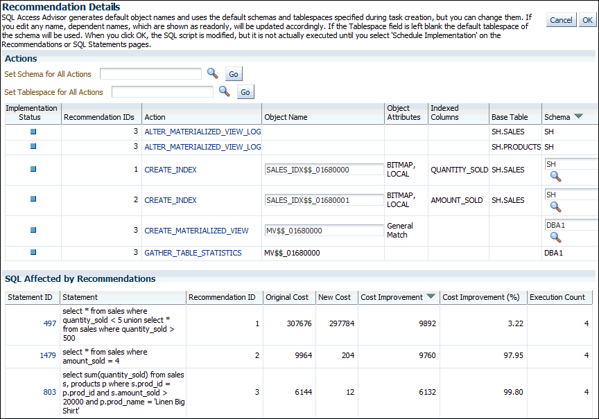

> The screenshot shows the Actions and SQL Affected by Recommendations sections of the Recommendation Details page. At the top of the Actions section is the Set Schema for All Actions field, which is blank. Next to the field is a search icon and to the left of that is a Go button. Below that field is the Set Tablespace for All Actions field, which is blank. Next to the field is a search icon and to the left of that is another Go button.
>
> Below those fields is a table. The column headings are, from left to right: Implementation Status, Recommendation IDs, Action, Object Name, Object Attributes, Indexed Columns, Base Table, and Schema. The values in the Implementation Status column are icons indicating the status. The values in the Action column are links. Some values in the Object Name, Schema, and Tablespace (not shown) columns appear as fields in which you can modify the value. The rows in the table have the following values:
>
> - Row 1: pending, 3, ALTER\_MATERIALIZED\_VIEW\_LOG, null, null, SH.SALES, SH
> - Row 2: pending, 3, ALTER\_MATERIALIZED\_VIEW\_LOG, null, null, SH.PRODUCTS, SH
> - Row 3: pending, 1, CREATE\_INDEX, SALES\_IDX$$\_01680000 (field), BITMAP LOCAL, QUANTITY\_SOLD, SH\_SALES, SH (field with an associated search icon)
> - Row 4: pending, 2, CREATE\_INDEX, SALES\_IDX$$\_01680001 (field), BITMAP LOCAL, AMOUNT\_SOLD, SH\_SALES, SH (field with an associated search icon)
> - Row 5: pending, 3, CREATE\_MATERIALIZED \_VIEW, MV$$\_01680000, General Match, null, null, DBA1 (field with an associated search icon)
> - Row 6: pending, 3, GATHER\_TABLE\_STATISTICS, MV$$\_01680000, null, null, null, DBA1
>
> The SQL Affected by Recommendations section contains a table. The column headings are, from left to right: Statement ID, Statement, Recommendation ID, Original Cost, New Cost, Cost Improvement, Cost Improvement (%), Execution Count. The values in the Statement ID column are links. The rows in the table have the following values:
>
> - Row 1: 497, SELECT \* FROM sales WHERE quantity\_sold < 5 UNION SELECT \* FROM sales WHERE quantity\_sold > 500, 1, 307676, 297784, 9892, 3.22, 4
> - Row 2: 1479, SELECT \* FROM sales WHERE amount\_sold = 4, 2, 9964, 204, 9760, 97.95, 4
> - Row 3: SELECT SUM(quantity\_sold) FROM sales s, products p WHERE s.prod\_id = p.prod\_id AND s.amount\_sold > 20000 AND p.prod\_name = "Linen Big Shirt', 3, 6144, 12, 6132, 99.80, 4
>
> End of description.

	The Recommendation Details page displays all actions for the specified recommendation.
	Under Actions, you can choose to specify the schema or the tablespace for all actions. For some actions you can modify the object name, tablespace, and schema. To view the SQL text of an action, click the link in the Action column for the specified action.
	Under SQL Affected by Recommendation, the SQL text of the SQL statement and cost improvement information are displayed.
5. Click OK.
	The Recommendations subpage appears.
6. To view the SQL text of a recommendation, select the recommendation and click Show SQL.
	The Show SQL page for the selected recommendation appears.
	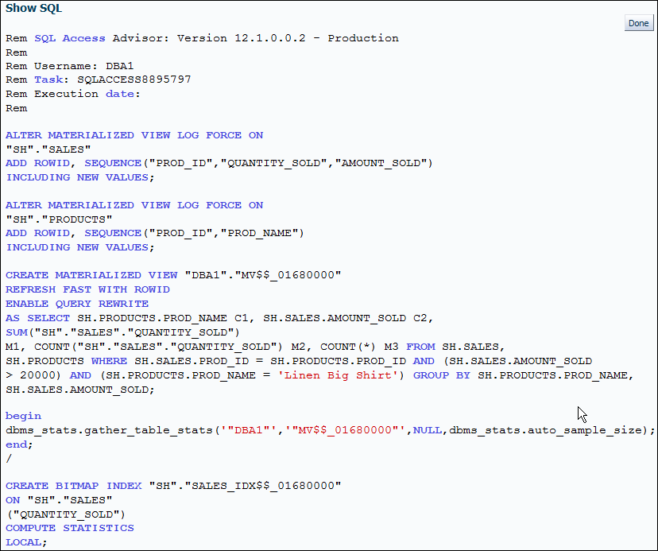

> The screenshot shows the Show SQL page for a selected recommendation. The heading of the page is Show SQL. On the top, on the right-hand side of the page, is a Done button. The SQL statement displayed is:
>
> ```
> Rem SQL Access Advisor: Version 12.1.0.0.2 – Production
> Rem
> Rem Username:  DBA1
> Rem Task: SQLACCESS8895797
> Rem Execution date:
> Rem
>
> ALTER MATERIALIZED VIEW LOG FORCE ON
> "SH"."SALES"
> ADD ROWID, SEQUENCE("PROD_ID", "QUANTITY_SOLD","AMOUNT_SOLD)
> INCLUDING NEW VALUES;
>
> CREATE MATERIALIZED VIEW "DBA1"."MV$$_01680000"
> REFRESH FAST WITH ROWID
> ENABLE QUERY REWRITE
> AS SELECT SH.PRODUCTS.PROD_NAME C1, SH.SALES.AMOUNT_SOLD C2,
> SUM("SH"."SALES"."QUANTITY_SOLD")
> M1, COUNT("SH"."SALES"."QUANTITY_SOLD" M2, COUNT(*) M3 FROM SH.SALES,
> SH.PRODUCTS WHERE SH.SALES.PROD_ID = SH.PRODUCTS.PROD_ID AND
> (SH.SALES.AMOUNT_SOLD > 20000) AND 
> (SH.PRODUCTS.PROD_NAME = 'Linen Big Shirt')
> GROUP BY SH.PRODUCTS.PROD_NAME, SH.SALES.AMOUNT_SOLD;
>
> BEGIN
> dbms_stats.gather_table_stats('"DBA1"', '"MV$$_01680000"', NULL, dbms_stats.auto_sample_size
> END;
> /
>
> CREATE BITMAP INDEX "SH"."SALES_IDX$$_01680000"
> ON "SH"."SALES"
> ("QUANTITY_SOLD")
> COMPUTE STATISTICS
> LOCAL;
> ```
>
> End of description.


#### Reviewing the SQL Access Advisor Recommendations: SQL Statements

The SQL Statements subpage ranks SQL statements in the workload by cost improvement. You can use this page to view details about the SQL statements analyzed in the workload.

To review SQL statements:

1. Access the Results for Task page, as described in " Reviewing the SQL Access Advisor Recommendations ".
2. Click SQL Statements.
	The SQL Statements subpage appears.
	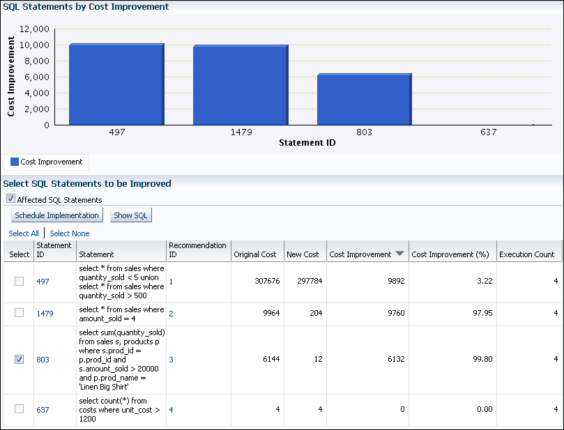

> The screenshot shows a portion of the SQL Statements subpage. There are two sections displayed: SQL Statements By Cost Improvement and Select SQL Statements to be Improved.
>
> The SQL Statements By Cost Improvement section contains a bar chart. The vertical axis measures Cost Improvement with values from 0 to 12,000 incrementing by 2,000. The horizontal axis contains the Statement ID, with values, from left to right: 497, 1479, 803, and 637. According to the legend, blue bars indicate Cost Improvement. There are three blue bars in the graph:
>
> - For statement ID 497, the cost improvement is 9,892.
> - For statement ID 1479, the cost improvement is 9,964.
> - For statement ID 803, the cost improvement is 6,144.
> - For statement ID 637, the cost improvement is 0.
>
> The Select SQL Statements to be Improved section contains a table. Just below the section heading is the Affected SQL Statements option, which is selected. Below this option are the Schedule Implementation and Show SQL buttons. Below the buttons and just above the table are the links Select All and Select None. The table has the following columns, from left to right: Select, Statement ID, Statement, Recommendation ID, Original Cost, New Cost, Cost Improvement, Cost Improvement (%), and Execution Count. The values of the Select column are check boxes. The values of the Statement ID column are links. The rows in the table have the following values:
>
> - Row 1: (not selected), 497, SELECT \* FROM sales WHERE quantity\_sold < 5 UNION SELECT \* FROM sales WHERE quantity\_sold > 500, 1, 307676, 297784, 9892, 3.22, 4
> - Row 2: (not selected), 1479, SELECT \* FROM sales WHERE amount\_sold = 4, 2, 9964, 204, 9760, 97.95, 4
> - Row 3: (selected), 803, SELECT SUM(quantity\_sold) FROM sales s, products p WHERE s.prod\_id = p.prod\_id AND s.amount\_sold > 20000 AND p.prod\_name = "Linen Big Shirt', 3, 6144, 12, 6132, 99.80, 4
> - Row 4: (not selected), 637, SELECT COUNT(\*) FROM costs WHERE unit\_cost > 1200, 4, 4, 4, 0, 0.00, 4
>
> End of description.

3. Use the SQL Statements by Cost Improvement chart to view SQL statements in the workload ordered by the cost improvement.
	Under Select SQL Statements to be Improved, each SQL statement is listed with its statement ID, SQL text, associated recommendation, cost improvement, and execution count.
	Implementing the recommendation associated with the top SQL statement has the biggest benefit to the total performance of the workload. In this example, implementing the recommendation with ID 3 produces the biggest benefit, a cost improvement of 99.80%, for the SQL statement with ID 803.
4. To view the SQL text of a recommendation, select the recommendation and click Show SQL.
	The Show SQL page for the selected recommendation appears.

#### Reviewing the SQL Access Advisor Recommendations: Details

The Details subpage displays a list of all the workload and task options used in the analysis. You can also use this page to view a list of journal entries for the task, based on the journaling level used when the task was created.

To review workload and task details:

1. Access the Results for Task page, as described in " Reviewing the SQL Access Advisor Recommendations ".
2. Click Details.
	The Details subpage appears.
	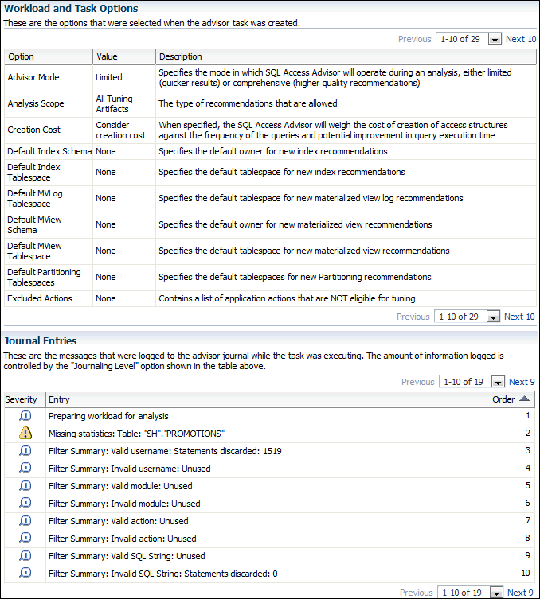

> The screenshot shows the Details subpage of the Results for Tasks page. The Details subpage has two tables: Workload and Task Options, and Journal Entries.
>
> The Workload and Task Options table has descriptive text below the title that reads, "These are the options that were selected when the advisor task was created." Below this text, on the right-hand side of the page is a link for the previous page (disabled), a list for selecting the options to display (the value "1-10 of 29" is selected), and a link for Next 10. The table has 3 columns, which are named, from left to right: Option, Value, and Description. There are 10 rows displayed in the table. They contain the following values, in column order from left to right and row order from top to bottom:
>
> - Advisor Mode, Limited, Specifies the mode in which SQL Access Advisor will operate during an analysis, either limited (quicker results) or comprehensive (higher quality recommendations)
> - Analysis Scope, All Tuning Artifacts, The type of recommendations that are allowed
> - Creation Cost, Consider creation cost, When specified, the SQL Access Advisor will weigh the cost of creation of access structures against the frequency of the queries and potential improvement in query execution time
> - Default Index Schema, None, Specifies the default owner for new index recommendations
> - Default Index Tablespace, None, Specifies the default tablespace for new index recommendations
> - Default MVLog Tablespace, None, Specifies the default tablespace for new materialized view log recommendations
> - Default MView Schema, None, Specifies the default owner for new materialized view recommendations
> - Default MView Tablespace, None, Specifies the default tablespace for new materialized view recommendations
> - Default Partitioning Tablespaces, None, Specifies the default tablespaces for new Partitioning recommendations
> - Excluded Actions, None, Contains a list of application actions that are NOT eligible for tuning
>
> Below this table, on the right-hand side of the page is a link for the previous page (disabled), and a list for selecting the options to display (the value "1-10 of 29" is selected), and a link for Next 10.
>
> The Journal Entries table has descriptive text below the title that reads, "These are the messages that were logged to the advisor journal while the task was executing. The amount of information logged is controlled by the 'Journalling Level' option shown in the table above." Below this text, on the right-hand side of the page is a link for the previous page (disabled), and a list for selecting the options to display (the value "1-10 of 19" is selected), and a link for the Next 9. The table has 3 columns, which are named, from left to right: Severity, Entry, and Order. The rows in the table are sorted by the ascending value of the Order column. These rows contain the following values, in column order from left to right and row order from top to bottom:
>
> - Information icon, Preparing workload for analysis, 1
> - Warning icon, Missing statistics: Table: "SH"."PROMOTIONS", 2
> - Information icon, Filter Summary: Valid username: Statements discarded: 1519, 3
> - Information icon, Filter Summary: Invalid username: Unused, 4
> - Information icon, Filter Summary: Valid module: Unused, 5
> - Information icon, Filter Summary: Invalid module: Unused, 6
> - Information icon, Filter Summary: Valid action: Unused, 7
> - Information icon, Filter Summary: Invalid action: Unused, 8
> - Information icon, Filter Summary: Valid SQL String: Unused, 9
> - Information icon, Filter Summary: Invalid SQL String: Statements discarded: 0, 10
>
> End of description.

	Under Workload and Task Options, a list of options that were selected when the advisor task was created is displayed.
	Under Journal Entries, a list of messages that were logged to the SQL Access Advisor journal while the task was executing is displayed.

### Implementing the SQL Access Advisor Recommendations

A SQL Access Advisor recommendation can range from a simple suggestion to a complex solution that requires partitioning a set of existing base tables and implementing a set of database objects such as indexes, materialized views, and materialized view logs. You can select the recommendations for implementation and schedule when the job should be executed.

To implement the SQL Access Advisor recommendations:

1. Review the SQL Access Advisor recommendations for cost benefits to determine which ones, if any, should be implemented.
	See " Reviewing the SQL Access Advisor Recommendations " for more information.
2. Access the Results for Task page, as described in " Reviewing the SQL Access Advisor Recommendations ".
3. Click Recommendations.
	The Recommendations subpage appears.
4. Under Select Recommendations for Implementation, select the recommendation you want to implement and then click Schedule Implementation.
	In the following example, the recommendation with ID value `1` is selected.
	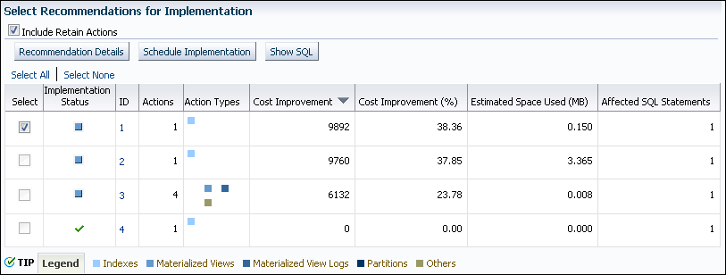

> The screenshot shows the Select Recommendations for Implementation table of the Recommendations subpage. Under the table title is the Include Retain Actions option, which is selected. Below this option there are the Recommendation Details, Schedule Implementation, and Show SQL buttons. Below the buttons are the Select All and Select None links.
>
> The table has nine columns and four rows. The columns headings are, from left to right: Select, Implementation Status, ID, Actions, Action Types, Cost Improvement, Cost Improvement (%), Estimated Space Used (MB), and Affected SQL Statements. The values of the Select column are check boxes. The values in the Implementation Status column are icons. The values in the ID column are links. The values in the Action Types column are colored squares. A legend below the table identifies the following action types: Indexes, Materialized Views, Materialized View Logs, Partitions, and Others. The rows contain the following values, listed in order from left to right:
>
> - Row 1: (selected), (pending), 1, 1, Indexes, 9892, 38.36, 0.150, 1.
> - Row 2: (not selected), (pending), 2, 1, Indexes, 9760, 37.85, 3.365, 1.
> - Row 3: (not selected), (pending), 3, 4, Materialized Views, Materialized View Logs, and Others, 6132, 23.78, 0.008, 1
> - Row 4: (not selected), (completed), 4, 1, Indexes, 0, 0.00, 0.000, 1
>
> End of description.

	The Schedule Implementation page appears.
5. In the Job Name field, enter a name for the job if you do not want to use the system-generated job name.
6. Determine whether the implementation job should stop if an error is encountered. Do one of the following:
	- To stop processing if an error occurs, select Stop on Error.
		- To continue processing even if an error occurs, deselect Stop on Error.
7. Under Scheduling Options, in the Schedule Type list, select a schedule type for the task and a maintenance window in which the task should run. Do one of the following:
	- Click Standard.
		This schedule type enables you to select a repeating interval and start time for the task. Complete the following steps:
		- Enter your time zone code in the Time Zone field or click the search icon to locate the code for your area.
				- In the Repeat list, select Do Not Repeat to perform the task only once, or select a unit of time and enter the number of units in the Interval field.
				- Under Start, select Immediately to start the task now, or Later to schedule the task to start at a time specified using the Date and Time fields.
		- Click Use predefined schedule.
		This schedule type enables you to select an existing schedule. Do one of the following:
		- In the Schedule field, enter the name of the schedule to be used for the task.
				- To search for a schedule, click the search icon.
			The Search and Select: Schedule dialog box appears.
			Select the desired schedule and click Select. The selected schedule now appears in the Schedule field.
		- Click Standard using PL/SQL for repeated interval.
		This schedule type enables you to select a repeating interval and an execution window for the task. Complete the following steps:
		- Enter your time zone code in the Time Zone field or click the search icon to locate the code for your area.
				- Under Available to Start, select Immediately to start the task now, or Later to schedule the task to start at a time specified using the Date and Time fields.
				- In the Repeated Interval field, enter a PL/SQL schedule expression, such as `SYSDATE+1`.
				- Under Not Available After, select No End Date to indicate that there is no end date for the execution window, or Specified End Date to specify an end date using the Date and Time fields.
		- Click Use predefined window.
		This schedule type enables you to select an existing window. Select Stop on Window Close to stop the job when the window closes. Do one of the following:
		- In the Window field, enter the name of the window to be used for the task.
				- To search for a window, click the search icon.
			The Search and Select: Window and Window Groups dialog box appears.
			Select the desired window and click Select. The selected window now appears in the Schedule field.
		- Click Event.
		Complete the following steps:
		- Enter your time zone code in the Time Zone field or click the search icon to locate the code for your area.
				- Under Event Parameters, enter values in the Queue Name and Condition fields.
				- Under Start, select Immediately to start the task now, or Later to schedule the task to start at a time specified using the Date and Time fields.
				- Under Not Available After, select No End Date to indicate that there is no end date for the execution window, or Specified End Date to specify an end date using the Date and Time fields.
		- Click Calendar.
		Complete the following steps:
		- Enter your time zone code in the Time Zone field or click the search icon to locate the code for your area.
				- Under Calendar Expression, enter a calendar expression.
				- Under Start, select Immediately to start the task now, or Later to schedule the task to start at a time specified using the Date and Time fields.
				- Under Not Available After, select No End Date to indicate that there is no end date for the execution window, or Specified End Date to specify an end date using the Date and Time fields.
	In this example, Standard is selected for schedule type. The job does not repeat and is scheduled to start immediately.
	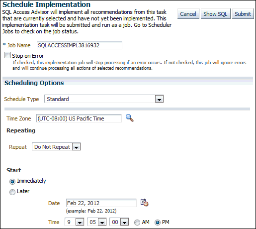

> The screenshot shows a portion of the Schedule Implementation page. Under the title of the page is the text, "SQL Access Advisor will implement all recommendations from this task that are currently selected and have not yet been implemented. This implementation task will be submitted and run as a job. Go to Scheduler Jobs to check on the job status." To the right of this text are the Cancel, Show SQL, and Submit buttons.
>
> Below the text is the Job Name field, which requires a value. The value in the field is SQLACCESSIMPL3816932. Below the Job Name is the Stop on Error option, which is not selected. This option has the following descriptive text: "If checked, this implementation job will stop processing if an error occurs. If not checked, this job will ignore errors and will continue processing all actions of selected recommendations."
>
> The Scheduling Options group has the Schedule Type list, which has the value Standard selected. Below that is the Time Zone list, which has the value (UTC-08:00) US Pacific Time selected. To the right of the Time Zone list is a search icon.
>
> Below the Time Zone list is the Repeating group. In the group is the Repeat list, which has the value Do Not Repeat selected.
>
> The Start group has two options: Immediately (selected) and Later. The Later option has associated Date field and Time lists. The Date value is Feb 22, 2012. This field has a Calendar icon to its right. Below the Date field are Time lists for hours, minutes, and seconds. The lists values show the time 9:05:00. To the right of these Time lists are the options AM and PM (selected).
>
> End of description.

8. Optionally, click Show SQL to view the SQL text for the job.
9. Click Submit to submit the job.
10. Do one of the following, depending on whether the job is scheduled to start immediately or later:
	- If you submitted the job immediately, and if the Results for Task page appears, then click the link in the Scheduler Job field to display the View Job page. Go to Step [^2].
		- If the job is scheduled to start at a later time, then proceed to Step [^1].
11. Complete the following steps:
	1. From the Administration menu, select Oracle Scheduler, then Jobs.
		The Scheduler Jobs page appears.
		2. Select the implementation job and click View Job Definition.
		The View Job page for the selected job appears.
12. On the View Job page, under Operation Detail, check the status of the operation.
	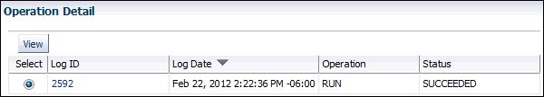

> The screenshot shows the Operation Detail table on the View Job page. Above the table is the View button. The table has the following columns: Select, Log ID, Log Date, Operation, and Status. The value of the Select column is an option. The value of the Log ID column is a link. The table has 1 row, the values of which are, from left to right: (selected), 2592, Feb 22, 2012 2:2236 PM -06:00, RUN, SUCCEEDED.
>
> End of description.

13. Optionally, select the operation and click View.
	The Operation Detail page appears.
	This page contains information (such as start date and time, run duration, CPU time used, and session ID) that you can use when troubleshooting.
14. Optionally, from the Database Home page, select Schema, then the page of the object that was created.
	Depending on the type of access structure that is created, you can display the access structure using the Indexes page, Materialized Views page, or the Materialized View Logs page.

[^1]: Complete the following steps:

1. From the Administration menu, select Oracle Scheduler, then Jobs.
	The Scheduler Jobs page appears.
2. Select the implementation job and click View Job Definition.
	The View Job page for the selected job appears.

[^2]: On the View Job page, under Operation Detail, check the status of the operation.


> The screenshot shows the Operation Detail table on the View Job page. Above the table is the View button. The table has the following columns: Select, Log ID, Log Date, Operation, and Status. The value of the Select column is an option. The value of the Log ID column is a link. The table has 1 row, the values of which are, from left to right: (selected), 2592, Feb 22, 2012 2:2236 PM -06:00, RUN, SUCCEEDED.
>
> End of description.


[^undefined]: Optionally, select the operation and click View.

The Operation Detail page appears.

This page contains information (such as start date and time, run duration, CPU time used, and session ID) that you can use when troubleshooting.

[^undefined]: Optionally, from the Database Home page, select Schema, then the page of the object that was created.

Depending on the type of access structure that is created, you can display the access structure using the Indexes page, Materialized Views page, or the Materialized View Logs page.