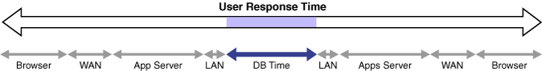
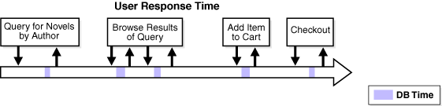
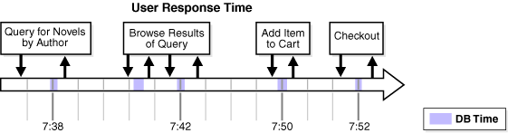

Performance improvement is an iterative process. Removing the first bottleneck (a point where resource contention is highest) may not lead to performance improvement immediately because another bottleneck might be revealed that has an even greater performance impact on the system. Accurately diagnosing the performance problem is the first step toward ensuring that your changes improve performance.

Typically, performance problems result from a lack of throughput (the amount of work that can be completed in a specified time), unacceptable user or job response time (the time to complete a specified workload), or both. The problem might be localized to specific application modules or it might span the system.

Before looking at database or operating system statistics, it is crucial to get feedback from the system users and the people in charge of the application. This feedback makes it easier to set performance goals. Improved performance can be measured in terms of business goals rather than system statistics.

The Oracle performance method can be applied until performance goals are met or deemed impractical. Because this process is iterative, some investigations may have little impact on system performance. It takes time and experience to accurately pinpoint critical bottlenecks quickly. Automatic Database Diagnostic Monitor (ADDM) implements the Oracle performance method and analyzes statistics to provide automatic diagnosis of major performance problems. Because ADDM can significantly shorten the time required to improve the performance of a system, it is the method used in this guide.

This chapter discusses the Oracle Database performance method and contains the following sections:

### Gathering Database Statistics Using the Automatic Workload Repository

Database statistics provide information about the type of load on the database and the internal and external resources used by the database. To accurately diagnose performance problems with the database using ADDM, statistics must be available.

A cumulative statistic is a count such as the number of block reads. Oracle Database generates many types of cumulative statistics for the system, sessions, and individual SQL statements. Oracle Database also tracks cumulative statistics about segments and services. Automatic Workload Repository (AWR) automates database statistics gathering by collecting, processing, and maintaining performance statistics for database problem detection and self-tuning purposes.

By default, the database gathers statistics every hour and creates an AWR snapshot, which is a set of data for a specific time that is used for performance comparisons. The delta values captured by the snapshot represent the changes for each statistic over the time period. Statistics gathered by AWR are queried from memory. The gathered data can be displayed in both reports and views.

The following initialization parameters are relevant for AWR:

- `STATISTICS_LEVEL`
	Set this parameter to `TYPICAL` (default) or `ALL` to enable statistics gathering by AWR. Setting `STATISTICS_LEVEL` to `BASIC` disables many database features, including AWR, and is not recommended.
- `CONTROL_MANAGEMENT_PACK_ACCESS`
	Set to `DIAGNOSTIC+TUNING` (default) or `DIAGNOSTIC` to enable automatic database diagnostic monitoring. Setting `CONTROL_MANAGEMENT_PACK_ACCESS` to `NONE` disables many database features, including ADDM, and is strongly discouraged.

See Also:

- [Oracle Database Reference](https://docs.oracle.com/pls/topic/lookup?ctx=en/database/oracle/oracle-database/21/tdppt&id=REFRN10214) for more information about the `STATISTICS_LEVEL` initialization parameter
- [Oracle Database Reference](https://docs.oracle.com/pls/topic/lookup?ctx=en/database/oracle/oracle-database/21/tdppt&id=REFRN10296) for more information about the `CONTROL_MANAGEMENT_PACK_ACCESS` initialization parameter

The database statistics collected and processed by AWR include:

- Time Model Statistics
- Wait Event Statistics
- Session and System Statistics
- Active Session History Statistics
- High-Load SQL Statistics

#### Time Model Statistics

Time model statistics measure the time spent in the database by operation type. The most important time model statistic is database time (DB time). DB time represents the total time spent in database calls by foreground sessions, and is an indicator of the total instance workload. As shown in Figure 2-1, database time makes up a portion of an application's overall user response time.

Figure 2-1 DB Time in Overall User Response Time

> This graphic shows a horizontal arrow labeled User Response Time, with points at each end. Under the User Response Time arrow and parallel to it are 9 smaller two-pointed arrows. The left to right the arrows are labeled as follows: Browser, WAN, Apps Server, LAN, DB Time, LAN, Apps Server, WAN, and Browser. The DB Time arrow, which is in the middle of the graphic, is blue. The end points of the DB Time arrow map to a gray segment of the User Response Time arrow.
>
> End of description.

A session is a logical entity in the database instance memory that represents the state of a current user login to a database. Database time is calculated by aggregating the CPU time and wait time of all active sessions (sessions that are not idle). For any database request, the CPU time is the sum of the time spent working on the request, while the wait time is the sum of all the waits for various database instance resources. DB time includes only time spent on client processes and does not include time spent on background processes such as PMON.

For example, a user session may involve an online transaction made at an online bookseller consisting of the actions shown in Figure 2-2.

Figure 2-2 DB Time in User Transaction

> This graphic shows a horizontal arrow labeled User Response Time, with a point on the right end. In a horizontal row above the arrow are four boxes with the following contents: Query for Novels by Author, Browse Results of Query, Add Item to Cart, and Checkout. The first, third, and fourth boxes have a pair of bold arrows: one arrow points down from the box to the main arrow and the other points up. The second box in the series has two pairs of arrows. On the main arrow underneath each pair of up/down arrows, a thin shaded segment is shown. The shading indicates DB Time.
>
> End of description.

1. Query for novels by author
	The user performs a search for novels by a particular author. This action causes the application to perform a database query for novels by the author.
2. Browse results of query
	The user browses the returned list of novels by the author and accesses additional details, such as user reviews and inventory status. This action causes the application to perform additional database queries.
3. Add item to cart
	After browsing details about the novels, the user decides to add one novel to the shopping cart. This action causes the application to make a database call to update the shopping cart.
4. Checkout
	The user completes the transaction by checking out, using the address and payment information previously saved at the bookseller's website from a previous purchase. This action causes the application to perform various database operations to retrieve the user's information, add a new order, update the inventory, and generate an email confirmation.

For each of the preceding actions, the user makes a request to the database, as represented by the down arrow in Figure 2-2. The CPU time spent by the database processing the request and the wait time spent waiting for the database are considered DB time, as represented by the shaded areas. After the request is completed, the results are returned to the user, as represented by the up arrow. The space between the up and down arrows represents the total user response time for processing the request, which contains other components besides DB time, as illustrated in Figure 2-1.

Note:

DB time is measured cumulatively from when the instance started. Because DB time combines times from all non-idle user sessions, DB time can exceed the time elapsed since the instance started. For example, an instance that has run 5 minutes could have four active sessions whose cumulative DB time is 20 minutes.

The objective of database tuning is to reduce DB time. In this way, you can improve the overall response time of user transactions in the application.

#### Wait Event Statistics

Wait events are incremented by a session to indicate that the session had to wait for an event to complete before being able to continue processing. When a session has to wait while processing a user request, the database records the wait by using one of a set of predefined wait events. The events are then grouped into wait classes, such as User I/O and Network. Wait event data reveals symptoms of problems that might be affecting performance, such as latch, buffer, or I/O contention.

See Also:

- [Oracle Database Performance Tuning Guide](https://docs.oracle.com/pls/topic/lookup?ctx=en/database/oracle/oracle-database/21/tdppt&id=TGDBA149)
- [Oracle Database Reference](https://docs.oracle.com/pls/topic/lookup?ctx=en/database/oracle/oracle-database/21/tdppt&id=REFRN101)

#### Session and System Statistics

A large number of cumulative database statistics are available on a system and session level. Some of these statistics are collected by AWR.

#### Active Session History Statistics

The Active Session History (ASH) statistics are samples of session activity in the database. The database samples active sessions every second and stores them in a circular buffer in the System Global Area (SGA). Any session that is connected to the database and using CPU, or is waiting for an event that does not belong to the idle wait class, is considered an active session. By capturing only active sessions, a manageable set of data is represented. The size of the data is directly related to the work being performed, rather than the number of sessions allowed on the database.

Using the DB time example described in " Time Model Statistics ", samples of session activity are collected from the online transaction made at the bookseller's website, represented as vertical lines below the horizontal arrow in Figure 2-3.

Figure 2-3 Active Session History

> This graphic shows a horizontal arrow labeled User Response Time, with a point on the right end. In a horizontal row above the arrow are four boxes with the following contents: Query for Novels by Author, Browse Results of Query, Add Item to Cart, and Checkout. The first, third, and fourth boxes have a pair of bold arrows: one arrow points down from the box to the main arrow and the other points up. The second box in the series has two pairs of arrows. On the main arrow underneath each pair of up/down arrows, a thin shaded segment is shown. The shading indicates DB Time. The first, third, fourth, and fifth gray segments are labeled with the following times: 7:38, 7:42, 7:50, and 7:52.
>
> End of description.

The light vertical lines represent samples of inactive session activity that are not captured in the ASH statistics. The bold vertical lines represent samples of active sessions that are captured at:

- 7:38, while novels by the author are being queried
- 7:42, while the user is browsing the query results
- 7:50, when one novel is added to the shopping cart
- 7:52, during the checkout process

Table 2-1 lists ASH statistics collected for the active sessions, along with examples of the session ID (SID), module, SQL ID, session state, and wait events that are sampled.

Table 2-1 Active Session History

| Time | SID | Module | SQL ID | State | Event |
| --- | --- | --- | --- | --- | --- |
| 7:38 | 213 | Book by author | qa324jffritcf | Waiting | db file sequential read |
| 7:42 | 213 | Get review ID | aferv5desfzs5 | CPU | n/a |
| 7:50 | 213 | Add item to cart | hk32pekfcbdfr | Waiting | buffer busy wait |
| 7:52 | 213 | Checkout | abngldf95f4de | Waiting | log file sync |

#### High-Load SQL Statistics

SQL statements that are consuming the most resources produce the highest load on the system, based on criteria such as elapsed time and CPU time.

### Using the Oracle Performance Method

Performance tuning using the Oracle performance method is driven by identifying and eliminating bottlenecks in the database, and by developing efficient SQL statements. Database tuning is performed in two phases: proactively and reactively.

In the proactive tuning phase, you must perform tuning tasks as part of your daily database maintenance routine, such as reviewing ADDM analysis and findings, monitoring the real-time performance of the database, and responding to alerts.

In the reactive tuning phase, you must respond to issues reported by users, such as performance problems that may occur for only a short duration of time, or performance degradation to the database over a period of time.

SQL tuning is an iterative process to identify, tune, and improve the efficiency of high-load SQL statements.

Applying the Oracle performance method involves the following:

- Performing pre-tuning preparations, as described in " Preparing the Database for Tuning "
- Tuning the database proactively on a regular basis, as described in " Tuning the Database Proactively "
- Tuning the database reactively when performance problems are reported by the users, as described in " Tuning the Database Reactively "
- Identifying, tuning, and optimizing high-load SQL statements, as described in " Tuning SQL Statements "

To improve database performance, you must apply these principles iteratively.

#### Preparing the Database for Tuning

This section lists and describes the steps that must be performed before the database can be properly tuned.

To prepare the database for tuning:

1. Get feedback from users.
	Determine the scope of the performance project and subsequent performance goals, and determine performance goals for the future. This process is key for future capacity planning.
2. Check the operating systems of all systems involved with user performance.
	Check for hardware or operating system resources that are fully utilized. List any overused resources for possible later analysis. In addition, ensure that all hardware is functioning properly.
3. Ensure that the `STATISTICS_LEVEL` initialization parameter is set to `TYPICAL` (default) or `ALL` to enable the automatic performance tuning features of Oracle Database, including AWR and ADDM.
4. Ensure that the `CONTROL_MANAGEMENT_PACK_ACCESS` initialization parameter is set to `DIAGNOSTIC+TUNING` (default) or `DIAGNOSTIC` to enable ADDM.

See Also:

- " Gathering Database Statistics Using the Automatic Workload Repository " for information about configuring AWR
- " [Configuring Automatic Database Diagnostic Monitor](automatic-database-performance-monitoring.md) "

#### Tuning the Database Proactively

This section lists and describes the proactive steps required to keep the database properly tuned on a regular basis. Perform these steps as part of your daily maintenance of Oracle Database. Repeat the tuning process until your performance goals are met or become impossible to achieve because of other constraints.

To tune the database proactively:

1. Review the ADDM findings, as described in [Automatic Database Performance Monitoring](automatic-database-performance-monitoring.md).
	ADDM automatically detects and reports on performance problems with the database, including most of the " Common Performance Problems Found in Databases ". The results are displayed as ADDM findings on the Database Home page in Oracle Enterprise Manager Cloud Control (Cloud Control). Reviewing these findings enables you to quickly identify the performance problems that require your attention.
2. Implement the ADDM recommendations, as described in [Automatic Database Performance Monitoring](automatic-database-performance-monitoring.md).
	With each ADDM finding, ADDM automatically provides a list of recommendations for reducing the impact of the performance problem. Implementing a recommendation applies the suggested changes to improve the database performance.
3. Monitor performance problems with the database in real time, as described in [Monitoring Real-Time Database Performance](monitoring-real-time-database-performance.md).
	The Performance page in Cloud Control enables you to identify and respond to real-time performance problems. By drilling down to the appropriate pages, you can identify and resolve performance problems with the database in real time, without having to wait until the next ADDM analysis.
4. Respond to performance-related alerts, as described in [Monitoring Performance Alerts](monitoring-performance-alerts.md).
	The Database Home page in Cloud Control displays performance-related alerts generated by the database. Typically, resolving the problems indicated by these alerts improves database performance.
5. Validate that any changes have produced the desired effect, and verify that the users experience performance improvements.

#### Tuning the Database Reactively

This section lists and describes the steps required to tune the database based on user feedback. This tuning procedure is considered reactive. Perform this procedure periodically when performance problems are reported by the users.

To tune the database reactively:

1. Run ADDM manually to diagnose current and historical database performance when performance problems are reported by the users, as described in [Manual Database Performance Monitoring](manual-database-performance-monitoring.md).
	In this way you can analyze current database performance before the next ADDM analysis, or analyze historical database performance when you were not proactively monitoring the system.
2. Resolve transient performance problems, as described in [Resolving Transient Performance Problems](resolving-transient-performance-problems.md).
	The Active Session History (ASH) reports enable you to analyze transient performance problems with the database that are short-lived and do not appear in the ADDM analysis.
3. Resolve performance degradation over time, as described in [Resolving Performance Degradation Over Time](resolving-performance-degradation-over-time.md).
	The Automatic Workload Repository (AWR) Compare Periods report enables you to compare database performance between two periods of time, and resolve performance degradation that may happen from one time period to another.
4. Validate that the changes made have produced the desired effect, and verify that the users experience performance improvements.
5. Repeat these steps until your performance goals are met or become impossible to achieve due to other constraints.

#### Tuning SQL Statements

This section lists and describes the steps required to identify, tune, and optimize high-load SQL statements.

To tune SQL statements:

1. Identify high-load SQL statements, as described in [Identifying High-Load SQL Statements](identifying-high-load-sql-statements.md).
	Use the ADDM findings and the Top SQL section to identify high-load SQL statements that are causing the greatest contention.
2. Tune high-load SQL statements, as described in [Tuning SQL Statements](tuning-sql-statements.md).
	You can improve the efficiency of high-load SQL statements by tuning them using SQL Tuning Advisor.
3. Optimize data access paths, as described in [Optimizing Data Access Paths](optimizing-data-access-paths.md).
	You can optimize the performance of data access paths by creating the proper set of materialized views, materialized view logs, and indexes for a given workload by using SQL Access Advisor.
4. Analyze the SQL performance impact of SQL tuning and other system changes by using SQL Performance Analyzer.
	To learn how to use SQL Performance Analyzer, see [Oracle Database Testing Guide](https://docs.oracle.com/pls/topic/lookup?ctx=en/database/oracle/oracle-database/21/tdppt&id=RATUG166).
5. Repeat these steps until all high-load SQL statements are tuned for greatest efficiency.

### Common Performance Problems Found in Databases

This section lists and describes common performance problems found in databases. By following the Oracle performance method, you should be able to avoid these problems in an Oracle Database instance. If you experience these problems, then repeat the steps in the Oracle performance method, as described in " Using the Oracle Performance Method ", or consult the appropriate section that addresses these problems:

- CPU bottlenecks
	Is the application performing poorly because the system is CPU-bound? Performance problems caused by CPU bottlenecks are diagnosed by ADDM, as described in [Automatic Database Performance Monitoring](automatic-database-performance-monitoring.md). You can also identify CPU bottlenecks by using the Performance page in Cloud Control, as described in " [Monitoring CPU Utilization](monitoring-real-time-database-performance.md) ".
- Undersized memory structures
	Are the Oracle memory structures such as the System Global Area (SGA), Program Global Area (PGA), and buffer cache adequately sized? Performance problems caused by undersized memory structures are diagnosed by ADDM, as described in [Automatic Database Performance Monitoring](automatic-database-performance-monitoring.md). You can also identify memory usage issues by using the Performance page in Cloud Control, as described in " [Monitoring Memory Utilization](monitoring-real-time-database-performance.md) ".
- I/O capacity issues
	Is the I/O subsystem performing as expected? Performance problems caused by I/O capacity issues are diagnosed by ADDM, as described in [Automatic Database Performance Monitoring](automatic-database-performance-monitoring.md). You can also identify disk I/O issues by using the Performance page in Cloud Control, as described in " [Monitoring Disk I/O Utilization](monitoring-real-time-database-performance.md) ".
- Suboptimal use of Oracle Database by the application
	Is the application making suboptimal use of Oracle Database? Problems such as establishing new database connections repeatedly, excessive SQL parsing, and high levels of contention for a small amount of data (also known as application-level block contention) can degrade the application performance significantly. Performance problems caused by suboptimal use of Oracle Database by the application are diagnosed by ADDM, as described in [Automatic Database Performance Monitoring](automatic-database-performance-monitoring.md). You can also monitor top activity in various dimensions—including SQL, session, services, modules, and actions—by using the Performance page in Cloud Control, as described in " [Monitoring User Activity](monitoring-real-time-database-performance.md) ".
- Concurrency issues
	Is the database performing suboptimally due to a high degree of concurrent activities in the database? A high degree of concurrent activities might result in contention for shared resources that can manifest in the form of locks or waits for buffer cache. Performance problems caused by concurrency issues are diagnosed by ADDM, as described in [Automatic Database Performance Monitoring](automatic-database-performance-monitoring.md). You can also identify concurrency issues by using Top Sessions in Cloud Control, as described in " [Monitoring Top Sessions](monitoring-real-time-database-performance.md) ".
- Database configuration issues
	Is the database configured optimally to provide desired performance levels? For example, is there evidence of incorrect sizing of log files, archiving issues, too many checkpoints, or suboptimal parameter settings? Performance problems caused by database configuration issues are diagnosed by ADDM, as described in [Automatic Database Performance Monitoring](automatic-database-performance-monitoring.md).
- Short-lived performance problems
	Are users complaining about short-lived or intermittent performance problems? Depending on the interval between snapshots taken by AWR, performance problems that have a short duration may not be captured by ADDM. You can identify short-lived performance problems by using the Active Session History report, as described in [Resolving Transient Performance Problems](resolving-transient-performance-problems.md).
- Degradation of database performance over time
	Is there evidence that the database performance has degraded over time? For example, are you or your users noticing that the database is not performing as well as it was 6 months ago? You can generate an AWR Compare Periods report to compare the period when the performance was poor to a period when the performance is stable to identify configuration settings, workload profile, and statistics that are different between these two time periods. This technique helps you identify the cause of the performance degradation, as described in [Resolving Performance Degradation Over Time](resolving-performance-degradation-over-time.md).
- Inefficient or high-load SQL statements
	Are any SQL statements using excessive system resources that impact the system? Performance problems caused by high-load SQL statements are diagnosed by ADDM, as described in [Automatic Database Performance Monitoring](automatic-database-performance-monitoring.md) and " [Identification of High-Load SQL Statements Using ADDM Findings](identifying-high-load-sql-statements.md) ". You can also identify high-load SQL statements by using Top SQL in Cloud Control, as described in " [Identifying High-Load SQL Statements Using Top SQL](identifying-high-load-sql-statements.md) ". After they have been identified, you can tune the high-load SQL statements using SQL Tuning Advisor, as described in [Tuning SQL Statements](tuning-sql-statements.md).
- Object contention
	Are any database objects the source of bottlenecks because they are continuously accessed? Performance problems caused by object contention are diagnosed by ADDM, as described in [Automatic Database Performance Monitoring](automatic-database-performance-monitoring.md). You can also optimize the data access path to these objects using SQL Access Advisor, as described in [Optimizing Data Access Paths](optimizing-data-access-paths.md).
- Unexpected performance regression after tuning SQL statements
	Is the performance of SQL statements degrading after they have been tuned? Tuning SQL statements may cause changes to their execution plans, resulting in a significant impact on SQL performance. In some cases, the changes may result in the improvement of SQL performance. In other cases, the changes may cause SQL statements to regress, resulting in a degradation of SQL performance.
	Before making changes on a production system, you can analyze the impact of SQL tuning on a test system by using SQL Performance Analyzer. This feature enables you to forecast the impact of system changes on a SQL workload by:
	- Measuring the performance before and after the change
		- Generating a report that describes the change in performance
		- Identifying the SQL statements that regressed or improved
		- Providing tuning recommendations for each SQL statement that regressed
		- Enabling you to implement the tuning recommendations when appropriate
	See Also:
	[Oracle Database Testing Guide](https://docs.oracle.com/pls/topic/lookup?ctx=en/database/oracle/oracle-database/21/tdppt&id=RATUG166) to know more about how to use SQL Performance Analyzer