Performance degradation of the database occurs when your database was performing optimally in the past, such as 6 months ago, but has gradually degraded to a point where it becomes noticeable to the users. The Automatic Workload Repository (AWR) Compare Periods report enables you to compare database performance between two periods of time.

While an AWR report shows AWR data between two snapshots (or two points in time), the AWR Compare Periods report shows the difference between two periods (or two AWR reports with a total of four snapshots). Using the AWR Compare Periods report helps you to identify detailed performance attributes and configuration settings that differ between two time periods. The two time periods selected for the AWR Compare Periods report can be of different durations. The report normalizes the statistics by the amount of time spent on the database for each time period and presents statistical data ordered by the largest difference between the periods.

For example, a batch workload that historically completed in the maintenance window between 10:00 p.m. and midnight is currently showing poor performance and completing at 2 a.m. You can generate an AWR Compare Periods report from 10:00 p.m. to midnight on a day when performance was good and from 10:00 a.m. to 2 a.m. on a day when performance was poor. The comparison of these reports should identify configuration settings, workload profile, and statistics that were different in these two time periods. Based on the differences identified, you can diagnose the cause of the performance degradation.

This chapter contains the following sections:

See Also:

- " [Gathering Database Statistics Using the Automatic Workload Repository](oracle-database-performance-method.md) "

### Managing Baselines

Baselines are an effective way to diagnose performance problems. AWR supports the capture of baseline data by enabling you to specify and preserve a pair or a range of snapshots as a baseline. The snapshots contained in a baseline are excluded from the automatic AWR purging process and are retained indefinitely.

A moving window baseline corresponds to all AWR data that exists within the AWR retention period. Oracle Database automatically maintains a system-defined moving window baseline. The default size of the window is the current AWR retention period, which by default is 8 days.

This section contains the following topics:

- Creating a Baseline
- Deleting a Baseline
- Computing Threshold Statistics for Baselines
- Setting Metric Thresholds for Baselines

#### Creating a Baseline

Before creating a baseline, carefully consider the time period you choose as a baseline because it should represent the database operating at an optimal level. In the future, you can compare these baselines with other baselines or snapshots captured during periods of poor performance to analyze performance degradation over time.

You can create the following types of baseline:

- Creating a Single Baseline
- Creating a Repeating Baseline

##### Creating a Single Baseline

A single baseline is captured at a single, fixed time interval. For example, a single baseline may be captured on February 5, 2020 from 5:00 p.m. to 8:00 p.m.

You can choose future start and end times to create a baseline that captures future database activity. If both the start time and the end time are in the future, then a baseline template with the same name as the baseline is also created. A baseline template is a specification that enables Oracle Database to automatically generate a baseline for a future time period.

To create a single baseline:

1. Access the Database Home page for the target database.
	See " [Accessing the Database Home Page](introduction.md) " for more information.
2. From the Performance menu, select AWR and then AWR Administration.
	If the Database Login page appears, then log in as a user with administrator privileges. The Performance page appears.
3. Under Manage Snapshots and Baselines, click the number next to Baselines.
	The AWR Baselines page appears with a list of existing baselines displayed.
	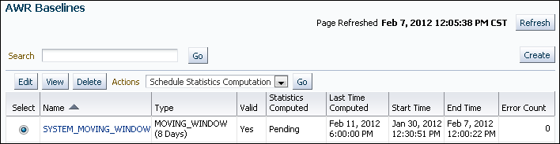

> The AWR Baselines page is shown.
>
> At the top right of the page is a label-value pair. The label is Page Refreshed and the value is Feb 7, 2012 12:05:38 PM CST. To the right of the pair is the Refresh button.
>
> On the left is the Search field, which is empty. Next to the field is the Go button. On the far right is the Create Button.
>
> Underneath are the following elements: Edit button, View button, Delete button, Actions list (set to Schedule Statistics Computation), and Go button.
>
> Below them is a table that has the following columns: Select, Name, Type, Valid, Statistics Computed, Last Time Computed, Start Time, End Time, Error Count. The Select column values appear as selectable options. The Name values are links.
>
> The table has one row. The values of the row are the following: (option selected), SYSTEM MOVING WINDOW, MOVING\_WINDOW (8 Days), Yes, Pending, Feb 11 2012 6:00:00 PM, Jan 30 2012 12:30:51 PM, Feb 7 2012 12:00:22 PM, 0.
>
> End of description

4. Click Create.
	The Create Baseline: Baseline Interval Type page appears.
	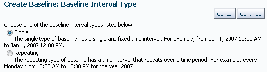

> The Create Baseline: Baseline Interval Type section is shown.
>
> AT the top right the Cancel and Continue buttons.
>
> The following mutually exclusive options are shown: Single (selected) and Repeating.
>
> End of description.

5. Select Single and then Continue.
	The Create Baseline: Single Baseline page appears.
	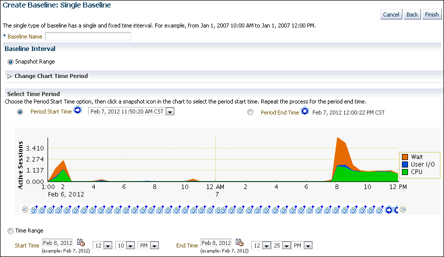

> The Create Baseline: Single Baseline section is shown.
>
> At the top right are the Cancel, Back, and Finish buttons.
>
> The Baseline Name field is empty.
>
> In the Baseline Interval section, the Snapshot Range option is selected.
>
> The Change Chart Time Period navigation tree is collapsed.
>
> In the Select Time Period section, the Period Start Time option shows Feb 7, 2012 11:50:20 AM CST. The option is selected. The Period End Time option shows Feb 7, 2012 12:00:22 PM CST. This option is not selected.
>
> A chart shows active sessions on the y-axis. The values range from 0 to 3.410. The x-axis shows hours of day, shown in 2-hour intervals, ranging from 1:00 p.m. Feb 6, 2012 to 12:00 p.m. Feb 7, 2012.
>
> The Time Range option is not selected.
>
> The Start Time is Feb 8, 2012 at 12:00 p.m. The End Time is Feb 8, 2012 at 12:25 p.m.
>
> End of description.

6. In the Baseline Name field, enter a name for the baseline.
7. Click Finish.
	The AWR Baselines page returns and has a new item for just created baseline.

##### Creating a Repeating Baseline

A repeating baseline is a baseline that repeats during a time interval over a specific period. For example, a repeating baseline may repeat every Monday from 1:00 p.m. to 3:00 p.m. from February 7, 2012 to February 7, 2013.

To create a repeating baseline:

1. Access the AWR Baselines page, as explained in " Creating a Single Baseline ".
2. Click Create.
	The Create Baseline: Baseline Interval Type page appears.
3. Select Repeating and then click Continue.
	The Create Baseline: Repeating Baseline Template page appears.
4. In the Baseline Name Prefix field, enter a name prefix for the baseline.
5. Under Baseline Time Period, specify the time of the day that you want the baseline to begin collecting AWR data and the duration of the baseline collection.
6. Under Frequency, do one of the following:
	- Select Daily if you want the baseline to repeat on a daily basis.
	- Select Weekly if you want the baseline to repeat on a weekly basis, and then select the day of the week on which the baseline repeats.
7. Under Interval of Baseline Creation, complete the following steps:
	1. In the Start Time fields, select a date and time in the future when the data collection should begin.
	2. In the End Time fields, select a date and time in the future when the data collection should end.
8. Under Purge Policy, enter the number of days to retain captured baselines.
9. Click Finish.
	A baseline template with the same name as the baseline name prefix is created. A baseline template is a specification that enables Oracle Database to automatically generate a baseline for a future time period.
	This example creates a baseline that repeats weekly on Mondays from 8:00 a.m. to 10:00 a.m. from February 6, 2009 to February 6, 2010. Every captured baseline expires after 30 days.
	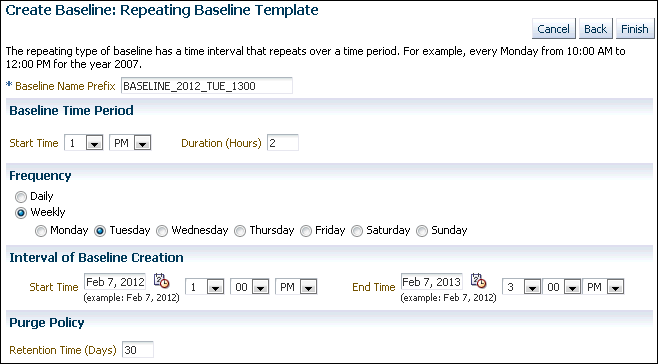

> The Create Baseline: Repeating Baseline Template page is shown.
>
> At the top right are the Cancel, Back, and Finish buttons.
>
> The Baseline Name Prefix field shows BASELINE\_2012\_TUE\_1300.
>
> In the Baseline Time Period section, the Start Time is 1 p.m. The Duration (Hours) field shows 2.
>
> In the Frequency section, the mutually exclusive options are Daily and Weekly (selected). A row of options from Monday (through Sunday is shown. The Tuesday option is selected.
>
> In the Interval of Baseline Creation section, the Start Time is Feb 7, 2012 at 1:00 p.m. The End Time is Feb 7, 2010 at 3:00 p.m.
>
> In the Purge Policy section, the Retention Time (Days) field shows 30.
>
> End of description.

#### Deleting a Baseline

To conserve storage space, you may want to periodically delete unused baselines stored in the database.

Removing a source from AWR dashboard presents two options:

1. Hard Delete: Remove source from AWR Warehouse and purge all collected AWR data
	- All the extract/transfer jobs scheduled for the source are removed.
		- The source databases are removed from AWR dashboard
		- Already collected AWR data for the source from the warehouse is purged.
2. Soft Delete: Stop all upload on source but retain collected data in AWR Warehouse
	- Source database remain in the dashboard, but in a disabled (greyed out) state.
		- The extract/transfer jobs scheduled for the source are removed.
		- Diagnosis,edit,enable/disable snapshots user actions are disabled.
		- Retention period for the collected snapshots is still applicable. For example, all snapshots older than the retention period are deleted.
		- AWR data collected in the Warehouse are not purged, and AWR reports can be generated from the data.

To delete a baseline:

1. Access the AWR Baselines page, as explained in " Creating a Single Baseline ".
2. Select a baseline and click Delete.
	The Confirmation page appears.
3. Select whether to purge the underlying data associated with the baseline.
	The underlying data includes the individual snapshots preserved in the baseline and any statistics that are computed for the baseline. Do one of the following:
	- To delete the underlying data, select Purge the underlying data associated with the baseline.
	- To preserve the underlying data, select Do not purge the underlying data associated with the baseline.
4. Click Yes.
	The AWR Baselines page reappears. A message informs you that the baseline was deleted successfully.

#### Computing Threshold Statistics for Baselines

Computing threshold statistics for baselines enables you to graphically display the computed statistics in the charts on the Performance page.

To compute threshold statistics for baselines:

1. Access the AWR Baselines page, as explained in " Creating a Single Baseline ".
2. Select the baseline for which you want to compute statistics.
	Select a baseline that does not already have computed statistics. These baselines are identified by No in the Statistics Computed column.
3. From the Actions list, select Schedule Statistics Computation, and then click Go.
	The Compute Threshold Statistics page appears.
	This example computes statistics for the baseline `BASELINE_TUE_1120`.
	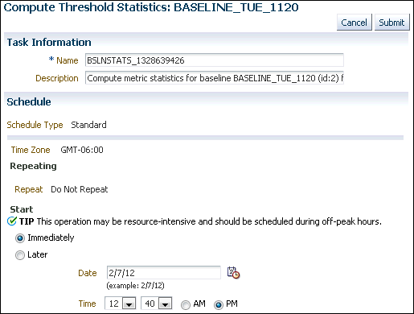

> The Compute Threshold Statistics: BASELINE\_TUE\_1120 screen appears.
>
> At the upper right of the page are the Cancel and Submit buttons.
>
> In the Task Information section, the Name field shows the value BSLNSTATS\_1328639426. The Description field includes the following value: Compute metric statistics for baseline BASELINE\_TUE\_1120 (id:2) f.
>
> The Schedule section includes 2 label-value pairs. The value for the Schedule Type label is Standard. The value for the Time Zone label is GMT-06:00.
>
> In the Repeating section, the value for the Repeat label is Do Not Repeat.
>
> The Start section has two mutually exclusive options: Immediately (selected) and Later. For Later, the Date list shows 2/7/12. There is a calendar icon next to the Date field. The Time list shows 12:40 PM.
>
> End of description.

4. In the Name field, enter a name for the task.
	Alternatively, you can choose to use the system-generated name.
5. In the Description field, enter a description for the task.
	Alternatively, you can choose to use the system-generated description.
6. Under Start, do one of the following:
	- Select Immediately to run the task immediately after it has been submitted.
	- Select Later to run the task at a later time as specified using the Date and Time fields.
	This computation is resource-intensive, so you may want to schedule it to run during off-peak hours.
7. Click Submit.
	The AWR Baselines page appears. A message informs you that statistics computation has been scheduled for the selected baseline.

See Also:

" [Customizing the Database Performance page](unresolvable-reference.md) " for information about displaying computed statistics on the Performance page

#### Setting Metric Thresholds for Baselines

As explained in " [Setting Metric Thresholds for Performance Alerts](monitoring-performance-alerts.md) ", a metric is the rate of change in a cumulative statistic. Alerts notify you when particular metric thresholds are crossed. When the metric thresholds are crossed, the system is in an undesirable state. You can edit the threshold settings for baseline metrics.

You can create the following types of baseline:

- Setting Metric Thresholds for the Default Moving Baseline
- Setting Metric Thresholds for Selected Baselines

##### Setting Metric Thresholds for the Default Moving Baseline

This section describes the easiest technique for setting the metric thresholds for the default moving baseline. You can choose a group of basic metric threshold settings based on common database workload profiles such as OLTP, data warehousing, and OLTP with nighttime batch jobs. After choosing a workload profile, you can expand or change the threshold values as needed.

To set metric thresholds for the default moving baseline:

1. Access the Database Home page.
	See " [Accessing the Database Home Page](introduction.md) " for more information.
2. From the Performance menu, select Adaptive Thresholds.
	If the Database Login page appears, then log in as a user with administrator privileges.
	The Threshold Configuration tab of the Baseline Metric Thresholds page appears.
3. Click Quick Configuration.
	The Quick Configuration: Baseline Metric Thresholds page appears.
4. In Workload Profile, select one of the following options, depending on how you are using the database:
	- Primarily OLTP (pure transaction processing 24 hours a day)
		- Primarily Data Warehousing (query and load intensive)
		- Alternating (OLTP during the daytime and batch during the nighttime)
	In this example, Primarily OLTP was selected.
5. Click Continue.
	The Quick Configuration: Review OLTP Threshold Settings page appears.
	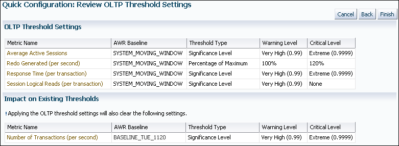

> The Quick Configuration: Review OLTP Threshold Settings page is shown.
>
> At the top right are the Cancel, Back, and Finish buttons.
>
> The OLTP Threshold Settings section contains a table.
>
> The column names are Metric Name, AWR Baseline, Threshold Type, Warning Level, and Critical Level. The table has four rows. The values of the rows are the following:
>
> Row 1: Average Active Sessions, SYSTEM\_MOVING\_WINDOW, Significance Level, Very High (0.99), Extreme (0.9999).
>
> Row 2: Redo Generated (per second), SYSTEM\_MOVING\_WINDOW, Percentage of Maximum, 100%, 120%.
>
> Row 3: Response Time (per transaction), SYSTEM\_MOVING\_WINDOW, Significance Level, Very High (0.99), Extreme (0.9999).
>
> Row 4: Session Logical Reads (per transaction), SYSTEM\_MOVING\_WINDOW, Significance Level, Very High (0.99), None.
>
> The Impact on Existing Thresholds section contains a line of text and a table. The text says: Applying the OLTP threshold settings will also clear the following settings.
>
> The table contains the following columns: Metric Name, AWR Baseline, Threshold Type, Warning Level, Critical Level. The table has one row.
>
> Row 1 has the following values: Number of transactions (per second), BASELINE\_TUE\_1120, Significance Level, Very High (0.99), Extreme (0.9999).
>
> Row 2 has the following values: "Current Open Cursors Count", null, Fixed Values, 1200, null.
>
> End of description

6. Review the metric threshold settings and then click Finish.
	You are returned to the Baseline Metric Thresholds page, with the Threshold Configuration tab selected. The metric threshold settings are displayed.

##### Setting Metric Thresholds for Selected Baselines

This section explains how to select a baseline and edit its thresholds. You can configure the type of threshold, for example, whether it is based on significance levels, percentage of maximum values, or fixed values. You can also configure the threshold levels that determine when the database generates critical alerts and warnings.

You can edit thresholds for the default moving baseline or a baseline that you created in the AWR Baselines page. You can select a baseline in the Edit Thresholds page after you have scheduled statistics computation from the AWR Baselines page and the statistics have finished computing on the static baseline.

To set a metric threshold for a selected moving baseline:

1. Access the Baseline Metric Thresholds page, as explained in " Setting Metric Thresholds for the Default Moving Baseline ".
2. In the View list, select Basic Metrics.
	The Baseline Metric Thresholds page appears.
3. In the Category/Name column, click the link for the metric whose threshold you want to set or change.
	For example, click Number of Transactions (per second).
	The Edit Thresholds: Number of Transactions (per second) appears.
	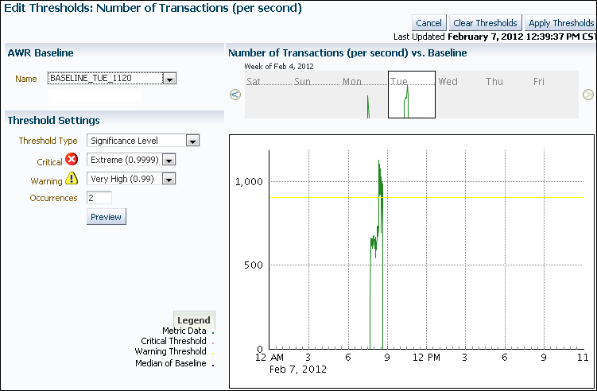

> The Edit Thresholds: Number of Transactions (per second) page is shown.
>
> At the upper right are the Cancel, Clear Thresholds, and Apply Thresholds buttons. Below them is a label-value pair. The label is Last Updated and the value is February 7, 2012 12:39?27 PM CST
>
> The AWR Baseline section has the Name list. The value BASELINE\_THU\_1530 is selected.
>
> The Number of Transactions (per second) vs. Baseline section has a chart. The legend over the chart says: Week of Feb 4, 2012. The chart has the days of the week: Sat, Sun, Mon, Tue, Wed, Thu, Fri. Tue is outlined. The outlined section is enlarged in another chart. In the second chart the y-axis measures metric data. The gradations of the y-axis go from 0 to 1000. The x-axis has times of the day in 3-hour increments. It goes from 12 a.m. to 11 p.m. on Feb 7, 2012. The activity spikes at 8:15 p.m. to 1200. A warning threshold line runs along the x-axis at 925 on the y-axis.
>
> The Threshold Setting sections includes: the Threshold Type list, with Significance Level selected; the Critical list, with Extreme (0.9999) selected; the Warning list, with Very High (0.99) selected; the Occurrences field, with 2 shown; the Preview button.
>
> End of description.

	The charts on this page provide simple and detailed views of metric activity for a 24-hour period. In the top simple chart, click a day to view the value of the metric plotted against a 24-hour period.
4. Under AWR Baseline, in the Name list, select either the default SYSTEM\_MOVING\_WINDOW or the name of a baseline created in the AWR Baselines page.
	A baseline appears in the AWR Baseline list after you have scheduled statistics computation from the AWR Baselines page and the statistics have finished computing on the static baseline.
	In this example, `BASELINE_TUE_1120` is selected.
	The page refreshes to show the charts for the baseline that you selected.
5. In the Threshold Settings section, complete the following steps to change the settings:
	1. In the Threshold Type list, select a type.
		2. In the Critical list, select a level.
		3. In the Warning list, select a value.
		4. In the Occurrences list, select a value.
6. Click Apply Thresholds.
	The Baseline Metric Thresholds page reappears. The page shows the altered metric threshold settings.

### Running the AWR Compare Periods Reports

This section describes how to run the AWR Compare Periods reports using Enterprise Manager Cloud Control (Cloud Control).

You can use AWR Compare Periods reports to compare the database performance between two time periods by:

- Comparing a Baseline to Another Baseline or Pair of Snapshots
- Comparing Current System Performance to a Baseline Period
- Comparing Two Pairs of Snapshots

#### Comparing a Baseline to Another Baseline or Pair of Snapshots

When performance degradation occurs over time, you can run the AWR Compare Periods report to compare the degraded performance, captured as a new baseline or a pair of snapshots, to an existing baseline. You must have a baseline that represents the system operating at an optimal level. If an existing baseline is unavailable, then compare database performance between two periods of time using two arbitrary pairs of snapshots, as described in " Comparing Two Pairs of Snapshots ".

To compare a baseline to another baseline:

1. Access the Database Home page for the target database.
	See " [Accessing the Database Home Page](introduction.md) " for more information.
2. From the Performance menu, select AWR, then AWR Administration.
	If the Database Login page appears, then log in as a user with administrator privileges. The Automatic Workload Repository page appears.
	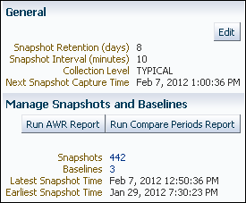

> A portion of the Automatic Workload Repository page is shown.
>
> In the General section, an Edit button is at the upper right.
>
> The section contains 4 label-value pairs.
>
> The Snapshot Retention (days) label has the value 8.
>
> The Snapshot Interval (minutes) label has the value 10.
>
> The Collection Level label has the value TYPICAL.
>
> The Next Snapshot Capture Time label has the value Feb 7, 2012 1:00:36 PM.
>
> The Manage Snapshots and Baselines section the buttons Run AWR Report and Run Compare Periods Report.
>
> The section contains 4 label-value pairs.
>
> The Snapshots label has the value 442. The value is a link.
>
> The Baselines label as the value 3. The value is a link
>
> The Latest Snapshot Time is Feb 7, 2012 12:50:36 PM.
>
> The Earliest Snapshot Time is Jan 29, 2012 7:30:23 PM.
>
> End of description.

3. Under Manage Snapshots and Baselines, click the link next to Baselines.
	The AWR Baselines page appears.
4. Complete the following steps:
	1. Select the baseline to use for the report.
		At least one existing baseline must be available.
	2. From the Actions list, select Compare Periods and then click Go.
	The Compare Periods: Second Period Start page appears. Under First Period, the selected baseline is displayed.
	In this example, the baseline named `BASELINE_TUE_1120` is selected.
	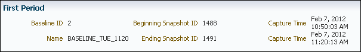

> The First Period section is shown.
>
> The section contains six label-value pairs. The Baseline ID label has the value 2. The Name label has the value BASELINE\_TUE\_1120. The Beginning Snapshot ID has the value 1488. The Ending Snapshot ID label has the value 1491. The Capture Time label has the value Feb 7, 2012 10:50:03 AM. The Capture Time label has the value Feb 7, 2012 11:20:13 AM.
>
> End of description.

5. Compare the baseline selected in the first period to another baseline or a pair of snapshots. Do one of the following:
	- To compare to another baseline, select Select a Baseline and the baseline you want to use in the second period, and then click Next.
		The Compare Periods: Review page appears.
	- To compare to a pair of snapshots, select Select Beginning Snapshot and the beginning snapshot to use in the second period, and then click Next.
		This example selects snapshot 18, taken on February 7, 2012 at 1:00 p.m.
		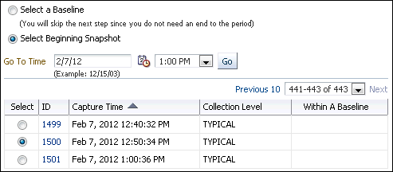

> A portion of the Compare Periods: Second Period Start page is shown.
>
> The Select a Baseline and Select Beginning Snapshot options (selected) are shown. Underneath Select Beginning Snapshot is the Go To Time field. The value is 2/7/12. A list shows the value 1:00 PM. A Go button is next to the list.
>
> Underneath the Go To Time field is a table. The table has the following columns: Select (values are shown as selectable options), ID (values are shown as links), Capture Time, Collection Level, and Within A Baseline (values shown as check marks). The table has 3 rows, with row 2 selected. Row 2 has the values: (selected option), 1500, Feb 7, 2012 12:50:34 PM, TYPICAL, and null.
>
> End of description.

		The Compare Periods: Second Period End appears. Proceed to the next step.
6. Select the ending snapshot for the snapshot period to include in the report and then click Next.
	In this example, snapshot 1500, taken on February 7, 2009 at 12:50 p.m., is selected.
	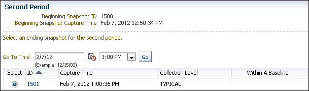

> The Second Period section is shown.
>
> The section has two label-value pairs. The Beginning Snapshot ID label has the value 1500. The Beginning Snapshot Capture Time label has the value Feb 7, 2012 12:50:34 PM.
>
> The Go To Time field has the value 2/7/12. The adjacent list has the value 1:00 PM. Next to the list is a Go button.
>
> A table has the following columns: Select (values shown as selectable options), ID (values shown as links), Capture Time, Collection Level, and Within a Baseline. The table has one rows. The row has the following values: (selected option), 1501, Feb 7 2012 1:00:36 PM, TYPICAL, null.
>
> End of description.

	The Compare Periods: Review page appears.
	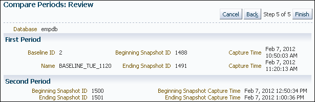

> The Compare Periods: Review section is shown.
>
> At the top right are the following buttons: Cancel, Back, and Finish. Between the Back and Finish buttons is the text, "Step 5 of 5".
>
> On the left side is a label-value pair. The name is Database and the value is empdb.
>
> The First Period section contains six label-value pairs. The Baseline ID label has the value 2. The Name label has the value BASELINE\_TUE\_1120. The Beginning Snapshot ID has the value 1488. The Ending Snapshot ID label has the value 1491. The Capture Time label has the value Feb 7, 2012 10:50:03 AM. The Capture Time label has the value Feb 7, 2012 11:20:13 AM.
>
> The Second Period section has four label-value pairs. The Beginning Snapshot ID label has the value 1500. The Ending Snapshot ID label has the value 1501. The Beginning Snapshot Capture Time label has the value Feb 7, 2012 12:50:34 PM. The Ending Snapshot Capture Time label has the value Feb 7, 2012 11:20:36 PM.
>
> End of description.

7. Review the periods to be included in the report and then click Finish.
	The Compare Periods: Results page appears.
	Data from the selected periods appears under the General subpage. You can view data per second or per transaction by selecting an option from the View Data list.
	Note:
	If the time periods have different lengths, then the data is normalized over database time before calculating the difference so that periods of different lengths can be compared.
	In this example, almost every metric shows that more resources were consumed in the first period. The bar graphs indicate the proportions of the values in the two periods. The absence of bars indicates equivalent values. The report for this example shows significantly more database block changes per second and parse time in the first period than in the second.
	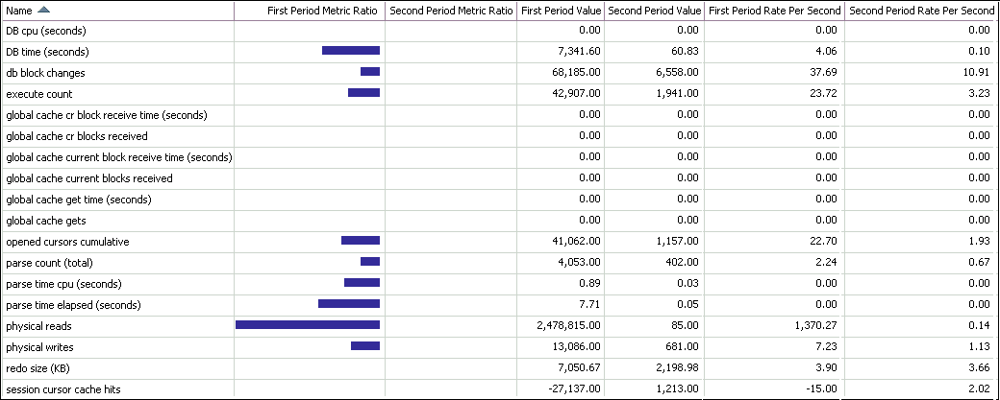

> This screenshot shows a table in the General tab of the Compare Periods: Results page.
>
> The table has the following columns: Name, First Period Metric Ratio (shown as a bar chart), Second Period Metric Ratio (shown as a bar chart), First Period Value, Second Period Value, First Period Rate Per Second, Second Period Rate Per Second.
>
> The table has 18 rows. The values in the rows are the following:
>
> Row 1: DB cpu (seconds), null, null, 0, 0, 0, 0.
>
> Row 2: DB time (seconds), (a bar about 43% of the column width), null, 7,341.60, 60.83, 4.06,.10.
>
> Row 3: db block changes, (a bar about 15% of the column width), null, 68,185, 6,558, 37.69, 10.91.
>
> Row 4: execute count, (a bar about 15% of the column width), null, 42,907, 1,941, 23.72, 3.23.
>
> Rows for the following metrics showed all 0s: global cache cr block receive time (seconds), global cache cr blocks received, global cache current block receive time (seconds), global cache current blocks received, global cache get time (seconds), global cache gets.
>
> Row 11: opened cursors cumulative, (a bar about 28% of the column width), null, 41,062.00, 1,157.00, 22.70, 1.93.
>
> Row 12: parse count (total), (a bar about 15% of the column width), null, 4,053, 402, 2.24,.67.
>
> Row 13: parse time cpu (seconds), (a bar about 26% of the column width), null,.89,.03, 0, 0.
>
> Row 14: parse time elapsed (seconds), (a bar about 44% of the column width), null, 7.71,.05, 0, 0.
>
> Row 15: physical reads, (a bar 100% of the column width), null, 2,478,815, 85, 1,370,.14.
>
> Row 16: physical writes, (a bar about 23% of the column width), null, 13,086, 681, 7.23, 1.13.
>
> Row 17: redo size (KB), (a bar less than 1% of the column width), null, 7,050.67, 2,198.98, 3.9, 3.66.
>
> Row 18: session cursor cache hits, null, -27,137, 1,213, -15, 2.02.
>
> End of description.

8. Click Report to view the report.
	The Processing: View Report page appears while the report is being generated. After it completes, the report appears.
9. Optionally, do the following:
	- To change periods, click Change Periods.
	- To save the report as an HTML file, click Save to File.

See Also:

- " Creating a Baseline "
- " Using the AWR Compare Periods Reports "

#### Comparing Current System Performance to a Baseline Period

You may have noticed a performance change on a production system and would like to know why, or you may have implemented a change to a production system and want to know the effect of the change, such as increased concurrency waits.

The Compare Period ADDM compares the performance of the database server in two time periods, and returns a report describing the performance changes and the root origin of the changes. The Advisor can analyze any Oracle RDBMS version 10.2.0.4 or later monitored by Cloud Control. The following procedure explains how to initiate a report from the Compare Period ADDM.

1. From the Performance menu, select AWR, then Compare Period ADDM.
2. From the Run Compare Period ADDM page, specify the desired comparison and base periods:
	- Comparison Period — Generally represents an improperly functioning time period. However, you could also use the advisor to understand why performance has improved now when compared with an earlier time period.
	- Base Period — Represents a known (baseline or reference) period in which the database is functioning properly. You should select a base period in which the performance was acceptable, and the workload was as similar or identical as possible.
3. Click Run to display the Database Compare Period Report.
4. Examine the sections of the report to understand the performance change between the two periods and the cause of the change:
	- Overview
		This portion of the report shows SQL commonality, which is the comparability between the base and comparison periods based on the average resource consumption of the SQL statements common to both periods.
		A commonality value of 100% means that the workload "signature" in both time periods is identical. A value of 0% means that the two time periods have no items in common for the specific workload dimension.
		Commonality is based on the type of input (that is, which SQL is executing) as well as the load of the executing SQL statements. Consequently, SQL statements running in only one time period, but not consuming significant time, do not affect commonality. Therefore, two workloads could have a commonality of 100% even if some SQL statements are running only in one of the two periods, provided that these SQL statements do not consume significant resources.
	- Configuration
		The information displayed shows base period and comparison period values for various parameters categorized by instance, host, and database.
	- Findings
		The findings can show performance improvements and identify the major performance differences caused by system changes. For negative outcomes, if you understand and remove the cause, the negative outcome can be eliminated.
		The values shown for the Base Period and Comparison Period represent performance with regard to database time.
		The Change Impact value represents a measurement of the scale of a change in performance from one time period to another. It is applicable to issues or items measured by the total database time they consumed in each time period. The absolute values are sorted in descending order.
		If the value is positive, an improvement has occurred, and if the value is negative, a regression has occurred. For instance, a change impact of -200% means that period 2 is three times as slow as period 1.
		You can run performance tuning tools, such as ADDM and the SQL Tuning Advisor, to fix issues in the comparison period to improve general system performance.
	- Resources
		The information shown here provides a summary of the division of database time for both time periods, and shows the resource usage for CPU, memory, I/O, and interconnect (Oracle RAC only).
5. Based on your observations, decide how to proceed to resolve performance regressions, then implement your action plan.

#### Comparing Two Pairs of Snapshots

If an existing baseline is unavailable, then you can compare database performance by using two arbitrary pairs of snapshots. Use one pair taken when the database is performing optimally, and another pair when the database is performing poorly. At least four snapshots must be available.

To compare performance using two pairs of snapshots:

1. Access the Database Home page.
	See " [Accessing the Database Home Page](introduction.md) " for more information.
2. From the Performance drop-down menu, select AWR and then Compare Periods Reports.
	If the Database Login page appears, then log in as a user with administrator privileges. The Run Compare Periods Report page appears.
3. In First Period, select By Snapshot.
4. In Begin Snapshot, click the magnifying glass icon.
	The Search and Select: Snapshots page appears.
5. Select the starting point for the first snapshot period to be included in the report, and then click Select.
	You are returned to the Run Compare Periods Report page.
6. In End Snapshot, click the magnifying glass icon.
	The Search and Select: Snapshots page appears.
7. Select the ending point for the first snapshot period to be included in the report, and then click Select.
	You are returned to the Run Compare Periods Report page.
8. Under Second Period, repeat Step [^1] through Step [^2].
9. Click Generate Report.
	The Report Results section appears on the Run Compare Periods Report page. The section contains the Workload Repository Compare Period Report.
10. Optionally, do the following:
	- To change periods, repeat Step [^1] through Step [^3].
		- To save the report as an HTML file, click Save to File.

### Using the AWR Compare Periods Reports

After an AWR Compare Periods report is generated for the time periods you want to compare, you can use it to analyze performance degradation. To learn how to create the report, see " Running the AWR Compare Periods Reports ".

Figure 9-1 shows a portion of an AWR Compare Periods report.

Figure 9-1 AWR Compare Periods Report

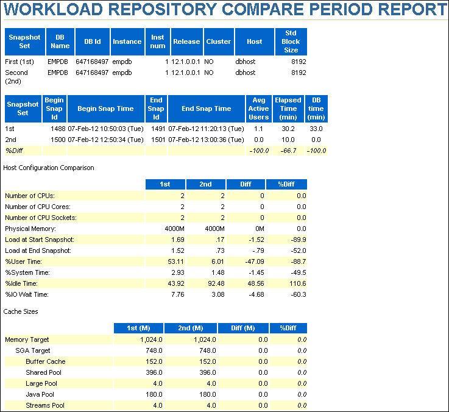

> The title is WORKLOAD REPOSITORY COMPARE PERIOD REPORT.
>
> The first table has the following columns: Snapshot Set, DB Name, DB Id, Instance, Inst num, Release, Cluster, Host, Std Block Size. The table has two rows. The values of the rows are the following:
>
> Row 1: First (1st), EMPDB, 647168497, empdb, 1, 12.1.0.0.1, NO, dbhost, 8192.
>
> Row 2 has the following values: Second (2nd), EMPDB, 647168497, empdb, 1, 12.1.0.0.1, NO, dbhost, 8192.
>
> The second table has the following columns: Snapshot Set, Begin Snap Id, Begin Snap Time, End Snap Id, End Snap Time, Avg Active Users, Elapsed Time (min), DB time (min). The table has three rows. The values of the rows are the following:
>
> Row 1: 1st, 1488, 07-Feb-12 10:50:03 (Tue), 1491, 07-Feb-12 11:20:13 (Tue), 1.1, 30.2, 33
>
> Row 2: 2nd, 1500, 07-Feb-12 12:50:34 (Tue), 1501, 07-Feb-12 11:20:13 (Tue), 0, 10, 0.
>
> Row 3: %Diff, null, null, null, null, -100, -66.7, -100.
>
> The Host Configuration Comparison section follows.
>
> The section contains a table with the following columns: null, 1st, 2nd, Diff, %Diff. The table has 10 rows. The values of the rows are the following:
>
> Row 1: Number of CPUs, 2, 2, 0, 0.
>
> Row 2: Number of CPU Cores: 2, 2, 0, 0.
>
> Row 3: Number of CPU Sockets: 2, 2, 0, 0.
>
> Row 4: Physical Memory, 4000M, 4000M, 0M, 0.
>
> Row 5: Load at Start Snapshot, 1.69,.17, -1.52, -88.9.
>
> Row 6: Load at End Snapshot, 1.52,.73, -.79, -52.
>
> Row 7: %User Time, 53.11, 6.01, -47.09, -88.7.
>
> Row 8: %System Time 2.93, 1.48, --1.45, -49.5.
>
> Row 9: %Idle Time, 43.92, 92.46, 48.56, 110.6.
>
> Row 10: %IO Wait Time, 7.78, 3.08, -4.68, -60.3.
>
> The Cache Sizes section follows.
>
> The section contains a table with the following columns: null, 1st (M), 2nd (M), Diff (M), %Diff. The table has 7 rows. The values of the rows are the following:
>
> Row 1: Memory Target, 1,024, 1,024, 0, 0.
>
> Row 2: (indented under Memory Target) SGA Target, 748, 748, 0, 0.
>
> Row 3: (indented under SGA Target) Buffer Cache, 152, 152, 0, 0.
>
> Row 4: (indented under SGA Target) Shared Pool, 396, 396, 0, 0.
>
> Row 5: (indented under SGA Target) Large Pool, 4, 4, 0, 0.
>
> Row 6: (indented under SGA Target) Java Pool, 180, 180, 0, 0.
>
> Row 5: (indented under SGA Target) Streams Pool, 4, 4, 0, 0.
>
> Row 6: (indented under Memory Target) PGA Target, 276, 276, 0, 0.
>
> Row 7: Log Buffer, 5.4, 5.4, 0, 0.
>
> The Load Profile section follows.
>
> The section contains a table with the following columns: null, 1st per sec, 2nd per sec, %Diff, 1st per txn, 2nd per txn, %Diff. The table has 3 rows showing. The values of the rows are the following:
>
> Row 1: DB time, 1.1, 0, -100, 18.5,.1, -99.7.
>
> Row 2: CPU time, 1, 0, -100, 16.6,.1, -99.7.
>
> Row 3: Redo size, 3,990.2, 3,740.6, 67,475.6, 173,212.3, 156.7.
>
> End of description.

The AWR Compare Periods report is divided into the following sections:

- Summary of the AWR Compare Periods Report
- Details of the AWR Compare Periods Report
- Supplemental Information in the AWR Compare Periods Report

#### Summary of the AWR Compare Periods Report

The report summary is at the beginning of the AWR Compare Periods report, and summarizes information about the snapshot sets and loads used in the report. The report summary contains the following sections:

- Snapshot Sets
- Host Configuration Comparison
- Cache Sizes
- Load Profile
- Top Timed Events

##### Snapshot Sets

The Snapshot Sets section displays information about the snapshot sets used for this report, such as instance, host, and snapshot information.

In the example shown in Figure 9-1, the first snapshot period corresponds to the time when performance was stable on February 7 from 10:50 to 11:20. The second snapshot period corresponds to the time when performance degradation occurred on the same day from 12:50 to 13:00.

##### Host Configuration Comparison

The Host Configuration Comparison section compares the host configurations used in the two snapshot sets. For example, the report compares physical memory and number of CPUs. Differences in the configurations are quantified as percentages in the %Diff column.

##### Cache Sizes

The Cache Sizes section compares the database configurations used in the two snapshot sets. For example, the report compares the SGA and log buffer size. Differences in the configurations are quantified as percentages in the %Diff column.

##### Load Profile

The Load Profile section compares the loads used in the two snapshot sets. Differences in the loads are quantified as percentages in the %Diff column.

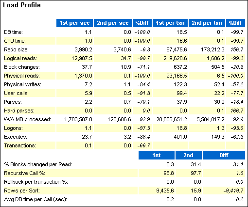

> The screenshot shows the Load Profile section of the AWR report. Refer to the complete text description of the report.
>
> The section contains two tables. The first table has the following columns: null, 1st per sec, 2nd per sec, %Diff, 1st per txn, 2nd per txn, %Diff. The table has 14 rows. The values of the rows are the following:
>
> Row 1: DB time, 1.1, 0, -100, 18.5,.1, -99.7.
>
> Row 2: CPU time, 1, 0, -100, 16.6,.1, -99.7.
>
> Row 3: Redo size, 3,990.2, 3,740.6, 67,475.6, 173,212.3, 156.7.
>
> Row 4: Logical reads, 12,987.5, 34.7, -99.7, 219,620.6, 1,606.2, -99.3.
>
> Row 5: Block changes, 37.7, 10.9, -71.1, 637.2, 504.5, 020.8.
>
> Row 6: Physical read, 1,370,.1, -100, 23,166.5, 6.5, -100.
>
> Row 7: Physical writes, 7.2, 1.1, -84.4, 122.3, 52.4, -57.2.
>
> Row 8: User calls, 5.9,.5, -91.8, 99.4, 22.2, -77.7.
>
> Row 9: Parses, 2.2,.7, -70.1, 37.9, 30.9, -18.4.
>
> Row 10: Hard parses, 0, 0, 0,.1, 166.7.
>
> Row 11: VWA MB processed, 1,703,507.8, 120,606.6, -92.9, 28,806,651.2, 5,584,817.2, -92.9.
>
> Row 12: Logons, 1.1, 0, -97.3, 18.8, 1.3, -93.
>
> Row 13: Executes, 23.7, 3.2, -86.4, 401, 149.3, -62.8.
>
> Row 14: Transactions,.1, 0, -66.7, null, null, null.
>
> The second table has the following columns: null, 1st, 2nd, Diff. The table has 5 rows. The values of the rows are the following:
>
> Row 1: % Blocks changed per Read.3, 31.4, 31.1.
>
> Recursive Call %, 96.8, 97.7, 1.
>
> Rollback per transaction %, 0, 0, 0.
>
> Rows per Sort, 9,435.6, 15.9, -9,491.7.
>
> Avg DB time per Call (sec),.2, 0, -.2.
>
> End of description.

In this example, the DB time per second was 100% higher in the first period. CPU time per second was 100% higher.

##### Top Timed Events

The Top Timed Events section is one of the most useful sections in the report. This section displays the five timed events or operations that consumed the highest percentage of total DB time in each of the snapshot sets.

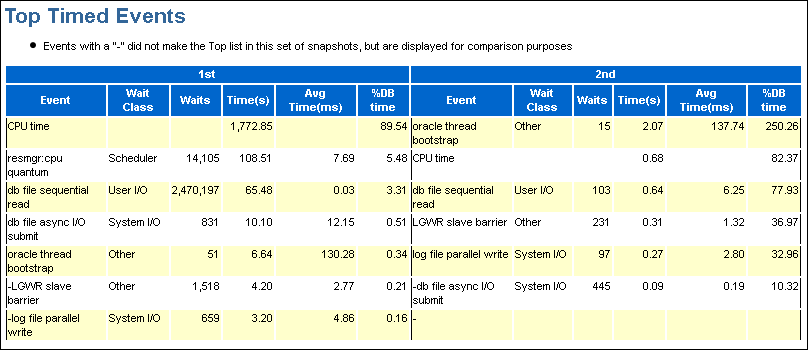

> The Top Timed Events section of the AWR Compare Periods report is shown. The section has a table that has two top-level columns. Before the table is a sentence that says the following: Events with a "-" did not make the Top list in this set of snapshots, but are displayed for comparison purposes.
>
> The names of the columns of the table are 1st and 2nd. Each column has six columns. Those column names are Event, Wait Class, Waits, Time(s), %DB time. There are seven rows of events, in descending order of the percentage of database time used.
>
> The values for the rows of the 1st column are the following:
>
> Row 1: CPU time, null, null, 1,772.85, null, 89.54.
>
> Row 2: resmgr:cpu quantum, Scheduler, 14,105, 108.51, 7.69, 5.48.
>
> Row 3: db file sequential read, User I/O, 2,470,197, 65.48,.03, 3.31
>
> Row 4: db file async I/O submit, System I/O, 831, 10.10, 12.15,.51.
>
> Row 5: oracle thread bootstrap, Other, 51, 6.64, 130.28,.34.
>
> Row 6: -LGWR slave barrier, Other, 1,518, 4.2, 2.77,.21.
>
> Row 7: -log file parallel write, System I/O, 659, 3.20, 4.86,.18
>
> The values for the rows of the 2nd column are the following:
>
> Row 1: oracle thread bootstrap, Other, 15, 2.07, 137.74, 250.26.
>
> Row 2: CPU time, null, null,.68, null, 82.37.
>
> Row 3: db file sequential read, User I/O, 103,.64, 6.25, 77.03.
>
> Row 4: LGWR slave barrier, Other, 231,.31, 1.32, 36.9.7
>
> Row 5: log file parallel write, System I/O, 97,.27, 2.8, 32.96.
>
> Row 6: -db file async I/O submit, System I/O, 445,.09,.19, 10.32.
>
> \-, null, null, null, null, null.
>
> End of description.

In this example, CPU time and the number of waits for database file sequential reads are significantly higher in the first period than in the second.

#### Details of the AWR Compare Periods Report

The Report Details section follows the summary of the AWR Compare Periods report, and provides statistics about the snapshot sets and loads used in the report. For example, the section includes statistics for time model statistics, wait events, SQL execution time, and instance activity.

#### Supplemental Information in the AWR Compare Periods Report

The supplemental information is at the end of the AWR Compare Periods report, and provides additional information about initialization parameters and SQL statements. The init.ora Parameters section lists all the initialization parameter values for the first snapshot set. The Complete List of SQL Text section lists each statement by SQL ID and shows the text of the SQL statement.

[^1]: In First Period, select By Snapshot.

[^undefined]: In Begin Snapshot, click the magnifying glass icon.

The Search and Select: Snapshots page appears.

[^undefined]: Select the starting point for the first snapshot period to be included in the report, and then click Select.

You are returned to the Run Compare Periods Report page.

[^undefined]: In End Snapshot, click the magnifying glass icon.

The Search and Select: Snapshots page appears.

[^2]: Select the ending point for the first snapshot period to be included in the report, and then click Select.

You are returned to the Run Compare Periods Report page.

[^undefined]: Under Second Period, repeat Step 3 through Step 7.

[^3]: Click Generate Report.

The Report Results section appears on the Run Compare Periods Report page. The section contains the Workload Repository Compare Period Report.

[^undefined]: Optionally, do the following:

- To change periods, repeat Step 3 through Step 9.
- To save the report as an HTML file, click Save to File.