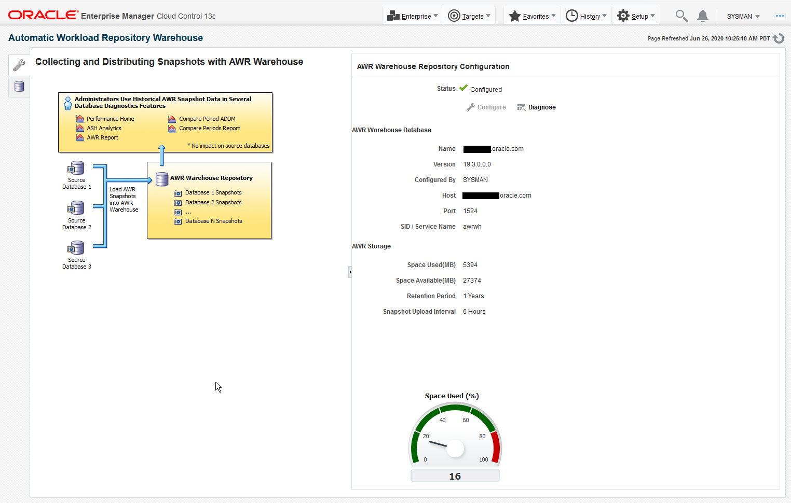
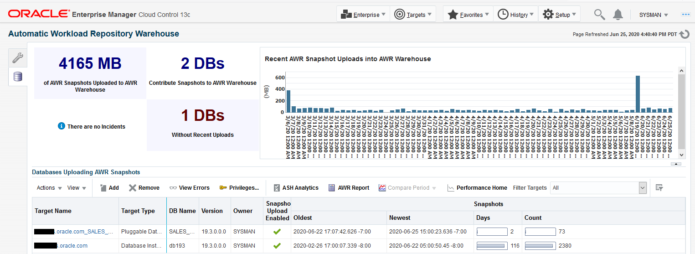
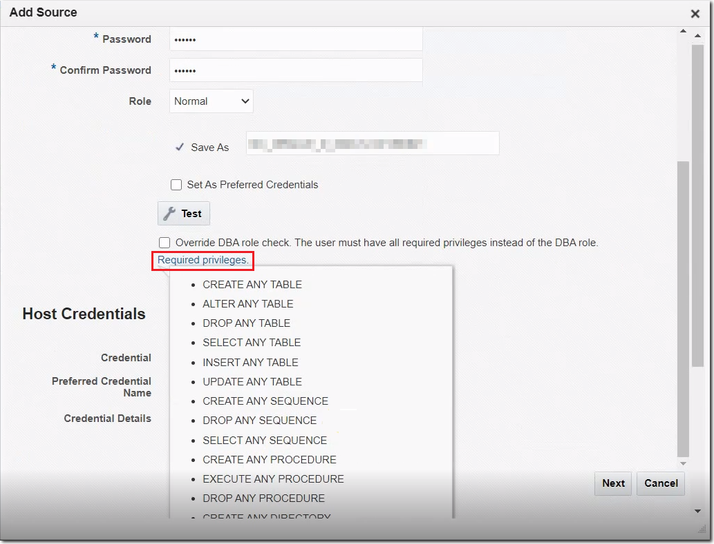
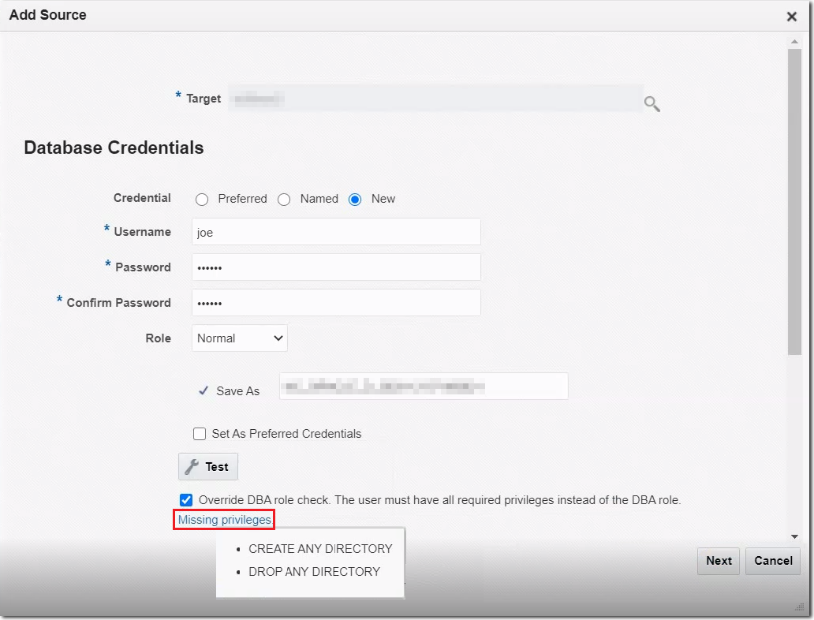

The Enterprise Manager AWR Warehouse enables you to consolidate and store detailed performance data from the Automatic Workload Repository of your important Oracle databases. This consolidated AWR Warehouse allows DBAs and developers to view and analyze historical performance data beyond the AWR retention period of the source database. Enterprise Manager extracts Automatic Workload Repository (AWR) data from one or more source database targets and transfers it into the AWR Warehouse, which is maintained independent of the source databases. The AWR Warehouse lets you keep a long-term history of AWR data, forever, if so configured, from the selected Enterprise Manager database targets. This enables long-term analysis of AWR data across databases without performance or storage impact on the source database targets.

Therefore, by uploading AWR data to a centralized AWR Warehouse, you free up space and improve performance on your production systems.

Starting in version 19c, AWR supports pluggable databases (PDB) as source databases that upload their AWR data to the warehouse. Also PDBs can be the AWR warehouse repository. This feature requires Oracle Database 12.2 and higher as the source or repository.

To configure an AWR warehouse, an Enterprise Manager administrator needs to designate an existing Enterprise Manager database target as the AWR Warehouse.

The warehouse target database must be version 12.1.0.2 or higher or version 11.2.0.4 with the appropriate patch. It also must be an equal or higher database version of the source databases it accommodates.

The warehouse is built in the `SYS` schema, using the `SYSAUX` tablespace by default. Starting Database 19c, it is possible to specify another tablespace to store the AWR data collected from all the source databases. This tablespace must exist on the Warehouse database.

To use the feature, you first need to set up an Oracle database that Enterprise Manager can use as the AWR Warehouse. After you set up the warehouse database, you can identify source databases whose repositories you want to extract and upload to the warehouse.

In Oracle Enterprise Manager 13c Platform Release 4 Update 2 (13.4.0.2). Active Data Guard (ADG) supports the switch over when the warehouse database or source database is configured with ADG and the primary database goes down and the standby database becomes the primary. After the switchover, the databases are automatically switched in the AWR warehouse.

### Setting Up the AWR Warehouse

Ensure that these prerequisites are satisfied before designating a database as the AWR Warehouse:

- The target database must be an existing version 12.1.0.2 or higher or 11.2.0.4 with the appropriate patch level managed target in Enterprise Manager Cloud Control. Oracle recommends that the selected database not be used by any other application and that the Enterprise Manager Cloud Control repository not be used as the warehouse.
- There is sufficient space available to accommodate the data to be uploaded, as a factor of per source database per day. Rule of thumb is a range of 4-10MB per database per day.
- You must have Super Administrator privileges to configure the AWR Warehouse.

1. From the Targets drop-down menu, select Databases.
	The Databases page appears with a list of the available target databases.
2. Access the Database Home page for the target database.
	See " [Accessing the Database Home Page](introduction.md) " for more information.
3. On the Databases page, click Performance drop-down, then select AWR Warehouse.
	If it has not previously been configured, a workflow diagram appears with aConfigure button in the right-hand pane. If it has been configured, the tool icon takes you to the configuration page.
	Prior to warehouse setup, the page displays a feature workflow on the left and configuration access on the right.
	
	Note:
	When adding a new AWR source database, you can specify dump locations for extract. The location should be a valid directory inside the source database host (or a shared location in case of a cluster) and accessible by the host credential specified. By default, the field is empty and means the dump file location is the default agent directory.
	After setup, the right side of the page summarizes the warehouse configuration and graphically depicts space used as a percentage of space available.
	
4. Click Configure in the pane to the right of the workflow diagram. The first configuration page (Repository) appears.
5. Click the search icon to select the database to serve as the AWR Warehouse.
6. Select the preferred or named credentials established for the target database. You can also provide new credentials.
	You can specify a password compliant with password policy for staging schema during warehouse configuration. If none specified, a complex random password is used by default.
7. Select the preferred or named credentials established for the target database host. You can also provide new credentials.
8. Click Next. The second configuration page (AWR Snapshot Management) appears.
9. Set the retention period to a number of years. Optionally, you can choose to retain the data indefinitely.
10. Set the snapshot upload interval. The default is 24 hours The minimum interval is one hour. You can also upload snapshots on-demand.
11. Select where on the warehouse database host to save exported dump files. For a single instance database, the location defaults to the agent state directory. For a cluster database, you have to specify a location that is accessible to all nodes.
12. Click Submit. This submits a job with the prefix `CAW_LOAD_SETUP_`.

After initial setup, the AWR Warehouse page becomes a dashboard where you can perform the following tasks:

- Add and remove source databases.
- Enable and disable snapshot uploads.
- Upload snapshots on-demand.
- Give administrators access to AWR data stored in the warehouse.
- Monitor and research incidents and errors.
- Run performance reports and analytics on the warehouse the same as you would on local AWRs.
- Edit Warehouse properties after the configuration is done with the Edit button. Properties that can be changed are:
	1. Database Credential
		2. Host Credential
		3. Retention period
		4. Upload Interval
		5. Staging Schema Password
	Note:
	Modifying Warehouse properties affects all the sources and overrides source level custom properties, if any.
- Edit the properties of a source database.
	1. Host Credential
		2. Database Credential
		3. Upload Interval
		4. Retention period
	Note:
	If you modify Host Credential, Database Credential, or Upload Interval, a `Reconfigure Job` is triggred and re-schedules the extract and transfer jobs with the new values.
- Specify dump locations for extract when adding a new AWR source database.
	Note:
	The location should be a valid directory inside the source database host (shared location in case of a cluster) and accessible by the host credential specified. By default, the field is empty and uses the default agent directory.

#### Working with Source Databases

Use the AWR Warehouse dashboard to manage the source databases that comprise the AWR warehouse, including the following activities:

- Add and remove source databases.
- Enable and disable snapshot uploads.
- Upload snapshots on-demand
- Grant view access to centrally stored AWR data.

Adding and Removing Source Databases

A source database whose AWR data you want to upload to the warehouse must be the same or earlier (to 10.2.0.4) as the version of the warehouse database. You can add and remove source databases provided you have access to the database target and to database credentials with execute privileges on the `sys.dbms_swrf_internal` package and the DBA role.

Click the Add button on the toolbar and select the source to add to the AWR Warehouse. The source can be a database or an Autonomous Data Warehouse (ADW).

- If the provided user does not have the DBA role, the message appears User does not have DBA privileges.
- The Required privileges link is displayed under the Override DBA role check box in the Add Source dialog box accessed from the AWR Warehouse dashboard. On clicking the Required privileges link, you can view the database privileges that the database user must have to add a source database to the AWR Warehouse.  
	
- To skip checking for the DBA role to allow a non-DBA database user to add a source database to AWR Warehouse, click on the checkbox for Override DBA role. When selected, the action happens without errors. However, the user has to ensure that the DB user provided has all required privileges in place of the DBA role. The Required privileges link is replaced with a Missing privileges link. On clicking the Missing privileges link, you can view the database privileges that the non-DBA database user must be granted to add a source database.  
	

If you are adding an ADW to the AWR Warehouse, the following are additional items required.

- An OCI credential, which is created in the Enterprise Manager.
- OCI storage URL.
- Bucket Name

To remove a source from the AWR Warehouse, select a source database or ADW on the dashboard and click the Remove button. When you remove a database, its data remains for a time until a job runs to clear the data. If you want to retain the data, disable the snapshot upload instead of removing the database.

Enabling and Disabling Snapshot Uploads

When you add a source database, its snapshot upload is enabled by default. You must be the owner or a proxy to disable (and re-enable) a source database's snapshot upload. When you disable an upload, any in-process job is allowed to complete prior to the cessation of an upload. When re-enabled, the upload resumes with the next scheduled upload.

Uploading Snapshots On-Demand

You can also upload a snapshot on-demand. Select a source database on the dashboard and then select Upload Snapshots Now from the Actions menu.

Granting View Access to AWR Snapshots

The source database owner can grant other Enterprise Manager Administrators view access to AWR snapshots stored in the AWR Warehouse.

1. Select a source database in the dashboard table and click the Privileges button in the toolbar.
2. In the dialog that opens, move administrator names from the Available list to the Selected list.
3. Click OK to grant view access to the selected names.

#### Uploading Snapshots to the AWR Warehouse

Upload of AWR snapshot data from source databases occurs as an ETL process, which is a series of jobs that perform ETL—Extract, Transfer, Load—processing.

Extract AWR Data

As part of the collection process, a DBMS job runs at regular intervals to collect AWR snapshots and create dumps in a staging area on the target host. Initially, this job collects existing AWR data and subsequently collects the latest snapshot in incremental fashion. If there is too much data to collect initially, the job staggers the collection process to avoid placing a burden on the source database.

Transfer AWR Data

An Enterprise Manager job runs at regular intervals on the respective host to transfer the source database AWR data to a staging area on the warehouse host for further processing. This job copies the dump files using an agent-to-agent file transfer mechanism. Upon successful upload to the warehouse, the dump file is removed from the host staging area.

Loading Transferred Data into the AWR Warehouse

A DBMS job runs at regular intervals to process multiple source database dump files and import them into the warehouse schema. This occurs incrementally to ensure snapshots were not already imported. As part of the import process, the job maps DB IDs to ensure uniqueness. This information is maintained in a separate table to handle duplicate DB IDs and to support multitenant scenarios; for example, multiple customers' data stored in a single AWR database, where there might be duplicate database names. AWR data remains in the warehouse up to the configurable retention period, after which it is purged.

Note:

You can also upload snapshots on-demand. Select a source database on the dashboard and then select Upload Snapshots Now from the Actions menu.

### Using Performance Pages with the AWR Warehouse

You can view historical data, charts, and reports from a configured AWR Warehouse, by switching the View Data mode to AWR Warehouse on the respective performance pages for a source database.

Performance Home Page

Use the Performance Home page with the AWR Warehouse as follows:

1. If you are already in the AWR Warehouse, skip to 5.
2. From the Targets drop-down menu, select Databases.
3. Select a database on the Enterprise Manager dashboard.
4. From the Performance drop-down menu, select AWR and then AWR Warehouse.
5. From AWR Warehouse dashboard, highlight a database.
6. Click the Performance Home button on the AWR toolbar.
	The Performance Home page displays in Historical - AWR Warehouse mode.
	Note:
	You do not have to log in to the source database to view this page.
	The AWR Warehouse selection is available only for databases that have been added as source databases and only to users who have been granted access.

See Also:

" [Monitoring User Activity](monitoring-real-time-database-performance.md) " for more information about the Performance Home page.

ASH Analytics Page

Use the ASH Analytics page with the AWR Warehouse as follows:

1. If you are already in the AWR Warehouse, skip to 5.
2. From the Targets drop-down menu, select Databases.
3. Select a database on the Enterprise Manager dashboard.
4. From the Performance drop-down menu, select AWR and then AWR Warehouse.
5. From AWR Warehouse dashboard, highlight a database.
6. Click the ASH Analytics button on the toolbar.
	The ASH Analytics page displays in Historical - AWR Warehouse mode.
	Note:
	You do not have to log in to the source database to view this page.

See Also:

" [Determining the Cause of Spikes in Database Activity](monitoring-real-time-database-performance.md) " for more information about ASH Analytics.

AWR Report Page

Use the AWR Report page with the AWR Warehouse as follows:

1. If you are already in the AWR Warehouse, skip to 5.
2. From the Targets drop-down menu, select Databases.
3. Select a database on the Enterprise Manager dashboard.
4. From the Performance drop-down menu, select AWR and then AWR Warehouse.
5. From AWR Warehouse dashboard, highlight a database.
6. Click the AWR Report button on the toolbar.
	The AWR Report page displays in Historical - AWR Warehouse mode. Note that you do not have to log in to the source database to view this page.
7. Click Generate Report.

See Also:

" [Resolving Performance Degradation Over Time](resolving-performance-degradation-over-time.md) " for more information about AWR Report.

Compare Period ADDM Page

Use the Compare Period ADDM page with the AWR Warehouse as follows:

1. If you are already in the AWR Warehouse, skip to 5.
2. From the Targets drop-down menu, select Databases.
3. Select a database on the Enterprise Manager dashboard.
4. From the Performance drop-down menu, select AWR and then AWR Warehouse.
5. From AWR Warehouse dashboard, highlight a database.
6. Select Compare Period ADDM from the Compare Period drop-down menu.
	The Compare Period ADDM page displays in Historical - AWR Warehouse mode. Note that you do not have to log in to the source database to view this page.
7. Complete Steps 1 and 2. Note that database selection in Step 2 lists all databases with AWR data in the warehouse to which you have access.
8. Click Run to run the comparison.

See Also:

" [Comparing Current System Performance to a Baseline Period](resolving-performance-degradation-over-time.md) " for more information about Compare Period ADDM.

Compare Periods Report

Use the Compare Periods Report page with the AWR Warehouse as follows:

1. If you are already in the AWR Warehouse, skip to 5.
2. From the Targets drop-down menu, select Databases.
3. Select a database on the Enterprise Manager dashboard.
4. From the Performance drop-down menu, select AWR and then AWR Warehouse.
5. From AWR Warehouse dashboard, highlight a database.
6. Select Compare Periods Report from the Compare Period drop-down menu.
	The Compare Periods Report page displays in Historical - AWR Warehouse mode. Note that you do not have to log in to the source database to view this page.
7. Complete First and Second Periods.
	Note:
	The selections for the two periods are derived from data in the warehouse. For the second period, you can select any database in the warehouse to which you have access.
8. Click Generate Report.

See Also:

" [Running the AWR Compare Periods Reports](resolving-performance-degradation-over-time.md) " for more information about Compare Periods Report.

### AWR Warehouse Best Practices

Oracle makes best practices recommendations from both a warehouse database perspective and an Enterprise Manager perspective.

#### Database Best Practices

##### Memory Management

Oracle recommends that you use Automatic Memory Management on the warehouse database to manage and tune it as required. To do this, set the target memory size initialization parameter (MEMORY\_TARGET) and optionally a maximum memory size initialization parameter (MEMORY\_MAX\_TARGET). The amount of target memory depends on the number of users of the warehouse. Set it to at least 2GB and modify it as needed depending on the load and other requirements.

When using manual memory management, set the sizes of SGA and instance PGA to sufficiently high enough values, minimally, 2GB. And if using manual shared memory management, set the sizes of individual SGA components, especially buffer cache size and shared pool size, to sufficiently high enough values.

##### Storage Requirements

By default, Oracle Database captures snapshots once every hour; the snapshot size varies depending on the database load. A typical system with an average of 10 concurrent active sessions may take anywhere from 1MB to 2MB per snapshot. Thus, the one hour default snapshot interval requires approximately 24MB to 48MB a day.

AWR data is stored in SYSAUX tablespace. The tablespace space required depends on the number of source databases. Using default settings with a typical load on source databases requires approximately 24MB to 48MB a day per source database.

To get a more accurate read on space requirements, run the `awrinfo.sql` script located in the `ORACLE_HOME/rdbms/admin` directory. In particular, see the "Size estimates for AWR snapshots" section, which contains "AWR size/day" and "AWR size/wk" values. On source databases, these values represent the average size of AWR data being generated on that database. On the AWR Warehouse database, these values represent the average size of AWR data imported from all the source databases. Use these values to estimate the warehouse space requirements. Naturally, as more source databases are added to the warehouse, the space required to store their AWR data increases.

Use Automatic Storage Management (ASM) with redundant disk groups and "Average Synchronous Single-Block Read Latency" of less than 40 milliseconds. The DBA\_HIST\_SYSMETRIC\_SUMMARY view contains this and other metrics related to storage and I/O.

Additionally, ensure that there is enough free disk space (approximately 50GB) on the warehouse host to store the dump files containing incoming AWR data from source databases until the data can be loaded into the warehouse database.

##### Backup

Oracle recommends that you back up the AWR Warehouse on a regular basis as a safeguard against any data loss. Using Data Guard along with RMAN ensures high availability and data protection.

##### Redo Log Size

It is important to size the redo logs correctly. A small redo results in frequent log switches affecting database performance. The amount of redo generated in AWR Warehouse varies based on the number of source databases moving their AWR data into the warehouse. Oracle recommends a minimum of 1GB redo log sizing.

##### Stats Collection

Gather statistics periodically, once a day at a minimum, for SYS and DBSNMP schemas to ensure that the stats are accurate.

##### The job\_queue\_processes Parameter

Set JOB\_QUEUE\_PROCESSES to a value greater than 0. Oracle scheduler jobs are responsible for importing AWR data. Setting the parameter ensures that job slaves are created to run the scheduler jobs.

##### Access Control

Ensure that users do not have direct access to the warehouse database as this will bypass the Enterprise Manager security model. The AWR Warehouse console in Enterprise Manager has an access control mechanism to control who can view data in the AWR Warehouse and for which source databases.

#### Enterprise Manager Best Practices

##### AWR Warehouse Credentials

When configuring an Enterprise Manager target as the AWR Warehouse Repository, select two credentials:

- Database credentials–AWR Warehouse requires SYSDBA credentials.
- Database host credentials–select credentials that have write permission on the dump file staging location. The default staging location is the agent state directory to which the agent user has the necessary permissions.

##### Source Database Credentials

Before adding source database targets to the AWR Warehouse Repository, set Preferred Credentials (Normal Credentials should be sufficient) for each of the source databases and their hosts. This facilitates adding multiple source databases at once (select multiple databases in the Search and Select: Database dialog).

- Database credentials–the database user requires the following:
	- DBA role
		- Execute privileges on `SYS.DBMS_SWRF_INTERNAL` package
- Database host credentials–the user should be the same as the agent user.

##### Staging Location on AWR Warehouse

AWR data from source databases moves as dump files to a staging location on the warehouse database host. You can configure the staging location when setting up the AWR Warehouse. For a single instance database, the location defaults to the agent state directory. For a cluster database, you have to specify a location that is accessible to all nodes.

##### Network Latency

AWR Warehouse uses the Agent-to-Agent file transfer method to move dump files from source databases to the warehouse database host. The connection between the source agent host and the warehouse agent host should have low network latency to avoid delays and problems during the transfer.

### Monitoring and Researching Incidents and Errors

With the constant movement of data, problems can occur at various stages of the upload process. The dashboard reports on incidents and errors so that you can trace and resolve issues. Consistent with Enterprise Manager best practices, you can use the existing frameworks to manage incidents, configure notifications, and so forth.

The graphical region of the dashboard provides an at-a-glance view of issues encountered overall during warehouse upload activity. When an incident is raised, a View Incidents link appears; click it to link directly to Incident Manager where you can drill down to research the details. The Guided Resolution section provides links to view any warehouse errors reported and to return to the AWR Warehouse dashboard.

You can proactively identify the points of failure after the AWR warehouse is configured and the ETL process started running between the source database and warehouse, by running a number of tests on the AWR warehouse or a select set of sources and determine the health of the AWR warehouse configuration.

To view errors related to a specific database source, select the database row in the dashboard and click View Errors on the toolbar.

Errors typically break down by activity—AWR Warehouse load, source database extract, transfer. Some of the more common errors and suggested resolutions are described below.

AWR Warehouse Load Errors

When SYSAUX tablespace on the AWR Warehouse is insufficient to accommodate the import of AWR snapshots, the import fails with the following errors:

```
ORA-20115: Data Pump import encountered error:
ORA-31626: job does not exist
ORA-31633: unable to create master table "SYS.SYS_IMPORT_FULL_27"
ORA-06512: at "SYS.DBMS_SYS_ERROR", line 95
ORA-06512: at "SYS.KUPV$FT", line 1048
ORA-01658: unable to create INITIAL extent for segment in tablespace SYSAUX
ORA-31626: job does not exist
```

Increase the SYSAUX tablespace to resolve the issue.

Load jobs use Data Pump to import AWR snapshot dumps. Data Pump jobs use a master table to track a job's progress. If an error occurs during import, the master table remains. As errors accumulate so too do master tables, eventually resulting in the following errors:

```
ORA-20115: Data Pump import encountered error:
ORA-31634: job already exists
ORA-31664: unable to construct unique job name when defaulted
ORA-31634: job already exists
```

The solution is to drop the master tables from the previous failed jobs. Query the `dba_datapump_jobs` view for jobs in the `NOT RUNNING` state, as follows:

```
SELECT job_name
FROM dba_datapump_jobs
WHERE owner_name='SYS'
 AND operation='IMPORT'
 AND job_mode='FULL'
 AND job_name like 'SYS_IMPORT_%'
 AND state='NOT RUNNING';
```

Caution:

There may be cases where a job name the query returns is in use by an active Data Pump job. Ensure that there are no active Data Pump jobs to avoid mistakenly deleting their master tables.

The patch that enables the AWR Warehouse feature includes a fix for the legacy master tables, so you should not encounter this problem after applying the patch.

When an active Data Pump job exits ungracefully (it aborts or the database shuts down, for example), subsequent jobs fail with the following errors:

```
ORA-39097: Data Pump job encountered unexpected error -56935
ORA-39065: unexpected master process exception in DISPATCH
ORA-56935: existing datapump jobs are using a different version of time zone data file
```

To resolve the issue, check database properties for certain values on database startup and take appropriate action, as follows:

```
SELECT property_name, property_value
FROM sys.database_properties
WHERE property_name in ('DST_UPGRADE_STATE', 'DST_SECONDARY_TT_VERSION');
```

If the query returns `'DATAPUMP'` and ` '<> 0'`, respectively, for the named properties, run the following:

```
exec dbms_dst.unload_secondary();
```

Note:

This Data Pump error can also happen during source database extraction.

When the source database time zone is ahead of the AWR Warehouse time zone, the following error occurs when importing the latest snapshot dumps:

```
ORA-20105: Unable to move AWR data to SYS
ORA-06512: at "SYS.DBMS_SWRF_INTERNAL", line 4773
ORA-13555: Message 13555 not found;  product=RDBMS; facility=ORA;
arguments: [end_time is greater than SYSDATE]
```

No action is necessary. The issue self-corrects when the `SYSDATE` of the AWR Warehouse advances past the date of the dump file.

Source Database Extract Errors

When SYSAUX tablespace on the source database is insufficient to accommodate the extract of AWR snapshots, the extract fails with the following errors:

```
ORA-20115: Data Pump export encountered error:
ORA-31626: job does not exist
ORA-31633: unable to create master table "SYS.SYS_EXPORT_TABLE_08"
ORA-06512: at "SYS.DBMS_SYS_ERROR", line 95
ORA-06512: at "SYS.KUPV$FT", line 1048
ORA-01658: unable to create INITIAL extent for segment in tablespace SYSAUX
ORA-06512: at "SYS.DBMS_SWRF_INTERNAL", line 2159
ORA-31626: job does not exist
```

Increase the SYSAUX tablespace to resolve the issue.

Extract jobs use Data Pump to export AWR snapshot dumps. Data Pump jobs use a master table to track a job's progress. If an error occurs during export, the master table remains. As errors accumulate so too do master tables, eventually resulting in the following errors:

```
ORA-20115: Data Pump import encountered error:
ORA-31634: job already exists
ORA-31664: unable to construct unique job name when defaulted
ORA-31634: job already exists
```

The solution is to drop the master tables from the previous failed jobs. Query the `dba_datapump_jobs` view for jobs in the `NOT RUNNING` state, as follows:

```
SELECT job_name
FROM dba_datapump_jobs
WHERE owner_name='SYS'
 AND operation='EXPORT'
 AND job_mode='TABLE'
 AND job_name like 'SYS_EXPORT_%'
 AND state='NOT RUNNING';
```

Caution:

There may be cases where a job name the query returns is in use by an active Data Pump job. Ensure that there are no active Data Pump jobs to avoid mistakenly deleting their master tables.

The patch that enables the AWR Warehouse feature includes a fix for the legacy master tables, so you should not encounter this problem after applying the patch.

See also the Data Pump error under AWR Warehouse Load errors for another potential error during source database extraction.

Transfer Errors

If many dump files from a single source database are waiting to be loaded into the AWR Warehouse and their total size exceeds a threshold value (1 GB), the following error results:

```
The total size of dump files from the source database exceeds threshold value (size: xxx MB, threshold: xxx MB)
```

There appears to be an underlying problem loading dump files into the AWR Warehouse, resulting in a backlog of dump files. Check for and resolve any outstanding load errors to enable importing to resume.

If the total size of dump files from all source databases waiting to be loaded into the AWR Warehouse exceeds a threshold value (30 GB), the following error results:

```
The total size of dump files on AWR Warehouse exceeds threshold value (size: xxx MB, threshold: xxx MB)
```

Determine why there is a backlog of pending dump files in the load queue. Resolving the backlog issue will enable the load to resume.

### Using Autonomous Database Warehouse in Automatic Workload Repository

Autonomous Data Warehouse (ADW) is supported in AWR Warehouse. The ADW must be discovered as an Enterprise Manager (EM) target. In addition to other AWR information, the user needs to provide for ADW:

- A Named OCI Credential to access Object Store. This is created in EM.
- Object Store base URI.
- Bucket Name.

When the warehouse is ADW, these features are disabled in the AWR dashboard in EM:

- `Edit Warehouse`
- `Restore Warehouse` if the warehouse is on error state

If the EM does not detect when ADG switch-over has occurred for a database, you can manually restore the source database to the new ADG primary.