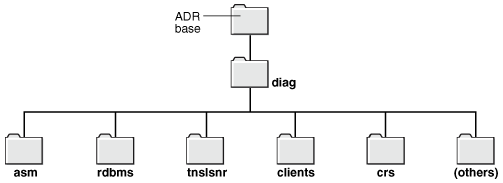
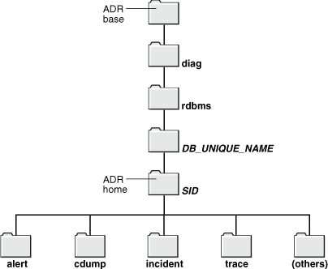
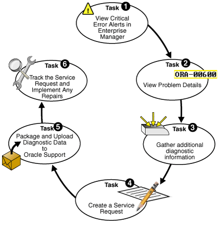
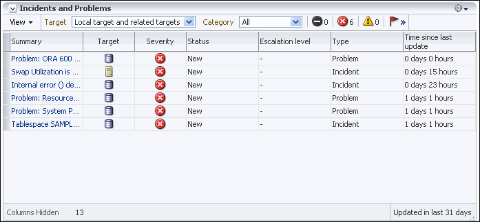
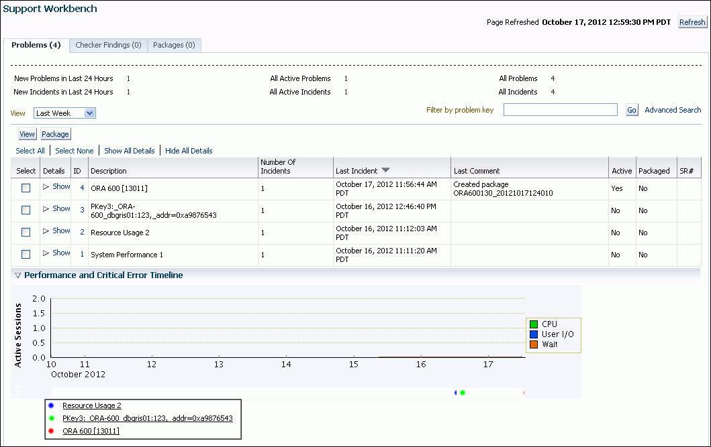
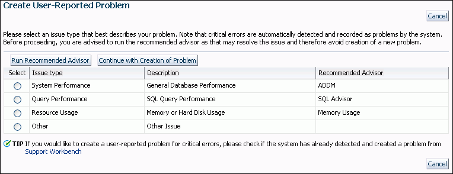
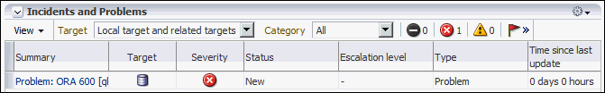
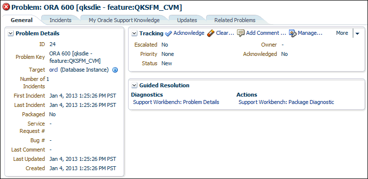
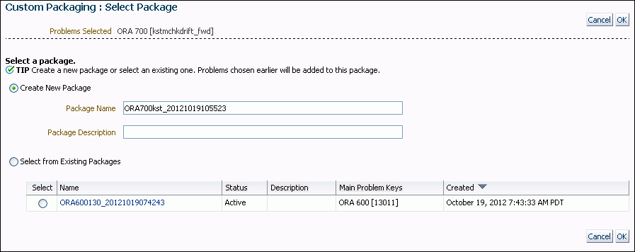
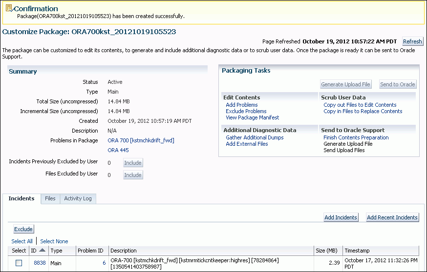

## 7 Diagnosing and Resolving Problems

Oracle Database includes an advanced fault diagnosability infrastructure for collecting and managing diagnostic data, so as to diagnose and resolve database problems. Diagnostic data includes the trace files, dumps, and core files that are also present in previous releases, plus new types of diagnostic data that enable customers and Oracle Support to identify, investigate, track, and resolve problems quickly and effectively.

**Parent topic:** [Basic Database Administration](basic-database-administration.md)

### 7.1 About the Oracle Database Fault Diagnosability Infrastructure

Oracle Database includes a fault diagnosability infrastructure for preventing, detecting, diagnosing, and resolving database problems.

- Fault Diagnosability Infrastructure Overview  
	The fault diagnosability infrastructure aids in preventing, detecting, diagnosing, and resolving problems. The problems that are targeted in particular are critical errors such as those caused by code bugs, metadata corruption, and customer data corruption.
- Incidents and Problems  
	A problem is a critical error in a database instance, Oracle Automatic Storage Management (Oracle ASM) instance, or other Oracle product or component. An incident is a single occurrence of a problem.
- Fault Diagnosability Infrastructure Components  
	The fault diagnosability infrastructure consists of several components, including the Automatic Diagnostic Repository (ADR), various logs, trace files, the Enterprise Manager Support Workbench, and the ADRCI Command-Line Utility.
- Structure, Contents, and Location of the Automatic Diagnostic Repository  
	The Automatic Diagnostic Repository (ADR) is a directory structure that is stored outside of the database. It is therefore available for problem diagnosis when the database is down.

**Parent topic:** Diagnosing and Resolving Problems

#### 7.1.1 Fault Diagnosability Infrastructure Overview

The fault diagnosability infrastructure aids in preventing, detecting, diagnosing, and resolving problems. The problems that are targeted in particular are critical errors such as those caused by code bugs, metadata corruption, and customer data corruption.

When a critical error occurs, it is assigned an incident number, and diagnostic data for the error (such as trace files) are immediately captured and tagged with this number. The data is then stored in the Automatic Diagnostic Repository (ADR)—a file-based repository outside the database—where it can later be retrieved by incident number and analyzed.

The goals of the fault diagnosability infrastructure are the following:

- First-failure diagnosis
- Problem prevention
- Limiting damage and interruptions after a problem is detected
- Reducing problem diagnostic time
- Reducing problem resolution time
- Simplifying customer interaction with Oracle Support

The keys to achieving these goals are the following technologies:

- Automatic capture of diagnostic data upon first failure—For critical errors, the ability to capture error information at first-failure greatly increases the chance of a quick problem resolution and reduced downtime. An always-on memory-based tracing system proactively collects diagnostic data from many database components, and can help isolate root causes of problems. Such proactive diagnostic data is similar to the data collected by airplane "black box" flight recorders. When a problem is detected, alerts are generated and the fault diagnosability infrastructure is activated to capture and store diagnostic data. The data is stored in a repository that is outside the database (and therefore available when the database is down), and is easily accessible with command line utilities and Oracle Enterprise Manager Cloud Control (Cloud Control).
- Standardized trace formats—Standardizing trace formats across all database components enables DBAs and Oracle Support personnel to use a single set of tools for problem analysis. Problems are more easily diagnosed, and downtime is reduced.
- Health checks—Upon detecting a critical error, the fault diagnosability infrastructure can run one or more health checks to perform deeper analysis of a critical error. Health check results are then added to the other diagnostic data collected for the error. Individual health checks look for data block corruptions, undo and redo corruption, data dictionary corruption, and more. As a DBA, you can manually invoke these health checks, either on a regular basis or as required.
- Incident packaging service (IPS) and incident packages—The IPS enables you to automatically and easily gather the diagnostic data—traces, dumps, health check reports, and more—pertaining to a critical error and package the data into a zip file for transmission to Oracle Support. Because all diagnostic data relating to a critical error are tagged with that error's incident number, you do not have to search through trace files and other files to determine the files that are required for analysis; the incident packaging service identifies the required files automatically and adds them to the zip file. Before creating the zip file, the IPS first collects diagnostic data into an intermediate logical structure called an incident package (package). Packages are stored in the Automatic Diagnostic Repository. If you choose to, you can access this intermediate logical structure, view and modify its contents, add or remove additional diagnostic data at any time, and when you are ready, create the zip file from the package. After these steps are completed, the zip file is ready to be uploaded to Oracle Support.
- Data Recovery Advisor—The Data Recovery Advisor integrates with database health checks and RMAN to display data corruption problems, assess the extent of each problem (critical, high priority, low priority), describe the impact of a problem, recommend repair options, conduct a feasibility check of the customer-chosen option, and automate the repair process.
- SQL Test Case Builder—For many SQL-related problems, obtaining a reproducible test case is an important factor in problem resolution speed. The SQL Test Case Builder automates the sometimes difficult and time-consuming process of gathering as much information as possible about the problem and the environment in which it occurred. After quickly gathering this information, you can upload it to Oracle Support to enable support personnel to easily and accurately reproduce the problem.

**Parent topic:** About the Oracle Database Fault Diagnosability Infrastructure

#### 7.1.2 Incidents and Problems

A problem is a critical error in a database instance, Oracle Automatic Storage Management (Oracle ASM) instance, or other Oracle product or component. An incident is a single occurrence of a problem.

- About Incidents and Problems  
	To facilitate diagnosis and resolution of critical errors, the fault diagnosability infrastructure introduces two concepts for Oracle Database: problems and incidents.
- Incident Flood Control  
	It is conceivable that a problem could generate dozens or perhaps hundreds of incidents in a short period of time. This would generate too much diagnostic data, which would consume too much space in the ADR and could possibly slow down your efforts to diagnose and resolve the problem. For these reasons, the fault diagnosability infrastructure applies flood control to incident generation after certain thresholds are reached.
- Related Problems Across the Topology  
	For any problem identified in a database instance, the diagnosability framework can identify related problems across the topology of your Oracle Database installation.

**Parent topic:** About the Oracle Database Fault Diagnosability Infrastructure

##### 7.1.2.1 About Incidents and Problems

To facilitate diagnosis and resolution of critical errors, the fault diagnosability infrastructure introduces two concepts for Oracle Database: problems and incidents.

A problem is a critical error in a database instance, Oracle Automatic Storage Management (Oracle ASM) instance, or other Oracle product or component. Critical errors manifest as internal errors, such as `ORA-00600`, or other severe errors, such as `ORA-07445` (operating system exception) or `ORA-04031` (out of memory in the shared pool). Problems are tracked in the ADR. Each problem has a problem key, which is a text string that describes the problem. It includes an error code (such as `ORA` `600`) and in some cases, one or more error parameters.

An incident is a single occurrence of a problem. When a problem (critical error) occurs multiple times, an incident is created for each occurrence. Incidents are timestamped and tracked in the Automatic Diagnostic Repository (ADR). Each incident is identified by a numeric incident ID, which is unique within the ADR. When an incident occurs, the database:

- Makes an entry in the alert log.
- Sends an incident alert to Cloud Control.
- Gathers first-failure diagnostic data about the incident in the form of dump files (incident dumps).
- Tags the incident dumps with the incident ID.
- Stores the incident dumps in an ADR subdirectory created for that incident.

Diagnosis and resolution of a critical error usually starts with an incident alert. Incident alerts are displayed on the Cloud Control Database Home page or Oracle Automatic Storage Management Home page. The Database Home page also displays in its Related Alerts section any critical alerts in the Oracle ASM instance or other Oracle products or components. After viewing an alert, you can then view the problem and its associated incidents with Cloud Control or with the ADRCI command-line utility.

##### 7.1.2.2 Incident Flood Control

It is conceivable that a problem could generate dozens or perhaps hundreds of incidents in a short period of time. This would generate too much diagnostic data, which would consume too much space in the ADR and could possibly slow down your efforts to diagnose and resolve the problem. For these reasons, the fault diagnosability infrastructure applies flood control to incident generation after certain thresholds are reached.

A flood-controlled incident is an incident that generates an alert log entry, is recorded in the ADR, but does not generate incident dumps. Flood-controlled incidents provide a way of informing you that a critical error is ongoing, without overloading the system with diagnostic data. You can choose to view or hide flood-controlled incidents when viewing incidents with Cloud Control or the ADRCI command-line utility.

Threshold levels for incident flood control are predetermined and cannot be changed. They are defined as follows:

- After five incidents occur for the same problem key in one hour, subsequent incidents for this problem key are flood-controlled. Normal (non-flood-controlled) recording of incidents for that problem key begins again in the next hour.
- After 25 incidents occur for the same problem key in one day, subsequent incidents for this problem key are flood-controlled. Normal recording of incidents for that problem key begins again on the next day.

In addition, after 50 incidents for the same problem key occur in one hour, or 250 incidents for the same problem key occur in one day, subsequent incidents for this problem key are not recorded at all in the ADR. In these cases, the database writes a message to the alert log indicating that no further incidents will be recorded. As long as incidents continue to be generated for this problem key, this message is added to the alert log every ten minutes until the hour or the day expires. Upon expiration of the hour or day, normal recording of incidents for that problem key begins again.

**Parent topic:** Incidents and Problems

##### 7.1.2.3 Related Problems Across the Topology

For any problem identified in a database instance, the diagnosability framework can identify related problems across the topology of your Oracle Database installation.

In a single instance environment, a related problem could be identified in the local Oracle ASM instance. In an Oracle RAC environment, a related problem could be identified in any database instance or Oracle ASM instance on any other node. When investigating problems, you are able to view and gather information on any related problems.

A problem is related to the original problem if it occurs within a designated time period or shares the same execution context identifier. An execution context identifier (ECID) is a globally unique identifier used to tag and track a single call through the Oracle software stack, for example, a call to Oracle Fusion Middleware that then calls into Oracle Database to retrieve data. The ECID is typically generated in the middle tier and is passed to the database as an Oracle Call Interface (OCI) attribute. When a single call has failures on multiple tiers of the Oracle software stack, problems that are generated are tagged with the same ECID so that they can be correlated. You can then determine the tier on which the originating problem occurred.

**Parent topic:** Incidents and Problems

#### 7.1.3 Fault Diagnosability Infrastructure Components

The fault diagnosability infrastructure consists of several components, including the Automatic Diagnostic Repository (ADR), various logs, trace files, the Enterprise Manager Support Workbench, and the ADRCI Command-Line Utility.

- Automatic Diagnostic Repository (ADR)  
	The ADR is a file-based repository for database diagnostic data such as traces, dumps, the alert log, health monitor reports, and more. It has a unified directory structure across multiple instances and multiple products.
- Alert Log  
	The alert log is an XML file that is a chronological log of messages and errors.
- Attention Log  
	The attention log is a structured, externally modifiable file that contains information about critical and highly visible database events. Use the attention log to quickly access information about critical events that need action.
- Trace Files, Dumps, and Core Files  
	Trace files, dumps, and core files contain diagnostic data that are used to investigate problems. They are stored in the ADR.
- DDL Log  
	The data definition language (DDL) log is a file that has the same format and basic behavior as the alert log, but it only contains the DDL statements issued by the database.
- Debug Log  
	An Oracle Database component can detect conditions, states, or events that are unusual, but which do not inhibit correct operation of the detecting component. The component can issue a warning about these conditions, states, or events. The debug log is a file that records these warnings.
- Other ADR Contents  
	In addition to files mentioned in the previous sections, the ADR contains health monitor reports, data repair records, SQL test cases, incident packages, and more. These components are described later in the chapter.
- Enterprise Manager Support Workbench  
	The Enterprise Manager Support Workbench (Support Workbench) is a facility that enables you to investigate, report, and in some cases, repair problems (critical errors), all with an easy-to-use graphical interface.
- ADRCI Command-Line Utility  
	The ADR Command Interpreter (ADRCI) is a utility that enables you to investigate problems, view health check reports, and package first-failure diagnostic data, all within a command-line environment.

**Parent topic:** About the Oracle Database Fault Diagnosability Infrastructure

##### 7.1.3.1 Automatic Diagnostic Repository (ADR)

The ADR is a file-based repository for database diagnostic data such as traces, dumps, the alert log, health monitor reports, and more. It has a unified directory structure across multiple instances and multiple products.

The database, Oracle Automatic Storage Management (Oracle ASM), the listener, Oracle Clusterware, and other Oracle products or components store all diagnostic data in the ADR. Each instance of each product stores diagnostic data underneath its own home directory within the ADR. For example, in an Oracle Real Application Clusters environment with shared storage and Oracle ASM, each database instance and each Oracle ASM instance has an ADR home directory. ADR's unified directory structure, consistent diagnostic data formats across products and instances, and a unified set of tools enable customers and Oracle Support to correlate and analyze diagnostic data across multiple instances. With Oracle Clusterware, each host node in the cluster has an ADR home directory.

Note:

Because all diagnostic data, including the alert log, are stored in the ADR, the initialization parameters `BACKGROUND_DUMP_DEST` and `USER_DUMP_DEST` are deprecated. They are replaced by the initialization parameter `DIAGNOSTIC_DEST`, which identifies the location of the ADR.

##### 7.1.3.2 Alert Log

The alert log is an XML file that is a chronological log of messages and errors.

There is one alert log in each ADR home. Each alert log is specific to its component type, such as database, Oracle ASM, listener, and Oracle Clusterware.

For the database, the alert log includes messages about the following:

- Critical errors (incidents)
- Administrative operations, such as starting up or shutting down the database, recovering the database, creating or dropping a tablespace, and others.
- Errors during automatic refresh of a materialized view
- Other database events

You can view the alert log in text format (with the XML tags stripped) with Cloud Control and with the ADRCI utility. There is also a text-formatted version of the alert log stored in the ADR for backward compatibility. However, Oracle recommends that any parsing of the alert log contents be done with the XML-formatted version, because the text format is unstructured and may change from release to release.

See Also:

- " ADRCI Command-Line Utility "
- " Viewing the Alert Log "

**Parent topic:** Fault Diagnosability Infrastructure Components

##### 7.1.3.3 Attention Log

The attention log is a structured, externally modifiable file that contains information about critical and highly visible database events. Use the attention log to quickly access information about critical events that need action.

There is one attention log for each database instance. The attention log contains a pre-determined, translatable series of messages, with one message for each event. Some important attributes of a message are as follows:

- Attention ID: A unique identifier for the message.
- Attention type: The type of attention message. Possible values are Error, Warning, Notification, or Additional information. The attention type can be modified dynamically.
- Message text
- Urgency: Possible values are Immediate, Soon, Deferrable, or Information.
- Scope: Possible values are Session, Process, PDB Instance, CDB Instance, CDB Cluster, PDB (for issues in persistent storage that a database restart will not fix), or CDB (for issues in persistent storage that a database restart will not fix).
- Target user: The user who must act on this attention log message. Possible values are Clusterware Admin, CDB admin, or PDB admin.
- Cause
- Action

Contents of the Attention Log

The following is an example of an attention log message that needs immediate action.

```
{
IMMEDIATE : "PMON (ospid: 3565): terminating the instance due to ORA error 822" 
CAUSE: "PMON detected fatal background process death"
ACTION: "Termination of fatal background is not recommended, Investigate cause of process termination"
CLASS : CDB-INSTANCE / CDB_ADMIN / ERROR / DBAL-35782660
TIME : 2020-03-28T14:15:16.159-07:00
INFO : "Some additional data on error PMON error"
}
```

##### 7.1.3.4 Trace Files, Dumps, and Core Files

Trace files, dumps, and core files contain diagnostic data that are used to investigate problems. They are stored in the ADR.

- Trace Files  
	Each server and background process can write to an associated trace file. Trace files are updated periodically over the life of the process and can contain information on the process environment, status, activities, and errors. In addition, when a process detects a critical error, it writes information about the error to its trace file.
- Dumps  
	A dump is a specific type of trace file. A dump is typically a one-time output of diagnostic data in response to an event (such as an incident), whereas a trace tends to be continuous output of diagnostic data.
- Core Files  
	A core file contains a memory dump, in an all-binary, port-specific format.

**Parent topic:** Fault Diagnosability Infrastructure Components

###### 7.1.3.4.1 Trace Files

Each server and background process can write to an associated trace file. Trace files are updated periodically over the life of the process and can contain information on the process environment, status, activities, and errors. In addition, when a process detects a critical error, it writes information about the error to its trace file.

The SQL trace facility also creates trace files, which provide performance information on individual SQL statements. You can enable SQL tracing for a session or an instance.

Trace file names are platform-dependent. Typically, database background process trace file names contain the Oracle SID, the background process name, and the operating system process number, while server process trace file names contain the Oracle SID, the string "ora", and the operating system process number. The file extension is `.trc`. An example of a server process trace file name is orcl\_ora\_344.trc. Trace files are sometimes accompanied by corresponding trace metadata (`.trm`) files, which contain structural information about trace files and are used for searching and navigation.

Starting with Oracle Database 21c, all trace file records contain a prefix that is used to classify records. The prefix indicates the level of sensitivity of each trace record. This helps in enhancing security.

Oracle Database includes tools that help you analyze trace files. For more information on application tracing, SQL tracing, and tracing tools, see Oracle Database SQL Tuning Guide.

###### 7.1.3.4.2 Dumps

A dump is a specific type of trace file. A dump is typically a one-time output of diagnostic data in response to an event (such as an incident), whereas a trace tends to be continuous output of diagnostic data.

When an incident occurs, the database writes one or more dumps to the incident directory created for the incident. Incident dumps also contain the incident number in the file name.

**Parent topic:** Trace Files, Dumps, and Core Files

###### 7.1.3.4.3 Core Files

A core file contains a memory dump, in an all-binary, port-specific format.

Core file names include the string "core" and the operating system process ID. Core files are useful to Oracle Support engineers only. Core files are not found on all platforms.

**Parent topic:** Trace Files, Dumps, and Core Files

##### 7.1.3.5 DDL Log

The data definition language (DDL) log is a file that has the same format and basic behavior as the alert log, but it only contains the DDL statements issued by the database.

The DDL log is created only for the RDBMS component and only if the `ENABLE_DDL_LOGGING` initialization parameter is set to `TRUE`. When this parameter is set to `FALSE`, DDL statements are not included in any log.

The DDL log contains one log record for each DDL statement issued by the database. The DDL log is included in IPS incident packages.

There are two DDL logs that contain the same information. One is an XML file, and the other is a text file. The DDL log is stored in the log/ddl subdirectory of the ADR home.

See Also:

[Oracle Database Reference](https://docs.oracle.com/pls/topic/lookup?ctx=en/database/oracle/oracle-database/21/admin&id=REFRN10302) for more information about the `ENABLE_DDL_LOGGING` initialization parameter

**Parent topic:** Fault Diagnosability Infrastructure Components

##### 7.1.3.6 Debug Log

An Oracle Database component can detect conditions, states, or events that are unusual, but which do not inhibit correct operation of the detecting component. The component can issue a warning about these conditions, states, or events. The debug log is a file that records these warnings.

These warnings recorded in the debug log are not serious enough to warrant an incident or a write to the alert log. They do warrant a record in a log file because they might be needed to diagnose a future problem.

The debug log has the same format and basic behavior as the alert log, but it only contains information about possible problems that might need to be corrected.

The debug log reduces the amount of information in the alert log and trace files. It also improves the visibility of debug information.

The debug log is included in IPS incident packages. The debug log's contents are intended for Oracle Support. Database administrators should not use the debug log directly.

Note:

Because there is a separate debug log starting with Oracle Database 12c, the alert log and the trace files are streamlined. They now contain fewer warnings of the type that are recorded in the debug log.

**Parent topic:** Fault Diagnosability Infrastructure Components

##### 7.1.3.7 Other ADR Contents

In addition to files mentioned in the previous sections, the ADR contains health monitor reports, data repair records, SQL test cases, incident packages, and more. These components are described later in the chapter.

**Parent topic:** Fault Diagnosability Infrastructure Components

##### 7.1.3.8 Enterprise Manager Support Workbench

The Enterprise Manager Support Workbench (Support Workbench) is a facility that enables you to investigate, report, and in some cases, repair problems (critical errors), all with an easy-to-use graphical interface.

The Support Workbench provides a self-service means for you to gather first-failure diagnostic data, obtain a support request number, and upload diagnostic data to Oracle Support with a minimum of effort and in a very short time, thereby reducing time-to-resolution for problems. The Support Workbench also recommends and provides easy access to Oracle advisors that help you repair SQL-related problems, data corruption problems, and more.

**Parent topic:** Fault Diagnosability Infrastructure Components

##### 7.1.3.9 ADRCI Command-Line Utility

The ADR Command Interpreter (ADRCI) is a utility that enables you to investigate problems, view health check reports, and package first-failure diagnostic data, all within a command-line environment.

You can then upload the package to Oracle Support. ADRCI also enables you to view the names of the trace files in the ADR, and to view the alert log with XML tags stripped, with and without content filtering.

For more information on ADRCI, see [Oracle Database Utilities](https://docs.oracle.com/pls/topic/lookup?ctx=en/database/oracle/oracle-database/21/admin&id=SUTIL700).

**Parent topic:** Fault Diagnosability Infrastructure Components

#### 7.1.4 Structure, Contents, and Location of the Automatic Diagnostic Repository

The Automatic Diagnostic Repository (ADR) is a directory structure that is stored outside of the database. It is therefore available for problem diagnosis when the database is down.

The ADR root directory is known as ADR base. Its location is set by the `DIAGNOSTIC_DEST` initialization parameter. If this parameter is omitted or left null, the database sets `DIAGNOSTIC_DEST` upon startup as follows:

- If environment variable `ORACLE_BASE` is set, `DIAGNOSTIC_DEST` is set to the directory designated by `ORACLE_BASE`.
- If environment variable `ORACLE_BASE` is not set, `DIAGNOSTIC_DEST` is set to ORACLE\_HOME/log.

Within ADR base, there can be multiple ADR homes, where each ADR home is the root directory for all diagnostic data—traces, dumps, the alert log, and so on—for a particular instance of a particular Oracle product or component. For example, in an Oracle Real Application Clusters environment with Oracle ASM, each database instance, Oracle ASM instance, and listener has an ADR home.

ADR homes reside in ADR base subdirectories that are named according to the product or component type. Figure 7-1 illustrates these top-level subdirectories.

Figure 7-1 Product/Component Type Subdirectories in the ADR



> This diagram shows a hierarchy of folders. The top folder is labeled ADR base. The single folder underneath it and connected to it by a straight line is named diag. Underneath diag are five folders, all connected to diag with straight lines, with the following names: asm, rdbms, tnslsnr, clients, and (others).


Note:

Additional subdirectories might be created in the ADR depending on your configuration. Some products automatically purge expired diagnostic data from ADR. For other products, you can use the ADRCI utility `PURGE` command at regular intervals to purge expired diagnostic data.

The location of each ADR home is given by the following path, which starts at the ADR base directory:

```
diag/product_type/product_id/instance_id
```

As an example, Table 7-1 lists the values of the various path components for an Oracle Database instance.

Table 7-1 ADR Home Path Components for Oracle Database

| Path Component | Value for Oracle Database |
| --- | --- |
| product\_type | rdbms |
| product\_id | `DB_UNIQUE_NAME` |
| instance\_id | SID |

For example, for a database with a SID and database unique name both equal to `orclbi`, the ADR home would be in the following location:

```
ADR_base/diag/rdbms/orclbi/orclbi/
```

Similarly, the ADR home path for the Oracle ASM instance in a single-instance environment would be:

```
ADR_base/diag/asm/+asm/+asm/
```

ADR Home Subdirectories

Within each ADR home directory are subdirectories that contain the diagnostic data. Table 7-2 lists some of these subdirectories and their contents.

Table 7-2 ADR Home Subdirectories

| Subdirectory Name | Contents |
| --- | --- |
| alert | The XML-formatted alert log |
| cdump | Core files |
| incident | Multiple subdirectories, where each subdirectory is named for a particular incident, and where each contains dumps pertaining only to that incident |
| trace | Background and server process trace files, SQL trace files, and the text-formatted alert log |
| (others) | Other subdirectories of ADR home, which store incident packages, health monitor reports, logs other than the alert log (such as the DDL log and the debug log), and other information |

Figure 7-2 illustrates the complete directory hierarchy of the ADR for a database instance.

Figure 7-2 ADR Directory Structure for a Database Instance



> This figure shows the directory structure of the ADR for a single database instance, where each directory is represented by a folder. At the top is a folder labeled as "ADR base". Beneath ADR base is a directory named diag, beneath which is a directory named rdbms. Beneath the rdbms directory is a directory whose name is the database name. Beneath that directory is a directory whole name is the database SID. This directory is flagged by a label as the ADR home for the database instance. Beneath the ADR home directory (the directory whose name is the database SID) are the following subdirectories: alert, cdump, incident, trace, and one named "(others)", which indicates several other ADR home subdirectories


ADR in an Oracle Clusterware Environment

Oracle Clusterware uses ADR and has its own Oracle home and Oracle base. The ADR directory structure for Oracle Clusterware is different from that of a database instance. There is only one instance of Oracle Clusterware on a system, so Clusterware ADR homes use only a system's host name as a differentiator.

When Oracle Clusterware is configured, the ADR home uses `crs` for both the product type and the instance ID, and the system host name is used for the product ID. Thus, on a host named `dbprod01`, the CRS ADR home would be:

```
ADR_base/diag/crs/dbprod01/crs/
```

See Also:

[Oracle Clusterware Administration and Deployment Guide](https://docs.oracle.com/pls/topic/lookup?ctx=en/database/oracle/oracle-database/21/admin&id=CWADD91091)

ADR in an Oracle Real Application Clusters Environment

In an Oracle Real Application Clusters (Oracle RAC) environment, each node can have ADR base on its own local storage, or ADR base can be set to a location on shared storage. You can use ADRCI to view aggregated diagnostic data from all instances on a single report.

ADR in Oracle Client

Each installation of Oracle Client includes an ADR for diagnostic data associated with critical failures in any of the Oracle Client components. The ADRCI utility is installed with Oracle Client so that you can examine diagnostic data and package it to enable it for upload to Oracle Support.

Viewing ADR Locations with the V$DIAG\_INFO View

The `V$DIAG_INFO` view lists all important ADR locations for the current Oracle Database instance.

```
SELECT * FROM V$DIAG_INFO;

INST_ID NAME                  VALUE
------- --------------------- -------------------------------------------------------------
      1 Diag Enabled          TRUE
      1 ADR Base              /u01/oracle
      1 ADR Home              /u01/oracle/diag/rdbms/orclbi/orclbi
      1 Diag Trace            /u01/oracle/diag/rdbms/orclbi/orclbi/trace
      1 Diag Alert            /u01/oracle/diag/rdbms/orclbi/orclbi/alert
      1 Diag Incident         /u01/oracle/diag/rdbms/orclbi/orclbi/incident
      1 Diag Cdump            /u01/oracle/diag/rdbms/orclbi/orclbi/cdump
      1 Health Monitor        /u01/oracle/diag/rdbms/orclbi/orclbi/hm
      1 Default Trace File    /u01/oracle/diag/rdbms/orclbi/orclbi/trace/orcl_ora_22769.trc
      1 Active Problem Count  8
      1 Active Incident Count 20
```

The following table describes some of the information displayed by this view.

Table 7-3 Data in the V$DIAG\_INFO View

| Name | Description |
| --- | --- |
| ADR Base | Path of ADR base |
| ADR Home | Path of ADR home for the current database instance |
| Diag Trace | Location of background process trace files, server process trace files, SQL trace files, and the text-formatted version of the alert log |
| Diag Alert | Location of the XML-formatted version of the alert log |
| Default Trace File | Path to the trace file for the current session |

Viewing Critical Errors with the V$DIAG\_CRITICAL\_ERROR View

The `V$DIAG_CRITICAL_ERROR` view lists all of the non-internal errors designated as critical errors for the current Oracle Database release. The view does not list internal errors because internal errors are always designated as critical errors.

The following example shows the output for the `V$DIAG_CRITICAL_ERROR` view:

```
SELECT * FROM V$DIAG_CRITICAL_ERROR;

FACILITY   ERROR
---------- ----------------------------------------------------------------
ORA        7445
ORA        4030
ORA        4031
ORA        29740
ORA        255
ORA        355
ORA        356
ORA        239
ORA        240
ORA        494
ORA        3137
ORA        227
ORA        353
ORA        1578
ORA        32701
ORA        32703
ORA        29770
ORA        29771
ORA        445
ORA        25319
OCI        3106
OCI        3113
OCI        3135
```

The following table describes the information displayed by this view.

Table 7-4 Data in the V$DIAG\_CRITICAL\_ERROR View

| Column | Description |
| --- | --- |
| `FACILITY` | The facility that can report the error, such as Oracle Database (ORA) or Oracle Call Interface (OCI) |
| `ERROR` | The error number |

See Also:

" About Incidents and Problems " for more information about internal errors

**Parent topic:** About the Oracle Database Fault Diagnosability Infrastructure

### 7.2 About Investigating, Reporting, and Resolving a Problem

You can use the Enterprise Manager Support Workbench (Support Workbench) to investigate and report a problem (critical error), and in some cases, resolve the problem. You can use a "roadmap" that summarizes the typical set of tasks that you must perform.

Note:

The tasks described in this section are all Cloud Control–based. You can also accomplish all of these tasks (or their equivalents) with the `ADRCI` command-line utility, with PL/SQL packages such as `DBMS_HM` and `DBMS_SQLDIAG`, and with other software tools. See [Oracle Database Utilities](https://docs.oracle.com/pls/topic/lookup?ctx=en/database/oracle/oracle-database/21/admin&id=SUTIL700) for more information on the `ADRCI` utility, and see [Oracle Database PL/SQL Packages and Types Reference](https://docs.oracle.com/pls/topic/lookup?ctx=en/database/oracle/oracle-database/21/admin&id=ARPLS) for information on PL/SQL packages.

- Roadmap — Investigating, Reporting, and Resolving a Problem  
	You can begin investigating a problem by starting from the Support Workbench home page in Cloud Control. However, the more typical workflow begins with a critical error alert on the Database Home page.
- Task 1: View Critical Error Alerts in Cloud Control  
	You begin the process of investigating problems (critical errors) by reviewing critical error alerts on the Database Home page or Oracle Automatic Storage Management Home page.
- Task 2: View Problem Details  
	You continue your investigation from the Incident Manager Problem Details page.
- Task 3: (Optional) Gather Additional Diagnostic Information  
	You can perform the following activities to gather additional diagnostic information for a problem. This additional information is then automatically included in the diagnostic data uploaded to Oracle Support. If you are unsure about performing these activities, then check with your Oracle Support representative.
- Task 4: (Optional) Create a Service Request  
	At this point, you can create an Oracle Support service request and record the service request number with the problem information.
- Task 5: Package and Upload Diagnostic Data to Oracle Support  
	For this task, you use the quick packaging process of the Support Workbench to package and upload the diagnostic information for the problem to Oracle Support.
- Task 6: Track the Service Request and Implement Any Repairs  
	After uploading diagnostic information to Oracle Support, you might perform various activities to track the service request, to collect additional diagnostic information, and to implement repairs.

See Also:

" About the Oracle Database Fault Diagnosability Infrastructure " for more information on problems and their diagnostic data

**Parent topic:** Diagnosing and Resolving Problems

#### 7.2.1 Roadmap — Investigating, Reporting, and Resolving a Problem

You can begin investigating a problem by starting from the Support Workbench home page in Cloud Control. However, the more typical workflow begins with a critical error alert on the Database Home page.

Figure 7-3 illustrates the tasks that you complete to investigate, report, and in some cases, resolve a problem.

Figure 7-3 Workflow for Investigating, Reporting, and Resolving a Problem



> This image is an illustration of the typical workflow for investigating, reporting, and resolving a problem. The workflow tasks (1–6) are described in the text. Each task is represented by an oval. In each oval is a task number, task name, and an icon that represents the activity for the task. (For example, for the Package and Upload Diagnostic Data to Oracle Support task, there is an image of box to represent a package.) The task ovals are arranged in a circle with arrows pointing from one task to another.


The following are task descriptions. Subsequent sections provide details for each task.

- Task 1: View Critical Error Alerts in Cloud Control
	Start by accessing the Database Home page in Cloud Control and reviewing critical error alerts. Select an alert for which to view details, and then go to the Problem Details page.
- Task 2: View Problem Details
	Examine the problem details and view a list of all incidents that were recorded for the problem. Display findings from any health checks that were automatically run.
- Task 3: (Optional) Gather Additional Diagnostic Information
	Optionally run additional health checks or other diagnostics. For SQL-related errors, optionally invoke the SQL Test Case Builder, which gathers all required data related to a SQL problem and packages the information in a way that enables the problem to be reproduced at Oracle Support.
- Task 4: (Optional) Create a Service Request
	Optionally create a service request with My Oracle Support and record the service request number with the problem information. If you skip this step, you can create a service request later, or the Support Workbench can create one for you.
- Task 5: Package and Upload Diagnostic Data to Oracle Support
	Invoke a guided workflow (a wizard) that automatically packages the gathered diagnostic data for a problem and uploads the data to Oracle Support.
- Task 6: Track the Service Request and Implement Any Repairs
	Optionally maintain an activity log for the service request in the Support Workbench. Run Oracle advisors to help repair SQL failures or corrupted data.

See Also:

" Viewing Problems with the Support Workbench "

**Parent topic:** [About Investigating, Reporting, and Resolving a Problem](https://docs.oracle.com/en/database/oracle/oracle-database/21/admin/diagnosing-and-resolving-problems.html#GUID-6A62DB22-0376-4522-A7A6-CBC078B38619 "You can use the Enterprise Manager Support Workbench (Support Workbench) to investigate and report a problem (critical error), and in some cases, resolve the problem. You can use a \"roadmap\" that summarizes the typical set of tasks that you must perform.")

#### 7.2.2 Task 1: View Critical Error Alerts in Cloud Control

You begin the process of investigating problems (critical errors) by reviewing critical error alerts on the Database Home page or Oracle Automatic Storage Management Home page.

To view critical error alerts:

1. Access the Database Home page in Cloud Control.
2. View the alerts in the Incidents and Problems section.
	If necessary, click the hide/show icon next to the Alerts heading to display the alerts.
	Also, in the Category list, you can select a particular category to view alerts for only that category.
	

> This image shows a table of incidents and problems. There is a View list, a Target list, a Category list, and a key of symbols at the top of the table. The table columns are Summary, Target, Severity, Status, Escalation Level, Type, and Time since last update. There are six rows in the table.

3. In the Summary column, click the message of the critical error alert that you want to investigate.
	The General subpage of the Incident Manager Problem Details page appears. This page includes:
	- Problem details
	- Controls that allow you to acknowledge, clear, or record a comment about the alert in the Tracking section
	- Links that enable you to diagnose the problem using Support Workbench and package the diagnostics in the Guided Resolution section.
	Other sections might appear depending on the type of problem you are investigating.
	To view more information about the problem, click the following subpages on the Incident Manager Problem Details page:
	- The Incidents subpage contains information about individual incidents for the problem.
	- The My Oracle Support Knowledge subpage provides access to My Oracle Support for more information about the problem.
	- The Updates subpage shows any updates entered about the problem.
	- The Related Problems subpage shows other open problems with the same problem key as the current problem.
4. Perform one of the following actions:
	- To view the details of the problem associated with the critical error alert that you are investigating, proceed with " Task 2: View Problem Details ".
	- If there are several related problems and you want to view more information about them, then complete these steps:
		- View problems and incidents as described in " Viewing Problems with the Support Workbench ".
			- Select a single problem and view problem details, as described in " Viewing Problems with the Support Workbench ".
			- Continue with " Task 3: (Optional) Gather Additional Diagnostic Information ".

**Parent topic:** [About Investigating, Reporting, and Resolving a Problem](https://docs.oracle.com/en/database/oracle/oracle-database/21/admin/diagnosing-and-resolving-problems.html#GUID-6A62DB22-0376-4522-A7A6-CBC078B38619 "You can use the Enterprise Manager Support Workbench (Support Workbench) to investigate and report a problem (critical error), and in some cases, resolve the problem. You can use a \"roadmap\" that summarizes the typical set of tasks that you must perform.")

#### 7.2.3 Task 2: View Problem Details

You continue your investigation from the Incident Manager Problem Details page.

To view problem details:

1. On the General subpage of the Incident Manager Problem Details page, click Support Workbench: Problem Details in the Diagnostics subsection.
	The Support Workbench Problem Details page appears.
2. (Optional) Complete one or more of the following actions:
	- In the Investigate and Resolve section, under Diagnose, click Related Problems Across Topology.
		A page appears showing any related problems in the local Oracle Automatic Storage Management (Oracle ASM) instance, or in the database or Oracle ASM instances on other nodes in an Oracle Real Application Clusters environment. This step is recommended if any critical alerts appear in the Related Alerts section on the Cloud Control Database Home page.
		See " Related Problems Across the Topology " for more information.
	- To view incident details, in the Incidents subpage, select an incident, and then click View.
		The Incident Details page appears, showing the Dump Files subpage.
	- On the Incident Details page, select Checker Findings to view the Checker Findings subpage.
		This page displays findings from any health checks that were automatically run when the critical error was detected.

**Parent topic:** [About Investigating, Reporting, and Resolving a Problem](https://docs.oracle.com/en/database/oracle/oracle-database/21/admin/diagnosing-and-resolving-problems.html#GUID-6A62DB22-0376-4522-A7A6-CBC078B38619 "You can use the Enterprise Manager Support Workbench (Support Workbench) to investigate and report a problem (critical error), and in some cases, resolve the problem. You can use a \"roadmap\" that summarizes the typical set of tasks that you must perform.")

#### 7.2.4 Task 3: (Optional) Gather Additional Diagnostic Information

You can perform the following activities to gather additional diagnostic information for a problem. This additional information is then automatically included in the diagnostic data uploaded to Oracle Support. If you are unsure about performing these activities, then check with your Oracle Support representative.

- Manually invoke additional health checks.
	See " Identifying Problems Proactively with Health Monitor ".
- Invoke the SQL Test Case Builder.
	See " Creating Test Cases with SQL Test Case Builder ".

**Parent topic:** [About Investigating, Reporting, and Resolving a Problem](https://docs.oracle.com/en/database/oracle/oracle-database/21/admin/diagnosing-and-resolving-problems.html#GUID-6A62DB22-0376-4522-A7A6-CBC078B38619 "You can use the Enterprise Manager Support Workbench (Support Workbench) to investigate and report a problem (critical error), and in some cases, resolve the problem. You can use a \"roadmap\" that summarizes the typical set of tasks that you must perform.")

#### 7.2.5 Task 4: (Optional) Create a Service Request

At this point, you can create an Oracle Support service request and record the service request number with the problem information.

If you choose to skip this task, then the Support Workbench will automatically create a draft service request for you in " Task 5: Package and Upload Diagnostic Data to Oracle Support ".

To create a service request:

1. From the Enterprise menu, select My Oracle Support, then Service Requests.
	The My Oracle Support Login and Registration page appears.
2. Log in to My Oracle Support and create a service request in the usual manner.
	(Optional) Remember the service request number (SR#) for the next step.
3. (Optional) Return to the Problem Details page, and then do the following:
	1. In the Summary section, click the Edit button that is adjacent to the SR# label.
		2. Enter the SR#, and then click OK.
	The SR# is recorded in the Problem Details page. This is for your reference only. See " Viewing Problems with the Support Workbench " for information about returning to the Problem Details page.

**Parent topic:** [About Investigating, Reporting, and Resolving a Problem](https://docs.oracle.com/en/database/oracle/oracle-database/21/admin/diagnosing-and-resolving-problems.html#GUID-6A62DB22-0376-4522-A7A6-CBC078B38619 "You can use the Enterprise Manager Support Workbench (Support Workbench) to investigate and report a problem (critical error), and in some cases, resolve the problem. You can use a \"roadmap\" that summarizes the typical set of tasks that you must perform.")

#### 7.2.6 Task 5: Package and Upload Diagnostic Data to Oracle Support

For this task, you use the quick packaging process of the Support Workbench to package and upload the diagnostic information for the problem to Oracle Support.

Quick packaging has a minimum of steps, organized in a guided workflow (a wizard). The wizard assists you with creating an incident package (package) for a single problem, creating a zip file from the package, and uploading the file. With quick packaging, you are not able to edit or otherwise customize the diagnostic information that is uploaded. However, quick packaging is the more direct, straightforward method to package and upload diagnostic data.

To edit or remove sensitive data from the diagnostic information, enclose additional user files (such as application configuration files or scripts), or perform other customizations before uploading, you must use the custom packaging process, which is a more manual process and has more steps. See " Reporting Problems " for instructions. If you choose to follow those instructions instead of the instructions here in Task 5, do so now and then continue with Task 6: Track the Service Request and Implement Any Repairs when you are finished.

To package and upload diagnostic data to Oracle Support:

1. On the Support Workbench Problem Details page, in the Investigate and Resolve section, click Quick Package.
	The Create New Package page of the Quick Packaging wizard appears.
	Note:
	See " Viewing Problems with the Support Workbench " for instructions for returning to the Problem Details page if you are not already there.
2. (Optional) Enter a package name and description.
3. Fill in any remaining fields on the page. If you have created a service request for this problem, then select the No option button for Create new Service Request (SR).
	If you select the Yes option button for Create new Service Request (SR), then the Quick Packaging wizard creates a draft service request on your behalf. You must later log in to My Oracle Support and fill in the details of the service request.
	Click Next.
	The Quick Packaging wizard displays a page indicating that it is processing the command to create a new package. When it finished, the Quick Packaging: View Contents page is displayed.
4. Review the contents on the View Contents page, making a note of the size of the created package, then click Next.
	The Quick Packaging: View Manifest page appears.
5. Review the information on this page, making a note of the location of the manifest (listed next to the heading Path). After you have reviewed the information, click Next.
	The Quick Packaging: Schedule page appears.
6. Choose either Immediately, or Later. If you select Later, then you provide additional information about the time the package should be submitted to My Oracle Support. After you have made your choice and provided any necessary information, click Submit.
	The Processing: Packaging and Sending the Package progress page appears.

When the Quick Packaging wizard is complete, if a new draft service request was created, then the confirmation message contains a link to the draft service request in My Oracle Support in Cloud Control. You can review and edit the service request by clicking the link.

The package created by the Quick Packaging wizard remains available in the Support Workbench. You can then modify it with custom packaging operations (such as adding new incidents) and upload again at a later time. See " Viewing and Modifying Incident Packages ".

**Parent topic:** [About Investigating, Reporting, and Resolving a Problem](https://docs.oracle.com/en/database/oracle/oracle-database/21/admin/diagnosing-and-resolving-problems.html#GUID-6A62DB22-0376-4522-A7A6-CBC078B38619 "You can use the Enterprise Manager Support Workbench (Support Workbench) to investigate and report a problem (critical error), and in some cases, resolve the problem. You can use a \"roadmap\" that summarizes the typical set of tasks that you must perform.")

#### 7.2.7 Task 6: Track the Service Request and Implement Any Repairs

After uploading diagnostic information to Oracle Support, you might perform various activities to track the service request, to collect additional diagnostic information, and to implement repairs.

Among these activities are the following:

- Adding an Oracle bug number to the problem information.
	To do so, on the Problem Details page, click the Edit button that is adjacent to the Bug# label. This is for your reference only.
- Adding comments to the problem activity log.
	You may want to do this to share problem status or history information with other DBAs in your organization. For example, you could record the results of your conversations with Oracle Support. To add comments, complete the following steps:
	1. Access the Problem Details page for the problem, as described in " Viewing Problems with the Support Workbench ".
		2. Click Activity Log to display the Activity Log subpage.
		3. In the Comment field, enter a comment, and then click Add Comment.
		Your comment is recorded in the activity log.
- As new incidents occur, adding them to the package and reuploading.
	For this activity, you must use the custom packaging method described in " Reporting Problems ".
- Running health checks.
	See " Identifying Problems Proactively with Health Monitor ".
- Running a suggested Oracle advisor to implement repairs.
	Access the suggested advisor in one of the following ways:
	- Problem Details page—In the Self-Service tab of the Investigate and Resolve section
		- Support Workbench home page—on the Checker Findings subpage
		- Incident Details page—on the Checker Findings subpage
	Table 7-5 lists the advisors that help repair critical errors.
	Table 7-5 Oracle Advisors that Help Repair Critical Errors
	| Advisor | Critical Errors Addressed | See |
	| --- | --- | --- |
	| Data Recovery Advisor | Corrupted blocks, corrupted or missing files, and other data failures | " Repairing Data Corruptions with the Data Recovery Advisor " |
	| SQL Repair Advisor | SQL statement failures | " Repairing SQL Failures with the SQL Repair Advisor " |

See Also:

" Viewing Problems with the Support Workbench " for instructions for viewing the Checker Findings subpage of the Incident Details page

**Parent topic:** [About Investigating, Reporting, and Resolving a Problem](https://docs.oracle.com/en/database/oracle/oracle-database/21/admin/diagnosing-and-resolving-problems.html#GUID-6A62DB22-0376-4522-A7A6-CBC078B38619 "You can use the Enterprise Manager Support Workbench (Support Workbench) to investigate and report a problem (critical error), and in some cases, resolve the problem. You can use a \"roadmap\" that summarizes the typical set of tasks that you must perform.")

### 7.3 Diagnosing Problems

This section describes various methods to diagnose problems in an Oracle database.

- Identifying Problems Reactively  
	This section describes how to identify Oracle database problems reactively.
- Identifying Problems Proactively with Health Monitor  
	You can run diagnostic checks on a database with Health Monitor.
- Gathering Additional Diagnostic Data  
	This section describes how to gather additional diagnostic data using alert log and trace files.
- Creating Test Cases with SQL Test Case Builder  
	**SQL Test Case Builder** is a tool that automatically gathers information needed to reproduce the problem in a different database instance.

**Parent topic:** Diagnosing and Resolving Problems

#### 7.3.1 Identifying Problems Reactively

This section describes how to identify Oracle database problems reactively.

- Viewing Problems with the Support Workbench  
	You can use the Support Workbench home page in Cloud Control to view all the problems or the problems in a specific time period.
- Adding Problems Manually to the Automatic Diagnostic Repository  
	You can use Support Workbench in Cloud Control to manually add a problem to the ADR.
- Creating Incidents Manually  
	You can create incidents manually by using the Automatic Diagnostic Repository Command Interpreter (ADRCI) utility.

**Parent topic:** Diagnosing Problems

##### 7.3.1.1 Viewing Problems with the Support Workbench

You can use the Support Workbench home page in Cloud Control to view all the problems or the problems in a specific time period.

Figure 7-4 Support Workbench Home Page in Cloud Control



> This image is a screenshot of the Support Workbench home page. It contains the following three subpages: Problems, Checker Findings, and Packages. The Problems subpage is currently shown. This subpage has the following sections:
>
> - An incident and problem summary, which includes six read-only fields organized across the page in two rows and three columns. The fields contain statistics on the number of incidents and problems in the ADR.
> - A search section that includes a list that enables you to choose the period from which to show problems (the default is 24 hours, however, the setting shown in the image is "Last Week"), a search field with a Go button, and an Advanced Search link.
> - A table of problems. The table shows 4 rows (for 4 problems) and contains the following columns: Select, Details, ID, Description, Number Of Incidents, Last Incident, Last Comment, Active, Packaged, and SR#. Above the table are two buttons: View and Package. The Details column contains a Show/Hide icon, which when clicked, displays all incidents for the problem below the problem.
> - A Performance and Critical Error Timeline section, which displays a graphical timeline of session activity above the x axis, and different colored 1/8" dots below the x axis, representing occurrences of incidents within the timeline. Each color represents a different problem. Below the dots is a legend of problem names (for example, ORA 600 \[13001\]) and corresponding colors. To the right of the graph is a legend that differentiates the traces on the graph by color. The three colors represent CPU, User I/O, and Wait.


To access the Support Workbench home page (database or Oracle ASM):

1. Access the Database Home page in Cloud Control.
2. From the Oracle Database menu, select Diagnostics, then Support Workbench.
	The Support Workbench home page for the database instance appears, showing the Problems subpage. By default the problems from the last 24 hours are displayed.
3. To view the Support Workbench home page for the Oracle ASM instance, click the link Support Workbench (+ASM\_hostname) in the Related Links section.

To view problems and incidents:

1. On the Support Workbench home page, select the desired time period from the View list. To view all problems, select All.
2. (Optional) If the Performance and Critical Error Timeline section is hidden, click the Show/Hide icon adjacent to the section heading to show the section.
	This section enables you to view any correlation between performance changes and incident occurrences.
3. (Optional) Under the Details column, click Show to display a list of all incidents for a problem, and then click an incident ID to display the Incident Details page.

To view details for a particular problem:

1. On the Support Workbench home page, select the problem, and then click View.
	The Problem Details page appears, showing the Incidents subpage. The incidents subpage shows all incidents that are open and that generated dumps—that is, that were not flood-controlled.
2. (Optional) To view both normal and flood-controlled incidents, select All in the Data Dumped list.
3. (Optional) To view details for an incident, select the incident, and then click View.
	The Incident Details page appears.
4. (Optional) On the Incident Details page, to view checker findings for the incident, click Checker Findings.
5. (Optional) On the Incident Details page, to view the user actions that are available to you for the incident, click Additional Diagnostics. Each user action provides a way for you to gather additional diagnostics for the incident or its problem.

See Also:

" Incident Flood Control "

**Parent topic:** Identifying Problems Reactively

##### 7.3.1.2 Adding Problems Manually to the Automatic Diagnostic Repository

You can use Support Workbench in Cloud Control to manually add a problem to the ADR.

System-generated problems, such as critical errors generated internally to the database are automatically added to the Automatic Diagnostic Repository (ADR) and tracked in the Support Workbench.

From the Support Workbench, you can gather additional diagnostic data on these problems, upload diagnostic data to Oracle Support, and in some cases, resolve the problems, all with the easy-to-use workflow that is explained in " [About Investigating, Reporting, and Resolving a Problem](https://docs.oracle.com/en/database/oracle/oracle-database/21/admin/diagnosing-and-resolving-problems.html#GUID-6A62DB22-0376-4522-A7A6-CBC078B38619 "You can use the Enterprise Manager Support Workbench (Support Workbench) to investigate and report a problem (critical error), and in some cases, resolve the problem. You can use a \"roadmap\" that summarizes the typical set of tasks that you must perform.") ".

There may be a situation in which you want to manually add a problem that you noticed to the ADR, so that you can put that problem through that same workflow. An example of such a situation might be a global database performance problem that was not diagnosed by Automatic Diagnostic Database Monitor (ADDM). The Support Workbench includes a mechanism for you to create and work with such a user-reported problem.

To create a user-reported problem:

1. Access the Support Workbench home page.
	See " Viewing Problems with the Support Workbench " for instructions.
2. Under Related Links, click Create User-Reported Problem.
	The Create User-Reported Problem page appears.
	

> This is a screenshot of the Create User-Reported Problem page. The main feature of the page is a table of issue types. The table has these columns: Select, Issue type, Description, and Recommended Advisor. There are four rows, each showing a different issue type. Under the Recommended Advisor column are names of available advisors. The listed issue types and corresponding Recommended Advisors are: System Performance (ADDM), Query Performance (SQL Advisor), Resource Usage (Memory Usage), and Other. Each issue type has a description in the Description column.
>
> Above the table are two buttons: Run Recommended Advisor, and Continue with Creation of Problem. At the top right-hand corner of the page is a Cancel button.

3. If your problem matches one of the listed issue types, select the issue type, and then click Run Recommended Advisor to attempt to solve the problem with an Oracle advisor.
4. If the recommended advisor did not solve the problem, or if you did not run an advisor, do one of the following:
	- If your problem matches one of the listed issue types, select the issue type, and then click Continue with Creation of Problem.
	- If your problem does not match one of the listed issue types, select the issue type Other and then click Continue with Creation of Problem.
	The Problem Details page appears.
5. Follow the instructions on the Problem Details page.
	See " [About Investigating, Reporting, and Resolving a Problem](https://docs.oracle.com/en/database/oracle/oracle-database/21/admin/diagnosing-and-resolving-problems.html#GUID-6A62DB22-0376-4522-A7A6-CBC078B38619 "You can use the Enterprise Manager Support Workbench (Support Workbench) to investigate and report a problem (critical error), and in some cases, resolve the problem. You can use a \"roadmap\" that summarizes the typical set of tasks that you must perform.") " for more information.

See Also:

" About the Oracle Database Fault Diagnosability Infrastructure " for more information on problems and the ADR

**Parent topic:** Identifying Problems Reactively

##### 7.3.1.3 Creating Incidents Manually

You can create incidents manually by using the Automatic Diagnostic Repository Command Interpreter (ADRCI) utility.

To create an incident manually by using the ADRCI utility:

1. Ensure that the `ORACLE_HOME` and `PATH` environment variables are set properly. The `PATH` environment variable must include `ORACLE_HOME/bin` directory.
2. Start the ADRCI utility by running the following command at the operating system command prompt:
	```
	ADRCI
	```
	The ADRCI utility starts and displays the following prompt:
	```
	adrci>
	```
3. Run the ADRCI command having the following syntax to create an incident manually:
	```
	adrci> dde create incident type incident_type
	```
	Specify incident\_type value for the type of incident that you want to create.

See Also:

- [Oracle Database Utilities](https://docs.oracle.com/pls/topic/lookup?ctx=en/database/oracle/oracle-database/21/admin&id=SUTIL-GUID-DC5744C7-FAC0-436B-99D5-DBD45B66930B) for more information about the ADRCI utility

**Parent topic:** Identifying Problems Reactively

#### 7.3.2 Identifying Problems Proactively with Health Monitor

You can run diagnostic checks on a database with Health Monitor.

- About Health Monitor  
	Oracle Database includes a framework called Health Monitor for running diagnostic checks on the database.
- Running Health Checks Manually  
	Health Monitor can run health checks manually either by using the `DBMS_HM` PL/SQL package or by using the Cloud Control interface, found on the Checkers subpage of the Advisor Central page.
- Viewing Checker Reports  
	After a checker has run, you can view a report of its execution. The report contains findings, recommendations, and other information. You can view reports using Cloud Control, the ADRCI utility, or the `DBMS_HM` PL/SQL package. The following table indicates the report formats available with each viewing method.
- Health Monitor Views  
	Instead of requesting a checker report, you can view the results of a specific checker run by directly querying the ADR data from which reports are created.
- Health Check Parameters Reference  
	Some health checks require parameters. Parameters with a default value of `(none)` are mandatory.

**Parent topic:** Diagnosing Problems

##### 7.3.2.1 About Health Monitor

Oracle Database includes a framework called Health Monitor for running diagnostic checks on the database.

- About Health Monitor Checks  
	Health Monitor checks (also known as checkers, health checks, or checks) examine various layers and components of the database.
- Types of Health Checks  
	Health monitor runs several different types of checks.

**Parent topic:** Identifying Problems Proactively with Health Monitor

###### 7.3.2.1.1 About Health Monitor Checks

Health Monitor checks (also known as checkers, health checks, or checks) examine various layers and components of the database.

Health checks detect file corruptions, physical and logical block corruptions, undo and redo corruptions, data dictionary corruptions, and more. The health checks generate reports of their findings and, in many cases, recommendations for resolving problems. Health checks can be run in two ways:

- Reactive—The fault diagnosability infrastructure can run health checks automatically in response to a critical error.
- Manual—As a DBA, you can manually run health checks using either the `DBMS_HM` PL/SQL package or the Cloud Control interface. You can run checkers on a regular basis if desired, or Oracle Support may ask you to run a checker while working with you on a service request.

Health Monitor checks store findings, recommendations, and other information in the Automatic Diagnostic Repository (ADR).

Health checks can run in two modes:

- DB-online mode means the check can be run while the database is open (that is, in `OPEN` mode or `MOUNT` mode).
- DB-offline mode means the check can be run when the instance is available but the database itself is closed (that is, in `NOMOUNT` mode).

All the health checks can be run in DB-online mode. Only the Redo Integrity Check and the DB Structure Integrity Check can be used in DB-offline mode.

Note:

" Automatic Diagnostic Repository (ADR) "

**Parent topic:** About Health Monitor

###### 7.3.2.1.2 Types of Health Checks

Health monitor runs several different types of checks.

Health monitor runs the following checks:

- DB Structure Integrity Check—This check verifies the integrity of database files and reports failures if these files are inaccessible, corrupt or inconsistent. If the database is in mount or open mode, this check examines the log files and data files listed in the control file. If the database is in `NOMOUNT` mode, only the control file is checked.
- Data Block Integrity Check—This check detects disk image block corruptions such as checksum failures, head/tail mismatch, and logical inconsistencies within the block. Most corruptions can be repaired using Block Media Recovery. Corrupted block information is also captured in the `V$DATABASE_BLOCK_CORRUPTION` view. This check does not detect inter-block or inter-segment corruption.
- Redo Integrity Check—This check scans the contents of the redo log for accessibility and corruption, as well as the archive logs, if available. The Redo Integrity Check reports failures such as archive log or redo corruption.
- Undo Segment Integrity Check—This check finds logical undo corruptions. After locating an undo corruption, this check uses PMON and SMON to try to recover the corrupted transaction. If this recovery fails, then Health Monitor stores information about the corruption in `V$CORRUPT_XID_LIST`. Most undo corruptions can be resolved by forcing a commit.
- Transaction Integrity Check—This check is identical to the Undo Segment Integrity Check except that it checks only one specific transaction.
- Dictionary Integrity Check—This check examines the integrity of core dictionary objects, such as `tab$` and `col$`. It performs the following operations:
	- Verifies the contents of dictionary entries for each dictionary object.
		- Performs a cross-row level check, which verifies that logical constraints on rows in the dictionary are enforced.
		- Performs an object relationship check, which verifies that parent-child relationships between dictionary objects are enforced.
	The Dictionary Integrity Check operates on the following dictionary objects:
	`tab$`, `clu$`, `fet$`, `uet$`, `seg$`, `undo$`, `ts$`, `file$`, `obj$`, `ind$`, `icol$`, `col$`, `user$`, `con$`, `cdef$`, `ccol$`, `bootstrap$`, `objauth$`, `ugroup$`, `tsq$`, `syn$`, `view$`, `typed_view$`, `superobj$`, `seq$`, `lob$`, `coltype$`, `subcoltype$`, `ntab$`, `refcon$`, `opqtype$`, `dependency$`, `access$`, `viewcon$`, `icoldep$`, `dual$`, `sysauth$`, `objpriv$`, `defrole$`, and `ecol$`.

**Parent topic:** About Health Monitor

##### 7.3.2.2 Running Health Checks Manually

Health Monitor can run health checks manually either by using the `DBMS_HM` PL/SQL package or by using the Cloud Control interface, found on the Checkers subpage of the Advisor Central page.

- Running Health Checks Using the DBMS\_HM PL/SQL Package  
	The `DBMS_HM` procedure for running a health check is called `RUN_CHECK`.
- Running Health Checks Using Cloud Control  
	Cloud Control provides an interface for running Health Monitor checkers.

**Parent topic:** Identifying Problems Proactively with Health Monitor

###### 7.3.2.2.1 Running Health Checks Using the DBMS\_HM PL/SQL Package

The `DBMS_HM` procedure for running a health check is called `RUN_CHECK`.

1. To call `RUN_CHECK`, supply the name of the check and a name for the run, as follows:
	```
	BEGIN
	  DBMS_HM.RUN_CHECK('Dictionary Integrity Check', 'my_run');
	END;
	/
	```
2. To obtain a list of health check names, run the following query:
	```
	SELECT name FROM v$hm_check WHERE internal_check='N';
	```
	Your output is similar to the following:
	```
	NAME
	----------------------------------------------------------------
	DB Structure Integrity Check
	Data Block Integrity Check
	Redo Integrity Check
	Transaction Integrity Check
	Undo Segment Integrity Check
	Dictionary Integrity Check
	```

Most health checks accept input parameters. You can view parameter names and descriptions with the `V$HM_CHECK_PARAM` view. Some parameters are mandatory while others are optional. If optional parameters are omitted, defaults are used. The following query displays parameter information for all health checks:

```
SELECT c.name check_name, p.name parameter_name, p.type,
p.default_value, p.description
FROM v$hm_check_param p, v$hm_check c
WHERE p.check_id = c.id and c.internal_check = 'N'
ORDER BY c.name;
```

Input parameters are passed in the `input_params` argument as name/value pairs separated by semicolons (;). The following example illustrates how to pass the transaction ID as a parameter to the Transaction Integrity Check:

```
BEGIN
  DBMS_HM.RUN_CHECK (
   check_name   => 'Transaction Integrity Check',
   run_name     => 'my_run',
   input_params => 'TXN_ID=7.33.2');
END;
/
```

See Also:

- " Health Check Parameters Reference "
- [Oracle Database PL/SQL Packages and Types Reference](https://docs.oracle.com/pls/topic/lookup?ctx=en/database/oracle/oracle-database/21/admin&id=ARPLS144) for more examples of using `DBMS_HM`.

**Parent topic:** Running Health Checks Manually

###### 7.3.2.2.2 Running Health Checks Using Cloud Control

Cloud Control provides an interface for running Health Monitor checkers.

To run a Health Monitor Checker using Cloud Control:

1. Access the Database Home page.
2. From the Performance menu, select Advisors Home.
3. Click Checkers to view the Checkers subpage.
4. In the Checkers section, click the checker you want to run.
5. Enter values for input parameters or, for optional parameters, leave them blank to accept the defaults.
6. Click OK, confirm your parameters, and click OK again.

**Parent topic:** Running Health Checks Manually

##### 7.3.2.3 Viewing Checker Reports

After a checker has run, you can view a report of its execution. The report contains findings, recommendations, and other information. You can view reports using Cloud Control, the ADRCI utility, or the `DBMS_HM` PL/SQL package. The following table indicates the report formats available with each viewing method.

- About Viewing Checker Reports  
	Results of checker runs (findings, recommendations, and other information) are stored in the ADR, but reports are not generated immediately.
- Viewing Reports Using Cloud Control  
	You can also view Health Monitor reports and findings for a given checker run using Cloud Control.
- Viewing Reports Using DBMS\_HM  
	You can view Health Monitor checker reports with the `DBMS_HM` package function `GET_RUN_REPORT`.
- Viewing Reports Using the ADRCI Utility  
	You can create and view Health Monitor checker reports using the ADRCI utility.

**Parent topic:** Identifying Problems Proactively with Health Monitor

###### 7.3.2.3.1 About Viewing Checker Reports

Results of checker runs (findings, recommendations, and other information) are stored in the ADR, but reports are not generated immediately.

| Report Viewing Method | Report Formats Available |
| --- | --- |
| Cloud Control | HTML |
| `DBMS_HM` PL/SQL package | HTML, XML, and text |
| ADRCI utility | XML |

When you request a report with the `DBMS_HM` PL/SQL package or with Cloud Control, if the report does not yet exist, it is first generated from the checker run data in the ADR, stored as a report file in XML format in the HM subdirectory of the ADR home for the current instance, and then displayed. If the report file already exists, it is just displayed. When using the ADRCI utility, you must first run a command to generate the report file if it does not exist, and then run another command to display its contents.

The preferred method to view checker reports is with Cloud Control.

Note:

" Automatic Diagnostic Repository (ADR) "

**Parent topic:** Viewing Checker Reports

###### 7.3.2.3.2 Viewing Reports Using Cloud Control

You can also view Health Monitor reports and findings for a given checker run using Cloud Control.

To view run findings using Cloud Control:

1. Access the Database Home page.
2. From the Performance menu, select Advisors Home.
3. Click Checkers to view the Checkers subpage.
4. Click the run name for the checker run that you want to view.
	The Run Detail page appears, showing the Findings subpage for that checker run.
5. Click Runs to display the Runs subpage.
	Cloud Control displays more information about the checker run.
6. Click View Report to view the report for the checker run.
	The report is displayed in a new browser window.

**Parent topic:** Viewing Checker Reports

###### 7.3.2.3.3 Viewing Reports Using DBMS\_HM

You can view Health Monitor checker reports with the `DBMS_HM` package function `GET_RUN_REPORT`.

This function enables you to request HTML, XML, or text formatting. The default format is text, as shown in the following SQL\*Plus example:

```
SET LONG 100000
SET LONGCHUNKSIZE 1000
SET PAGESIZE 1000
SET LINESIZE 512
SELECT DBMS_HM.GET_RUN_REPORT('HM_RUN_1061') FROM DUAL;

DBMS_HM.GET_RUN_REPORT('HM_RUN_1061')
-----------------------------------------------------------------------
 
 Run Name                     : HM_RUN_1061
 Run Id                       : 1061
 Check Name                   : Data Block Integrity Check
 Mode                         : REACTIVE
 Status                       : COMPLETED
 Start Time                   : 2007-05-12 22:11:02.032292 -07:00
 End Time                     : 2007-05-12 22:11:20.835135 -07:00
 Error Encountered            : 0
 Source Incident Id           : 7418
 Number of Incidents Created  : 0
 
Input Parameters for the Run
 BLC_DF_NUM=1
 BLC_BL_NUM=64349
 
Run Findings And Recommendations
 Finding
 Finding Name  : Media Block Corruption
 Finding ID    : 1065
 Type          : FAILURE
 Status        : OPEN
 Priority      : HIGH
 Message       : Block 64349 in datafile 1:
               '/u01/app/oracle/dbs/t_db1.f' is media corrupt
 Message       : Object BMRTEST1 owned by SYS might be unavailable
 Finding
 Finding Name  : Media Block Corruption
 Finding ID    : 1071
 Type          : FAILURE
 Status        : OPEN
 Priority      : HIGH
 Message       : Block 64351 in datafile 1:
               '/u01/app/oracle/dbs/t_db1.f' is media corrupt
 Message       : Object BMRTEST2 owned by SYS might be unavailable
```

See Also:

[Oracle Database PL/SQL Packages and Types Reference](https://docs.oracle.com/pls/topic/lookup?ctx=en/database/oracle/oracle-database/21/admin&id=ARPLS144) for details on the `DBMS_HM` package.

**Parent topic:** Viewing Checker Reports

###### 7.3.2.3.4 Viewing Reports Using the ADRCI Utility

You can create and view Health Monitor checker reports using the ADRCI utility.

To create and view a checker report using ADRCI:

1. Ensure that the `ORACLE_HOME` and `PATH` environment variables are set properly, and then start the ADRCI utility by running the following command at the operating system command prompt:
	```
	ADRCI
	```
	The ADRCI utility starts and displays the following prompt:
	```
	adrci>
	```
	Optionally, you can change the current ADR home. Use the `SHOW HOMES` command to list all ADR homes, and the `SET HOMEPATH` command to change the current ADR home. See [Oracle Database Utilities](https://docs.oracle.com/pls/topic/lookup?ctx=en/database/oracle/oracle-database/21/admin&id=SUTIL700) for more information.
2. ```
	show hm_run
	```
	This command lists all the checker runs (stored in `V$HM_RUN`) registered in the ADR.
3. Locate the checker run for which you want to create a report and note the checker run name. The `REPORT_FILE` field contains a file name if a report already exists for this checker run. Otherwise, generate the report with the following command:
	```
	create report hm_run run_name
	```
4. To view the report, enter the following command:
	```
	show report hm_run run_name
	```

Note:

" Automatic Diagnostic Repository (ADR) "

**Parent topic:** Viewing Checker Reports

##### 7.3.2.4 Health Monitor Views

Instead of requesting a checker report, you can view the results of a specific checker run by directly querying the ADR data from which reports are created.

This data is available through the views `V$HM_RUN`, `V$HM_FINDING`, and `V$HM_RECOMMENDATION`.

The following example queries the `V$HM_RUN` view to determine a history of checker runs:

```
SELECT run_id, name, check_name, run_mode, src_incident FROM v$hm_run;

    RUN_ID NAME         CHECK_NAME                         RUN_MODE SRC_INCIDENT
---------- ------------ ---------------------------------- -------- ------------
         1 HM_RUN_1     DB Structure Integrity Check       REACTIVE            0
       101 HM_RUN_101   Transaction Integrity Check        REACTIVE         6073
       121 TXNCHK       Transaction Integrity Check        MANUAL              0
       181 HMR_tab$     Dictionary Integrity Check         MANUAL              0
          .
          .
          .
       981 Proct_ts$    Dictionary Integrity Check         MANUAL              0
      1041 HM_RUN_1041  DB Structure Integrity Check       REACTIVE            0
      1061 HM_RUN_1061  Data Block Integrity Check         REACTIVE         7418
```

The next example queries the `V$HM_FINDING` view to obtain finding details for the reactive data block check with `RUN_ID` 1061:

```
SELECT type, description FROM v$hm_finding WHERE run_id = 1061;

TYPE          DESCRIPTION
------------- -----------------------------------------
FAILURE       Block 64349 in datafile 1: '/u01/app/orac
              le/dbs/t_db1.f' is media corrupt
 
FAILURE       Block 64351 in datafile 1: '/u01/app/orac
              le/dbs/t_db1.f' is media corrupt
```

See Also:

- " Types of Health Checks "
- [Oracle Database Reference](https://docs.oracle.com/pls/topic/lookup?ctx=en/database/oracle/oracle-database/21/admin&id=REFRN) for more information on the `V$HM_*` views

**Parent topic:** Identifying Problems Proactively with Health Monitor

##### 7.3.2.5 Health Check Parameters Reference

Some health checks require parameters. Parameters with a default value of `(none)` are mandatory.

Table 7-6 Parameters for Data Block Integrity Check

| Parameter Name | Type | Default Value | Description |
| --- | --- | --- | --- |
| `BLC_DF_NUM` | Number | (none) | Block data file number |
| `BLC_BL_NUM` | Number | (none) | Data block number |

Table 7-7 Parameters for Redo Integrity Check

| Parameter Name | Type | Default Value | Description |
| --- | --- | --- | --- |
| `SCN_TEXT` | Text | 0 | SCN of the latest good redo (if known) |

Table 7-8 Parameters for Undo Segment Integrity Check

| Parameter Name | Type | Default Value | Description |
| --- | --- | --- | --- |
| `USN_NUMBER` | Text | (none) | Undo segment number |

Table 7-9 Parameters for Transaction Integrity Check

| Parameter Name | Type | Default Value | Description |
| --- | --- | --- | --- |
| `TXN_ID` | Text | (none) | Transaction ID |

Table 7-10 Parameters for Dictionary Integrity Check

| Parameter Name | Type | Default Value | Description |
| --- | --- | --- | --- |
| `CHECK_MASK` | Text | `ALL` | Possible values are:  - `COLUMN_CHECKS` —Run column checks only. Verify column-level constraints in the core tables. - `ROW_CHECKS` —Run row checks only. Verify row-level constraints in the core tables. - `REFERENTIAL_CHECKS` —Run referential checks only. Verify referential constraints in the core tables. - `ALL` —Run all checks. |
| `TABLE_NAME` | Text | `ALL_CORE_TABLES` | Name of a single core table to check. If omitted, all core tables are checked. |

**Parent topic:** Identifying Problems Proactively with Health Monitor

#### 7.3.3 Gathering Additional Diagnostic Data

This section describes how to gather additional diagnostic data using alert log and trace files.

- Viewing the Alert Log  
	You can view the alert log with a text editor, with Cloud Control, or with the ADRCI utility.
- Finding Trace Files  
	Trace files are stored in the Automatic Diagnostic Repository (ADR), in the `trace` directory under each ADR home. To help you locate individual trace files within this directory, you can use data dictionary views. For example, you can find the path to your current session's trace file or to the trace file for each Oracle Database process.

**Parent topic:** Diagnosing Problems

##### 7.3.3.1 Viewing the Alert Log

You can view the alert log with a text editor, with Cloud Control, or with the ADRCI utility.

To view the alert log with Cloud Control:

1. Access the Database Home page in Cloud Control.
2. From the Oracle Database menu, select Diagnostics, then Support Workbench.
3. Under Related Links, click Alert Log Contents.
	The View Alert Log Contents page appears.
4. Select the number of entries to view, and then click Go.

To view the alert log with a text editor:

1. Connect to the database with SQL\*Plus or another query tool, such as SQL Developer.
2. Query the `V$DIAG_INFO` view as shown in " Viewing ADR Locations with the V$DIAG\_INFO View ".
3. To view the text-only alert log, without the XML tags, complete these steps:
	1. In the `V$DIAG_INFO` query results, note the path that corresponds to the `Diag` `Trace` entry, and change directory to that path.
		2. Open file alert\_SID.log with a text editor.
4. To view the XML-formatted alert log, complete these steps:
	1. In the `V$DIAG_INFO` query results, note the path that corresponds to the `Diag` `Alert` entry, and change directory to that path.
		2. Open the file log.xml with a text editor.

See Also:

[Oracle Database Utilities](https://docs.oracle.com/pls/topic/lookup?ctx=en/database/oracle/oracle-database/21/admin&id=SUTIL700) for information about using the ADRCI utility to view a text version of the alert log (with XML tags stripped) and to run queries against the alert log

**Parent topic:** Gathering Additional Diagnostic Data

##### 7.3.3.2 Finding Trace Files

Trace files are stored in the Automatic Diagnostic Repository (ADR), in the `trace` directory under each ADR home. To help you locate individual trace files within this directory, you can use data dictionary views. For example, you can find the path to your current session's trace file or to the trace file for each Oracle Database process.

To find the trace file for your current session:

- Submit the following query:
	```
	SELECT VALUE FROM V$DIAG_INFO WHERE NAME = 'Default Trace File';
	```
	The full path to the trace file is returned.

To find all trace files for the current instance:

- Submit the following query:
	```
	SELECT VALUE FROM V$DIAG_INFO WHERE NAME = 'Diag Trace';
	```
	The path to the ADR trace directory for the current instance is returned.

To determine the trace file for each Oracle Database process:

- Submit the following query:
	```
	SELECT PID, PROGRAM, TRACEFILE FROM V$PROCESS;
	```

See Also:

- " Structure, Contents, and Location of the Automatic Diagnostic Repository "
- The ADRCI `SHOW` `TRACEFILE` command in [Oracle Database Utilities](https://docs.oracle.com/pls/topic/lookup?ctx=en/database/oracle/oracle-database/21/admin&id=SUTIL700)

**Parent topic:** Gathering Additional Diagnostic Data

#### 7.3.4 Creating Test Cases with SQL Test Case Builder

**SQL Test Case Builder** is a tool that automatically gathers information needed to reproduce the problem in a different database instance.

A **SQL test case** is a set of information that enables a developer to reproduce the execution plan for a specific SQL statement that has encountered a performance problem.

This section contains the following topics:

- Purpose of SQL Test Case Builder  
	SQL Test Case Builder automates the process of gathering and reproducing information about a problem and the environment in which it occurred.
- Concepts for SQL Test Case Builder  
	Key concepts for SQL Test Case Builder include SQL incidents, types of information recorded, and the form of the output.
- User Interfaces for SQL Test Case Builder  
	You can access SQL Test Case Builder either through Cloud Control or using PL/SQL on the command line.
- Running SQL Test Case Builder  
	You can run SQL Test Case Builder using Cloud Control.

**Parent topic:** Diagnosing Problems

##### 7.3.4.1 Purpose of SQL Test Case Builder

SQL Test Case Builder automates the process of gathering and reproducing information about a problem and the environment in which it occurred.

For most SQL components, obtaining a reproducible test case is the most important factor in bug resolution speed. It is also the longest and most painful step for users. The goal of SQL Test Case Builder is to gather as much as information related to an SQL incident as possible, and then package it in a way that enables Oracle staff to reproduce the problem on a different system.

The output of SQL Test Case Builder is a set of scripts in a predefined directory. These scripts contain the commands required to re-create all the necessary objects and the environment on another database instance. After the test case is ready, you can create a zip file of the directory and move it to another database, or upload the file to Oracle Support.

**Parent topic:** Creating Test Cases with SQL Test Case Builder

##### 7.3.4.2 Concepts for SQL Test Case Builder

Key concepts for SQL Test Case Builder include SQL incidents, types of information recorded, and the form of the output.

This section contains the following topics:

- SQL Incidents  
	In the fault diagnosability infrastructure of Oracle Database, an **incident** is a single occurrence of a problem.
- What SQL Test Case Builder Captures  
	SQL Test Case Builder captures permanent information about a SQL query and its environment.
- Output of SQL Test Case Builder  
	The output of SQL Test Case Builder is a set of files that contains commands required to re-create the environment and all necessary objects.

**Parent topic:** Creating Test Cases with SQL Test Case Builder

###### 7.3.4.2.1 SQL Incidents

In the fault diagnosability infrastructure of Oracle Database, an **incident** is a single occurrence of a problem.

A SQL incident is a SQL-related problem. When a problem (critical error) occurs multiple times, the database creates an incident for each occurrence. Incidents are timestamped and tracked in the Automatic Diagnostic Repository (ADR). Each incident has a numeric incident ID, which is unique within the ADR.

SQL Test Case Builder is accessible any time on the command line. In Oracle Enterprise Manager Cloud Control (Cloud Control), the SQL Test Case pages are only available after a SQL incident is found.

**Parent topic:** Concepts for SQL Test Case Builder

###### 7.3.4.2.2 What SQL Test Case Builder Captures

SQL Test Case Builder captures permanent information about a SQL query and its environment.

The information includes the query being executed, table and index definitions (but not the actual data), PL/SQL packages and program units, optimizer statistics, SQL plan baselines, and initialization parameter settings. Starting with Oracle Database 12c, SQL Test Case Builder also captures and replays transient information, including information only available as part of statement execution.

SQL Test Case Builder supports the following:

- Adaptive plans
	SQL Test Case Builder captures inputs to the decisions made regarding adaptive plans, and replays them at each decision point. For adaptive plans, the final statistics value at each buffering statistics collector is sufficient to decide on the final plan.
- Automatic memory management
	The database automatically handles the memory requested for each SQL operation. Actions such as sorting can affect performance significantly. SQL Test Case Builder keeps track of the memory activities, for example, where the database allocated memory and how much it allocated.
- Dynamic statistics
	Dynamic statistics is an optimization technique in which the database executes a recursive SQL statement to scan a small random sample of a table's blocks to estimate predicate selectivities. Regathering dynamic statistics on a different database does not always generate the same results, for example, when data is missing. To reproduce the problem, SQL Test Case Builder exports the dynamic statistics result from the source database. In the testing database, SQL Test Case Builder reuses the same values captured from the source database instead of regathering dynamic statistics.
- Multiple execution support
	SQL Test Case Builder can capture dynamic information accumulated during multiple executions of the query. This capability is important for automatic reoptimization.
- Compilation environment and bind values replay
	The compilation environment setting is an important part of the query optimization context. SQL Test Case Builder captures nondefault settings altered by the user when running the problem query in the source database. If any nondefault parameter values are used, SQL Test Case Builder re-establishes the same values before running the query.
- Object statistics history
	The statistics history for objects is helpful to determine whether a plan change was caused by a change in statistics values. `DBMS_STATS` stores the history in the data dictionary. SQL Test Case Builder stores this statistics data into a staging table during export. During import, SQL Test Case Builder automatically reloads the statistics history data into the target database from the staging table.
- Statement history
	The statement history is important for diagnosing problems related to adaptive cursor sharing, statistics feedback, and cursor sharing bugs. The history includes execution plans and compilation and execution statistics.

See Also:

- [Oracle Database SQL Tuning Guide](https://docs.oracle.com/pls/topic/lookup?ctx=en/database/oracle/oracle-database/21/admin&id=TGSQL-GUID-B653E5F3-F078-4BBC-9516-B892960046A2) for more information about adaptive query plans, supplemental dynamic statistics, automatic reoptimization, and SQL plan baselines
- [Oracle Database PL/SQL Packages and Types Reference](https://docs.oracle.com/pls/topic/lookup?ctx=en/database/oracle/oracle-database/21/admin&id=ARPLS059) to learn about the `DBMS_STATS` package

**Parent topic:** Concepts for SQL Test Case Builder

###### 7.3.4.2.3 Output of SQL Test Case Builder

The output of SQL Test Case Builder is a set of files that contains commands required to re-create the environment and all necessary objects.

By default, SQL Test Case Builder stores the files in the following directory, where incnum refers to the incident number and runnum refers to the run number:

```
$ADR_HOME/incident/incdir_incnum/SQLTCB_runnum
```

For example, a valid output file name could be as follows:

```
$ORACLE_HOME/log/diag/rdbms/dbsa/dbsa/incident/incdir_2657/SQLTCB_1
```

You can also specify a particular directory for storing the SQL Test Case Builder files by creating a directory object with the name `SQL_TCB_DIR` and running the procedure `DBMS_SQLDIAG.EXPORT_SQL_TESTCASE` as shown in the following example:

```
CREATE OR REPLACE DIRECTORY SQL_TCB_DIR '/tmp';

DECLARE  
tc CLOB;
BEGIN 
  DBMS_SQLDIAG.EXPORT_SQL_TESTCASE (
    directory => 'SQL_TCB_DIR',   
    sql_text  => 'select * from hr_table',   
    testcase  => tc);
END;
```

Note:

The database administrator must have read and write access permissions to the operating system directory specified in the directory object `SQL_TCB_DIR`.

You can also specify a name for a test case using the `testcase_name` parameter of the `DBMS_SQLDIAG.EXPORT_SQL_TESTCASE` procedure. A test case name is used as a prefix for all the files generated by SQL Test Case Builder.

If you do not specify a test case name, then a default test case name having the following format is used by SQL Test Case Builder:

```
oratcb_connectionId_sqlId_sequenceNumber_sessionId
```

Here, connectionId is the database connection ID, sqlId is the SQL statement ID, sequenceNumber is the internal sequence number, and sessionId is the database session ID.

You can also specify any additional information to include in the output of SQL Test Case Builder using the `ctrlOptions` parameter of the `DBMS_SQLDIAG.EXPORT_SQL_TESTCASE` procedure. The following are some of the options that you can specify in the `ctrlOptions` parameter:

- `compress`: This option is used to compress the SQL Test Case Builder output files into a zip file.
- `diag_event`: This option is used to specify the level of trace information to include in the SQL Test Case Builder output.
- `problem_type`: This option is used to assign an issue type for a SQL Test Case Builder test case. For example, if a test case is related to performance regression issue, then you can assign the value of `PERFORMANCE` to the `problem_type` option.

You can view the information about all the test cases generated by SQL Test Case Builder by querying the `V$SQL_TESTCASES` view as shown in the following example:

```
select testcase_name, sql_text from v$sql_testcases;

TESTCASE_NAME                           SQL_TEXT
-------------------------------------   ----------------------
oratcb_0_am8q8kudm02v9_1_00244CC50001   select * from hr_table
```

Note:

The `V$SQL_TESTCASES` view requires the existence of a SQL Test Case Builder root directory object named `SQL_TCB_DIR`. In Oracle Autonomous Database environments, this directory object is created automatically on each POD during provisioning. For on-premises databases, you must explicitly create the SQL Test Case Builder root directory object `SQL_TCB_DIR`, otherwise the `V$SQL_TESTCASES` view will not display any information. The database administrator must have read and write access permissions to the operating system directory specified in the directory object `SQL_TCB_DIR`.

See Also:

- [Oracle Database PL/SQL Packages and Types Reference](https://docs.oracle.com/pls/topic/lookup?ctx=en/database/oracle/oracle-database/21/admin&id=ARPLS-GUID-A6751459-6F1D-44C4-BDBB-AE855D01BACA) for more information about the `DBMS_SQLDIAG.EXPORT_SQL_TESTCASE` procedure
- [Oracle Database Reference](https://docs.oracle.com/pls/topic/lookup?ctx=en/database/oracle/oracle-database/21/admin&id=REFRN-GUID-BFF605B2-49FA-44B1-880D-8928F5395184) for more information about the `V$SQL_TESTCASES` view

**Parent topic:** Concepts for SQL Test Case Builder

##### 7.3.4.3 User Interfaces for SQL Test Case Builder

You can access SQL Test Case Builder either through Cloud Control or using PL/SQL on the command line.

This section contains the following topics:

- Graphical Interface for SQL Test Case Builder  
	Within Cloud Control, you can access SQL Test Case Builder from the Incident Manager page or the Support Workbench page.
- Command-Line Interface for SQL Test Case Builder  
	The `DBMS_SQLDIAG` package performs tasks relating to SQL Test Case Builder.

**Parent topic:** Creating Test Cases with SQL Test Case Builder

###### 7.3.4.3.1 Graphical Interface for SQL Test Case Builder

Within Cloud Control, you can access SQL Test Case Builder from the Incident Manager page or the Support Workbench page.

This section contains the following topics:

- Accessing the Incident Manager  
	From the Incidents and Problems section on the Database Home page, you can navigate to the Incident Manager.
- Accessing the Support Workbench  
	From the Oracle Database menu, you can navigate to the Support Workbench.

**Parent topic:** User Interfaces for SQL Test Case Builder

###### 7.3.4.3.1.1 Accessing the Incident Manager

From the Incidents and Problems section on the Database Home page, you can navigate to the Incident Manager.

To access the Incident Manager:

1. Log in to Cloud Control with the appropriate credentials.
2. Under the Targets menu, select Databases.
3. In the list of database targets, select the target for the Oracle Database instance that you want to administer.
4. If prompted for database credentials, then enter the minimum credentials necessary for the tasks you intend to perform.
5. In the Incidents and Problems section, locate the SQL incident to be investigated.
	In the following example, the `ORA 600` error is a SQL incident.
	

> This screenshot shows the Incidents and Problems section of the home page. At the top area View menu, Target menu with Local target and related targets selected, Category with All selected, an icon with a horizontal line and the number 0, and X icon with the number 4, an exclamation point icon with the number 0, and a small flag. The page contains a table with the following columns: Summary, Tar, Sev, Status, Escalation level, Type, Time since last update. The first row values are as follows: Swap Utilization is 95.673%, a server icon, an X, New, a dash, Incident, 2 days 1 hours. The remaining rows are similar.

6. Click the summary of the incident.
	The Problem Details page of the Incident Manager appears.
	

> This screenshot shows the Incident Manager page. Beneath the title are the breadcrumbs Incident Manager > Problem Details. The Page Refreshed Mar 8, 2012 11:03:48 AM PST. The page shows Problem: ORA 600 \[qksdie - feature: QKSFM\_CVM\]. The page contains a sections with the following tabs: General, Incidents, My Oracle Support Knowledge, Updates, and Related Problems. The General tab is displayed. The Problem Details section contains the following name/value pairs: ID, 52; Problem Key, ORA 600; Target, orcl (Database Instance); Number of Incidents, 4; First Incident, Mar 2; Last Incident, Mar 6; Packaged, Yes; SR #, -; Bug #, -; Last Comment, -; Last Updated, Mar 6. The Tracking section contains icons for Acknowledge, Clear, Add Comment, Manage. The section contains the following name/value pairs: Escalated, No; Priority, None; Status, New; Owner, -; Acknowledged, No. The Guided Resolution section contains the heading "Diagnostics," beneath which is the link "Support Workbench: Problem Details." Beneath the heading "Actions" are the links "Support Workbench: Package Diagnostic" and "Support Workbench: View Packages."

	The Support Workbench page appears, with the incidents listed in a table.

**Parent topic:** Graphical Interface for SQL Test Case Builder

###### 7.3.4.3.1.2 Accessing the Support Workbench

From the Oracle Database menu, you can navigate to the Support Workbench.

To access the Support Workbench:

1. Log in to Cloud Control with the appropriate credentials.
2. Under the Targets menu, select Databases.
3. In the list of database targets, select the target for the Oracle Database instance that you want to administer.
4. If prompted for database credentials, then enter the minimum credentials necessary for the tasks you intend to perform.
5. From the Oracle Database menu, select Diagnostics, then Support Workbench.
	The Support Workbench page appears, with the incidents listed in a table.

**Parent topic:** Graphical Interface for SQL Test Case Builder

###### 7.3.4.3.2 Command-Line Interface for SQL Test Case Builder

The `DBMS_SQLDIAG` package performs tasks relating to SQL Test Case Builder.

This package consists of various subprograms for the SQL Test Case Builder, some of which are listed in the following table.

Table 7-11 SQL Test Case Functions in the DBMS\_SQLDIAG Package

| Procedure | Description |
| --- | --- |
| `EXPORT_SQL_TESTCASE` | Exports a SQL test case to a user-specified directory |
| `EXPORT_SQL_TESTCASE_DIR_BY_INC` | Exports a SQL test case corresponding to the incident ID passed as an argument |
| `EXPORT_SQL_TESTCASE_DIR_BY_TXT` | Exports a SQL test case corresponding to the SQL text passed as an argument |
| `IMPORT_SQL_TESTCASE` | Imports a SQL test case into a schema |
| `REPLAY_SQL_TESTCASE` | Automates reproduction of a SQL test case |
| `EXPLAIN_SQL_TESTCASE` | Explains a SQL test case |

See Also:

[Oracle Database PL/SQL Packages and Types Reference](https://docs.oracle.com/pls/topic/lookup?ctx=en/database/oracle/oracle-database/21/admin&id=ARPLS203) to learn more about the `DBMS_SQLDIAG` package

**Parent topic:** User Interfaces for SQL Test Case Builder

##### 7.3.4.4 Running SQL Test Case Builder

You can run SQL Test Case Builder using Cloud Control.

Assumptions

This tutorial assumes the following:

- You ran the following `EXPLAIN PLAN` statement as user `sh`, which causes an internal error:
	```
	EXPLAIN PLAN FOR
	  SELECT unit_cost, sold
	  FROM   costs c,
	         ( SELECT /*+ merge */ p.prod_id, SUM(quantity_sold) AS sold
	           FROM   products p, sales s
	           WHERE  p.prod_id = s.prod_id
	           GROUP BY p.prod_id ) v
	  WHERE  c.prod_id = v.prod_id;
	```
- In the Incidents and Problems section on the Database Home page, a SQL incident generated by the internal error appears.
- You access the Incident Details page, as explained in " Accessing the Incident Manager ".

**Parent topic:** Creating Test Cases with SQL Test Case Builder

### 7.4 Reporting Problems

Using the Enterprise Manager Support Workbench (Support Workbench), you can create, edit, and upload custom incident packages. With custom incident packages, you have fine control over the diagnostic data that you send to Oracle Support.

- Incident Packages  
	You can collect diagnostic data into an intermediate logical structure called an incident package (package).
- Packaging and Uploading Problems with Custom Packaging  
	You use Support Workbench (Support Workbench) to create and upload custom incident packages (packages). Before uploading, you can manually add, edit, and remove diagnostic data files from the package.
- Viewing and Modifying Incident Packages  
	After creating an incident package with the custom packaging method, you can view or modify the contents of the package before uploading the package to Oracle Support.
- Creating, Editing, and Uploading Correlated Packages  
	After you upload a package to Oracle Support, you can create and upload one or more correlated packages.
- Deleting Correlated Packages  
	You delete a correlated package with the Support Workbench for the target for which you created the package.
- Setting Incident Packaging Preferences  
	You can set incident packaging preferences. Examples of incident packaging preferences include the number of days to retain incident information, and the number of leading and trailing incidents to include in a package for each problem.

See Also:

" About the Oracle Database Fault Diagnosability Infrastructure "

**Parent topic:** Diagnosing and Resolving Problems

#### 7.4.1 Incident Packages

You can collect diagnostic data into an intermediate logical structure called an incident package (package).

- About Incident Packages  
	For the customized approach to uploading diagnostic data to Oracle Support, you first collect the data into an intermediate logical structure called an incident package (package).
- About Correlated Diagnostic Data in Incident Packages  
	To diagnose problem, it is sometimes necessary to examine not only diagnostic data that is directly related to the problem, but also diagnostic data that is correlated with the directly related data.
- About Quick Packaging and Custom Packaging  
	The Support Workbench provides two methods for creating and uploading an incident package: the quick packaging method and the custom packaging method.
- About Correlated Packages  
	Correlated packages provide a means of packaging and uploading diagnostic data for related problems.

**Parent topic:** Reporting Problems

##### 7.4.1.1 About Incident Packages

For the customized approach to uploading diagnostic data to Oracle Support, you first collect the data into an intermediate logical structure called an incident package (package).

A package is a collection of metadata that is stored in the Automatic Diagnostic Repository (ADR) and that points to diagnostic data files and other files both in and out of the ADR. When you create a package, you select one or more problems to add to the package. The Support Workbench then automatically adds to the package the problem information, incident information, and diagnostic data (such as trace files and dumps) associated with the selected problems. Because a problem can have many incidents (many occurrences of the same problem), by default only the first three and last three incidents for each problem are added to the package, excluding any incidents that are over 90 days old. You can change these default numbers on the Incident Packaging Configuration page of the Support Workbench.

After the package is created, you can add any type of external file to the package, remove selected files from the package, or edit selected files in the package to remove sensitive data. As you add and remove package contents, only the package metadata is modified.

When you are ready to upload the diagnostic data to Oracle Support, you first create a zip file that contains all the files referenced by the package metadata. You then upload the zip file through My Oracle Support.

##### 7.4.1.2 About Correlated Diagnostic Data in Incident Packages

To diagnose problem, it is sometimes necessary to examine not only diagnostic data that is directly related to the problem, but also diagnostic data that is correlated with the directly related data.

Diagnostic data can be correlated by time, by process ID, or by other criteria. For example, when examining an incident, it may be helpful to also examine an incident that occurred five minutes after the original incident. Similarly, while it is clear that the diagnostic data for an incident should include the trace file for the Oracle Database process that was running when the incident occurred, it might be helpful to also include trace files for other processes that are related to the original process.

Thus, when problems and their associated incidents are added to a package, any correlated incidents are added at the same time, with their associated trace files.

During the process of creating the physical file for a package, the Support Workbench calls upon the Incident Packaging Service to finalize the package. Finalizing means adding to the package any additional trace files that are correlated by time to incidents in the package, and adding other diagnostic information such as the alert log, health checker reports, SQL test cases, configuration information, and so on. Therefore, the number of files in the zip file may be greater than the number of files that the Support Workbench had previously displayed as the package contents.

The Incident Packaging Service follows a set of rules to determine the trace files in the ADR that are correlated to existing package data. You can modify some of those rules in the Incident Packaging Configuration page in Cloud Control.

Because both initial package data and added correlated data may contain sensitive information, it is important to have an opportunity to remove or edit files that contain this information before uploading to Oracle Support. For this reason, the Support Workbench enables you to run a command that finalizes the package as a separate operation. After manually finalizing a package, you can examine the package contents, remove or edit files, and then generate and upload a zip file.

Note:

Finalizing a package does not mean closing it to further modifications. You can continue to add diagnostic data to a finalized package. You can also finalize the same package multiple times. Each time that you finalize, any new correlated data is added.

##### 7.4.1.3 About Quick Packaging and Custom Packaging

The Support Workbench provides two methods for creating and uploading an incident package: the quick packaging method and the custom packaging method.

Quick Packaging—This is the more automated method with a minimum of steps, organized in a guided workflow (a wizard). You select a single problem, provide a package name and description, and then schedule upload of the package contents, either immediately or at a specified date and time. The Support Workbench automatically places diagnostic data related to the problem into the package, finalizes the package, creates the zip file, and then uploads the file. With this method, you do not have the opportunity to add, edit, or remove package files or add other diagnostic data such as SQL test cases. However, it is the simplest and quickest way to get first-failure diagnostic data to Oracle Support. Quick packaging is the method used in the workflow described in "About Investigating, Reporting, and Resolving a Problem".

When quick packaging is complete, the package that was created by the wizard remains. You can then modify the package with custom packaging operations at a later time and manually reupload.

Custom Packaging—This is the more manual method, with more steps. It is intended for expert Support Workbench users who want more control over the packaging process. With custom packaging, you can create a new package with one or more problems, or you can add one or more problems to an existing package. You can then perform a variety of operations on the new or updated package, including:

- Adding or removing problems or incidents
- Adding, editing, or removing trace files in the package
- Adding or removing external files of any type
- Adding other diagnostic data such as SQL test cases
- Manually finalizing the package and then viewing package contents to determine if you must edit or remove sensitive data or remove files to reduce package size.

You might conduct these operations over several days, before deciding that you have enough diagnostic information to send to Oracle Support.

With custom packaging, you create the zip file and request the upload to Oracle Support as two separate steps. Each of these steps can be performed immediately or scheduled for a future date and time.

#### 7.4.2 Packaging and Uploading Problems with Custom Packaging

You use Support Workbench (Support Workbench) to create and upload custom incident packages (packages). Before uploading, you can manually add, edit, and remove diagnostic data files from the package.

To package and upload problems with custom packaging:

1. Access the Support Workbench home page.
	See " Viewing Problems with the Support Workbench " for instructions.
2. (Optional) For each problem that you want to include in the package, indicate the service request number (SR#) associated with the problem, if any. To do so, complete the following steps for each problem:
	1. In the Problems subpage at the bottom of the Support Workbench home page, select the problem, and then click View.
		Note:
		If you do not see the desired problem in the list of problems, or if there are too many problems to scroll through, select a time period from the View list and click Go. You can then select the desired problem and click View.
		The Problem Details page appears.
		2. Next to the SR# label, click Edit, enter a service request number, and then click OK.
		The service request number is displayed on the Problem Details page.
		3. Return to the Support Workbench home page by clicking Support Workbench in the locator links at the top of the page.
		

> This image shows a portion of the top of the Problem Details page. Above the Problem Details page heading is a series of labels separated by right angle brackets that serve as right arrows. Each label is the name of a page. Clicking the label goes to that page. This is a breadcrumb trail. The displayed breadcrumb trail is: "Database Instance:smple.example.com > Support Workbench >"

3. On the Support Workbench home page, select the problems that you want to package, and then click Package.
	The Select Packaging Mode page appears.
	Note:
	The packaging process may automatically select additional correlated problems to add to the package. An example of a correlated problem is one that occurs within a few minutes of the selected problem. See " About Correlated Diagnostic Data in Incident Packages " for more information.
4. Select the Custom packaging option, and then click Continue.
	The Select Package page appears.
	

> This is a partial image of the Select Package page. At the top left-hand side of the page, the problem keys for the selected problems are displayed. At the top right-hand side are two buttons: Cancel and OK.
>
> The remainder of the page presents two options, one above the other: "Create new package" or "Select from existing packages." If you select "Create new package" you fill in the following fields that are just under this option: Package name and Package description. There is a default value already entered in the Package name field. If you select the "Select from existing packages" option, you must select one entry from a table of existing packages. The table columns are: Select, Name, Status, Type, Description, Main Problem Keys, and Created. There is one row in the table, and its type is Main. The Created column is a timestamp.

5. Do one of the following:
	- To create a new package, select the Create new package option, enter a package name and description, and then click OK.
		- To add the selected problems to an existing package, select the Select from existing packages option, select the package to update, and then click OK.
	The Customize Package page appears. It displays the problems and incidents that are contained in the package, plus a selection of packaging tasks to choose from. You run these tasks against the new package or the updated existing package.
	

> This image shows the Package Details page. It includes the following sections:
>
> - Summary (at the upper left)—Includes package status, type (e.g. Main), and size, a list of the problems in the package, and more.
> - Packaging tasks (a box at the upper right)—Includes two buttons at the upper right-hand corner of the box: Generate Upload File and Send to Oracle. Below the buttons are four sections of links, where each link represents a packaging task. The sections are arranged in two rows and two columns. In the top left section, whose heading is "Edit Contents," the links are: Add Problems, Exclude Problems, and View Package Manifest. In the top right section, whose heading is "Scrub User Data," the links are: Copy out Files to Edit Contents and Copy in Files to Replace Contents. In the bottom left section, whose heading is "Additional Diagnostic Data," the links are: Gather Additional Dumps and Add External Files. In the bottom right section, whose heading is "Send to Oracle Support," the links are: Finish Contents Preparation, Generate Upload File, and Send Upload Files. Of the links in the bottom right section, only Finish Contents Preparation is clickable. The others are disabled.
> - A set of three subpages (at the bottom)—The subpage tabs are labeled Incidents, Files, and Activity Log. The Incidents subpage is shown. It contains a table of incidents. The table columns are Select, ID, Type, Problem ID, Description, Size (MB), and Timestamp. The table has one row showing of type Main and Description starting with ORA-700. Each row has a timestamp. Directly above the table, at the left, is an Exclude button. Above the table and the Exclude button, at the right, are two buttons: Add Incidents and Add Recent Incidents.

6. (Optional) In the Packaging Tasks section, click links to perform one or more packaging tasks. Or, use other controls on the Customize Package page and its subpages to manipulate the package. Return to the Customize Package page when you are finished.
	See " Viewing and Modifying Incident Packages " for instructions for some of the most common packaging tasks.
7. In the Packaging Tasks section of the Customize Package page, under the heading Send to Oracle Support, click Finish Contents Preparation to finalize the package.
	A list (or partial list) of files included in the package is displayed. (This may take a while.) The list includes files that were determined to contain correlated diagnostic information and added by the finalization process.
	See " About Correlated Diagnostic Data in Incident Packages " for a definition of package finalization.
8. Click Files to view all the files in the package. Examine the list to see if there are any files that might contain sensitive data that you do not want to expose. If you find such files, then exclude (remove) or edit them.
	See " Editing Incident Package Files (Copying Out and In) " and " Removing Incident Package Files " for instructions for editing and removing files.
	To view the contents of a file, click the eyeglasses icon in the rightmost column in the table of files. Enter host credentials, if prompted.
	Note:
	Trace files are generally for Oracle internal use only.
9. Click Generate Upload File.
	The Generate Upload File page appears.
10. Select the Full or Incremental option to generate a full package zip file or an incremental package zip file.
	For a full package zip file, all the contents of the package (original contents and all correlated data) are always added to the zip file.
	For an incremental package zip file, only the diagnostic information that is new or modified since the last time that you created a zip file for the same package is added to the zip file. For example, if trace information was appended to a trace file since that file was last included in the generated physical file for a package, the trace file is added to the incremental package zip file. Conversely, if no changes were made to a trace file since it was last uploaded for a package, that trace file is not included in the incremental package zip file.
	Note:
	The Incremental option is dimmed (unavailable) if an upload file was never created for the package.
11. Schedule file creation either immediately or at a future date and time (select Immediately or Later), and then click Submit.
	File creation can use significant system resources, so it may be advisable to schedule it for a period of low system usage.
	A Processing page appears, and creation of the zip file proceeds. A confirmation page appears when processing is complete.
	Note:
	The package is automatically finalized when the zip file is created.
12. Click OK.
	The Customize Package page returns.
13. Click Send to Oracle.
	The View/Send Upload Files page appears.
14. (Optional) Click the Send Correlated Packages link to create correlated packages and send them to Oracle.
	See " Creating, Editing, and Uploading Correlated Packages ". When you are finished working with correlated packages, return to the View/Send Upload Files page by clicking the Package Details link at the top of the page, clicking Customize Package, and then clicking Send to Oracle again.
15. Select the zip files to upload, and then click Send to Oracle.
	The Send to Oracle page appears. The selected zip files are listed in a table.
16. Fill in the requested My Oracle Support information. Next to Create new Service Request (SR), select Yes or No. If you select Yes, a draft service request is created for you. You must later log in to My Oracle Support and fill in the service request details. If you select No, enter an existing service request number.
17. Schedule the upload to take place immediately or at a future date and time, and then click Submit.
	A Processing page appears. If the upload is completed successfully, a confirmation page appears. If the upload could not complete, an error page appears. The error page may include a message that requests that you upload the zip file to Oracle manually. If so, contact your Oracle Support representative for instructions.
18. Click OK.
	The View/Send Upload Files page returns. Under the Time Sent column, check the status of the files that you attempted to upload.
19. (Optional) Create and upload correlated packages.
	See " Creating, Editing, and Uploading Correlated Packages " for instructions.

#### 7.4.3 Viewing and Modifying Incident Packages

After creating an incident package with the custom packaging method, you can view or modify the contents of the package before uploading the package to Oracle Support.

In addition, after using the quick packaging method to package and upload diagnostic data, you can view or modify the contents of the package that the Support Workbench created, and then reupload the package. To modify a package, you choose from among a selection of packaging tasks, most of which are available from the Customize Package page.

- Viewing Package Details  
	The Package Details page contains information about the incidents, trace files, and other files in a package, and enables you to view and add to the package activity log.
- Accessing the Customize Package Page  
	The Customize Package page is used to perform various packaging tasks, such as adding and removing problems; adding, removing, and scrubbing (editing) package files; and generating and uploading the package zip file.
- Editing Incident Package Files (Copying Out and In)  
	The Support Workbench enables you to edit one or more files in an incident package.
- Adding an External File to an Incident Package  
	You can add any type of external file to an incident package.
- Removing Incident Package Files  
	You can remove one or more files of any type from the incident package.
- Viewing and Updating the Incident Package Activity Log  
	The Support Workbench maintains an activity log for each incident package.

See Also:

- " About Incident Packages "
- " Packaging and Uploading Problems with Custom Packaging "

**Parent topic:** Reporting Problems

##### 7.4.3.1 Viewing Package Details

The Package Details page contains information about the incidents, trace files, and other files in a package, and enables you to view and add to the package activity log.

To view package details:

1. Access the Support Workbench home page.
	See " Viewing Problems with the Support Workbench " for instructions.
2. Click Packages to view the Packages subpage.
	A list of packages that are currently in the Automatic Diagnostic Repository (ADR) is displayed.
3. (Optional) To reduce the number of packages displayed, enter text into the Search field above the list, and then click Go.
	All packages that contain the search text anywhere in the package name are displayed. To view the full list of packages, remove the text from the Search field and click Go again.
4. Under the Package Name column, click the link for the desired package.
	The Package Details page appears.

**Parent topic:** Viewing and Modifying Incident Packages

##### 7.4.3.2 Accessing the Customize Package Page

The Customize Package page is used to perform various packaging tasks, such as adding and removing problems; adding, removing, and scrubbing (editing) package files; and generating and uploading the package zip file.

To access the Customize Package page:

1. Access the Package Details page for the desired package, as described in " Viewing Package Details ".
2. Click Customize Package.
	The Customize Package page appears.

**Parent topic:** Viewing and Modifying Incident Packages

##### 7.4.3.3 Editing Incident Package Files (Copying Out and In)

The Support Workbench enables you to edit one or more files in an incident package.

You may want to do this to delete or overwrite sensitive data in the files. To edit package files, you must first copy the files out of the package into a designated directory, edit the files with a text editor or other utility, and then copy the files back into the package, overwriting the original package files.

The following procedure assumes that the package is already created and contains diagnostic data.

To edit incident package files:

1. Access the Customize Package page for the desired incident package.
	See " Accessing the Customize Package Page " for instructions.
2. In the Packaging Tasks section, under the Scrub User Data heading, click Copy out Files to Edit contents.
	If prompted for host credentials, enter credentials and then click OK.
	The Copy Out Files page appears. It displays the name of the host to which you can copy files.
3. Do one of the following to specify a destination directory for the files:
	- Enter a directory path in the Destination Folder field.
		- Click the magnifying glass icon next to the Destination Folder field, and then complete the following steps:
		1. If prompted for host credentials, enter credentials for the host to which you want to copy out the files, and then click OK. (Select Save as Preferred Credential to avoid the prompt for credentials next time.)
			The Browse and Select: File or Directory window appears.
				2. Select the desired destination directory, and then click Select.
			The Browse and Select: File or Directory window closes, and the path to the selected directory appears in the Destination Folder field of the Copy Out Files page.
4. Under Files to Copy Out, select the desired files, and then click OK.
	Note:
	If you do not see the desired files, then they may be on another page. Click the Next link to view the next page. Continue clicking Next, or select from the list of file numbers (to the left of the Next link) until you see the desired files. You can then select the files and click OK.
	The Customize Package page returns, displaying a confirmation message that lists the files that were copied out.
5. Using a text editor or other utility, edit the files.
6. On the Customize Package page, in the Packaging Tasks section, under the Scrub User Data heading, click Copy in Files to Replace Contents.
	The Copy In Files page appears. It displays the files that you copied out.
7. Select the files to copy in, and then click OK.
	The files are copied into the package, overwriting the existing files. The Customize Package page returns, displaying a confirmation message that lists the files that were copied in.

**Parent topic:** Viewing and Modifying Incident Packages

##### 7.4.3.4 Adding an External File to an Incident Package

You can add any type of external file to an incident package.

To add an external file to an incident package:

1. Access the Customize Package page for the desired incident package.
	See " Accessing the Customize Package Page " for instructions.
2. Click the Files link to view the Files subpage.
	From this page, you can add and remove files to and from the package.
3. Click Add external files.
	The Add External File page appears. It displays the host name from which you may select a file.
4. Do one of the following to specify a file to add:
	- Enter the full path to the file in the File Name field.
		- Click the magnifying glass icon next to the File Name field, and then complete the following steps:
		1. If prompted for host credentials, enter credentials for the host on which the external file resides, and then click OK. (Select Save as Preferred Credential to avoid the prompt for credentials next time.)
				2. In the Browse and Select: File or Directory window, select the desired file and then click Select.
			The Browse and Select window closes, and the path to the selected file appears in the File Name field of the Add External File page.
5. Click OK.
	The Customize Package page returns, displaying the Files subpage. The selected file is now shown in the list of files.

**Parent topic:** Viewing and Modifying Incident Packages

##### 7.4.3.5 Removing Incident Package Files

You can remove one or more files of any type from the incident package.

To remove incident package files:

1. Access the Customize Package page for the desired incident package.
	See " Accessing the Customize Package Page " for instructions.
2. Click the Files link to view the Files subpage.
	A list of files in the package is displayed.
	If you have not yet generated a physical file for this package, all package files are displayed in the list. If you have already generated a physical file, then a View list appears above the files list. It enables you to choose between viewing only incremental package contents or the full package contents. The default selection is incremental package contents. This default selection displays only those package files that were created or modified since the last time that a physical file was generated for the package. Select Full package contents from the View list to view all package files.
3. Select the files to remove, and then click Exclude.
	Note:
	If you do not see the desired files, then they may be on another page. Click the Next link to view the next page. Continue clicking Next, or select from the list of file numbers (to the left of the Next link) until you see the desired files. You can then select the files and click Remove.

**Parent topic:** Viewing and Modifying Incident Packages

##### 7.4.3.6 Viewing and Updating the Incident Package Activity Log

The Support Workbench maintains an activity log for each incident package.

Most activities that you perform on a package, such as adding or removing files or creating a package zip file, are recorded in the log. You can also add your own notes to the log. This is especially useful if multiple database administrators are working with packages.

To view and update the incident package activity log:

1. Access the Package Details page for the desired incident package.
	See " Viewing Package Details " for instructions.
2. Click the Activity Log link to view the Activity Log subpage.
	The activity log is displayed.
3. To add your own comment to the activity log, enter text into the field, and then click.