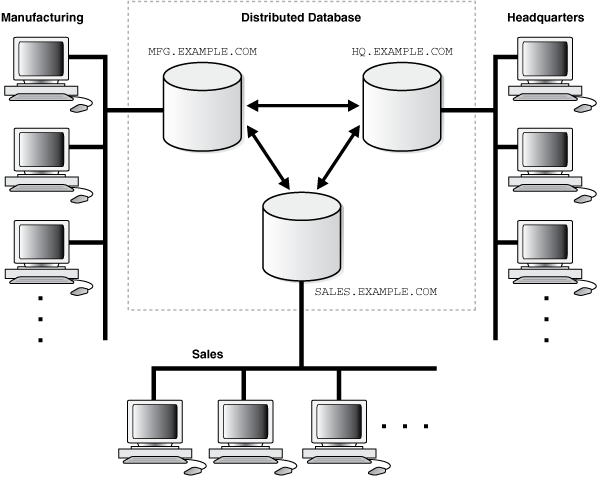
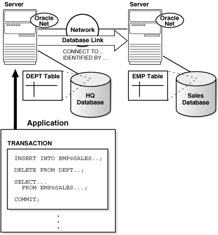
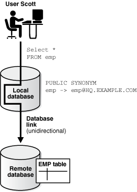
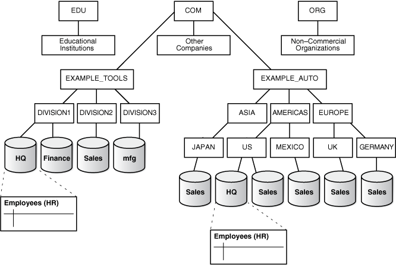
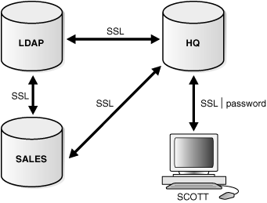
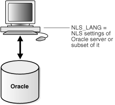
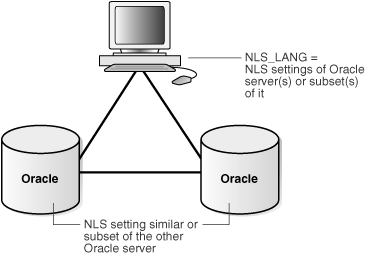
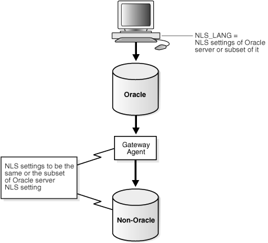

## 30 Distributed Database Concepts

Concepts related to distributed databases include distributed database architecture, database links, transaction processing, application development, and character set support.

**Parent topic:** [Distributed Database Management](distributed-database-management.md)

### 30.1 Distributed Database Architecture

A distributed database system allows applications to access data from local and remote databases. In a homogenous distributed database system, each database is an Oracle Database. In a heterogeneous distributed database system, at least one of the databases is not an Oracle Database. Distributed databases use a client/server architecture to process information requests.

- Homogenous Distributed Database Systems  
	A homogenous distributed database system includes only Oracle databases.
- Heterogeneous Distributed Database Systems  
	A heterogeneous distributed database system includes both Oracle databases and non-Oracle databases.
- Client/Server Database Architecture  
	A database server is the Oracle software managing a database, and a client is an application that requests information from a server. Each computer in a network is a node that can host one or more databases. Each node in a distributed database system can act as a client, a server, or both, depending on the situation.

**Parent topic:** Distributed Database Concepts

#### 30.1.1 Homogenous Distributed Database Systems

A homogenous distributed database system includes only Oracle databases.

- About Homogenous Distributed Database Systems  
	A homogenous distributed database system is a network of two or more Oracle Databases that reside on one or more systems.
- Distributed Databases Versus Distributed Processing  
	The terms distributed database and distributed processing are closely related, yet have distinct meanings.
- Distributed Databases Versus Replicated Databases  
	The terms distributed database system and database replication are related, yet distinct.

**Parent topic:** Distributed Database Architecture

##### 30.1.1.1 About Homogenous Distributed Database Systems

A homogenous distributed database system is a network of two or more Oracle Databases that reside on one or more systems.

Figure 30-1 illustrates a distributed system that connects three databases: `hq`, `mfg`, and `sales`. An application can simultaneously access or modify the data in several databases in a single distributed environment. For example, a single query from a Manufacturing client on local database `mfg` can retrieve joined data from the `products` table on the local database and the `dept` table on the remote `hq` database.

For a client application, the location and platform of the databases are transparent. You can also create synonyms for remote objects in the distributed system so that users can access them with the same syntax as local objects. For example, if you are connected to database `mfg` but want to access data on database `hq`, creating a synonym on `mfg` for the remote `dept` table enables you to issue this query:

```
SELECT * FROM dept;
```

In this way, a distributed system gives the appearance of native data access. Users on `mfg` do not have to know that the data they access resides on remote databases.

Figure 30-1 Homogeneous Distributed Database



> The image admin046.gif shows a homogeneous distributed database. The figure shows three databases: HQ.EXAMPLE.COM, SALES.EXAMPLE.COM, and MFG.EXAMPLE.COM. Each database is connected to several client systems at Headquarters and the Sales and Manufacturing divisions.
>
> End of image description.
>
> [  
> Copyright © 1996, 2025, Oracle and/or its affiliates.](https://docs.oracle.com/en/database/oracle/oracle-database/dcommon/html/cpyr.htm)


An Oracle Database distributed database system can incorporate Oracle Databases of different releases. All supported releases of Oracle Database can participate in a distributed database system. Nevertheless, the applications that work with the distributed database must understand the functionality that is available at each node in the system. A distributed database application cannot expect an Oracle7 database to understand the SQL extensions that are only available with Oracle Database.

**Parent topic:** Homogenous Distributed Database Systems

##### 30.1.1.2 Distributed Databases Versus Distributed Processing

The terms distributed database and distributed processing are closely related, yet have distinct meanings.

There definitions are as follows:

- Distributed database
	A set of databases in a distributed system that can appear to applications as a single data source.
- Distributed processing
	The operations that occurs when an application distributes its tasks among different computers in a network. For example, a database application typically distributes front-end presentation tasks to client computers and allows a back-end database server to manage shared access to a database. Consequently, a distributed database application processing system is more commonly referred to as a client/server database application system.

Distributed database systems employ a distributed processing architecture. For example, an Oracle Database server acts as a client when it requests data that another Oracle Database server manages.

**Parent topic:** Homogenous Distributed Database Systems

##### 30.1.1.3 Distributed Databases Versus Replicated Databases

The terms distributed database system and database replication are related, yet distinct.

In a pure (that is, not replicated) distributed database, the system manages a single copy of all data and supporting database objects. Typically, distributed database applications use distributed transactions to access both local and remote data and modify the global database in real-time.

Note:

This book discusses only pure distributed databases.

The term replication refers to the operation of copying and maintaining database objects in multiple databases belonging to a distributed system. While replication relies on distributed database technology, database replication offers applications benefits that are not possible within a pure distributed database environment.

Most commonly, replication is used to improve local database performance and protect the availability of applications because alternate data access options exist. For example, an application may normally access a local database rather than a remote server to minimize network traffic and achieve maximum performance. Furthermore, the application can continue to function if the local server experiences a failure, but other servers with replicated data remain accessible.

**Parent topic:** Homogenous Distributed Database Systems

#### 30.1.2 Heterogeneous Distributed Database Systems

A heterogeneous distributed database system includes both Oracle databases and non-Oracle databases.

- About Heterogeneous Distributed Database Systems  
	In a heterogeneous distributed database system, at least one of the databases is a non-Oracle Database system. To the application, the heterogeneous distributed database system appears as a single, local, Oracle Database. The local Oracle Database server hides the distribution and heterogeneity of the data.
- Heterogeneous Services  
	Heterogeneous Services (HS) is an integrated component within the Oracle Database server and the enabling technology for the current suite of Oracle Transparent Gateway products.
- Transparent Gateway Agents  
	For each non-Oracle Database system that you access, Heterogeneous Services can use a transparent gateway agent to interface with the specified non-Oracle Database system. The agent is specific to the non-Oracle Database system, so each type of system requires a different agent.
- Generic Connectivity  
	Generic connectivity enables you to connect to non-Oracle Database data stores by using either a Heterogeneous Services ODBC agent or a Heterogeneous Services OLE DB agent.

**Parent topic:** Distributed Database Architecture

##### 30.1.2.1 About Heterogeneous Distributed Database Systems

In a heterogeneous distributed database system, at least one of the databases is a non-Oracle Database system. To the application, the heterogeneous distributed database system appears as a single, local, Oracle Database. The local Oracle Database server hides the distribution and heterogeneity of the data.

The Oracle Database server accesses the non-Oracle Database system using Oracle Heterogeneous Services with an agent. If you access the non-Oracle Database data store using an Oracle Transparent Gateway, then the agent is a system-specific application. For example, if you include a Sybase database in an Oracle Database distributed system, then you must obtain a Sybase-specific transparent gateway so that the Oracle Database in the system can communicate with it.

Alternatively, you can use generic connectivity to access non-Oracle Database data stores so long as the non-Oracle Database system supports the ODBC or OLE DB protocols.

Note:

Other than the introductory material presented in this chapter, this book does not discuss Oracle Heterogeneous Services. See [Oracle Database Heterogeneous Connectivity User's Guide](https://docs.oracle.com/pls/topic/lookup?ctx=en/database/oracle/oracle-database/21/admin&id=HETER) for more detailed information about Heterogeneous Services.

**Parent topic:** Heterogeneous Distributed Database Systems

##### 30.1.2.2 Heterogeneous Services

Heterogeneous Services (HS) is an integrated component within the Oracle Database server and the enabling technology for the current suite of Oracle Transparent Gateway products.

HS provides the common architecture and administration mechanisms for Oracle Database gateway products and other heterogeneous access facilities. Also, it provides upwardly compatible functionality for users of most of the earlier Oracle Transparent Gateway releases.

**Parent topic:** Heterogeneous Distributed Database Systems

##### 30.1.2.3 Transparent Gateway Agents

For each non-Oracle Database system that you access, Heterogeneous Services can use a transparent gateway agent to interface with the specified non-Oracle Database system. The agent is specific to the non-Oracle Database system, so each type of system requires a different agent.

The transparent gateway agent facilitates communication between Oracle Database and non-Oracle Database systems and uses the Heterogeneous Services component in the Oracle Database server. The agent executes SQL and transactional requests at the non-Oracle Database system on behalf of the Oracle Database server.

See Also:

Your Oracle-supplied gateway-specific documentation for information about transparent gateways

**Parent topic:** Heterogeneous Distributed Database Systems

##### 30.1.2.4 Generic Connectivity

Generic connectivity enables you to connect to non-Oracle Database data stores by using either a Heterogeneous Services ODBC agent or a Heterogeneous Services OLE DB agent.

Both are included with your Oracle product as a standard feature. Any data source compatible with the ODBC or OLE DB standards can be accessed using a generic connectivity agent.

The advantage to generic connectivity is that it may not be required for you to purchase and configure a separate system-specific agent. You use an ODBC or OLE DB driver that can interface with the agent. However, some data access features are only available with transparent gateway agents.

**Parent topic:** Heterogeneous Distributed Database Systems

#### 30.1.3 Client/Server Database Architecture

A database server is the Oracle software managing a database, and a client is an application that requests information from a server. Each computer in a network is a node that can host one or more databases. Each node in a distributed database system can act as a client, a server, or both, depending on the situation.

In Figure 30-2, the host for the `hq` database is acting as a database server when a statement is issued against its local data (for example, the second statement in each transaction issues a statement against the local `dept` table), but is acting as a client when it issues a statement against remote data (for example, the first statement in each transaction is issued against the remote table `emp` in the `sales` database).

Figure 30-2 An Oracle Database Distributed Database System



> The image admin040.gif depicts an Oracle distributed database system. There are two databases located on separate servers: HQ and SALES. The figure shows examples of direct and indirect client connections. Queries are made to the HQ database directly, and queries are made indirectly to the SALES database, through the HQ database, which then acts as a client. Communication between the servers occurs over the network using Oracle Net.
>
> End of image description.


A client can connect directly or indirectly to a database server. A direct connection occurs when a client connects to a server and accesses information from a database contained on that server. For example, if you connect to the `hq` database and access the `dept` table on this database as in Figure 30-2, you can issue the following:

```
SELECT * FROM dept;
```

This query is direct because you are not accessing an object on a remote database.

In contrast, an indirect connection occurs when a client connects to a server and then accesses information contained in a database on a different server. For example, if you connect to the `hq` database but access the `emp` table on the remote `sales` database as in Figure 30-2, you can issue the following:

```
SELECT * FROM emp@sales;
```

This query is indirect because the object you are accessing is not on the database to which you are directly connected.

**Parent topic:** Distributed Database Architecture

### 30.2 Database Links

The central concept in distributed database systems is a database link. A database link is a connection between two physical database servers that allows a client to access them as one logical database.

- What Are Database Links?  
	A database link is a pointer that defines a one-way communication path from an Oracle Database server to another database server.
- What Are Shared Database Links?  
	A shared database link is a link between a local server process and the remote database. The link is shared because multiple client processes can use the same link simultaneously.
- Why Use Database Links?  
	The great advantage of database links is that they allow users to access another user's objects in a remote database so that they are bounded by the privilege set of the object owner. In other words, a local user can access a link to a remote database without having to be a user on the remote database.
- Global Database Names in Database Links  
	To understand how a database link works, you must first understand what a global database name is. Each database in a distributed database is uniquely identified by its global database name.
- Global Name as a Loopback Database Link  
	You can use the global name of a database as a loopback database link without explicitly creating a database link. When the database link in a SQL statement matches the global name of the current database, the database link is effectively ignored.
- Names for Database Links  
	Typically, a database link has the same name as the global database name of the remote database that it references.
- Types of Database Links  
	Oracle Database lets you create private, public, and global database links.
- Users of Database Links  
	Users of database links include connect user, current user, and fixed user.
- Creation of Database Links: Examples  
	Create database links using the `CREATE DATABASE LINK` statement.
- Schema Objects and Database Links  
	After you have created a database link, you can execute SQL statements that access objects on the remote database. You must also be authorized in the remote database to access specific remote objects.
- Database Link Restrictions  
	Several restrictions apply to database links.

**Parent topic:** Distributed Database Concepts

#### 30.2.1 What Are Database Links?

A database link is a pointer that defines a one-way communication path from an Oracle Database server to another database server.

For public and private database links, the link pointer is actually defined as an entry in a data dictionary table. To access the link, you must be connected to the local database that contains the data dictionary entry. For global database links, the link pointer is defined in a directory service. The different types of database links are described in more detail in " Types of Database Links ".

A database link connection is one-way in the sense that a client connected to local database A can use a link stored in database A to access information in remote database B, but users connected to database B cannot use the same link to access data in database A. If local users on database B want to access data on database A, then they must define a link that is stored in the data dictionary of database B.

A database link connection allows local users to access data on a remote database. For this connection to occur, each database in the distributed system must have a unique global database name in the network domain. The global database name uniquely identifies a database server in a distributed system.

Figure 30-3 shows an example of user `scott` accessing the `emp` table on the remote database with the global name `hq.example.com`:

Figure 30-3 Database Link



> The image admin045.gif shows a database link between user Scott and a remote database. The link passes through the local database, and, because the link to the remote database is stored on the local database, a unidirectional link links the remote database to the user.
>
> End of image description.
>
> [  
> Copyright © 1996, 2025, Oracle and/or its affiliates.](https://docs.oracle.com/en/database/oracle/oracle-database/dcommon/html/cpyr.htm)


Database links are either private or public. If they are private, then only the user who created the link has access; if they are public, then all database users have access.

One principal difference among database links is the way that different link definitions determine how the link connection is authenticated. Users access a remote database through the following types of links:

| Type of Link | Description |
| --- | --- |
| Connected user link | Users connect as themselves, which means that they must have an account on the remote database with the same user name and password as their account on the local database. |
| Fixed user link | Users connect using the user name and password referenced in the link. For example, if Jane uses a fixed user link that connects to the `hq` database with the user name and password `scott/` password, then she connects as `scott`, Jane has all the privileges in `hq` granted to `scott` directly, and all the default roles that `scott` has been granted in the `hq` database. |
| Current user link | A user connects as a global user. A local user can connect as a global user in the context of a stored procedure, without storing the global user's password in a link definition. For example, Jane can access a procedure that Scott wrote, accessing Scott's account and Scott's schema on the `hq` database. |

Create database links using the `CREATE DATABASE LINK` statement. After a link is created, you can use it to specify schema objects in SQL statements.

See Also:

[Oracle Database SQL Language Reference](https://docs.oracle.com/pls/topic/lookup?ctx=en/database/oracle/oracle-database/21/admin&id=SQLRF01204) for syntax of the `CREATE DATABASE` statement

**Parent topic:** Database Links

#### 30.2.2 What Are Shared Database Links?

A shared database link is a link between a local server process and the remote database. The link is shared because multiple client processes can use the same link simultaneously.

When a local database is connected to a remote database through a database link, either database can run in dedicated or shared server mode. The following table illustrates the possibilities:

| Local Database Mode | Remote Database Mode |
| --- | --- |
| Dedicated | Dedicated |
| Dedicated | Shared server |
| Shared server | Dedicated |
| Shared server | Shared server |

A shared database link can exist in any of these four configurations. Shared links differ from standard database links in the following ways:

- Different users accessing the same schema object through a database link can share a network connection.
- When a user must establish a connection to a remote server from a particular server process, the process can reuse connections already established to the remote server. The reuse of the connection can occur if the connection was established on the same server process with the same database link, possibly in a different session. In a non-shared database link, a connection is not shared across multiple sessions.
- When you use a shared database link in a shared server configuration, a network connection is established directly out of the shared server process in the local server. For a non-shared database link on a local shared server, this connection would have been established through the local dispatcher, requiring context switches for the local dispatcher, and requiring data to go through the dispatcher.
	See Also:
	[Oracle Database Net Services Administrator's Guide](https://docs.oracle.com/pls/topic/lookup?ctx=en/database/oracle/oracle-database/21/admin&id=NETAG001) for information about shared server

**Parent topic:** Database Links

#### 30.2.3 Why Use Database Links?

The great advantage of database links is that they allow users to access another user's objects in a remote database so that they are bounded by the privilege set of the object owner. In other words, a local user can access a link to a remote database without having to be a user on the remote database.

For example, assume that employees submit expense reports to Accounts Payable (A/P), and further suppose that a user using an A/P application must retrieve information about employees from the `hq` database. The A/P users should be able to connect to the `hq` database and execute a stored procedure in the remote `hq` database that retrieves the desired information. The A/P users should not need to be `hq` database users to do their jobs; they should only be able to access `hq` information in a controlled way as limited by the procedure.

See Also:

- " Users of Database Links " for an explanation of database link users
- " [Viewing Information About Database Links](managing-a-distributed-database.md) " for an explanation of how to hide passwords from non-administrative users

**Parent topic:** Database Links

#### 30.2.4 Global Database Names in Database Links

To understand how a database link works, you must first understand what a global database name is. Each database in a distributed database is uniquely identified by its global database name.

The database forms a global database name by prefixing the database network domain, specified by the `DB_DOMAIN` initialization parameter at database creation, with the individual database name, specified by the `DB_NAME` initialization parameter.

For example, Figure 30-4 illustrates a representative hierarchical arrangement of databases throughout a network.

Figure 30-4 Hierarchical Arrangement of Networked Databases



> The image admin041.gif shows the representative hierarchical arrangement of databases throughout a network to illustrate global database names. There are three root domains: EDU, COM, and ORG. There is one subdomain each for the EDU and ORG domains: Educational Institutions and Non-Commercial Organizations, respectively. There are three subdomains associated with the root domain COM: EXAMPLE\_TOOLS, Other Companies, and EXAMPLE\_AUTO. EXAMPLE\_TOOLS is subdivided into three divisions:
>
> - DIVISION1contains the HQ and Finance databases.
> - DIVISION2 contains the Sales database.
> - DIVISION3 contains the MFG database.
>
> The subdomain Other Companies has no subordinates.
>
> EXAMPLE\_AUTO is subdivided into geographical regions (ASIA, AMERICAS, EUROPE):
>
> - Subordinate to ASIA is JAPAN, with the SALES database Sales.
> - Subordinate to AMERICAS are US and MEXICO. US contains the HQ and Sales databases. MEXICO contains the SALES database. Subordinate to EUROPE are UK and GERMANY. Both UK and GERMANY contain a database called Sales.
>
> End of image description.


The name of a database is formed by starting at the leaf of the tree and following a path to the root. For example, the `mfg` database is in `division3` of the `example_tools` branch of the `com` domain. The global database name for `mfg` is created by concatenating the nodes in the tree as follows:

- `mfg.division3.example_tools.com`

While several databases can share an individual name, each database must have a unique global database name. For example, the network domains `us.americas.example_auto.com` and `uk.europe.example_auto.com` each contain a `sales` database. The global database naming system distinguishes the `sales` database in the `americas` division from the `sales` database in the `europe` division as follows:

- `sales.us.americas.example_auto.com`
- `sales.uk.europe.example_auto.com`
	See Also:
	" [Managing Global Names in a Distributed System](managing-a-distributed-database.md) " to learn how to specify and change global database names

**Parent topic:** Database Links

#### 30.2.5 Global Name as a Loopback Database Link

You can use the global name of a database as a loopback database link without explicitly creating a database link. When the database link in a SQL statement matches the global name of the current database, the database link is effectively ignored.

For example, assume the global name of a database is `db1.example.com`. You can run the following SQL statement on this database:

```
SELECT * FROM hr.employees@db1.example.com;
```

In this case, the `@db1.example.com` portion of the SQL statement is effectively ignored.

**Parent topic:** Database Links

#### 30.2.6 Names for Database Links

Typically, a database link has the same name as the global database name of the remote database that it references.

For example, if the global database name of a database is `sales.us.example.com`, then the database link is also called `sales.us.example.com`.

When you set the initialization parameter `GLOBAL_NAMES` to `TRUE`, the database ensures that the name of the database link is the same as the global database name of the remote database. For example, if the global database name for `hq` is `hq.example.com`, and `GLOBAL_NAMES` is `TRUE`, then the link name must be called `hq.example.com`. Note that the database checks the domain part of the global database name as stored in the data dictionary, not the `DB_DOMAIN` setting in the initialization parameter file (see " [Changing the Domain in a Global Database Name](managing-a-distributed-database.md) ").

If you set the initialization parameter `GLOBAL_NAMES` to `FALSE`, then you are not required to use global naming. You can then name the database link whatever you want. For example, you can name a database link to `hq.example.com` as `foo`.

Note:

Oracle recommends that you use global naming because many useful features require global naming.

After you have enabled global naming, database links are essentially transparent to users of a distributed database because the name of a database link is the same as the global name of the database to which the link points. For example, the following statement creates a database link in the local database to remote database `sales`:

```
CREATE PUBLIC DATABASE LINK sales.division3.example.com USING 'sales1';
```

See Also:

[Oracle Database Reference](https://docs.oracle.com/pls/topic/lookup?ctx=en/database/oracle/oracle-database/21/admin&id=REFRN10065) for more information about specifying the initialization parameter `GLOBAL_NAMES`

**Parent topic:** Database Links

#### 30.2.7 Types of Database Links

Oracle Database lets you create private, public, and global database links.

These basic link types differ according to which users are allowed access to the remote database:

| Type | Owner | Description |
| --- | --- | --- |
| Private | User who created the link. View ownership data through:  - `DBA_DB_LINKS` - `ALL_DB_LINKS` - `USER_DB_LINKS` | Creates link in a specific schema of the local database. Only the owner of a private database link or PL/SQL subprograms in the schema can use this link to access database objects in the corresponding remote database. |
| Public | User called PUBLIC. View ownership data through views shown for private database links. | Creates a database-wide link. All users and PL/SQL subprograms in the database can use the link to access database objects in the corresponding remote database. |
| Global | No user owns the global database link. The global database link exists in a directory service. | Creates a network-wide link. When an Oracle network uses a directory server and the database is registered in the directory service, this information can be used as a database link. Users and PL/SQL subprograms in any database can use a global database link to access objects in the corresponding remote database. Global database links refer to the use of net service names from the directory server. |

Determining the type of database links to employ in a distributed database depends on the specific requirements of the applications using the system. Consider these features when making your choice:

| Type of Link | Features |
| --- | --- |
| Private database link | This link is more secure than a public or global link, because only the owner of the private link, or subprograms within the same schema, can use the link to access the remote database. |
| Public database link | When many users require an access path to a remote Oracle Database, you can create a single public database link for all users in a database. |
| Global database link | When an Oracle network uses a directory server, an administrator can conveniently manage global database links for all databases in the system. Database link management is centralized and simple.  There is no user data associated with a global database link definition. A global database link must operate as a connected user database link. |

**Parent topic:** Database Links

#### 30.2.8 Users of Database Links

Users of database links include connect user, current user, and fixed user.

- Overview of Database Link Users  
	When creating the link, you determine which user should connect to the remote database to access the data.
- Connected User Database Links  
	Connected user links have no connect string associated with them. The advantage of a connected user link is that a user referencing the link connects to the remote database as the same user, and credentials do not have to be stored in the link definition in the data dictionary.
- Fixed User Database Links  
	A benefit of a fixed user link is that it connects a user in a primary database to a remote database with the security context of the user specified in the connect string.
- Current User Database Links  
	Current user database links make use of a global user. A global user must be authenticated by an X.509 certificate or a password, and be a user on both databases involved in the link.

**Parent topic:** Database Links

##### 30.2.8.1 Overview of Database Link Users

When creating the link, you determine which user should connect to the remote database to access the data.

The following table explains the differences among the categories of users involved in database links:

| User Type | Description | Sample Link Creation Syntax |
| --- | --- | --- |
| Connected user | A local user accessing a database link in which no fixed username and password have been specified. If `SYSTEM` accesses a public link in a query, then the connected user is `SYSTEM`, and the database connects to the `SYSTEM` schema in the remote database.  Note: A connected user does not have to be the user who created the link, but is any user who is accessing the link. | `CREATE PUBLIC DATABASE LINK hq USING 'hq';` |
| Current user | A global user in a `CURRENT_USER` database link. The global user must be authenticated by an X.509 certificate (an SSL-authenticated enterprise user) or a password (a password-authenticated enterprise user), and be a user on both databases involved in the link.  See [Oracle Database Enterprise User Security Administrator's Guide](https://docs.oracle.com/pls/topic/lookup?ctx=en/database/oracle/oracle-database/21/admin&id=DBIMI262) for information about global security | `CREATE PUBLIC DATABASE LINK hq CONNECT TO CURRENT_USER using 'hq';` |
| Fixed user | A user whose username/password is part of the link definition. If a link includes a fixed user, the fixed user's username and password are used to connect to the remote database. | `CREATE PUBLIC DATABASE LINK hq CONNECT TO jane IDENTIFIED BY ` `password` `USING 'hq'; ` |

Note:

The following users cannot be target users of database links: `SYS` and `PUBLIC`.

See Also:

" [Specifying Link Users](managing-a-distributed-database.md) " to learn how to specify users when creating links

**Parent topic:** Users of Database Links

##### 30.2.8.2 Connected User Database Links

Connected user links have no connect string associated with them. The advantage of a connected user link is that a user referencing the link connects to the remote database as the same user, and credentials do not have to be stored in the link definition in the data dictionary.

Connected user links have some disadvantages. Because these links require users to have accounts and privileges on the remote databases to which they are attempting to connect, they require more privilege administration for administrators. Also, giving users more privileges than they need violates the fundamental security concept of least privilege: users should only be given the privileges they need to perform their jobs.

The ability to use a connected user database link depends on several factors, chief among them whether the user is authenticated by the database using a password, or externally authenticated by the operating system or a network authentication service. If the user is externally authenticated, then the ability to use a connected user link also depends on whether the remote database accepts remote authentication of users, which is set by the `REMOTE_OS_AUTHENT` initialization parameter.

The `REMOTE_OS_AUTHENT` parameter operates as follows:

| REMOTE\_OS\_AUTHENT Value | Consequences |
| --- | --- |
| `TRUE` for the remote database | An externally-authenticated user can connect to the remote database using a connected user database link. |
| `FALSE` for the remote database | An externally-authenticated user cannot connect to the remote database using a connected user database link unless a secure protocol or a network authentication service option is used. |

If the connected user database link is accessed from within a definer's rights function, procedure, or package, then the definer's authorization ID is used to connect as a remote user. For example, if user `jane` calls procedure `scott.p` (a definer's rights procedure created by `scott`), and the link appears inside procedure `scott.p`, then `scott` is the connected user. To run a definer's rights function, procedure, or package that includes a connected user database link, the user who invokes the function, procedure, or package must be granted the `INHERIT REMOTE PRIVILEGES` privilege.

Note:

The `REMOTE_OS_AUTHENT` initialization parameter is deprecated. It is retained for backward compatibility only.

**Parent topic:** Users of Database Links

##### 30.2.8.3 Fixed User Database Links

A benefit of a fixed user link is that it connects a user in a primary database to a remote database with the security context of the user specified in the connect string.

For example, local user `joe` can create a public database link in `joe` 's schema that specifies the fixed user `scott` with password `password`. If `jane` uses the fixed user link in a query, then `jane` is the user on the local database, but she connects to the remote database as `scott/` `password`.

Fixed user links have a user name and password associated with the connect string. The user name and password are stored with other link information in data dictionary tables.

**Parent topic:** Users of Database Links

##### 30.2.8.4 Current User Database Links

Current user database links make use of a global user. A global user must be authenticated by an X.509 certificate or a password, and be a user on both databases involved in the link.

The user invoking the `CURRENT_USER` link does not have to be a global user. For example, if `jane` is authenticated (not as a global user) by password to the Accounts Payable database, she can access a stored procedure to retrieve data from the `hq` database. The procedure uses a current user database link, which connects her to `hq` as global user `scott`. User `scott` is a global user and authenticated through a certificate over SSL, but `jane` is not.

Note that current user database links have these consequences:

- If the current user database link is not accessed from within a stored object, then the current user is the same as the connected user accessing the link. For example, if `scott` issues a `SELECT` statement through a current user link, then the current user is `scott`.
- When executing a stored object such as a procedure, view, or trigger that accesses a database link, the current user is the user that owns the stored object, and not the user that calls the object. For example, if `jane` calls procedure `scott.p` (created by `scott`), and a current user link appears within the called procedure, then `scott` is the current user of the link.
- If the stored object is an invoker's rights function, procedure, or package, then the invoker's authorization ID is used to connect as a remote user. For example, if user `jane` calls procedure `scott.p` (an invoker's rights procedure created by `scott`), and the link appears inside procedure `scott.p`, then `jane` is the current user.
- You cannot connect to a database as an enterprise user and then use a current user link in a stored procedure that exists in a shared, global schema. For example, if user `jane` accesses a stored procedure in the shared schema `guest` on database `hq`, she cannot use a current user link in this schema to log on to a remote database.
	See Also:
	- " Distributed Database Security " for more information about security issues relating to database links
	- [Oracle Database PL/SQL Language Reference](https://docs.oracle.com/pls/topic/lookup?ctx=en/database/oracle/oracle-database/21/admin&id=LNPLS008) for more information about invoker's rights functions, procedures, or packages.
	- [Oracle Database Security Guide](https://docs.oracle.com/pls/topic/lookup?ctx=en/database/oracle/oracle-database/21/admin&id=DBSEG-GUID-B354724F-BD35-47C7-A699-93C2B6389555) for information about running a definer's rights function, procedure, or package that includes a current user database link

**Parent topic:** Users of Database Links

#### 30.2.9 Creation of Database Links: Examples

Create database links using the `CREATE DATABASE LINK` statement.

The table gives examples of SQL statements that create database links in a local database to the remote `sales.us.americas.example_auto.com` database:

| SQL Statement | Connects To Database | Connects As | Link Type |
| --- | --- | --- | --- |
| `CREATE DATABASE LINK sales.us.americas.example_auto.com USING 'sales_us';` | `sales` using net service name `sales_us` | Connected user | Private connected user |
| `CREATE DATABASE LINK foo CONNECT TO CURRENT_USER USING 'am_sls';` | `sales` using service name `am_sls` | Current global user | Private current user |
| `CREATE DATABASE LINK sales.us.americas.example_auto.com CONNECT TO scott IDENTIFIED BY` ` password` `USING 'sales_us';` | `sales` using net service name `sales_us` | `scott` using password `password` | Private fixed user |
| `CREATE PUBLIC DATABASE LINK sales CONNECT TO scott IDENTIFIED BY` `password` `USING 'rev';` | `sales` using net service name `rev` | `scott` using password `password` | Public fixed user |
| `CREATE SHARED PUBLIC DATABASE LINK sales.us.americas.example_auto.com CONNECT TO scott IDENTIFIED BY` `password` `AUTHENTICATED BY anupam IDENTIFIED BY` `password1` `USING 'sales'; ` | `sales` using net service name `sales` | `scott` using password `password`, authenticated as `anupam` using password `password1` | Shared public fixed user |

See Also:

- " [Creating Database Links](managing-a-distributed-database.md) " to learn how to create link
- [Oracle Database SQL Language Reference](https://docs.oracle.com/pls/topic/lookup?ctx=en/database/oracle/oracle-database/21/admin&id=SQLRF01205) for information about the `CREATE DATABASE LINK` statement syntax

**Parent topic:** Database Links

#### 30.2.10 Schema Objects and Database Links

After you have created a database link, you can execute SQL statements that access objects on the remote database. You must also be authorized in the remote database to access specific remote objects.

For example, to access remote object `emp` using database link `foo`, you can issue:

```
SELECT * FROM emp@foo;
```

Constructing properly formed object names using database links is an essential aspect of data manipulation in distributed systems.

If you call a procedure using a remote database link, and the procedure contains a `ROLLBACK` command, only DML operations performed at the remote site are rolled back. Any DML changes made at the originating site are not rolled back.

- Naming of Schema Objects Using Database Links  
	Oracle Database uses the global database name to name the schema objects globally.
- Authorization for Accessing Remote Schema Objects  
	To access a remote schema object, you must be granted access to the remote object in the remote database.
- Synonyms for Schema Objects  
	Oracle Database lets you create synonyms so that you can hide the database link name from the user.
- Schema Object Name Resolution  
	To resolve application references to schema objects (a process called name resolution), the database forms object names hierarchically.

**Parent topic:** Database Links

##### 30.2.10.1 Naming of Schema Objects Using Database Links

Oracle Database uses the global database name to name the schema objects globally.

Global database names are in the following form:

`schema.schema_object` @ `global_database_name`

where:

- `schema ` is a collection of logical structures of data, or schema objects. A schema is owned by a database user and has the same name as that user. Each user owns a single schema.
- `schema_object` is a logical data structure like a table, index, view, synonym, procedure, package, or a database link.
- `global_database_name` is the name that uniquely identifies a remote database. This name must be the same as the concatenation of the remote database initialization parameters `DB_NAME` and `DB_DOMAIN`, unless the parameter `GLOBAL_NAMES` is set to `FALSE`, in which case any name is acceptable.

For example, using a database link to database `sales.division3.example.com`, a user or application can reference remote data as follows:

```
SELECT * FROM scott.emp@sales.division3.example.com;  # emp table in scott's schema
SELECT loc FROM scott.dept@sales.division3.example.com;
```

If `GLOBAL_NAMES` is set to `FALSE`, then you can use any name for the link to `sales.division3.example.com`. For example, you can call the link `foo`. Then, you can access the remote database as follows:

```
SELECT name FROM scott.emp@foo;  # link name different from global name
```

**Parent topic:** Schema Objects and Database Links

##### 30.2.10.2 Authorization for Accessing Remote Schema Objects

To access a remote schema object, you must be granted access to the remote object in the remote database.

Further, to perform any updates, inserts, or deletes on the remote object, you must be granted the `READ` or `SELECT` privilege on the object, along with the `UPDATE`, `INSERT`, or `DELETE` privilege. Unlike when accessing a local object, the `READ` or `SELECT` privilege is necessary for accessing a remote object because the database has no remote describe capability. The database must do a `SELECT *` on the remote object to determine its structure.

**Parent topic:** Schema Objects and Database Links

##### 30.2.10.3 Synonyms for Schema Objects

Oracle Database lets you create synonyms so that you can hide the database link name from the user.

A synonym allows access to a table on a remote database using the same syntax that you would use to access a table on a local database. For example, assume you issue the following query against a table in a remote database:

```
SELECT * FROM emp@hq.example.com;
```

You can create the synonym `emp` for `emp@hq.example.com` so that you can issue the following query instead to access the same data:

```
SELECT * FROM emp;
```

See Also:

" [Using Synonyms to Create Location Transparency](managing-a-distributed-database.md) " to learn how to create synonyms for objects specified using database links

**Parent topic:** Schema Objects and Database Links

##### 30.2.10.4 Schema Object Name Resolution

To resolve application references to schema objects (a process called name resolution), the database forms object names hierarchically.

For example, the database guarantees that each schema within a database has a unique name, and that within a schema each object has a unique name. As a result, a schema object name is always unique within the database. Furthermore, the database resolves application references to the local name of the object.

In a distributed database, a schema object such as a table is accessible to all applications in the system. The database extends the hierarchical naming model with global database names to effectively create global object names and resolve references to the schema objects in a distributed database system. For example, a query can reference a remote table by specifying its fully qualified name, including the database in which it resides.

For example, assume that you connect to the local database as user `SYSTEM`:

```
CONNECT SYSTEM@sales1
```

You then issue the following statements using database link `hq.example.com` to access objects in the `scott` and `jane` schemas on remote database `hq`:

```
SELECT * FROM scott.emp@hq.example.com;
INSERT INTO jane.accounts@hq.example.com (acc_no, acc_name, balance)
  VALUES (5001, 'BOWER', 2000);
UPDATE jane.accounts@hq.example.com
  SET balance = balance + 500;
DELETE FROM jane.accounts@hq.example.com
  WHERE acc_name = 'BOWER';
```

**Parent topic:** Schema Objects and Database Links

#### 30.2.11 Database Link Restrictions

Several restrictions apply to database links.

You cannot perform the following operations using database links:

- Grant privileges on remote objects
- Execute `DESCRIBE` operations on some remote objects. The following remote objects, however, do support `DESCRIBE` operations:
	- Tables
		- Views
		- Procedures
		- Functions
- Analyze remote objects
- Define or enforce referential integrity
- Grant roles to users in a remote database
- Obtain nondefault roles on a remote database. For example, if `jane` connects to the local database and executes a stored procedure that uses a fixed user link connecting as `scott`, `jane` receives `scott` 's default roles on the remote database. Jane cannot issue `SET ROLE` to obtain a nondefault role.
- Use a current user link without authentication through SSL, password, or Microsoft Windows native authentication

See Also:

- [Oracle Database Object-Relational Developer's Guide](https://docs.oracle.com/pls/topic/lookup?ctx=en/database/oracle/oracle-database/21/admin&id=ADOBJ7083) for information about database link restrictions for user-defined types
- [Oracle Database SecureFiles and Large Objects Developer's Guide](https://docs.oracle.com/pls/topic/lookup?ctx=en/database/oracle/oracle-database/21/admin&id=ADLOB2010) for information about database link restrictions for LOBs

**Parent topic:** Database Links

### 30.3 Distributed Database Administration

Distributed database administration includes topics related to site autonomy, security, auditing database links, and administration tools.

- Site Autonomy  
	Site autonomy means that each server participating in a distributed database is administered independently from all other databases.
- Distributed Database Security  
	The database supports all of the security features that are available with a non-distributed database environment for distributed database systems, including password authentication for users and roles, some types of external authentication for users and roles including Kerberos version 5 for connected user links, and login packet encryption for client-to-server and server-to-server connections.
- Auditing Database Links  
	You must always perform auditing operations locally. That is, if a user acts in a local database and accesses a remote database through a database link, the local actions are audited in the local database, and the remote actions are audited in the remote database, provided appropriate audit options are set in the respective databases.
- Administration Tools  
	The database administrator has several choices for tools to use when managing an Oracle Database distributed database system.

See Also:

- [Managing a Distributed Database](managing-a-distributed-database.md) to learn how to administer homogenous systems
- [Oracle Database Heterogeneous Connectivity User's Guide](https://docs.oracle.com/pls/topic/lookup?ctx=en/database/oracle/oracle-database/21/admin&id=HETER) to learn about heterogeneous services concepts

**Parent topic:** Distributed Database Concepts

#### 30.3.1 Site Autonomy

Site autonomy means that each server participating in a distributed database is administered independently from all other databases.

Although several databases can work together, each database is a separate repository of data that is managed individually. Some of the benefits of site autonomy in an Oracle Database distributed database include:

- Nodes of the system can mirror the logical organization of companies or groups that need to maintain independence.
- Local administrators control corresponding local data. Therefore, each database administrator's domain of responsibility is smaller and more manageable.
- Independent failures are less likely to disrupt other nodes of the distributed database. No single database failure need halt all distributed operations or be a performance bottleneck.
- Administrators can recover from isolated system failures independently from other nodes in the system.
- A data dictionary exists for each local database. A global catalog is not necessary to access local data.
- Nodes can upgrade software independently.

Although Oracle Database permits you to manage each database in a distributed database system independently, you should not ignore the global requirements of the system. For example, you may need to:

- Create additional user accounts in each database to support the links that you create to facilitate server-to-server connections.
- Set additional initialization parameters such as `COMMIT_POINT_STRENGTH`, and `OPEN_LINKS`.

**Parent topic:** Distributed Database Administration

#### 30.3.2 Distributed Database Security

The database supports all of the security features that are available with a non-distributed database environment for distributed database systems, including password authentication for users and roles, some types of external authentication for users and roles including Kerberos version 5 for connected user links, and login packet encryption for client-to-server and server-to-server connections.

- Authentication Through Database Links  
	Database links are either private or public, authenticated or non-authenticated.
- Authentication Without Passwords  
	When using a connected user or current user database link, you can use an external authentication source such as Kerberos to obtain end-to-end security.
- Supporting User Accounts and Roles  
	In a distributed database system, you must carefully plan the user accounts and roles that are necessary to support applications using the system.
- Centralized User and Privilege Management  
	For centralized user and privilege management, you must consider the authentication method. You can also consider exclusively mapped global users or shared schema users.
- Data Encryption  
	The Oracle Advanced Security option also enables Oracle Net and related products to use network data encryption and checksumming so that data cannot be read or altered. It protects data from unauthorized viewing by using the RSA Data Security RC4 or the Data Encryption Standard (DES) encryption algorithm.

See Also:

[Oracle Database Enterprise User Security Administrator's Guide](https://docs.oracle.com/pls/topic/lookup?ctx=en/database/oracle/oracle-database/21/admin&id=DBIMI259) for more information about external authentication

**Parent topic:** Distributed Database Administration

##### 30.3.2.1 Authentication Through Database Links

Database links are either private or public, authenticated or non-authenticated.

You create public links by specifying the `PUBLIC` keyword in the link creation statement. For example, you can issue:

```
CREATE PUBLIC DATABASE LINK foo USING 'sales';
```

You create authenticated links by specifying the `CONNECT TO` clause, `AUTHENTICATED BY` clause, or both clauses together in the database link creation statement. For example, you can issue:

```
CREATE DATABASE LINK sales CONNECT TO scott IDENTIFIED BY password USING 'sales';

CREATE SHARED PUBLIC DATABASE LINK sales CONNECT TO nick IDENTIFIED BY password1 
     AUTHENTICATED BY david IDENTIFIED BY password2 USING 'sales';
```

This table describes how users access the remote database through the link:

| Link Type | Authenticated | Security Access |
| --- | --- | --- |
| Private | No | When connecting to the remote database, the database uses security information (userid/password) taken from the local session. Hence, the link is a connected user database link. Passwords must be synchronized between the two databases. |
| Private | Yes | The userid/password is taken from the link definition rather than from the local session context. Hence, the link is a fixed user database link.  This configuration allows passwords to be different on the two databases, but the local database link password must match the remote database password. |
| Public | No | Works the same as a private nonauthenticated link, except that all users can reference this pointer to the remote database. |
| Public | Yes | All users on the local database can access the remote database, and all use the same userid/password to make the connection. |

Note:

The following initialization parameters can provide enhanced security for database link connections:
- The `OUTBOUND_DBLINK_PROTOCOLS` initialization parameter can specify Oracle Net transport protocols restricting any outbound database link communication to use only the protocols from the specified list.
- The `ALLOW_GLOBAL_DBLINKS` initialization parameter can allow or disallow LDAP lookup for global database links information.

See Also:

- [Oracle Database Security Guide](https://docs.oracle.com/pls/topic/lookup?ctx=en/database/oracle/oracle-database/21/admin&id=DBSEG504)
- [Oracle Database Reference](https://docs.oracle.com/pls/topic/lookup?ctx=en/database/oracle/oracle-database/21/admin&id=REFRN-GUID-4E760A19-5791-4E2D-8792-016B7B6D10D6) for more information about the `OUTBOUND_DBLINK_PROTOCOLS` initialization parameter
- [Oracle Database Reference](https://docs.oracle.com/pls/topic/lookup?ctx=en/database/oracle/oracle-database/21/admin&id=REFRN-GUID-854693F5-87F6-46FB-A656-F6DAC3524BA2) for more information about the `ALLOW_GLOBAL_DBLINKS` initialization parameter

**Parent topic:** Distributed Database Security

##### 30.3.2.2 Authentication Without Passwords

When using a connected user or current user database link, you can use an external authentication source such as Kerberos to obtain end-to-end security.

In end-to-end authentication, credentials are passed from server to server and can be authenticated by a database server belonging to the same domain. For example, if `jane` is authenticated externally on a local database, and wants to use a connected user link to connect as herself to a remote database, the local server passes the security ticket to the remote database.

**Parent topic:** Distributed Database Security

##### 30.3.2.3 Supporting User Accounts and Roles

In a distributed database system, you must carefully plan the user accounts and roles that are necessary to support applications using the system.

Note that:

- The user accounts necessary to establish server-to-server connections must be available in all databases of the distributed database system.
- The roles necessary to make available application privileges to distributed database application users must be present in all databases of the distributed database system.

As you create the database links for the nodes in a distributed database system, determine which user accounts and roles each site must support server-to-server connections that use the links.

In a distributed environment, users typically require access to many network services. When you must configure separate authentications for each user to access each network service, security administration can become unwieldy, especially for large systems.

See Also:

" [Creating Database Links](managing-a-distributed-database.md) " for more information about the user accounts that must be available to support different types of database links in the system

**Parent topic:** Distributed Database Security

##### 30.3.2.4 Centralized User and Privilege Management

For centralized user and privilege management, you must consider the authentication method. You can also consider exclusively mapped global users or shared schema users.

- About Centralized User and Privilege Management  
	The database provides different ways for you to manage the users and their privileges in a distributed system.
- Exclusively Mapped Global Users  
	One option for centralizing user and privilege management is to create a global user in a centralized directory and a user in every database to which the global user must connect.
- Shared Schema Users  
	The shared schema users functionality allows a global user to be centrally managed by an enterprise directory service. Users who are managed in the directory are called enterprise users.

**Parent topic:** Distributed Database Security

###### 30.3.2.4.1 About Centralized User and Privilege Management

The database provides different ways for you to manage the users and their privileges in a distributed system.

For example, you have these options:

- Enterprise user management
	You can create global users who are authenticated using passwords, Kerberos, or PKI certificates. You can then manage these users and their authorizations in a directory using an independent enterprise directory service.
- Network authentication service
	This common technique simplifies security management for distributed environments. You can use the Oracle Advanced Security option to enhance Oracle Net and the security of an Oracle Database distributed database system. Microsoft Windows native authentication is an example of a non-Oracle authentication solution.

See Also:

- [Oracle Database Security Guide](https://docs.oracle.com/pls/topic/lookup?ctx=en/database/oracle/oracle-database/21/admin&id=DBSEG001) for more information about Oracle Database security
- [Oracle Database Enterprise User Security Administrator's Guide](https://docs.oracle.com/pls/topic/lookup?ctx=en/database/oracle/oracle-database/21/admin&id=DBIMI152) for more information about enterprise user security in Oracle Database
- [Oracle Database Security Guide](https://docs.oracle.com/pls/topic/lookup?ctx=en/database/oracle/oracle-database/21/admin&id=DBSEG-GUID-9739D541-FA9D-422A-95CA-799A4C6F488D) for more information about configuring users with Microsoft Active Directory

**Parent topic:** Centralized User and Privilege Management

###### 30.3.2.4.2 Exclusively Mapped Global Users

One option for centralizing user and privilege management is to create a global user in a centralized directory and a user in every database to which the global user must connect.

For example, you can create a global user called `fred` with the following SQL statement:

```
CREATE USER fred IDENTIFIED GLOBALLY AS 'CN=fred adams,O=Oracle,C=England';
```

This solution allows a single global database user to be authenticated by a centralized directory and map the database user exclusively to a directory user.

The exclusively mapped global user solution has the consequence that you must create a user called `fred` on every database that this user must access. Because most users need permission to access an application schema but do not need their own schemas, the creation of a separate account in each database for every global user creates significant overhead. Because of this problem, the database also supports shared schema users, which are global users that can access a single, generic schema in every database.

**Parent topic:** Centralized User and Privilege Management

###### 30.3.2.4.3 Shared Schema Users

The shared schema users functionality allows a global user to be centrally managed by an enterprise directory service. Users who are managed in the directory are called enterprise users.

This directory may contain information about:

- Which databases in a distributed system an enterprise user can access
- Which role on each database an enterprise user can use
- Which schema on each database an enterprise user can connect to

The administrator of each database is not required to create a global user account for each enterprise user on each database to which the enterprise user must connect. Instead, multiple enterprise users can connect to the same database schema, called a shared schema.

Note:

You cannot access a current user database link in a shared schema.

For example, suppose `jane`, `bill`, and `scott` all use a human resources application. The `hq` application objects are all contained in the `guest` schema on the `hq` database. In this case, you can create a local global user account to be used as a shared schema. This global user name, that is, shared schema name, is `guest`. `jane`, `bill`, and `scott` are all created as enterprise users in the directory service. They are also mapped to the `guest` schema in the directory, and can be assigned different authorizations in the `hq` application.

Figure 30-5 illustrates an example of global user security using the enterprise directory service:

Figure 30-5 Global User Security



> The image admin047.gif depicts global user security using the enterprise directory service. There are two databases, DB1 and DB2, and an LDAP server. A user, SCOTT, is shown connecting to DB1. All communication between client and server, and among the servers, occurs over SSL.
>
> End of image description.
>
> [  
> Copyright © 1996, 2025, Oracle and/or its affiliates.](https://docs.oracle.com/en/database/oracle/oracle-database/dcommon/html/cpyr.htm)


Assume that the enterprise directory service contains the following information on enterprise users for `hq` and `sales`:

| Database | Role | Schema | Enterprise Users |
| --- | --- | --- | --- |
| `hq` | `clerk1` | `guest` | `bill`  `scott` |
| `sales` | `clerk2` | `guest` | `jane`  `scott` |

Also, assume that the local administrators for `hq` and `sales` have issued statements as follows:

| Database | CREATE Statements |
| --- | --- |
| `hq` | ``` CREATE USER guest IDENTIFIED GLOBALLY AS ''; CREATE ROLE clerk1 GRANT select ON emp; CREATE PUBLIC DATABASE LINK sales_link CONNECT AS CURRENT_USER USING 'sales'; ``` |
| `sales` | ``` CREATE USER guest IDENTIFIED GLOBALLY AS ''; CREATE ROLE clerk2 GRANT select ON dept; ``` |

Assume that enterprise user `scott` requests a connection to local database `hq` in order to execute a distributed transaction involving `sales`. The following steps occur (not necessarily in this exact order):

1. Enterprise user `scott` is authenticated using SSL or a password.
2. User `scott` issues the following statement:
	```
	SELECT e.ename, d.loc 
	FROM emp e, dept@sales_link d
	WHERE e.deptno=d.deptno;
	```
3. Databases `hq` and `sales` mutually authenticate one another using SSL.
4. `Database` `hq` queries the enterprise directory service to determine whether enterprise user `scott` has access to `hq`, and discovers `scott` can access local schema `guest` using role `clerk1`.
5. Database `sales` queries the enterprise directory service to determine whether enterprise user `scott` has access to `sales`, and discovers `scott` can access local schema `guest` using role `clerk2`.
6. Enterprise user `scott` logs into `sales` to schema `guest` with role `clerk2` and issues a `SELECT` to obtain the required information and transfer it to `hq`.
7. Database `hq` receives the requested data from `sales` and returns it to the client `scott`.
	Note:
	Starting with Oracle Database 18c:
	- You can create a global role using the `GLOBALLY AS [domain_name_of_directory_group]` clause of the `CREATE ROLE` or `ALTER ROLE` statement to map a directory group to a global role. The global user must be authorized to use the global role by the enterprise directory service before the role is enabled.
		See [Oracle Database SQL Language Reference](https://docs.oracle.com/pls/topic/lookup?ctx=en/database/oracle/oracle-database/21/admin&id=SQLRF) for the syntax of `CREATE ROLE` and `ALTER ROLE` statements.
	- You can authenticate and authorize users directly with Microsoft Active Directory. Thus, Oracle database users and roles can map directly to Active Directory users and groups without using Oracle Enterprise User Security (EUS) or any other intermediate directory service.
		See [Oracle Database Security Guide](https://docs.oracle.com/pls/topic/lookup?ctx=en/database/oracle/oracle-database/21/admin&id=DBSEG-GUID-9739D541-FA9D-422A-95CA-799A4C6F488D) for more information about configuring users with Microsoft Active Directory.
	See Also:
	- [Oracle Database Enterprise User Security Administrator's Guide](https://docs.oracle.com/pls/topic/lookup?ctx=en/database/oracle/oracle-database/21/admin&id=DBIMI152) for more information about enterprise user security in Oracle Database
	- [Oracle Database Security Guide](https://docs.oracle.com/pls/topic/lookup?ctx=en/database/oracle/oracle-database/21/admin&id=DBSEG001) for more information about Oracle Database security

**Parent topic:** Centralized User and Privilege Management

##### 30.3.2.5 Data Encryption

The Oracle Advanced Security option also enables Oracle Net and related products to use network data encryption and checksumming so that data cannot be read or altered. It protects data from unauthorized viewing by using the RSA Data Security RC4 or the Data Encryption Standard (DES) encryption algorithm.

To ensure that data has not been modified, deleted, or replayed during transmission, the security services of the Oracle Advanced Security option can generate a cryptographically secure message digest and include it with each packet sent across the network.

Note:

Starting with Oracle Database Release 21c, the RC4 algorithm is deprecated and it may be desupported in a future release.

See Also:

[Oracle Database Advanced Security Guide](https://docs.oracle.com/pls/topic/lookup?ctx=en/database/oracle/oracle-database/21/admin&id=ASOAG600) for more information about these and other features of the Oracle Advanced Security option

**Parent topic:** Distributed Database Security

#### 30.3.3 Auditing Database Links

You must always perform auditing operations locally. That is, if a user acts in a local database and accesses a remote database through a database link, the local actions are audited in the local database, and the remote actions are audited in the remote database, provided appropriate audit options are set in the respective databases.

The remote database cannot determine whether a successful connect request and subsequent SQL statements come from another server or from a locally connected client. For example, assume the following:

- Fixed user link `hq.example.com` connects local user `jane` to the remote `hq` database as remote user `scott.`
- User `scott` is audited on the remote database.

Actions performed during the remote database session are audited as if `scott` were connected locally to `hq` and performing the same actions there. You must set audit options in the remote database to capture the actions of the username--in this case, `scott` on the `hq` database--embedded in the link if the desired effect is to audit what `jane` is doing in the remote database.

Note:

You can audit the global username for global users.

You cannot set local auditing options on remote objects. Therefore, you cannot audit use of a database link, although access to remote objects can be audited on the remote database.

Note:

Starting with Oracle Database Release 21c, traditional auditing is deprecated. Oracle recommends that you use unified auditing, which enables selective and more effective auditing inside Oracle Database.

**Parent topic:** Distributed Database Administration

#### 30.3.4 Administration Tools

The database administrator has several choices for tools to use when managing an Oracle Database distributed database system.

- Cloud Control and Distributed Databases  
	Oracle Enterprise Manager Cloud Control is the Oracle Database administration tool that provides a graphical user interface (GUI). Cloud Control provides administrative functionality for distributed databases through an easy-to-use interface.
- Third-Party Administration Tools  
	Currently more than 60 companies produce more than 150 products that help manage Oracle Databases and networks, providing a truly open environment.
- SNMP Support  
	Besides its network administration capabilities, Oracle Simple Network Management Protocol (SNMP) support allows an Oracle Database server to be located and queried by any SNMP-based network management system.

**Parent topic:** Distributed Database Administration

##### 30.3.4.1 Cloud Control and Distributed Databases

Oracle Enterprise Manager Cloud Control is the Oracle Database administration tool that provides a graphical user interface (GUI). Cloud Control provides administrative functionality for distributed databases through an easy-to-use interface.

You can use Cloud Control to:

- Administer multiple databases. You can use Cloud Control to administer a single database or to simultaneously administer multiple databases.
- Centralize database administration tasks. You can administer both local and remote databases running on any Oracle Database platform in any location worldwide. In addition, these Oracle Database platforms can be connected by any network protocols supported by Oracle Net.
- Dynamically execute SQL, PL/SQL, and Cloud Control commands. You can use Cloud Control to enter, edit, and execute statements. Cloud Control also maintains a history of statements executed.
	Thus, you can reexecute statements without retyping them, a particularly useful feature if you must execute lengthy statements repeatedly in a distributed database system.
- Manage security features such as global users, global roles, and the enterprise directory service.

**Parent topic:** Administration Tools

##### 30.3.4.2 Third-Party Administration Tools

Currently more than 60 companies produce more than 150 products that help manage Oracle Databases and networks, providing a truly open environment.

**Parent topic:** Administration Tools

##### 30.3.4.3 SNMP Support

Besides its network administration capabilities, Oracle Simple Network Management Protocol (SNMP) support allows an Oracle Database server to be located and queried by any SNMP-based network management system.

SNMP is the accepted standard underlying many popular network management systems such as:

- HP OpenView
- Digital POLYCENTER Manager on NetView
- IBM NetView/6000
- Novell NetWare Management System
- SunSoft SunNet Manager

Note:

Oracle has deprecated SNMP support in Oracle Net Listener. Oracle recommends not using SNMP in new implementations. See [Oracle Database Upgrade Guide](https://docs.oracle.com/pls/topic/lookup?ctx=en/database/oracle/oracle-database/21/admin&id=UPGRD52751) for more information.

**Parent topic:** Administration Tools

### 30.4 Transaction Processing in a Distributed System

A transaction is a logical unit of work constituted by one or more SQL statements executed by a single user. A transaction begins with the user's first executable SQL statement and ends when it is committed or rolled back by that user. A remote transaction contains only statements that access a single remote node. A distributed transaction contains statements that access multiple nodes.

- Remote SQL Statements  
	A remote SQL statement either queries or modifies one or more remote tables, all of which reside at the same remote node.
- Distributed SQL Statements  
	A distributed SQL statement either queries or modifies data on two or more nodes.
- Shared SQL for Remote and Distributed Statements  
	The mechanics of a remote or distributed statement using shared SQL are essentially the same as those of a local statement.
- Remote Transactions  
	A remote transaction contains one or more remote statements, all of which reference a single remote node.
- Distributed Transactions  
	A distributed transaction is a transaction that includes one or more statements that, individually or as a group, update data on two or more distinct nodes of a distributed database.
- Two-Phase Commit Mechanism  
	The database two-phase commit mechanism guarantees that all database servers participating in a distributed transaction either all commit or all roll back the statements in the transaction.
- Database Link Name Resolution  
	Whenever a SQL statement includes a reference to a global object name, the database searches for a database link with a name that matches the database name specified in the global object name.
- Schema Object Name Resolution  
	It is important to understand how the remote schema is determined when a local Oracle Database connects to a remote database.
- Global Name Resolution in Views, Synonyms, and Procedures  
	A global object name can be complete or partial.

**Parent topic:** Distributed Database Concepts

#### 30.4.1 Remote SQL Statements

A remote SQL statement either queries or modifies one or more remote tables, all of which reside at the same remote node.

A remote query statement is a query that selects information from one or more remote tables, all of which reside at the same remote node. For example, the following query accesses data from the `dept` table in the `scott` schema of the remote `sales` database:

```
SELECT * FROM scott.dept@sales.us.americas.example_auto.com;
```

A remote update statement is an update that modifies data in one or more tables, all of which are located at the same remote node. For example, the following query updates the `dept` table in the `scott` schema of the remote `sales` database:

```
UPDATE scott.dept@mktng.us.americas.example_auto.com
  SET loc = 'NEW YORK'
  WHERE deptno = 10;
```

Note:

A remote update can include a subquery that retrieves data from one or more remote nodes, but because the update happens at only a single remote node, the statement is classified as a remote update.

**Parent topic:** Transaction Processing in a Distributed System

#### 30.4.2 Distributed SQL Statements

A distributed SQL statement either queries or modifies data on two or more nodes.

A distributed query statement retrieves information from two or more nodes. For example, the following query accesses data from the local database as well as the remote `sales` database:

```
SELECT ename, dname
  FROM scott.emp e, scott.dept@sales.us.americas.example_auto.com d
  WHERE e.deptno = d.deptno;
```

A distributed update statement modifies data on two or more nodes. A distributed update is possible using a PL/SQL subprogram unit such as a procedure or trigger that includes two or more remote updates that access data on different nodes. For example, the following PL/SQL program unit updates tables on the local database and the remote `sales` database:

```
BEGIN
  UPDATE scott.dept@sales.us.americas.example_auto.com
    SET loc = 'NEW YORK'
    WHERE deptno = 10;
  UPDATE scott.emp
    SET deptno = 11
    WHERE deptno = 10;
END;
COMMIT;
```

The database sends statements in the program to the remote nodes, and their execution succeeds or fails as a unit.

**Parent topic:** Transaction Processing in a Distributed System

#### 30.4.3 Shared SQL for Remote and Distributed Statements

The mechanics of a remote or distributed statement using shared SQL are essentially the same as those of a local statement.

The SQL text must match, and the referenced objects must match. If available, shared SQL areas can be used for the local and remote handling of any statement or decomposed query.

See Also:

[Oracle Database Concepts](https://docs.oracle.com/pls/topic/lookup?ctx=en/database/oracle/oracle-database/21/admin&id=CNCPT-GUID-0DBEB809-0660-4A04-ADF6-CABE4F6DF0B8) for more information about shared SQL

**Parent topic:** Transaction Processing in a Distributed System

#### 30.4.4 Remote Transactions

A remote transaction contains one or more remote statements, all of which reference a single remote node.

For example, the following transaction contains two statements, each of which accesses the remote `sales` database:

```
UPDATE scott.dept@sales.us.americas.example_auto.com
  SET loc = 'NEW YORK'
  WHERE deptno = 10;
UPDATE scott.emp@sales.us.americas.example_auto.com
  SET deptno = 11
  WHERE deptno = 10;
COMMIT;
```

**Parent topic:** Transaction Processing in a Distributed System

#### 30.4.5 Distributed Transactions

A distributed transaction is a transaction that includes one or more statements that, individually or as a group, update data on two or more distinct nodes of a distributed database.

For example, this transaction updates the local database and the remote `sales` database:

```
UPDATE scott.dept@sales.us.americas.example_auto.com
  SET loc = 'NEW YORK'
  WHERE deptno = 10;
UPDATE scott.emp
  SET deptno = 11
  WHERE deptno = 10;
COMMIT;
```

Note:

If all statements of a transaction reference only a single remote node, the transaction is remote, not distributed.

**Parent topic:** Transaction Processing in a Distributed System

#### 30.4.6 Two-Phase Commit Mechanism

The database two-phase commit mechanism guarantees that all database servers participating in a distributed transaction either all commit or all roll back the statements in the transaction.

A database must guarantee that all statements in a transaction, distributed or non-distributed, either commit or roll back as a unit. The effects of an ongoing transaction should be invisible to all other transactions at all nodes; this transparency should be true for transactions that include any type of operation, including queries, updates, or remote procedure calls.

The general mechanisms of transaction control in a non-distributed database are discussed in the [Oracle Database Concepts](https://docs.oracle.com/pls/topic/lookup?ctx=en/database/oracle/oracle-database/21/admin&id=CNCPT016). In a distributed database, the database must coordinate transaction control with the same characteristics over a network and maintain data consistency, even if a network or system failure occurs.

A two-phase commit mechanism also protects implicit DML operations performed by integrity constraints, remote procedure calls, and triggers.

See Also:

[Distributed Transactions Concepts](distributed-transactions-concepts.md) for more information about the Oracle Database two-phase commit mechanism

**Parent topic:** Transaction Processing in a Distributed System

#### 30.4.7 Database Link Name Resolution

Whenever a SQL statement includes a reference to a global object name, the database searches for a database link with a name that matches the database name specified in the global object name.

- About Database Link Name Resolution  
	A global object name is an object specified using a database link.
- Name Resolution When the Global Database Name Is Complete  
	For SQL statements with a complete global database name, the database searches only for links that match the specified global database name.
- Name Resolution When the Global Database Name Is Partial  
	If any part of the domain is specified, then the database assumes that a complete global database name is specified.
- Name Resolution When No Global Database Name Is Specified  
	If a global object name references an object in the local database and a database link name is not specified using the @ symbol, then the database automatically detects that the object is local and does not search for or use database links to resolve the object reference.
- Terminating the Search for Name Resolution  
	The database does not necessarily stop searching for matching database links when it finds the first match. The database must search for matching private, public, and network database links until it determines a complete path to the remote database (both a remote account and service name).

**Parent topic:** Transaction Processing in a Distributed System

##### 30.4.7.1 About Database Link Name Resolution

A global object name is an object specified using a database link.

The essential components of a global object name are:

- Object name
- Database name
- Domain

The following table shows the components of an explicitly specified global database object name:

| Statement | Object | Database | Domain |
| --- | --- | --- | --- |
| `SELECT * FROM joan.dept@sales.example.com` | `dept` | `sales` | `example.com` |
| `SELECT * FROM emp@mktg.us.example.com` | `emp` | `mktg` | `us.example.com` |

Whenever a SQL statement includes a reference to a global object name, the database searches for a database link with a name that matches the database name specified in the global object name. For example, if you issue the following statement:

```
SELECT * FROM scott.emp@orders.us.example.com;
```

The database searches for a database link called `orders.us.example.com`. The database performs this operation to determine the path to the specified remote database.

The database always searches for matching database links in the following order:

1. Private database links in the schema of the user who issued the SQL statement.
2. Public database links in the local database.
3. Global database links (only if a directory server is available).

**Parent topic:** Database Link Name Resolution

##### 30.4.7.2 Name Resolution When the Global Database Name Is Complete

For SQL statements with a complete global database name, the database searches only for links that match the specified global database name.

Assume that you issue the following SQL statement, which specifies a complete global database name:

```
SELECT * FROM emp@prod1.us.example.com;
```

In this case, both the database name (`prod1`) and domain components (`us.example.com`) are specified, so the database searches for private, public, and global database links.

**Parent topic:** Database Link Name Resolution

##### 30.4.7.3 Name Resolution When the Global Database Name Is Partial

If any part of the domain is specified, then the database assumes that a complete global database name is specified.

If a SQL statement specifies a partial global database name (that is, only the database component is specified), the database appends the value in the `DB_DOMAIN` initialization parameter to the value in the `DB_NAME` initialization parameter to construct a complete name. For example, assume you issue the following statements:

```
CONNECT scott@locdb
SELECT * FROM scott.emp@orders;
```

If the network domain for `locdb` is `us.example.com`, then the database appends this domain to `orders` to construct the complete global database name of `orders.us.example.com`. The database searches for database links that match only the constructed global name. If a matching link is not found, the database returns an error and the SQL statement cannot execute.

**Parent topic:** Database Link Name Resolution

##### 30.4.7.4 Name Resolution When No Global Database Name Is Specified

If a global object name references an object in the local database and a database link name is not specified using the @ symbol, then the database automatically detects that the object is local and does not search for or use database links to resolve the object reference.

For example, assume that you issue the following statements:

```
CONNECT scott@locdb
SELECT * from scott.emp;
```

Because the second statement does not specify a global database name using a database link connect string, the database does not search for database links.

**Parent topic:** Database Link Name Resolution

##### 30.4.7.5 Terminating the Search for Name Resolution

The database does not necessarily stop searching for matching database links when it finds the first match. The database must search for matching private, public, and network database links until it determines a complete path to the remote database (both a remote account and service name).

The first match determines the remote schema as illustrated in the following table:

| User Operation | Database Response | Example |
| --- | --- | --- |
| Do not specify the `CONNECT` clause | Uses a connected user database link | `CREATE DATABASE LINK k1 USING 'prod'` |
| Do specify the `CONNECT TO ... IDENTIFIED BY` clause | Uses a fixed user database link | `CREATE DATABASE LINK k2 CONNECT TO scott IDENTIFIED BY` `password` `USING 'prod'` |
| Specify the `CONNECT TO CURRENT_USER` clause | Uses a current user database link | `CREATE DATABASE LINK k3 CONNECT TO CURRENT_USER USING 'prod'` |
| Do not specify the `USING` clause | Searches until it finds a link specifying a database string. If matching database links are found and a string is never identified, the database returns an error. | `CREATE DATABASE LINK k4 CONNECT TO CURRENT_USER` |

After the database determines a complete path, it creates a remote session, assuming that an identical connection is not already open on behalf of the same local session. If a session already exists, the database reuses it.

**Parent topic:** Database Link Name Resolution

#### 30.4.8 Schema Object Name Resolution

It is important to understand how the remote schema is determined when a local Oracle Database connects to a remote database.

- About Schema Object Name Resolution  
	After the local Oracle Database connects to the specified remote database on behalf of the local user that issued the SQL statement, object resolution continues as if the remote user had issued the associated SQL statement.
- Example of Global Object Name Resolution: Complete Object Name  
	An example illustrates how the database resolves a complete global object name and determines the appropriate path to the remote database using both a private and public database link.
- Example of Global Object Name Resolution: Partial Object Name  
	An example illustrates how the database resolves a partial global object name and determines the appropriate path to the remote database using both a private and public database link.

**Parent topic:** Transaction Processing in a Distributed System

##### 30.4.8.1 About Schema Object Name Resolution

After the local Oracle Database connects to the specified remote database on behalf of the local user that issued the SQL statement, object resolution continues as if the remote user had issued the associated SQL statement.

The first match determines the remote schema according to the following rules:

| Type of Link Specified | Location of Object Resolution |
| --- | --- |
| A fixed user database link | Schema specified in the link creation statement |
| A connected user database link | Connected user's remote schema |
| A current user database link | Current user's schema |

If the database cannot find the object, then it checks public objects of the remote database. If it cannot resolve the object, then the established remote session remains but the SQL statement cannot execute and returns an error.

The following are examples of global object name resolution in a distributed database system. For all the following examples, assume that:

**Parent topic:** Schema Object Name Resolution

##### 30.4.8.2 Example of Global Object Name Resolution: Complete Object Name

An example illustrates how the database resolves a complete global object name and determines the appropriate path to the remote database using both a private and public database link.

For this example, assume the following:

- The remote database is named `sales.division3.example.com`.
- The local database is named `hq.division3.example.com`.
- A directory server (and therefore, global database links) is not available.
- A remote table `emp` is contained in the schema `tsmith`.

Consider the following statements issued by `scott` at the local database:

```
CONNECT scott@hq

CREATE PUBLIC DATABASE LINK sales.division3.example.com 
CONNECT TO guest IDENTIFIED BY network 
  USING 'dbstring';
```

Later, `JWARD` connects and issues the following statements:

```
CONNECT jward@hq

CREATE DATABASE LINK sales.division3.example.com 
  CONNECT TO tsmith IDENTIFIED BY radio; 

UPDATE tsmith.emp@sales.division3.example.com 
  SET deptno = 40 
  WHERE deptno = 10;
```

The database processes the final statement as follows:

1. The database determines that a complete global object name is referenced in `jward` 's `UPDATE` statement. Therefore, the system begins searching in the local database for a database link with a matching name.
2. The database finds a matching private database link in the schema `jward`. Nevertheless, the private database link `jward.sales.division3.example.com` does not indicate a complete path to the remote `sales` database, only a remote account. Therefore, the database now searches for a matching public database link.
3. The database finds the public database link in `scott` 's schema. From this public database link, the database takes the service name `dbstring`.
4. Combined with the remote account taken from the matching private fixed user database link, the database determines a complete path and proceeds to establish a connection to the remote `sales` database as user `tsmith/radio`.
5. The remote database can now resolve the object reference to the `emp` table. The database searches in the `tsmith` schema and finds the referenced `emp` table.
6. The remote database completes the execution of the statement and returns the results to the local database.

**Parent topic:** Schema Object Name Resolution

##### 30.4.8.3 Example of Global Object Name Resolution: Partial Object Name

An example illustrates how the database resolves a partial global object name and determines the appropriate path to the remote database using both a private and public database link.

For this example, assume that:

- The remote database is named `sales.division3.example.com`.
- The local database is named `hq.division3.example.com`.
- A directory server (and therefore, global database links) is not available.
- A table `emp` on the remote database `sales` is contained in the schema `tsmith`, but not in schema `scott`.
- A public synonym named `emp` resides at remote database `sales` and points to `tsmith.emp` in the remote database `sales`.
- The public database link in " Example of Global Object Name Resolution: Complete Object Name " is already created on local database `hq`:
	```
	CREATE PUBLIC DATABASE LINK sales.division3.example.com 
	  CONNECT TO guest IDENTIFIED BY network 
	  USING 'dbstring';
	```

Consider the following statements issued at local database `hq`:

```
CONNECT scott@hq

CREATE DATABASE LINK sales.division3.example.com;

DELETE FROM emp@sales 
  WHERE empno = 4299;
```

The database processes the final `DELETE` statement as follows:

1. The database notices that a partial global object name is referenced in `scott` 's `DELETE` statement. It expands it to a complete global object name using the domain of the local database as follows:
	```
	DELETE FROM emp@sales.division3.example.com 
	  WHERE empno = 4299;
	```
2. The database searches the local database for a database link with a matching name.
3. The database finds a matching private connected user link in the schema `scott`, but the private database link indicates no path at all. The database uses the connected username/password as the remote account portion of the path and then searches for and finds a matching public database link:
	```
	CREATE PUBLIC DATABASE LINK sales.division3.example.com 
	  CONNECT TO guest IDENTIFIED BY network 
	  USING 'dbstring';
	```
4. The database takes the database net service name `dbstring` from the public database link. At this point, the database has determined a complete path.
5. The database connects to the remote database as `scott/` `password` and searches for and does not find an object named `emp` in the schema `scott`.
6. The remote database searches for a public synonym named `emp` and finds it.
7. The remote database executes the statement and returns the results to the local database.

**Parent topic:** Schema Object Name Resolution

#### 30.4.9 Global Name Resolution in Views, Synonyms, and Procedures

A global object name can be complete or partial.

- About Global Name Resolution in Views, Synonyms, and Procedures  
	A view, synonym, or PL/SQL program unit (for example, a procedure, function, or trigger) can reference a remote schema object by its global object name.
- What Happens When Global Names Change  
	Global name changes can affect views, synonyms, and procedures that reference remote data using partial global object names.
- Scenarios for Global Name Changes  
	Scenarios illustrate global name changes.

**Parent topic:** Transaction Processing in a Distributed System

##### 30.4.9.1 About Global Name Resolution in Views, Synonyms, and Procedures

A view, synonym, or PL/SQL program unit (for example, a procedure, function, or trigger) can reference a remote schema object by its global object name.

If the global object name is complete, then the database stores the definition of the object without expanding the global object name. If the name is partial, however, then the database expands the name using the domain of the local database name.

The following table explains when the database completes the expansion of a partial global object name for views, synonyms, and program units:

| User Operation | Database Response |
| --- | --- |
| Create a view | Does not expand partial global names. The data dictionary stores the exact text of the defining query. Instead, the database expands a partial global object name each time a statement that uses the view is parsed. |
| Create a synonym | Expands partial global names. The definition of the synonym stored in the data dictionary includes the expanded global object name. |
| Compile a program unit | Expands partial global names. |

**Parent topic:** Global Name Resolution in Views, Synonyms, and Procedures

##### 30.4.9.2 What Happens When Global Names Change

Global name changes can affect views, synonyms, and procedures that reference remote data using partial global object names.

If the global name of the referenced database changes, views and procedures may try to reference a nonexistent or incorrect database. However, synonyms do not expand database link names at run time, so they do not change.

**Parent topic:** Global Name Resolution in Views, Synonyms, and Procedures

##### 30.4.9.3 Scenarios for Global Name Changes

Scenarios illustrate global name changes.

For example, consider two databases named `sales.uk.example.com` and `hq.uk.example.com`. Also, assume that the `sales` database contains the following view and synonym:

```
CREATE VIEW employee_names AS 
        SELECT ename FROM scott.emp@hr; 

CREATE SYNONYM employee FOR scott.emp@hr;
```

The database expands the `employee` synonym definition and stores it as:

`scott.emp@hr.uk.example.com`

- Scenario 1: Both Databases Change Names  
	A scenario illustrates a situation in which both global database names change.
- Scenario 2: One Database Changes Names  
	A scenario illustrates a situation in which one global database name changes.

**Parent topic:** Global Name Resolution in Views, Synonyms, and Procedures

###### 30.4.9.3.1 Scenario 1: Both Databases Change Names

A scenario illustrates a situation in which both global database names change.

First, consider the situation where both the Sales and Human Resources departments are relocated to the United States. Consequently, the corresponding global database names are both changed as follows:

- `sales.uk.example.com` becomes `sales.us.example.com`
- `hq.uk.example.com` becomes `hq.us.example.com`

The following table describes query expansion before and after the change in global names:

| Query on sales | Expansion Before Change | Expansion After Change |
| --- | --- | --- |
| `SELECT * FROM employee_names` | `SELECT * FROM scott.emp@hr.uk.example.com` | `SELECT * FROM scott.emp@hr.us.example.com` |
| `SELECT * FROM employee` | `SELECT * FROM scott.emp@hr.uk.example.com` | `SELECT * FROM scott.emp@hr.uk.example.com` |

**Parent topic:** Scenarios for Global Name Changes

###### 30.4.9.3.2 Scenario 2: One Database Changes Names

A scenario illustrates a situation in which one global database name changes.

Now consider that only the Sales department is moved to the United States; Human Resources remains in the UK. Consequently, the corresponding global database names are both changed as follows:

- `sales.uk.example.com` becomes `sales.us.example.com`
- `hq.uk.example.com` is not changed

The following table describes query expansion before and after the change in global names:

| Query on sales | Expansion Before Change | Expansion After Change |
| --- | --- | --- |
| `SELECT * FROM employee_names` | `SELECT * FROM scott.emp@hr.uk.example.com` | `SELECT * FROM scott.emp@hr.us.example.com` |
| `SELECT * FROM employee` | `SELECT * FROM scott.emp@hr.uk.example.com` | `SELECT * FROM scott.emp@hr.uk.example.com` |

In this case, the defining query of the `employee_names` view expands to a nonexistent global database name. However, the `employee` synonym continues to reference the correct database, `hq.uk.example.com`.

**Parent topic:** Scenarios for Global Name Changes

### 30.5 Distributed Database Application Development

Application development in a distributed system raises issues that are not applicable in a non-distributed system.

- Transparency in a Distributed Database System  
	With minimal effort, you can develop applications that make an Oracle Database distributed database system transparent to users that work with the system. The goal of transparency is to make a distributed database system appear as though it is a single Oracle Database. Consequently, the system does not burden developers and users of the system with complexities that would otherwise make distributed database application development challenging and detract from user productivity.
- PL/SQL and Remote Procedure Calls (RPCs)  
	Developers can code PL/SQL packages and procedures to support applications that work with a distributed database. Applications can make local procedure calls to perform work at the local database and remote procedure calls (RPCs) to perform work at a remote database.
- Distributed Query Optimization  
	Distributed query optimization is an Oracle Database feature that reduces the amount of data transfer required between sites when a transaction retrieves data from remote tables referenced in a distributed SQL statement.

See Also:

[Developing Applications for a Distributed Database System](developing-applications-for-a-distributed-database-system.md) to learn how to develop applications for distributed systems

**Parent topic:** Distributed Database Concepts

#### 30.5.1 Transparency in a Distributed Database System

With minimal effort, you can develop applications that make an Oracle Database distributed database system transparent to users that work with the system. The goal of transparency is to make a distributed database system appear as though it is a single Oracle Database. Consequently, the system does not burden developers and users of the system with complexities that would otherwise make distributed database application development challenging and detract from user productivity.

- Location Transparency  
	An Oracle Database distributed database system has features that allow application developers and administrators to hide the physical location of database objects from applications and users.
- SQL and COMMIT Transparency  
	The Oracle Database distributed database architecture provides query, update, and transaction transparency.

**Parent topic:** Distributed Database Application Development

##### 30.5.1.1 Location Transparency

An Oracle Database distributed database system has features that allow application developers and administrators to hide the physical location of database objects from applications and users.

Location transparency exists when a user can universally refer to a database object such as a table, regardless of the node to which an application connects. Location transparency has several benefits, including:

- Access to remote data is simple, because database users do not need to know the physical location of database objects.
- Administrators can move database objects with no impact on end-users or existing database applications.

Typically, administrators and developers use synonyms to establish location transparency for the tables and supporting objects in an application schema. For example, the following statements create synonyms in a database for tables in another, remote database.

```
CREATE PUBLIC SYNONYM emp
  FOR scott.emp@sales.us.americas.example_auto.com;
CREATE PUBLIC SYNONYM dept
  FOR scott.dept@sales.us.americas.example_auto.com;
```

Now, rather than access the remote tables with a query such as:

```
SELECT ename, dname
  FROM scott.emp@sales.us.americas.example_auto.com e,
       scott.dept@sales.us.americas.example_auto.com d
  WHERE e.deptno = d.deptno;
```

An application can issue a much simpler query that does not have to account for the location of the remote tables.

```
SELECT ename, dname
  FROM emp e, dept d
  WHERE e.deptno = d.deptno;
```

In addition to synonyms, developers can also use views and stored procedures to establish location transparency for applications that work in a distributed database system.

**Parent topic:** Transparency in a Distributed Database System

##### 30.5.1.2 SQL and COMMIT Transparency

The Oracle Database distributed database architecture provides query, update, and transaction transparency.

For example, standard SQL statements such as `SELECT`, `INSERT`, `UPDATE`, and `DELETE` work just as they do in a non-distributed database environment. Additionally, applications control transactions using the standard SQL statements `COMMIT`, `SAVEPOINT`, and `ROLLBACK`. There is no requirement for complex programming or other special operations to provide distributed transaction control.

- The statements in a single transaction can reference any number of local or remote tables.
- The database guarantees that all nodes involved in a distributed transaction take the same action: they either all commit or all roll back the transaction.
- If a network or system failure occurs during the commit of a distributed transaction, the transaction is automatically and transparently resolved globally. Specifically, when the network or system is restored, the nodes either all commit or all roll back the transaction.

Internal to the database, each committed transaction has an associated system change number (SCN) to uniquely identify the changes made by the statements within that transaction. In a distributed database, the SCNs of communicating nodes are coordinated when:

- A connection is established using the path described by one or more database links.
- A distributed SQL statement is executed.
- A distributed transaction is committed.

Among other benefits, the coordination of SCNs among the nodes of a distributed database system allows global distributed read-consistency at both the statement and transaction level. If necessary, global distributed time-based recovery can also be completed.

**Parent topic:** Transparency in a Distributed Database System

#### 30.5.2 PL/SQL and Remote Procedure Calls (RPCs)

Developers can code PL/SQL packages and procedures to support applications that work with a distributed database. Applications can make local procedure calls to perform work at the local database and remote procedure calls (RPCs) to perform work at a remote database.

When a program calls a remote procedure, the local server passes all procedure parameters to the remote server in the call. For example, the following PL/SQL program unit calls the packaged procedure `del_emp` located at the remote `sales` database and passes it the parameter 1257:

```
BEGIN
 emp_mgmt.del_emp@sales.us.americas.example_auto.com(1257);
END;
```

In order for the RPC to succeed, the called procedure must exist at the remote site, and the user being connected to must have the proper privileges to execute the procedure.

When developing packages and procedures for distributed database systems, developers must code with an understanding of what program units should do at remote locations, and how to return the results to a calling application.

**Parent topic:** Distributed Database Application Development

#### 30.5.3 Distributed Query Optimization

Distributed query optimization is an Oracle Database feature that reduces the amount of data transfer required between sites when a transaction retrieves data from remote tables referenced in a distributed SQL statement.

Distributed query optimization uses cost-based optimization to find or generate SQL expressions that extract only the necessary data from remote tables, process that data at a remote site or sometimes at the local site, and send the results to the local site for final processing. This operation reduces the amount of required data transfer when compared to the time it takes to transfer all the table data to the local site for processing.

Using various cost-based optimizer hints such as `DRIVING_SITE`, `NO_MERGE`, and `INDEX`, you can control where Oracle Database processes the data and how it accesses the data.

See Also:

" [Using Cost-Based Optimization](developing-applications-for-a-distributed-database-system.md) " for more information about cost-based optimization

**Parent topic:** Distributed Database Application Development

### 30.6 Character Set Support for Distributed Environments

Different databases and clients can use different character sets in a distributed environment.

- About Character Set Support for Distributed Environments  
	Oracle Database supports environments in which clients, Oracle Database servers, and non-Oracle Database servers use different character sets. `NCHAR` support is provided for heterogeneous environments.
- Client/Server Environment  
	In a client/server environment, set the client character set to be the same as or a subset of the Oracle Database server character set.
- Homogeneous Distributed Environment  
	In a non-heterogeneous environment, the client and server character sets should be either the same as or subsets of the main server character set.
- Heterogeneous Distributed Environment  
	In a heterogeneous environment, the globalization support parameter settings of the client, the transparent gateway, and the non-Oracle Database data source should be either the same or a subset of the database server character set.

**Parent topic:** Distributed Database Concepts

#### 30.6.1 About Character Set Support for Distributed Environments

Oracle Database supports environments in which clients, Oracle Database servers, and non-Oracle Database servers use different character sets. `NCHAR` support is provided for heterogeneous environments.

You can set a variety of National Language Support (NLS) and Heterogeneous Services (HS) environment variables and initialization parameters to control data conversion between different character sets.

Character settings are defined by the following NLS and HS parameters:

| Parameters | Environment | Defined For |
| --- | --- | --- |
| `NLS_LANG ` (environment variable) | Client/Server | Client |
| `NLS_LANGUAGE`  `NLS_CHARACTERSET`  `NLS_TERRITORY` | Client/Server  Not Heterogeneous Distributed  Heterogeneous Distributed | Oracle Database server |
| `HS_LANGUAGE` | Heterogeneous Distributed | Non-Oracle Database server  Transparent gateway |
| `NLS_NCHAR ` (environment variable)  `HS_NLS_NCHAR` | Heterogeneous Distributed | Oracle Database server  Transparent gateway |

See Also:

- [Oracle Database Globalization Support Guide](https://docs.oracle.com/pls/topic/lookup?ctx=en/database/oracle/oracle-database/21/admin&id=NLSPG-GUID-6475CA50-6476-4559-AD87-35D431276B20) for information about NLS parameters
- [Oracle Database Heterogeneous Connectivity User's Guide](https://docs.oracle.com/pls/topic/lookup?ctx=en/database/oracle/oracle-database/21/admin&id=HETER) for information about HS parameters

**Parent topic:** Character Set Support for Distributed Environments

#### 30.6.2 Client/Server Environment

In a client/server environment, set the client character set to be the same as or a subset of the Oracle Database server character set.

Figure 30-6 illustrates a client/server environment.

Figure 30-6 NLS Parameter Settings in a Client/Server Environment



> The image admin042.gif shows globalization support parameter settings in a client/server environment. The client character set is shown as the same as, or a subset of, the Oracle database server character set.
>
> End of image description.
>
> [  
> Copyright © 1996, 2025, Oracle and/or its affiliates.](https://docs.oracle.com/en/database/oracle/oracle-database/dcommon/html/cpyr.htm)


**Parent topic:** Character Set Support for Distributed Environments

#### 30.6.3 Homogeneous Distributed Environment

In a non-heterogeneous environment, the client and server character sets should be either the same as or subsets of the main server character set.

Figure 30-7 illustrates a homogeneous distributed environment:

Figure 30-7 NLS Parameter Settings in a Homogeneous Environment



> The image admin044.gif shows globalization support parameter settings in a homogeneous environment. The character sets of the client and server are shown as the same as, or subsets of the main server character set.
>
> End of image description.
>
> [  
> Copyright © 1996, 2025, Oracle and/or its affiliates.](https://docs.oracle.com/en/database/oracle/oracle-database/dcommon/html/cpyr.htm)


**Parent topic:** Character Set Support for Distributed Environments

#### 30.6.4 Heterogeneous Distributed Environment

In a heterogeneous environment, the globalization support parameter settings of the client, the transparent gateway, and the non-Oracle Database data source should be either the same or a subset of the database server character set.

Figure 30-8 illustrates a heterogeneous distributed environment. Transparent gateways have full globalization support.

Figure 30-8 NLS Parameter Settings in a Heterogeneous Environment



> The image admin042.gif shows globalization support parameter settings in a heterogeneous environment. The character sets of the client, gateway agent, and non-Oracle server are shown to be the same as, or subsets of, the Oracle server character set.
>
> End of image description.
>
> [  
> Copyright © 1996, 2025, Oracle and/or its affiliates.](https://docs.oracle.com/en/database/oracle/oracle-database/dcommon/html/cpyr.htm)


In a heterogeneous environment, only transparent gateways built with HS technology support complete `NCHAR` capabilities. Whether a specific transparent gateway supports `NCHAR` depends on the non-Oracle Database data source it is targeting. For information on how a particular transparent gateway handles `NCHAR` support, consult the system-specific transparent gateway documentation.

See Also:

[Oracle Database Heterogeneous Connectivity User's Guide](https://docs.oracle.com/pls/topic/lookup?ctx=en/database/oracle/oracle-database/21/admin&id=HETER) for more detailed information about Heterogeneous Services

**Parent topic:** Character Set Support for Distributed Environments