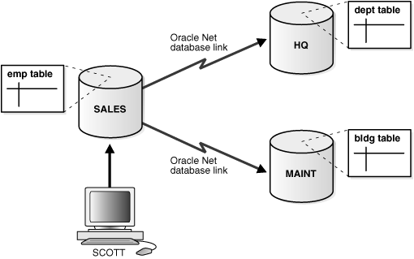
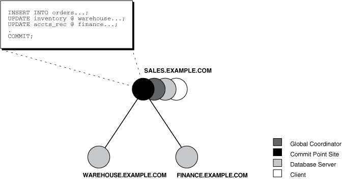
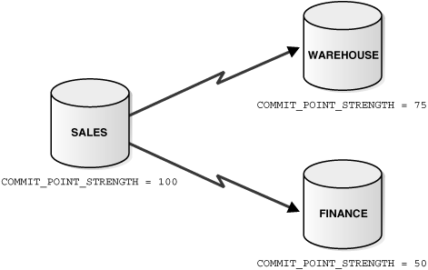
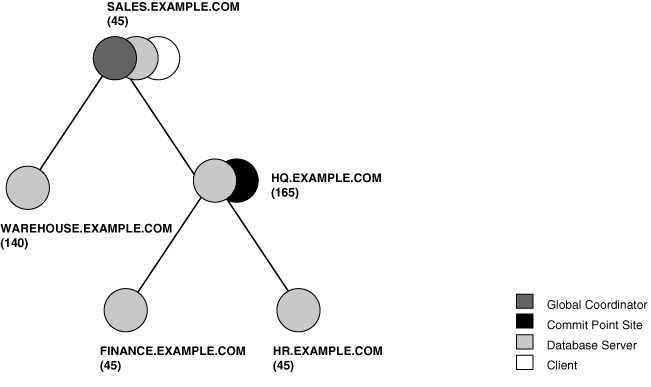
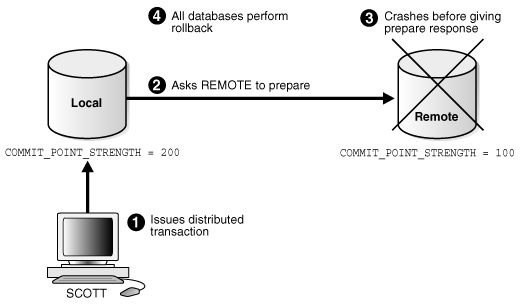
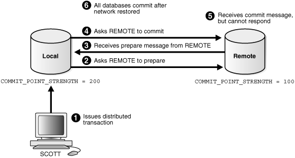
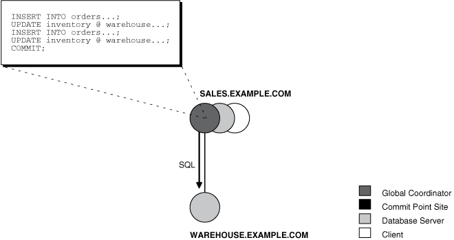
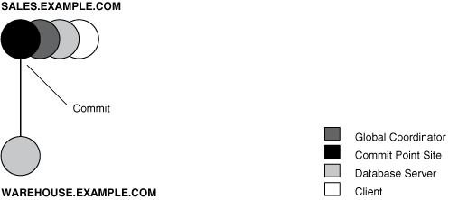
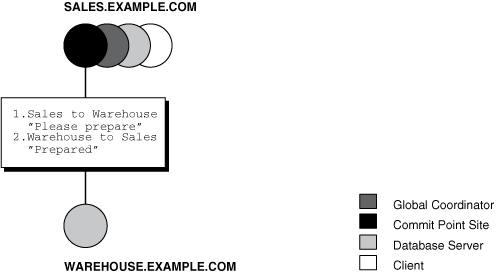
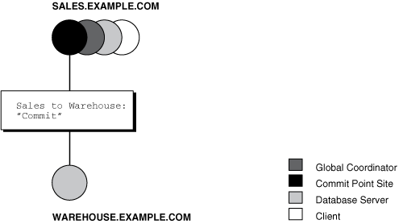

## 33 Distributed Transactions Concepts

Distributed transactions update data on two or more distinct nodes of a distributed database.

**Parent topic:** [Distributed Database Management](distributed-database-management.md)

### 33.1 What Are Distributed Transactions?

A distributed transaction includes one or more statements that, individually or as a group, update data on two or more distinct nodes of a distributed database.

For example, assume the database configuration depicted in Figure 33-1:

Figure 33-1 Distributed System



> The image admin051.gif shows a distributed database system. There are three databases, one local (SALES), and two remote (HQ and MAINT). A user (SCOTT) is shown updating tables on all three databases using a distributed transaction over Oracle Net database links.
>
> End of image description.
>
> [  
> Copyright © 1996, 2025, Oracle and/or its affiliates.](https://docs.oracle.com/en/database/oracle/oracle-database/dcommon/html/cpyr.htm)


The following distributed transaction executed by `scott` updates the local `sales` database, the remote `hq` database, and the remote `maint` database:

```
UPDATE scott.dept@hq.us.example.com
  SET loc = 'REDWOOD SHORES'
  WHERE deptno = 10;
UPDATE scott.emp
  SET deptno = 11
  WHERE deptno = 10;
UPDATE scott.bldg@maint.us.example.com
  SET room = 1225
  WHERE room = 1163;
COMMIT;
```

Note:

If all statements of a transaction reference only a single remote node, then the transaction is remote, not distributed.

There are two types of permissible operations in distributed transactions: DML and DDL transactions, and transaction control statement.

- DML and DDL Transactions  
	Some DML and DDL operations are supported in a distributed transaction.
- Transaction Control Statements  
	Some transaction control statements are supported in distributed transactions.

**Parent topic:** Distributed Transactions Concepts

#### 33.1.1 DML and DDL Transactions

Some DML and DDL operations are supported in a distributed transaction.

The following are the DML and DDL operations supported in a distributed transaction:

- `CREATE` `TABLE` `AS` `SELECT`
- `DELETE`
- `INSERT` (default and direct load)
- `UPDATE`
- `LOCK` `TABLE`
- `SELECT`
- `SELECT` `FOR` `UPDATE`

You can execute DML and DDL statements in parallel, and `INSERT` direct load statements serially, but note the following restrictions:

- All remote operations must be `SELECT` statements.
- These statements must not be clauses in another distributed transaction.
- If the table referenced in the table\_expression\_clause of an `INSERT`, `UPDATE`, or `DELETE` statement is remote, then execution is serial rather than parallel.
- You cannot perform remote operations after issuing parallel DML/DDL or direct load `INSERT`.
- If the transaction begins using XA or OCI, it executes serially.
- No loopback operations can be performed on the transaction originating the parallel operation. For example, you cannot reference a remote object that is actually a synonym for a local object.
- If you perform a distributed operation other than a `SELECT` in the transaction, no DML is parallelized.

**Parent topic:** What Are Distributed Transactions?

#### 33.1.2 Transaction Control Statements

Some transaction control statements are supported in distributed transactions.

The following are the supported transaction control statements:

- `COMMIT`
- `ROLLBACK`
- `SAVEPOINT`
	See Also:
	[Oracle Database SQL Language Reference](https://docs.oracle.com/pls/topic/lookup?ctx=en/database/oracle/oracle-database/21/admin&id=SQLRF) for more information about these SQL statements

**Parent topic:** What Are Distributed Transactions?

### 33.2 Session Trees for Distributed Transactions

A session tree is a hierarchical model that describes the relationships among sessions and their roles.

- About Session Trees for Distributed Transactions  
	As the statements in a distributed transaction are issued, the database defines a session tree of all nodes participating in the transaction.
- Clients  
	A node acts as a client when it references information from a database on another node.
- Database Servers  
	A database server is a node that hosts a database from which a client requests data.
- Local Coordinators  
	A node that must reference data on other nodes to complete its part in the distributed transaction is called a local coordinator.
- Global Coordinator  
	The node where the distributed transaction originates is called the global coordinator.
- Commit Point Site  
	The system administrator always designates one node to be the commit point site.

**Parent topic:** Distributed Transactions Concepts

#### 33.2.1 About Session Trees for Distributed Transactions

As the statements in a distributed transaction are issued, the database defines a session tree of all nodes participating in the transaction.

A session tree is a hierarchical model that describes the relationships among sessions and their roles. Figure 33-2 illustrates a session tree:

Figure 33-2 Example of a Session Tree



> The image admin031.gif depicts an example of a session tree. There are three nodes on this session tree: SALES.EXAMPLE.COM, WAREHOUSE.EXAMPLE.COM, and FINANCE.EXAMPLE.COM. The SALES.EXAMPLE.COM node has assumed the roles Global Coordinator, Commit Point Site, Database Server, and Client. These roles are explained in the text that follows the figure. A transaction consisting of several SQL statements associated only with the sales node, which in turn is associated with the warehouse and finance nodes.
>
> End of image description.


All nodes participating in the session tree of a distributed transaction assume one or more of the following roles:

| Role | Description |
| --- | --- |
| Client | A node that references information in a database belonging to a different node. |
| Database server | A node that receives a request for information from another node. |
| Global coordinator | The node that originates the distributed transaction. |
| Local coordinator | A node that is forced to reference data on other nodes to complete its part of the transaction. |
| Commit point site | The node that commits or rolls back the transaction as instructed by the global coordinator. |

The role a node plays in a distributed transaction is determined by:

- Whether the transaction is local or remote
- The commit point strength of the node (" Commit Point Site ")
- Whether all requested data is available at a node, or whether other nodes need to be referenced to complete the transaction
- Whether the node is read-only

**Parent topic:** Session Trees for Distributed Transactions

#### 33.2.2 Clients

A node acts as a client when it references information from a database on another node.

The referenced node is a database server. In Figure 33-2, the node `sales` is a client of the nodes that host the `warehouse` and `finance` databases.

**Parent topic:** Session Trees for Distributed Transactions

#### 33.2.3 Database Servers

A database server is a node that hosts a database from which a client requests data.

In Figure 33-2, an application at the `sales` node initiates a distributed transaction that accesses data from the `warehouse` and `finance` nodes. Therefore, `sales.example.com` has the role of client node, and `warehouse` and `finance` are both database servers. In this example, `sales` is a database server and a client because the application also modifies data in the `sales` database.

**Parent topic:** Session Trees for Distributed Transactions

#### 33.2.4 Local Coordinators

A node that must reference data on other nodes to complete its part in the distributed transaction is called a local coordinator.

In Figure 33-2, `sales` is a local coordinator because it coordinates the nodes it directly references: `warehouse` and `finance. `The node `sales` also happens to be the global coordinator because it coordinates all the nodes involved in the transaction.

A local coordinator is responsible for coordinating the transaction among the nodes it communicates directly with by:

- Receiving and relaying transaction status information to and from those nodes
- Passing queries to those nodes
- Receiving queries from those nodes and passing them on to other nodes
- Returning the results of queries to the nodes that initiated them

**Parent topic:** Session Trees for Distributed Transactions

#### 33.2.5 Global Coordinator

The node where the distributed transaction originates is called the global coordinator.

The database application issuing the distributed transaction is directly connected to the node acting as the global coordinator. For example, in Figure 33-2, the transaction issued at the node `sales` references information from the database servers `warehouse` and `finance`. Therefore, `sales.example.com` is the global coordinator of this distributed transaction.

The global coordinator becomes the parent or root of the session tree. The global coordinator performs the following operations during a distributed transaction:

- Sends all of the distributed transaction SQL statements, remote procedure calls, and so forth to the directly referenced nodes, thus forming the session tree
- Instructs all directly referenced nodes other than the commit point site to prepare the transaction
- Instructs the commit point site to initiate the global commit of the transaction if all nodes prepare successfully
- Instructs all nodes to initiate a global rollback of the transaction if there is a terminate response

**Parent topic:** Session Trees for Distributed Transactions

#### 33.2.6 Commit Point Site

The system administrator always designates one node to be the commit point site.

- About the Commit Point Site  
	The job of the commit point site is to initiate a commit or roll back operation as instructed by the global coordinator.
- How a Distributed Transaction Commits  
	A distributed transaction is considered committed after all non-commit-point sites are prepared, and the transaction has been actually committed at the commit point site.
- Commit Point Strength  
	Every database server must be assigned a commit point strength. If a database server is referenced in a distributed transaction, the value of its commit point strength determines which role it plays in the two-phase commit.

**Parent topic:** Session Trees for Distributed Transactions

##### 33.2.6.1 About the Commit Point Site

The job of the commit point site is to initiate a commit or roll back operation as instructed by the global coordinator.

The system administrator always designates one node to be the commit point site in the session tree by assigning all nodes a commit point strength. The node selected as commit point site should be the node that stores the most critical data.

Figure 33-3 illustrates an example of distributed system, with `sales` serving as the commit point site:

Figure 33-3 Commit Point Site



> The image admin050.gif shows commit point site settings in a distributed system. There are three databases shown: SALES, WAREHOUSE, and FINANCE. SALES serves as the commit point site in this example and has a COMMIT\_POINT\_STRENGTH setting of 100. WAREHOUSE and FINANCE have COMMIT\_POINT\_STRENGTH settings of 75 and 50, respectively.
>
> End of image description.


The commit point site is distinct from all other nodes involved in a distributed transaction in these ways:

- The commit point site never enters the prepared state. Consequently, if the commit point site stores the most critical data, this data never remains in-doubt, even if a failure occurs. In failure situations, failed nodes remain in a prepared state, holding necessary locks on data until in-doubt transactions are resolved.
- The commit point site commits before the other nodes involved in the transaction. In effect, the outcome of a distributed transaction at the commit point site determines whether the transaction at all nodes is committed or rolled back: the other nodes follow the lead of the commit point site. The global coordinator ensures that all nodes complete the transaction in the same manner as the commit point site.

**Parent topic:** Commit Point Site

##### 33.2.6.2 How a Distributed Transaction Commits

A distributed transaction is considered committed after all non-commit-point sites are prepared, and the transaction has been actually committed at the commit point site.

The redo log at the commit point site is updated as soon as the distributed transaction is committed at this node.

Because the commit point log contains a record of the commit, the transaction is considered committed even though some participating nodes may still be only in the prepared state and the transaction not yet actually committed at these nodes. In the same way, a distributed transaction is considered not committed if the commit has not been logged at the commit point site.

**Parent topic:** Commit Point Site

##### 33.2.6.3 Commit Point Strength

Every database server must be assigned a commit point strength. If a database server is referenced in a distributed transaction, the value of its commit point strength determines which role it plays in the two-phase commit.

Specifically, the commit point strength determines whether a given node is the commit point site in the distributed transaction and thus commits before all of the other nodes. This value is specified using the initialization parameter `COMMIT_POINT_STRENGTH`. This section explains how the database determines the commit point site.

The commit point site, which is determined at the beginning of the prepare phase, is selected only from the nodes participating in the transaction. The following sequence of events occurs:

1. Of the nodes directly referenced by the global coordinator, the database selects the node with the highest commit point strength as the commit point site.
2. The initially-selected node determines if any of the nodes from which it has to obtain information for this transaction has a higher commit point strength.
3. Either the node with the highest commit point strength directly referenced in the transaction or one of its servers with a higher commit point strength becomes the commit point site.
4. After the final commit point site has been determined, the global coordinator sends prepare responses to all nodes participating in the transaction.

Figure 33-4 shows in a sample session tree the commit point strengths of each node (in parentheses) and shows the node chosen as the commit point site:

Figure 33-4 Commit Point Strengths and Determination of the Commit Point Site



> The image admin032.gif shows a sample session tree with five nodes and their associated commit point strengths. The illustration shows how the commit point site is determined. The five nodes and their associated commit point strengths are SALES.EXAMPLE.COM (45), WAREHOUSE.EXAMPLE.COM (140), HQ.EXAMPLE.COM (165), FINANCE.EXAMPLE.COM (45), and HR.EXAMPLE.COM (45). HQ.EXAMPLE.COM is determined as the commit point site because it has the highest commit point strength.
>
> End image description.


The following conditions apply when determining the commit point site:

- A read-only node cannot be the commit point site.
- If multiple nodes directly referenced by the global coordinator have the same commit point strength, then the database designates one of these as the commit point site.
- If a distributed transaction ends with a rollback, then the prepare and commit phases are not needed. Consequently, the database never determines a commit point site. Instead, the global coordinator sends a `ROLLBACK` statement to all nodes and ends the processing of the distributed transaction.

As Figure 33-4 illustrates, the commit point site and the global coordinator can be different nodes of the session tree. The commit point strength of each node is communicated to the coordinators when the initial connections are made. The coordinators retain the commit point strengths of each node they are in direct communication with so that commit point sites can be efficiently selected during two-phase commits. Therefore, it is not necessary for the commit point strength to be exchanged between a coordinator and a node each time a commit occurs.

See Also:

- " [Specifying the Commit Point Strength of a Node](managing-distributed-transactions.md) " to learn how to set the commit point strength of a node
- [Oracle Database Reference](https://docs.oracle.com/pls/topic/lookup?ctx=en/database/oracle/oracle-database/21/admin&id=REFRN10018) for more information about the initialization parameter `COMMIT_POINT_STRENGTH`

**Parent topic:** Commit Point Site

### 33.3 Two-Phase Commit Mechanism

In a distributed database environment, the database must coordinate the committing or rolling back of the changes in a distributed transaction as a self-contained unit.

- About the Two-Phase Commit Mechanism  
	Unlike a transaction on a local database, a distributed transaction involves altering data on multiple databases. Consequently, distributed transaction processing is more complicated, because the database must coordinate the committing or rolling back of the changes in a transaction as a self-contained unit. In other words, the entire transaction commits, or the entire transaction rolls back.
- Prepare Phase  
	Prepare phase is the first phase in committing a distributed transaction.
- Commit Phase  
	The second phase in committing a distributed transaction is the commit phase. Before this phase occurs, all nodes other than the commit point site referenced in the distributed transaction have guaranteed that they are prepared, that is, they have the necessary resources to commit the transaction.
- Forget Phase  
	After the participating nodes notify the commit point site that they have committed, the commit point site can forget about the transaction.

**Parent topic:** Distributed Transactions Concepts

#### 33.3.1 About the Two-Phase Commit Mechanism

Unlike a transaction on a local database, a distributed transaction involves altering data on multiple databases. Consequently, distributed transaction processing is more complicated, because the database must coordinate the committing or rolling back of the changes in a transaction as a self-contained unit. In other words, the entire transaction commits, or the entire transaction rolls back.

The database ensures the integrity of data in a distributed transaction using the two-phase commit mechanism. In the prepare phase, the initiating node in the transaction asks the other participating nodes to promise to commit or roll back the transaction. During the commit phase, the initiating node asks all participating nodes to commit the transaction. If this outcome is not possible, then all nodes are asked to roll back.

All participating nodes in a distributed transaction should perform the same action: they should either all commit or all perform a rollback of the transaction. The database automatically controls and monitors the commit or rollback of a distributed transaction and maintains the integrity of the global database (the collection of databases participating in the transaction) using the two-phase commit mechanism. This mechanism is completely transparent, requiring no programming on the part of the user or application developer.

The commit mechanism has the following distinct phases, which the database performs automatically whenever a user commits a distributed transaction:

| Phase | Description |
| --- | --- |
| Prepare phase | The initiating node, called the global coordinator, asks participating nodes other than the commit point site to promise to commit or roll back the transaction, even if there is a failure. If any node cannot prepare, the transaction is rolled back. |
| Commit phase | If all participants respond to the coordinator that they are prepared, then the coordinator asks the commit point site to commit. After it commits, the coordinator asks all other nodes to commit the transaction. |
| Forget phase | The global coordinator forgets about the transaction. |

**Parent topic:** Two-Phase Commit Mechanism

#### 33.3.2 Prepare Phase

Prepare phase is the first phase in committing a distributed transaction.

- About Prepare Phase  
	The first phase in committing a distributed transaction is the prepare phase.
- Types of Responses in the Prepare Phase  
	When a node is told to prepare, it can respond in the different ways.
- Steps in the Prepare Phase  
	The prepare phase in the two-phase commit process includes specific steps.

**Parent topic:** Two-Phase Commit Mechanism

##### 33.3.2.1 About Prepare Phase

The first phase in committing a distributed transaction is the prepare phase.

In this phase, the database does not actually commit or roll back the transaction. Instead, all nodes referenced in a distributed transaction (except the commit point site, described in the " Commit Point Site ") are told to prepare to commit. By preparing, a node:

- Records information in the redo logs so that it can subsequently either commit or roll back the transaction, regardless of intervening failures
- Places a distributed lock on modified tables, which prevents reads

When a node responds to the global coordinator that it is prepared to commit, the prepared node promises to either commit or roll back the transaction later, but does not make a unilateral decision on whether to commit or roll back the transaction. The promise means that if an instance failure occurs at this point, the node can use the redo records in the online log to recover the database back to the prepare phase.

Note:

Queries that start after a node has prepared cannot access the associated locked data until all phases complete. The time is insignificant unless a failure occurs (see " [Deciding How to Handle In-Doubt Transactions](managing-distributed-transactions.md) ").

**Parent topic:** Prepare Phase

##### 33.3.2.2 Types of Responses in the Prepare Phase

When a node is told to prepare, it can respond in the different ways.

| Response | Meaning |
| --- | --- |
| Prepared | Data on the node has been modified by a statement in the distributed transaction, and the node has successfully prepared. |
| Read-only | No data on the node has been, or can be, modified (only queried), so no preparation is necessary. |
| Abort | The node cannot successfully prepare. |

- Prepared Response  
	When a node has successfully prepared, it issues a prepared message.
- Read-Only Response  
	When a node is asked to prepare, and the SQL statements affecting the database do not change any data on the node, the node responds with a read-only message.
- Abort Response  
	The abort message results in specific actions.

**Parent topic:** Prepare Phase

###### 33.3.2.2.1 Prepared Response

When a node has successfully prepared, it issues a prepared message.

The message indicates that the node has records of the changes in the online log, so it is prepared either to commit or perform a rollback. The message also guarantees that locks held for the transaction can survive a failure.

###### 33.3.2.2.2 Read-Only Response

When a node is asked to prepare, and the SQL statements affecting the database do not change any data on the node, the node responds with a read-only message.

The message indicates that the node will not participate in the commit phase.

There are three cases in which all or part of a distributed transaction is read-only:

| Case | Conditions | Consequence |
| --- | --- | --- |
| Partially read-only | Any of the following occurs:  - Only queries are issued at one or more nodes. - No data is changed. - Changes rolled back due to triggers firing or constraint violations. | The read-only nodes recognize their status when asked to prepare. They give their local coordinators a read-only response. Thus, the commit phase completes faster because the database eliminates read-only nodes from subsequent processing. |
| Completely read-only with prepare phase | All of following occur:  - No data changes. - Transaction is not started with `SET TRANSACTION READ ONLY` statement. | All nodes recognize that they are read-only during prepare phase, so no commit phase is required. The global coordinator, not knowing whether all nodes are read-only, must still perform the prepare phase. |
| Completely read-only without two-phase commit | All of following occur:  - No data changes. - Transaction is started with `SET TRANSACTION READ ONLY` statement. | Only queries are allowed in the transaction, so global coordinator does not have to perform two-phase commit. Changes by other transactions do not degrade global transaction-level read consistency because of global SCN coordination among nodes. The transaction does not use undo segments. |

Note that if a distributed transaction is set to read-only, then it does not use undo segments. If many users connect to the database and their transactions are not set to `READ ONLY`, then they allocate undo space even if they are only performing queries.

###### 33.3.2.2.3 Abort Response

The abort message results in specific actions.

When a node cannot successfully prepare, it performs the following actions:

1. Releases resources currently held by the transaction and rolls back the local portion of the transaction.
2. Responds to the node that referenced it in the distributed transaction with an abort message.

These actions then propagate to the other nodes involved in the distributed transaction so that they can roll back the transaction and guarantee the integrity of the data in the global database. This response enforces the primary rule of a distributed transaction: all nodes involved in the transaction either all commit or all roll back the transaction at the same logical time.

##### 33.3.2.3 Steps in the Prepare Phase

The prepare phase in the two-phase commit process includes specific steps.

To complete the prepare phase, each node excluding the commit point site performs the following steps:

1. The node requests that its descendants, that is, the nodes subsequently referenced, prepare to commit.
2. The node checks to see whether the transaction changes data on itself or its descendants. If there is no change to the data, then the node skips the remaining steps and returns a read-only response (see " Read-Only Response ").
3. The node allocates the resources it must commit the transaction if data is changed.
4. The node saves redo records corresponding to changes made by the transaction to its redo log.
5. The node guarantees that locks held for the transaction are able to survive a failure.
6. The node responds to the initiating node with a prepared response (see " Prepared Response ") or, if its attempt or the attempt of one of its descendents to prepare was unsuccessful, with an abort response (see " Abort Response ").

These actions guarantee that the node can subsequently commit or roll back the transaction on the node. The prepared nodes then wait until a `COMMIT` or `ROLLBACK` request is received from the global coordinator.

After the nodes are prepared, the distributed transaction is said to be in-doubt (see " In-Doubt Transactions "). It retains in-doubt status until all changes are either committed or rolled back.

**Parent topic:** Prepare Phase

#### 33.3.3 Commit Phase

The second phase in committing a distributed transaction is the commit phase. Before this phase occurs, all nodes other than the commit point site referenced in the distributed transaction have guaranteed that they are prepared, that is, they have the necessary resources to commit the transaction.

- Steps in the Commit Phase  
	The commit phase in the two-phase commit process includes specific steps.
- Guaranteeing Global Database Consistency  
	Each committed transaction has an associated system change number (SCN) to uniquely identify the changes made by the SQL statements within that transaction.

**Parent topic:** Two-Phase Commit Mechanism

##### 33.3.3.1 Steps in the Commit Phase

The commit phase in the two-phase commit process includes specific steps.

The commit phase consists of the following steps:

1. The global coordinator instructs the commit point site to commit.
2. The commit point site commits.
3. The commit point site informs the global coordinator that it has committed.
4. The global and local coordinators send a message to all nodes instructing them to commit the transaction.
5. At each node, the database commits the local portion of the distributed transaction and releases locks.
6. At each node, the database records an additional redo entry in the local redo log, indicating that the transaction has committed.
7. The participating nodes notify the global coordinator that they have committed.

When the commit phase is complete, the data on all nodes of the distributed system is consistent.

**Parent topic:** Commit Phase

##### 33.3.3.2 Guaranteeing Global Database Consistency

Each committed transaction has an associated system change number (SCN) to uniquely identify the changes made by the SQL statements within that transaction.

The SCN functions as an internal timestamp that uniquely identifies a committed version of the database.

In a distributed system, the SCNs of communicating nodes are coordinated when all of the following actions occur:

- A connection occurs using the path described by one or more database links
- A distributed SQL statement executes
- A distributed transaction commits

Among other benefits, the coordination of SCNs among the nodes of a distributed system ensures global read-consistency at both the statement and transaction level. If necessary, global time-based recovery can also be completed.

During the prepare phase, the database determines the highest SCN at all nodes involved in the transaction. The transaction then commits with the high SCN at the commit point site. The commit SCN is then sent to all prepared nodes with the commit decision.

See Also:

" [Managing Read Consistency](managing-distributed-transactions.md) " for information about managing time lag issues in read consistency

**Parent topic:** Commit Phase

#### 33.3.4 Forget Phase

After the participating nodes notify the commit point site that they have committed, the commit point site can forget about the transaction.

The following steps occur:

1. After receiving notice from the global coordinator that all nodes have committed, the commit point site erases status information about this transaction.
2. The commit point site informs the global coordinator that it has erased the status information.
3. The global coordinator erases its own information about the transaction.

**Parent topic:** Two-Phase Commit Mechanism

### 33.4 In-Doubt Transactions

A transaction becomes in-doubt if the two-phase commit mechanism fails.

- About In-Doubt Transactions  
	The two-phase commit mechanism ensures that all nodes either commit or perform a rollback together. What happens if any of the three phases fails because of a system or network error? The transaction becomes in-doubt.
- Automatic Resolution of In-Doubt Transactions  
	In the majority of cases, the database resolves the in-doubt transaction automatically. Assume that there are two nodes, `local` and `remote`, in the following scenarios. The local node is the commit point site. User `scott` connects to `local` and executes and commits a distributed transaction that updates `local` and `remote`.
- Manual Resolution of In-Doubt Transactions  
	In some cases, you must resolve an in-doubt transaction manually.
- Relevance of System Change Numbers for In-Doubt Transactions  
	A system change number (SCN) is an internal timestamp for a committed version of the database. The Oracle Database server uses the SCN clock value to guarantee transaction consistency.

**Parent topic:** Distributed Transactions Concepts

#### 33.4.1 About In-Doubt Transactions

The two-phase commit mechanism ensures that all nodes either commit or perform a rollback together. What happens if any of the three phases fails because of a system or network error? The transaction becomes in-doubt.

Distributed transactions can become in-doubt in the following ways:

- A server system running Oracle Database software crashes
- A network connection between two or more Oracle Databases involved in distributed processing is disconnected
- An unhandled software error occurs

The RECO process automatically resolves in-doubt transactions when the system, network, or software problem is resolved. Until RECO can resolve the transaction, the data is locked for both reads and writes. The database blocks reads because it cannot determine which version of the data to display for a query.

**Parent topic:** In-Doubt Transactions

#### 33.4.2 Automatic Resolution of In-Doubt Transactions

In the majority of cases, the database resolves the in-doubt transaction automatically. Assume that there are two nodes, `local` and `remote`, in the following scenarios. The local node is the commit point site. User `scott` connects to `local` and executes and commits a distributed transaction that updates `local` and `remote`.

- Failure During the Prepare Phase  
	An example illustrates the steps that are followed when there is a failure during the prepare phase of a two-phase transaction.
- Failure During the Commit Phase  
	An example illustrates the steps that are followed when there is a failure during the commit phase of a two-phase transaction.

**Parent topic:** In-Doubt Transactions

##### 33.4.2.1 Failure During the Prepare Phase

An example illustrates the steps that are followed when there is a failure during the prepare phase of a two-phase transaction.

Figure 33-5 illustrates the sequence of events when there is a failure during the prepare phase of a distributed transaction:

Figure 33-5 Failure During Prepare Phase



> The image admin049.gif shows a failure during the prepare phase of a distributed transaction. User SCOTT and two databases, Local and Remote, are shown. The Local database has COMMIT\_POINT\_STRENGTH = 200. The Remote database has COMMIT\_POINT\_STRENGTH = 100. The sequence of events leading to failure is described in the text following the image.
>
> End of image description.


The following steps occur:

1. User `SCOTT` connects to `Local` and executes a distributed transaction.
2. The global coordinator, which in this example is also the commit point site, requests all databases other than the commit point site to promise to commit or roll back when told to do so.
3. The `remote` database crashes before issuing the prepare response back to `local`.
4. The transaction is ultimately rolled back on each database by the RECO process when the remote site is restored.

**Parent topic:** Automatic Resolution of In-Doubt Transactions

##### 33.4.2.2 Failure During the Commit Phase

An example illustrates the steps that are followed when there is a failure during the commit phase of a two-phase transaction.

Figure 33-6 illustrates the sequence of events when there is a failure during the commit phase of a distributed transaction:

Figure 33-6 Failure During Commit Phase



> The image admin048.gif shows a failure during the commit phase of a distributed transaction. User SCOTT, and two databases, Local and Remote, are shown. The Local database has COMMIT\_POINT\_STRENGTH = 200. The Remote database has COMMIT\_POINT\_STRENGTH = 100. The events leading to failure are described in the text following the image.
>
> End of image description.


The following steps occur:

1. User `Scott` connects to `local` and executes a distributed transaction.
2. The global coordinator, which in this case is also the commit point site, requests all databases other than the commit point site to promise to commit or roll back when told to do so.
3. The commit point site receives a prepared message from `remote` saying that it will commit.
4. The commit point site commits the transaction locally, then sends a commit message to `remote` asking it to commit.
5. The `remote` database receives the commit message, but cannot respond because of a network failure.
6. The transaction is ultimately committed on the remote database by the RECO process after the network is restored.
	See Also:
	" [Deciding How to Handle In-Doubt Transactions](managing-distributed-transactions.md) " for a description of failure situations and how the database resolves intervening failures during two-phase commit

**Parent topic:** Automatic Resolution of In-Doubt Transactions

#### 33.4.3 Manual Resolution of In-Doubt Transactions

In some cases, you must resolve an in-doubt transaction manually.

You should only need to resolve an in-doubt transaction manually in the following cases:

- The in-doubt transaction has locks on critical data or undo segments.
- The cause of the system, network, or software failure cannot be repaired quickly.

Resolution of in-doubt transactions can be complicated. The procedure requires that you do the following:

- Identify the transaction identification number for the in-doubt transaction.
- Query the `DBA_2PC_PENDING` and `DBA_2PC_NEIGHBORS` views to determine whether the databases involved in the transaction have committed.
- If necessary, force a commit using the `COMMIT FORCE` statement or a rollback using the `ROLLBACK FORCE` statement.
	See Also:
	The following sections explain how to resolve in-doubt transactions:
	- " [Deciding How to Handle In-Doubt Transactions](managing-distributed-transactions.md) "
	- " [Manually Overriding In-Doubt Transactions](managing-distributed-transactions.md) "

**Parent topic:** In-Doubt Transactions

#### 33.4.4 Relevance of System Change Numbers for In-Doubt Transactions

A system change number (SCN) is an internal timestamp for a committed version of the database. The Oracle Database server uses the SCN clock value to guarantee transaction consistency.

For example, when a user commits a transaction, the database records an SCN for this commit in the redo log.

The database uses SCNs to coordinate distributed transactions among different databases. For example, the database uses SCNs in the following way:

1. An application establishes a connection using a database link.
2. The distributed transaction commits with the highest global SCN among all the databases involved.
3. The commit global SCN is sent to all databases involved in the transaction.

SCNs are important for distributed transactions because they function as a synchronized commit timestamp of a transaction, even if the transaction fails. If a transaction becomes in-doubt, an administrator can use this SCN to coordinate changes made to the global database. The global SCN for the transaction commit can also be used to identify the transaction later, for example, in distributed recovery.

**Parent topic:** In-Doubt Transactions

### 33.5 Distributed Transaction Processing: Case Study

A case study illustrates distributed transaction processing.

- About the Distributed Transaction Processing Case Study  
	In this scenario, a company has separate Oracle Database servers, `sales.example.com` and `warehouse.example.com`. As users insert sales records into the `sales` database, associated records are being updated at the `warehouse` database.
- Stage 1: Client Application Issues DML Statements  
	An example illustrates the first stage in distributed transaction processing.
- Stage 2: Oracle Database Determines Commit Point Site  
	An example illustrates the second stage in distributed transaction processing.
- Stage 3: Global Coordinator Sends Prepare Response  
	An example illustrates the third stage in distributed transaction processing.
- Stage 4: Commit Point Site Commits  
	An example illustrates the fourth stage in distributed transaction processing.
- Stage 5: Commit Point Site Informs Global Coordinator of Commit  
	An example illustrates the fifth stage in distributed transaction processing.
- Stage 6: Global and Local Coordinators Tell All Nodes to Commit  
	An example illustrates the sixth stage in distributed transaction processing.
- Stage 7: Global Coordinator and Commit Point Site Complete the Commit  
	An example illustrates the seventh stage in distributed transaction processing.

**Parent topic:** Distributed Transactions Concepts

#### 33.5.1 About the Distributed Transaction Processing Case Study

In this scenario, a company has separate Oracle Database servers, `sales.example.com` and `warehouse.example.com`. As users insert sales records into the `sales` database, associated records are being updated at the `warehouse` database.

This case study of distributed processing illustrates:

- The definition of a session tree
- How a commit point site is determined
- When prepare messages are sent
- When a transaction actually commits
- What information is stored locally about the transaction

**Parent topic:** Distributed Transaction Processing: Case Study

#### 33.5.2 Stage 1: Client Application Issues DML Statements

An example illustrates the first stage in distributed transaction processing.

At the Sales department, a salesperson uses SQL\*Plus to enter a sales order and then commit it. The application issues several SQL statements to enter the order into the `sales` database and update the inventory in the `warehouse` database:

```
CONNECT scott@sales.example.com ...;
INSERT INTO orders ...;
UPDATE inventory@warehouse.example.com ...;
INSERT INTO orders ...;
UPDATE inventory@warehouse.example.com ...;
COMMIT;
```

These SQL statements are part of a single distributed transaction, guaranteeing that all issued SQL statements succeed or fail as a unit. Treating the statements as a unit prevents the possibility of an order being placed and then inventory not being updated to reflect the order. In effect, the transaction guarantees the consistency of data in the global database.

As each of the SQL statements in the transaction executes, the session tree is defined, as shown in Figure 33-7.

Figure 33-7 Defining the Session Tree



> The image admin033.gif defines the session tree when each of the SQL statements in the transaction executes. The SQL statements are listed in the text preceding the image.
>
> The SALES.EXAMPLE.COM database takes on the roles of global coordinator, database server, and client when each SQL statement to the WAREHOUSE.EXAMPLE.COM database executes.
>
> End of image description.


Note the following aspects of the transaction:

- An order entry application running on the `sales` database initiates the transaction. Therefore, `sales.example.com ` is the global coordinator for the distributed transaction.
- The order entry application inserts a new sales record into the `sales` database and updates the inventory at the warehouse. Therefore, the nodes `sales.example.com` and `warehouse.example.com ` are both database servers.
- Because `sales.example.com` updates the inventory, it is a client of `warehouse.example.com`.

This stage completes the definition of the session tree for this distributed transaction. Each node in the tree has acquired the necessary data locks to execute the SQL statements that reference local data. These locks remain even after the SQL statements have been executed until the two-phase commit is completed.

**Parent topic:** Distributed Transaction Processing: Case Study

#### 33.5.3 Stage 2: Oracle Database Determines Commit Point Site

An example illustrates the second stage in distributed transaction processing.

The database determines the commit point site immediately following the `COMMIT` statement. `sales.example.com`, the global coordinator, is determined to be the commit point site, as shown in Figure 33-8.

See Also:

" Commit Point Strength " for more information about how the commit point site is determined

Figure 33-8 Determining the Commit Point Site



> The image admin034.gif shows the determination of the commit point site following the COMMIT statement. SALES.EXAMPLE.COM, the global coordinator, is determined as the commit point site.
>
> End of image description.
>
> [  
> Copyright © 1996, 2025, Oracle and/or its affiliates.](https://docs.oracle.com/en/database/oracle/oracle-database/dcommon/html/cpyr.htm)


**Parent topic:** Distributed Transaction Processing: Case Study

#### 33.5.4 Stage 3: Global Coordinator Sends Prepare Response

An example illustrates the third stage in distributed transaction processing.

The prepare stage involves the following steps:

1. After the database determines the commit point site, the global coordinator sends the prepare message to all directly referenced nodes of the session tree, excluding the commit point site. In this example, `warehouse.example.com` is the only node asked to prepare.
2. Node `warehouse.example.com ` tries to prepare. If a node can guarantee that it can commit the locally dependent part of the transaction and can record the commit information in its local redo log, then the node can successfully prepare. In this example, only `warehouse.example.com` receives a prepare message because `sales.example.com` is the commit point site.
3. Node `warehouse.example.com` responds to `sales.example.com` with a prepared message.

As each node prepares, it sends a message back to the node that asked it to prepare. Depending on the responses, one of the following can happen:

- If any of the nodes asked to prepare responds with an abort message to the global coordinator, then the global coordinator tells all nodes to roll back the transaction, and the operation is completed.
- If all nodes asked to prepare respond with a prepared or a read-only message to the global coordinator, that is, they have successfully prepared, then the global coordinator asks the commit point site to commit the transaction.

Figure 33-9 Sending and Acknowledging the Prepare Message



> The image admin035.gif shows the sending and acknowledging of the "prepare" message. SALES.EXAMPLE.COM sends a "please prepare" message to WAREHOUSE.EXAMPLE.COM. WAREHOUSE.EXAMPLE.COM acknowledges by sending a "prepared" message back to SALES.EXAMPLE.COM.
>
> End of image description.
>
> [  
> Copyright © 1996, 2025, Oracle and/or its affiliates.](https://docs.oracle.com/en/database/oracle/oracle-database/dcommon/html/cpyr.htm)


**Parent topic:** Distributed Transaction Processing: Case Study

#### 33.5.5 Stage 4: Commit Point Site Commits

An example illustrates the fourth stage in distributed transaction processing.

The committing of the transaction by the commit point site involves the following steps:

1. Node `sales.example.com`, receiving acknowledgment that `warehouse.example.com` is prepared, instructs the commit point site to commit the transaction.
2. The commit point site now commits the transaction locally and records this fact in its local redo log.

Even if `warehouse.example.com` has not yet committed, the outcome of this transaction is predetermined. In other words, the transaction will be committed at all nodes even if the ability of a given node to commit is delayed.

**Parent topic:** Distributed Transaction Processing: Case Study

#### 33.5.6 Stage 5: Commit Point Site Informs Global Coordinator of Commit

An example illustrates the fifth stage in distributed transaction processing.

This stage involves the following steps:

1. The commit point site tells the global coordinator that the transaction has committed. Because the commit point site and global coordinator are the same node in this example, no operation is required. The commit point site knows that the transaction is committed because it recorded this fact in its online log.
2. The global coordinator confirms that the transaction has been committed on all other nodes involved in the distributed transaction.

**Parent topic:** Distributed Transaction Processing: Case Study

#### 33.5.7 Stage 6: Global and Local Coordinators Tell All Nodes to Commit

An example illustrates the sixth stage in distributed transaction processing.

The committing of the transaction by all the nodes in the transaction involves the following steps:

1. After the global coordinator has been informed of the commit at the commit point site, it tells all other directly referenced nodes to commit.
2. In turn, any local coordinators instruct their servers to commit, and so on.
3. Each node, including the global coordinator, commits the transaction and records appropriate redo log entries locally. As each node commits, the resource locks that were being held locally for that transaction are released.

In Figure 33-10, `sales.example.com`, which is both the commit point site and the global coordinator, has already committed the transaction locally. `sales` now instructs `warehouse.example.com` to commit the transaction.

Figure 33-10 Instructing Nodes to Commit



> The image admin036.gif shows the instruction of nodes to commit. SALES.EXAMPLE.COM sends a "commit" message to WAREHOUSE.EXAMPLE.COM.
>
> End of image description.
>
> [  
> Copyright © 1996, 2025, Oracle and/or its affiliates.](https://docs.oracle.com/en/database/oracle/oracle-database/dcommon/html/cpyr.htm)


**Parent topic:** Distributed Transaction Processing: Case Study

#### 33.5.8 Stage 7: Global Coordinator and Commit Point Site Complete the Commit

An example illustrates the seventh stage in distributed transaction processing.

The completion of the commit of the transaction occurs in the following steps:

1. After all referenced nodes and the global coordinator have committed the transaction, the global coordinator informs the commit point site of this fact.
2. The commit point site, which has been waiting for this message, erases the status information about this distributed transaction.
3. The commit point site informs the global coordinator that it is finished. In other words, the commit point site forgets about committing the distributed transaction. This action is permissible because all nodes involved in the two-phase commit have committed the transaction successfully, so they will never have to determine its status in the future.
4. The global coordinator finalizes the transaction by forgetting about the transaction itself.

After the completion of the `COMMIT` phase, the distributed transaction is itself complete. The steps described are accomplished automatically and in a fraction of a second.

**Parent topic:** Distributed Transaction Processing: Case Study