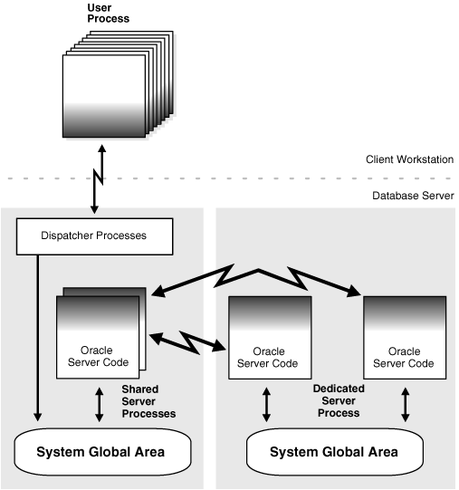
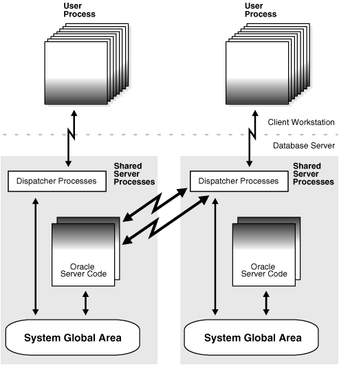
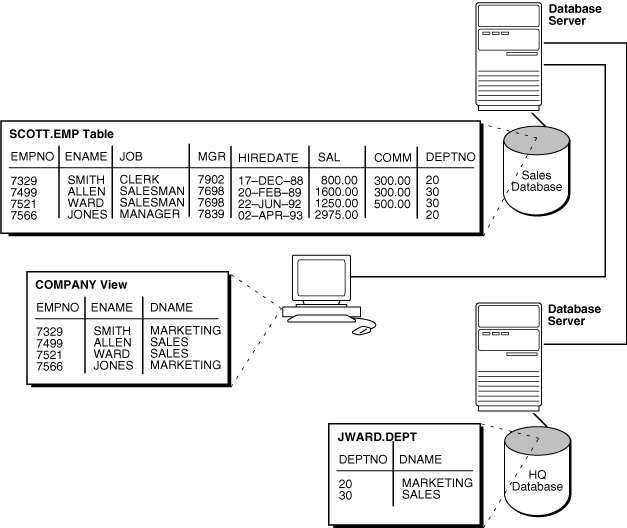

## 31 Managing a Distributed Database

Managing a distributed database includes tasks such as managing global names, managing database links, and creating location and statement transparency.

**Parent topic:** [Distributed Database Management](distributed-database-management.md)

### 31.1 Managing Global Names in a Distributed System

In a distributed database system, each database should have a unique global database name. Global database names uniquely identify a database in the system. A primary administration task in a distributed system is managing the creation and alteration of global database names.

- Understanding How Global Database Names Are Formed  
	A global database name is formed from two components: a database name and a domain.
- Determining Whether Global Naming Is Enforced  
	The name that you give to a link on the local database depends on whether the local database enforces global naming.
- Viewing a Global Database Name  
	Use the data dictionary view `GLOBAL_NAME` to view the database global name.
- Changing the Domain in a Global Database Name  
	Use the `ALTER DATABASE` statement to change the domain in a database global name.
- Changing a Global Database Name: Scenario  
	A scenario illustrates changing a global database name.

**Parent topic:** Managing a Distributed Database

#### 31.1.1 Understanding How Global Database Names Are Formed

A global database name is formed from two components: a database name and a domain.

The database name and the domain name are determined by the following initialization parameters at database creation:

| Component | Parameter | Requirements | Example |
| --- | --- | --- | --- |
| Database name | `DB_NAME` | Must be 30 characters or less. | `sales` |
| Domain containing the database | `DB_DOMAIN` | Must follow standard Internet conventions. Levels in domain names must be separated by dots and the order of domain names is from leaf to root, left to right. | `us.example.com` |

These are examples of valid global database names:

| DB\_NAME | DB\_DOMAIN | Global Database Name |
| --- | --- | --- |
| `sales` | `example.com` | `sales.example.com` |
| `sales` | `us.example.com` | `sales.us.example.com` |
| `mktg` | `us.example.com` | `mktg.us.example.com` |
| `payroll` | `example.org` | `payroll.example.org` |

The `DB_DOMAIN` initialization parameter is only important at database creation time when it is used, together with the `DB_NAME` parameter, to form the database global name. At this point, the database global name is stored in the data dictionary. You must change the global name using an `ALTER DATABASE ` statement, not by altering the `DB_DOMAIN` parameter in the initialization parameter file. It is good practice, however, to change the `DB_DOMAIN` parameter to reflect the change in the domain name before the next database startup.

**Parent topic:** Managing Global Names in a Distributed System

#### 31.1.2 Determining Whether Global Naming Is Enforced

The name that you give to a link on the local database depends on whether the local database enforces global naming.

If the local database enforces global naming, then you must use the remote database global database name as the name of the link. For example, if you are connected to the local `hq` server and want to create a link to the remote `mfg` database, and the local database enforces global naming, then you must use the `mfg` global database name as the link name.

You can also use service names as part of the database link name. For example, if you use the service names `sn1` and `sn2` to connect to database `hq.example.com`, and global naming is enforced, then you can create the following link names to `hq`:

- `HQ.EXAMPLE.COM@SN1`
- `HQ.EXAMPLE.COM@SN2`
	See Also:
	" Using Connection Qualifiers to Specify Service Names Within Link Names " for more information about using services names in link names

To determine whether global naming is enforced on a database, either examine the database initialization parameter file or query the `V$PARAMETER` view. For example, to see whether global naming is enforced on `mfg`, you could start a session on `mfg` and then create and execute the following `globalnames.sql` script (sample output included):

```
COL NAME FORMAT A12
COL VALUE FORMAT A6
SELECT NAME, VALUE FROM V$PARAMETER
   WHERE NAME = 'global_names'
/

SQL> @globalnames

NAME         VALUE
------------ ------
global_names FALSE
```

**Parent topic:** Managing Global Names in a Distributed System

#### 31.1.3 Viewing a Global Database Name

Use the data dictionary view `GLOBAL_NAME` to view the database global name.

For example, issue the following:

```
SELECT * FROM GLOBAL_NAME;

GLOBAL_NAME
-------------------------------------------------------------------------------
SALES.EXAMPLE.COM
```

**Parent topic:** Managing Global Names in a Distributed System

#### 31.1.4 Changing the Domain in a Global Database Name

Use the `ALTER DATABASE` statement to change the domain in a database global name.

After the database is created, changing the initialization parameter `DB_DOMAIN` has no effect on the global database name or on the resolution of database link names.

The following example shows the syntax for the renaming statement, where database is a database name and domain is the network domain:

```
ALTER DATABASE RENAME GLOBAL_NAME TO database.domain;
```

Use the following procedure to change the domain in a global database name:

1. Determine the current global database name. For example, issue:
	```
	SELECT * FROM GLOBAL_NAME;
	GLOBAL_NAME
	----------------------------------------------------------------------------
	SALES.EXAMPLE.COM
	```
2. Rename the global database name using an `ALTER DATABASE` statement. For example, enter:
	```
	ALTER DATABASE RENAME GLOBAL_NAME TO sales.us.example.com;
	```
3. Query the `GLOBAL_NAME` table to check the new name. For example, enter:
	```
	SELECT * FROM GLOBAL_NAME;
	GLOBAL_NAME
	----------------------------------------------------------------------------
	SALES.US.EXAMPLE.COM
	```

**Parent topic:** Managing Global Names in a Distributed System

#### 31.1.5 Changing a Global Database Name: Scenario

A scenario illustrates changing a global database name.

In this scenario, you change the domain part of the global database name of the local database. You also create database links using partially specified global names to test how Oracle Database resolves the names. You discover that the database resolves the partial names using the domain part of the current global database name of the local database, not the value for the initialization parameter `DB_DOMAIN`.

1. You connect to `SALES.US.EXAMPLE.COM` and query the `GLOBAL_NAME` data dictionary view to determine the current database global name:
	```
	CONNECT SYSTEM@sales.us.example.com
	SELECT * FROM GLOBAL_NAME;
	GLOBAL_NAME
	---------------------------------------------------------------------------- 
	SALES.US.EXAMPLE.COM
	```
2. You query the `V$PARAMETER` view to determine the current setting for the `DB_DOMAIN` initialization parameter:
	```
	SELECT NAME, VALUE FROM V$PARAMETER WHERE NAME = 'db_domain'; 
	NAME       VALUE
	---------  -----------
	db_domain  US.EXAMPLE.COM
	```
3. You then create a database link to a database called `hq`, using only a partially-specified global name:
	```
	CREATE DATABASE LINK hq USING 'sales';
	```
	The database expands the global database name for this link by appending the domain part of the global database name of the local database to the name of the database specified in the link.
4. You query `USER_DB_LINKS` to determine which domain name the database uses to resolve the partially specified global database name:
	```
	SELECT DB_LINK FROM USER_DB_LINKS; 
	DB_LINK
	------------------
	HQ.US.EXAMPLE.COM
	```
	This result indicates that the domain part of the global database name of the local database is `us.example.com`. The database uses this domain in resolving partial database link names when the database link is created.
5. Because you have received word that the `sales` database will move to Japan, you rename the `sales` database to `sales.jp.example.com`:
	```
	ALTER DATABASE RENAME GLOBAL_NAME TO sales.jp.example.com;
	SELECT * FROM GLOBAL_NAME; 
	GLOBAL_NAME
	---------------------------------------------------------------------------- 
	SALES.JP.EXAMPLE.COM
	```
6. You query `V$PARAMETER` again and discover that the value of `DB_DOMAIN` is not changed, although you renamed the domain part of the global database name:
	```
	SELECT NAME, VALUE FROM V$PARAMETER 
	  WHERE NAME = 'db_domain'; 
	NAME       VALUE
	---------  -----------
	db_domain  US.EXAMPLE.COM
	```
	This result indicates that the value of the `DB_DOMAIN` initialization parameter is independent of the `ALTER DATABASE RENAME GLOBAL_NAME` statement. The `ALTER DATABASE` statement determines the domain of the global database name, not the `DB_DOMAIN` initialization parameter (although it is good practice to alter `DB_DOMAIN` to reflect the new domain name).
7. You create another database link to database `supply`, and then query `USER_DB_LINKS` to see how the database resolves the domain part of the global database name of `supply`:
	```
	CREATE DATABASE LINK supply USING 'supply'; 
	SELECT DB_LINK FROM USER_DB_LINKS; 
	DB_LINK
	------------------
	HQ.US.EXAMPLE.COM 
	SUPPLY.JP.EXAMPLE.COM
	```
	This result indicates that the database resolves the partially specified link name by using the domain `jp.example.com.` This domain is used when the link is created because it is the domain part of the global database name of the local database. The database does not use the `DB_DOMAIN` initialization parameter setting when resolving the partial link name.
8. You then receive word that your previous information was faulty: `sales` will be in the `ASIA.JP.EXAMPLE.COM` domain, not the `JP.EXAMPLE.COM` domain. Consequently, you rename the global database name as follows:
	```
	ALTER DATABASE RENAME GLOBAL_NAME TO sales.asia.jp.example.com; 
	SELECT * FROM GLOBAL_NAME; 
	GLOBAL_NAME
	---------------------------------------------------------------------------- 
	SALES.ASIA.JP.EXAMPLE.COM
	```
9. You query `V$PARAMETER` to again check the setting for the parameter `DB_DOMAIN`:
	```
	SELECT NAME, VALUE FROM V$PARAMETER 
	  WHERE NAME = 'db_domain'; 
	NAME        VALUE
	----------  -----------
	db_domain   US.EXAMPLE.COM
	```
	The result indicates that the domain setting in the parameter file is the same as it was before you issued either of the `ALTER DATABASE RENAME` statements.
10. Finally, you create a link to the `warehouse` database and again query `USER_DB_LINKS` to determine how the database resolves the partially-specified global name:
	```
	CREATE DATABASE LINK warehouse USING 'warehouse'; 
	SELECT DB_LINK FROM USER_DB_LINKS; 
	DB_LINK
	------------------
	HQ.US.EXAMPLE.COM 
	SUPPLY.JP.EXAMPLE.COM
	WAREHOUSE.ASIA.JP.EXAMPLE.COM
	```
	Again, you see that the database uses the domain part of the global database name of the local database to expand the partial link name during link creation.
	Note:
	In order to correct the `supply` database link, it must be dropped and re-created.
	See Also:
	- [Oracle Database Reference](https://docs.oracle.com/pls/topic/lookup?ctx=en/database/oracle/oracle-database/21/admin&id=REFRN10041) for more information about specifying the `DB_NAME` initialization parameter
	- [Oracle Database Reference](https://docs.oracle.com/pls/topic/lookup?ctx=en/database/oracle/oracle-database/21/admin&id=REFRN10036) for more information about specifying the `DB_DOMAIN` initialization parameter

**Parent topic:** Managing Global Names in a Distributed System

### 31.2 Creating Database Links

To support application access to the data and schema objects throughout a distributed database system, you must create all necessary database links.

- Obtaining Privileges Necessary for Creating Database Links  
	A database link is a pointer in the local database that lets you access objects on a remote database. To create a private database link, you must have been granted the proper privileges.
- Specifying Link Types  
	When you create a database link, you must decide who will have access to it.
- Specifying Link Users  
	A database link defines a communication path from one database to another. When an application uses a database link to access a remote database, Oracle Database establishes a database session in the remote database on behalf of the local application request. When you create a private or public database link, you can determine which schema on the remote database the link will establish connections to by creating fixed user, current user, and connected user database links.
- Using Connection Qualifiers to Specify Service Names Within Link Names  
	In some situations, you may want to have several database links of the same type (for example, public) that point to the same remote database, yet establish connections to the remote database using different communication pathways.

**Parent topic:** Managing a Distributed Database

#### 31.2.1 Obtaining Privileges Necessary for Creating Database Links

A database link is a pointer in the local database that lets you access objects on a remote database. To create a private database link, you must have been granted the proper privileges.

The following table illustrates which privileges are required on which database for which type of link:

| Privilege | Database | Required For |
| --- | --- | --- |
| `CREATE DATABASE LINK` | Local | Creation of a private database link. |
| `CREATE PUBLIC DATABASE LINK` | Local | Creation of a public database link. |
| `CREATE SESSION` | Remote | Creation of any type of database link. |

To see which privileges you currently have available, query `ROLE_SYS_PRIVS`. For example, you could create and execute the following `privs.sql` script (sample output included):

```
SELECT DISTINCT PRIVILEGE AS "Database Link Privileges"
FROM ROLE_SYS_PRIVS
WHERE PRIVILEGE IN ( 'CREATE SESSION','CREATE DATABASE LINK',
                     'CREATE PUBLIC DATABASE LINK')
/

SQL> @privs

Database Link Privileges
----------------------------------------
CREATE DATABASE LINK
CREATE PUBLIC DATABASE LINK
CREATE SESSION
```

**Parent topic:** Creating Database Links

#### 31.2.2 Specifying Link Types

When you create a database link, you must decide who will have access to it.

- Creating Private Database Links  
	Use the `CREATE DATABASE LINK` statement to create private database links.
- Creating Public Database Links  
	Use the `CREATE PUBLIC DATABASE LINK` statement to create public database links.
- Creating Global Database Links  
	You can use a directory server in which databases are identified by net service names. In this document, these are what are referred to as global database links.

**Parent topic:** Creating Database Links

##### 31.2.2.1 Creating Private Database Links

Use the `CREATE DATABASE LINK` statement to create private database links.

To create a private database link, specify the following (where link\_name is the global database name or an arbitrary link name):

```
CREATE DATABASE LINK link_name ...;
```

Following are examples of private database links:

| SQL Statement | Result |
| --- | --- |
| `CREATE DATABASE LINK supply.us.example.com;` | A private link using the global database name to the remote `supply` database.  The link uses the userid/password of the connected user. So if `scott` (identified by `password`) uses the link in a query, the link establishes a connection to the remote database as `scott/` `password`. |
| `CREATE DATABASE LINK link_2 CONNECT TO jane IDENTIFIED BY` `password` `  USING 'us_supply';  ` | A private fixed user link called `link_2` to the database with service name `us_supply`. The link connects to the remote database with the userid/password of `jane/` `password` regardless of the connected user. |
| `CREATE DATABASE LINK link_1 CONNECT TO CURRENT_USER USING 'us_supply';` | A private link called `link_1` to the database with service name `us_supply`. The link uses the userid/password of the current user to log onto the remote database.  Note: The current user may not be the same as the connected user, and must be a global user on both databases involved in the link (see " [Users of Database Links](distributed-database-concepts.md) "). Current user links are part of the Oracle Advanced Security option. |

See Also:

[Oracle Database SQL Language Reference](https://docs.oracle.com/pls/topic/lookup?ctx=en/database/oracle/oracle-database/21/admin&id=SQLRF01205) for `CREATE DATABASE LINK` syntax

**Parent topic:** Specifying Link Types

##### 31.2.2.2 Creating Public Database Links

Use the `CREATE PUBLIC DATABASE LINK` statement to create public database links.

To create a public database link, use the keyword `PUBLIC` (where link\_name is the global database name or an arbitrary link name):

```
CREATE PUBLIC DATABASE LINK link_name ...;
```

Following are examples of public database links:

| SQL Statement | Result |
| --- | --- |
| `CREATE PUBLIC DATABASE LINK supply.us.example.com;` | A public link to the remote `supply` database. The link uses the userid/password of the connected user. So if `scott` (identified by `password`) uses the link in a query, the link establishes a connection to the remote database as `scott/` `password`. |
| `CREATE PUBLIC DATABASE LINK pu_link CONNECT TO CURRENT_USER USING 'supply';` | A public link called `pu_link` to the database with service name `supply`. The link uses the userid/password of the current user to log onto the remote database.  Note: The current user may not be the same as the connected user, and must be a global user on both databases involved in the link (see " [Users of Database Links](distributed-database-concepts.md) "). |
| `CREATE PUBLIC DATABASE LINK sales.us.example.com CONNECT TO jane IDENTIFIED BY` `password``;` | A public fixed user link to the remote `sales` database. The link connects to the remote database with the userid/password of `jane/` `password`. |

See Also:

[Oracle Database SQL Language Reference](https://docs.oracle.com/pls/topic/lookup?ctx=en/database/oracle/oracle-database/21/admin&id=SQLRF01205) for `CREATE PUBLIC DATABASE LINK` syntax

**Parent topic:** Specifying Link Types

##### 31.2.2.3 Creating Global Database Links

You can use a directory server in which databases are identified by net service names. In this document, these are what are referred to as global database links.

See the [Oracle Database Net Services Administrator's Guide](https://docs.oracle.com/pls/topic/lookup?ctx=en/database/oracle/oracle-database/21/admin&id=NETAG008) to learn how to create directory entries that act as global database links.

**Parent topic:** Specifying Link Types

#### 31.2.3 Specifying Link Users

A database link defines a communication path from one database to another. When an application uses a database link to access a remote database, Oracle Database establishes a database session in the remote database on behalf of the local application request. When you create a private or public database link, you can determine which schema on the remote database the link will establish connections to by creating fixed user, current user, and connected user database links.

- Creating Fixed User Database Links  
	When an application uses a fixed user database link, the local server always establishes a connection to a fixed remote schema in the remote database. The local server also sends the fixed user's credentials across the network when an application uses the link to access the remote database.
- Creating Connected User and Current User Database Links  
	Connected user and current user database links do not include credentials in the definition of the link. The credentials used to connect to the remote database can change depending on the user that references the database link and the operation performed by the application.

**Parent topic:** Creating Database Links

##### 31.2.3.1 Creating Fixed User Database Links

When an application uses a fixed user database link, the local server always establishes a connection to a fixed remote schema in the remote database. The local server also sends the fixed user's credentials across the network when an application uses the link to access the remote database.

To create a fixed user database link, you embed the credentials (in this case, a username and password) required to access the remote database in the definition of the link:

```
CREATE DATABASE LINK ... CONNECT TO username IDENTIFIED BY password ...;
```

Following are examples of fixed user database links:

| SQL Statement | Result |
| --- | --- |
| `CREATE PUBLIC DATABASE LINK supply.us.example.com CONNECT TO scott IDENTIFIED BY ` `password``;` | A public link using the global database name to the remote `supply` database. The link connects to the remote database with the userid/password `scott/` `password`. |
| `CREATE DATABASE LINK foo CONNECT TO jane IDENTIFIED BY` `password` `USING 'finance';` | A private fixed user link called `foo` to the database with service name `finance`. The link connects to the remote database with the userid/password `jane/` `password`. |

**Parent topic:** Specifying Link Users

##### 31.2.3.2 Creating Connected User and Current User Database Links

Connected user and current user database links do not include credentials in the definition of the link. The credentials used to connect to the remote database can change depending on the user that references the database link and the operation performed by the application.

Note:

For many distributed applications, you do not want a user to have privileges in a remote database. One simple way to achieve this result is to create a procedure that contains a fixed user or current user database link within it. In this way, the user accessing the procedure temporarily assumes someone else's privileges.

- Creating a Connected User Database Link  
	To create a connected user database link, omit the `CONNECT TO` clause in the `CREATE DATABASE LINK` statement.
- Creating a Current User Database Link  
	To create a current user database link, use the `CONNECT TO CURRENT_USER` clause in the `CREATE DATABASE LINK` statement.

**Parent topic:** Specifying Link Users

###### 31.2.3.2.1 Creating a Connected User Database Link

To create a connected user database link, omit the `CONNECT TO` clause in the `CREATE DATABASE LINK` statement.

The following syntax creates a connected user database link, where dblink is the name of the link and net\_service\_name is an optional connect string:

```
CREATE [SHARED] [PUBLIC] DATABASE LINK dblink ... [USING 'net_service_name'];
```

For example, to create a connected user database link, use the following syntax:

```
CREATE DATABASE LINK sales.division3.example.com USING 'sales';
```

**Parent topic:** Creating Connected User and Current User Database Links

###### 31.2.3.2.2 Creating a Current User Database Link

To create a current user database link, use the `CONNECT TO CURRENT_USER` clause in the `CREATE DATABASE LINK` statement.

Current user links are only available through the Oracle Advanced Security option.

The following syntax creates a current user database link, where dblink is the name of the link and net\_service\_name is an optional connect string:

```
CREATE [SHARED] [PUBLIC] DATABASE LINK dblink CONNECT TO CURRENT_USER 
[USING 'net_service_name'];
```

For example, to create a connected user database link to the `sales` database, you might use the following syntax:

```
CREATE DATABASE LINK sales CONNECT TO CURRENT_USER USING 'sales';
```

Note:

To use a current user database link, the current user must be a global user on both databases involved in the link.

See Also:

[Oracle Database SQL Language Reference](https://docs.oracle.com/pls/topic/lookup?ctx=en/database/oracle/oracle-database/21/admin&id=SQLRF01205) for more syntax information about creating database links

**Parent topic:** Creating Connected User and Current User Database Links

#### 31.2.4 Using Connection Qualifiers to Specify Service Names Within Link Names

In some situations, you may want to have several database links of the same type (for example, public) that point to the same remote database, yet establish connections to the remote database using different communication pathways.

Some cases in which this strategy is useful are:

- A remote database is part of an Oracle Real Application Clusters configuration, so you define several public database links at your local node so that connections can be established to specific instances of the remote database.
- Some clients connect to the Oracle Database server using TCP/IP while others use DECNET.

To facilitate such functionality, the database lets you create a database link with an optional service name in the database link name. When creating a database link, a service name is specified as the trailing portion of the database link name, separated by an `@` sign, as in `@sales`. This string is called a connection qualifier.

For example, assume that remote database `hq.example.com ` is managed in an Oracle Real Application Clusters environment. The `hq` database has two instances named `hq_1` and `hq_2`. The local database can contain the following public database links to define pathways to the remote instances of the `hq` database:

```
CREATE PUBLIC DATABASE LINK hq.example.com@hq_1
  USING 'string_to_hq_1';
CREATE PUBLIC DATABASE LINK hq.example.com@hq_2
  USING 'string_to_hq_2';
CREATE PUBLIC DATABASE LINK hq.example.com
  USING 'string_to_hq';
```

Notice in the first two examples that a service name is simply a part of the database link name. The text of the service name does not necessarily indicate how a connection is to be established; this information is specified in the service name of the `USING` clause. Also notice that in the third example, a service name is not specified as part of the link name. In this case, just as when a service name is specified as part of the link name, the instance is determined by the `USING` string.

To use a service name to specify a particular instance, include the service name at the end of the global object name:

```
SELECT * FROM scott.emp@hq.example.com@hq_1
```

Note that in this example, there are two @ symbols.

**Parent topic:** Creating Database Links

### 31.3 Using Shared Database Links

Every application that references a remote server using a standard database link establishes a connection between the local database and the remote database. Many users running applications simultaneously can cause a high number of connections between the local and remote databases. Shared database links enable you to limit the number of network connections required between the local server and the remote server.

- Determining Whether to Use Shared Database Links  
	Look carefully at your application and shared server configuration to determine whether to use shared links. A simple guideline is to use shared database links when the number of users accessing a database link is expected to be much larger than the number of server processes in the local database.
- Creating Shared Database Links  
	To create a shared database link, use the keyword `SHARED` in the `CREATE DATABASE LINK` statement.
- Configuring Shared Database Links  
	You can configure shared database links in different ways.

See Also:

" [What Are Shared Database Links?](distributed-database-concepts.md)" for a conceptual overview of shared database links

**Parent topic:** Managing a Distributed Database

#### 31.3.1 Determining Whether to Use Shared Database Links

Look carefully at your application and shared server configuration to determine whether to use shared links. A simple guideline is to use shared database links when the number of users accessing a database link is expected to be much larger than the number of server processes in the local database.

The following table illustrates three possible configurations involving database links:

| Link Type | Server Mode | Consequences |
| --- | --- | --- |
| Nonshared | Dedicated/shared server | If your application uses a standard public database link, and 100 users simultaneously require a connection, then 100 direct network connections to the remote database are required. |
| Shared | Shared server | If 10 shared server processes exist in the local shared server mode database, then 100 users that use the same database link require 10 or fewer network connections to the remote server. Each local shared server process may only need one connection to the remote server. |
| Shared | Dedicated | If 10 clients connect to a local dedicated server, and each client has 10 sessions on the same connection (thus establishing 100 sessions overall), and each session references the same remote database, then only 10 connections are needed. With a nonshared database link, 100 connections are needed. |

Shared database links are not useful in all situations. Assume that only one user accesses the remote server. If this user defines a shared database link and 10 shared server processes exist in the local database, then this user can require up to 10 network connections to the remote server. Because the user can use each shared server process, each process can establish a connection to the remote server.

Clearly, a nonshared database link is preferable in this situation because it requires only one network connection. Shared database links lead to more network connections in single-user scenarios, so use shared links only when many users need to use the same link. Typically, shared links are used for public database links, but can also be used for private database links when many clients access the same local schema (and therefore the same private database link).

Note:

In a multitiered environment, there is a restriction that if you use a shared database link to connect to a remote database, then that remote database cannot link to another database with a database link that cannot be migrated. That link must use a shared server, or it must be another shared database link.

**Parent topic:** Using Shared Database Links

#### 31.3.2 Creating Shared Database Links

To create a shared database link, use the keyword `SHARED` in the `CREATE DATABASE LINK` statement.

Use the following syntax to create a shared database link:

```
CREATE SHARED DATABASE LINK dblink_name
[CONNECT TO username IDENTIFIED BY password]|[CONNECT TO CURRENT_USER]
AUTHENTICATED BY schema_name IDENTIFIED BY password
[USING 'service_name'];
```

Whenever you use the keyword `SHARED`, the clause `AUTHENTICATED BY` is required. The schema specified in the `AUTHENTICATED BY` clause must exist in the remote database and must be granted at least the `CREATE SESSION` privilege. The credentials of this schema can be considered the authentication method between the local database and the remote database. These credentials are required to protect the remote shared server processes from clients that masquerade as a database link user and attempt to gain unauthorized access to information.

After a connection is made with a shared database link, operations on the remote database proceed with the privileges of the `CONNECT` `TO` user or `CURRENT_USER`, not the `AUTHENTICATED` `BY` schema.

The following example creates a fixed user, shared link to database `sales`, connecting as `scott` and authenticated as `linkuser`:

```
CREATE SHARED DATABASE LINK link2sales
CONNECT TO scott IDENTIFIED BY password
AUTHENTICATED BY linkuser IDENTIFIED BY ostrich
USING 'sales';
```

See Also:

[Oracle Database SQL Language Reference](https://docs.oracle.com/pls/topic/lookup?ctx=en/database/oracle/oracle-database/21/admin&id=SQLRF01205) for information about the `CREATE DATABASE LINK` statement

**Parent topic:** Using Shared Database Links

#### 31.3.3 Configuring Shared Database Links

You can configure shared database links in different ways.

- Creating Shared Links to Dedicated Servers  
	A shared server process in the local server can own a dedicated remote server process.
- Creating Shared Links to Shared Servers  
	You can create shared links using shared server processes on the remote server.

**Parent topic:** Using Shared Database Links

##### 31.3.3.1 Creating Shared Links to Dedicated Servers

A shared server process in the local server can own a dedicated remote server process.

The advantage is that a direct network transport exists between the local shared server and the remote dedicated server. A disadvantage is that extra back-end server processes are needed.

Note:

The remote server can either be a shared server or dedicated server. There is a dedicated connection between the local and remote servers. When the remote server is a shared server, you can force a dedicated server connection by using the (`SERVER=DEDICATED`) clause in the definition of the service name.

Figure 31-1 A Shared Database Link to Dedicated Server Processes



> The image admin039.gif shows a shared database link to dedicated server processes. A client workstation owns several user processes which link to a local server through dispatcher processes. A shared server process on the local server owns a link to a dedicated remote server process. The shared server process on the local server interacts with the local system global area (SGA). The dedicated server processes on the remote server interact with the remote SGA.
>
> End of image description.


**Parent topic:** Configuring Shared Database Links

##### 31.3.3.2 Creating Shared Links to Shared Servers

You can create shared links using shared server processes on the remote server.

This configuration eliminates the need for more dedicated servers, but requires the connection to go through the dispatcher on the remote server. Note that both the local and the remote server must be configured as shared servers.

Figure 31-2 Shared Database Link to Shared Server



> The image admin038.gif shows a shared database link to a shared server. The shared server processes, in this configuration, are located on the remote server. User processes on the client connect to shared server processes on the server through dispatcher processes on the remote server.
>
> End of image description.
>
> [  
> Copyright © 1996, 2025, Oracle and/or its affiliates.](https://docs.oracle.com/en/database/oracle/oracle-database/dcommon/html/cpyr.htm)


See Also:

" [Shared Server Processes](managing-processes.md) " for information about the shared server option

**Parent topic:** Configuring Shared Database Links

### 31.4 Managing Database Links

Managing database links includes tasks such as closing them, dropping them, and limiting the number of active connections to them.

- Closing Database Links  
	If you access a database link in a session, then the link remains open until you close the session. To close a database link manually, use the `ALTER SESSION CLOSE DATABASE LINK` statement.
- Dropping Database Links  
	You can drop a database link just as you can drop a table or view. If the link is private, then it must be in your schema. If the link is public, then you must have the `DROP PUBLIC DATABASE LINK` system privilege.
- Limiting the Number of Active Database Link Connections  
	You can limit the number of connections from a user process to remote databases using the static initialization parameter `OPEN_LINKS`.

**Parent topic:** Managing a Distributed Database

#### 31.4.1 Closing Database Links

If you access a database link in a session, then the link remains open until you close the session. To close a database link manually, use the `ALTER SESSION CLOSE DATABASE LINK` statement.

A link is open in the sense that a process is active on each of the remote databases accessed through the link. This situation has the following consequences:

- If 20 users open sessions and access the same public link in a local database, then 20 database link connections are open.
- If 20 users open sessions and each user accesses a private link, then 20 database link connections are open.
- If one user starts a session and accesses 20 different links, then 20 database link connections are open.

After you close a session, the links that were active in the session are automatically closed. You may have occasion to close the link manually. For example, close links when:

- The network connection established by a link is used infrequently in an application.
- The user session must be terminated.

To close a link, issue the following statement, where linkname refers to the name of the link:

```
ALTER SESSION CLOSE DATABASE LINK linkname;
```

Note that this statement only closes the links that are active in your current session.

**Parent topic:** Managing Database Links

#### 31.4.2 Dropping Database Links

You can drop a database link just as you can drop a table or view. If the link is private, then it must be in your schema. If the link is public, then you must have the `DROP PUBLIC DATABASE LINK` system privilege.

The statement syntax is as follows, where dblink is the name of the link:

```
DROP [PUBLIC] DATABASE LINK dblink;
```

- Dropping a Private Database Link  
	Use the `DROP DATABASE LINK` statement to drop a private database link.
- Dropping a Public Database Link  
	Use the `DROP PUBLIC DATABASE LINK` statement to drop a public database link.

**Parent topic:** Managing Database Links

##### 31.4.2.1 Dropping a Private Database Link

Use the `DROP DATABASE LINK` statement to drop a private database link.

1. Connect to the local database using SQL\*Plus. For example, enter:
	```
	CONNECT scott@local_db
	```
2. Query `USER_DB_LINKS` to view the links that you own. For example, enter:
	```
	SELECT DB_LINK FROM USER_DB_LINKS;
	DB_LINK
	-----------------------------------
	SALES.US.EXAMPLE.COM
	MKTG.US.EXAMPLE.COM
	2 rows selected.
	```
3. Drop the desired link using the `DROP DATABASE LINK` statement. For example, enter:
	```
	DROP DATABASE LINK sales.us.example.com;
	```

**Parent topic:** Dropping Database Links

##### 31.4.2.2 Dropping a Public Database Link

Use the `DROP PUBLIC DATABASE LINK` statement to drop a public database link.

1. Connect to the local database as a user with the `DROP PUBLIC DATABASE LINK` privilege. For example, enter:
	```
	CONNECT SYSTEM@local_db AS SYSDBA
	```
2. Query `DBA_DB_LINKS` to view the public links. For example, enter:
	```
	SELECT DB_LINK FROM DBA_DB_LINKS
	  WHERE OWNER = 'PUBLIC';
	DB_LINK
	-----------------------------------
	DBL1.US.EXAMPLE.COM
	SALES.US.EXAMPLE.COM
	INST2.US.EXAMPLE.COM                            
	RMAN2.US.EXAMPLE.COM
	4 rows selected.
	```
3. Drop the desired link using the `DROP PUBLIC DATABASE LINK` statement. For example, enter:
	```
	DROP PUBLIC DATABASE LINK sales.us.example.com;
	```

**Parent topic:** Dropping Database Links

#### 31.4.3 Limiting the Number of Active Database Link Connections

You can limit the number of connections from a user process to remote databases using the static initialization parameter `OPEN_LINKS`.

This parameter controls the number of remote connections that a single user session can use concurrently in distributed transactions.

Note the following considerations for setting this parameter:

- The value should be greater than or equal to the number of databases referred to in a single SQL statement that references multiple databases.
- Increase the value if several distributed databases are accessed over time. Thus, if you regularly access three databases, set `OPEN_LINKS` to 3 or greater.
- The default value for `OPEN_LINKS` is 4. If `OPEN_LINKS` is set to 0, then no distributed transactions are allowed.
	See Also:
	[Oracle Database Reference](https://docs.oracle.com/pls/topic/lookup?ctx=en/database/oracle/oracle-database/21/admin&id=REFRN10138) for more information about the `OPEN_LINKS` initialization parameter

**Parent topic:** Managing Database Links

### 31.5 Viewing Information About Database Links

The data dictionary of each database stores the definitions of all the database links in the database. You can use data dictionary tables and views to gain information about the links.

- Determining Which Links Are in the Database  
	A set of views shows the database links that have been defined at the local database and stored in the data dictionary.
- Determining Which Link Connections Are Open  
	You may find it useful to determine which database link connections are currently open in your session.
- Determining the Host of Outgoing Database Links  
	You can use the `RESOLVE_TNSNAME` function in the `DBMS_TNS` package to determine the host name of an outgoing database link.
- Determining Information About Incoming Database Links  
	You can use the `DBA_DB_LINK_SOURCES` view to determine information about incoming database links.
- Determining the Source of High SCN Activity for Incoming Database Links  
	You can use the following views to determine the source of high system change number (SCN) activity for incoming database links: `DBA_EXTERNAL_SCN_ACTIVITY`, `DBA_DB_LINK_SOURCES`, and `DBA_DB_LINK`.

**Parent topic:** Managing a Distributed Database

#### 31.5.1 Determining Which Links Are in the Database

A set of views shows the database links that have been defined at the local database and stored in the data dictionary.

:

| View | Purpose |
| --- | --- |
| `DBA_DB_LINKS` | Lists all database links in the database. |
| `ALL_DB_LINKS` | Lists all database links accessible to the connected user. |
| `USER_DB_LINKS` | Lists all database links owned by the connected user. |

These data dictionary views contain the same basic information about database links, with some exceptions:

| Column | Which Views? | Description |
| --- | --- | --- |
| `OWNER` | All except `USER_*` | The user who created the database link. If the link is public, then the user is listed as `PUBLIC`. |
| `DB_LINK` | All | The name of the database link. |
| `USERNAME` | All | If the link definition includes a fixed user, then this column displays the username of the fixed user. If there is no fixed user, the column is `NULL`. |
| `PASSWORD` | Only `USER_*` | Not used. Maintained for backward compatibility only. |
| `HOST` | All | The net service name used to connect to the remote database. |
| `CREATED` | All | Creation time of the database link. |

Any user can query `USER_DB_LINKS` to determine which database links are available to that user. Only those with additional privileges can use the `ALL_DB_LINKS` or `DBA_DB_LINKS` view.

The following script queries the `DBA_DB_LINKS` view to access link information:

```
COL OWNER FORMAT a10
COL USERNAME FORMAT A8 HEADING "USER"
COL DB_LINK FORMAT A30
COL HOST FORMAT A7 HEADING "SERVICE"
SELECT * FROM DBA_DB_LINKS
/
```

Here, the script is invoked and the resulting output is shown:

```
SQL>@link_script

OWNER      DB_LINK                        USER     SERVICE CREATED
---------- ------------------------------ -------- ------- ----------
SYS        TARGET.US.EXAMPLE.COM             SYS      inst1   23-JUN-99
PUBLIC     DBL1.UK.EXAMPLE.COM               BLAKE    ora51   23-JUN-99
PUBLIC     RMAN2.US.EXAMPLE.COM                       inst2   23-JUN-99
PUBLIC     DEPT.US.EXAMPLE.COM                        inst2   23-JUN-99
JANE       DBL.UK.EXAMPLE.COM                BLAKE    ora51   23-JUN-99
SCOTT      EMP.US.EXAMPLE.COM                SCOTT    inst2   23-JUN-99
6 rows selected.
```

**Parent topic:** Viewing Information About Database Links

#### 31.5.2 Determining Which Link Connections Are Open

You may find it useful to determine which database link connections are currently open in your session.

Note that if you connect as `SYSDBA`, you cannot query a view to determine all the links open for all sessions; you can only access the link information in the session within which you are working.

The following views show the database link connections that are currently open in your current session:

| View | Purpose |
| --- | --- |
| `V$DBLINK` | Lists all open database links in your session, that is, all database links with the `IN_TRANSACTION` column set to `YES`. |
| `GV$DBLINK` | Lists all open database links in your session along with their corresponding instances. This view is useful in an Oracle Real Application Clusters configuration. |

These data dictionary views contain the same basic information about database links, with one exception:

| Column | Which Views? | Description |
| --- | --- | --- |
| `DB_LINK` | All | The name of the database link. |
| `OWNER_ID` | All | The owner of the database link. |
| `LOGGED_ON` | All | Whether the database link is currently logged on. |
| `HETEROGENEOUS` | All | Whether the database link is homogeneous (`NO`) or heterogeneous (`YES`). |
| `PROTOCOL` | All | The communication protocol for the database link. |
| `OPEN_CURSORS` | All | Whether cursors are open for the database link. |
| `IN_TRANSACTION` | All | Whether the database link is accessed in a transaction that has not yet been committed or rolled back. |
| `UPDATE_SENT` | All | Whether there was an update on the database link. |
| `COMMIT_POINT_STRENGTH` | All | The commit point strength of the transactions using the database link. |
| `INST_ID` | `GV$DBLINK` only | The instance from which the view information was obtained. |

For example, you can create and execute the script below to determine which links are open (sample output included):

```
COL DB_LINK FORMAT A25
COL OWNER_ID FORMAT 99999 HEADING "OWNID"
COL LOGGED_ON FORMAT A5 HEADING "LOGON"
COL HETEROGENEOUS FORMAT A5 HEADING "HETER"
COL PROTOCOL FORMAT A8
COL OPEN_CURSORS FORMAT 999 HEADING "OPN_CUR"
COL IN_TRANSACTION FORMAT A3 HEADING "TXN"
COL UPDATE_SENT FORMAT A6 HEADING "UPDATE"
COL COMMIT_POINT_STRENGTH FORMAT 99999 HEADING "C_P_S"

SELECT * FROM V$DBLINK
/

SQL> @dblink

DB_LINK                   OWNID LOGON HETER PROTOCOL OPN_CUR TXN UPDATE  C_P_S
------------------------- ------ ----- ----- -------- ------- --- ------ ------
INST2.EXAMPLE.COM                 0 YES   YES    UNKN          0 YES YES       255
```

**Parent topic:** Viewing Information About Database Links

#### 31.5.3 Determining the Host of Outgoing Database Links

You can use the `RESOLVE_TNSNAME` function in the `DBMS_TNS` package to determine the host name of an outgoing database link.

For outgoing database links, the `HOST` column value in the `DBA_DB_LINKS` view does not resolve the connect data when the database link is created with a connect identifier, such as the network service name. As a result, a tool that requires any part of the connect data, such as the host name, must check the tnsnames.ora file to find the information. However, the tnsnames.ora file might not be accessible to the tool.

1. Connect to the database that contains the outgoing database link as a user who can run subprograms in the `DBMS_TNS` package.
2. Query the `DBA_DB_LINKS` view.

Example 31-1 Determining the Host of Outgoing Database Links

This query results show the connect data, including the host name, for each outgoing database link.

```
SELECT DB_LINK, DBMS_TNS.RESOLVE_TNSNAME(HOST) FROM DBA_DB_LINKS;
```

See Also:

- [Oracle Database Reference](https://docs.oracle.com/pls/topic/lookup?ctx=en/database/oracle/oracle-database/21/admin&id=REFRN20050)
- [Oracle Database PL/SQL Packages and Types Reference](https://docs.oracle.com/pls/topic/lookup?ctx=en/database/oracle/oracle-database/21/admin&id=ARPLS-GUID-E02B17AC-1657-4C16-B311-B4C1593D984B) for more information about the `RESOLVE_TNSNAME` function

**Parent topic:** Viewing Information About Database Links

#### 31.5.4 Determining Information About Incoming Database Links

You can use the `DBA_DB_LINK_SOURCES` view to determine information about incoming database links.

The database records details about unique connections for incoming database links in a persistent table and the `DBA_DB_LINK_SOURCES` view. You can query this view for information about the incoming connections on database links.

1. Connect to the database as a user who can query the `DBA_DB_LINK_SOURCES` view.
2. Query the `DBA_DB_LINK_SOURCES` view.

Example 31-2 Querying the DBA\_DB\_LINK\_SOURCES View

This example returns the database name and host name of each incoming database link. It also returns the time of the first login and last login to the current database with the database link.

```
SELECT DB_NAME, HOST_NAME, FIRST_LOGON_TIME, LAST_LOGON_TIME 
   FROM DBA_DB_LINK_SOURCES;
```

See Also:

[Oracle Database Reference](https://docs.oracle.com/pls/topic/lookup?ctx=en/database/oracle/oracle-database/21/admin&id=REFRN-GUID-0E6F0B9A-F816-4791-8DCB-00623DDD7456)

**Parent topic:** Viewing Information About Database Links

#### 31.5.5 Determining the Source of High SCN Activity for Incoming Database Links

You can use the following views to determine the source of high system change number (SCN) activity for incoming database links: `DBA_EXTERNAL_SCN_ACTIVITY`, `DBA_DB_LINK_SOURCES`, and `DBA_DB_LINK`.

To implement distributed transactions and distributed read consistency in a distributed database environment, databases synchronize SCNs when calls are made over database links. A high SCN increase rate can cause a database to return errors.

It is often hard to determine the source of unusual increases of SCNs that result from distributed database operations. The `DBA_EXTERNAL_SCN_ACTIVITY` view enables you to determine which databases or clients are causing excessive SCN increases. You join this view in a query with the `DBA_DB_LINK_SOURCES` and `DBA_DB_LINK` views to return the information.

1. Connect to the database as a user who can query the `DBA_EXTERNAL_SCN_ACTIVITY`, `DBA_DB_LINK_SOURCES`, and `DBA_DB_LINK` views.
2. Run the following query to show the recent history of SCN increments and their sources:
	```
	(SELECT RESULT, OPERATION_TIMESTAMP, EXTERNAL_SCN, SCN_ADJUSTMENT, HOST_NAME, DB_NAME, SESSION_ID, SESSION_SERIAL#
	   FROM DBA_EXTERNAL_SCN_ACTIVITY a, DBA_DB_LINK_SOURCES s
	   WHERE a.INBOUND_DB_LINK_SOURCE_ID = s.SOURCE_ID)
	UNION
	(SELECT RESULT, OPERATION_TIMESTAMP, EXTERNAL_SCN, SCN_ADJUSTMENT, dbms_tns.resolve_tnsname(HOST) HOST_NAME, NULL DB_NAME, SESSION_ID, SESSION_SERIAL#
	   FROM DBA_EXTERNAL_SCN_ACTIVITY a, DBA_DB_LINKS o
	   WHERE a.OUTBOUND_DB_LINK_NAME = o.DB_LINK AND
	         a.OUTBOUND_DB_LINK_OWNER = o.OWNER)
	UNION
	(SELECT RESULT, OPERATION_TIMESTAMP, EXTERNAL_SCN,   SCN_ADJUSTMENT,  s.MACHINE HOST_NAME, NULL DB_NAME, SESSION_ID, SESSION_SERIAL#
	   FROM DBA_EXTERNAL_SCN_ACTIVITY a, V$SESSION s
	   WHERE a.SESSION_ID = s.SID AND  
	         a.SESSION_SERIAL#=s.SERIAL# AND
	         INBOUND_DB_LINK_SOURCE_ID IS NULL AND
	         OUTBOUND_DB_LINK_NAME IS NULL AND
	         OUTBOUND_DB_LINK_OWNER IS NULL);
	```

Note:

If no high SCN activity is recorded in the `DBA_EXTERNAL_SCN_ACTIVITY` view, then this query returns no results.

See Also:

[Oracle Database Reference](https://docs.oracle.com/pls/topic/lookup?ctx=en/database/oracle/oracle-database/21/admin&id=REFRN-GUID-3DD6460C-D734-4686-870A-DB85877BF890)

**Parent topic:** Viewing Information About Database Links

### 31.6 Creating Location Transparency

After you have configured the necessary database links, you can use various tools to hide the distributed nature of the database system from users. In other words, users can access remote objects as if they were local objects.

- Using Views to Create Location Transparency  
	Local views can provide location transparency for local and remote tables in a distributed database system.
- Using Synonyms to Create Location Transparency  
	Synonyms are useful in both distributed and non-distributed environments because they hide the identity of the underlying object, including its location in a distributed database system. If you must rename or move the underlying object, you only need to redefine the synonym; applications based on the synonym continue to function normally. Synonyms also simplify SQL statements for users in a distributed database system.
- Using Procedures to Create Location Transparency  
	PL/SQL program units called procedures can provide location transparency.

**Parent topic:** Managing a Distributed Database

#### 31.6.1 Using Views to Create Location Transparency

Local views can provide location transparency for local and remote tables in a distributed database system.

For example, assume that table `emp` is stored in a local database and table `dept` is stored in a remote database. To make these tables transparent to users of the system, you can create a view in the local database that joins local and remote data:

```
CREATE VIEW company AS
   SELECT a.empno, a.ename, b.dname 
   FROM scott.emp a, jward.dept@hq.example.com b 
   WHERE a.deptno = b.deptno;
```

Figure 31-3 Views and Location Transparency



> The image admin030.gif illustrates views and location transparency. Two servers are shown, a remote sales database and a local HQ database.The sales database contains the scott.emp table with the following columns: empno, ename, job, mgr, hiredate, sal, comm, deptno.The HQ database contains the jward.dept table with columns deptno and dname. A client is shown accessing a customized view that contains selected columns from each table (empno, ename, and dname).
>
> End of image description.


When users access this view, they do not need to know where the data is physically stored, or if data from more than one table is being accessed. Thus, it is easier for them to get required information. For example, the following query provides data from both the local and remote database table:

```
SELECT * FROM company;
```

The owner of the local view can grant only those object privileges on the local view that have been granted by the remote user. (The remote user is implied by the type of database link). This is similar to privilege management for views that reference local data.

**Parent topic:** Creating Location Transparency

#### 31.6.2 Using Synonyms to Create Location Transparency

Synonyms are useful in both distributed and non-distributed environments because they hide the identity of the underlying object, including its location in a distributed database system. If you must rename or move the underlying object, you only need to redefine the synonym; applications based on the synonym continue to function normally. Synonyms also simplify SQL statements for users in a distributed database system.

- Creating Synonyms  
	All synonyms are schema objects that are stored in the data dictionary of the database in which they are created. To simplify remote table access through database links, a synonym can allow single-word access to remote data, hiding the specific object name and the location from users of the synonym.
- Managing Privileges and Synonyms  
	A synonym is a reference to an actual object. A user who has access to a synonym for a particular schema object must also have privileges on the underlying schema object itself.

**Parent topic:** Creating Location Transparency

##### 31.6.2.1 Creating Synonyms

All synonyms are schema objects that are stored in the data dictionary of the database in which they are created. To simplify remote table access through database links, a synonym can allow single-word access to remote data, hiding the specific object name and the location from users of the synonym.

You can create synonyms for the following:

- Tables
- Types
- Views
- Materialized views
- Sequences
- Procedures
- Functions
- Packages

The syntax to create a synonym is:

```
CREATE [PUBLIC] SYNONYM synonym_name 
FOR [schema.]object_name[@database_link_name];
```

where:

- `PUBLIC` is a keyword specifying that this synonym is available to all users. Omitting this parameter makes a synonym private, and usable only by the creator. Public synonyms can be created only by a user with `CREATE PUBLIC SYNONYM` system privilege.
- `synonym_name` specifies the alternate object name to be referenced by users and applications.
- `schema` specifies the schema of the object specified in `object_name`. Omitting this parameter uses the schema of the creator as the schema of the object.
- `object_name` specifies either a table, view, sequence, materialized view, type, procedure, function or package as appropriate.
- `database_link_name` specifies the database link identifying the remote database and schema in which the object specified in `object_name` is located.

A synonym must be a uniquely named object for its schema. If a schema contains a schema object and a public synonym exists with the same name, then the database always finds the schema object when the user that owns the schema references that name.

Example: Creating a Public Synonym

Assume that in every database in a distributed database system, a public synonym is defined for the `scott.emp` table stored in the `hq` database:

```
CREATE PUBLIC SYNONYM emp FOR scott.emp@hq.example.com;
```

You can design an employee management application without regard to where the application is used because the location of the table `scott.emp@hq.example.com` is hidden by the public synonyms. SQL statements in the application access the table by referencing the public synonym `emp`.

Furthermore, if you move the `emp` table from the `hq` database to the `hr` database, then you only need to change the public synonyms on the nodes of the system. The employee management application continues to function properly on all nodes.

**Parent topic:** Using Synonyms to Create Location Transparency

##### 31.6.2.2 Managing Privileges and Synonyms

A synonym is a reference to an actual object. A user who has access to a synonym for a particular schema object must also have privileges on the underlying schema object itself.

For example, if the user attempts to access a synonym but does not have privileges on the table it identifies, an error occurs indicating that the table or view does not exist.

Assume `scott` creates local synonym `emp` as an alias for remote object `scott.emp@sales.example.com. scott` cannot grant object privileges on the synonym to another local user. `scott` cannot grant local privileges for the synonym because this operation amounts to granting privileges for the remote `emp` table on the `sales` database, which is not allowed. This behavior is different from privilege management for synonyms that are aliases for local tables or views.

Therefore, you cannot manage local privileges when synonyms are used for location transparency. Security for the base object is controlled entirely at the remote node. For example, user `admin` cannot grant object privileges for the `emp_syn` synonym.

Unlike a database link referenced in a view or procedure definition, a database link referenced in a synonym is resolved by first looking for a private link owned by the schema in effect at the time the reference to the synonym is parsed. Therefore, to ensure the desired object resolution, it is especially important to specify the schema of the underlying object in the definition of a synonym.

**Parent topic:** Using Synonyms to Create Location Transparency

#### 31.6.3 Using Procedures to Create Location Transparency

PL/SQL program units called procedures can provide location transparency.

- Using Local Procedures to Reference Remote Data  
	Procedures or functions (either standalone or in packages) can contain SQL statements that reference remote data.
- Using Local Procedures to Call Remote Procedures  
	You can use a local procedure to call a remote procedure. The remote procedure can then execute the required DML.
- Using Local Synonyms to Reference Remote Procedures  
	You can use a local synonym to reference a remote procedure.
- Managing Procedures and Privileges  
	Assume a local procedure includes a statement that references a remote table or view. The owner of the local procedure can grant the `execute` privilege to any user, thereby giving that user the ability to execute the procedure and, indirectly, access remote data.

**Parent topic:** Creating Location Transparency

##### 31.6.3.1 Using Local Procedures to Reference Remote Data

Procedures or functions (either standalone or in packages) can contain SQL statements that reference remote data.

For example, consider the procedure created by the following statement:

```
CREATE PROCEDURE fire_emp (enum NUMBER) AS 
BEGIN 
  DELETE FROM emp@hq.example.com 
  WHERE empno = enum;
END;
```

When a user or application calls the `fire_emp` procedure, it is not apparent that a remote table is being modified.

A second layer of location transparency is possible when the statements in a procedure indirectly reference remote data using local procedures, views, or synonyms. For example, the following statement defines a local synonym:

```
CREATE SYNONYM emp FOR emp@hq.example.com;
```

Given this synonym, you can create the `fire_emp` procedure using the following statement:

```
CREATE PROCEDURE fire_emp (enum NUMBER) AS 
BEGIN 
  DELETE FROM emp WHERE empno = enum; 
END;
```

If you rename or move the table `emp@hq`, then you only need to modify the local synonym that references the table. None of the procedures and applications that call the procedure require modification.

**Parent topic:** Using Procedures to Create Location Transparency

##### 31.6.3.2 Using Local Procedures to Call Remote Procedures

You can use a local procedure to call a remote procedure. The remote procedure can then execute the required DML.

For example, assume that `scott` connects to `local_db` and creates the following procedure:

```
CONNECT scott@local_db

CREATE PROCEDURE fire_emp (enum NUMBER) 
AS 
BEGIN 
  EXECUTE term_emp@hq.example.com;
END;
```

Now, assume that `scott` connects to the remote database and creates the remote procedure:

```
CONNECT scott@hq.example.com

CREATE PROCEDURE term_emp (enum NUMBER) 
AS 
BEGIN 
  DELETE FROM emp WHERE empno = enum;
END;
```

When a user or application connected to `local_db` calls the `fire_emp` procedure, this procedure in turn calls the remote `term_emp` procedure on `hq.example.com`.

**Parent topic:** Using Procedures to Create Location Transparency

##### 31.6.3.3 Using Local Synonyms to Reference Remote Procedures

You can use a local synonym to reference a remote procedure.

For example, `scott` connects to the local `sales.example.com` database and creates the following procedure:

```
CREATE PROCEDURE fire_emp (enum NUMBER) AS 
BEGIN 
DELETE FROM emp@hq.example.com 
WHERE empno = enum; 
END;
```

User `peggy` then connects to the `supply.example.com` database and creates the following synonym for the procedure that `scott` created on the remote `sales` database:

```
SQL> CONNECT peggy@supply
SQL> CREATE PUBLIC SYNONYM emp FOR scott.fire_emp@sales.example.com;
```

A local user on `supply` can use this synonym to execute the procedure on `sales`.

**Parent topic:** Using Procedures to Create Location Transparency

##### 31.6.3.4 Managing Procedures and Privileges

Assume a local procedure includes a statement that references a remote table or view. The owner of the local procedure can grant the `execute` privilege to any user, thereby giving that user the ability to execute the procedure and, indirectly, access remote data.

In general, procedures aid in security. Privileges for objects referenced within a procedure do not need to be explicitly granted to the calling users.

**Parent topic:** Using Procedures to Create Location Transparency

### 31.7 Managing Statement Transparency

In a distributed database, some SQL statements can reference remote tables.

The database allows the following standard DML statements to reference remote tables:

- `SELECT` (queries)
- `INSERT`
- `UPDATE`
- `DELETE`
- `SELECT...FOR UPDATE` (not always supported in Heterogeneous Systems)
- `LOCK TABLE`

Queries including joins, aggregates, subqueries, and `SELECT...FOR UPDATE` can reference any number of local and remote tables and views. For example, the following query joins information from two remote tables:

```
SELECT e.empno, e.ename, d.dname 
  FROM scott.emp@sales.division3.example.com e, jward.dept@hq.example.com d 
  WHERE e.deptno = d.deptno;
```

In a homogeneous environment, `UPDATE`, `INSERT`, `DELETE`, and `LOCK TABLE` statements can reference both local and remote tables. No programming is necessary to update remote data. For example, the following statement inserts new rows into the remote table `emp` in the `scott.sales` schema by selecting rows from the `emp` table in the `jward` schema in the local database:

```
INSERT INTO scott.emp@sales.division3.example.com 
  SELECT * FROM jward.emp;
```

Restrictions for Statement Transparency:

Several restrictions apply to statement transparency.

- Data manipulation language statements that update objects on a remote non-Oracle Database system cannot reference any objects on the local Oracle Database. For example, a statement such as the following will cause an error to be raised:
	```
	INSERT INTO remote_table@link as SELECT * FROM local_table;
	```
- Within a single SQL statement, all referenced `LONG` and `LONG RAW` columns, sequences, updated tables, and locked tables must be located at the same node.
- The database does not allow remote DDL statements (for example, `CREATE`, `ALTER`, and `DROP`) in homogeneous systems except through remote execution of procedures of the `DBMS_SQL` package, as in this example:
	```
	DBMS_SQL.PARSE@link_name(crs, 'drop table emp', v7);
	```
	Note that in Heterogeneous Systems, a pass-through facility lets you execute DDL.
- The `LIST CHAINED ROWS` clause of an `ANALYZE` statement cannot reference remote tables.
- In a distributed database system, the database always evaluates environmentally-dependent SQL functions such as `SYSDATE`, `USER`, `UID`, and `USERENV` with respect to the local server, no matter where the statement (or portion of a statement) executes.
	Note:
	Oracle Database supports the `USERENV` function for queries only.
- Several performance restrictions relate to access of remote objects:
	- Remote views do not have statistical data.
		- Queries on partitioned tables may not be optimized.
		- No more than 20 indexes are considered for a remote table.
		- No more than 20 columns are used for a composite index.
- There is a restriction in the Oracle Database implementation of distributed read consistency that can cause one node to be in the past with respect to another node. In accordance with read consistency, a query may end up retrieving consistent, but out-of-date data. See " [Managing Read Consistency](managing-distributed-transactions.md) " to learn how to manage this problem.
	See Also:
	[Oracle Database PL/SQL Packages and Types Reference](https://docs.oracle.com/pls/topic/lookup?ctx=en/database/oracle/oracle-database/21/admin&id=ARPLS058) for more information about the `DBMS_SQL` package

**Parent topic:** Managing a Distributed Database

### 31.8 Managing a Distributed Database: Examples

Examples illustrate managing database links.

- Example 1: Creating a Public Fixed User Database Link  
	An example illustrates creating a public fixed user database link.
- Example 2: Creating a Public Fixed User Shared Database Link  
	An example illustrates creating a public fixed user shared database link.
- Example 3: Creating a Public Connected User Database Link  
	An example illustrates creating a public connected user database link.
- Example 4: Creating a Public Connected User Shared Database Link  
	An example illustrates creating a public connected user shared database link.
- Example 5: Creating a Public Current User Database Link  
	An example illustrates creating a public current user database link.

**Parent topic:** Managing a Distributed Database

#### 31.8.1 Example 1: Creating a Public Fixed User Database Link

An example illustrates creating a public fixed user database link.

The following statements connect to the local database as `jane` and create a public fixed user database link to database `sales` for `scott`. The database is accessed through its net service name `sldb`:

```
CONNECT jane@local

CREATE PUBLIC DATABASE LINK sales.division3.example.com
  CONNECT TO scott IDENTIFIED BY password
  USING 'sldb';
```

After executing these statements, any user connected to the local database can use the `sales.division3.example.com` database link to connect to the remote database. Each user connects to the schema `scott` in the remote database.

To access the table `emp` table in `scott` 's remote schema, a user can issue the following SQL query:

```
SELECT * FROM emp@sales.division3.example.com;
```

Note that each application or user session creates a separate connection to the common account on the server. The connection to the remote database remains open for the duration of the application or user session.

**Parent topic:** Managing a Distributed Database: Examples

#### 31.8.2 Example 2: Creating a Public Fixed User Shared Database Link

An example illustrates creating a public fixed user shared database link.

The following example connects to the local database as `dana` and creates a public link to the `sales` database (using its net service name `sldb`). The link allows a connection to the remote database as `scott` and authenticates this user as `scott`:

```
CONNECT dana@local

CREATE SHARED PUBLIC DATABASE LINK sales.division3.example.com
  CONNECT TO scott IDENTIFIED BY password 
  AUTHENTICATED BY scott IDENTIFIED BY password
  USING 'sldb';
```

Now, any user connected to the local shared server can use this database link to connect to the remote `sales` database through a shared server process. The user can then query tables in the `scott` schema.

In the preceding example, each local shared server can establish one connection to the remote server. Whenever a local shared server process must access the remote server through the `sales.division3.example.com` database link, the local shared server process reuses established network connections.

**Parent topic:** Managing a Distributed Database: Examples

#### 31.8.3 Example 3: Creating a Public Connected User Database Link

An example illustrates creating a public connected user database link.

The following example connects to the local database as `larry` and creates a public link to the database with the net service name `sldb`:

```
CONNECT larry@local

CREATE PUBLIC DATABASE LINK redwood
  USING 'sldb';
```

Any user connected to the local database can use the `redwood` database link. The connected user in the local database who uses the database link determines the remote schema.

If `scott` is the connected user and uses the database link, then the database link connects to the remote schema `scott`. If `fox` is the connected user and uses the database link, then the database link connects to remote schema `fox`.

The following statement fails for local user `fox` in the local database when the remote schema `fox` cannot resolve the `emp` schema object. That is, if the `fox` schema in the `sales.division3.example.com ` does not have `emp` as a table, view, or (public) synonym, an error will be returned.

```
CONNECT fox@local

SELECT * FROM emp@redwood;
```

**Parent topic:** Managing a Distributed Database: Examples

#### 31.8.4 Example 4: Creating a Public Connected User Shared Database Link

An example illustrates creating a public connected user shared database link.

The following example connects to the local database as `neil` and creates a shared, public link to the `sales` database (using its net service name `sldb`). The user is authenticated by the userid/password of `crazy/horse`. The following statement creates a public, connected user, shared database link:

```
CONNECT neil@local

CREATE SHARED PUBLIC DATABASE LINK sales.division3.example.com 
  AUTHENTICATED BY crazy IDENTIFIED BY horse
  USING 'sldb';
```

Each user connected to the local server can use this shared database link to connect to the remote database and query the tables in the corresponding remote schema.

Each local, shared server process establishes one connection to the remote server. Whenever a local server process must access the remote server through the `sales.division3.example.com` database link, the local process reuses established network connections, even if the connected user is a different user.

If this database link is used frequently, eventually every shared server in the local database will have a remote connection. At this point, no more physical connections are needed to the remote server, even if new users use this shared database link.

**Parent topic:** Managing a Distributed Database: Examples

#### 31.8.5 Example 5: Creating a Public Current User Database Link

An example illustrates creating a public current user database link.

The following example connects to the local database as the connected user and creates a public link to the `sales` database (using its net service name `sldb`). The following statement creates a public current user database link:

```
CONNECT bart@local

CREATE PUBLIC DATABASE LINK sales.division3.example.com
  CONNECT TO CURRENT_USER
  USING 'sldb';
```

Note:

To use this link, the current user must be a global user.

The consequences of this database link are as follows:

Assume `scott` creates local procedure `fire_emp` that deletes a row from the remote `emp` table, and grants execute privilege on `fire_emp` to `ford`.

```
CONNECT scott@local_db

CREATE PROCEDURE fire_emp (enum NUMBER) 
AS
BEGIN
   DELETE FROM emp@sales.division3.example.com
   WHERE empno=enum;
END;

GRANT EXECUTE ON fire_emp TO ford;
```

Now, assume that `ford` connects to the local database and runs `scott` 's procedure:

```
CONNECT ford@local_db

EXECUTE PROCEDURE scott.fire_emp (enum 10345);
```

When `ford` executes the procedure `scott.fire_emp`, the procedure runs under `scott` 's privileges. Because a current user database link is used, the connection is established to `scott` 's remote schema, not `ford` 's remote schema. Note that `scott` must be a global user while `ford` does not have to be a global user.

Note:

If a connected user database link were used instead, the connection would be to `ford` 's remote schema. For more information about invoker rights and privileges, see the [Oracle Database PL/SQL Language Reference](https://docs.oracle.com/pls/topic/lookup?ctx=en/database/oracle/oracle-database/21/admin&id=LNPLS008).

You can accomplish the same result by using a fixed user database link to `scott` 's remote schema.

**Parent topic:** Managing a Distributed Database: Examples