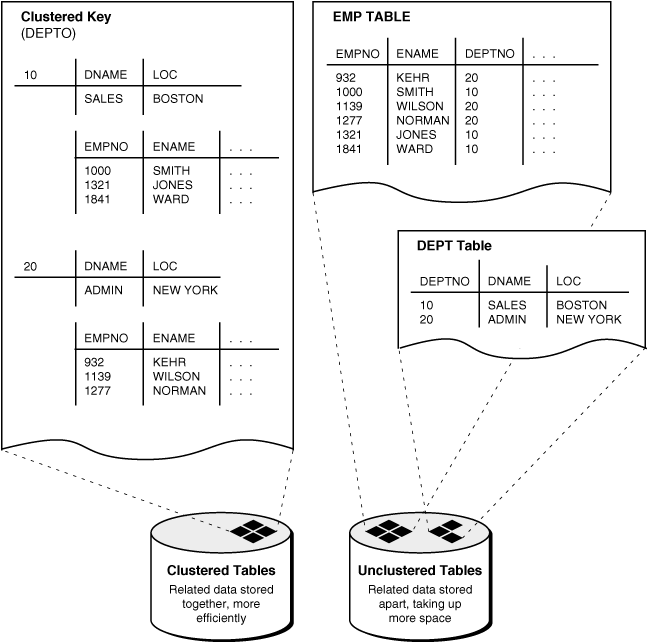

## 21 Managing Clusters

Using clusters can improve performance and reduce disk space requirements.

- About Clusters  
	A cluster provides an optional method of storing table data. A cluster is made up of a group of tables that share the same data blocks. The tables are grouped together because they share common columns and are often used together.
- Guidelines for Managing Clusters  
	You can follow guidelines for managing clusters.
- Creating Clusters and Objects That Use Them  
	You create a cluster using the `CREATE CLUSTER` statement. You create clustered table using the `CREATE TABLE` statement with the `CLUSTER` clause. You create a cluster index using the `CREATE INDEX` statement with the `CLUSTER` clause.
- Altering Clusters and Objects That Use Them  
	You can alter a cluster to change its physical attributes, size, and default degree of parallelism.
- Dropping Clusters and Objects That Use Them  
	You drop a cluster using the `DROP CLUSTER` statement. You drop a clustered table using the `DROP TABLE` statement. You drop a cluster index using the `DROP INDEX` statement.
- Clusters Data Dictionary Views  
	You can query a set of data dictionary views for information about clusters.

**Parent topic:** [Schema Objects](schema-objects.md)

### 21.1 About Clusters

A cluster provides an optional method of storing table data. A cluster is made up of a group of tables that share the same data blocks. The tables are grouped together because they share common columns and are often used together.

For example, the `emp` and `dept` table share the `deptno` column. When you cluster the `emp` and `dept` tables (see Figure 21-1), Oracle Database physically stores all rows for each department from both the `emp` and `dept` tables in the same data blocks.

Because clusters store related rows of different tables together in the same data blocks, properly used clusters offer two primary benefits:

- Disk I/O is reduced and access time improves for joins of clustered tables.
- The cluster key is the column, or group of columns, that the clustered tables have in common. You specify the columns of the cluster key when creating the cluster. You subsequently specify the same columns when creating every table added to the cluster. Each cluster key value is stored only once each in the cluster and the cluster index, no matter how many rows of different tables contain the value.
	Therefore, less storage might be required to store related table and index data in a cluster than is necessary in non-clustered table format. For example, in Figure 21-1, notice how each cluster key (each `deptno`) is stored just once for many rows that contain the same value in both the `emp` and `dept` tables.

After creating a cluster, you can create tables in the cluster. However, before any rows can be inserted into the clustered tables, a cluster index must be created. Using clusters does not affect the creation of additional indexes on the clustered tables; they can be created and dropped as usual.

You should not use clusters for tables that are frequently accessed individually.

Figure 21-1 Clustered Table Data



> This is a text description of admin021.gif. This figure compares the structure of clustered tables to the structure of nonclustered tables.
>
> One part of the illustration shows two tables as nonclustered tables. There are two distinct tables, EMP and DEPT. The EMP table contains (among other columns) the following columns: EMPNO, ENAME, DEPTNO. The DEPT table contains the following columns: DEPTNO, DNAME, LOC.
>
> Another part of the illustration shows the EMP table and DEPT table created as clustered tables. The cluster key is DEPTNO. The information relating to DEPTNO is stored in the cluster. EMPNO, ENAME, and the other columns in the EMP table are all stored with the department data. Effectively, all data has been stored in the same table (cluster).
>
> End of image description.


See Also:

- [Managing Hash Clusters](managing-hash-clusters.md) for a description of another type of cluster: a hash cluster
- [Managing Space for Schema Objects](managing-space-for-schema-objects.md) is recommended reading before attempting tasks described in this chapter

**Parent topic:** Managing Clusters

### 21.2 Guidelines for Managing Clusters

You can follow guidelines for managing clusters.

- Choose Appropriate Tables for the Cluster  
	Use clusters for tables that are primarily queries and frequently queried together.
- Choose Appropriate Columns for the Cluster Key  
	Choose cluster key columns carefully. If multiple columns are used in queries that join the tables, make the cluster key a composite key. In general, the characteristics that indicate a good cluster index are the same as those for any index.
- Specify the Space Required by an Average Cluster Key and Its Associated Rows  
	The `CREATE CLUSTER` statement has an optional clause, `SIZE`, which is the estimated number of bytes required by an average cluster key and its associated rows.
- Specify the Location of Each Cluster and Cluster Index Rows  
	Always specify the `TABLESPACE` clause in a `CREATE CLUSTER` / `INDEX` statement to identify the tablespace to store the new cluster or index.
- Estimate Cluster Size and Set Storage Parameters  
	Before creating a cluster, estimate the cluster size and set the storage parameters for the data segments of a cluster.

See Also:

- [Oracle Database Concepts](https://docs.oracle.com/pls/topic/lookup?ctx=en/database/oracle/oracle-database/21/admin&id=CNCPT608) for more information about clusters
- [Oracle Database SQL Tuning Guide](https://docs.oracle.com/pls/topic/lookup?ctx=en/database/oracle/oracle-database/21/admin&id=TGSQL850) for guidelines on when to use clusters

**Parent topic:** Managing Clusters

#### 21.2.1 Choose Appropriate Tables for the Cluster

Use clusters for tables that are primarily queries and frequently queried together.

Use clusters for tables for which the following conditions are true:

- The tables are primarily queried--that is, tables that are not predominantly inserted into or updated.
- Records from the tables are frequently queried together or joined.

**Parent topic:** Guidelines for Managing Clusters

#### 21.2.2 Choose Appropriate Columns for the Cluster Key

Choose cluster key columns carefully. If multiple columns are used in queries that join the tables, make the cluster key a composite key. In general, the characteristics that indicate a good cluster index are the same as those for any index.

For information about characteristics of a good index, see " [Guidelines for Managing Indexes](managing-indexes.md) ".

A good cluster key has enough unique values so that the group of rows corresponding to each key value fills approximately one data block. Having too few rows for each cluster key value can waste space and result in negligible performance gains. Cluster keys that are so specific that only a few rows share a common value can cause wasted space in blocks, unless a small `SIZE` was specified at cluster creation time (see " Specify the Space Required by an Average Cluster Key and Its Associated Rows ").

Too many rows for each cluster key value can cause extra searching to find rows for that key. Cluster keys on values that are too general (for example, `male` and `female`) result in excessive searching and can result in worse performance than with no clustering.

A cluster index cannot be unique or include a column defined as `long`.

**Parent topic:** Guidelines for Managing Clusters

#### 21.2.3 Specify the Space Required by an Average Cluster Key and Its Associated Rows

The `CREATE CLUSTER` statement has an optional clause, `SIZE`, which is the estimated number of bytes required by an average cluster key and its associated rows.

The database uses the `SIZE` parameter when performing the following tasks:

- Estimating the number of cluster keys (and associated rows) that can fit in a clustered data block
- Limiting the number of cluster keys placed in a clustered data block. This maximizes the storage efficiency of keys within a cluster.

`SIZE` does not limit the space that can be used by a given cluster key. For example, if `SIZE` is set such that two cluster keys can fit in one data block, any amount of the available data block space can still be used by either of the cluster keys.

By default, the database stores only one cluster key and its associated rows in each data block of the cluster data segment. Although block size can vary from one operating system to the next, the rule of one key for each block is maintained as clustered tables are imported to other databases on other systems.

If all the rows for a given cluster key value cannot fit in one block, the blocks are chained together to speed access to all the values with the given key. The cluster index points to the beginning of the chain of blocks, each of which contains the cluster key value and associated rows. If the cluster `SIZE` is such that multiple keys fit in a block, then blocks can belong to multiple chains.

**Parent topic:** Guidelines for Managing Clusters

#### 21.2.4 Specify the Location of Each Cluster and Cluster Index Rows

Always specify the `TABLESPACE` clause in a `CREATE CLUSTER` / `INDEX` statement to identify the tablespace to store the new cluster or index.

If you have the proper privileges and tablespace quota, you can create a new cluster and the associated cluster index in any tablespace that is currently online.

The cluster and its cluster index can be created in different tablespaces. In fact, creating a cluster and its index in different tablespaces that are stored on different storage devices allows table data and index data to be retrieved simultaneously with minimal disk contention.

**Parent topic:** Guidelines for Managing Clusters

#### 21.2.5 Estimate Cluster Size and Set Storage Parameters

Before creating a cluster, estimate the cluster size and set the storage parameters for the data segments of a cluster.

The following are benefits of estimating cluster size before creating the cluster:

- You can use the combined estimated size of clusters, along with estimates for indexes and redo log files, to determine the amount of disk space that is required to hold an intended database. From these estimates, you can make correct hardware purchases and other decisions.
- You can use the estimated size of an individual cluster to better manage the disk space that the cluster will use. When a cluster is created, you can set appropriate storage parameters and improve I/O performance of applications that use the cluster.

Set the storage parameters for the data segments of a cluster using the `STORAGE` clause of the `CREATE` `CLUSTER` or `ALTER` `CLUSTER` statement, rather than the individual `CREATE` or `ALTER` statements that put tables into the cluster. Storage parameters specified when creating or altering a clustered table are ignored. The storage parameters set for the cluster override the table storage parameters.

**Parent topic:** Guidelines for Managing Clusters

### 21.3 Creating Clusters and Objects That Use Them

You create a cluster using the `CREATE CLUSTER` statement. You create clustered table using the `CREATE TABLE` statement with the `CLUSTER` clause. You create a cluster index using the `CREATE INDEX` statement with the `CLUSTER` clause.

- Creating Clusters  
	You create a cluster using the `CREATE CLUSTER` statement.
- Creating Clustered Tables  
	You create a table in a cluster using the `CREATE TABLE` statement with the `CLUSTER` clause.
- Creating Cluster Indexes  
	A cluster index must be created before any rows can be inserted into any clustered table.

**Parent topic:** Managing Clusters

#### 21.3.1 Creating Clusters

You create a cluster using the `CREATE CLUSTER` statement.

To create a cluster in your schema, you must have the `CREATE CLUSTER` system privilege and a quota for the tablespace intended to contain the cluster or the `UNLIMITED TABLESPACE` system privilege.

To create a cluster in another user's schema you must have the `CREATE ANY CLUSTER` system privilege, and the owner must have a quota for the tablespace intended to contain the cluster or the `UNLIMITED TABLESPACE` system privilege.

The following statement creates a cluster named `emp_dept`, which stores the `emp` and `dept` tables, clustered by the `deptno` column:

```
CREATE CLUSTER emp_dept (deptno NUMBER(3))
   SIZE 600
   TABLESPACE users
   STORAGE (INITIAL 200K
      NEXT 300K
      MINEXTENTS 2
      PCTINCREASE 33);
```

If no `INDEX` keyword is specified, as is true in this example, an index cluster is created by default. You can also create a `HASH` cluster, when hash parameters (`HASHKEYS`, `HASH IS`, or `SINGLE TABLE HASHKEYS`) are specified. Hash clusters are described in [Managing Hash Clusters](managing-hash-clusters.md).

**Parent topic:** Creating Clusters and Objects That Use Them

#### 21.3.2 Creating Clustered Tables

You create a table in a cluster using the `CREATE TABLE` statement with the `CLUSTER` clause.

To create a table in a cluster, you must have either the `CREATE TABLE` or `CREATE ANY TABLE` system privilege. You do not need a tablespace quota or the `UNLIMITED TABLESPACE` system privilege to create a table in a cluster.

For example, the `emp` and `dept` tables can be created in the `emp_dept` cluster using the following statements:

```
CREATE TABLE emp (
   empno NUMBER(5) PRIMARY KEY,
   ename VARCHAR2(15) NOT NULL,
   . . .
   deptno NUMBER(3) REFERENCES dept)
   CLUSTER emp_dept (deptno);  

CREATE TABLE dept (
   deptno NUMBER(3) PRIMARY KEY, . . . )
   CLUSTER emp_dept (deptno);
```

Note:

You can specify the schema for a clustered table in the `CREATE TABLE` statement. A clustered table can be in a different schema than the schema containing the cluster. Also, the names of the columns are not required to match, but their structure must match.

See Also:

[Oracle Database SQL Language Reference](https://docs.oracle.com/pls/topic/lookup?ctx=en/database/oracle/oracle-database/21/admin&id=SQLRF01402) for syntax of the `CREATE TABLE` statement for creating cluster tables

**Parent topic:** Creating Clusters and Objects That Use Them

#### 21.3.3 Creating Cluster Indexes

A cluster index must be created before any rows can be inserted into any clustered table.

To create a cluster index, one of the following conditions must be true:

- Your schema contains the cluster.
- You have the `CREATE ANY INDEX` system privilege.

In either case, you must also have either a quota for the tablespace intended to contain the cluster index, or the `UNLIMITED TABLESPACE` system privilege.

The following statement creates a cluster index for the `emp_dept` cluster:

```
CREATE INDEX emp_dept_index
   ON CLUSTER emp_dept
   TABLESPACE users
   STORAGE (INITIAL 50K
      NEXT 50K
      MINEXTENTS 2
      MAXEXTENTS 10
      PCTINCREASE 33);
```

The cluster index clause (`ON CLUSTER`) identifies the cluster, `emp_dept`, for which the cluster index is being created. The statement also explicitly specifies several storage settings for the cluster and cluster index.

See Also:

[Oracle Database SQL Language Reference](https://docs.oracle.com/pls/topic/lookup?ctx=en/database/oracle/oracle-database/21/admin&id=SQLRF01209) for syntax of the `CREATE INDEX` statement for creating cluster indexes

**Parent topic:** Creating Clusters and Objects That Use Them

### 21.4 Altering Clusters and Objects That Use Them

You can alter a cluster to change its physical attributes, size, and default degree of parallelism.

- Altering Clusters  
	You alter a cluster using the `ALTER CLUSTER` statement.
- Altering Clustered Tables  
	You can alter clustered tables using the `ALTER TABLE` statement, but some parameters of a clustered table cannot be set with the `ALTER TABLE` statement.
- Altering Cluster Indexes  
	You alter cluster indexes exactly as you do other indexes.

**Parent topic:** Managing Clusters

#### 21.4.1 Altering Clusters

You alter a cluster using the `ALTER CLUSTER` statement.

To alter a cluster, your schema must contain the cluster or you must have the `ALTER ANY CLUSTER` system privilege. You can alter an existing cluster to change the following settings:

- Physical attributes (`INITRANS` and storage characteristics)
- The average amount of space required to store all the rows for a cluster key value (`SIZE`)
- The default degree of parallelism

Additionally, you can explicitly allocate a new extent for the cluster, or deallocate any unused extents at the end of the cluster. The database dynamically allocates additional extents for the data segment of a cluster as required. In some circumstances, however, you might want to explicitly allocate an additional extent for a cluster. For example, when using Real Application Clusters, you can allocate an extent of a cluster explicitly for a specific instance. You allocate a new extent for a cluster using the `ALTER CLUSTER` statement with the `ALLOCATE EXTENT` clause.

When you alter the cluster size parameter (`SIZE`) of a cluster, the new settings apply to all data blocks used by the cluster, including blocks already allocated and blocks subsequently allocated for the cluster. Blocks already allocated for the table are reorganized when necessary (not immediately).

When you alter the transaction entry setting `INITRANS` of a cluster, the new setting for `INITRANS` applies only to data blocks subsequently allocated for the cluster.

The storage parameters `INITIAL` and `MINEXTENTS` cannot be altered. All new settings for the other storage parameters affect only extents subsequently allocated for the cluster.

To alter a cluster, use the `ALTER CLUSTER` statement.

**Parent topic:** Altering Clusters and Objects That Use Them

#### 21.4.2 Altering Clustered Tables

You can alter clustered tables using the `ALTER TABLE` statement, but some parameters of a clustered table cannot be set with the `ALTER TABLE` statement.

However, any data block space parameters, transaction entry parameters, or storage parameters you set in an `ALTER TABLE` statement for a clustered table generate an error message (`ORA-01771, illegal option for a clustered table`). The database uses the parameters of the cluster for all clustered tables. Therefore, you can use the `ALTER TABLE` statement only to add or modify columns, drop non-cluster-key columns, or add, drop, enable, or disable integrity constraints or triggers for a clustered table. For information about altering tables, see " [Altering Tables](managing-tables.md) ".

See Also:

[Oracle Database SQL Language Reference](https://docs.oracle.com/pls/topic/lookup?ctx=en/database/oracle/oracle-database/21/admin&id=SQLRF01001) for syntax of the `ALTER TABLE` statement

**Parent topic:** Altering Clusters and Objects That Use Them

#### 21.4.3 Altering Cluster Indexes

You alter cluster indexes exactly as you do other indexes.

See " [Altering Indexes](managing-indexes.md) ".

Note:

When estimating the size of cluster indexes, remember that the index is on each cluster key, not the actual rows. Therefore, each key appears only once in the index.

**Parent topic:** Altering Clusters and Objects That Use Them

### 21.5 Dropping Clusters and Objects That Use Them

You drop a cluster using the `DROP CLUSTER` statement. You drop a clustered table using the `DROP TABLE` statement. You drop a cluster index using the `DROP INDEX` statement.

- Dropping Clusters  
	You can drop a cluster using the `DROP CLUSTER` statement.
- Dropping Clustered Tables  
	Clustered tables can be dropped individually without affecting the cluster, other clustered tables, or the cluster index. A clustered table is dropped just as a nonclustered table is dropped, with the `DROP TABLE` statement.
- Dropping Cluster Indexes  
	A cluster index can be dropped without affecting the cluster or its clustered tables. However, clustered tables cannot be used if there is no cluster index; you must re-create the cluster index to allow access to the cluster.

**Parent topic:** Managing Clusters

#### 21.5.1 Dropping Clusters

You can drop a cluster using the `DROP CLUSTER` statement.

A cluster can be dropped if the tables within the cluster are no longer needed. When a cluster is dropped, so are the tables within the cluster and the corresponding cluster index. All extents belonging to both the cluster data segment and the index segment of the cluster index are returned to the containing tablespace and become available for other segments within the tablespace.

To drop a cluster that contains no tables, and its cluster index, use the `DROP CLUSTER` statement. For example, the following statement drops the empty cluster named `emp_dept`:

```
DROP CLUSTER emp_dept;
```

If the cluster contains one or more clustered tables and you intend to drop the tables as well, add the `INCLUDING TABLES` clause of the `DROP CLUSTER` statement, as follows:

```
DROP CLUSTER emp_dept INCLUDING TABLES;
```

If the `INCLUDING TABLES` clause is not included and the cluster contains tables, an error is returned.

If one or more tables in a cluster contain primary or unique keys that are referenced by `FOREIGN KEY` constraints of tables outside the cluster, the cluster cannot be dropped unless the dependent `FOREIGN KEY` constraints are also dropped. This can be easily done using the `CASCADE CONSTRAINTS` clause of the `DROP CLUSTER` statement, as shown in the following example:

```
DROP CLUSTER emp_dept INCLUDING TABLES CASCADE CONSTRAINTS;
```

The database returns an error if you do not use the `CASCADE CONSTRAINTS` clause and constraints exist.

See Also:

[Oracle Database SQL Language Reference](https://docs.oracle.com/pls/topic/lookup?ctx=en/database/oracle/oracle-database/21/admin&id=SQLRF01511) for syntax of the `DROP CLUSTER` statement

**Parent topic:** Dropping Clusters and Objects That Use Them

#### 21.5.2 Dropping Clustered Tables

Clustered tables can be dropped individually without affecting the cluster, other clustered tables, or the cluster index. A clustered table is dropped just as a nonclustered table is dropped, with the `DROP TABLE` statement.

To drop a cluster, your schema must contain the cluster or you must have the `DROP ANY CLUSTER` system privilege. You do not need additional privileges to drop a cluster that contains tables, even if the clustered tables are not owned by the owner of the cluster.

See " [Dropping Table Columns](managing-tables.md) ".

Note:

When you drop a single table from a cluster, the database deletes each row of the table individually. To maximize efficiency when you intend to drop an entire cluster, drop the cluster including all tables by using the `DROP CLUSTER` statement with the `INCLUDING TABLES` clause. Drop an individual table from a cluster (using the `DROP TABLE` statement) only if you want the rest of the cluster to remain.

**Parent topic:** Dropping Clusters and Objects That Use Them

#### 21.5.3 Dropping Cluster Indexes

A cluster index can be dropped without affecting the cluster or its clustered tables. However, clustered tables cannot be used if there is no cluster index; you must re-create the cluster index to allow access to the cluster.

Cluster indexes are sometimes dropped as part of the procedure to rebuild a fragmented cluster index.

Note:

Hash cluster indexes cannot be dropped.

See Also:

" [Dropping Indexes](managing-indexes.md) "

**Parent topic:** Dropping Clusters and Objects That Use Them

### 21.6 Clusters Data Dictionary Views

You can query a set of data dictionary views for information about clusters.

The following views display information about clusters:

| View | Description |
| --- | --- |
| `DBA_CLUSTERS`  `ALL_CLUSTERS`  `USER_CLUSTERS` | `DBA` view describes all clusters in the database. `ALL` view describes all clusters accessible to the user. `USER` view is restricted to clusters owned by the user. Some columns in these views contain statistics that are generated by the `DBMS_STATS` package or `ANALYZE ` statement. |
| `DBA_CLU_COLUMNS`  `USER_CLU_COLUMNS` | These views map table columns to cluster columns |

See Also:

[Oracle Database Reference](https://docs.oracle.com/pls/topic/lookup?ctx=en/database/oracle/oracle-database/21/admin&id=REFRN) for complete descriptions of these views

**Parent topic:** Managing Clusters