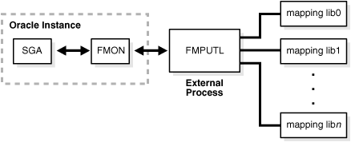
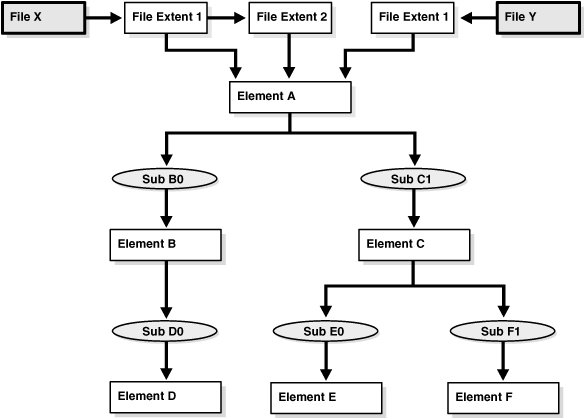

## 12 Managing Data Files and Temp Files

You can manage data files and temp files by performing tasks such as creating them, altering them, and dropping them.

Note:

Temp files are a special class of data files that are associated only with temporary tablespaces. Information in this chapter applies to both data files and temp files except where differences are noted. Temp files are further described in " [Creating a Locally Managed Temporary Tablespace](managing-tablespaces.md) "

- Guidelines for Managing Data Files  
	You can follow guidelines for managing data files.
- Creating Data Files and Adding Data Files to a Tablespace  
	You can create data files and associate them with a tablespace using several different SQL statements.
- Changing Data File Size  
	You can alter the size of a data file. For example, you can increase the size of one or more data files when more space is needed in the database.
- Altering Data File Availability  
	You must alter data file availability to perform certain tasks, such as performing an offline backup of a data file or relocating an offline data file.
- Renaming and Relocating Data Files  
	You can rename online or offline data files to either change their names or relocate them.
- Dropping Data Files  
	You use the `DROP` `DATAFILE` and `DROP` `TEMPFILE` clauses of the `ALTER` `TABLESPACE` statement to drop a single data file or temp file.
- Verifying Data Blocks in Data Files  
	To configure the database to use checksums to verify data blocks, set the initialization parameter `DB_BLOCK_CHECKSUM` to `TYPICAL` (the default).
- Copying Files Using the Database Server  
	You can use the `DBMS_FILE_TRANSFER` package to copy a file within a database or transfer a file between databases.
- Mapping Files to Physical Devices  
	In an environment where data files are file system files, it is relatively straight forward to see the association between a tablespace and the underlying device. Oracle Database provides views, such as `DBA_TABLESPACES`, `DBA_DATA_FILES`, and `V$DATAFILE`, that provide a mapping of files onto devices. These mappings, along with device statistics can be used to evaluate I/O performance.
- Data Files Data Dictionary Views  
	A set of data dictionary views provides useful information about the data files of a database.

See Also:

- [Using Oracle Managed Files](using-oracle-managed-files.md) for information about creating data files and temp files that are both created and managed by the Oracle Database server
- [Oracle Database Concepts](https://docs.oracle.com/pls/topic/lookup?ctx=en/database/oracle/oracle-database/21/admin&id=CNCPT403)

**Parent topic:** [Oracle Database Structure and Storage](oracle-database-structure-and-storage.md)

### 12.1 Guidelines for Managing Data Files

You can follow guidelines for managing data files.

**Parent topic:** Managing Data Files and Temp Files

#### 12.1.1 About Data Files

Data files are physical files of the operating system that store the data of all logical structures in the database. They must be explicitly created for each tablespace.

Oracle Database assigns each data file two associated file numbers, an absolute file number and a relative file number, that are used to uniquely identify it. These numbers are described in the following table:

| Type of File Number | Description |
| --- | --- |
| Absolute | Uniquely identifies a data file in the database. This file number can be used in many SQL statements that reference data files in place of using the file name. The absolute file number can be found in the `FILE# ` column of the `V$DATAFILE` or `V$TEMPFILE` view, or in the `FILE_ID` column of the `DBA_DATA_FILES` or `DBA_TEMP_FILES` view. |
| Relative | Uniquely identifies a data file within a tablespace. For small and medium size databases, relative file numbers usually have the same value as the absolute file number. However, when the number of data files in a database exceeds a threshold (typically 1023), the relative file number differs from the absolute file number. In a bigfile tablespace, the relative file number is always 1024 (4096 on OS/390 platform). |

**Parent topic:** Guidelines for Managing Data Files

#### 12.1.2 Determine the Number of Data Files

You must determine the number of data files for your database.

- About Determining the Number of Data Files  
	At least one data file is required for the `SYSTEM` and `SYSAUX` tablespaces of a database. Your database should contain several other tablespaces with their associated data files or temp files. The number of data files that you anticipate creating for your database can affect the settings of initialization parameters and the specification of `CREATE` `DATABASE` statement clauses.
- Determine a Value for the DB\_FILES Initialization Parameter  
	When starting an Oracle Database instance, the `DB_FILES` initialization parameter indicates the amount of SGA space to reserve for data file information and thus, the maximum number of data files that can be created for the instance.
- Consider Possible Limitations When Adding Data Files to a Tablespace  
	There are some limitations to consider when adding data files to a tablespace.
- Consider the Performance Impact of the Number of Data Files  
	The number of data files contained in a tablespace, and ultimately the database, can have an impact upon performance.

**Parent topic:** Guidelines for Managing Data Files

##### 12.1.2.1 About Determining the Number of Data Files

At least one data file is required for the `SYSTEM` and `SYSAUX` tablespaces of a database. Your database should contain several other tablespaces with their associated data files or temp files. The number of data files that you anticipate creating for your database can affect the settings of initialization parameters and the specification of `CREATE` `DATABASE` statement clauses.

Be aware that your operating system might impose limits on the number of data files contained in your Oracle Database. Also consider that the number of data files, and how and where they are allocated can affect the performance of your database.

Note:

One means of controlling the number of data files in your database and simplifying their management is to use bigfile tablespaces. Bigfile tablespaces comprise a single, very large data file and are especially useful in ultra large databases and where a logical volume manager is used for managing operating system files. Bigfile tablespaces are discussed in " [Bigfile Tablespaces](managing-tablespaces.md) ".

Consider the following guidelines when determining the number of data files for your database.

**Parent topic:** Determine the Number of Data Files

##### 12.1.2.2 Determine a Value for the DB\_FILES Initialization Parameter

When starting an Oracle Database instance, the `DB_FILES` initialization parameter indicates the amount of SGA space to reserve for data file information and thus, the maximum number of data files that can be created for the instance.

This limit applies for the life of the instance. You can change the value of `DB_FILES` (by changing the initialization parameter setting), but the new value does not take effect until you shut down and restart the instance.

When determining a value for `DB_FILES`, take the following into consideration:

- If the value of `DB_FILES` is too low, you cannot add data files beyond the `DB_FILES` limit without first shutting down the database.
- If the value of `DB_FILES` is too high, memory is unnecessarily consumed.

**Parent topic:** Determine the Number of Data Files

##### 12.1.2.3 Consider Possible Limitations When Adding Data Files to a Tablespace

There are some limitations to consider when adding data files to a tablespace.

You can add data files to traditional smallfile tablespaces, subject to the following limitations:

- Operating systems often impose a limit on the number of files a process can open simultaneously. More data files cannot be created when the operating system limit of open files is reached.
- Operating systems impose limits on the number and size of data files.
- The database imposes a maximum limit on the number of data files for any Oracle Database opened by any instance. This limit is operating system specific.
- You cannot exceed the number of data files specified by the `DB_FILES` initialization parameter.
- When you issue `CREATE DATABASE` or `CREATE CONTROLFILE` statements, the `MAXDATAFILES` parameter specifies an initial size of the data file portion of the control file. However, if you attempt to add a new file whose number is greater than `MAXDATAFILES`, but less than or equal to `DB_FILES`, the control file will expand automatically so that the data files section can accommodate more files.

**Parent topic:** Determine the Number of Data Files

##### 12.1.2.4 Consider the Performance Impact of the Number of Data Files

The number of data files contained in a tablespace, and ultimately the database, can have an impact upon performance.

Oracle Database allows more data files in the database than the operating system defined limit. The database DBWn processes can open all online data files. Oracle Database is capable of treating open file descriptors as a cache, automatically closing files when the number of open file descriptors reaches the operating system-defined limit. This can have a negative performance impact. When possible, adjust the operating system limit on open file descriptors so that it is larger than the number of online data files in the database.

See Also:

- Your operating system specific Oracle documentation for more information on operating system limits
- [Oracle Database SQL Language Reference](https://docs.oracle.com/pls/topic/lookup?ctx=en/database/oracle/oracle-database/21/admin&id=SQLRF012) for more information about the `MAXDATAFILES` parameter of the `CREATE DATABASE` or `CREATE CONTROLFILE` statement

**Parent topic:** Determine the Number of Data Files

#### 12.1.3 Determine the Size of Data Files

When creating a tablespace, you should estimate the potential size of database objects and create sufficient data files.

Later, if needed, you can create additional data files and add them to a tablespace to increase the total amount of disk space allocated to it, and consequently the database. Preferably, place data files on multiple devices to ensure that data is spread evenly across all devices.

**Parent topic:** Guidelines for Managing Data Files

#### 12.1.4 Place Data Files Appropriately

Tablespace location is determined by the physical location of the data files that constitute that tablespace. Use the hardware resources of your computer appropriately.

For example, if several disk drives are available to store the database, consider placing potentially contending data files on separate disks. This way, when users query information, both disk drives can work simultaneously, retrieving data at the same time.

See Also:

[Oracle Database Performance Tuning Guide](https://docs.oracle.com/pls/topic/lookup?ctx=en/database/oracle/oracle-database/21/admin&id=TGDBA015) for information about I/O and the placement of data files

**Parent topic:** Guidelines for Managing Data Files

#### 12.1.5 Store Data Files Separate from Redo Log Files

Data files should not be stored on the same disk drive that stores the database redo log files. If the data files and redo log files are stored on the same disk drive and that disk drive fails, the files cannot be used in your database recovery procedures.

If you multiplex your redo log files, then the likelihood of losing all of your redo log files is low, so you can store data files on the same drive as some redo log files.

**Parent topic:** Guidelines for Managing Data Files

### 12.2 Creating Data Files and Adding Data Files to a Tablespace

You can create data files and associate them with a tablespace using several different SQL statements.

In all cases, you can either specify the file specifications for the data files being created, or you can use the Oracle Managed Files feature to create files that are created and managed by the database server. The table includes a brief description of the statement, as used to create data files, and references the section of this book where use of the statement is specifically described:

| SQL Statement | Description | Additional Information |
| --- | --- | --- |
| `CREATE TABLESPACE ` | Creates a tablespace and the data files that comprise it | " [Creating Tablespaces](managing-tablespaces.md) " |
| `CREATE TEMPORARY TABLESPACE` | Creates a locally-managed temporary tablespace and the tempfiles (temp files are a special kind of data file) that comprise it | " [Creating a Locally Managed Temporary Tablespace](managing-tablespaces.md) " |
| `ALTER TABLESPACE ... ADD DATAFILE` | Creates and adds a data file to a tablespace | " [Altering a Locally Managed Tablespace](managing-tablespaces.md) " |
| `ALTER TABLESPACE ... ADD TEMPFILE` | Creates and adds a temp file to a temporary tablespace | " [Altering a Locally Managed Temporary Tablespace](managing-tablespaces.md) " |
| `CREATE DATABASE` | Creates a database and associated data files | [Oracle Multitenant Administrator's Guide](https://docs.oracle.com/pls/topic/lookup?ctx=en/database/oracle/oracle-database/21/admin&id=MULTI-GUID-18B03451-5C74-4B53-A892-656C3E8A2556) |
| `ALTER DATABASE ... CREATE DATAFILE` | Creates a new empty data file in place of an old one--useful to re-create a data file that was lost with no backup. | See [Oracle Database Backup and Recovery User's Guide](https://docs.oracle.com/pls/topic/lookup?ctx=en/database/oracle/oracle-database/21/admin&id=BRADV224). |

If you add new data files to a tablespace and do not fully specify the file names, the database creates the data files in the default database directory or the current directory, depending upon your operating system. Oracle recommends you always specify a fully qualified name for a data file. Unless you want to reuse existing files, make sure the new file names do not conflict with other files. Old files that have been previously dropped will be overwritten.

If a statement that creates a data file fails, the database removes any created operating system files. However, because of the large number of potential errors that can occur with file systems and storage subsystems, there can be situations where you must manually remove the files using operating system commands.

**Parent topic:** Managing Data Files and Temp Files

### 12.3 Changing Data File Size

You can alter the size of a data file. For example, you can increase the size of one or more data files when more space is needed in the database.

- Enabling and Disabling Automatic Extension for a Data File  
	You can create data files or alter existing data files so that they automatically increase in size when more space is needed in the database. The file size increases in specified increments up to a specified maximum.
- Manually Resizing a Data File  
	You can manually increase or decrease the size of a data file using the `ALTER DATABASE` statement.

**Parent topic:** Managing Data Files and Temp Files

#### 12.3.1 Enabling and Disabling Automatic Extension for a Data File

You can create data files or alter existing data files so that they automatically increase in size when more space is needed in the database. The file size increases in specified increments up to a specified maximum.

Setting your data files to extend automatically provides these advantages:

- Reduces the need for immediate intervention when a tablespace runs out of space
- Ensures applications will not halt or be suspended because of failures to allocate extents

You can specify automatic file extension by specifying an `AUTOEXTEND ON` clause when you create data files using the following SQL statements:

- `CREATE` `DATABASE`
- `ALTER` `DATABASE`
- `CREATE` `TABLESPACE`
- `ALTER` `TABLESPACE`

To enable or disable automatic extension for a data file:

1. Determine whether a data file is auto-extensible by querying the `DBA_DATA_FILES` view and examining the `AUTOEXTENSIBLE` column.
2. Enable or disable automatic file extension for existing data files, or manually resize a data file, using the `ALTER` `DATABASE` statement with the `AUTOEXTEND` clause. For a bigfile tablespace, use the `ALTER` `TABLESPACE` statement with the `AUTOEXTEND` clause.

The following example enables automatic extension for a data file added to the `users` tablespace:

```
ALTER TABLESPACE users
    ADD DATAFILE '/u02/oracle/rbdb1/users03.dbf' SIZE 10M
      AUTOEXTEND ON
      NEXT 512K
      MAXSIZE 250M;
```

The value of `NEXT` is the minimum size of the increments added to the file when it extends. The value of `MAXSIZE` is the maximum size to which the file can automatically extend.

The next example disables the automatic extension for the data file.

```
ALTER DATABASE DATAFILE '/u02/oracle/rbdb1/users03.dbf' 
    AUTOEXTEND OFF;
```

See Also:

[Oracle Database SQL Language Reference](https://docs.oracle.com/pls/topic/lookup?ctx=en/database/oracle/oracle-database/21/admin&id=SQLRF) for more information about the SQL statements for creating or altering data files

**Parent topic:** Changing Data File Size

#### 12.3.2 Manually Resizing a Data File

You can manually increase or decrease the size of a data file using the `ALTER DATABASE` statement.

Therefore, you can add more space to your database without adding more data files. This is beneficial if you are concerned about reaching the maximum number of data files allowed in your database.

For a bigfile tablespace, you can use the `ALTER` `TABLESPACE` statement to resize a data file. You are not allowed to add a data file to a bigfile tablespace.

Manually reducing the sizes of data files enables you to reclaim unused space in the database. This is useful for correcting errors in estimates of space requirements.

In the following example, assume that the data file `/u02/oracle/rbdb1/stuff01.dbf` has extended up to 250M. However, because its tablespace now stores smaller objects, the data file can be reduced in size.

The following statement decreases the size of data file `/u02/oracle/rbdb1/stuff01.dbf`:

```
ALTER DATABASE DATAFILE '/u02/oracle/rbdb1/stuff01.dbf'
   RESIZE 100M;
```

Note:

It is not always possible to decrease the size of a file to a specific value. It could be that the file contains data beyond the specified decreased size, in which case the database will return an error.

**Parent topic:** Changing Data File Size

### 12.4 Altering Data File Availability

You must alter data file availability to perform certain tasks, such as performing an offline backup of a data file or relocating an offline data file.

- About Altering Data File Availability  
	You can alter the availability of individual data files or temp files by taking them offline or bringing them online. Offline data files are unavailable to the database and cannot be accessed until they are brought back online.
- Bringing Data Files Online or Taking Offline in ARCHIVELOG Mode  
	To bring an individual data file online or take an individual data file offline, issue the `ALTER DATABASE` statement and include the `DATAFILE` clause.
- Taking Data Files Offline in NOARCHIVELOG Mode  
	To take a data file offline when the database is in `NOARCHIVELOG` mode, use the `ALTER` `DATABASE` statement with both the `DATAFILE` and `OFFLINE` `FOR` `DROP` clauses.
- Altering the Availability of All Data Files or Temp Files in a Tablespace  
	Clauses of the `ALTER TABLESPACE` statement allow you to change the online or offline status of all of the data files or temp files within a tablespace.

**Parent topic:** Managing Data Files and Temp Files

#### 12.4.1 About Altering Data File Availability

You can alter the availability of individual data files or temp files by taking them offline or bringing them online. Offline data files are unavailable to the database and cannot be accessed until they are brought back online.

Reasons for altering data file availability include the following:

- You want to perform an offline backup of a data file.
- You want to rename or relocate an offline data file. You can first take the data file offline or take the tablespace offline.
- The database has problems writing to a data file and automatically takes the data file offline. Later, after resolving the problem, you can bring the data file back online manually.
- A data file becomes missing or corrupted. You must take it offline before you can open the database.

The data files of a read-only tablespace can be taken offline or brought online, but bringing a file online does not affect the read-only status of the tablespace. You cannot write to the data file until the tablespace is returned to the read/write state.

Note:

You can make all data files of a tablespace temporarily unavailable by taking the tablespace itself offline. You must leave these files in the tablespace to bring the tablespace back online, although you can relocate or rename them following procedures similar to those shown in " Renaming and Relocating Data Files ".

For more information, see " [Taking Tablespaces Offline](managing-tablespaces.md) ".

To take a data file offline or bring it online, you must have the `ALTER DATABASE` system privilege. To take all data files or temp files offline using the `ALTER TABLESPACE` statement, you must have the `ALTER TABLESPACE` or `MANAGE TABLESPACE` system privilege. In an Oracle Real Application Clusters environment, the database must be open in exclusive mode.

**Parent topic:** Altering Data File Availability

#### 12.4.2 Bringing Data Files Online or Taking Offline in ARCHIVELOG Mode

To bring an individual data file online or take an individual data file offline, issue the `ALTER DATABASE` statement and include the `DATAFILE` clause.

The following statement brings the specified data file online:

```
ALTER DATABASE DATAFILE '/u02/oracle/rbdb1/stuff01.dbf' ONLINE;
```

To take the same file offline, issue the following statement:

```
ALTER DATABASE DATAFILE '/u02/oracle/rbdb1/stuff01.dbf' OFFLINE;
```

Note:

To use this form of the `ALTER DATABASE` statement, the database must be in `ARCHIVELOG` mode. This requirement prevents you from accidentally losing the data file, since taking the data file offline while in `NOARCHIVELOG` mode is likely to result in losing the file.

**Parent topic:** Altering Data File Availability

#### 12.4.3 Taking Data Files Offline in NOARCHIVELOG Mode

To take a data file offline when the database is in `NOARCHIVELOG` mode, use the `ALTER` `DATABASE` statement with both the `DATAFILE` and `OFFLINE` `FOR` `DROP` clauses.

- The `OFFLINE` keyword causes the database to mark the data file `OFFLINE`, whether or not it is corrupted, so that you can open the database.
- The `FOR` `DROP` keywords mark the data file for subsequent dropping. Such a data file can no longer be brought back online.
	Note:
	This operation does not actually drop the data file. It remains in the data dictionary, and you must drop it yourself using one of the following methods:
	- An `ALTER` `TABLESPACE`... `DROP` `DATAFILE` statement.
		After an `OFFLINE` `FOR` `DROP`, this method works for dictionary managed tablespaces only.
	- A `DROP` `TABLESPACE`... `INCLUDING` `CONTENTS` `AND` `DATAFILES` statement
	- If the preceding methods fail, an operating system command to delete the data file. This is the least desirable method, as it leaves references to the data file in the data dictionary and control files.

The following statement takes the specified data file offline and marks it to be dropped:

```
ALTER DATABASE DATAFILE '/u02/oracle/rbdb1/users03.dbf' OFFLINE FOR DROP;
```

**Parent topic:** Altering Data File Availability

#### 12.4.4 Altering the Availability of All Data Files or Temp Files in a Tablespace

Clauses of the `ALTER TABLESPACE` statement allow you to change the online or offline status of all of the data files or temp files within a tablespace.

Specifically, the statements that affect online/offline status are:

- `ALTER` `TABLESPACE`... `DATAFILE` { `ONLINE` | `OFFLINE` }
- `ALTER` `TABLESPACE`... `TEMPFILE` { `ONLINE` | `OFFLINE` }

You are required only to enter the tablespace name, not the individual data files or temp files. All of the data files or temp files are affected, but the online/offline status of the tablespace itself is not changed.

In most cases the preceding `ALTER TABLESPACE` statements can be issued whenever the database is mounted, even if it is not open. However, the database must not be open if the tablespace is the `SYSTEM` tablespace, an undo tablespace, or the default temporary tablespace. The `ALTER DATABASE DATAFILE` and `ALTER DATABASE TEMPFILE` statements also have `ONLINE/OFFLINE` clauses, however in those statements you must enter all of the file names for the tablespace.

The syntax is different from the `ALTER TABLESPACE...ONLINE|OFFLINE` statement that alters tablespace availability, because that is a different operation. The `ALTER TABLESPACE` statement takes data files offline as well as the tablespace, but it cannot be used to alter the status of a temporary tablespace or its temp file(s).

**Parent topic:** Altering Data File Availability

### 12.5 Renaming and Relocating Data Files

You can rename online or offline data files to either change their names or relocate them.

- Renaming and Relocating Online Data Files  
	You can use the `ALTER DATABASE MOVE DATAFILE` SQL statement to rename or relocate online data files. This statement enables you to rename or relocate a data file while the database is open and users are accessing the data file.
- Renaming and Relocating Offline Data Files  
	You can rename and relocate offline data files.

**Parent topic:** Managing Data Files and Temp Files

#### 12.5.1 Renaming and Relocating Online Data Files

You can use the `ALTER DATABASE MOVE DATAFILE` SQL statement to rename or relocate online data files. This statement enables you to rename or relocate a data file while the database is open and users are accessing the data file.

When you rename or relocate online data files, the pointers to the data files, as recorded in the database control file, are changed. The files are also physically renamed or relocated at the operating system level.

You might rename or relocate online data files because you want to allow users to access the data files when you perform one of the following tasks:

- Move the data files from one type of storage to another
- Move data files that are accessed infrequently to lower cost storage
- Make a tablespace read-only and move its data files to write-once storage
- Move a database into Oracle Automatic Storage Management (Oracle ASM)

When you run the `ALTER` `DATABASE` `MOVE` `DATAFILE` statement and a file with the same name exists in the destination location, you can specify the `REUSE` option to overwrite the existing file. When `REUSE` is not specified, and a file with the same name exists in the destination location, the existing file is not overwritten, and the statement returns an error.

By default, when you run the `ALTER` `DATABASE` `MOVE` `DATAFILE` statement and specify a new location for a data file, the statement moves the data file. However, you can specify the `KEEP` option to retain the data file in the old location and copy it to the new location. In this case, the database only uses the data file in the new location when the statement completes successfully.

When you rename or relocate a data file with `ALTER` `DATABASE` `MOVE` `DATAFILE` statement, Oracle Database creates a copy of the data file when it is performing the operation. Ensure that there is adequate disk space for the original data file and the copy during the operation.

You can view the name, location, and online status of each data file by querying the `DBA_DATA_FILES` view.

Note:

- The `ALTER DATABASE MOVE DATAFILE` statement raises an error if the specified data file is offline.
- If you are using a standby database, then you can perform an online move data file operation independently on the primary and on the standby (either physical or logical). The standby is not affected when a data file is moved on the primary, and vice versa. See [Oracle Data Guard Concepts and Administration](https://docs.oracle.com/pls/topic/lookup?ctx=en/database/oracle/oracle-database/21/admin&id=SBYDB5158) for more information.
- A flashback operation does not relocate a moved data file to its previous location. If you move a data file online from one location to another and later flash back the database to a point in time before the move, then the data file remains in the new location, but the contents of the data file are changed to the contents at the time specified in the flashback. See [Oracle Database Backup and Recovery User's Guide](https://docs.oracle.com/pls/topic/lookup?ctx=en/database/oracle/oracle-database/21/admin&id=BRADV71000) for more information about flashback database operations.
- When you relocate a data file on the Windows platform, the original data file might be retained in the old location, even when the `KEEP` option is omitted. In this case, the database only uses the data file in the new location when the statement completes successfully. You can delete the old data file manually after the operation completes if necessary.

To rename or relocate online data files:

1. In SQL\*Plus, connect to the database as a user with `ALTER DATABASE` system privilege.
2. Issue the `ALTER` `DATABASE` `MOVE` `DATAFILE` statement and specify the data file.

Example 12-1 Renaming an Online Data File

This example renames the data file `user1.dbf` to `user01.dbf` while keeping the data file in the same location.

```
ALTER DATABASE MOVE DATAFILE '/u01/oracle/rbdb1/user1.dbf' 
  TO '/u01/oracle/rbdb1/user01.dbf';
```

Example 12-2 Relocating an Online Data File

This example moves the data file `user1.dbf` from the /u01/oracle/rbdb1/ directory to the /u02/oracle/rbdb1/ directory. After the operation, the file is no longer in the /u01/oracle/rbdb1/ directory.

```
ALTER DATABASE MOVE DATAFILE '/u01/oracle/rbdb1/user1.dbf' 
  TO '/u02/oracle/rbdb1/user1.dbf';
```

Example 12-3 Copying an Online Data File

This example copies the data file `user1.dbf` from the /u01/oracle/rbdb1/ directory to the /u02/oracle/rbdb1/ directory. After the operation, the old file is retained in the /u01/oracle/rbdb1/ directory.

```
ALTER DATABASE MOVE DATAFILE '/u01/oracle/rbdb1/user1.dbf' 
  TO '/u02/oracle/rbdb1/user1.dbf' KEEP;
```

Example 12-4 Relocating an Online Data File and Overwriting an Existing File

This example moves the data file `user1.dbf` from the /u01/oracle/rbdb1/ directory to the /u02/oracle/rbdb1/ directory. If a file with the same name exists in the /u02/oracle/rbdb1/ directory, then the statement overwrites the file.

```
ALTER DATABASE MOVE DATAFILE '/u01/oracle/rbdb1/user1.dbf' 
  TO '/u02/oracle/rbdb1/user1.dbf' REUSE;
```

Example 12-5 Relocating an Online Data File to Oracle ASM

This example moves the data file `user1.dbf` from the /u01/oracle/rbdb1/ directory to an Oracle ASM location.

```
ALTER DATABASE MOVE DATAFILE '/u01/oracle/rbdb1/user1.dbf' 
  TO '+dgroup_01/data/orcl/datafile/user1.dbf';
```

Example 12-6 Moving a File from One ASM Location to Another ASM Location

This example moves the data file from one Oracle ASM location to another Oracle ASM location.

```
ALTER DATABASE MOVE DATAFILE '+dgroup_01/data/orcl/datafile/user1.dbf' 
  TO '+dgroup_02/data/orcl/datafile/user1.dbf';
```

You also can move an online data file with Oracle ASM by mirroring the data file and then removing the original file location from the mirror. The online data file move operation might be faster when you use Oracle ASM to move the file instead of the `ALTER` `DATABASE` `MOVE` `DATAFILE` statement.

See Also:

- [Oracle Database SQL Language Reference](https://docs.oracle.com/pls/topic/lookup?ctx=en/database/oracle/oracle-database/21/admin&id=SQLRF00802) for more information about the `ALTER DATABASE` statement
- [Oracle Automatic Storage Management Administrator's Guide](https://docs.oracle.com/pls/topic/lookup?ctx=en/database/oracle/oracle-database/21/admin&id=OSTMG)

**Parent topic:** Renaming and Relocating Data Files

#### 12.5.2 Renaming and Relocating Offline Data Files

You can rename and relocate offline data files.

When you rename and relocate offline data files, only the pointers to the data files, as recorded in the database control file, are changed. Files are not physically renamed, and they are not copied at the operating system level.

- Procedures for Renaming and Relocating Offline Data Files in a Single Tablespace  
	You can rename and relocate offline data files that can be used for a single tablespace. You must have `ALTER TABLESPACE` system privilege to perform these procedures.
- Renaming and Relocating Offline Data Files in Multiple Tablespaces  
	You can rename and relocate data files in one or more tablespaces using the `ALTER DATABASE RENAME FILE` statement.

**Parent topic:** Renaming and Relocating Data Files

##### 12.5.2.1 Procedures for Renaming and Relocating Offline Data Files in a Single Tablespace

You can rename and relocate offline data files that can be used for a single tablespace. You must have `ALTER TABLESPACE` system privilege to perform these procedures.

- Renaming Offline Data Files in a Single Tablespace  
	You can rename offline data files in a single tablespace.
- Relocating Offline Data Files in a Single Tablespace  
	You can relocate offline data files in a single tablespace.

See Also:

" [Taking Tablespaces Offline](managing-tablespaces.md) " for more information about taking tablespaces offline in preparation for renaming or relocating data files

**Parent topic:** Renaming and Relocating Offline Data Files

###### 12.5.2.1.1 Renaming Offline Data Files in a Single Tablespace

You can rename offline data files in a single tablespace.

To rename offline data files in a single tablespace, complete the following steps:

1. Take the tablespace that contains the data files offline. The database must be open.
	For example:
	```
	ALTER TABLESPACE users OFFLINE NORMAL;
	```
2. Rename the data files using the operating system.
3. Use the `ALTER TABLESPACE` statement with the `RENAME DATAFILE` clause to change the file names within the database.
	For example, the following statement renames the data files `/u02/oracle/rbdb1/user1.dbf` and `/u02/oracle/rbdb1/user2.dbf` to `/u02/oracle/rbdb1/users01.dbf` and `/u02/oracle/rbdb1/users02.dbf`, respectively:
	```
	ALTER TABLESPACE users
	    RENAME DATAFILE '/u02/oracle/rbdb1/user1.dbf',
	                    '/u02/oracle/rbdb1/user2.dbf'
	                 TO '/u02/oracle/rbdb1/users01.dbf', 
	                    '/u02/oracle/rbdb1/users02.dbf';
	```
	Always provide complete file names (including their paths) to properly identify the old and new data files. In particular, specify the old data file name exactly as it appears in the `DBA_DATA_FILES` view of the data dictionary.
4. Back up the database. After making any structural changes to a database, always perform an immediate and complete backup.
5. Bring the tablespace back online using an `ALTER` `TABLESPACE` statement with the `ONLINE` clause:
	```
	ALTER TABLESPACE users ONLINE
	```

**Parent topic:** Procedures for Renaming and Relocating Offline Data Files in a Single Tablespace

###### 12.5.2.1.2 Relocating Offline Data Files in a Single Tablespace

You can relocate offline data files in a single tablespace.

Here is a sample procedure for relocating an offline data file.

Assume the following conditions:

- An open database has a tablespace named `users` that is made up of data files all located on the same disk.
- The data files of the `users` tablespace are to be relocated to different and separate disk drives.
- You are currently connected with administrator privileges to the open database.
- You have a current backup of the database.

Complete the following steps:

1. If you do not know the specific file names or sizes, you can obtain this information by issuing the following query of the data dictionary view `DBA_DATA_FILES`:
	```
	SQL> SELECT FILE_NAME, BYTES FROM DBA_DATA_FILES
	  2> WHERE TABLESPACE_NAME = 'USERS';
	FILE_NAME                                  BYTES
	------------------------------------------ ----------------
	/u02/oracle/rbdb1/users01.dbf              102400000
	/u02/oracle/rbdb1/users02.dbf              102400000
	```
2. Take the tablespace containing the data files offline:
	```
	ALTER TABLESPACE users OFFLINE NORMAL;
	```
3. Copy the data files to their new locations and rename them using the operating system. You can copy the files using the `DBMS_FILE_TRANSFER` package discussed in " Copying Files Using the Database Server ".
	Note:
	You can temporarily exit SQL\*Plus to execute an operating system command to copy a file by using the SQL\*Plus `HOST` command.
4. Rename the data files within the database.
	The data file pointers for the files that comprise the `users` tablespace, recorded in the control file of the associated database, must now be changed from the old names to the new names.
	Use the `ALTER TABLESPACE...RENAME DATAFILE` statement.
	```
	ALTER TABLESPACE users
	    RENAME DATAFILE '/u02/oracle/rbdb1/users01.dbf',
	                    '/u02/oracle/rbdb1/users02.dbf'
	                 TO '/u03/oracle/rbdb1/users01.dbf', 
	                    '/u04/oracle/rbdb1/users02.dbf';
	```
5. Back up the database. After making any structural changes to a database, always perform an immediate and complete backup.
6. Bring the tablespace back online using an `ALTER` `TABLESPACE` statement with the `ONLINE` clause:
	```
	ALTER TABLESPACE users ONLINE
	```

**Parent topic:** Procedures for Renaming and Relocating Offline Data Files in a Single Tablespace

##### 12.5.2.2 Renaming and Relocating Offline Data Files in Multiple Tablespaces

You can rename and relocate data files in one or more tablespaces using the `ALTER DATABASE RENAME FILE` statement.

This method is the only choice if you want to rename or relocate data files of several tablespaces in one operation. You must have the `ALTER DATABASE` system privilege.

Note:

To rename or relocate data files of the `SYSTEM` tablespace, the default temporary tablespace, or the active undo tablespace you must use this `ALTER` `DATABASE` method because you cannot take these tablespaces offline.

To rename data files in multiple tablespaces, follow these steps.

1. Ensure that the database is mounted but closed.
	Note:
	Optionally, the database does not have to be closed, but the data files (or temp files) must be offline.
2. Copy the data files to be renamed to their new locations and new names, using the operating system. You can copy the files using the `DBMS_FILE_TRANSFER` package discussed in " Copying Files Using the Database Server ".
3. Use `ALTER DATABASE` to rename the file pointers in the database control file.
	For example, the following statement renames the data files `/u02/oracle/rbdb1/sort01.dbf` and `/u02/oracle/rbdb1/user3.dbf` to `/u02/oracle/rbdb1/temp01.dbf` and `/u02/oracle/rbdb1/users03.dbf`, respectively:
	```
	ALTER DATABASE
	    RENAME FILE '/u02/oracle/rbdb1/sort01.dbf',
	                '/u02/oracle/rbdb1/user3.dbf'
	             TO '/u02/oracle/rbdb1/temp01.dbf',
	                '/u02/oracle/rbdb1/users03.dbf';
	```
	Always provide complete file names (including their paths) to properly identify the old and new data files. In particular, specify the old data file names exactly as they appear in the `DBA_DATA_FILES` view.
4. Back up the database. After making any structural changes to a database, always perform an immediate and complete backup.

**Parent topic:** Renaming and Relocating Offline Data Files

### 12.6 Dropping Data Files

You use the `DROP` `DATAFILE` and `DROP` `TEMPFILE` clauses of the `ALTER` `TABLESPACE` statement to drop a single data file or temp file.

The data file must be empty. (A data file is considered to be empty when no extents remain allocated from it.) When you drop a data file or temp file, references to the data file or temp file are removed from the data dictionary and control files, and the physical file is deleted from the file system or Oracle Automatic Storage Management (Oracle ASM) disk group.

The following example drops the data file identified by the alias `example_df3.f` in the Oracle ASM disk group `DGROUP1`. The data file belongs to the `example` tablespace.

```
ALTER TABLESPACE example DROP DATAFILE '+DGROUP1/example_df3.f';
```

The next example drops the temp file `lmtemp02.dbf`, which belongs to the `lmtemp` tablespace.

```
ALTER TABLESPACE lmtemp DROP TEMPFILE '/u02/oracle/data/lmtemp02.dbf';
```

This is equivalent to the following statement:

```
ALTER DATABASE TEMPFILE '/u02/oracle/data/lmtemp02.dbf' DROP 
     INCLUDING DATAFILES;
```

Note:

If there are sessions using a temp file, and you attempt to drop the temp file, then an error is returned, and the temp file is not dropped. In this case, the temp file is taken offline, and queries that attempt to use the temp file will fail while the temp file is offline.

See [Oracle Database SQL Language Reference](https://docs.oracle.com/pls/topic/lookup?ctx=en/database/oracle/oracle-database/21/admin&id=SQLRF53561) for `ALTER` `TABLESPACE` syntax details.

Restrictions for Dropping Data Files

The following are restrictions for dropping data files and temp files:

- The database must be open.
- If a data file is not empty, it cannot be dropped.
	If you must remove a data file that is not empty and that cannot be made empty by dropping schema objects, you must drop the tablespace that contains the data file.
- You cannot drop the first or only data file in a tablespace.
	Therefore, `DROP` `DATAFILE` cannot be used with a bigfile tablespace.
- You cannot drop data files in a read-only tablespace that was migrated from dictionary managed to locally managed. Dropping a data file from all other read-only tablespaces is supported.
- You cannot drop data files in the `SYSTEM` tablespace.
- If a data file in a locally managed tablespace is offline, it cannot be dropped.

See Also:

[Dropping Tablespaces](managing-tablespaces.md)

**Parent topic:** Managing Data Files and Temp Files

### 12.7 Verifying Data Blocks in Data Files

To configure the database to use checksums to verify data blocks, set the initialization parameter `DB_BLOCK_CHECKSUM` to `TYPICAL` (the default).

This setting causes the DBWn process and the direct loader to calculate a checksum for each block and to store the checksum in the block header when writing the block to disk.

The checksum is verified when the block is read, but only if `DB_BLOCK_CHECKSUM` is `TRUE` and the last write of the block stored a checksum. If corruption is detected, the database returns message `ORA-01578` and writes information about the corruption to the alert log.

The value of the `DB_BLOCK_CHECKSUM` parameter can be changed dynamically using the `ALTER SYSTEM` statement. Regardless of the setting of this parameter, checksums are always used to verify data blocks in the `SYSTEM` tablespace.

See Also:

[Oracle Database Reference](https://docs.oracle.com/pls/topic/lookup?ctx=en/database/oracle/oracle-database/21/admin&id=REFRN10030) for more information about the `DB_BLOCK_CHECKSUM` initialization parameter

**Parent topic:** Managing Data Files and Temp Files

### 12.8 Copying Files Using the Database Server

You can use the `DBMS_FILE_TRANSFER` package to copy a file within a database or transfer a file between databases.

- About Copying Files Using the Database Server  
	You do not necessarily have to use the operating system to copy a file within a database, or transfer a file between databases as you would do when using the transportable tablespace feature. You can use the `DBMS_FILE_TRANSFER` package for this purpose.
- Copying a File on a Local File System  
	You can use the `COPY_FILE` procedure in the `DBMS_FILE_TRANSFER` package to copy a file on a local file system.
- Third-Party File Transfer  
	Although the procedures in the `DBMS_FILE_TRANSFER` package typically are invoked as local procedure calls, they can also be invoked as remote procedure calls. A remote procedure call lets you copy a file within a database even when you are connected to a different database.
- Advanced File Transfer Mechanisms  
	You can create more sophisticated file transfer mechanisms using both the `DBMS_FILE_TRANSFER` package and the `DBMS_SCHEDULER` package.
- File Transfer and the DBMS\_SCHEDULER Package  
	You can use the `DBMS_SCHEDULER` package to transfer files automatically within a single database and between databases.

**Parent topic:** Managing Data Files and Temp Files

#### 12.8.1 About Copying Files Using the Database Server

You do not necessarily have to use the operating system to copy a file within a database, or transfer a file between databases as you would do when using the transportable tablespace feature. You can use the `DBMS_FILE_TRANSFER` package for this purpose.

The `DBMS_FILE_TRANSFER` package can use a local file system or an Oracle Automatic Storage Management (Oracle ASM) disk group as the source or destination for a file transfer. Only Oracle database files (data files, temp files, control files, and so on) can be involved in transfers to and from Oracle ASM.

On UNIX systems, the owner of a file created by the `DBMS_FILE_TRANSFER` package is the owner of the shadow process running the instance. Normally, this owner is `ORACLE`. A file created using `DBMS_FILE_TRANSFER` is always writable and readable by all processes in the database, but non privileged users who need to read or write such a file directly may need access from a system administrator.

Caution:

Do not use the `DBMS_FILE_TRANSFER` package to copy or transfer a file that is being modified by a database because doing so may result in an inconsistent file.

See Also:

- " Copying a File on a Local File System " for an example of using the `DBMS_FILE_TRANSFER` package
- " [Transporting Tablespaces Between Databases](transporting-data.md) " for information about how to transport tablespaces between databases
- [Oracle Database PL/SQL Packages and Types Reference](https://docs.oracle.com/pls/topic/lookup?ctx=en/database/oracle/oracle-database/21/admin&id=ARPLS095) for a description of the `DBMS_FILE_TRANSFER` package.

**Parent topic:** Copying Files Using the Database Server

#### 12.8.2 Copying a File on a Local File System

You can use the `COPY_FILE` procedure in the `DBMS_FILE_TRANSFER` package to copy a file on a local file system.

The following example illustrates using the `COPY_FILE` procedure in the `DBMS_FILE_TRANSFER` package to copy a file on a local file system. The example copies a binary file named `db1.dat` from the `/usr/admin/source` directory to the `/usr/admin/destination` directory as `db1_copy.dat` on a local file system:

1. In SQL\*Plus, connect as an administrative user who can grant privileges and create directory objects using SQL.
2. Use the SQL command `CREATE DIRECTORY` to create a directory object for the directory from which you want to copy the file. A directory object is similar to an alias for the directory. For example, to create a directory object called `SOURCE_DIR` for the `/usr/admin/source` directory on your computer system, execute the following statement:
	```
	CREATE DIRECTORY SOURCE_DIR AS '/usr/admin/source';
	```
3. Use the SQL command `CREATE` `DIRECTORY` to create a directory object for the directory into which you want to copy the binary file. For example, to create a directory object called `DEST_DIR` for the `/usr/admin/destination` directory on your computer system, execute the following statement:
	```
	CREATE DIRECTORY DEST_DIR AS '/usr/admin/destination';
	```
4. Grant the required privileges to the user who will run the `COPY_FILE` procedure. In this example, the `strmadmin` user runs the procedure.
	```
	GRANT EXECUTE ON DBMS_FILE_TRANSFER TO strmadmin;
	GRANT READ ON DIRECTORY source_dir TO strmadmin;
	GRANT WRITE ON DIRECTORY dest_dir TO strmadmin;
	```
5. Connect as `strmadmin` user and provide the user password when prompted:
	```
	CONNECT strmadmin
	```
6. Run the `COPY_FILE` procedure to copy the file:
	```
	BEGIN
	  DBMS_FILE_TRANSFER.COPY_FILE(
	        source_directory_object       =>  'SOURCE_DIR',
	        source_file_name              =>  'db1.dat',
	        destination_directory_object  =>  'DEST_DIR',
	        destination_file_name         =>  'db1_copy.dat');
	END;
	/
	```
	The `source_file_name` parameter must specify a file that is in the directory specified by the `source_directory_object` parameter before running the procedure, and the `destination_file_name` parameter must specify the new name of the file in the new location specified in the `destination_directory_object` parameter. Relative paths and symbolic links are not allowed in the directory objects for the `source_directory_object` and `destination_directory_object` parameters.

Caution:

Do not use the `DBMS_FILE_TRANSFER` package to copy or transfer a file that is being modified by a database because doing so may result in an inconsistent file.

**Parent topic:** Copying Files Using the Database Server

#### 12.8.3 Third-Party File Transfer

Although the procedures in the `DBMS_FILE_TRANSFER` package typically are invoked as local procedure calls, they can also be invoked as remote procedure calls. A remote procedure call lets you copy a file within a database even when you are connected to a different database.

For example, you can make a copy of a file on database `DB`, even if you are connected to another database, by executing the following remote procedure call:

```
DBMS_FILE_TRANSFER.COPY_FILE@DB(...)
```

Using remote procedure calls enables you to copy a file between two databases, even if you are not connected to either database. For example, you can connect to database `A` and then transfer a file from database `B` to database `C`. In this example, database `A` is the third party because it is neither the source of nor the destination for the transferred file.

A third-party file transfer can both push and pull a file. Continuing with the previous example, you can perform a third-party file transfer if you have a database link from `A` to either `B` or `C`, and that database has a database link to the other database. Database `A` does not need a database link to both `B` and `C`.

For example, if you have a database link from `A` to `B`, and another database link from `B` to `C`, then you can run the following procedure at `A` to transfer a file from `B` to `C`:

```
DBMS_FILE_TRANSFER.PUT_FILE@B(...)
```

This configuration pushes the file.

Alternatively, if you have a database link from `A` to `C`, and another database link from `C` to `B`, then you can run the following procedure at database `A` to transfer a file from `B` to `C`:

```
DBMS_FILE_TRANSFER.GET_FILE@C(...)
```

This configuration pulls the file.

**Parent topic:** Copying Files Using the Database Server

#### 12.8.4 Advanced File Transfer Mechanisms

You can create more sophisticated file transfer mechanisms using both the `DBMS_FILE_TRANSFER` package and the `DBMS_SCHEDULER` package.

For example, when several databases have a copy of the file you want to transfer, you can consider factors such as source availability, source load, and communication bandwidth to the destination database when deciding which source database to contact first and which source databases to try if failures occur. In this case, the information about these factors must be available to you, and you must create the mechanism that considers these factors.

As another example, when early completion time is more important than load, you can submit several Scheduler jobs to transfer files in parallel. As a final example, knowing something about file layout on the source and destination databases enables you to minimize disk contention by performing or scheduling simultaneous transfers only if they use different I/O devices.

**Parent topic:** Copying Files Using the Database Server

#### 12.8.5 File Transfer and the DBMS\_SCHEDULER Package

You can use the `DBMS_SCHEDULER` package to transfer files automatically within a single database and between databases.

Third-party file transfers are also supported by the `DBMS_SCHEDULER` package. You can monitor a long-running file transfer done by the Scheduler using the `V$SESSION_LONGOPS` dynamic performance view at the databases reading or writing the file. Any database links used by a Scheduler job must be fixed user database links.

You can use a restartable Scheduler job to improve the reliability of file transfers automatically, especially if there are intermittent failures. If a file transfer fails before the destination file is closed, then you can restart the file transfer from the beginning once the database has removed any partially written destination file. Hence you should consider using a restartable Scheduler job to transfer a file if the rest of the job is restartable. See [Scheduling Jobs with Oracle Scheduler](scheduling-jobs-with-oracle-scheduler.md) for more information on Scheduler jobs.

Note:

If a single restartable job transfers several files, then you should consider restart scenarios in which some of the files have been transferred already and some have not been transferred yet.

**Parent topic:** Copying Files Using the Database Server

### 12.9 Mapping Files to Physical Devices

In an environment where data files are file system files, it is relatively straight forward to see the association between a tablespace and the underlying device. Oracle Database provides views, such as `DBA_TABLESPACES`, `DBA_DATA_FILES`, and `V$DATAFILE`, that provide a mapping of files onto devices. These mappings, along with device statistics can be used to evaluate I/O performance.

However, with the introduction of host based Logical Volume Managers (LVM), and sophisticated storage subsystems that provide RAID (Redundant Array of Inexpensive Disks) features, it is not easy to determine file to device mapping. This poses a problem because it becomes difficult to determine your "hottest" files when they are hidden behind a "black box". This section presents the Oracle Database approach to resolving this problem.

Note:

This section presents an overview of the Oracle Database file mapping interface and explains how to use the `DBMS_STORAGE_MAP` package and dynamic performance views to expose the mapping of files onto physical devices. You can more easily access this functionality through the Oracle Enterprise Manager Cloud Control. It provides an easy to use graphical interface for mapping files to physical devices. See the Cloud Control online help for more information.

- Overview of Oracle Database File Mapping Interface  
	To acquire an understanding of I/O performance, one must have detailed knowledge of the storage hierarchy in which files reside.
- How the Oracle Database File Mapping Interface Works  
	Oracle Database file mapping includes the following components: the FMON is a background process, the FMPUTL process, and mapping libraries.
- Using the Oracle Database File Mapping Interface  
	You can use the Oracle Database file mapping interface to enable file mapping and obtain information about file mapping in a set of views.
- File Mapping Examples  
	Examples illustrates some of the powerful capabilities of the Oracle Database file mapping feature.

**Parent topic:** Managing Data Files and Temp Files

#### 12.9.1 Overview of Oracle Database File Mapping Interface

To acquire an understanding of I/O performance, one must have detailed knowledge of the storage hierarchy in which files reside.

Oracle Database provides a mechanism to show a complete mapping of a file to intermediate layers of logical volumes to actual physical devices. This is accomplished though a set of dynamic performance views (`V$` views). Using these views, you can locate the exact disk on which any block of a file resides.

To build these views, storage vendors must provide mapping libraries that are responsible for mapping their particular I/O stack elements. The database communicates with these libraries through an external non-Oracle Database process that is spawned by a background process called FMON. FMON is responsible for managing the mapping information. Oracle provides a PL/SQL package, `DBMS_STORAGE_MAP`, that you use to invoke mapping operations that populate the mapping views.

Note:

If you are not using Oracle Automatic Storage Management, then the file mapping interface is not available on Windows platforms. If you are using Oracle Automatic Storage Management, then the file mapping interface is available on all platforms.

See Also:

[Oracle Automatic Storage Management Administrator's Guide](https://docs.oracle.com/pls/topic/lookup?ctx=en/database/oracle/oracle-database/21/admin&id=OSTMG95752) for information about using file mapping with Oracle ASM

**Parent topic:** Mapping Files to Physical Devices

#### 12.9.2 How the Oracle Database File Mapping Interface Works

Oracle Database file mapping includes the following components: the FMON is a background process, the FMPUTL process, and mapping libraries.

- Components of File Mapping  
	The file mapping mechanism includes several components.
- Mapping Structures  
	You must understand mapping structures and the Oracle Database representation of these structures to interpret the information in the mapping views.
- Example of Mapping Structures  
	An example illustrates mapping structures.
- Configuration ID  
	The configuration ID captures the version information associated with elements or files.

**Parent topic:** Mapping Files to Physical Devices

##### 12.9.2.1 Components of File Mapping

The file mapping mechanism includes several components.

The following figure shows the components of the file mapping mechanism.

Figure 12-1 Components of File Mapping



> This is a text description of admin058.gif. It shows the components of file mapping. It shows FMON and the SGA within an Oracle instance. FMON stores information in the SGA. FMON communicates with the FMPUTL utility, shown as an external process. FMPUTL communicates with several mapping libraries.
>
> End of image description.


Note:

Starting with Oracle Database 12c, the `FILE_MAPPING` initialization parameter, the `FMPUTL` process, and the mapping libraries are deprecated.

- FMON  
	FMON is a background process started by the database whenever the `FILE_MAPPING` initialization parameter is set to `true`. FMON builds map information and refreshing mapping information when a change occurs.
- External Process (FMPUTL)  
	FMON spawns an external non-Oracle Database process called `FMPUTL`, that communicates directly with the vendor supplied mapping libraries.
- Mapping Libraries  
	Oracle Database uses mapping libraries to discover mapping information for the elements that are owned by a particular mapping library.

**Parent topic:** How the Oracle Database File Mapping Interface Works

###### 12.9.2.1.1 FMON

FMON is a background process started by the database whenever the `FILE_MAPPING` initialization parameter is set to `true`. FMON builds map information and refreshing mapping information when a change occurs.

FMON is responsible for:

- Building mapping information, which is stored in the SGA. This information is composed of the following structures:
	- Files
		- File system extents
		- Elements
		- Subelements
	These structures are explained in " Mapping Structures ".
- Refreshing mapping information when a change occurs because of:
	- Changes to data files (size)
		- Addition or deletion of data files
		- Changes to the storage configuration (not frequent)
- Saving mapping information in the data dictionary to maintain a view of the information that is persistent across startup and shutdown operations
- Restoring mapping information into the SGA at instance startup. This avoids the need for a potentially expensive complete rebuild of the mapping information on every instance startup.

You help control this mapping using procedures that are invoked with the `DBMS_STORAGE_MAP` package.

**Parent topic:** Components of File Mapping

###### 12.9.2.1.2 External Process (FMPUTL)

FMON spawns an external non-Oracle Database process called `FMPUTL`, that communicates directly with the vendor supplied mapping libraries.

This process obtains the mapping information through all levels of the I/O stack, assuming that mapping libraries exist for all levels. On some platforms the external process requires that the `SETUID` bit is set to `ON` because root privileges are needed to map through all levels of the I/O mapping stack.

The external process is responsible for discovering the mapping libraries and dynamically loading them into its address space.

**Parent topic:** Components of File Mapping

###### 12.9.2.1.3 Mapping Libraries

Oracle Database uses mapping libraries to discover mapping information for the elements that are owned by a particular mapping library.

Through these mapping libraries information about individual I/O stack elements is communicated. This information is used to populate dynamic performance views that can be queried by users.

Mapping libraries need to exist for all levels of the stack for the mapping to be complete, and different libraries may own their own parts of the I/O mapping stack. For example, a VERITAS VxVM library would own the stack elements related to the VERITAS Volume Manager, and an EMC library would own all EMC storage specific layers of the I/O mapping stack.

Mapping libraries are vendor supplied. However, Oracle currently supplies a mapping library for EMC storage. The mapping libraries available to a database server are identified in a special file named filemap.ora.

**Parent topic:** Components of File Mapping

##### 12.9.2.2 Mapping Structures

You must understand mapping structures and the Oracle Database representation of these structures to interpret the information in the mapping views.

The following are the primary structures that compose the mapping information:

- Files
	A file mapping structure provides a set of attributes for a file, including file size, number of file system extents that the file is composed of, and the file type.
- File system extents
	A file system extent mapping structure describes a contiguous chunk of blocks residing on one element. This includes the device offset, the extent size, the file offset, the type (data or parity), and the name of the element where the extent resides.
	Note:
	File system extents are different from Oracle Database extents. File system extents are physical contiguous blocks of data written to a device as managed by the file system. Oracle Database extents are logical structures managed by the database, such as tablespace extents.
- Elements
	An element mapping structure is the abstract mapping structure that describes a storage component within the I/O stack. Elements may be mirrors, stripes, partitions, RAID5, concatenated elements, and disks. These structures are the mapping building blocks.
- Subelements
	A subelement mapping structure describes the link between an element and the next elements in the I/O mapping stack. This structure contains the subelement number, size, the element name where the subelement exists, and the element offset.

All of these mapping structures are illustrated in the following example.

**Parent topic:** How the Oracle Database File Mapping Interface Works

##### 12.9.2.3 Example of Mapping Structures

An example illustrates mapping structures.

Consider an Oracle Database which is composed of two data files X and Y. Both files X and Y reside on a file system mounted on volume A. File X is composed of two extents while file Y is composed of only one extent.

The two extents of File X and the one extent of File Y both map to Element A. Element A is striped to Elements B and C. Element A maps to Elements B and C by way of Subelements B0 and C1, respectively.

Element B is a partition of Element D (a physical disk), and is mapped to Element D by way of subelement D0.

Element C is mirrored over Elements E and F (both physical disks), and is mirrored to those physical disks by way of Subelements E0 and F1, respectively.

All of the mapping structures are illustrated in Figure 12-2.

Figure 12-2 Illustration of Mapping Structures



> This is a text description of admin059.gif. The image is described in the preceding text.
>
> End of image description.
>
> [  
> Copyright © 1996, 2025, Oracle and/or its affiliates.](https://docs.oracle.com/en/database/oracle/oracle-database/dcommon/html/cpyr.htm)


Note that the mapping structures represented are sufficient to describe the entire mapping information for the Oracle Database instance and consequently to map every logical block within the file into a (element name, element offset) tuple (or more in case of mirroring) at each level within the I/O stack.

**Parent topic:** How the Oracle Database File Mapping Interface Works

##### 12.9.2.4 Configuration ID

The configuration ID captures the version information associated with elements or files.

The vendor library provides the configuration ID and updates it whenever a change occurs. Without a configuration ID, there is no way for the database to tell whether the mapping has changed.

There are two kinds of configuration IDs:

- Persistent
	These configuration IDs are persistent across instance shutdown
- Non-persistent
	The configuration IDs are not persistent across instance shutdown. The database is only capable of refreshing the mapping information while the instance is up.

**Parent topic:** How the Oracle Database File Mapping Interface Works

#### 12.9.3 Using the Oracle Database File Mapping Interface

You can use the Oracle Database file mapping interface to enable file mapping and obtain information about file mapping in a set of views.

- Enabling File Mapping  
	You can enable file mapping.
- Using the DBMS\_STORAGE\_MAP Package  
	The `DBMS_STORAGE_MAP` package enables you to control the mapping operations.
- Obtaining Information from the File Mapping Views  
	Mapping information generated by `DBMS_STORAGE_MAP` package is captured in dynamic performance views.

**Parent topic:** Mapping Files to Physical Devices

##### 12.9.3.1 Enabling File Mapping

You can enable file mapping.

To enable file mapping:

1. Ensure that a valid filemap.ora file exists in the /opt/ORCLfmap/prot1\_32/etc directory for 32-bit platforms, or in the /opt/ORCLfmap/prot1\_64/etc directory for 64-bit platforms.
	Note:
	While the format and content of the filemap.ora file is discussed here, it is for informational reasons only. The filemap.ora file is created by the database when your system is installed. Until such time that vendors supply their own libraries, there will be only one entry in the filemap.ora file, and that is the Oracle-supplied EMC library. This file should be modified manually by uncommenting this entry only if an EMC Symmetrix array is available.
	The filemap.ora file is the configuration file that describes all of the available mapping libraries. FMON requires that a filemap.ora file exists and that it points to a valid path to mapping libraries. Otherwise, it will not start successfully.
	The following row must be included in filemap.ora for each library:
	`lib` = `vendor_name:mapping_library_path`
	where:
	- vendor\_name should be `Oracle` for the EMC Symmetric library
	- mapping\_library\_path is the full path of the mapping library
	Note that the ordering of the libraries in this file is extremely important. The libraries are queried based on their order in the configuration file.
	The file mapping service can be started even if no mapping libraries are available. The filemap.ora file still must be present even though it is empty. In this case, the mapping service is constrained in the sense that new mapping information cannot be discovered. Only restore and drop operations are allowed in such a configuration.
2. Set the `FILE_MAPPING` initialization parameter to `TRUE`.
	The instance does not have to be shut down to set this parameter. You can set it using the following `ALTER SYSTEM` statement:
	```
	ALTER SYSTEM SET FILE_MAPPING=TRUE;
	```
3. Invoke the appropriate `DBMS_STORAGE_MAP` mapping procedure. You have two options:
	- In a cold startup scenario, the Oracle Database is just started and no mapping operation has been invoked yet. You execute the `DBMS_STORAGE_MAP.MAP_ALL` procedure to build the mapping information for the entire I/O subsystem associated with the database.
	- In a warm start scenario where the mapping information is already built, you have the option to invoke the `DBMS_STORAGE_MAP.MAP_SAVE` procedure to save the mapping information in the data dictionary. (Note that this procedure is invoked in `DBMS_STORAGE_MAP.MAP_ALL()` by default.) This forces all of the mapping information in the SGA to be flushed to disk.
		Once you restart the database, use `DBMS_STORAGE_MAP.RESTORE()` to restore the mapping information into the SGA. If needed, `DBMS_STORAGE_MAP.MAP_ALL()` can be called to refresh the mapping information.

**Parent topic:** Using the Oracle Database File Mapping Interface

##### 12.9.3.2 Using the DBMS\_STORAGE\_MAP Package

The `DBMS_STORAGE_MAP` package enables you to control the mapping operations.

The various procedures available to you are described in the following table.

| Procedure | Use to: |
| --- | --- |
| `MAP_OBJECT` | Build the mapping information for the database object identified by object name, owner, and type |
| `MAP_ELEMENT` | Build mapping information for the specified element |
| `MAP_FILE` | Build mapping information for the specified file name |
| `MAP_ALL` | Build entire mapping information for all types of database files (excluding archive logs) |
| `DROP_ELEMENT` | Drop the mapping information for a specified element |
| `DROP_FILE` | Drop the file mapping information for the specified file name |
| `DROP_ALL` | Drop all mapping information in the SGA for this instance |
| `SAVE` | Save into the data dictionary the required information needed to regenerate the entire mapping |
| `RESTORE` | Load the entire mapping information from the data dictionary into the shared memory of the instance |
| `LOCK_MAP` | Lock the mapping information in the SGA for this instance |
| `UNLOCK_MAP` | Unlock the mapping information in the SGA for this instance |

See Also:

- [Oracle Database PL/SQL Packages and Types Reference](https://docs.oracle.com/pls/topic/lookup?ctx=en/database/oracle/oracle-database/21/admin&id=ARPLS137) for a description of the `DBMS_STORAGE_MAP` package
- " File Mapping Examples " for an example of using the `DBMS_STORAGE_MAP` package

**Parent topic:** Using the Oracle Database File Mapping Interface

##### 12.9.3.3 Obtaining Information from the File Mapping Views

Mapping information generated by `DBMS_STORAGE_MAP` package is captured in dynamic performance views.

Brief descriptions of these views are presented here.

| View | Description |
| --- | --- |
| `V$MAP_LIBRARY` | Contains a list of all mapping libraries that have been dynamically loaded by the external process |
| `V$MAP_FILE` | Contains a list of all file mapping structures in the shared memory of the instance |
| `V$MAP_FILE_EXTENT` | Contains a list of all file system extent mapping structures in the shared memory of the instance |
| `V$MAP_ELEMENT` | Contains a list of all element mapping structures in the SGA of the instance |
| `V$MAP_EXT_ELEMENT` | Contains supplementary information for all element mapping |
| `V$MAP_SUBELEMENT` | Contains a list of all subelement mapping structures in the shared memory of the instance |
| `V$MAP_COMP_LIST` | Contains supplementary information for all element mapping structures. |
| `V$MAP_FILE_IO_STACK` | The hierarchical arrangement of storage containers for the file displayed as a series of rows. Each row represents a level in the hierarchy. |

However, the information generated by the `DBMS_STORAGE_MAP.MAP_OBJECT` procedure is captured in a global temporary table named `MAP_OBJECT`. This table displays the hierarchical arrangement of storage containers for objects. Each row in the table represents a level in the hierarchy. A description of the `MAP_OBJECT` table follows.

| Column | Data Type | Description |
| --- | --- | --- |
| `OBJECT_NAME` | `VARCHAR2(2000)` | Name of the object |
| `OBJECT_OWNER` | `VARCHAR2(2000)` | Owner of the object |
| `OBJECT_TYPE` | `VARCHAR2(2000)` | Object type |
| `FILE_MAP_IDX` | `NUMBER` | File index (corresponds to `FILE_MAP_IDX` in `V$MAP_FILE`) |
| `DEPTH` | `NUMBER` | Element depth within the I/O stack |
| `ELEM_IDX` | `NUMBER` | Index corresponding to element |
| `CU_SIZE` | `NUMBER` | Contiguous set of logical blocks of the file, in HKB (half KB) units, that is resident contiguously on the element |
| `STRIDE` | `NUMBER` | Number of HKB between contiguous units (CU) in the file that are contiguous on this element. Used in RAID5 and striped files. |
| `NUM_CU` | `NUMBER` | Number of contiguous units that are adjacent to each other on this element that are separated by `STRIDE` HKB in the file. In RAID5, the number of contiguous units also include the parity stripes. |
| `ELEM_OFFSET` | `NUMBER` | Element offset in HKB units |
| `FILE_OFFSET` | `NUMBER` | Offset in HKB units from the start of the file to the first byte of the contiguous units |
| `DATA_TYPE` | `VARCHAR2(2000)` | Data type (`DATA`, `PARITY`, or `DATA AND PARITY`) |
| `PARITY_POS` | `NUMBER` | Position of the parity. Only for RAID5. This field is needed to distinguish the parity from the data part. |
| `PARITY_PERIOD` | `NUMBER` | Parity period. Only for RAID5. |

**Parent topic:** Using the Oracle Database File Mapping Interface

#### 12.9.4 File Mapping Examples

Examples illustrates some of the powerful capabilities of the Oracle Database file mapping feature.

These capabilities include:

- The ability to map all the database files that span a particular device
- The ability to map a particular file into its corresponding devices
- The ability to map a particular database object, including its block distribution at all levels within the I/O stack

Consider an Oracle Database instance which is composed of two data files:

- `t_db1.f`
- `t_db2.f`

These files are created on a Solaris UFS file system mounted on a VERITAS VxVM host based striped volume, `/dev/vx/dsk/ipfdg/ipf-vol1`, that consists of the following host devices as externalized from an EMC Symmetrix array:

- `/dev/vx/rdmp/c2t1d0s2`
- `/dev/vx/rdmp/c2t1d1s2`

Note that the following examples require the execution of a `MAP_ALL()` operation.

- Example 1: Map All Database Files that Span a Device  
	An example illustrates returning all Oracle Database files associated with a host device.
- Example 2: Map a File Into Its Corresponding Devices  
	An example displays a topological graph of a data file.
- Example 3: Map a Database Object  
	An example displays the block distribution at all levels within the I/O stack for a table.

**Parent topic:** Mapping Files to Physical Devices

##### 12.9.4.1 Example 1: Map All Database Files that Span a Device

An example illustrates returning all Oracle Database files associated with a host device.

The following query returns all Oracle Database files associated with the `/dev/vx/rdmp/c2t1d1s2` host device:

```
SELECT UNIQUE me.ELEM_NAME, mf.FILE_NAME
   FROM V$MAP_FILE_IO_STACK fs, V$MAP_FILE mf, V$MAP_ELEMENT me
   WHERE mf.FILE_MAP_IDX = fs.FILE_MAP_IDX
   AND me.ELEM_IDX = fs.ELEM_IDX
   AND me.ELEM_NAME = '/dev/vx/rdmp/c2t1d1s2';
```

The query results are:

```
ELEM_NAME                 FILE_NAME
------------------------  --------------------------------
/dev/vx/rdmp/c2t1d1s2     /oracle/dbs/t_db1.f
/dev/vx/rdmp/c2t1d1s2     /oracle/dbs/t_db2.f
```

**Parent topic:** File Mapping Examples

##### 12.9.4.2 Example 2: Map a File Into Its Corresponding Devices

An example displays a topological graph of a data file.

The following query displays a topological graph of the `/oracle/dbs/t_db1.f` data file:

```
WITH fv AS 
  (SELECT FILE_MAP_IDX, FILE_NAME FROM V$MAP_FILE 
   WHERE FILE_NAME = '/oracle/dbs/t_db1.f')
SELECT fv.FILE_NAME, LPAD(' ', 4 * (LEVEL - 1)) || el.ELEM_NAME ELEM_NAME 
   FROM V$MAP_SUBELEMENT sb, V$MAP_ELEMENT el, fv, 
     (SELECT UNIQUE ELEM_IDX FROM V$MAP_FILE_IO_STACK io, fv 
      WHERE io.FILE_MAP_IDX = fv.FILE_MAP_IDX) fs
   WHERE el.ELEM_IDX = sb.CHILD_IDX
   AND fs.ELEM_IDX = el.ELEM_IDX
   START WITH sb.PARENT_IDX IN
     (SELECT DISTINCT ELEM_IDX 
      FROM V$MAP_FILE_EXTENT fe, fv
      WHERE fv.FILE_MAP_IDX = fe.FILE_MAP_IDX)
   CONNECT BY PRIOR sb.CHILD_IDX = sb.PARENT_IDX;
```

The resulting topological graph is:

```
FILE_NAME                    ELEM_NAME
-----------------------      -------------------------------------------------
/oracle/dbs/t_db1.f          _sym_plex_/dev/vx/rdsk/ipfdg/ipf-vol1_-1_-1
/oracle/dbs/t_db1.f              _sym_subdisk_/dev/vx/rdsk/ipfdg/ipf-vol1_0_0_0
/oracle/dbs/t_db1.f                  /dev/vx/rdmp/c2t1d0s2
/oracle/dbs/t_db1.f                      _sym_symdev_000183600407_00C
/oracle/dbs/t_db1.f                          _sym_hyper_000183600407_00C_0
/oracle/dbs/t_db1.f                          _sym_hyper_000183600407_00C_1
/oracle/dbs/t_db1.f              _sym_subdisk_/dev/vx/rdsk/ipfdg/ipf-vol1_0_1_0
/oracle/dbs/t_db1.f                  /dev/vx/rdmp/c2t1d1s2
/oracle/dbs/t_db1.f                      _sym_symdev_000183600407_00D
/oracle/dbs/t_db1.f                          _sym_hyper_000183600407_00D_0
/oracle/dbs/t_db1.f                          _sym_hyper_000183600407_00D_1
```

**Parent topic:** File Mapping Examples

##### 12.9.4.3 Example 3: Map a Database Object

An example displays the block distribution at all levels within the I/O stack for a table.

This example displays the block distribution at all levels within the I/O stack for the `scott.bonus` table.

A `MAP_OBJECT()` operation must first be executed as follows:

```
EXECUTE DBMS_STORAGE_MAP.MAP_OBJECT('BONUS','SCOTT','TABLE');
```

The query is as follows:

```
SELECT io.OBJECT_NAME o_name, io.OBJECT_OWNER o_owner, io.OBJECT_TYPE o_type,
       mf.FILE_NAME, me.ELEM_NAME, io.DEPTH,
      (SUM(io.CU_SIZE * (io.NUM_CU - DECODE(io.PARITY_PERIOD, 0, 0, 
                         TRUNC(io.NUM_CU / io.PARITY_PERIOD)))) / 2) o_size
   FROM MAP_OBJECT io, V$MAP_ELEMENT me, V$MAP_FILE mf
   WHERE io.OBJECT_NAME =  'BONUS'
   AND   io.OBJECT_OWNER = 'SCOTT'
   AND   io.OBJECT_TYPE =  'TABLE'
   AND   me.ELEM_IDX = io.ELEM_IDX
   AND   mf.FILE_MAP_IDX = io.FILE_MAP_IDX
   GROUP BY io.ELEM_IDX, io.FILE_MAP_IDX, me.ELEM_NAME, mf.FILE_NAME, io.DEPTH,
         io.OBJECT_NAME, io.OBJECT_OWNER, io.OBJECT_TYPE
   ORDER BY io.DEPTH;
```

The following is the result of the query. Note that the `o_size` column is expressed in KB.

```
O_NAME O_OWNER O_TYPE  FILE_NAME            ELEM_NAME                      DEPTH   O_SIZE
------ ------- ------  -------------------  -----------------------------  ------  ------
BONUS  SCOTT   TABLE   /oracle/dbs/t_db1.f  /dev/vx/dsk/ipfdg/ipf-vol1          0      20
BONUS  SCOTT   TABLE   /oracle/dbs/t_db1.f  _sym_plex_/dev/vx/rdsk/ipf          1      20
                                            pdg/if-vol1_-1_-1
BONUS  SCOTT   TABLE   /oracle/dbs/t_db1.f  _sym_subdisk_/dev/vx/rdsk/          2      12
                                            ipfdg/ipf-vol1_0_1_0
BONUS  SCOTT   TABLE   /oracle/dbs/t_db1.f  _sym_subdisk_/dev/vx/rdsk/ipf       2       8
                                            dg/ipf-vol1_0_2_0 
BONUS  SCOTT   TABLE   /oracle/dbs/t_db1.f  /dev/vx/rdmp/c2t1d1s2               3      12
BONUS  SCOTT   TABLE   /oracle/dbs/t_db1.f  /dev/vx/rdmp/c2t1d2s2               3       8
BONUS  SCOTT   TABLE   /oracle/dbs/t_db1.f  _sym_symdev_000183600407_00D        4      12
BONUS  SCOTT   TABLE   /oracle/dbs/t_db1.f  _sym_symdev_000183600407_00E        4       8
BONUS  SCOTT   TABLE   /oracle/dbs/t_db1.f  _sym_hyper_000183600407_00D_0       5      12
BONUS  SCOTT   TABLE   /oracle/dbs/t_db1.f  _sym_hyper_000183600407_00D_1       5      12
BONUS  SCOTT   TABLE   /oracle/dbs/t_db1.f  _sym_hyper_000183600407_00E_0       6       8
BONUS  SCOTT   TABLE   /oracle/dbs/t_db1.f  _sym_hyper_000183600407_00E_1       6       8
```

**Parent topic:** File Mapping Examples

### 12.10 Data Files Data Dictionary Views

A set of data dictionary views provides useful information about the data files of a database.

| View | Description |
| --- | --- |
| `DBA_DATA_FILES` | Provides descriptive information about each data file, including the tablespace to which it belongs and the file ID. The file ID can be used to join with other views for detail information. |
| `DBA_EXTENTS`  `USER_EXTENTS` | `DBA` view describes the extents comprising all segments in the database. Contains the file ID of the data file containing the extent. `USER` view describes extents of the segments belonging to objects owned by the current user. |
| `DBA_FREE_SPACE`  `USER_FREE_SPACE` | `DBA` view lists the free extents in all tablespaces. Includes the file ID of the data file containing the extent. `USER` view lists the free extents in the tablespaces accessible to the current user. |
| `V$DATAFILE` | Contains data file information from the control file |
| `V$DATAFILE_HEADER` | Contains information from data file headers |

This example illustrates the use of one of these views, `V$DATAFILE`.

```
SELECT NAME,
    FILE#,
    STATUS,
    CHECKPOINT_CHANGE# "CHECKPOINT"   
  FROM   V$DATAFILE;

NAME                                      FILE#     STATUS       CHECKPOINT
--------------------------------          -----     -------       ----------
/u01/oracle/rbdb1/system01.dbf                1     SYSTEM              3839
/u02/oracle/rbdb1/temp01.dbf                  2     ONLINE              3782
/u02/oracle/rbdb1/users03.dbf                 3     OFFLINE             3782
```

`FILE#` lists the file number of each data file; the first data file in the `SYSTEM` tablespace created with the database is always file 1. `STATUS` lists other information about a data file. If a data file is part of the `SYSTEM` tablespace, its status is `SYSTEM` (unless it requires recovery). If a data file in a non- `SYSTEM` tablespace is online, its status is `ONLINE`. If a data file in a non- `SYSTEM` tablespace is offline, its status can be either `OFFLINE` or `RECOVER`. `CHECKPOINT` lists the final SCN (system change number) written for the most recent checkpoint of a data file.

**Parent topic:** Managing Data Files and Temp Files