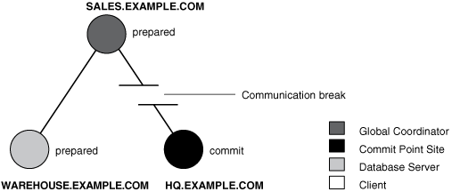

## 34 Managing Distributed Transactions

Managing distributed transactions includes tasks such as specifying the comment point strength of a node, naming transactions, and managing in-doubt transactions.

- Specifying the Commit Point Strength of a Node  
	The database with the highest commit point strength determines which node commits first in a distributed transaction.
- Naming Transactions  
	You can name a transaction. This is useful for identifying a specific distributed transaction and replaces the use of the `COMMIT COMMENT` statement for this purpose.
- Viewing Information About Distributed Transactions  
	The data dictionary of each database stores information about all open distributed transactions. You can use data dictionary tables and views to gain information about the transactions.
- Deciding How to Handle In-Doubt Transactions  
	A transaction is in-doubt when there is a failure during any aspect of the two-phase commit. Distributed transactions become in-doubt in the following ways: a server system running Oracle Database software crashes, a network connection between two or more Oracle Databases involved in distributed processing is disconnected, or an unhandled software error occurs.
- Manually Overriding In-Doubt Transactions  
	Use the `COMMIT` or `ROLLBACK` statement with the `FORCE` option and a text string that indicates either the local or global transaction ID of the in-doubt transaction to commit.
- Purging Pending Rows from the Data Dictionary  
	You can purge pending rows from the data dictionary for in-doubt transactions.
- Manually Committing an In-Doubt Transaction: Example  
	An example illustrates manually committing an in-doubt transaction.
- Data Access Failures Due to Locks  
	When you issue a SQL statement, the database attempts to lock the resources needed to successfully execute the statement. If the requested data is currently held by statements of other uncommitted transactions, however, and remains locked for a long time, a timeout occurs.
- Simulating Distributed Transaction Failure  
	You can force the failure of a distributed transaction to observe RECO automatically resolving the local portion of the transaction or to practice manually resolving in-doubt distributed transactions and observing the results.
- Managing Read Consistency  
	An important restriction exists in the Oracle Database implementation of distributed read consistency.

**Parent topic:** [Distributed Database Management](distributed-database-management.md)

### 34.1 Specifying the Commit Point Strength of a Node

The database with the highest commit point strength determines which node commits first in a distributed transaction.

When specifying a commit point strength for each node, ensure that the most critical server will be non-blocking if a failure occurs during a prepare or commit phase. The `COMMIT_POINT_STRENGTH` initialization parameter determines the commit point strength of a node.

The default value is operating system-dependent. The range of values is any integer from 0 to 255. For example, to set the commit point strength of a database to 200, include the following line in the database initialization parameter file:

```
COMMIT_POINT_STRENGTH = 200
```

The commit point strength is only used to determine the commit point site in a distributed transaction.

When setting the commit point strength for a database, note the following considerations:

- Because the commit point site stores information about the status of the transaction, the commit point site should not be a node that is frequently unreliable or unavailable in case other nodes need information about transaction status.
- Set the commit point strength for a database relative to the amount of critical shared data in the database. For example, a database on a mainframe computer usually shares more data among users than a database on a PC. Therefore, set the commit point strength of the mainframe to a higher value than the PC.
	See Also:
	" [Commit Point Site](distributed-transactions-concepts.md) " for a conceptual overview of commit points

**Parent topic:** Managing Distributed Transactions

### 34.2 Naming Transactions

You can name a transaction. This is useful for identifying a specific distributed transaction and replaces the use of the `COMMIT COMMENT` statement for this purpose.

To name a transaction, use the `SET TRANSACTION...NAME` statement. For example:

```
SET TRANSACTION ISOLATION LEVEL SERIALIZABLE
     NAME 'update inventory checkpoint 0';
```

This example shows that the user started a new transaction with isolation level equal to `SERIALIZABLE` and named it `'update inventory checkpoint 0'`.

For distributed transactions, the name is sent to participating sites when a transaction is committed. If a `COMMIT COMMENT` exists, it is ignored when a transaction name exists.

The transaction name is displayed in the `NAME` column of the `V$TRANSACTION` view, and in the `TRAN_COMMENT` field of the `DBA_2PC_PENDING` view when the transaction is committed.

**Parent topic:** Managing Distributed Transactions

### 34.3 Viewing Information About Distributed Transactions

The data dictionary of each database stores information about all open distributed transactions. You can use data dictionary tables and views to gain information about the transactions.

- Determining the ID Number and Status of Prepared Transactions  
	Use the `DBA_2PC_PENDING` view to determine the global commit number for a particular transaction ID. You can use this global commit number when manually resolving an in-doubt transaction.
- Tracing the Session Tree of In-Doubt Transactions  
	The `DBA_2PC_NEIGHBORS` view shows which in-doubt transactions are incoming from a remote client and which are outgoing to a remote server.

**Parent topic:** Managing Distributed Transactions

#### 34.3.1 Determining the ID Number and Status of Prepared Transactions

Use the `DBA_2PC_PENDING` view to determine the global commit number for a particular transaction ID. You can use this global commit number when manually resolving an in-doubt transaction.

The following view shows the database links that have been defined at the local database and stored in the data dictionary:

| View | Purpose |
| --- | --- |
| `DBA_2PC_PENDING` | Lists all in-doubt distributed transactions. The view is empty until populated by an in-doubt transaction. After the transaction is resolved, the view is purged. |

The following table shows the most relevant columns (for a description of all the columns in the view, see [Oracle Database Reference](https://docs.oracle.com/pls/topic/lookup?ctx=en/database/oracle/oracle-database/21/admin&id=REFRN23002)):

Table 34-1 DBA\_2PC\_PENDING

| Column | Description |
| --- | --- |
| `LOCAL_TRAN_ID` | Local transaction identifier in the format integer.integer.integer.  Note: When the `LOCAL_TRAN_ID` and the `GLOBAL_TRAN_ID` for a connection are the same, the node is the global coordinator of the transaction. |
| `GLOBAL_TRAN_ID` | Global database identifier in the format global\_db\_name.db\_hex\_id.local\_tran\_id, where db\_hex\_id is an eight-character hexadecimal value used to uniquely identify the database. This common transaction ID is the same on every node for a distributed transaction.  Note: When the `LOCAL_TRAN_ID` and the `GLOBAL_TRAN_ID` for a connection are the same, the node is the global coordinator of the transaction. |
| `STATE` | `STATE` can have the following values:  - Collecting 	This category normally applies only to the global coordinator or local coordinators. The node is currently collecting information from other database servers before it can decide whether it can prepare. - Prepared 	The node has prepared and may or may not have acknowledged this to its local coordinator with a prepared message. However, no commit request has been received. The node remains prepared, holding any local resource locks necessary for the transaction to commit. - Committed 	The node (any type) has committed the transaction, but other nodes involved in the transaction may not have done the same. That is, the transaction is still pending at one or more nodes. - Forced Commit 	A pending transaction can be forced to commit at the discretion of a database administrator. This entry occurs if a transaction is manually committed at a local node. - Forced termination (rollback) 	A pending transaction can be forced to roll back at the discretion of a database administrator. This entry occurs if this transaction is manually rolled back at a local node. |
| `MIXED` | `YES` means that part of the transaction was committed on one node and rolled back on another node. |
| `TRAN_COMMENT ` | Transaction comment or, if using transaction naming, the transaction name is placed here when the transaction is committed. |
| `HOST` | Name of the host system. |
| `COMMIT#` | Global commit number for committed transactions. |

Execute the following script, named `pending_txn_script`, to query pertinent information in `DBA_2PC_PENDING` (sample output included):

```
COL LOCAL_TRAN_ID FORMAT A13
COL GLOBAL_TRAN_ID FORMAT A30
COL STATE FORMAT A8
COL MIXED FORMAT A3
COL HOST FORMAT A10
COL COMMIT# FORMAT A10

SELECT LOCAL_TRAN_ID, GLOBAL_TRAN_ID, STATE, MIXED, HOST, COMMIT#
   FROM DBA_2PC_PENDING
/

SQL> @pending_txn_script

LOCAL_TRAN_ID GLOBAL_TRAN_ID                 STATE    MIX HOST       COMMIT#
------------- ------------------------------ -------- --- ---------- ----------
1.15.870      HQ.EXAMPLE.COM.ef192da4.1.15.870  commit   no  dlsun183   115499
```

This output indicates that local transaction `1.15.870` has been committed on this node, but it may be pending on one or more other nodes. Because `LOCAL_TRAN_ID` and the local part of `GLOBAL_TRAN_ID` are the same, the node is the global coordinator of the transaction.

**Parent topic:** Viewing Information About Distributed Transactions

#### 34.3.2 Tracing the Session Tree of In-Doubt Transactions

The `DBA_2PC_NEIGHBORS` view shows which in-doubt transactions are incoming from a remote client and which are outgoing to a remote server.

| View | Purpose |
| --- | --- |
| `DBA_2PC_NEIGHBORS` | Lists all incoming (from remote client) and outgoing (to remote server) in-doubt distributed transactions. It also indicates whether the local node is the commit point site in the transaction.  The view is empty until populated by an in-doubt transaction. After the transaction is resolved, the view is purged. |

When a transaction is in-doubt, you may need to determine which nodes performed which roles in the session tree. Use to this view to determine:

- All the incoming and outgoing connections for a given transaction
- Whether the node is the commit point site in a given transaction
- Whether the node is a global coordinator in a given transaction (because its local transaction ID and global transaction ID are the same)

The following table shows the most relevant columns (for an account of all the columns in the view, see [Oracle Database Reference](https://docs.oracle.com/pls/topic/lookup?ctx=en/database/oracle/oracle-database/21/admin&id=REFRN23002)):

Table 34-2 DBA\_2PC\_NEIGHBORS

| Column | Description |
| --- | --- |
| `LOCAL_TRAN_ID` | Local transaction identifier with the format integer.integer.integer.  Note: When `LOCAL_TRAN_ID` and `GLOBAL_TRAN_ID`.`DBA_2PC_PENDING` for a connection are the same, the node is the global coordinator of the transaction. |
| `IN_OUT` | `IN` for incoming transactions; `OUT` for outgoing transactions. |
| `DATABASE` | For incoming transactions, the name of the client database that requested information from this local node; for outgoing transactions, the name of the database link used to access information on a remote server. |
| `DBUSER_OWNER` | For incoming transactions, the local account used to connect by the remote database link; for outgoing transactions, the owner of the database link. |
| `INTERFACE` | `C` is a commit message; `N` is either a message indicating a prepared state or a request for a read-only commit.  When `IN_OUT` is `OUT`, `C` means that the child at the remote end of the connection is the commit point site and knows whether to commit or terminate. `N` means that the local node is informing the remote node that it is prepared.  When `IN_OUT` is `IN`, `C` means that the local node or a database at the remote end of an outgoing connection is the commit point site. `N` means that the remote node is informing the local node that it is prepared. |

Execute the following script, named `neighbors_script`, to query pertinent information in `DBA_2PC_PENDING` (sample output included):

```
COL LOCAL_TRAN_ID FORMAT A13
COL IN_OUT FORMAT A6
COL DATABASE FORMAT A25
COL DBUSER_OWNER FORMAT A15
COL INTERFACE FORMAT A3
SELECT LOCAL_TRAN_ID, IN_OUT, DATABASE, DBUSER_OWNER, INTERFACE 
   FROM DBA_2PC_NEIGHBORS
/

SQL> CONNECT SYS@hq.example.com AS SYSDBA
SQL> @neighbors_script

LOCAL_TRAN_ID IN_OUT DATABASE                  DBUSER_OWNER    INT
------------- ------ ------------------------- --------------- ---
1.15.870      out    SALES.EXAMPLE.COM            SYS             C
```

This output indicates that the local node sent an outgoing request to remote server `sales` to commit transaction `1.15.870`. If `sales` committed the transaction but no other node did, then you know that `sales` is the commit point site, because the commit point site always commits first.

**Parent topic:** Viewing Information About Distributed Transactions

### 34.4 Deciding How to Handle In-Doubt Transactions

A transaction is in-doubt when there is a failure during any aspect of the two-phase commit. Distributed transactions become in-doubt in the following ways: a server system running Oracle Database software crashes, a network connection between two or more Oracle Databases involved in distributed processing is disconnected, or an unhandled software error occurs.

You can manually force the commit or rollback of a local, in-doubt distributed transaction. Because this operation can generate consistency problems, perform it only when specific conditions exist.

See Also:

[In-Doubt Transactions](distributed-transactions-concepts.md)

**Parent topic:** Managing Distributed Transactions

#### 34.4.1 Discovering Problems with a Two-Phase Commit

Error messages inform applications when there are problems with distributed transactions.

The user application that commits a distributed transaction is informed of a problem by one of the following error messages:

```
ORA-02050: transaction ID rolled back,
           some remote dbs may be in-doubt
ORA-02053: transaction ID committed,
           some remote dbs may be in-doubt
ORA-02054: transaction ID in-doubt
```

A robust application should save information about a transaction if it receives any of the preceding errors. This information can be used later if manual distributed transaction recovery is desired.

No action is required by the administrator of any node that has one or more in-doubt distributed transactions due to a network or system failure. The automatic recovery features of the database transparently complete any in-doubt transaction so that the same outcome occurs on all nodes of a session tree (that is, all commit or all roll back) after the network or system failure is resolved.

In extended outages, however, you can force the commit or rollback of a transaction to release any locked data. Applications must account for such possibilities.

**Parent topic:** Deciding How to Handle In-Doubt Transactions

#### 34.4.2 Determining Whether to Perform a Manual Override

You should override an in-doubt transaction only under certain conditions.

Override a specific in-doubt transaction manually only when one of the following conditions exists:

- The in-doubt transaction locks data that is required by other transactions. This situation occurs when the `ORA-01591` error message interferes with user transactions.
- An in-doubt transaction prevents the extents of an undo segment from being used by other transactions. The first portion of the local transaction ID of an in-doubt distributed transaction corresponds to the ID of the undo segment, as listed by the data dictionary view `DBA_2PC_PENDING.`
- The failure preventing the two-phase commit phases to complete cannot be corrected in an acceptable time period. Examples of such cases include a telecommunication network that has been damaged or a damaged database that requires a long recovery time.

Normally, you should decide to locally force an in-doubt distributed transaction in consultation with administrators at other locations. A wrong decision can lead to database inconsistencies that can be difficult to trace and that you must manually correct.

If none of these conditions apply, always allow the automatic recovery features of the database to complete the transaction. If any of these conditions are met, however, consider a local override of the in-doubt transaction.

**Parent topic:** Deciding How to Handle In-Doubt Transactions

#### 34.4.3 Analyzing the Transaction Data

If you decide to force the transaction to complete, then analyze the available information.

- Find a Node that Committed or Rolled Back  
	Use the `DBA_2PC_PENDING` view to find a node that has either committed or rolled back the transaction.
- Look for Transaction Comments  
	See if any information is given in the `TRAN_COMMENT` column of `DBA_2PC_PENDING` for the distributed transaction.
- Look for Transaction Advice  
	See if any information is given in the `ADVICE` column of `DBA_2PC_PENDING` for the distributed transaction.

**Parent topic:** Deciding How to Handle In-Doubt Transactions

##### 34.4.3.1 Find a Node that Committed or Rolled Back

Use the `DBA_2PC_PENDING` view to find a node that has either committed or rolled back the transaction.

If you can find a node that has already resolved the transaction, then you can follow the action taken at that node.

**Parent topic:** Analyzing the Transaction Data

##### 34.4.3.2 Look for Transaction Comments

See if any information is given in the `TRAN_COMMENT` column of `DBA_2PC_PENDING` for the distributed transaction.

Comments are included in the `COMMENT` clause of the `COMMIT` statement, or if transaction naming is used, the transaction name is placed in the `TRAN_COMMENT` field when the transaction is committed.

For example, the comment of an in-doubt distributed transaction can indicate the origin of the transaction and what type of transaction it is:

```
COMMIT COMMENT 'Finance/Accts_pay/Trans_type 10B';
```

The `SET TRANSACTION...NAME` statement could also have been used (and is preferable) to provide this information in a transaction name.

See Also:

" Naming Transactions "

**Parent topic:** Analyzing the Transaction Data

##### 34.4.3.3 Look for Transaction Advice

See if any information is given in the `ADVICE` column of `DBA_2PC_PENDING` for the distributed transaction.

An application can prescribe advice about whether to force the commit or force the rollback of separate parts of a distributed transaction with the `ADVISE` clause of the `ALTER SESSION` statement.

The advice sent during the prepare phase to each node is the advice in effect at the time the most recent DML statement executed at that database in the current transaction.

For example, consider a distributed transaction that moves an employee record from the `emp` table at one node to the `emp` table at another node. The transaction can protect the record--even when administrators independently force the in-doubt transaction at each node--by including the following sequence of SQL statements:

```
ALTER SESSION ADVISE COMMIT;
INSERT INTO emp@hq ... ;    /*advice to commit at HQ */
ALTER SESSION ADVISE ROLLBACK;
DELETE FROM emp@sales ... ; /*advice to roll back at SALES*/

ALTER SESSION ADVISE NOTHING;
```

If you manually force the in-doubt transaction following the given advice, the worst that can happen is that each node has a copy of the employee record; the record cannot disappear.

**Parent topic:** Analyzing the Transaction Data

### 34.5 Manually Overriding In-Doubt Transactions

Use the `COMMIT` or `ROLLBACK` statement with the `FORCE` option and a text string that indicates either the local or global transaction ID of the in-doubt transaction to commit.

Note:

In all examples, the transaction is committed or rolled back on the local node, and the local pending transaction table records a value of forced commit or forced termination for the `STATE` column the row for this transaction.

- Manually Committing an In-Doubt Transaction  
	You can manually commit an in-doubt transaction using a transaction ID or an SCN.
- Manually Rolling Back an In-Doubt Transaction  
	You can roll back an in-doubt transaction using the transaction ID.

**Parent topic:** Managing Distributed Transactions

#### 34.5.1 Manually Committing an In-Doubt Transaction

You can manually commit an in-doubt transaction using a transaction ID or an SCN.

- Privileges Required to Commit an In-Doubt Transaction  
	Before attempting to commit the transaction, ensure that you have the proper privileges.
- Committing Using Only the Transaction ID  
	You can commit an in-doubt transaction using the transaction ID.
- Committing Using an SCN  
	You can commit an in-doubt transaction using an SCN.

**Parent topic:** Manually Overriding In-Doubt Transactions

##### 34.5.1.1 Privileges Required to Commit an In-Doubt Transaction

Before attempting to commit the transaction, ensure that you have the proper privileges.

Note the following requirements:

| User Committing the Transaction | Privilege Required |
| --- | --- |
| You | `FORCE TRANSACTION` |
| Another user | `FORCE ANY TRANSACTION` |

**Parent topic:** Manually Committing an In-Doubt Transaction

##### 34.5.1.2 Committing Using Only the Transaction ID

You can commit an in-doubt transaction using the transaction ID.

The following SQL statement commits an in-doubt transaction:

```
COMMIT FORCE 'transaction_id';
```

The variable transaction\_id is the identifier of the transaction as specified in either the `LOCAL_TRAN_ID` or `GLOBAL_TRAN_ID` columns of the `DBA_2PC_PENDING` data dictionary view.

For example, assume that you query `DBA_2PC_PENDING` and determine that `LOCAL_TRAN_ID` for a distributed transaction is `1:45.13`.

You then issue the following SQL statement to force the commit of this in-doubt transaction:

```
COMMIT FORCE '1.45.13';
```

**Parent topic:** Manually Committing an In-Doubt Transaction

##### 34.5.1.3 Committing Using an SCN

You can commit an in-doubt transaction using an SCN.

Optionally, you can specify the SCN for the transaction when forcing a transaction to commit. This feature lets you commit an in-doubt transaction with the SCN assigned when it was committed at other nodes.

Consequently, you maintain the synchronized commit time of the distributed transaction even if there is a failure. Specify an SCN only when you can determine the SCN of the same transaction already committed at another node.

For example, assume you want to manually commit a transaction with the following global transaction ID:

```
SALES.EXAMPLE.COM.55d1c563.1.93.29
```

First, query the `DBA_2PC_PENDING` view of a remote database also involved with the transaction in question. Note the SCN used for the commit of the transaction at that node. Specify the SCN when committing the transaction at the local node. For example, if the SCN is `829381993`, issue:

```
COMMIT FORCE 'SALES.EXAMPLE.COM.55d1c563.1.93.29', 829381993;
```

See Also:

[Oracle Database SQL Language Reference](https://docs.oracle.com/pls/topic/lookup?ctx=en/database/oracle/oracle-database/21/admin&id=SQLRF01110) for more information about using the `COMMIT` statement

**Parent topic:** Manually Committing an In-Doubt Transaction

#### 34.5.2 Manually Rolling Back an In-Doubt Transaction

You can roll back an in-doubt transaction using the transaction ID.

Before attempting to roll back the in-doubt distributed transaction, ensure that you have the proper privileges. Note the following requirements:

| User Committing the Transaction | Privilege Required |
| --- | --- |
| You | `FORCE TRANSACTION` |
| Another user | `FORCE ANY TRANSACTION` |

The following SQL statement rolls back an in-doubt transaction:

```
ROLLBACK FORCE 'transaction_id';
```

The variable transaction\_id is the identifier of the transaction as specified in either the `LOCAL_TRAN_ID` or `GLOBAL_TRAN_ID` columns of the `DBA_2PC_PENDING` data dictionary view.

For example, to roll back the in-doubt transaction with the local transaction ID of `2.9.4`, use the following statement:

```
ROLLBACK FORCE '2.9.4';
```

Note:

You cannot roll back an in-doubt transaction to a savepoint.

See Also:

[Oracle Database SQL Language Reference](https://docs.oracle.com/pls/topic/lookup?ctx=en/database/oracle/oracle-database/21/admin&id=SQLRF01610) for more information about using the `ROLLBACK` statement

**Parent topic:** Manually Overriding In-Doubt Transactions

### 34.6 Purging Pending Rows from the Data Dictionary

You can purge pending rows from the data dictionary for in-doubt transactions.

- About Purging Pending Rows from the Data Dictionary  
	You can purge pending rows from the data dictionary for in-doubt transactions using the `DBMS_TRANSACTION.PURGE_MIXED` procedure or the `DBMS_TRANSACTION.PURGE_LOST_DB_ENTRY` procedure.
- Executing the PURGE\_LOST\_DB\_ENTRY Procedure  
	Use the `DBMS_TRANSACTION.PURGE_LOST_DB_ENTRY` procedure to clean up entries for in-doubt transactions in the data dictionary.
- Determining When to Use DBMS\_TRANSACTION  
	You typically should perform a specific action based on the state of a distributed transaction.

**Parent topic:** Managing Distributed Transactions

#### 34.6.1 About Purging Pending Rows from the Data Dictionary

You can purge pending rows from the data dictionary for in-doubt transactions using the `DBMS_TRANSACTION.PURGE_MIXED` procedure or the `DBMS_TRANSACTION.PURGE_LOST_DB_ENTRY` procedure.

Before RECO recovers an in-doubt transaction, the transaction appears in `DBA_2PC_PENDING.STATE` as `COLLECTING`, `COMMITTED`, or `PREPARED`. If you force an in-doubt transaction using `COMMIT FORCE` or `ROLLBACK FORCE`, then the states `FORCED COMMIT` or `FORCED ROLLBACK` may appear.

Automatic recovery normally deletes entries in these states. The only exception is when recovery discovers a forced transaction that is in a state inconsistent with other sites in the transaction. In this case, the entry can be left in the table, and the `MIXED` column in `DBA_2PC_PENDING` has a value of `YES`. These entries can be cleaned up with the `DBMS_TRANSACTION.PURGE_MIXED` procedure.

If automatic recovery is not possible because a remote database has been permanently lost, then recovery cannot identify the re-created database because it receives a new database ID when it is re-created. In this case, you must use the `PURGE_LOST_DB_ENTRY` procedure in the `DBMS_TRANSACTION` package to clean up the entries. The entries do not hold up database resources, so there is no urgency in cleaning them up.

See Also:

[Oracle Database PL/SQL Packages and Types Reference](https://docs.oracle.com/pls/topic/lookup?ctx=en/database/oracle/oracle-database/21/admin&id=ARPLS062) for more information about the `DBMS_TRANSACTION` package

**Parent topic:** Purging Pending Rows from the Data Dictionary

#### 34.6.2 Executing the PURGE\_LOST\_DB\_ENTRY Procedure

Use the `DBMS_TRANSACTION.PURGE_LOST_DB_ENTRY` procedure to clean up entries for in-doubt transactions in the data dictionary.

To manually remove an entry from the data dictionary, use the following syntax (where trans\_id is the identifier for the transaction):

```
DBMS_TRANSACTION.PURGE_LOST_DB_ENTRY('trans_id');
```

For example, to purge pending distributed transaction `1.44.99`, enter the following statement in SQL\*Plus:

```
EXECUTE DBMS_TRANSACTION.PURGE_LOST_DB_ENTRY('1.44.99');
```

Execute this procedure only if significant reconfiguration has occurred so that automatic recovery cannot resolve the transaction. Examples include:

- Total loss of the remote database
- Reconfiguration in software resulting in loss of two-phase commit capability
- Loss of information from an external transaction coordinator such as a TPMonitor

**Parent topic:** Purging Pending Rows from the Data Dictionary

#### 34.6.3 Determining When to Use DBMS\_TRANSACTION

You typically should perform a specific action based on the state of a distributed transaction.

The following tables indicates what the various states indicate about the distributed transaction and what the administrator's action should be:

| STATE Column | State of Global Transaction | State of Local Transaction | Normal Action | Alternative Action |
| --- | --- | --- | --- | --- |
| Collecting | Rolled back | Rolled back | None | `PURGE_LOST_DB_ENTRY` (only if autorecovery cannot resolve transaction) |
| Committed | Committed | Committed | None | `PURGE_LOST_DB_ENTRY` (only if autorecovery cannot resolve transaction) |
| Prepared | Unknown | Prepared | None | Force commit or rollback |
| Forced commit | Unknown | Committed | None | `PURGE_LOST_DB_ENTRY` (only if autorecovery cannot resolve transaction) |
| Forced rollback | Unknown | Rolled back | None | `PURGE_LOST_DB_ENTRY` (only if autorecovery cannot resolve transaction) |
| Forced commit | Mixed | Committed | Manually remove inconsistencies then use `PURGE_MIXED` | \- |
| Forced rollback | Mixed | Rolled back | Manually remove inconsistencies then use `PURGE_MIXED` | \- |

**Parent topic:** Purging Pending Rows from the Data Dictionary

### 34.7 Manually Committing an In-Doubt Transaction: Example

An example illustrates manually committing an in-doubt transaction.

Figure 34-1, illustrates a failure during the commit of a distributed transaction. In this failure case, the prepare phase completes. During the commit phase, however, the commit confirmation of the commit point site never reaches the global coordinator, even though the commit point site committed the transaction. Inventory data is locked and cannot be accessed because the in-doubt transaction is critical to other transactions. Further, the locks must be held until the in-doubt transaction either commits or rolls back.

Figure 34-1 Example of an In-Doubt Distributed Transaction



> The image admin037.gif shows an example of an in-doubt distributed transaction. In this example, the following occurs:
>
> - SALES.EXAMPLE.COM is the global coordinator and is in the prepared state.
> - WAREHOUSE.EXAMPLE.COM is the database server and is in the prepared state.
> - HQ.EXAMPLE.COM is the commit point site and has issued the commit request.
>
> The failure occurs during the commit phase when a communication break between HQ.EXAMPLE.COM and SALES.EXAMPLE.COM disrupts the transaction.
>
> End of image description.


You can manually force the local portion of the in-doubt transaction.

- Step 1: Record User Feedback  
	An example illustrates recording user feedback for an in-doubt transaction.
- Step 2: Query DBA\_2PC\_PENDING  
	An example illustrates querying the `DBA_2PC_PENDING` data dictionary view for information about in-doubt transactions.
- Step 3: Query DBA\_2PC\_NEIGHBORS on Local Node  
	The purpose of this step is to climb the session tree so that you find coordinators, eventually reaching the global coordinator.
- Step 4: Querying Data Dictionary Views on All Nodes  
	At this point, you can contact the administrator at the located nodes and ask each person to repeat Steps 2 and 3 using the global transaction ID.
- Step 5: Commit the In-Doubt Transaction  
	Use the global ID to commit the in-doubt transaction.
- Step 6: Check for Mixed Outcome Using DBA\_2PC\_PENDING  
	After you manually force a transaction to commit or roll back, the corresponding row in the pending transaction table remains. The state of the transaction is changed depending on how you forced the transaction.

**Parent topic:** Managing Distributed Transactions

#### 34.7.1 Step 1: Record User Feedback

An example illustrates recording user feedback for an in-doubt transaction.

The users of the local database system that conflict with the locks of the in-doubt transaction receive the following error message:

```
ORA-01591: lock held by in-doubt distributed transaction 1.21.17
```

In this case, `1.21.17` is the local transaction ID of the in-doubt distributed transaction. You should request and record this ID number from users that report problems to identify which in-doubt transactions should be forced.

**Parent topic:** Manually Committing an In-Doubt Transaction: Example

#### 34.7.2 Step 2: Query DBA\_2PC\_PENDING

An example illustrates querying the `DBA_2PC_PENDING` data dictionary view for information about in-doubt transactions.

After connecting with SQL\*Plus to `warehouse`, query the local `DBA_2PC_PENDING` data dictionary view to gain information about the in-doubt transaction:

```
CONNECT SYS@warehouse.example.com AS SYSDBA
SELECT * FROM DBA_2PC_PENDING WHERE LOCAL_TRAN_ID = '1.21.17';
```

The database returns the following information:

```
Column Name            Value
---------------------- --------------------------------------
LOCAL_TRAN_ID          1.21.17
GLOBAL_TRAN_ID         SALES.EXAMPLE.COM.55d1c563.1.93.29
STATE                  prepared
MIXED                  no
ADVICE
TRAN_COMMENT           Sales/New Order/Trans_type 10B
FAIL_TIME              31-MAY-91
FORCE_TIME
RETRY_TIME             31-MAY-91
OS_USER                SWILLIAMS
OS_TERMINAL            TWA139:
HOST                   system1
DB_USER                SWILLIAMS
COMMIT#
```

- Determining the Global Transaction ID  
	The global transaction ID is the common transaction ID that is the same on every node for a distributed transaction.
- Determining the State of the Transaction  
	The `STATE` column of the `DBA_2PC_PENDING` data dictionary view shows the state of the transaction.
- Looking for Comments or Advice  
	The `TRANS_COMMENT` column of the `DBA_2PC_PENDING` data dictionary view shows the comment included for the transaction, while the `ADVICE` column provides advice.

**Parent topic:** Manually Committing an In-Doubt Transaction: Example

##### 34.7.2.1 Determining the Global Transaction ID

The global transaction ID is the common transaction ID that is the same on every node for a distributed transaction.

It is of the form:

`global_database_name`.`hhhhhhhh.local` \_ `transaction_id`

where:

- `global_database_name ` is the database name of the global coordinator.
- `hhhhhhhh` is the internal database identifier of the global coordinator (in hexadecimal).
- `local_transaction_id` is the corresponding local transaction ID assigned on the global coordinator.

Note that the last portion of the global transaction ID and the local transaction ID match at the global coordinator. In the example, you can tell that `warehouse` is not the global coordinator because these numbers do not match:

```
LOCAL_TRAN_ID          1.21.17
GLOBAL_TRAN_ID         ... 1.93.29
```

**Parent topic:** Step 2: Query DBA\_2PC\_PENDING

##### 34.7.2.2 Determining the State of the Transaction

The `STATE` column of the `DBA_2PC_PENDING` data dictionary view shows the state of the transaction.

The transaction on this node is in a prepared state:

```
STATE          prepared
```

Therefore, `warehouse` waits for its coordinator to send either a commit or a rollback request.

**Parent topic:** Step 2: Query DBA\_2PC\_PENDING

##### 34.7.2.3 Looking for Comments or Advice

The `TRANS_COMMENT` column of the `DBA_2PC_PENDING` data dictionary view shows the comment included for the transaction, while the `ADVICE` column provides advice.

The transaction comment or advice can include information about this transaction. If so, use this comment to your advantage. In this example, the origin and transaction type is in the transaction comment:

```
TRAN_COMMENT           Sales/New Order/Trans_type 10B
```

It could also be provided as a transaction name with a `SET TRANSACTION...NAME` statement.

This information can reveal something that helps you decide whether to commit or rollback the local portion of the transaction. If useful comments do not accompany an in-doubt transaction, you must complete some extra administrative work to trace the session tree and find a node that has resolved the transaction.

**Parent topic:** Step 2: Query DBA\_2PC\_PENDING

#### 34.7.3 Step 3: Query DBA\_2PC\_NEIGHBORS on Local Node

The purpose of this step is to climb the session tree so that you find coordinators, eventually reaching the global coordinator.

Along the way, you may find a coordinator that has resolved the transaction. If not, you can eventually work your way to the commit point site, which will always have resolved the in-doubt transaction. To trace the session tree, query the `DBA_2PC_NEIGHBORS` view on each node.

In this case, you query this view on the `warehouse` database:

```
CONNECT SYS@warehouse.example.com AS SYSDBA
SELECT * FROM DBA_2PC_NEIGHBORS
  WHERE LOCAL_TRAN_ID = '1.21.17'
  ORDER BY SESS#, IN_OUT;

Column Name            Value
---------------------- --------------------------------------
LOCAL_TRAN_ID          1.21.17
IN_OUT                 in
DATABASE               SALES.EXAMPLE.COM
DBUSER_OWNER           SWILLIAMS
INTERFACE              N
DBID                   000003F4
SESS#                  1
BRANCH                 0100
```

- Obtaining Database Role and Database Link Information  
	The `DBA_2PC_NEIGHBORS` view provides information about connections associated with an in-doubt transaction.
- Determining the Commit Point Site  
	The `INTERFACE` column tells whether the local node or a subordinate node is the commit point site.

**Parent topic:** Manually Committing an In-Doubt Transaction: Example

##### 34.7.3.1 Obtaining Database Role and Database Link Information

The `DBA_2PC_NEIGHBORS` view provides information about connections associated with an in-doubt transaction.

Information for each connection is different, based on whether the connection is inbound (`IN_OUT = in`) or outbound (`IN_OUT = out`):

| IN\_OUT | Meaning | DATABASE | DBUSER\_OWNER |
| --- | --- | --- | --- |
| in | Your node is a server of another node. | Lists the name of the client database that connected to your node. | Lists the local account for the database link connection that corresponds to the in-doubt transaction. |
| out | Your node is a client of other servers. | Lists the name of the database link that connects to the remote node. | Lists the owner of the database link for the in-doubt transaction. |

In this example, the `IN_OUT` column reveals that the `warehouse` database is a server for the `sales` client, as specified in the DATABASE column:

```
IN_OUT                 in
DATABASE               SALES.EXAMPLE.COM
```

The connection to `warehouse` was established through a database link from the `swilliams` account, as shown by the `DBUSER_OWNER` column:

```
DBUSER_OWNER           SWILLIAMS
```

**Parent topic:** Step 3: Query DBA\_2PC\_NEIGHBORS on Local Node

##### 34.7.3.2 Determining the Commit Point Site

The `INTERFACE` column tells whether the local node or a subordinate node is the commit point site.

```
INTERFACE              N
```

Neither `warehouse` nor any of its descendants is the commit point site, as shown by the `INTERFACE` column.

**Parent topic:** Step 3: Query DBA\_2PC\_NEIGHBORS on Local Node

#### 34.7.4 Step 4: Querying Data Dictionary Views on All Nodes

At this point, you can contact the administrator at the located nodes and ask each person to repeat Steps 2 and 3 using the global transaction ID.

Note:

If you can directly connect to these nodes with another network, you can repeat Steps 2 and 3 yourself.

For example, the following results are returned when Steps 2 and 3 are performed at `sales` and `hq`.

- Checking the Status of Pending Transactions at sales  
	At this stage, the `sales` administrator queries the `DBA_2PC_PENDING` data dictionary view.
- Determining the Coordinators and Commit Point Site at sales  
	Next, the `sales` administrator queries `DBA_2PC_NEIGHBORS` to determine the global and local coordinators as well as the commit point site.
- Checking the Status of Pending Transactions at HQ  
	At this stage, the `hq` administrator queries the `DBA_2PC_PENDING` data dictionary view.

**Parent topic:** Manually Committing an In-Doubt Transaction: Example

##### 34.7.4.1 Checking the Status of Pending Transactions at sales

At this stage, the `sales` administrator queries the `DBA_2PC_PENDING` data dictionary view.

```
SQL> CONNECT SYS@sales.example.com AS SYSDBA
SQL> SELECT * FROM DBA_2PC_PENDING
   > WHERE GLOBAL_TRAN_ID = 'SALES.EXAMPLE.COM.55d1c563.1.93.29';

Column Name            Value
---------------------- --------------------------------------
LOCAL_TRAN_ID          1.93.29
GLOBAL_TRAN_ID         SALES.EXAMPLE.COM.55d1c563.1.93.29
STATE                  prepared
MIXED                  no
ADVICE
TRAN_COMMENT           Sales/New Order/Trans_type 10B
FAIL_TIME              31-MAY-91
FORCE_TIME
RETRY_TIME             31-MAY-91
OS_USER                SWILLIAMS
OS_TERMINAL            TWA139:
HOST                   system1
DB_USER                SWILLIAMS
COMMIT#
```

**Parent topic:** Step 4: Querying Data Dictionary Views on All Nodes

##### 34.7.4.2 Determining the Coordinators and Commit Point Site at sales

Next, the `sales` administrator queries `DBA_2PC_NEIGHBORS` to determine the global and local coordinators as well as the commit point site.

```
SELECT * FROM DBA_2PC_NEIGHBORS
   WHERE GLOBAL_TRAN_ID = 'SALES.EXAMPLE.COM.55d1c563.1.93.29'
   ORDER BY SESS#, IN_OUT;
```

This query returns three rows:

- The connection to `warehouse`
- The connection to `hq`
- The connection established by the user

Reformatted information corresponding to the rows for the `warehouse` connection appears below:

```
Column Name            Value
---------------------- --------------------------------------
LOCAL_TRAN_ID          1.93.29
IN_OUT                 OUT
DATABASE               WAREHOUSE.EXAMPLE.COM
DBUSER_OWNER           SWILLIAMS
INTERFACE              N
DBID                   55d1c563
SESS#                  1
BRANCH                 1
```

Reformatted information corresponding to the rows for the `hq` connection appears below:

```
Column Name            Value
---------------------- --------------------------------------
LOCAL_TRAN_ID          1.93.29
IN_OUT                 OUT
DATABASE               HQ.EXAMPLE.COM
DBUSER_OWNER           ALLEN
INTERFACE              C
DBID                   00000390
SESS#                  1
BRANCH                 1
```

The information from the previous queries reveal the following:

- `sales` is the global coordinator because the local transaction ID and global transaction ID match.
- Two outbound connections are established from this node, but no inbound connections. `sales` is not the server of another node.
- `hq` or one of its servers is the commit point site.

**Parent topic:** Step 4: Querying Data Dictionary Views on All Nodes

##### 34.7.4.3 Checking the Status of Pending Transactions at HQ

At this stage, the `hq` administrator queries the `DBA_2PC_PENDING` data dictionary view.

```
SELECT * FROM DBA_2PC_PENDING@hq.example.com
   WHERE GLOBAL_TRAN_ID = 'SALES.EXAMPLE.COM.55d1c563.1.93.29';

Column Name            Value
---------------------- --------------------------------------
LOCAL_TRAN_ID          1.45.13
GLOBAL_TRAN_ID         SALES.EXAMPLE.COM.55d1c563.1.93.29
STATE                  COMMIT
MIXED                  NO
ACTION
TRAN_COMMENT           Sales/New Order/Trans_type 10B
FAIL_TIME              31-MAY-91
FORCE_TIME
RETRY_TIME             31-MAY-91
OS_USER                SWILLIAMS
OS_TERMINAL            TWA139:
HOST                   SYSTEM1
DB_USER                SWILLIAMS
COMMIT#                129314
```

At this point, you have found a node that resolved the transaction. As the view reveals, it has been committed and assigned a commit ID number:

```
STATE                  COMMIT
COMMIT#                129314
```

Therefore, you can force the in-doubt transaction to commit at your local database. It is a good idea to contact any other administrators you know that could also benefit from your investigation.

**Parent topic:** Step 4: Querying Data Dictionary Views on All Nodes

#### 34.7.5 Step 5: Commit the In-Doubt Transaction

Use the global ID to commit the in-doubt transaction.

You contact the administrator of the `sales` database, who manually commits the in-doubt transaction using the global ID:

```
SQL> CONNECT SYS@sales.example.com AS SYSDBA
SQL> COMMIT FORCE 'SALES.EXAMPLE.COM.55d1c563.1.93.29';
```

As administrator of the `warehouse` database, you manually commit the in-doubt transaction using the global ID:

```
SQL> CONNECT SYS@warehouse.example.com AS SYSDBA
SQL> COMMIT FORCE 'SALES.EXAMPLE.COM.55d1c563.1.93.29';
```

**Parent topic:** Manually Committing an In-Doubt Transaction: Example

#### 34.7.6 Step 6: Check for Mixed Outcome Using DBA\_2PC\_PENDING

After you manually force a transaction to commit or roll back, the corresponding row in the pending transaction table remains. The state of the transaction is changed depending on how you forced the transaction.

Every Oracle Database has a pending transaction table. This is a special table that stores information about distributed transactions as they proceed through the two-phase commit phases. You can query the pending transaction table of a database through the `DBA_2PC_PENDING` data dictionary view (see " Determining the ID Number and Status of Prepared Transactions ").

Also of particular interest in the pending transaction table is the mixed outcome flag as indicated in `DBA_2PC_PENDING.MIXED`. You can make the wrong choice if a pending transaction is forced to commit or roll back. For example, the local administrator rolls back the transaction, but the other nodes commit it. Incorrect decisions are detected automatically, and the damage flag for the corresponding pending transaction record is set (`MIXED=yes`).

The RECO (Recoverer) background process uses the information in the pending transaction table to finalize the status of in-doubt transactions. You can also use the information in the pending transaction table to manually override the automatic recovery procedures for pending distributed transactions.

All transactions automatically resolved by RECO are removed from the pending transaction table. Additionally, all information about in-doubt transactions correctly resolved by an administrator (as checked when RECO reestablishes communication) are automatically removed from the pending transaction table. However, all rows resolved by an administrator that result in a mixed outcome across nodes remain in the pending transaction table of all involved nodes until they are manually deleted using `DBMS_TRANSACTIONS.PURGE_MIXED`.

**Parent topic:** Manually Committing an In-Doubt Transaction: Example

### 34.8 Data Access Failures Due to Locks

When you issue a SQL statement, the database attempts to lock the resources needed to successfully execute the statement. If the requested data is currently held by statements of other uncommitted transactions, however, and remains locked for a long time, a timeout occurs.

- Transaction Timeouts  
	A DML statement that requires locks on a remote database can be blocked if another transaction own locks on the requested data.
- Locks from In-Doubt Transactions  
	A query or DML statement that requires locks on a local database can be blocked indefinitely due to the locked resources of an in-doubt distributed transaction.

**Parent topic:** Managing Distributed Transactions

#### 34.8.1 Transaction Timeouts

A DML statement that requires locks on a remote database can be blocked if another transaction own locks on the requested data.

If these locks continue to block the requesting SQL statement, then the following sequence of events occurs:

1. A timeout occurs.
2. The database rolls back the statement.
3. The database returns this error message to the user:
	```
	ORA-02049: time-out: distributed transaction waiting for lock
	```

Because the transaction did not modify data, no actions are necessary as a result of the timeout. Applications should proceed as if a deadlock has been encountered. The user who executed the statement can try to reexecute the statement later. If the lock persists, then the user should contact an administrator to report the problem.

**Parent topic:** Data Access Failures Due to Locks

#### 34.8.2 Locks from In-Doubt Transactions

A query or DML statement that requires locks on a local database can be blocked indefinitely due to the locked resources of an in-doubt distributed transaction.

In this case, the database issues the following error message:

```
ORA-01591: lock held by in-doubt distributed transaction identifier
```

In this case, the database rolls back the SQL statement immediately. The user who executed the statement can try to reexecute the statement later. If the lock persists, the user should contact an administrator to report the problem, including the ID of the in-doubt distributed transaction.

The chances of these situations occurring are rare considering the low probability of failures during the critical portions of the two-phase commit. Even if such a failure occurs, and assuming quick recovery from a network or system failure, problems are automatically resolved without manual intervention. Thus, problems usually resolve before they can be detected by users or database administrators.

**Parent topic:** Data Access Failures Due to Locks

### 34.9 Simulating Distributed Transaction Failure

You can force the failure of a distributed transaction to observe RECO automatically resolving the local portion of the transaction or to practice manually resolving in-doubt distributed transactions and observing the results.

- Forcing a Distributed Transaction to Fail  
	You can include comments in the `COMMENT` parameter of the `COMMIT` statement.
- Disabling and Enabling RECO  
	The RECO background process of an Oracle Database instance automatically resolves failures involving distributed transactions. At exponentially growing time intervals, the RECO background process of a node attempts to recover the local portion of an in-doubt distributed transaction.

**Parent topic:** Managing Distributed Transactions

#### 34.9.1 Forcing a Distributed Transaction to Fail

You can include comments in the `COMMENT` parameter of the `COMMIT` statement.

To intentionally induce a failure during the two-phase commit phases of a distributed transaction, include the following comment in the `COMMENT` parameter:

```
COMMIT COMMENT 'ORA-2PC-CRASH-TEST-n';
```

where n is one of the following integers:

| n | Effect |
| --- | --- |
| 1 | Crash commit point after collect |
| 2 | Crash non-commit-point site after collect |
| 3 | Crash before prepare (non-commit-point site) |
| 4 | Crash after prepare (non-commit-point site) |
| 5 | Crash commit point site before commit |
| 6 | Crash commit point site after commit |
| 7 | Crash non-commit-point site before commit |
| 8 | Crash non-commit-point site after commit |
| 9 | Crash commit point site before forget |
| 10 | Crash non-commit-point site before forget |

For example, the following statement returns the following messages if the local commit point strength is greater than the remote commit point strength and both nodes are updated:

```
COMMIT COMMENT 'ORA-2PC-CRASH-TEST-7';

ORA-02054: transaction 1.93.29 in-doubt
ORA-02059: ORA_CRASH_TEST_7 in commit comment
```

At this point, the in-doubt distributed transaction appears in the `DBA_2PC_PENDING` view. If enabled, RECO automatically resolves the transaction.

**Parent topic:** Simulating Distributed Transaction Failure

#### 34.9.2 Disabling and Enabling RECO

The RECO background process of an Oracle Database instance automatically resolves failures involving distributed transactions. At exponentially growing time intervals, the RECO background process of a node attempts to recover the local portion of an in-doubt distributed transaction.

RECO can use an existing connection or establish a new connection to other nodes involved in the failed transaction. When a connection is established, RECO automatically resolves all in-doubt transactions. Rows corresponding to any resolved in-doubt transactions are automatically removed from the pending transaction table of each database.

You can enable and disable RECO using the `ALTER SYSTEM` statement with the `ENABLE` / `DISABLE DISTRIBUTED RECOVERY` options. For example, you can temporarily disable RECO to force the failure of a two-phase commit and manually resolve the in-doubt transaction.

The following statement disables RECO:

```
ALTER SYSTEM DISABLE DISTRIBUTED RECOVERY;
```

Alternatively, the following statement enables RECO so that in-doubt transactions are automatically resolved:

```
ALTER SYSTEM ENABLE DISTRIBUTED RECOVERY;
```

**Parent topic:** Simulating Distributed Transaction Failure

### 34.10 Managing Read Consistency

An important restriction exists in the Oracle Database implementation of distributed read consistency.

The problem arises because each system has its own SCN, which you can view as the database internal timestamp. The Oracle Database server uses the SCN to decide which version of data is returned from a query.

The SCNs in a distributed transaction are synchronized at the end of each remote SQL statement and at the start and end of each transaction. Between two nodes that have heavy traffic and especially distributed updates, the synchronization is frequent. Nevertheless, no practical way exists to keep SCNs in a distributed system absolutely synchronized: a window always exists in which one node may have an SCN that is somewhat in the past with respect to the SCN of another node.

Because of the SCN gap, you can execute a query that uses a slightly old snapshot, so that the most recent changes to the remote database are not seen. In accordance with read consistency, a query can therefore retrieve consistent, but out-of-date data. Note that all data retrieved by the query will be from the old SCN, so that if a locally executed update transaction updates two tables at a remote node, then data selected from both tables in the next remote access contain data before the update.

One consequence of the SCN gap is that two consecutive `SELECT` statements can retrieve different data even though no DML has been executed between the two statements. For example, you can issue an update statement and then commit the update on the remote database. When you issue a `SELECT` statement on a view based on this remote table, the view does not show the update to the row. The next time that you issue the `SELECT` statement, the update is present.

You can use the following techniques to ensure that the SCNs of the two systems are synchronized just before a query:

- Because SCNs are synchronized at the end of a remote query, precede each remote query with a dummy remote query to the same site, for example, `SELECT * FROM DUAL@REMOTE`.
- Because SCNs are synchronized at the start of every remote transaction, commit or roll back the current transaction before issuing the remote query.

**Parent topic:** Managing Distributed Transactions