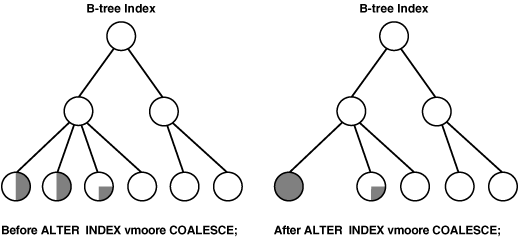

## 20 Managing Indexes

Indexes can provide faster data access. You can create, alter, monitor, and drop indexes.

- About Indexes  
	Indexes are optional structures associated with tables and clusters that allow SQL queries to execute more quickly against a table.
- Guidelines for Managing Indexes  
	You can follow guidelines for managing indexes.
- Creating Indexes  
	You can create several different types of indexes. You can create indexes explicitly, and you can create indexes associated with constraints.
- Altering Indexes  
	You can alter an index by completing tasks such as changing its storage characteristics, rebuilding it, making it unusable, or making it visible or invisible.
- Monitoring Space Use of Indexes  
	If key values in an index are inserted, updated, and deleted frequently, then the index can lose its acquired space efficiency over time.
- Dropping Indexes  
	You can drop an index with the `DROP INDEX` statement.
- Managing Automatic Indexes  
	You can use the automatic indexing feature to configure and use automatic indexes in an Oracle database to improve database performance.
- Indexes Data Dictionary Views  
	You can query a set of data dictionary views for information about indexes.

**Parent topic:** [Schema Objects](schema-objects.md)

### 20.1 About Indexes

Indexes are optional structures associated with tables and clusters that allow SQL queries to execute more quickly against a table.

Just as the index in this manual helps you locate information faster than if there were no index, an Oracle Database index provides a faster access path to table data. You can use indexes without rewriting any queries. Your results are the same, but you see them more quickly.

Oracle Database provides several indexing schemes that provide complementary performance functionality. These are:

- B-tree indexes: the default and the most common
- B-tree cluster indexes: defined specifically for cluster
- Hash cluster indexes: defined specifically for a hash cluster
- Global and local indexes: relate to partitioned tables and indexes
- Reverse key indexes: most useful for Oracle Real Application Clusters applications
- Bitmap indexes: compact; work best for columns with a small set of values
- Function-based indexes: contain the precomputed value of a function/expression
- Domain indexes: specific to an application or cartridge.

Indexes are logically and physically independent of the data in the associated table. Being independent structures, they require storage space. You can create or drop an index without affecting the base tables, database applications, or other indexes. The database automatically maintains indexes when you insert, update, and delete rows of the associated table. If you drop an index, all applications continue to work. However, access to previously indexed data might be slower.

See Also:

- [Oracle Database Concepts](https://docs.oracle.com/pls/topic/lookup?ctx=en/database/oracle/oracle-database/21/admin&id=CNCPT811) for an overview of indexes
- [Managing Space for Schema Objects](managing-space-for-schema-objects.md)

**Parent topic:** Managing Indexes

### 20.2 Guidelines for Managing Indexes

You can follow guidelines for managing indexes.

- Create Indexes After Inserting Table Data  
	Data is often inserted or loaded into a table using either the SQL\*Loader or an import utility. It is more efficient to create an index for a table after inserting or loading the data. If you create one or more indexes before loading data, then the database must update every index as each row is inserted.
- Index the Correct Tables and Columns  
	Follow guidelines about tables and columns that are suitable for indexing.
- Order Index Columns for Performance  
	The order of columns in the `CREATE` `INDEX` statement can affect query performance. In general, specify the most frequently used columns first.
- Limit the Number of Indexes for Each Table  
	A table can have any number of indexes. However, the more indexes there are, the more overhead is incurred as the table is modified.
- Drop Indexes That Are No Longer Required  
	It is best practice to drop indexes that are no longer required.
- Indexes and Deferred Segment Creation  
	Index segment creation is deferred when the associated table defers segment creation. This is because index segment creation reflects the behavior of the table with which it is associated.
- Estimate Index Size and Set Storage Parameters  
	Estimating the size of an index before creating one can facilitate better disk space planning and management.
- Specify the Tablespace for Each Index  
	Indexes can be created in any tablespace. An index can be created in the same or different tablespace as the table it indexes.
- Consider Parallelizing Index Creation  
	You can parallelize index creation, much the same as you can parallelize table creation. Because multiple processes work together to create the index, the database can create the index more quickly than if a single server process created the index sequentially.
- Consider Creating Indexes with NOLOGGING  
	You can create an index and generate minimal redo log records by specifying `NOLOGGING` in the `CREATE INDEX` statement.
- Understand When to Use Unusable or Invisible Indexes  
	Use unusable or invisible indexes when you want to improve the performance of bulk loads, test the effects of removing an index before dropping it, or otherwise suspend the use of an index by the optimizer.
- Understand When to Create Multiple Indexes on the Same Set of Columns  
	You can create multiple indexes on the same set of columns when the indexes are different in some way. For example, you can create a B-tree index and a bitmap index on the same set of columns.
- Consider Costs and Benefits of Coalescing or Rebuilding Indexes  
	Improper sizing or increased growth can produce index fragmentation. To eliminate or reduce fragmentation, you can rebuild or coalesce the index. But before you perform either task weigh the costs and benefits of each option and choose the one that works best for your situation.
- Consider Cost Before Disabling or Dropping Constraints  
	Because unique and primary keys have associated indexes, you should factor in the cost of dropping and creating indexes when considering whether to disable or drop a `UNIQUE` or `PRIMARY KEY` constraint.
- Consider Using the In-Memory Column Store to Reduce the Number of Indexes  
	The In-Memory Column Store is an optional portion of the system global area (SGA) that stores copies of tables, table partitions, and other database objects that is optimized for rapid scans. In the In-Memory Column Store, table data is stored by column rather than row in the SGA.

See Also:

- [Oracle Database Concepts](https://docs.oracle.com/pls/topic/lookup?ctx=en/database/oracle/oracle-database/21/admin&id=CNCPT811) for conceptual information about indexes and indexing, including descriptions of the various indexing schemes offered by Oracle
- [Oracle Database SQL Tuning Guide](https://docs.oracle.com/pls/topic/lookup?ctx=en/database/oracle/oracle-database/21/admin&id=TGSQL867) and [Oracle Database Data Warehousing Guide](https://docs.oracle.com/pls/topic/lookup?ctx=en/database/oracle/oracle-database/21/admin&id=DWHSG8130) for information about bitmap indexes
- [Oracle Database Data Cartridge Developer's Guide](https://docs.oracle.com/pls/topic/lookup?ctx=en/database/oracle/oracle-database/21/admin&id=ADDCI290) for information about defining domain-specific operators and indexing schemes and integrating them into the Oracle Database server

**Parent topic:** Managing Indexes

#### 20.2.1 Create Indexes After Inserting Table Data

Data is often inserted or loaded into a table using either the SQL\*Loader or an import utility. It is more efficient to create an index for a table after inserting or loading the data. If you create one or more indexes before loading data, then the database must update every index as each row is inserted.

Creating an index on a table that already has data requires sort space. Some sort space comes from memory allocated for the index creator. The amount for each user is determined by the initialization parameter `SORT_AREA_SIZE`. The database also swaps sort information to and from temporary segments that are only allocated during the index creation in the user's temporary tablespace.

Under certain conditions, data can be loaded into a table with SQL\*Loader direct-path load, and an index can be created as data is loaded.

See Also:

[Oracle Database Utilities](https://docs.oracle.com/pls/topic/lookup?ctx=en/database/oracle/oracle-database/21/admin&id=SUTIL009) for information about using SQL\*Loader for direct-path load

**Parent topic:** Guidelines for Managing Indexes

#### 20.2.2 Index the Correct Tables and Columns

Follow guidelines about tables and columns that are suitable for indexing.

Use the following guidelines for determining when to create an index:

- Create an index if you frequently want to retrieve less than 15% of the rows in a large table. The percentage varies greatly according to the relative speed of a table scan and how the row data is distributed in relation to the index key. The faster the table scan, the lower the percentage; the more clustered the row data, the higher the percentage.
- To improve performance on joins of multiple tables, index columns used for joins.
	Note:
	Primary and unique keys automatically have indexes, but you might want to create an index on a foreign key.
- If a query is taking too long, then check the table size. If it has changed significantly, the existing indexes (if any) may need to be reviewed.

Columns That Are Suitable for Indexing

Some columns are strong candidates for indexing. Columns with one or more of the following characteristics are candidates for indexing:

- Values are relatively unique in the column.
- There is a wide range of values (good for regular indexes).
- There is a small range of values (good for bitmap indexes).
- The column contains many nulls, but queries often select all rows having a value. In this case, use the following phrase:
	```
	WHERE COL_X > -9.99 * power(10,125)
	```
	Using the preceding phrase is preferable to:
	```
	WHERE COL_X IS NOT NULL
	```
	This is because the first uses an index on `COL_X` (assuming that `COL_X` is a numeric column).

Columns That Are Not Suitable for Indexing

Columns with the following characteristics are less suitable for indexing:

- There are many nulls in the column, and you do not search on the not null values.

`LONG` and `LONG` `RAW` columns cannot be indexed.

Virtual Columns

You can create unique or non-unique indexes on virtual columns. A table index defined on a virtual column is equivalent to a function-based index on the table.

See Also:

" Creating a Function-Based Index "

**Parent topic:** Guidelines for Managing Indexes

#### 20.2.3 Order Index Columns for Performance

The order of columns in the `CREATE` `INDEX` statement can affect query performance. In general, specify the most frequently used columns first.

If you create a single index across columns to speed up queries that access, for example, `col1`, `col2`, and `col3`; then queries that access just `col1`, or that access just `col1` and `col2`, are also speeded up. But a query that accessed just `col2`, just `col3`, or just `col2` and `col3` does not use the index.

Note:

In some cases, such as when the leading column has very low cardinality, the database may use a skip scan of this type of index. See [Oracle Database Concepts](https://docs.oracle.com/pls/topic/lookup?ctx=en/database/oracle/oracle-database/21/admin&id=CNCPT88842) for more information about index skip scan.

**Parent topic:** Guidelines for Managing Indexes

#### 20.2.4 Limit the Number of Indexes for Each Table

A table can have any number of indexes. However, the more indexes there are, the more overhead is incurred as the table is modified.

Specifically, when rows are inserted or deleted, all indexes on the table must be updated as well. Also, when a column is updated, all indexes that contain the column must be updated.

Thus, there is a trade-off between the speed of retrieving data from a table and the speed of updating the table. For example, if a table is primarily read-only, then having more indexes can be useful; but if a table is heavily updated, then having fewer indexes could be preferable.

**Parent topic:** Guidelines for Managing Indexes

#### 20.2.5 Drop Indexes That Are No Longer Required

It is best practice to drop indexes that are no longer required.

Consider dropping an index if:

- It does not speed up queries. The table could be very small, or there could be many rows in the table but very few index entries.
- The queries in your applications do not use the index.
- The index must be dropped before being rebuilt.
	See Also:
	" Monitoring Index Usage "

**Parent topic:** Guidelines for Managing Indexes

#### 20.2.6 Indexes and Deferred Segment Creation

Index segment creation is deferred when the associated table defers segment creation. This is because index segment creation reflects the behavior of the table with which it is associated.

See Also:

" [Understand Deferred Segment Creation](managing-tables.md) " for further information

**Parent topic:** Guidelines for Managing Indexes

#### 20.2.7 Estimate Index Size and Set Storage Parameters

Estimating the size of an index before creating one can facilitate better disk space planning and management.

You can use the combined estimated size of indexes, along with estimates for tables, the undo tablespace, and redo log files, to determine the amount of disk space that is required to hold an intended database. From these estimates, you can make correct hardware purchases and other decisions.

Use the estimated size of an individual index to better manage the disk space that the index uses. When an index is created, you can set appropriate storage parameters and improve I/O performance of applications that use the index. For example, assume that you estimate the maximum size of an index before creating it. If you then set the storage parameters when you create the index, then fewer extents are allocated for the table data segment, and all of the index data is stored in a relatively contiguous section of disk space. This decreases the time necessary for disk I/O operations involving this index.

The maximum size of a single index entry is dependent on the block size of the database.

Storage parameters of an index segment created for the index used to enforce a primary key or unique key constraint can be set in either of the following ways:

- In the `ENABLE`... `USING` `INDEX` clause of the `CREATE` `TABLE` or `ALTER` `TABLE` statement
- In the `STORAGE` clause of the `ALTER` `INDEX` statement

See Also:

- [Oracle Database Reference](https://docs.oracle.com/pls/topic/lookup?ctx=en/database/oracle/oracle-database/21/admin&id=REFRN0043) for more information about the limits related to index size
- [Oracle Database SQL Language Reference](https://docs.oracle.com/pls/topic/lookup?ctx=en/database/oracle/oracle-database/21/admin&id=SQLRF56300) for information about creating an index on an extended data type column

**Parent topic:** Guidelines for Managing Indexes

#### 20.2.8 Specify the Tablespace for Each Index

Indexes can be created in any tablespace. An index can be created in the same or different tablespace as the table it indexes.

If you use the same tablespace for a table and its index, then it can be more convenient to perform database maintenance (such as tablespace or file backup) or to ensure application availability. All the related data is always online together.

Using different tablespaces (on different disks) for a table and its index produces better performance than storing the table and index in the same tablespace. Disk contention is reduced. But, if you use different tablespaces for a table and its index, and one tablespace is offline (containing either data or index), then the statements referencing that table are not guaranteed to work.

**Parent topic:** Guidelines for Managing Indexes

#### 20.2.9 Consider Parallelizing Index Creation

You can parallelize index creation, much the same as you can parallelize table creation. Because multiple processes work together to create the index, the database can create the index more quickly than if a single server process created the index sequentially.

When creating an index in parallel, storage parameters are used separately by each query server process. Therefore, an index created with an `INITIAL` value of 5M and a parallel degree of 12 consumes at least 60M of storage during index creation.

See Also:

[Oracle Database VLDB and Partitioning Guide](https://docs.oracle.com/pls/topic/lookup?ctx=en/database/oracle/oracle-database/21/admin&id=VLDBG010) for information about using parallel execution

**Parent topic:** Guidelines for Managing Indexes

#### 20.2.10 Consider Creating Indexes with NOLOGGING

You can create an index and generate minimal redo log records by specifying `NOLOGGING` in the `CREATE INDEX` statement.

Note:

Because indexes created using `NOLOGGING` are not archived, perform a backup after you create the index.

Creating an index with `NOLOGGING` has the following benefits:

- Space is saved in the redo log files.
- The time it takes to create the index is decreased.
- Performance improves for parallel creation of large indexes.

In general, the relative performance improvement is greater for larger indexes created without `LOGGING` than for smaller ones. Creating small indexes without `LOGGING` has little effect on the time it takes to create an index. However, for larger indexes the performance improvement can be significant, especially when you are also parallelizing the index creation.

**Parent topic:** Guidelines for Managing Indexes

#### 20.2.11 Understand When to Use Unusable or Invisible Indexes

Use unusable or invisible indexes when you want to improve the performance of bulk loads, test the effects of removing an index before dropping it, or otherwise suspend the use of an index by the optimizer.

Unusable indexes

An unusable index is ignored by the optimizer and is not maintained by DML. One reason to make an index unusable is to improve bulk load performance. (Bulk loads go more quickly if the database does not need to maintain indexes when inserting rows.) Instead of dropping the index and later re-creating it, which requires you to recall the exact parameters of the `CREATE` `INDEX` statement, you can make the index unusable, and then rebuild it.

You can create an index in the unusable state, or you can mark an existing index or index partition unusable. In some cases the database may mark an index unusable, such as when a failure occurs while building the index. When one partition of a partitioned index is marked unusable, the other partitions of the index remain valid.

An unusable index or index partition must be rebuilt, or dropped and re-created, before it can be used. Truncating a table makes an unusable index valid.

When you make an existing index unusable, its index segment is dropped.

The functionality of unusable indexes depends on the setting of the `SKIP_UNUSABLE_INDEXES` initialization parameter. When `SKIP_UNUSABLE_INDEXES` is `TRUE` (the default), then:

- DML statements against the table proceed, but unusable indexes are not maintained.
- DML statements terminate with an error if there are any unusable indexes that are used to enforce the `UNIQUE` constraint.
- For nonpartitioned indexes, the optimizer does not consider any unusable indexes when creating an access plan for `SELECT` statements. The only exception is when an index is explicitly specified with the `INDEX()` hint.
- For a partitioned index where one or more of the partitions is unusable, the optimizer can use table expansion. With table expansion, the optimizer transforms the query into a `UNION` `ALL` statement, with some subqueries accessing indexed partitions and other subqueries accessing partitions with unusable indexes. The optimizer can choose the most efficient access method available for a partition. See [Oracle Database SQL Tuning Guide](https://docs.oracle.com/pls/topic/lookup?ctx=en/database/oracle/oracle-database/21/admin&id=TGSQL94910) for more information about table expansion.

When `SKIP_UNUSABLE_INDEXES` is `FALSE`, then:

- If any unusable indexes or index partitions are present, then any DML statements that would cause those indexes or index partitions to be updated are terminated with an error.
- For `SELECT` statements, if an unusable index or unusable index partition is present, but the optimizer does not choose to use it for the access plan, then the statement proceeds. However, if the optimizer does choose to use the unusable index or unusable index partition, then the statement terminates with an error.

Invisible Indexes

You can create invisible indexes or make an existing index invisible. An invisible index is ignored by the optimizer unless you explicitly set the `OPTIMIZER_USE_INVISIBLE_INDEXES` initialization parameter to `TRUE` at the session or system level. Unlike unusable indexes, an invisible index is maintained during DML statements. Although you can make a partitioned index invisible, you cannot make an individual index partition invisible while leaving the other partitions visible.

Using invisible indexes, you can do the following:

- Test the removal of an index before dropping it.
- Use temporary index structures for certain operations or modules of an application without affecting the overall application.
- Add an index to a set of columns on which an index already exists.

#### 20.2.12 Understand When to Create Multiple Indexes on the Same Set of Columns

You can create multiple indexes on the same set of columns when the indexes are different in some way. For example, you can create a B-tree index and a bitmap index on the same set of columns.

When you have multiple indexes on the same set of columns, only one of these indexes can be visible at a time, and any other indexes must be invisible.

You might create different indexes on the same set of columns because they provide the flexibility to meet your requirements. You can also create multiple indexes on the same set of columns to perform application migrations without dropping an existing index and recreating it with different attributes.

Different types of indexes are useful in different scenarios. For example, B-tree indexes are often used in online transaction processing (OLTP) systems with many concurrent transactions, while bitmap indexes are often used in data warehousing systems that are mostly used for queries. Similarly, locally and globally partitioned indexes are useful in different scenarios. Locally partitioned indexes are easy to manage because partition maintenance operations automatically apply to them. Globally partitioned indexes are useful when you want the partitioning scheme of an index to be different from its table's partitioning scheme.

You can create multiple indexes on the same set of columns when at least one of the following index characteristics is different:

- The indexes are of different types.
	See " About Indexes " and [Oracle Database Concepts](https://docs.oracle.com/pls/topic/lookup?ctx=en/database/oracle/oracle-database/21/admin&id=CNCPT88834) for information about the different types of indexes.
	However, the following exceptions apply:
	- You cannot create a B-tree index and a B-tree cluster index on the same set of columns.
		- You cannot create a B-tree index and an index-organized table on the same set of columns.
- The indexes use different partitioning.
	Partitioning can be different in any of the following ways:
	- Indexes that are not partitioned and indexes that are partitioned
		- Indexes that are locally partitioned and indexes that are globally partitioned
		- Indexes that differ in partitioning type (range or hash)
- The indexes have different uniqueness properties.
	You can create both a unique and a non-unique index on the same set of columns.

See Also:

- " Creating Multiple Indexes on the Same Set of Columns "
- " Understand When to Use Unusable or Invisible Indexes "

**Parent topic:** Guidelines for Managing Indexes

#### 20.2.13 Consider Costs and Benefits of Coalescing or Rebuilding Indexes

Improper sizing or increased growth can produce index fragmentation. To eliminate or reduce fragmentation, you can rebuild or coalesce the index. But before you perform either task weigh the costs and benefits of each option and choose the one that works best for your situation.

Table 20-1 is a comparison of the costs and benefits associated with rebuilding and coalescing indexes.

Table 20-1 Costs and Benefits of Coalescing or Rebuilding Indexes

| Rebuild Index | Coalesce Index |
| --- | --- |
| Quickly moves index to another tablespace | Cannot move index to another tablespace |
| Higher costs: requires more disk space | Lower costs: does not require more disk space |
| Creates new tree, shrinks height if applicable | Coalesces leaf blocks within same branch of tree |
| Enables you to quickly change storage and tablespace parameters without having to drop the original index | Quickly frees up index leaf blocks for use |

In situations where you have B-tree index leaf blocks that can be freed up for reuse, you can merge those leaf blocks using the following statement:

```
ALTER INDEX vmoore COALESCE;
```

Figure 20-1 illustrates the effect of an `ALTER INDEX COALESCE` on the index `vmoore`. Before performing the operation, the first two leaf blocks are 50% full. Therefore, you have an opportunity to reduce fragmentation and completely fill the first block, while freeing up the second.

Figure 20-1 Coalescing Indexes



> This is a text description of admin026.gif. It shows a B-tree index before and after coalescing. In the "before" image, there are two index blocks, each of which is half full. The "after" image shows that these two index blocks have been combined into one full index block.
>
> End of image description.


**Parent topic:** Guidelines for Managing Indexes

#### 20.2.14 Consider Cost Before Disabling or Dropping Constraints

Because unique and primary keys have associated indexes, you should factor in the cost of dropping and creating indexes when considering whether to disable or drop a `UNIQUE` or `PRIMARY KEY` constraint.

If the associated index for a `UNIQUE` key or `PRIMARY KEY` constraint is extremely large, then you can save time by leaving the constraint enabled rather than dropping and re-creating the large index. You also have the option of explicitly specifying that you want to keep or drop the index when dropping or disabling a `UNIQUE` or `PRIMARY KEY` constraint.

See Also:

" [Managing Integrity Constraints](managing-schema-objects.md) "

**Parent topic:** Guidelines for Managing Indexes

#### 20.2.15 Consider Using the In-Memory Column Store to Reduce the Number of Indexes

The In-Memory Column Store is an optional portion of the system global area (SGA) that stores copies of tables, table partitions, and other database objects that is optimized for rapid scans. In the In-Memory Column Store, table data is stored by column rather than row in the SGA.

Note:

This feature is available starting with Oracle Database 12c Release 1 (12.1.0.2).

For tables used in OLTP or data warehousing environments, multiple indexes typically are created to improve the performance of analytic and reporting queries. These indexes can impede the performance of data manipulation language (DML) statements. When a table is stored in the In-Memory Column Store, indexes used for analytic or reporting queries can be greatly reduced or eliminated without affecting query performance. Eliminating these indexes can improve the performance of transactions and data loading operations.

See Also:

" [Improving Query Performance with Oracle Database In-Memory](managing-memory.md) "

**Parent topic:** Guidelines for Managing Indexes

### 20.3 Creating Indexes

You can create several different types of indexes. You can create indexes explicitly, and you can create indexes associated with constraints.

Live SQL:

To view and run examples related to creating indexes on Oracle Live SQL, go to [Oracle Live SQL: Creating Indexes](https://livesql.oracle.com/apex/livesql/docs/admin/managing-indexes/create.html).

- Prerequisites for Creating Indexes  
	Prerequisites must be met before you can create indexes.
- Creating an Index Explicitly  
	You can create indexes explicitly (outside of integrity constraints) using the SQL statement `CREATE INDEX`.
- Creating a Unique Index Explicitly  
	Indexes can be unique or non-unique. Unique indexes guarantee that no two rows of a table have duplicate values in the key column (or columns). Non-unique indexes do not impose this restriction on the column values.
- Creating an Index Associated with a Constraint  
	You can create an index associated with a constraint when you issue the `CREATE TABLE` or `ALTER TABLE` SQL statement.
- Creating a Large Index  
	When creating an extremely large index, consider allocating a larger temporary tablespace for the index creation.
- Creating an Index Online  
	You can create and rebuild indexes online. Therefore, you can update base tables at the same time you are building or rebuilding indexes on that table.
- Creating a Function-Based Index  
	Function-based indexes facilitate queries that qualify a value returned by a function or expression. The value of the function or expression is precomputed and stored in the index.
- Creating a Compressed Index  
	As your database grows in size, consider using index compression to save disk space.
- Creating an Unusable Index  
	When you create an index in the `UNUSABLE` state, it is ignored by the optimizer and is not maintained by DML. An unusable index must be rebuilt, or dropped and re-created, before it can be used.
- Creating an Invisible Index  
	An invisible index is an index that is ignored by the optimizer unless you explicitly set the `OPTIMIZER_USE_INVISIBLE_INDEXES` initialization parameter to `TRUE` at the session or system level.
- Creating Multiple Indexes on the Same Set of Columns  
	You can create multiple indexes on the same set of columns when the indexes are different in some way.

**Parent topic:** Managing Indexes

#### 20.3.1 Prerequisites for Creating Indexes

Prerequisites must be met before you can create indexes.

To create an index in your own schema, at least one of the following prerequisites must be met:

- The table or cluster to be indexed is in your own schema.
- You have `INDEX` privilege on the table to be indexed.
- You have `CREATE ANY INDEX` system privilege.

To create an index in another schema, all of the following prerequisites must be met:

- You have `CREATE ANY INDEX ` system privilege.
- The owner of the other schema has a quota for the tablespaces to contain the index or index partitions, or `UNLIMITED TABLESPACE` system privilege.

**Parent topic:** Creating Indexes

#### 20.3.2 Creating an Index Explicitly

You can create indexes explicitly (outside of integrity constraints) using the SQL statement `CREATE INDEX`.

The following statement creates an index named `emp_ename` for the `ename` column of the `emp` table:

```
CREATE INDEX emp_ename ON emp(ename)
      TABLESPACE users
      STORAGE (INITIAL 20K
      NEXT 20k);
```

Notice that several storage settings and a tablespace are explicitly specified for the index. If you do not specify storage options (such as `INITIAL` and `NEXT`) for an index, then the default storage options of the default or specified tablespace are automatically used.

Live SQL:

View and run a related example on Oracle Live SQL at [Oracle Live SQL: Creating Indexes](https://livesql.oracle.com/apex/livesql/docs/admin/managing-indexes/create.html).

See Also:

[Oracle Database SQL Language Reference](https://docs.oracle.com/pls/topic/lookup?ctx=en/database/oracle/oracle-database/21/admin&id=SQLRF01209) for syntax and restrictions on the use of the `CREATE INDEX` statement

**Parent topic:** Creating Indexes

#### 20.3.3 Creating a Unique Index Explicitly

Indexes can be unique or non-unique. Unique indexes guarantee that no two rows of a table have duplicate values in the key column (or columns). Non-unique indexes do not impose this restriction on the column values.

Use the `CREATE UNIQUE INDEX` statement to create a unique index. The following example creates a unique index:

```
CREATE UNIQUE INDEX dept_unique_index ON dept (dname)
      TABLESPACE indx;
```

Alternatively, you can define `UNIQUE` integrity constraints on the desired columns. The database enforces `UNIQUE` integrity constraints by automatically defining a unique index on the unique key. This is discussed in the following section. However, it is advisable that any index that exists for query performance, including unique indexes, be created explicitly.

Live SQL:

View and run a related example on Oracle Live SQL at [Oracle Live SQL: Creating Indexes](https://livesql.oracle.com/apex/livesql/docs/admin/managing-indexes/create.html).

See Also:

[Oracle Database SQL Tuning Guide](https://docs.oracle.com/pls/topic/lookup?ctx=en/database/oracle/oracle-database/21/admin&id=TGSQL850) for more information about creating an index for performance

**Parent topic:** Creating Indexes

#### 20.3.4 Creating an Index Associated with a Constraint

You can create an index associated with a constraint when you issue the `CREATE TABLE` or `ALTER TABLE` SQL statement.

- About Creating an Index Associated with a Constraint  
	Oracle Database enforces a `UNIQUE` key or `PRIMARY KEY` integrity constraint on a table by creating a unique index on the unique key or primary key.
- Specifying Storage Options for an Index Associated with a Constraint  
	You can set the storage options for the indexes associated with `UNIQUE` and `PRIMARY KEY` constraints using the `USING INDEX` clause.
- Specifying the Index Associated with a Constraint  
	You can specify details about the indexes associated with constraints.

**Parent topic:** Creating Indexes

##### 20.3.4.1 About Creating an Index Associated with a Constraint

Oracle Database enforces a `UNIQUE` key or `PRIMARY KEY` integrity constraint on a table by creating a unique index on the unique key or primary key.

This index is automatically created by the database when the constraint is enabled. No action is required by you when you issue the `CREATE TABLE` or `ALTER TABLE` statement to create the index, but you can optionally specify a `USING INDEX` clause to exercise control over its creation. This includes both when a constraint is defined and enabled, and when a defined but disabled constraint is enabled.

To enable a `UNIQUE` or `PRIMARY KEY` constraint, thus creating an associated index, the owner of the table must have a quota for the tablespace intended to contain the index, or the `UNLIMITED TABLESPACE` system privilege. The index associated with a constraint always takes the name of the constraint, unless you optionally specify otherwise.

Note:

An efficient procedure for enabling a constraint that can make use of parallelism is described in " [Efficient Use of Integrity Constraints: A Procedure](managing-schema-objects.md) ".

**Parent topic:** Creating an Index Associated with a Constraint

##### 20.3.4.2 Specifying Storage Options for an Index Associated with a Constraint

You can set the storage options for the indexes associated with `UNIQUE` and `PRIMARY KEY` constraints using the `USING INDEX` clause.

The following `CREATE TABLE` statement enables a `PRIMARY KEY` constraint and specifies the storage options of the associated index:

```
CREATE TABLE emp (
     empno NUMBER(5) PRIMARY KEY, age INTEGER)
     ENABLE PRIMARY KEY USING INDEX
     TABLESPACE users;
```

**Parent topic:** Creating an Index Associated with a Constraint

##### 20.3.4.3 Specifying the Index Associated with a Constraint

You can specify details about the indexes associated with constraints.

If you require more explicit control over the indexes associated with `UNIQUE` and `PRIMARY KEY` constraints, the database lets you:

- Specify an existing index that the database is to use to enforce the constraint
- Specify a `CREATE` `INDEX` statement that the database is to use to create the index and enforce the constraint

These options are specified using the `USING` `INDEX` clause. The following statements present some examples.

Example 1:

```
CREATE TABLE a (
     a1 INT PRIMARY KEY USING INDEX (create index ai on a (a1)));
```

Live SQL:

View and run a related example on Oracle Live SQL at [Oracle Live SQL: Creating Indexes](https://livesql.oracle.com/apex/livesql/docs/admin/managing-indexes/create.html).

Example 2:

```
CREATE TABLE b(
     b1 INT, 
     b2 INT, 
     CONSTRAINT bu1 UNIQUE (b1, b2) 
                    USING INDEX (create unique index bi on b(b1, b2)),
     CONSTRAINT bu2 UNIQUE (b2, b1) USING INDEX bi);
```

Example 3:

```
CREATE TABLE c(c1 INT, c2 INT);
CREATE INDEX ci ON c (c1, c2);
ALTER TABLE c ADD CONSTRAINT cpk PRIMARY KEY (c1) USING INDEX ci;
```

If a single statement creates an index with one constraint and also uses that index for another constraint, the system will attempt to rearrange the clauses to create the index before reusing it.

See Also:

" [Managing Integrity Constraints](managing-schema-objects.md) "

**Parent topic:** Creating an Index Associated with a Constraint

#### 20.3.5 Creating a Large Index

When creating an extremely large index, consider allocating a larger temporary tablespace for the index creation.

To do so, complete the following steps:

1. Create a new temporary tablespace using the `CREATE TABLESPACE` or `CREATE TEMPORARY TABLESPACE` statement.
2. Use the `TEMPORARY TABLESPACE ` option of the `ALTER USER` statement to make this your new temporary tablespace.
3. Create the index using the `CREATE INDEX` statement.
4. Drop this tablespace using the `DROP TABLESPACE` statement. Then use the `ALTER USER` statement to reset your temporary tablespace to your original temporary tablespace.

Using this procedure can avoid the problem of expanding your usual, and usually shared, temporary tablespace to an unreasonably large size that might affect future performance.

**Parent topic:** Creating Indexes

#### 20.3.6 Creating an Index Online

You can create and rebuild indexes online. Therefore, you can update base tables at the same time you are building or rebuilding indexes on that table.

You can perform DML operations while the index build is taking place, but DDL operations are not allowed. Parallel DML is not supported when creating or rebuilding an index online.

The following statements illustrate online index build operations:

```
CREATE INDEX emp_name ON emp (mgr, emp1, emp2, emp3) ONLINE;
```

Note:

Keep in mind that the time that it takes on online index build to complete is proportional to the size of the table and the number of concurrently executing DML statements. Therefore, it is best to start online index builds when DML activity is low.

Live SQL:

View and run a related example on Oracle Live SQL at [Oracle Live SQL: Creating Indexes](https://livesql.oracle.com/apex/livesql/docs/admin/managing-indexes/create.html).

See Also:

" Rebuilding an Existing Index "

**Parent topic:** Creating Indexes

#### 20.3.7 Creating a Function-Based Index

Function-based indexes facilitate queries that qualify a value returned by a function or expression. The value of the function or expression is precomputed and stored in the index.

In addition to the prerequisites for creating a conventional index, if the index is based on user-defined functions, then those functions must be marked `DETERMINISTIC`. Also, a function-based index is executed with the credentials of the owner of the function, so you must have the `EXECUTE` object privilege on the function.

Note:

`CREATE INDEX` stores the timestamp of the most recent function used in the function-based index. This timestamp is updated when the index is validated. When performing tablespace point-in-time recovery of a function-based index, if the timestamp on the most recent function used in the index is newer than the timestamp stored in the index, then the index is marked invalid. You must use the `ANALYZE INDEX...VALIDATE STRUCTURE` statement to validate this index.

To illustrate a function-based index, consider the following statement that defines a function-based index (`area_index`) defined on the function `area(geo)`:

```
CREATE INDEX area_index ON rivers (area(geo));
```

In the following SQL statement, when `area(geo)` is referenced in the `WHERE` clause, the optimizer considers using the index `area_index`.

```
SELECT id, geo, area(geo), desc
     FROM rivers     
     WHERE Area(geo) >5000;
```

Because a function-based index depends upon any function it is using, it can be invalidated when a function changes. If the function is valid, then you can use an `ALTER INDEX...ENABLE` statement to enable a function-based index that has been disabled. The `ALTER INDEX...DISABLE` statement lets you disable the use of a function-based index. Consider doing this if you are working on the body of the function.

Note:

An alternative to creating a function-based index is to add a virtual column to the target table and index the virtual column. See " [About Tables](managing-tables.md) " for more information.

See Also:

- [Oracle Database Concepts](https://docs.oracle.com/pls/topic/lookup?ctx=en/database/oracle/oracle-database/21/admin&id=CNCPT1161) for more information about function-based indexes
- [Oracle Database Development Guide](https://docs.oracle.com/pls/topic/lookup?ctx=en/database/oracle/oracle-database/21/admin&id=ADFNS00505) for information about using function-based indexes in applications and examples of their use

**Parent topic:** Creating Indexes

#### 20.3.8 Creating a Compressed Index

As your database grows in size, consider using index compression to save disk space.

- Creating an Index Using Prefix Compression  
	Creating an index using prefix compression (also known as key compression) eliminates repeated occurrences of key column prefix values. Prefix compression is most useful for non-unique indexes with a large number of duplicates on the leading columns.
- Creating an Index Using Advanced Index Compression  
	Advanced index compression works well on all supported indexes, including those that are not good candidates for prefix compression. Creating an index using advanced index compression can reduce the size of all unique and non-unique indexes and improves the compression ratio significantly, while still providing efficient access to the indexes.

**Parent topic:** Creating Indexes

##### 20.3.8.1 Creating an Index Using Prefix Compression

Creating an index using prefix compression (also known as key compression) eliminates repeated occurrences of key column prefix values. Prefix compression is most useful for non-unique indexes with a large number of duplicates on the leading columns.

Prefix compression breaks an index key into a prefix and a suffix entry. Compression is achieved by sharing the prefix entries among all the suffix entries in an index block. This sharing can lead to substantial savings in space, allowing you to store more keys for each index block while improving performance.

Prefix compression can be useful in the following situations:

- You have a non-unique index where `ROWID` is appended to make the key unique. If you use prefix compression here, then the duplicate key is stored as a prefix entry on the index block without the `ROWID`. The remaining rows become suffix entries consisting of only the `ROWID`.
- You have a unique multicolumn index.

You enable prefix compression using the `COMPRESS` clause. The prefix length (as the number of key columns) can also be specified to identify how the key columns are broken into a prefix and suffix entry. For example, the following statement compresses duplicate occurrences of a key in the index leaf block:

```
CREATE INDEX  hr.emp_ename ON emp(ename)
   TABLESPACE users
   COMPRESS 1;
```

You can also specify the `COMPRESS` clause during rebuild. For example, during rebuild, you can disable compression as follows:

```
ALTER INDEX hr.emp_ename REBUILD NOCOMPRESS;
```

The `COMPRESSION` column in the `ALL_INDEXES` view and `ALL_PART_INDEXES` views shows whether an index is compressed, and, if it is compressed, the type of compression enabled for the index.

Live SQL:

View and run a related example on Oracle Live SQL at [Oracle Live SQL: Creating Indexes](https://livesql.oracle.com/apex/livesql/docs/admin/managing-indexes/create.html).

See Also:

- [Oracle Database SQL Language Reference](https://docs.oracle.com/pls/topic/lookup?ctx=en/database/oracle/oracle-database/21/admin&id=SQLRF53999)
- [Oracle Database Concepts](https://docs.oracle.com/pls/topic/lookup?ctx=en/database/oracle/oracle-database/21/admin&id=CNCPT1177) for a more detailed discussion of prefix compression

**Parent topic:** Creating a Compressed Index

##### 20.3.8.2 Creating an Index Using Advanced Index Compression

Advanced index compression works well on all supported indexes, including those that are not good candidates for prefix compression. Creating an index using advanced index compression can reduce the size of all unique and non-unique indexes and improves the compression ratio significantly, while still providing efficient access to the indexes.

For a partitioned index, you can specify the compression type on a partition by partition basis. You can also specify advanced index compression on index partitions even when the parent index is not compressed.

Advanced index compression works at the block level to provide the best compression for each block.

You can enable advanced index compression using the `COMPRESS ADVANCED` clause and can specify the following compression levels:

- `LOW`: This level provides lower compression ratio at minimal CPU overhead. Before enabling `COMPRESS ADVANCED LOW`, the database must be at 12.1.0 or higher compatibility level.
- `HIGH`: This level, the default, provides higher compression ratio at some CPU overhead. Before enabling `COMPRESS ADVANCED HIGH`, the database must be at 12.2.0 or higher compatibility level.
	When a `CREATE INDEX` DDL statement is executed, a block is filled with rows. At high compression level, when the block is full, it is compressed with advanced index compression if enough space is saved to insert the next row. When a block becomes full, the block might be recompressed using advanced index compression to avoid splitting the block if enough space is saved to insert the incoming key.

The `COMPRESSION` column in the `ALL_INDEXES` view shows whether an index is compressed, and, if it is compressed, the type of compression enabled for the index. The possible values for the `COMPRESSION` column are `ADVANCED HIGH`, `ADVANCED LOW`, `DISABLED`, or `ENABLED`. The `COMPRESSION` column in the `ALL_IND_PARTITIONS` and `ALL_IND_SUBPARTITIONS` views indicates whether index compression is `ENABLED` or `DISABLED` for the partition or subpartition.

Note:

- Advanced index compression is not supported for bitmap indexes or index-organized tables.
- When low level advanced index compression is enabled, advanced index compression cannot be specified on a single column unique index. This restriction does not apply when high level advanced index compression is enabled.

Example 20-1 Enabling Low Level Advanced Index Compression During Index Creation

For example, the following statement enables low level advanced index compression during the creation of the `hr.emp_mndp_ix` index:

```
CREATE INDEX hr.emp_mndp_ix ON hr.employees(manager_id, department_id)
   COMPRESS ADVANCED LOW;
```

Example 20-2 Enabling High Level Advanced Index Compression During Index Rebuild

You can also specify the `COMPRESS ADVANCED` clause during an index rebuild. For example, during rebuild, you can enable high level advanced index compression for the `hr.emp_manager_ix` index as follows:

```
ALTER INDEX hr.emp_manager_ix REBUILD COMPRESS ADVANCED HIGH;
```

**Parent topic:** Creating a Compressed Index

#### 20.3.9 Creating an Unusable Index

When you create an index in the `UNUSABLE` state, it is ignored by the optimizer and is not maintained by DML. An unusable index must be rebuilt, or dropped and re-created, before it can be used.

If the index is partitioned, then all index partitions are marked `UNUSABLE`.

The database does not create an index segment when creating an unusable index.

The following procedure illustrates how to create unusable indexes and query the database for details about the index.

To create an unusable index:

1. If necessary, create the table to be indexed.
	For example, create a hash-partitioned table called `hr.employees_part` as follows:
	```
	sh@PROD> CONNECT hr
	Enter password: **
	Connected.
	hr@PROD> CREATE TABLE employees_part
	  2    PARTITION BY HASH (employee_id) PARTITIONS 2
	  3    AS SELECT * FROM employees;
	 
	Table created.
	hr@PROD> SELECT COUNT(*) FROM employees_part;
	 
	  COUNT(*)
	----------
	       107
	```
2. Create an index with the keyword `UNUSABLE`.
	The following example creates a locally partitioned index on `employees_part`, naming the index partitions `p1_i_emp_ename` and `p2_i_emp_ename`, and making `p1_i_emp_ename` unusable:
	```
	hr@PROD> CREATE INDEX i_emp_ename ON employees_part (employee_id)
	  2    LOCAL (PARTITION p1_i_emp_ename UNUSABLE, PARTITION p2_i_emp_ename);
	 
	Index created.
	```
3. (Optional) Verify that the index is unusable by querying the data dictionary.
	The following example queries the status of index `i_emp_ename` and its two partitions, showing that only partition `p2_i_emp_ename` is unusable:
	```
	hr@PROD> SELECT INDEX_NAME AS "INDEX OR PARTITION NAME", STATUS
	  2  FROM   USER_INDEXES
	  3  WHERE  INDEX_NAME = 'I_EMP_ENAME'
	  4  UNION ALL
	  5  SELECT PARTITION_NAME AS "INDEX OR PARTITION NAME", STATUS
	  6  FROM   USER_IND_PARTITIONS
	  7  WHERE  PARTITION_NAME LIKE '%I_EMP_ENAME%';
	 
	INDEX OR PARTITION NAME        STATUS
	------------------------------ --------
	I_EMP_ENAME                    N/A
	P1_I_EMP_ENAME                 UNUSABLE
	P2_I_EMP_ENAME                 USABLE
	```
4. (Optional) Query the data dictionary to determine whether storage exists for the partitions.
	For example, the following query shows that only index partition `p2_i_emp_ename` occupies a segment. Because you created `p1_i_emp_ename` as unusable, the database did not allocate a segment for it.
	```
	hr@PROD> COL PARTITION_NAME FORMAT a14
	hr@PROD> COL SEG_CREATED FORMAT a11
	hr@PROD> SELECT p.PARTITION_NAME, p.STATUS AS "PART_STATUS",
	  2         p.SEGMENT_CREATED AS "SEG_CREATED",   
	  3  FROM   USER_IND_PARTITIONS p, USER_SEGMENTS s
	  4  WHERE  s.SEGMENT_NAME = 'I_EMP_ENAME';
	 
	PARTITION_NAME PART_STA SEG_CREATED 
	-------------- -------- ----------- 
	P2_I_EMP_ENAME USABLE   YES       
	P1_I_EMP_ENAME UNUSABLE NO
	```

See Also:

- " Understand When to Use Unusable or Invisible Indexes "
- " Making an Index Unusable "
- [Oracle Database SQL Language Reference](https://docs.oracle.com/pls/topic/lookup?ctx=en/database/oracle/oracle-database/21/admin&id=SQLRF54038) for more information on creating unusable indexes, including restrictions.

**Parent topic:** Creating Indexes

#### 20.3.10 Creating an Invisible Index

An invisible index is an index that is ignored by the optimizer unless you explicitly set the `OPTIMIZER_USE_INVISIBLE_INDEXES` initialization parameter to `TRUE` at the session or system level.

To create an invisible index:

- Use the `CREATE INDEX` statement with the `INVISIBLE` keyword.
	The following statement creates an invisible index named `emp_ename` for the `ename` column of the `emp` table:
	```
	CREATE INDEX emp_ename ON emp(ename)
	      TABLESPACE users
	      STORAGE (INITIAL 20K
	      NEXT 20k)
	      INVISIBLE;
	```

See Also:

- " Understand When to Use Unusable or Invisible Indexes "
- " Making an Index Invisible or Visible "
- [Oracle Database SQL Language Reference](https://docs.oracle.com/pls/topic/lookup?ctx=en/database/oracle/oracle-database/21/admin&id=SQLRF01209) for more information on creating invisible indexes

**Parent topic:** Creating Indexes

#### 20.3.11 Creating Multiple Indexes on the Same Set of Columns

You can create multiple indexes on the same set of columns when the indexes are different in some way.

To create multiple indexes on the same set of columns, the following prerequisites must be met:

- The prerequisites for required privileges in " Creating Indexes ".
- Only one index on the same set of columns can be visible at any point in time.
	If you are creating a visible index, then any existing indexes on the set of columns must be invisible..
	Alternatively, you can create an invisible index on the set of columns.

For example, the following steps create a B-tree index and a bitmap index on the same set of columns in the `oe.orders` table:

1. Create a B-tree index on the `customer_id` and `sales_rep_id` columns in the `oe.orders` table:
	```
	CREATE INDEX oe.ord_customer_ix1 ON oe.orders (customer_id, sales_rep_id);
	```
	The `oe.ord_customer_ix1` index is visible by default.
2. Alter the index created in Step 1 to make it invisible:
	```
	ALTER INDEX oe.ord_customer_ix1 INVISIBLE;
	```
	Alternatively, you can add the `INVISIBLE` clause in Step 1 to avoid this step.
3. Create a bitmap index on the `customer_id` and `sales_rep_id` columns in the `oe.orders` table:
	```
	CREATE BITMAP INDEX oe.ord_customer_ix2 ON oe.orders (customer_id, sales_rep_id);
	```
	The `oe.ord_customer_ix2` index is visible by default.
	If the `oe.ord_customer_ix1` index created in Step 1 is visible, then the `CREATE` `BITMAP` `INDEX` statement in this step returns an error.

### 20.4 Altering Indexes

You can alter an index by completing tasks such as changing its storage characteristics, rebuilding it, making it unusable, or making it visible or invisible.

- About Altering Indexes  
	To alter an index, your schema must contain the index, or you must have the `ALTER ANY INDEX` system privilege.
- Altering Storage Characteristics of an Index  
	Alter the storage parameters of any index, including those created by the database to enforce primary and unique key integrity constraints, using the `ALTER INDEX` statement.
- Rebuilding an Existing Index  
	When you rebuild an index, you use an existing index as the data source. Creating an index in this manner enables you to change storage characteristics or move to a new tablespace. Rebuilding an index based on an existing data source removes intra-block fragmentation.
- Making an Index Unusable  
	When you make an index unusable, it is ignored by the optimizer and is not maintained by DML. When you make one partition of a partitioned index unusable, the other partitions of the index remain valid.
- Making an Index Invisible or Visible  
	Making an index invisible is an alternative to making it unusable or dropping it.
- Renaming an Index  
	You can rename an index using an `ALTER INDEX` statement with the `RENAME` clause.
- Monitoring Index Usage  
	Oracle Database provides a means of monitoring indexes to determine whether they are being used. If an index is not being used, then it can be dropped, eliminating unnecessary statement overhead.

**Parent topic:** Managing Indexes

#### 20.4.1 About Altering Indexes

To alter an index, your schema must contain the index, or you must have the `ALTER ANY INDEX` system privilege.

With the `ALTER INDEX` statement, you can:

- Rebuild or coalesce an existing index
- Deallocate unused space or allocate a new extent
- Specify parallel execution (or not) and alter the degree of parallelism
- Alter storage parameters or physical attributes
- Specify `LOGGING` or `NOLOGGING`
- Enable or disable prefix compression
- Enable or disable advanced compression
- Mark the index unusable
- Make the index invisible
- Rename the index
- Start or stop the monitoring of index usage

You cannot alter index column structure.

See Also:

- [Oracle Database SQL Language Reference](https://docs.oracle.com/pls/topic/lookup?ctx=en/database/oracle/oracle-database/21/admin&id=SQLRF00805) for details on the `ALTER` `INDEX` statement

**Parent topic:** Altering Indexes

#### 20.4.2 Altering Storage Characteristics of an Index

Alter the storage parameters of any index, including those created by the database to enforce primary and unique key integrity constraints, using the `ALTER INDEX` statement.

For example, the following statement alters the `emp_ename` index:

```
ALTER INDEX emp_ename
     STORAGE (NEXT 40);
```

The parameters `INITIAL` and `MINEXTENTS` cannot be altered. All new settings for the other storage parameters affect only extents subsequently allocated for the index.

For indexes that implement integrity constraints, you can adjust storage parameters by issuing an `ALTER TABLE` statement that includes the `USING INDEX` subclause of the `ENABLE` clause. For example, the following statement changes the storage options of the index created on table `emp` to enforce the primary key constraint:

```
ALTER TABLE emp
     ENABLE PRIMARY KEY USING INDEX;
```

See Also:

[Oracle Database SQL Language Reference](https://docs.oracle.com/pls/topic/lookup?ctx=en/database/oracle/oracle-database/21/admin&id=SQLRF00805) for syntax and restrictions on the use of the `ALTER INDEX` statement

**Parent topic:** Altering Indexes

#### 20.4.3 Rebuilding an Existing Index

When you rebuild an index, you use an existing index as the data source. Creating an index in this manner enables you to change storage characteristics or move to a new tablespace. Rebuilding an index based on an existing data source removes intra-block fragmentation.

Compared to dropping the index and using the `CREATE INDEX` statement, rebuilding an existing index offers better performance. Before rebuilding an existing index, compare the costs and benefits associated with rebuilding to those associated with coalescing indexes as described in " Consider Costs and Benefits of Coalescing or Rebuilding Indexes ".

The following statement rebuilds the existing index `emp_name`:

```
ALTER INDEX emp_name REBUILD;
```

The `REBUILD` clause must immediately follow the index name, and precede any other options. It cannot be used with the `DEALLOCATE UNUSED` clause.

You have the option of rebuilding the index online. Rebuilding online enables you to update base tables at the same time that you are rebuilding. The following statement rebuilds the `emp_name` index online:

```
ALTER INDEX emp_name REBUILD ONLINE;
```

To rebuild an index in a different user's schema online, the `ALTER ANY INDEX` system privileges is required.

Note:

Online index rebuilding has stricter limitations on the maximum key length that can be handled, compared to other methods of rebuilding an index. If an ORA-1450 (maximum key length exceeded) error occurs when rebuilding online, try rebuilding offline, coalescing, or dropping and recreating the index.

If you do not have the space required to rebuild an index, you can choose instead to coalesce the index. Coalescing an index is an online operation.

See Also:

- " Creating an Index Online "
- " Monitoring Space Use of Indexes "

**Parent topic:** Altering Indexes

#### 20.4.4 Making an Index Unusable

When you make an index unusable, it is ignored by the optimizer and is not maintained by DML. When you make one partition of a partitioned index unusable, the other partitions of the index remain valid.

You must rebuild or drop and re-create an unusable index or index partition before using it.

The following procedure illustrates how to make an index and index partition unusable, and how to query the object status.

To make an index unusable:

1. Query the data dictionary to determine whether an existing index or index partition is usable or unusable.
	For example, issue the following query (output truncated to save space):
	```
	hr@PROD> SELECT INDEX_NAME AS "INDEX OR PART NAME", STATUS, SEGMENT_CREATED
	  2  FROM   USER_INDEXES
	  3  UNION ALL
	  4  SELECT PARTITION_NAME AS "INDEX OR PART NAME", STATUS, SEGMENT_CREATED
	  5  FROM   USER_IND_PARTITIONS;
	 
	INDEX OR PART NAME             STATUS   SEG
	------------------------------ -------- ---
	I_EMP_ENAME                    N/A      N/A
	JHIST_EMP_ID_ST_DATE_PK        VALID    YES
	JHIST_JOB_IX                   VALID    YES
	JHIST_EMPLOYEE_IX              VALID    YES
	JHIST_DEPARTMENT_IX            VALID    YES
	EMP_EMAIL_UK                   VALID    NO
	.
	.
	.
	COUNTRY_C_ID_PK                VALID    YES
	REG_ID_PK                      VALID    YES
	P2_I_EMP_ENAME                 USABLE   YES
	P1_I_EMP_ENAME                 UNUSABLE NO
	 
	22 rows selected.
	```
	The preceding output shows that only index partition `p1_i_emp_ename` is unusable.
2. Make an index or index partition unusable by specifying the `UNUSABLE` keyword.
	The following example makes index `emp_email_uk` unusable:
	```
	hr@PROD> ALTER INDEX emp_email_uk UNUSABLE;
	 
	Index altered.
	```
	The following example makes index partition `p2_i_emp_ename` unusable:
	```
	hr@PROD> ALTER INDEX i_emp_ename MODIFY PARTITION p2_i_emp_ename UNUSABLE;
	 
	Index altered.
	```
3. (Optional) Query the data dictionary to verify the status change.
	For example, issue the following query (output truncated to save space):
	```
	hr@PROD> SELECT INDEX_NAME AS "INDEX OR PARTITION NAME", STATUS, 
	  2  SEGMENT_CREATED
	  3  FROM   USER_INDEXES
	  4  UNION ALL
	  5  SELECT PARTITION_NAME AS "INDEX OR PARTITION NAME", STATUS, 
	  6  SEGMENT_CREATED
	  7  FROM   USER_IND_PARTITIONS;
	 
	INDEX OR PARTITION NAME        STATUS   SEG
	------------------------------ -------- ---
	I_EMP_ENAME                    N/A      N/A
	JHIST_EMP_ID_ST_DATE_PK        VALID    YES
	JHIST_JOB_IX                   VALID    YES
	JHIST_EMPLOYEE_IX              VALID    YES
	JHIST_DEPARTMENT_IX            VALID    YES
	EMP_EMAIL_UK                   UNUSABLE NO
	.
	.
	.
	COUNTRY_C_ID_PK                VALID    YES
	REG_ID_PK                      VALID    YES
	P2_I_EMP_ENAME                 UNUSABLE NO
	P1_I_EMP_ENAME                 UNUSABLE NO
	 
	22 rows selected.
	```
	A query of space consumed by the `i_emp_ename` and `emp_email_uk` segments shows that the segments no longer exist:
	```
	hr@PROD> SELECT SEGMENT_NAME, BYTES
	  2  FROM   USER_SEGMENTS
	  3  WHERE  SEGMENT_NAME IN ('I_EMP_ENAME', 'EMP_EMAIL_UK');
	 
	no rows selected
	```

See Also:

- " Understand When to Use Unusable or Invisible Indexes "
- " Creating an Unusable Index "
- [Oracle Database SQL Language Reference](https://docs.oracle.com/pls/topic/lookup?ctx=en/database/oracle/oracle-database/21/admin&id=SQLRF54038) for more information about the `UNUSABLE` keyword, including restrictions

**Parent topic:** Altering Indexes

#### 20.4.5 Making an Index Invisible or Visible

Making an index invisible is an alternative to making it unusable or dropping it.

An invisible index is ignored by the optimizer unless you explicitly set the `OPTIMIZER_USE_INVISIBLE_INDEXES` initialization parameter to `TRUE` at the session or system level. You cannot make an individual index partition invisible. Attempting to do so produces an error.

To make an index invisible:

- Submit the following SQL statement:
	```
	ALTER INDEX index INVISIBLE;
	```

To make an invisible index visible again:

- Submit the following SQL statement:
	```
	ALTER INDEX index VISIBLE;
	```

Note:

If there are multiple indexes on the same set of columns, then only one of these indexes can be visible at any point in time. If you try to make an index on a set of columns visible, and another index on the same set of columns is visible, then an error is returned.

To determine whether an index is visible or invisible:

- Query the dictionary views `USER_INDEXES`, `ALL_INDEXES`, or `DBA_INDEXES`.
	For example, to determine if the index `ind1` is invisible, issue the following query:
	```
	SELECT INDEX_NAME, VISIBILITY FROM USER_INDEXES
	   WHERE INDEX_NAME = 'IND1';
	INDEX_NAME   VISIBILITY
	----------   ----------
	IND1         VISIBLE
	```

#### 20.4.6 Renaming an Index

You can rename an index using an `ALTER INDEX` statement with the `RENAME` clause.

To rename an index, issue this statement:

```
ALTER INDEX index_name RENAME TO new_name;
```

**Parent topic:** Altering Indexes

#### 20.4.7 Monitoring Index Usage

Oracle Database provides a means of monitoring indexes to determine whether they are being used. If an index is not being used, then it can be dropped, eliminating unnecessary statement overhead.

To start monitoring the usage of an index, issue this statement:

```
ALTER INDEX index MONITORING USAGE;
```

Later, issue the following statement to stop the monitoring:

```
ALTER INDEX index NOMONITORING USAGE;
```

The view `USER_OBJECT_USAGE` can be queried for the index being monitored to see if the index has been used. The view contains a `USED` column whose value is `YES` or `NO`, depending upon if the index has been used within the time period being monitored. The view also contains the start and stop times of the monitoring period, and a `MONITORING` column (`YES` / `NO`) to indicate if usage monitoring is currently active.

Each time that you specify `MONITORING USAGE`, the `USER_OBJECT_USAGE` view is reset for the specified index. The previous usage information is cleared or reset, and a new start time is recorded. When you specify `NOMONITORING USAGE`, no further monitoring is performed, and the end time is recorded for the monitoring period. Until the next `ALTER INDEX...MONITORING USAGE` statement is issued, the view information is left unchanged.

**Parent topic:** Altering Indexes

### 20.5 Monitoring Space Use of Indexes

If key values in an index are inserted, updated, and deleted frequently, then the index can lose its acquired space efficiency over time.

Monitor index efficiency of space usage at regular intervals by first analyzing the index structure, using the `ANALYZE INDEX...VALIDATE STRUCTURE` statement, and then querying the `INDEX_STATS` view:

```
SELECT PCT_USED FROM INDEX_STATS WHERE NAME = 'index';
```

The percentage of index space usage varies according to how often index keys are inserted, updated, or deleted. Develop a history of average efficiency of space usage for an index by performing the following sequence of operations several times:

- Analyzing statistics
- Validating the index
- Checking `PCT_USED`
- Dropping and rebuilding (or coalescing) the index

When you find that index space usage drops below its average, you can condense the index space by dropping the index and rebuilding it, or coalescing it.

See Also:

" [About Analyzing Tables, Indexes, and Clusters](managing-schema-objects.md) "

**Parent topic:** Managing Indexes

### 20.6 Dropping Indexes

You can drop an index with the `DROP INDEX` statement.

To drop an index, the index must be contained in your schema, or you must have the `DROP ANY INDEX` system privilege.

Some reasons for dropping an index include:

- The index is no longer required.
- The index is not providing anticipated performance improvements for queries issued against the associated table. For example, the table might be very small, or there might be many rows in the table but very few index entries.
- Applications do not use the index to query the data.
- The index has become invalid and must be dropped before being rebuilt.
- The index has become too fragmented and must be dropped before being rebuilt.

When you drop an index, all extents of the index segment are returned to the containing tablespace and become available for other objects in the tablespace.

How you drop an index depends on whether you created the index explicitly with a `CREATE INDEX` statement, or implicitly by defining a key constraint on a table. If you created the index explicitly with the `CREATE INDEX` statement, then you can drop the index with the `DROP INDEX` statement. The following statement drops the `emp_ename` index:

```
DROP INDEX emp_ename;
```

You cannot drop only the index associated with an enabled `UNIQUE` key or `PRIMARY KEY` constraint. To drop a constraints associated index, you must disable or drop the constraint itself.

Note:

If a table is dropped, all associated indexes are dropped automatically.

See Also:

- [Oracle Database SQL Language Reference](https://docs.oracle.com/pls/topic/lookup?ctx=en/database/oracle/oracle-database/21/admin&id=SQLRF01510) for syntax and restrictions on the use of the `DROP INDEX` statement
- " [Managing Integrity Constraints](managing-schema-objects.md) "
- " Making an Index Invisible or Visible " for an alternative to dropping indexes

**Parent topic:** Managing Indexes

### 20.7 Managing Automatic Indexes

You can use the automatic indexing feature to configure and use automatic indexes in an Oracle database to improve database performance.

- About Automatic Indexing  
	The automatic indexing feature automates the index management tasks in an Oracle database. Automatic indexing automatically creates and drops indexes in a database based on the changes in application workload, thus improving database performance. The automatically managed indexes are known as auto indexes.
- How Automatic Indexing Works  
	This section describes how automatic indexing works.
- Configuring Automatic Indexing in an Oracle Database  
	You can configure automatic indexing in an Oracle database using the `DBMS_AUTO_INDEX.CONFIGURE` procedure.
- Generating Automatic Indexing Reports  
	You can generate reports related to automatic indexing operations in an Oracle database using the `REPORT_ACTIVITY` and `REPORT_LAST_ACTIVITY` functions of the `DBMS_AUTO_INDEX` package.
- Views Containing the Automatic Indexing Information  
	You can query a set of data dictionary views for getting information about the auto indexes in an Oracle database.

**Parent topic:** Managing Indexes

#### 20.7.1 About Automatic Indexing

The automatic indexing feature automates the index management tasks in an Oracle database. Automatic indexing automatically creates and drops indexes in a database based on the changes in application workload, thus improving database performance. The automatically managed indexes are known as auto indexes.

Index structures are an essential feature to database performance. Indexes are critical for OLTP applications, which use large data sets and run millions of SQL statements a day. Indexes are also critical for data warehousing applications, which typically query a relatively small amount of data from very large tables. If you do not update the indexes whenever there are changes in the application workload, the existing indexes can cause the database performance to deteriorate considerably.

Automatic indexing improves database performance by managing indexes automatically and dynamically in an Oracle database based on changes in the application workload.

Automatic indexing provides the following functionality:

- Runs the automatic indexing process in the background periodically at a predefined time interval.
- Analyzes application workload, and accordingly creates new indexes and drops the existing underperforming indexes to improve database performance.
- Rebuilds the indexes that are marked unusable due to table partitioning maintenance operations, such as `ALTER TABLE MOVE`.
- Provides PL/SQL APIs for configuring automatic indexing in a database and generating reports related to automatic indexing operations.

Note:

- Auto indexes are local B-tree indexes.
- Auto indexes can be created for partitioned as well as non-partitioned tables.
- Auto indexes cannot be created for temporary tables.
- Automatic indexing uses the SQL performance analyzer framework internally to measure SQL statement performance. Automatic indexing will not function if Real Application Testing is explicitly excluded when linking the SQL executable. Real Application Testing is excluded if the `RAT_OFF` parameter is supplied to the `make` command. Explicitly excluding Real Application Testing and using automatic indexing will generate error `ORA-00438:                             Real Application Testing Option not installed`.

**Parent topic:** Managing Automatic Indexes

#### 20.7.2 How Automatic Indexing Works

This section describes how automatic indexing works.

The automatic indexing process runs in the background every 15 minutes and performs the following operations:

1. Automatic index candidates are identified based on the usage of table columns in SQL statements. Ensure that table statistics are up to date. Tables without statistics are not considered for automatic indexing. Tables with stale statistics are not considered for automatic indexing.
2. Index candidates are initially created invisible and unusable. They are not visible to the application workload. Invisible automatic indexes cannot be used by SQL statements in the application workload.
	Automatic indexes can be single-column or multi-column. They are considered for the following:
	- Table columns (including virtual columns)
		- Partitioned and non-partitioned tables
		- Selected expressions (for example, JSON expressions)
3. A sample of workload SQL statements is tested against the candidate indexes. During this verification phase, some or all candidate indexes will be built and made valid so that the performance effect on SQL statements can be measured. All candidate indexes remain invisible during the verification step.
	If the performance of SQL statements is not improved by using the candidate indexes, they remain invisible.
4. Candidate valid indexes found to improve SQL performance will be made visible and available to the application workload. Candidate indexes that do not improve SQL performance will revert to invisible and be unusable after a short delay.
	During the verification stage, if an index is found to be beneficial, but an individual SQL statement suffers a performance regression, a SQL plan baseline is created to prevent the regression when the index is made visible.
5. Unusable and unused valid indexes are deleted by the automatic indexing process.
	Note:
	By default, the unused automatic indexes are deleted after 373 days. The period for retaining the unused automatic indexes in a database can be configured using the `DBMS_AUTO_INDEX.CONFIGURE` procedure.

**Parent topic:** Managing Automatic Indexes

#### 20.7.3 Configuring Automatic Indexing in an Oracle Database

You can configure automatic indexing in an Oracle database using the `DBMS_AUTO_INDEX.CONFIGURE` procedure.

The following examples describe some of the configuration settings that can be specified using the `DBMS_AUTO_INDEX.CONFIGURE` procedure:

Enabling and disabling automatic indexing in a database

You can use the `AUTO_INDEX_MODE` configuration setting to enable or disable automatic indexing in a database.

The following statement enables automatic indexing in a database and creates any new auto indexes as visible indexes, so that they can be used in SQL statements:

```
EXEC DBMS_AUTO_INDEX.CONFIGURE('AUTO_INDEX_MODE','IMPLEMENT');
```

The following statement enables automatic indexing in a database, but creates any new auto indexes as invisible indexes, so that they cannot be used in SQL statements:

```
EXEC DBMS_AUTO_INDEX.CONFIGURE('AUTO_INDEX_MODE','REPORT ONLY');
```

The following statement disables automatic indexing in a database so that no new auto indexes are created (existing auto indexes remain enabled):

```
EXEC DBMS_AUTO_INDEX.CONFIGURE('AUTO_INDEX_MODE','OFF');
```

Specifying schemas that can use auto indexes

You can use the `AUTO_INDEX_SCHEMA` configuration setting to specify schemas that can use auto indexes.

Note:

When automatic indexing is enabled in a database, all the schemas in the database can use auto indexes by default.

The following statements add the `SH` and `HR` schemas to the exclusion list, so that the `SH` and `HR` schemas cannot use auto indexes:

```
EXEC DBMS_AUTO_INDEX.CONFIGURE('AUTO_INDEX_SCHEMA', 'SH', FALSE);
EXEC DBMS_AUTO_INDEX.CONFIGURE('AUTO_INDEX_SCHEMA', 'HR', FALSE);
```

The following statement removes the `HR` schema from the exclusion list, so that the `HR` schema can use auto indexes:

```
EXEC DBMS_AUTO_INDEX.CONFIGURE('AUTO_INDEX_SCHEMA', 'HR', NULL);
```

The following statement removes all the schema from the exclusion list, so that all the schemas in the database can use auto indexes:

```
EXEC DBMS_AUTO_INDEX.CONFIGURE('AUTO_INDEX_SCHEMA', NULL, TRUE);
```

Specifying tables that can use auto indexes

You can use the `AUTO_INDEX_TABLE` configuration setting to specify tables that can use auto indexes. When you enable automatic indexing for a schema, all the tables in that schema can use auto indexes. However, if there is a conflict between the schema level and table level setting, the table level setting takes precedence.

The following statement includes the `PRODUCTS` table in the `SH` schema for automatic indexing:

```
EXEC DBMS_AUTO_INDEX.CONFIGURE('AUTO_INDEX_TABLE','SH.PRODUCTS',TRUE);
```

The following statements add the `SALES` and `PRODUCTS` tables in the `SH` schema to the exclusion list, so that these tables cannot use auto indexes:

```
EXEC DBMS_AUTO_INDEX.CONFIGURE('AUTO_INDEX_TABLE', 'SH.SALES', FALSE);
EXEC DBMS_AUTO_INDEX.CONFIGURE('AUTO_INDEX_TABLE', 'SH.PRODUCTS', FALSE);
```

The following statement removes the `SH.SALES` table from the exclusion list, so that the table can use auto indexes:

```
EXEC DBMS_AUTO_INDEX.CONFIGURE('AUTO_INDEX_TABLE', 'SH.SALES', NULL);
```

The following statement removes all the tables from the exclusion list, so that all the tables in the database can use auto indexes:

```
EXEC DBMS_AUTO_INDEX.CONFIGURE('AUTO_INDEX_TABLE', NULL, TRUE);
```

The following statement checks the current configuration setting:

```
SELECT parameter_name, parameter_value FROM dba_auto_index_config WHERE parameter_name = 'AUTO_INDEX_TABLE';
```

Specifying a retention period for unused auto indexes

You can use the `AUTO_INDEX_RETENTION_FOR_AUTO` configuration setting to specify a period for retaining unused auto indexes in a database. The unused auto indexes are deleted after the specified retention period.

Note:

By default, the unused auto indexes are deleted after 373 days.

The following statement sets the retention period for unused auto indexes to 90 days.

```
EXEC DBMS_AUTO_INDEX.CONFIGURE('AUTO_INDEX_RETENTION_FOR_AUTO', '90');
```

The following statement resets the retention period for auto indexes to the default value of 373 days.

```
EXEC DBMS_AUTO_INDEX.CONFIGURE('AUTO_INDEX_RETENTION_FOR_AUTO', NULL);
```

Specifying a retention period for unused non-auto indexes

You can use the `AUTO_INDEX_RETENTION_FOR_MANUAL` configuration setting to specify a period for retaining unused non-auto indexes (manually created indexes) in a database. The unused non-auto indexes are deleted after the specified retention period.

Note:

By default, the unused non-auto indexes are never deleted by the automatic indexing process.

The following statement sets the retention period for unused non-auto indexes to 60 days.

```
EXEC DBMS_AUTO_INDEX.CONFIGURE('AUTO_INDEX_RETENTION_FOR_MANUAL', '60');
```

The following statement sets the retention period for unused non-auto indexes to `NULL` so that they are never deleted by the automatic indexing process.

```
EXEC DBMS_AUTO_INDEX.CONFIGURE('AUTO_INDEX_RETENTION_FOR_MANUAL', NULL);
```

Specifying a retention period for automatic indexing logs

You can use the `AUTO_INDEX_REPORT_RETENTION` configuration setting to specify a period for retaining automatic indexing logs in a database. The automatic indexing logs are deleted after the specified retention period.

Note:

By default, the automatic indexing logs are deleted after 373 days.

The following statement sets the retention period for automatic indexing logs to 60 days.

```
EXEC DBMS_AUTO_INDEX.CONFIGURE('AUTO_INDEX_REPORT_RETENTION', '60');
```

The following statement resets the retention period for automatic indexing logs to the default value 373 days.

```
EXEC DBMS_AUTO_INDEX.CONFIGURE('AUTO_INDEX_REPORT_RETENTION', NULL);
```

Note:

Automatic indexing reports are generated based on the automatic indexing logs. Therefore, automatic indexing reports cannot be generated for a period that is more than the retention period of the automatic indexing logs specified using the `AUTO_INDEX_REPORT_RETENTION` configuration setting.

Specifying a tablespace to store auto indexes

You can use the `AUTO_INDEX_DEFAULT_TABLESPACE` configuration setting to specify a tablespace to store auto indexes. Note that you cannot specify an Oracle-owned tablespace (such as `SYSAUX`) as the default tablespace.

Note:

By default, the permanent tablespace specified during the database creation is used for storing auto indexes.

The following statement specifies the tablespace of `TBS_AUTO` to store auto indexes:

```
EXEC DBMS_AUTO_INDEX.CONFIGURE('AUTO_INDEX_DEFAULT_TABLESPACE', 'TBS_AUTO');
```

Specifying percentage of tablespace to allocate for auto indexes

You can use the `AUTO_INDEX_SPACE_BUDGET` configuration setting to specify percentage of tablespace to allocate for auto indexes. You can specify this configuration setting only when the tablespace used for storing auto indexes is the default permanent tablespace specified during the database creation, that is, when no value is specified for the `AUTO_INDEX_DEFAULT_TABLESPACE` configuration setting.

The following statement allocates 5 percent of the tablespace for auto indexes:

```
EXEC DBMS_AUTO_INDEX.CONFIGURE('AUTO_INDEX_SPACE_BUDGET', '5');
```

Configuring advanced index compression for auto indexes

You can use the `AUTO_INDEX_COMPRESSION` configuration setting to specify whether advanced index compression must be used with auto indexes. Advanced index compression is part of the Oracle Advanced Compression option.

The following example enables advanced index compression when creating auto indexes:

```
EXEC DBMS_AUTO_INDEX.CONFIGURE('AUTO_INDEX_COMPRESSION','ON');
```

See Also:

[Oracle Database Licensing Information User Manual](https://docs.oracle.com/pls/topic/lookup?ctx=en/database/oracle/oracle-database/21/admin&id=DBLIC-GUID-0F9EB85D-4610-4EDF-89C2-4916A0E7AC87) for information about the Oracle Advanced Compression option.

See Also:

[Oracle Database PL/SQL Packages and Types Reference](https://docs.oracle.com/pls/topic/lookup?ctx=en/database/oracle/oracle-database/21/admin&id=ARPLS-GUID-93A19936-453A-4C62-8DFB-FB52AC70C838) for a complete list of configuration settings related to automatic indexing that can be specified using the `DBMS_AUTO_INDEX.CONFIGURE` procedure

**Parent topic:** Managing Automatic Indexes

#### 20.7.4 Generating Automatic Indexing Reports

You can generate reports related to automatic indexing operations in an Oracle database using the `REPORT_ACTIVITY` and `REPORT_LAST_ACTIVITY` functions of the `DBMS_AUTO_INDEX` package.

See Also:

[Oracle Database PL/SQL Packages and Types Reference](https://docs.oracle.com/pls/topic/lookup?ctx=en/database/oracle/oracle-database/21/admin&id=ARPLS-GUID-A0FF6233-E4A5-49BD-9A5E-9342B4CF6640) for the syntax of the `REPORT_ACTIVITY` and `REPORT_LAST_ACTIVITY` functions of the `DBMS_AUTO_INDEX` package.

Generating a report of automatic indexing operations for a specific period

The following example generates a report containing typical information about the automatic indexing operations for the last 24 hours. The report is generated in the plain text format by default.

```
declare
  report clob := null;
begin
  report := DBMS_AUTO_INDEX.REPORT_ACTIVITY();
end;
```

The following example generates a report containing basic information about the automatic indexing operations for the month of November 2018. The report is generated in the HTML format and includes only the summary of automatic indexing operations.

```
declare
  report clob := null;
begin
  report := DBMS_AUTO_INDEX.REPORT_ACTIVITY(
              activity_start => TO_TIMESTAMP('2018-11-01', 'YYYY-MM-DD'),
              activity_end   => TO_TIMESTAMP('2018-12-01', 'YYYY-MM-DD'),
              type           => 'HTML',
              section        => 'SUMMARY',
              level          => 'BASIC');
end;
```

Generating a report of the last automatic indexing operation

The following example generates a report containing typical information about the last automatic indexing operation. The report is generated in the plain text format by default.

```
declare
  report clob := null;
begin
  report := DBMS_AUTO_INDEX.REPORT_LAST_ACTIVITY();
end;
```

The following example generates a report containing basic information about the last automatic indexing operation. The report includes the summary, index details, and error information of the last automatic indexing operation. The report is generated in the HTML format.

```
declare
  report clob := null;
begin
  report := DBMS_AUTO_INDEX.REPORT_LAST_ACTIVITY(
              type    => 'HTML',
              section => 'SUMMARY +INDEX_DETAILS +ERRORS',
              level   => 'BASIC');
end;
```

**Parent topic:** Managing Automatic Indexes

#### 20.7.5 Views Containing the Automatic Indexing Information

You can query a set of data dictionary views for getting information about the auto indexes in an Oracle database.

The following views show information about the automatic indexing configuration settings and the auto indexes created in an Oracle database:

| View | Description |
| --- | --- |
| ``` DBA_AUTO_INDEX_CONFIG ``` | Shows the current configuration settings for automatic indexing. |
| ``` DBA_INDEXES ALL_INDEXES USER_INDEXES ``` | The `AUTO` column in these views indicates whether an index is an auto index (`YES`) or not (`NO`). |

See Also:

[Oracle Database Reference](https://docs.oracle.com/pls/topic/lookup?ctx=en/database/oracle/oracle-database/21/admin&id=REFRN) for complete descriptions of these views

**Parent topic:** Managing Automatic Indexes

### 20.8 Indexes Data Dictionary Views

You can query a set of data dictionary views for information about indexes.

The following views show information about indexes:

| View | Description |
| --- | --- |
| `DBA_INDEXES ALL_INDEXES                             USER_INDEXES` | `DBA` view shows information about indexes on all tables in the database. `ALL` view shows information about indexes on all tables accessible to the user. `USER` view is restricted to indexes owned by the user. Some columns in these views contain statistics that are generated by the `DBMS_STATS` package or the `ANALYZE` statement. |
| `DBA_IND_COLUMNS ALL_IND_COLUMNS                                 USER_IND_COLUMNS` | These views show information about the columns of indexes on tables. Some columns in these views contain statistics that are generated by the `DBMS_STATS` package or `ANALYZE` statement. |
| `DBA_IND_PARTITIONS                                 ALL_IND_PARTITIONSALL_IND_PARTITIONS                             USER_IND_PARTITIONS` | These views show the following information about each index partition: the partitioning details, the storage parameters for the partition, and various partition statistics generated by the `DBMS_STATS` package. |
| `DBA_IND_EXPRESSIONS ALL_IND_EXPRESSIONS                                 USER_IND_EXPRESSIONS` | These views show information about the expressions of function-based indexes on tables. |
| `DBA_IND_STATISTICS ALL_IND_STATISTICS                                 USER_IND_STATISTICS` | These views show information about the optimizer statistics for indexes. |
| `INDEX_STATS INDEX_HISTOGRAM` | These views show the information about the last `ANALYZE INDEX...VALIDATE STRUCTURE` statement. |
| `USER_OBJECT_USAGE` | This view shows the index usage information produced by the `ALTER INDEX...MONITORING USAGE` statement. |

See Also:

[Oracle Database Reference](https://docs.oracle.com/pls/topic/lookup?ctx=en/database/oracle/oracle-database/21/admin&id=REFRN) for the complete descriptions of these views

**Parent topic:** Managing Indexes