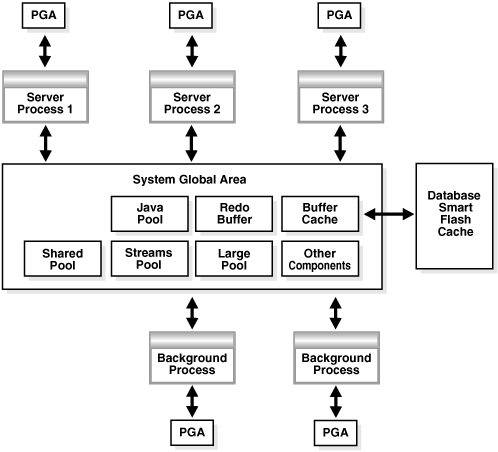

## 4 Managing Memory

Memory management involves maintaining optimal sizes for the Oracle Database instance memory structures as demands on the database change.

Note:

A multitenant container database is the only supported architecture in Oracle Database 21c. While the documentation is being revised, legacy terminology may persist. In most cases, "database" and "non-CDB" refer to a CDB or PDB, depending on context. In some contexts, such as upgrades, "non-CDB" refers to a non-CDB from a previous release.

**Parent topic:** [Basic Database Administration](basic-database-administration.md)

### 4.1 About Memory Management

The memory structures that must be managed are the system global area (SGA) and the instance program global area (instance PGA). Oracle Database supports various memory management methods, which are chosen by initialization parameter settings.

Automatic Memory Management

Oracle Database can manage the SGA memory and instance PGA memory completely automatically. You designate only the total memory size to be used by the instance, and Oracle Database dynamically exchanges memory between the SGA and the instance PGA as needed to meet processing demands. This capability is referred to as automatic memory management. With this memory management method, the database also dynamically tunes the sizes of the individual SGA components and the sizes of the individual PGAs. Oracle recommends automatic memory management for databases where the total size of the SGA and PGA memory is less than or equal to four gigabytes.

Manual Memory Management

If you prefer to exercise more direct control over the sizes of individual memory components, you can disable automatic memory management and configure the database for manual memory management. There are a few different methods available for manual memory management. Some of these methods retain some degree of automation. The methods therefore vary in the amount of effort and knowledge required by the DBA. These methods are:

- Automatic shared memory management - for the SGA
- Manual shared memory management - for the SGA
- Automatic PGA memory management - for the instance PGA
- Manual PGA memory management - for the instance PGA

These memory management methods are described later in this chapter.

If you create your database with Database Configuration Assistant (DBCA) and choose the basic installation option, automatic memory management is enabled when system memory is less than or equal to 4 gigabytes. When system memory is greater than 4 gigabytes, automatic memory management is disabled, and automatic shared memory management is enabled. If you choose advanced installation, then DBCA enables you to select automatic memory management or automatic shared memory management.

Oracle recommends automatic shared memory management when the total size of the SGA and PGA memory is four gigabytes or larger.

Note:

The easiest way to manage memory is to use the graphical user interface of Oracle Enterprise Manager Database Express (EM Express) or Oracle Enterprise Manager Cloud Control (Cloud Control).

For information about managing memory with Cloud Control, see the Cloud Control online help.

Note:

Oracle Enterprise Manager Database Express (EM Express) is deprecated, and will be removed in a future Oracle Database release.

See Also:

[Oracle Database Concepts](https://docs.oracle.com/pls/topic/lookup?ctx=en/database/oracle/oracle-database/21/admin&id=CNCPT1244) for an introduction to the various automatic and manual methods of managing memory.

**Parent topic:** Managing Memory

### 4.2 Memory Architecture Overview

Understand basic memory structures associated with Oracle Database.

The basic memory structures associated with Oracle Database include:

- System Global Area (SGA)
	The SGA is a group of shared memory structures, known as SGA components, that contain data and control information for one Oracle Database instance. The SGA is shared by all server and background processes. Examples of data stored in the SGA include cached data blocks and shared SQL areas.
- Program Global Area (PGA)
	A PGA is a memory region that contains data and control information for a server process. It is nonshared memory created by Oracle Database when a server process is started. Access to the PGA is exclusive to the server process. There is one PGA for each server process. Background processes also allocate their own PGAs. The total PGA memory allocated for all background and server processes attached to an Oracle Database instance is referred to as the total instance PGA memory, and the collection of all individual PGAs is referred to as the total instance PGA, or just instance PGA.

Figure 4-1 illustrates the relationships among these memory structures.

Figure 4-1 Oracle Database Memory Structures



> This image shows a large rectangle representing the SGA. Inside the SGA are two rows of boxes representing the SGA components. The three boxes in the top row, going from left to right, are labeled Java Pool, Redo Buffer, and Buffer Cache. The four boxes in the bottom row, going from left to right, are labeled Shared pool, Streams pool, Large pool, and Other Components. Outside the SGA is another memory component labeled Database Smart Flash Cache. It is connected by a double-arrow to the Buffer Cache box inside the SGA. Outside the SGA are three boxes labeled Server Process 1, Server Process 2, and Server Process 3, and two boxes labeled Background Process. Each of these five processes is connected to the large SGA box with a double-sided arrow, indicating that each process reads from and writes to the SGA. Each process is also connected with a double-sided arrow to a small box labeled PGA. Each process has its own connected PGA box.


If your database is running on Solaris or Oracle Linux, you can optionally add another memory component: Database Smart Flash Cache. Database Smart Flash Cache is an extension of the SGA-resident buffer cache, providing a level 2 cache for database blocks. It can improve response time and overall throughput for both read-intensive online transaction processing (OLTP) workloads and ad hoc queries and bulk data modifications in a data warehouse environment. Database Smart Flash Cache resides on one or more flash disk devices, which are solid state storage devices that use flash memory. Database Smart Flash Cache is typically more economical than additional main memory, and is an order of magnitude faster than disk drives.

Starting with Oracle Database 12c Release 1 (12.1.0.2), the big table cache enables serial queries and parallel queries to use the buffer cache. The big table cache facilitates efficient caching for large tables in data warehousing environments, even if these tables do not fully fit in the buffer cache. Table scans can use the big table cache in the following scenarios:

- Parallel queries
	In single-instance and Oracle Real Application Clusters (Oracle RAC) databases, parallel queries can use the big table cache when the `DB_BIG_TABLE_CACHE_PERCENT_TARGET` initialization parameter is set to a non-zero value, and `PARALLEL_DEGREE_POLICY` is set to `AUTO` or `ADAPTIVE`.
- Serial queries
	In a single-instance configuration only, serial queries can use the big table cache when the `DB_BIG_TABLE_CACHE_PERCENT_TARGET` initialization parameter is set to a non-zero value.

See Also:

- " Configuring Database Smart Flash Cache "
- [Oracle Database Concepts](https://docs.oracle.com/pls/topic/lookup?ctx=en/database/oracle/oracle-database/21/admin&id=CNCPT007) for more information on memory architecture in an Oracle Database instance
- [Oracle Database Reference](https://docs.oracle.com/pls/topic/lookup?ctx=en/database/oracle/oracle-database/21/admin&id=REFRN10340) for more information about the `DB_BIG_TABLE_CACHE_PERCENT_TARGET` initialization parameter
- [Oracle Database Reference](https://docs.oracle.com/pls/topic/lookup?ctx=en/database/oracle/oracle-database/21/admin&id=REFRN10310) for more information about the `PARALLEL_DEGREE_POLICY` initialization parameter
- [Oracle Database VLDB and Partitioning Guide](https://docs.oracle.com/pls/topic/lookup?ctx=en/database/oracle/oracle-database/21/admin&id=VLDBG14145) for more information about the big table cache

**Parent topic:** Managing Memory

### 4.3 Using Automatic Memory Management

You can allow the Oracle Database instance to automatically manage and tune memory for you.

- About Automatic Memory Management  
	The simplest way to manage instance memory is to allow the Oracle Database instance to automatically manage and tune it for you. To do so (on most platforms), you set only a target memory size initialization parameter (`MEMORY_TARGET`) and optionally a maximum memory size initialization parameter (`MEMORY_MAX_TARGET`).
- Enabling Automatic Memory Management  
	If you did not enable automatic memory management upon database creation (either by selecting the proper options in DBCA or by setting the appropriate initialization parameters for the `CREATE DATABASE` SQL statement), then you can enable it at a later time. Enabling automatic memory management involves a shutdown and restart of the database.
- Monitoring and Tuning Automatic Memory Management  
	The dynamic performance view `V$MEMORY_DYNAMIC_COMPONENTS` shows the current sizes of all dynamically tuned memory components, including the total sizes of the SGA and instance PGA.

**Parent topic:** Managing Memory

#### 4.3.1 About Automatic Memory Management

The simplest way to manage instance memory is to allow the Oracle Database instance to automatically manage and tune it for you. To do so (on most platforms), you set only a target memory size initialization parameter (`MEMORY_TARGET`) and optionally a maximum memory size initialization parameter (`MEMORY_MAX_TARGET`).

The total memory that the instance uses remains relatively constant, based on the value of `MEMORY_TARGET`, and the instance automatically distributes memory between the system global area (SGA) and the instance program global area (instance PGA). As memory requirements change, the instance dynamically redistributes memory between the SGA and instance PGA.

When automatic memory management is not enabled, you must size both the SGA and instance PGA manually.

Because the `MEMORY_TARGET` initialization parameter is dynamic, you can change `MEMORY_TARGET` at any time without restarting the database. `MEMORY_MAX_TARGET`, which is not dynamic, serves as an upper limit so that you cannot accidentally set `MEMORY_TARGET` too high, and so that enough memory is set aside for the database instance in case you do want to increase total instance memory in the future. Because certain SGA components either cannot easily shrink or must remain at a minimum size, the instance also prevents you from setting `MEMORY_TARGET` too low.

Note:

- If the total physical memory of a database instance is greater than 4 GB, then you cannot specify the Automatic Memory Management option during the database installation and creation. Oracle recommends that you use Automatic Shared Memory Management in such environments.
- You cannot enable automatic memory management if the `LOCK_SGA` initialization parameter is `TRUE`. See [Oracle Database Reference](https://docs.oracle.com/pls/topic/lookup?ctx=en/database/oracle/oracle-database/21/admin&id=REFRN10084) for information about this parameter.

See Also:

" Platforms That Support Automatic Memory Management "

**Parent topic:** Using Automatic Memory Management

#### 4.3.2 Enabling Automatic Memory Management

If you did not enable automatic memory management upon database creation (either by selecting the proper options in DBCA or by setting the appropriate initialization parameters for the `CREATE DATABASE` SQL statement), then you can enable it at a later time. Enabling automatic memory management involves a shutdown and restart of the database.

To enable automatic memory management:

1. Start SQL\*Plus and connect to the Oracle Database instance with the `SYSDBA` administrative privilege.
	See " [Connecting to the Database with SQL\*Plus](getting-started-with-database-administration.md) " and " [Database Administrator Authentication](getting-started-with-database-administration.md) " for instructions.
2. Calculate the minimum value for `MEMORY_TARGET` as follows:
	1. Determine the current sizes of `SGA_TARGET` and `PGA_AGGREGATE_TARGET` in megabytes by entering the following SQL\*Plus commands:
		```
		SHOW PARAMETER SGA_TARGET
		NAME                                 TYPE        VALUE
		------------------------------------ ----------- --------------------------
		sga_target                           big integer 272M
		SHOW PARAMETER PGA_AGGREGATE_TARGET
		NAME                                 TYPE        VALUE
		------------------------------------ ----------- --------------------------
		pga_aggregate_target                 big integer 90M
		```
		See " Enabling Automatic Shared Memory Management " for information about setting the `SGA_TARGET` parameter if it is not set.
		2. Run the following query to determine the maximum instance PGA allocated in megabytes since the database was started:
		```
		SELECT VALUE/1048576 FROM V$PGASTAT WHERE NAME='maximum PGA allocated';
		```
		3. Compute the maximum value between the query result from step 2b and `PGA_AGGREGATE_TARGET`. Add `SGA_TARGET` to this value.
		```
		MEMORY_TARGET = SGA_TARGET + MAX(PGA_AGGREGATE_TARGET, MAXIMUM PGA ALLOCATED)
		```
	For example, if `SGA_TARGET` is 272M and `PGA_AGGREGATE_TARGET` is 90M as shown above, and if the maximum PGA allocated is determined to be 120M, then `MEMORY_TARGET` should be at least 392M (272M + 120M).
3. Choose the value for `MEMORY_TARGET` that you want to use.
	This can be the minimum value that you computed in step 2, or you can choose to use a larger value if you have enough physical memory available.
4. For the `MEMORY_MAX_TARGET` initialization parameter, decide on a maximum amount of memory that you would want to allocate to the database for the foreseeable future. That is, determine the maximum value for the sum of the SGA and instance PGA sizes. This number can be larger than or the same as the `MEMORY_TARGET` value that you chose in the previous step.
5. Do one of the following:
	- If you started your Oracle Database instance with a server parameter file, which is the default if you created the database with the Database Configuration Assistant (DBCA), enter the following command:
		```
		ALTER SYSTEM SET MEMORY_MAX_TARGET = nM SCOPE = SPFILE;
		```
		where n is the value that you computed in step 4.
		The `SCOPE` `=` `SPFILE` clause sets the value only in the server parameter file, and not for the running instance. You must include this `SCOPE` clause because `MEMORY_MAX_TARGET` is not a dynamic initialization parameter.
		- If you started your instance with a text initialization parameter file, manually edit the file so that it contains the following statements:
		```
		memory_max_target = nM
		memory_target = mM
		```
		where n is the value that you determined in step 4, and m is the value that you determined in step 3.
	Note:
	In a text initialization parameter file, if you omit the line for `MEMORY_MAX_TARGET` and include a value for `MEMORY_TARGET`, then the database automatically sets `MEMORY_MAX_TARGET` to the value of `MEMORY_TARGET`. If you omit the line for `MEMORY_TARGET` and include a value for `MEMORY_MAX_TARGET`, then the `MEMORY_TARGET` parameter defaults to zero. After startup, you can then dynamically change `MEMORY_TARGET` to a nonzero value, provided that it does not exceed the value of `MEMORY_MAX_TARGET`.
6. Shut down and restart the database.
	See [Oracle Database SQL Language Reference](https://docs.oracle.com/pls/topic/lookup?ctx=en/database/oracle/oracle-database/21/admin&id=MULTI-GUID-045DE684-6680-4099-A49E-2F5B5FA59670) for instructions.
7. If you started your Oracle Database instance with a server parameter file, enter the following commands:
	```
	ALTER SYSTEM SET MEMORY_TARGET = nM;
	ALTER SYSTEM SET SGA_TARGET = 0;
	ALTER SYSTEM SET PGA_AGGREGATE_TARGET = 0;
	```
	where n is the value that you determined in step 3.

Note:

With `MEMORY_TARGET` set, the `SGA_TARGET` setting becomes the minimum size of the SGA and the `PGA_AGGREGATE_TARGET` setting becomes the minimum size of the instance PGA. By setting both of these to zero as shown, there are no minimums, and the SGA and instance PGA can grow as needed as long as their sum is less than or equal to the `MEMORY_TARGET` setting. The sizing of SQL work areas remains automatic.

You can omit the statements that set the `SGA_TARGET` and `PGA_AGGREGATE_TARGET` parameter values to zero and leave either or both of the values as positive numbers. In this case, the values act as minimum values for the sizes of the SGA or instance PGA.

In addition, you can use the `PGA_AGGREGATE_LIMIT` initialization parameter to set an instance-wide hard limit for PGA memory. You can set `PGA_AGGREGATE_LIMIT` whether or not you use automatic memory management. See " Using Automatic PGA Memory Management ".

#### 4.3.3 Monitoring and Tuning Automatic Memory Management

The dynamic performance view `V$MEMORY_DYNAMIC_COMPONENTS` shows the current sizes of all dynamically tuned memory components, including the total sizes of the SGA and instance PGA.

- Query the `V$MEMORY_TARGET_ADVICE` view for tuning advice for the `MEMORY_TARGET` initialization parameter.

For example, run the following query:

```
SQL>  select * from v$memory_target_advice order by memory_size;
 
MEMORY_SIZE MEMORY_SIZE_FACTOR ESTD_DB_TIME ESTD_DB_TIME_FACTOR    VERSION
----------- ------------------ ------------ ------------------- ----------
        180                 .5          458               1.344          0
        270                .75          367              1.0761          0
        360                  1          341                   1          0
        450               1.25          335               .9817          0
        540                1.5          335               .9817          0
        630               1.75          335               .9817          0
        720                  2          335               .9817          0
```

The row with the `MEMORY_SIZE_FACTOR` of 1 shows the current size of memory, as set by the `MEMORY_TARGET` initialization parameter, and the amount of DB time required to complete the current workload. In previous and subsequent rows, the results show several alternative `MEMORY_TARGET` sizes. For each alternative size, the database shows the size factor (the multiple of the current size), and the estimated DB time to complete the current workload if the `MEMORY_TARGET` parameter were changed to the alternative size. Notice that for a total memory size smaller than the current `MEMORY_TARGET` size, estimated DB time increases. Notice also that in this example, there is nothing to be gained by increasing total memory size beyond 450MB. However, this situation might change if a complete workload has not yet been run.

EM Express provides an easy-to-use graphical memory advisor to help you select an optimal size for `MEMORY_TARGET`.

Note:

Oracle Enterprise Manager Database Express (EM Express) is deprecated, and will be removed in a future Oracle Database release.

See Also:

- [Oracle Database Reference](https://docs.oracle.com/pls/topic/lookup?ctx=en/database/oracle/oracle-database/21/admin&id=REFRN30463) for more information about the `V$MEMORY_DYNAMIC_COMPONENTS` dynamic performance view
- [Oracle Database Reference](https://docs.oracle.com/pls/topic/lookup?ctx=en/database/oracle/oracle-database/21/admin&id=REFRN30465) for more information about the `V$MEMORY_TARGET_ADVICE` dynamic performance view
- [Oracle Database Performance Tuning Guide](https://docs.oracle.com/pls/topic/lookup?ctx=en/database/oracle/oracle-database/21/admin&id=TGDBA147) for a definition of DB time.

**Parent topic:** Using Automatic Memory Management

### 4.4 Configuring Memory Manually

If you prefer to exercise more direct control over the sizes of individual memory components, you can disable automatic memory management and configure the database for manual memory management.

- About Manual Memory Management  
	There are two different manual memory management methods for the SGA, and two for the instance PGA.
- Using Automatic Shared Memory Management  
	Automatic Shared Memory Management simplifies SGA memory management.
- Using Manual Shared Memory Management  
	To manage shared memory manually, you first ensure that both automatic memory management and automatic shared memory management are disabled. You then manually configure, monitor, and tune memory components..
- Using Automatic PGA Memory Management  
	By default, Oracle Database automatically and globally manages the total amount of memory dedicated to the instance PGA. You can control this amount by setting the initialization parameter `PGA_AGGREGATE_TARGET`.
- Using Manual PGA Memory Management  
	Oracle Database supports manual PGA memory management, in which you manually tune SQL work areas.

**Parent topic:** Managing Memory

#### 4.4.1 About Manual Memory Management

There are two different manual memory management methods for the SGA, and two for the instance PGA.

The two manual memory management methods for the SGA vary in the amount of effort and knowledge required by the DBA. With automatic shared memory management, you set target and maximum sizes for the SGA. The database then sets the total size of the SGA to your designated target, and dynamically tunes the sizes of many SGA components. With manual shared memory management, you set the sizes of several individual SGA components, thereby determining the overall SGA size. You then manually tune these individual SGA components on an ongoing basis.

For the instance PGA, there is automatic PGA memory management, in which you set a target size for the instance PGA. The database then sets the size of the instance PGA to your target, and dynamically tunes the sizes of individual PGAs. There is also manual PGA memory management, in which you set maximum work area size for each type of SQL operator (such as sort or hash-join). This memory management method, although supported, is not recommended.

See Also:

[Oracle Database Concepts](https://docs.oracle.com/pls/topic/lookup?ctx=en/database/oracle/oracle-database/21/admin&id=CNCPT1244) for an overview of Oracle Database memory management methods.

**Parent topic:** Configuring Memory Manually

#### 4.4.2 Using Automatic Shared Memory Management

Automatic Shared Memory Management simplifies SGA memory management.

- About Automatic Shared Memory Management  
	With automatic shared memory management, you specify the total amount of SGA memory available to an instance using the `SGA_TARGET` initialization parameter and Oracle Database automatically distributes this memory among the various SGA components to ensure the most effective memory utilization.
- Components and Granules in the SGA  
	The SGA comprises several memory components, which are pools of memory used to satisfy a particular class of memory allocation requests.
- Setting Maximum SGA Size  
	The `SGA_MAX_SIZE` initialization parameter specifies the maximum size of the System Global Area for the lifetime of the instance.
- Setting SGA Target Size  
	You enable the automatic shared memory management feature by setting the `SGA_TARGET` initialization parameter to a nonzero value. This parameter sets the total size of the SGA. It replaces the parameters that control the memory allocated for a specific set of individual components, which are now automatically and dynamically resized (tuned) as needed.
- Enabling Automatic Shared Memory Management  
	The procedure for enabling automatic shared memory management (ASMM) differs depending on whether you are changing to ASMM from manual shared memory management or from automatic memory management.
- Setting Minimums for Automatically Sized SGA Components  
	You can exercise some control over the size of the automatically sized SGA components by specifying minimum values for the parameters corresponding to these components. Doing so can be useful if you know that an application cannot function properly without a minimum amount of memory in specific components.
- Dynamic Modification of SGA\_TARGET  
	The `SGA_TARGET` parameter can be dynamically increased up to the value specified for the `SGA_MAX_SIZE` parameter, and it can also be reduced.
- Modifying Parameters for Automatically Sized Components  
	When automatic shared memory management is enabled, the manually specified sizes of automatically sized components serve as a lower bound for the size of the components. You can modify this limit dynamically by changing the values of the corresponding parameters.
- Modifying Parameters for Manually Sized Components  
	Parameters for manually sized components can be dynamically altered as well. However, rather than setting a minimum size, the value of the parameter specifies the precise size of the corresponding component.

See Also:

- [Oracle Database Performance Tuning Guide](https://docs.oracle.com/pls/topic/lookup?ctx=en/database/oracle/oracle-database/21/admin&id=TGDBA291) for information about tuning the components of the SGA

**Parent topic:** Configuring Memory Manually

##### 4.4.2.1 About Automatic Shared Memory Management

With automatic shared memory management, you specify the total amount of SGA memory available to an instance using the `SGA_TARGET` initialization parameter and Oracle Database automatically distributes this memory among the various SGA components to ensure the most effective memory utilization.

When automatic shared memory management is enabled, the sizes of the different SGA components are flexible and can adapt to the needs of a workload without requiring any additional configuration. The database automatically distributes the available memory among the various components as required, allowing the system to maximize the use of all available SGA memory.

If you are using a server parameter file (`SPFILE`), the database remembers the sizes of the automatically tuned SGA components across instance shutdowns. As a result, the database instance does not need to learn the characteristics of the workload again each time the instance is started. The instance can begin with information from the previous instance and continue evaluating workload where it left off at the last shutdown.

**Parent topic:** Using Automatic Shared Memory Management

##### 4.4.2.2 Components and Granules in the SGA

The SGA comprises several memory components, which are pools of memory used to satisfy a particular class of memory allocation requests.

Examples of memory components include the shared pool (used to allocate memory for SQL and PL/SQL execution), the java pool (used for java objects and other java execution memory), and the buffer cache (used for caching disk blocks). All SGA components allocate and deallocate space in units of granules. Oracle Database tracks SGA memory use in internal numbers of granules for each SGA component.

The memory for dynamic components in the SGA is allocated in the unit of granules. The granule size is determined by the amount of SGA memory requested when the instance starts. Specifically, the granule size is based on the value of the `SGA_MAX_SIZE` initialization parameter. Table 4-1 shows the granule size for different amounts of SGA memory.

Table 4-1 Granule Size

| SGA Memory Amount | Granule Size |
| --- | --- |
| Less than or equal to 1 GB | 4 MB |
| Greater than 1 GB and less than or equal to 8 GB | 16 MB |
| Greater than 8 GB and less than or equal to 16 GB | 32 MB |
| Greater than 16 GB and less than or equal to 32 GB | 64 MB |
| Greater than 32 GB and less than or equal to 64 GB | 128 MB |
| Greater than 64 GB and less than or equal to 128 GB | 256 MB |
| Greater than 128 GB | 512 MB |

Some platform dependencies may arise. Consult your operating system specific documentation for more details.

You can query the `V$SGAINFO` view to see the granule size that is being used by an instance. The same granule size is used for all components in the SGA.

If you specify a size for a component that is not a multiple of granule size, Oracle Database rounds the specified size up to the nearest multiple. For example, if the granule size is 4 MB and you specify `DB_CACHE_SIZE` as 10 MB, the database actually allocates 12 MB.

**Parent topic:** Using Automatic Shared Memory Management

##### 4.4.2.3 Setting Maximum SGA Size

The `SGA_MAX_SIZE` initialization parameter specifies the maximum size of the System Global Area for the lifetime of the instance.

To set the maximum size of the System Global Area:

- Set the `SGA_MAX_SIZE` initialization parameter.

You can dynamically alter the initialization parameters affecting the size of the buffer caches, shared pool, large pool, Java pool, and streams pool but only to the extent that the sum of these sizes and the sizes of the other components of the SGA (fixed SGA, variable SGA, and redo log buffers) does not exceed the value specified by `SGA_MAX_SIZE`.

If you do not specify `SGA_MAX_SIZE`, then Oracle Database selects a default value that is the sum of all components specified or defaulted at initialization time. If you do specify `SGA_MAX_SIZE`, and at the time the database is initialized the value is less than the sum of the memory allocated for all components, either explicitly in the parameter file or by default, then the database ignores the setting for `SGA_MAX_SIZE` and chooses a correct value for this parameter.

**Parent topic:** Using Automatic Shared Memory Management

##### 4.4.2.4 Setting SGA Target Size

You enable the automatic shared memory management feature by setting the `SGA_TARGET` initialization parameter to a nonzero value. This parameter sets the total size of the SGA. It replaces the parameters that control the memory allocated for a specific set of individual components, which are now automatically and dynamically resized (tuned) as needed.

To enable the automatic shared memory management feature:

- Set the `SGA_TARGET` initialization parameter to a nonzero value.

Note:

- The `STATISTICS_LEVEL` initialization parameter must be set to `TYPICAL` (the default) or `ALL` for automatic shared memory management to function.
- An easier way to enable automatic shared memory management is to use EM Express. When you enable automatic shared memory management and set the Total SGA Size, EM Express automatically generates the `ALTER                                 SYSTEM` statements to set `SGA_TARGET` to the specified size and to set all automatically sized SGA components to zero.

If you use SQL\*Plus to set `SGA_TARGET`, then you must then set the automatically sized SGA components to zero or to a minimum value.

Note:

Oracle Enterprise Manager Database Express (EM Express) is deprecated, and will be removed in a future Oracle Database release.

- The SGA Target and Automatically Sized SGA Components  
	Some SGA components are automatically sized when `SGA_TARGET` is set.
- SGA and Virtual Memory  
	For optimal performance in most systems, the entire SGA should fit in real memory. If it does not, and if virtual memory is used to store parts of it, then overall database system performance can decrease dramatically. The reason for this is that portions of the SGA are paged (written to and read from disk) by the operating system.
- Monitoring and Tuning SGA Target Size  
	The `V$SGAINFO` view provides information on the current tuned sizes of various SGA components. The `V$SGA_TARGET_ADVICE` view provides information that helps you decide on a value for `SGA_TARGET`.

**Parent topic:** Using Automatic Shared Memory Management

###### 4.4.2.4.1 The SGA Target and Automatically Sized SGA Components

Some SGA components are automatically sized when `SGA_TARGET` is set.

The following table lists the SGA components that are automatically sized when `SGA_TARGET` is set. For each SGA component, its corresponding initialization parameter is listed.

Table 4-2 Automatically Sized SGA Components and Corresponding Parameters

| SGA Component | Initialization Parameter |
| --- | --- |
| Fixed SGA and other internal allocations needed by the Oracle Database instance | N/A |
| The shared pool | `SHARED_POOL_SIZE` |
| The large pool | `LARGE_POOL_SIZE` |
| The Java pool | `JAVA_POOL_SIZE` |
| The buffer cache | `DB_CACHE_SIZE` |
| The Streams pool | `STREAMS_POOL_SIZE` |

The manually sized parameters listed in Table 4-3, if they are set, take their memory from `SGA_TARGET`, leaving what is available for the components listed in Table 4-2.

Table 4-3 Manually Sized SGA Components that Use SGA\_TARGET Space

| SGA Component | Initialization Parameter |
| --- | --- |
| The log buffer | `LOG_BUFFER` |
| The keep and recycle buffer caches | `DB_KEEP_CACHE_SIZE`  `DB_RECYCLE_CACHE_SIZE` |
| Nonstandard block size buffer caches | `DB_` `n` `K_CACHE_SIZE` |

In addition to setting `SGA_TARGET` to a nonzero value, you must set to zero all initialization parameters listed in Table 4-2 to enable full automatic tuning of the automatically sized SGA components.

Alternatively, you can set one or more of the automatically sized SGA components to a nonzero value, which is then used as the minimum setting for that component during SGA tuning. This is discussed in detail later in this section.

**Parent topic:** Setting SGA Target Size

###### 4.4.2.4.2 SGA and Virtual Memory

For optimal performance in most systems, the entire SGA should fit in real memory. If it does not, and if virtual memory is used to store parts of it, then overall database system performance can decrease dramatically. The reason for this is that portions of the SGA are paged (written to and read from disk) by the operating system.

See your operating system documentation for instructions for monitoring paging activity. You can also view paging activity using Cloud Control. See [Oracle Database 2 Day + Performance Tuning Guide](https://docs.oracle.com/pls/topic/lookup?ctx=en/database/oracle/oracle-database/21/admin&id=TDPPT043) for more information.

**Parent topic:** Setting SGA Target Size

###### 4.4.2.4.3 Monitoring and Tuning SGA Target Size

The `V$SGAINFO` view provides information on the current tuned sizes of various SGA components. The `V$SGA_TARGET_ADVICE` view provides information that helps you decide on a value for `SGA_TARGET`.

To monitor and tune the SGA target size:

- Query the `V$SGAINFO` and `V$SGA_TARGET_ADVICE` views.

For example, run the following query:

```
SQL> select * from v$sga_target_advice order by sga_size;
 
  SGA_SIZE SGA_SIZE_FACTOR ESTD_DB_TIME ESTD_DB_TIME_FACTOR ESTD_PHYSICAL_READS
---------- --------------- ------------ ------------------- -------------------
       290              .5       448176              1.6578             1636103
       435             .75       339336              1.2552             1636103
       580               1       270344                   1             1201780
       725            1.25       239038               .8842              907584
       870             1.5       211517               .7824              513881
      1015            1.75       201866               .7467              513881
      1160               2       200703               .7424              513881
```

The information in this view is similar to that provided in the `V$MEMORY_TARGET_ADVICE` view for automatic memory management. See " Monitoring and Tuning Automatic Memory Management " for an explanation of that view.

EM Express provides an easy-to-use graphical memory advisor to help you select an optimal size for `SGA_TARGET`.

Note:

Oracle Enterprise Manager Database Express (EM Express) is deprecated, and will be removed in a future Oracle Database release.

See Also:

- [Oracle Database Reference](https://docs.oracle.com/pls/topic/lookup?ctx=en/database/oracle/oracle-database/21/admin&id=REFRN30314) for more information about the `V$SGAINFO` view
- [Oracle Database Reference](https://docs.oracle.com/pls/topic/lookup?ctx=en/database/oracle/oracle-database/21/admin&id=REFRN30393) for more information about the `V$SGA_TARGET_ADVICE` view

**Parent topic:** Setting SGA Target Size

##### 4.4.2.5 Enabling Automatic Shared Memory Management

The procedure for enabling automatic shared memory management (ASMM) differs depending on whether you are changing to ASMM from manual shared memory management or from automatic memory management.

To change to ASMM from manual shared memory management:

1. Run the following query to obtain a value for `SGA_TARGET`:
	```
	SELECT (
	   (SELECT SUM(value) FROM V$SGA) -
	   (SELECT CURRENT_SIZE FROM V$SGA_DYNAMIC_FREE_MEMORY)
	   ) "SGA_TARGET"
	FROM DUAL;
	```
2. Set the value of `SGA_TARGET`, either by editing the text initialization parameter file and restarting the database, or by issuing the following statement:
	```
	ALTER SYSTEM SET SGA_TARGET=value [SCOPE={SPFILE|MEMORY|BOTH}]
	```
	where value is the value computed in step 1 or is some value between the sum of all SGA component sizes and `SGA_MAX_SIZE`. For more information on the `ALTER` `SYSTEM` statement and its `SCOPE` clause, see [Oracle Database SQL Language Reference](https://docs.oracle.com/pls/topic/lookup?ctx=en/database/oracle/oracle-database/21/admin&id=SQLRF00902).
3. Do one of the following:
	- For more complete automatic tuning, set the values of the automatically sized SGA components listed in Table 4-2 to zero. Do this by editing the text initialization parameter file or by issuing `ALTER` `SYSTEM` statements.
		- To control the minimum size of one or more automatically sized SGA components, set those component sizes to the desired value. (See the next section for details.) Set the values of the other automatically sized SGA components to zero. Do this by editing the text initialization parameter file or by issuing `ALTER` `SYSTEM` statements.

To change to ASMM from automatic memory management:

1. Set the `MEMORY_TARGET` initialization parameter to 0.
	```
	ALTER SYSTEM SET MEMORY_TARGET = 0;
	```
	The database sets `SGA_TARGET` based on current SGA memory allocation.
2. Do one of the following:
	- For more complete automatic tuning, set the sizes of the automatically sized SGA components listed in Table 4-2 to zero. Do this by editing the text initialization parameter file or by issuing `ALTER` `SYSTEM` statements.
	- To control the minimum size of one or more automatically sized SGA components, set those component sizes to the desired value. (See the next section for details.) Set the sizes of the other automatically sized SGA components to zero. Do this by editing the text initialization parameter file or by issuing `ALTER` `SYSTEM` statements.

Example 4-1 Using ASMM

For example, suppose you currently have the following configuration of parameters for an instance configured for manual shared memory management and with `SGA_MAX_SIZE` set to 1200M:

- `SHARED_POOL_SIZE` = 200M
- `DB_CACHE_SIZE` = 500M
- `LARGE_POOL_SIZE` =200M

Also assume the following query results:

| Query | Result |
| --- | --- |
| `SELECT SUM(value) FROM V$SGA` | 1200M |
| `SELECT CURRENT_SIZE FROM V$SGA_DYNAMIC_FREE_MEMORY` | 208M |

You can take advantage of automatic shared memory management by issuing the following statements:

```
ALTER SYSTEM SET SGA_TARGET = 992M;
ALTER SYSTEM SET SHARED_POOL_SIZE = 0;
ALTER SYSTEM SET LARGE_POOL_SIZE = 0;
ALTER SYSTEM SET JAVA_POOL_SIZE = 0;
ALTER SYSTEM SET DB_CACHE_SIZE = 0;
ALTER SYSTEM SET STREAMS_POOL_SIZE = 0;
```

where 992M = 1200M minus 208M.

**Parent topic:** Using Automatic Shared Memory Management

##### 4.4.2.6 Setting Minimums for Automatically Sized SGA Components

You can exercise some control over the size of the automatically sized SGA components by specifying minimum values for the parameters corresponding to these components. Doing so can be useful if you know that an application cannot function properly without a minimum amount of memory in specific components.

To specify the minimum amount of SGA space for a component:

- Set a value for its corresponding initialization parameter.

Manually limiting the minimum size of one or more automatically sized components reduces the total amount of memory available for dynamic adjustment. This reduction in turn limits the ability of the system to adapt to workload changes. Therefore, this practice is not recommended except in exceptional cases. The default automatic management behavior maximizes both system performance and the use of available resources.

##### 4.4.2.7 Dynamic Modification of SGA\_TARGET

The `SGA_TARGET` parameter can be dynamically increased up to the value specified for the `SGA_MAX_SIZE` parameter, and it can also be reduced.

If you reduce the value of `SGA_TARGET`, the system identifies one or more automatically tuned components for which to release memory. You can reduce `SGA_TARGET` until one or more automatically tuned components reach their minimum size. Oracle Database determines the minimum allowable value for `SGA_TARGET` taking into account several factors, including values set for the automatically sized components, manually sized components that use `SGA_TARGET` space, and number of CPUs.

The change in the amount of physical memory consumed when `SGA_TARGET` is modified depends on the operating system. On some UNIX platforms that do not support dynamic shared memory, the physical memory in use by the SGA is equal to the value of the `SGA_MAX_SIZE` parameter. On such platforms, there is no real benefit in setting `SGA_TARGET` to a value smaller than `SGA_MAX_SIZE`. Therefore, setting `SGA_MAX_SIZE` on those platforms is not recommended.

On other platforms, such as Solaris and Windows, the physical memory consumed by the SGA is equal to the value of `SGA_TARGET`.

For example, suppose you have an environment with the following configuration:

- `SGA_MAX_SIZE` = 1024M
- `SGA_TARGET` = 512M
- `DB_8K_CACHE_SIZE` = 128M

In this example, the value of `SGA_TARGET` can be resized up to 1024M and can also be reduced until one or more of the automatically sized components reaches its minimum size. The exact value depends on environmental factors such as the number of CPUs on the system. However, the value of `DB_8K_CACHE_SIZE` remains fixed at all times at 128M

Note:

When enabling automatic shared memory management, it is best to set `SGA_TARGET` to the desired nonzero value before starting the database. Dynamically modifying `SGA_TARGET` from zero to a nonzero value may not achieve the desired results because the shared pool may not be able to shrink. After startup, you can dynamically tune `SGA_TARGET` up or down as required.

**Parent topic:** Using Automatic Shared Memory Management

##### 4.4.2.8 Modifying Parameters for Automatically Sized Components

When automatic shared memory management is enabled, the manually specified sizes of automatically sized components serve as a lower bound for the size of the components. You can modify this limit dynamically by changing the values of the corresponding parameters.

If the specified lower limit for the size of a given SGA component is less than its current size, then there is no immediate change in the size of that component. The new setting only limits the automatic tuning algorithm to that reduced minimum size in the future.

To set the lower bound for the size of a component:

- Set the initialization parameter for the component to the minimum.

For example, consider the following configuration:

- `SGA_TARGET` = 512M
- `LARGE_POOL_SIZE` = 256M
- Current actual large pool size = 284M

In this example, if you increase the value of `LARGE_POOL_SIZE` to a value greater than the actual current size of the component, the system expands the component to accommodate the increased minimum size. For example, if you increase the value of `LARGE_POOL_SIZE` to 300M, then the system increases the large pool incrementally until it reaches 300M. This resizing occurs at the expense of one or more automatically tuned components. If you decrease the value of `LARGE_POOL_SIZE` to 200, there is no immediate change in the size of that component. The new setting only limits the reduction of the large pool size to 200 M in the future.

Note:

When `SGA_TARGET` is not set, the automatic shared memory management feature is not enabled. Therefore, the rules governing the resizing of all component parameters are the same as in earlier releases.

**Parent topic:** Using Automatic Shared Memory Management

##### 4.4.2.9 Modifying Parameters for Manually Sized Components

Parameters for manually sized components can be dynamically altered as well. However, rather than setting a minimum size, the value of the parameter specifies the precise size of the corresponding component.

When you increase the size of a manually sized component, extra memory is taken away from one or more automatically sized components. When you decrease the size of a manually sized component, the memory that is released is given to the automatically sized components.

To modify the precise size of a component:

- Set the initialization parameter for the component.

For example, consider this configuration:

- `SGA_TARGET` = 512M
- `DB_8K_CACHE_SIZE` = 128M

In this example, increasing `DB_8K_CACHE_SIZE` by 16M to 144M means that the 16M is taken away from the automatically sized components. Likewise, reducing `DB_8K_CACHE_SIZE` by 16M to 112M means that the 16M is given to the automatically sized components.

**Parent topic:** Using Automatic Shared Memory Management

#### 4.4.3 Using Manual Shared Memory Management

To manage shared memory manually, you first ensure that both automatic memory management and automatic shared memory management are disabled. You then manually configure, monitor, and tune memory components..

- About Manual Shared Memory Management  
	If you decide not to use automatic memory management or automatic shared memory management, you must manually configure several SGA component sizes, and then monitor and tune these sizes on an ongoing basis as the database workload changes. You can follow guidelines on setting the parameters that control the sizes of these SGA components.
- Enabling Manual Shared Memory Management  
	There is no initialization parameter that in itself enables manual shared memory management. You effectively enable manual shared memory management by disabling both automatic memory management and automatic shared memory management.
- Setting the Buffer Cache Initialization Parameters  
	The buffer cache initialization parameters determine the size of the buffer cache component of the SGA.
- Specifying the Shared Pool Size  
	The `SHARED_POOL_SIZE` initialization parameter is a dynamic parameter that lets you specify or adjust the size of the shared pool component of the SGA. Oracle Database selects an appropriate default value.
- Specifying the Large Pool Size  
	The `LARGE_POOL_SIZE` initialization parameter is a dynamic parameter that lets you specify or adjust the size of the large pool component of the SGA.
- Specifying the Java Pool Size  
	The `JAVA_POOL_SIZE` initialization parameter is a dynamic parameter that lets you specify or adjust the size of the Java pool component of the SGA.
- Specifying the Streams Pool Size  
	The `STREAMS_POOL_SIZE` initialization parameter is a dynamic parameter that lets you specify or adjust the size of the Streams Pool component of the SGA.
- Specifying Miscellaneous SGA Initialization Parameters  
	You can set a few additional initialization parameters to control how the SGA uses memory.

**Parent topic:** Configuring Memory Manually

##### 4.4.3.1 About Manual Shared Memory Management

If you decide not to use automatic memory management or automatic shared memory management, you must manually configure several SGA component sizes, and then monitor and tune these sizes on an ongoing basis as the database workload changes. You can follow guidelines on setting the parameters that control the sizes of these SGA components.

If you create your database with DBCA and choose manual shared memory management, DBCA provides fields where you must enter sizes for the buffer cache, shared pool, large pool, and Java pool. It then sets the corresponding initialization parameters in the server parameter file (`SPFILE`) that it creates. If you instead create the database with the `CREATE DATABASE` SQL statement and a text initialization parameter file, you can do one of the following:

- Provide values for the initialization parameters that set SGA component sizes.
- Omit SGA component size parameters from the text initialization file. Oracle Database chooses reasonable defaults for any component whose size you do not set.

**Parent topic:** Using Manual Shared Memory Management

##### 4.4.3.2 Enabling Manual Shared Memory Management

There is no initialization parameter that in itself enables manual shared memory management. You effectively enable manual shared memory management by disabling both automatic memory management and automatic shared memory management.

To enable manual shared memory management:

1. Set the `MEMORY_TARGET` initialization parameter to 0.
2. Set the `SGA_TARGET` initialization parameter to 0.

You must then set values for the various SGA components, as described in the following sections.

**Parent topic:** Using Manual Shared Memory Management

##### 4.4.3.3 Setting the Buffer Cache Initialization Parameters

The buffer cache initialization parameters determine the size of the buffer cache component of the SGA.

You use them to specify the sizes of caches for the various block sizes used by the database. These initialization parameters are all dynamic.

The size of a buffer cache affects performance. Larger cache sizes generally reduce the number of disk reads and writes. However, a large cache may take up too much memory and induce memory paging or swapping.

Oracle Database supports multiple block sizes in a database. If you create tablespaces with non-standard block sizes, you must configure non-standard block size buffers to accommodate these tablespaces. The standard block size is used for the `SYSTEM` tablespace. You specify the standard block size by setting the initialization parameter `DB_BLOCK_SIZE`. Legitimate values are from 2K to 32K.

If you intend to use multiple block sizes in your database, you must have the `DB_CACHE_SIZE` and at least one `DB_` `n` `K_CACHE_SIZE` parameter set. Oracle Database assigns an appropriate default value to the `DB_CACHE_SIZE` parameter, but the `DB_` `n` `K_CACHE_SIZE` parameters default to 0, and no additional block size caches are configured.

The sizes and numbers of non-standard block size buffers are specified by the following parameters:

```
DB_2K_CACHE_SIZE
DB_4K_CACHE_SIZE
DB_8K_CACHE_SIZE
DB_16K_CACHE_SIZE
DB_32K_CACHE_SIZE
```

Each parameter specifies the size of the cache for the corresponding block size.

Note:

- Platform-specific restrictions regarding the maximum block size apply, so some of these sizes might not be allowed on some platforms.
- A 32K block size is valid only on 64-bit platforms.

- Example of Setting Block and Cache Sizes  
	An example illustrates setting block and cache sizes.
- Multiple Buffer Pools  
	You can configure the database buffer cache with separate buffer pools that either keep data in the buffer cache or make the buffers available for new data immediately after using the data blocks.

See Also:

" [Specifying Nonstandard Block Sizes for Tablespaces](managing-tablespaces.md) "

**Parent topic:** Using Manual Shared Memory Management

###### 4.4.3.3.1 Example of Setting Block and Cache Sizes

An example illustrates setting block and cache sizes.

```
DB_BLOCK_SIZE=4096
DB_CACHE_SIZE=1024M
DB_2K_CACHE_SIZE=256M
DB_8K_CACHE_SIZE=512M
```

In the preceding example, the parameter `DB_BLOCK_SIZE` sets the standard block size of the database to 4K. The size of the cache of standard block size buffers is 1024MB. Additionally, 2K and 8K caches are also configured, with sizes of 256MB and 512MB, respectively.

Note:

The `DB_` `n` `K_CACHE_SIZE` parameters cannot be used to size the cache for the standard block size. If the value of `DB_BLOCK_SIZE` is nK, it is invalid to set `DB_` `n` `K_CACHE_SIZE`. The size of the cache for the standard block size is always determined from the value of `DB_CACHE_SIZE`.

The cache has a limited size, so not all the data on disk can fit in the cache. When the cache is full, subsequent cache misses cause Oracle Database to write dirty data already in the cache to disk to make room for the new data. (If a buffer is not dirty, it does not need to be written to disk before a new block can be read into the buffer.) Subsequent access to any data that was written to disk and then overwritten results in additional cache misses.

The size of the cache affects the likelihood that a request for data results in a cache hit. If the cache is large, it is more likely to contain the data that is requested. Increasing the size of a cache increases the percentage of data requests that result in cache hits.

You can change the size of the buffer cache while the instance is running, without having to shut down the database. Do this with the `ALTER` `SYSTEM` statement.

Use the fixed view `V$BUFFER_POOL` to track the sizes of the different cache components and any pending resize operations.

**Parent topic:** Setting the Buffer Cache Initialization Parameters

###### 4.4.3.3.2 Multiple Buffer Pools

You can configure the database buffer cache with separate buffer pools that either keep data in the buffer cache or make the buffers available for new data immediately after using the data blocks.

Particular schema objects (tables, clusters, indexes, and partitions) can then be assigned to the appropriate buffer pool to control the way their data blocks age out of the cache.

- The `KEEP` buffer pool retains the schema object's data blocks in memory.
- The `RECYCLE` buffer pool eliminates data blocks from memory as soon as they are no longer needed.
- The `DEFAULT` buffer pool contains data blocks from schema objects that are not assigned to any buffer pool, as well as schema objects that are explicitly assigned to the `DEFAULT` pool.

The initialization parameters that configure the `KEEP` and `RECYCLE` buffer pools are `DB_KEEP_CACHE_SIZE` and `DB_RECYCLE_CACHE_SIZE`.

Note:

Multiple buffer pools are only available for the standard block size. Non-standard block size caches have a single `DEFAULT` pool.

See Also:

[Oracle Database Performance Tuning Guide](https://docs.oracle.com/pls/topic/lookup?ctx=en/database/oracle/oracle-database/21/admin&id=TGDBA295) for information about tuning the buffer cache and for more information about multiple buffer pools

**Parent topic:** Setting the Buffer Cache Initialization Parameters

##### 4.4.3.4 Specifying the Shared Pool Size

The `SHARED_POOL_SIZE` initialization parameter is a dynamic parameter that lets you specify or adjust the size of the shared pool component of the SGA. Oracle Database selects an appropriate default value.

In releases before Oracle Database 10g, the amount of shared pool memory that was allocated was equal to the value of the `SHARED_POOL_SIZE` initialization parameter plus the amount of internal SGA overhead computed during instance startup. The internal SGA overhead refers to memory that is allocated by Oracle Database during startup, based on the values of several other initialization parameters. This memory is used to maintain state for different server components in the SGA. For example, if the `SHARED_POOL_SIZE` parameter is set to 64 MB and the internal SGA overhead is computed to be 12 MB, the real size of the shared pool is 64 + 12 = 76 MB, although the value of the `SHARED_POOL_SIZE` parameter is still displayed as 64 MB.

Starting with Oracle Database 10g, the size of the internal SGA overhead is included in the user-specified value of `SHARED_POOL_SIZE`. If you are not using automatic memory management or automatic shared memory management, the amount of shared pool memory that is allocated at startup is equal to the value of the `SHARED_POOL_SIZE` initialization parameter, rounded up to a multiple of the granule size. You must therefore set this parameter so that it includes the internal SGA overhead in addition to the desired value for shared pool size. In the previous example, if the `SHARED_POOL_SIZE` parameter is set to 64 MB at startup, then the available shared pool after startup is 64 - 12 = 52 MB, assuming the value of internal SGA overhead remains unchanged. In order to maintain an effective value of 64 MB for shared pool memory after startup, you must set the `SHARED_POOL_SIZE` parameter to 64 + 12 = 76 MB.

When migrating from a release earlier than Oracle Database 10g, the migration utilities recommend a new value for this parameter based on the value of internal SGA overhead in the pre-upgrade environment and based on the old value of this parameter. Beginning with Oracle Database 10g, the exact value of internal SGA overhead, also known as startup overhead in the shared pool, can be queried from the `V$SGAINFO` view. Also, in manual shared memory management mode, if the user-specified value of `SHARED_POOL_SIZE` is too small to accommodate even the requirements of internal SGA overhead, then Oracle Database generates an `ORA-00371` error during startup, with a suggested value to use for the `SHARED_POOL_SIZE` parameter. When you use automatic shared memory management, the shared pool is automatically tuned, and an `ORA-00371` error would not be generated.

- The Result Cache and Shared Pool Size

**Parent topic:** Using Manual Shared Memory Management

###### 4.4.3.4.1 The Result Cache and Shared Pool Size

The result cache takes its memory from the shared pool. Therefore, if you expect to increase the maximum size of the result cache, take this into consideration when sizing the shared pool.

See Also:

" Specifying the Result Cache Maximum Size "

**Parent topic:** Specifying the Shared Pool Size

##### 4.4.3.5 Specifying the Large Pool Size

The `LARGE_POOL_SIZE` initialization parameter is a dynamic parameter that lets you specify or adjust the size of the large pool component of the SGA.

The large pool is an optional component of the SGA. You must specifically set the `LARGE_POOL_SIZE` parameter to create a large pool. Configuring the large pool is discussed in [Oracle Database Performance Tuning Guide](https://docs.oracle.com/pls/topic/lookup?ctx=en/database/oracle/oracle-database/21/admin&id=TGDBA291).

**Parent topic:** Using Manual Shared Memory Management

##### 4.4.3.6 Specifying the Java Pool Size

The `JAVA_POOL_SIZE` initialization parameter is a dynamic parameter that lets you specify or adjust the size of the Java pool component of the SGA.

Oracle Database selects an appropriate default value. Configuration of the Java pool is discussed in [Oracle Database Java Developer's Guide](https://docs.oracle.com/pls/topic/lookup?ctx=en/database/oracle/oracle-database/21/admin&id=JJDEV09200).

**Parent topic:** Using Manual Shared Memory Management

##### 4.4.3.7 Specifying the Streams Pool Size

The `STREAMS_POOL_SIZE` initialization parameter is a dynamic parameter that lets you specify or adjust the size of the Streams Pool component of the SGA.

If `STREAMS_POOL_SIZE` is set to 0, then the Oracle Streams product transfers memory from the buffer cache to the Streams Pool when it is needed..

**Parent topic:** Using Manual Shared Memory Management

##### 4.4.3.8 Specifying Miscellaneous SGA Initialization Parameters

You can set a few additional initialization parameters to control how the SGA uses memory.

- Physical Memory  
	The `LOCK_SGA` parameter, when set to `TRUE`, locks the entire SGA into physical memory.
- SGA Starting Address  
	The `SHARED_MEMORY_ADDRESS` and `HI_SHARED_MEMORY_ADDRESS` parameters specify the SGA's starting address at run time.

**Parent topic:** Using Manual Shared Memory Management

###### 4.4.3.8.1 Physical Memory

The `LOCK_SGA` parameter, when set to `TRUE`, locks the entire SGA into physical memory.

This parameter cannot be used with automatic memory management.

###### 4.4.3.8.2 SGA Starting Address

The `SHARED_MEMORY_ADDRESS` and `HI_SHARED_MEMORY_ADDRESS` parameters specify the SGA's starting address at run time.

These parameters are rarely used. For 64-bit platforms, `HI_SHARED_MEMORY_ADDRESS` specifies the high order 32 bits of the 64-bit address.

See Also:

- [Oracle Database Reference](https://docs.oracle.com/pls/topic/lookup?ctx=en/database/oracle/oracle-database/21/admin&id=REFRN10200) for more information on the `SHARED_MEMORY_ADDRESS` initialization parameter
- [Oracle Database Reference](https://docs.oracle.com/pls/topic/lookup?ctx=en/database/oracle/oracle-database/21/admin&id=REFRN10068) for more information on the `HI_SHARED_MEMORY_ADDRESS` initialization parameter
- " Using Automatic Memory Management "
- " Using Automatic Shared Memory Management "

**Parent topic:** Specifying Miscellaneous SGA Initialization Parameters

#### 4.4.4 Using Automatic PGA Memory Management

By default, Oracle Database automatically and globally manages the total amount of memory dedicated to the instance PGA. You can control this amount by setting the initialization parameter `PGA_AGGREGATE_TARGET`.

Oracle Database then tries to ensure that the total amount of PGA memory allocated across all database server processes and background processes never exceeds this target.

If you create your database with DBCA, you can specify a value for the total instance PGA. DBCA then sets the `PGA_AGGREGATE_TARGET` initialization parameters in the server parameter file (`SPFILE`) that it creates. If you do not specify the total instance PGA, DBCA chooses a reasonable default.

If you create the database with the `CREATE DATABASE` SQL statement and a text initialization parameter file, you can provide a value for `PGA_AGGREGATE_TARGET`. If you omit this parameter, the database chooses a default value for it.

With automatic PGA memory management, sizing of SQL work areas is automatic and all `*_AREA_SIZE` initialization parameters are ignored. At any given time, the total amount of PGA memory available to active work areas on the instance is automatically derived from the parameter `PGA_AGGREGATE_TARGET`. This amount is set to the value of `PGA_AGGREGATE_TARGET` minus the PGA memory allocated for other purposes (for example, session memory). The resulting PGA memory is then allotted to individual active work areas based on their specific memory requirements.

There are dynamic performance views that provide PGA memory use statistics. Most of these statistics are enabled when `PGA_AGGREGATE_TARGET` is set.

- Statistics on allocation and use of work area memory can be viewed in the following dynamic performance views:
- `V$SYSSTAT `
- `V$SESSTAT `
- `V$PGASTAT`
- `V$SQL_WORKAREA `
- `V$SQL_WORKAREA_ACTIVE `
- The following three columns in the `V$PROCESS` view report the PGA memory allocated and used by an Oracle Database process:
- `PGA_USED_MEM `
- `PGA_ALLOC_MEM `
- `PGA_MAX_MEM `

The `PGA_AGGREGATE_TARGET` setting is a target. Therefore, Oracle Database tries to limit PGA memory usage to the target, but usage can exceed the setting at times. To specify a hard limit on PGA memory usage, use the `PGA_AGGREGATE_LIMIT` initialization parameter. Oracle Database ensures that the PGA size does not exceed this limit. If the database exceeds the limit, then the database terminates calls from sessions that have the highest untunable PGA memory allocations. You can set `PGA_AGGREGATE_LIMIT` whether or not you use automatic memory management. If `PGA_AGGREGATE_LIMIT` is not set, then Oracle Database determines an appropriate default limit. See [Oracle Database Reference](https://docs.oracle.com/pls/topic/lookup?ctx=en/database/oracle/oracle-database/21/admin&id=REFRN10328) for more information about this parameter.

Note:

The automatic PGA memory management method applies to work areas allocated by both dedicated and shared server process. See [Oracle Database Concepts](https://docs.oracle.com/pls/topic/lookup?ctx=en/database/oracle/oracle-database/21/admin&id=CNCPT1243) for information about PGA memory allocation in dedicated and shared server modes.

See Also:

- [Oracle Database Reference](https://docs.oracle.com/pls/topic/lookup?ctx=en/database/oracle/oracle-database/21/admin&id=REFRN) for information about the initialization parameters and views described in this section
- [Oracle Database Performance Tuning Guide](https://docs.oracle.com/pls/topic/lookup?ctx=en/database/oracle/oracle-database/21/admin&id=TGDBA470) for information about using the views described in this section

**Parent topic:** Configuring Memory Manually

#### 4.4.5 Using Manual PGA Memory Management

Oracle Database supports manual PGA memory management, in which you manually tune SQL work areas.

In releases earlier than Oracle Database 10g, the database administrator controlled the maximum size of SQL work areas by setting the following parameters: `SORT_AREA_SIZE`, `HASH_AREA_SIZE`, `BITMAP_MERGE_AREA_SIZE` and `CREATE_BITMAP_AREA_SIZE`. Setting these parameters is difficult, because the maximum work area size is ideally selected from the data input size and the total number of work areas active in the system. These two factors vary greatly from one work area to another and from one time to another. Thus, the various `*_AREA_SIZE` parameters are difficult to tune under the best of circumstances.

For this reason, Oracle strongly recommends that you leave automatic PGA memory management enabled.

If you decide to tune SQL work areas manually, you must set the `WORKAREA_SIZE_POLICY` initialization parameter to `MANUAL`.

Note:

The initialization parameter `WORKAREA_SIZE_POLICY` is a session- and system-level parameter that can take only two values: `MANUAL` or `AUTO`. The default is `AUTO`. You can set `PGA_AGGREGATE_TARGET`, and then switch back and forth from auto to manual memory management mode. When `WORKAREA_SIZE_POLICY` is set to `AUTO`, your settings for `*_AREA_SIZE` parameters are ignored.

**Parent topic:** Configuring Memory Manually

### 4.5 Using Force Full Database Caching Mode

An Oracle Database instance can cache the full database in the buffer cache.

Note:

This feature is available starting with Oracle Database 12c Release 1 (12.1.0.2).

- About Force Full Database Caching Mode  
	In default caching mode, Oracle Database does not always cache the underlying data when a user queries a large table because doing so might remove more useful data from the buffer cache. Starting with Oracle Database 12c Release 1 (12.1.0.2), if the Oracle Database instance determines that there is enough space to cache the full database in the buffer cache and that it would be beneficial to do so, then the instance automatically caches the full database in the buffer cache.
- Before Enabling Force Full Database Caching Mode  
	The database must be at 12.0.0 or higher compatibility level to enable force full database caching mode for the database instance. In addition, ensure that the buffer cache is large enough to cache the entire database.
- Enabling Force Full Database Caching Mode  
	You can enable force full database caching mode for a database.
- Disabling Force Full Database Caching Mode  
	You can disable force full database caching mode for a database.

**Parent topic:** Managing Memory

#### 4.5.1 About Force Full Database Caching Mode

In default caching mode, Oracle Database does not always cache the underlying data when a user queries a large table because doing so might remove more useful data from the buffer cache. Starting with Oracle Database 12c Release 1 (12.1.0.2), if the Oracle Database instance determines that there is enough space to cache the full database in the buffer cache and that it would be beneficial to do so, then the instance automatically caches the full database in the buffer cache.

Caching the full database in the buffer cache might result in performance improvements. You can force an instance to cache the database in the buffer cache using an `ALTER DATABASE FORCE FULL DATABASE CACHING` statement. This statement puts the instance in force full database caching mode. In this mode, Oracle Database assumes that the buffer cache is large enough to cache the full database and tries to cache all blocks that are accessed subsequently.

When an Oracle Database instance is in force full database caching mode, the following query returns `YES`:

```
SELECT FORCE_FULL_DB_CACHING FROM V$DATABASE;
```

When an instance is in default caching mode, `NOCACHE` LOBs are not cached in the buffer cache. However, when an instance is in force full database caching mode, `NOCACHE` LOBs can be cached in the buffer cache. Also, both LOBs that use SecureFiles LOB storage and LOBs that use BasicFiles LOB storage can be cached in the buffer cache in force full database caching mode only.

Note:

- When an instance is put in force full database caching mode, database objects are not loaded into the buffer cache immediately. Instead, they are cached in the buffer cache when they are accessed.
- In a multitenant environment, force full database caching mode applies to the entire multitenant container database (CDB), including all of its pluggable databases (PDBs).
- Information about force full database caching mode is stored in the control file. If the control file is replaced or recreated, then the information about the force full database caching mode is lost. A restored control file might or might not include this information, depending on when the control file was backed up.

See Also:

- [Oracle Multitenant Administrator's Guide](https://docs.oracle.com/pls/topic/lookup?ctx=en/database/oracle/oracle-database/21/admin&id=MULTI-GUID-93F1E584-D309-4301-82E0-AD0E60D4977C)
- " [Managing Control Files](managing-control-files.md) "
- [Oracle Database Performance Tuning Guide](https://docs.oracle.com/pls/topic/lookup?ctx=en/database/oracle/oracle-database/21/admin&id=TGDBA95388) for information about when to use force full database caching mode

**Parent topic:** Using Force Full Database Caching Mode

#### 4.5.2 Before Enabling Force Full Database Caching Mode

The database must be at 12.0.0 or higher compatibility level to enable force full database caching mode for the database instance. In addition, ensure that the buffer cache is large enough to cache the entire database.

When a database is configured to use the `SGA_TARGET` or `MEMORY_TARGET` initialization parameter for automatic memory management, the size of the buffer cache might change depending on the workload. Run the following query to estimate the buffer cache size when the instance is under normal workload:

```
SELECT NAME, BYTES FROM V$SGAINFO WHERE NAME='Buffer Cache Size';
```

This query returns the buffer cache size for all possible block sizes. If your database uses multiple block sizes, then it is best to ensure that the buffer cache size for each possible block size is bigger than the total database size for that block size.

You can determine the buffer cache size for non-default block sizes with the `DB_` `n` `K_CACHE_SIZE` initialization parameter. With `SGA_TARGET` or `MEMORY_TARGET`, the buffer cache size for the default block size in the default pool might change depending on the workload. The following query returns the current buffer cache size for the default block size in the default pool:

```
SELECT COMPONENT, CURRENT_SIZE FROM V$SGA_DYNAMIC_COMPONENTS 
   WHERE COMPONENT LIKE 'DEFAULT buffer cache';
```

If you are estimating memory requirements for running a database fully in the buffer cache, then you can estimate the size of the buffer cache as one of the following:

- If you plan to use `SGA_TARGET`, then you can estimate the buffer cache size as 60% of `SGA_TARGET`.
- If you plan to use `MEMORY_TARGET`, then you can estimate the SGA size as 60% of `MEMORY_TARGET`, and buffer cache size as 60% of SGA size. That is, you can estimate the buffer cache size as 36% of `MEMORY_TARGET`.

See Also:

" Using Automatic Memory Management "

**Parent topic:** Using Force Full Database Caching Mode

#### 4.5.3 Enabling Force Full Database Caching Mode

You can enable force full database caching mode for a database.

1. Connect to the instance as a user with `ALTER DATABASE` system privilege.
2. Ensure that the database is mounted but not open.
	See " [Oracle Database SQL Language Reference](https://docs.oracle.com/pls/topic/lookup?ctx=en/database/oracle/oracle-database/21/admin&id=MULTI-GUID-01B47551-8B2E-4A4C-9A8A-4999C09161FC) ".
3. ```
	ALTER DATABASE FORCE FULL DATABASE CACHING;
	```
4. ```
	ALTER DATABASE OPEN;
	```

**Parent topic:** Using Force Full Database Caching Mode

#### 4.5.4 Disabling Force Full Database Caching Mode

You can disable force full database caching mode for a database.

1. Connect to the instance as a user with `ALTER DATABASE` system privilege.
2. Ensure that the database is mounted but not open.
	See " [Oracle Database SQL Language Reference](https://docs.oracle.com/pls/topic/lookup?ctx=en/database/oracle/oracle-database/21/admin&id=MULTI-GUID-01B47551-8B2E-4A4C-9A8A-4999C09161FC) ".
3. ```
	ALTER DATABASE NO FORCE FULL DATABASE CACHING;
	```
4. ```
	ALTER DATABASE OPEN;
	```

**Parent topic:** Using Force Full Database Caching Mode

### 4.6 Configuring Database Smart Flash Cache

The Database Smart Flash Cache feature is a transparent extension of the database buffer cache using solid state device (SSD) technology. Database Smart Flash Cache can greatly improve the performance of Oracle databases by reducing the amount of disk I/O at a much lower cost than adding an equivalent amount of RAM.

- When to Configure Database Smart Flash Cache  
	You should consider configuring Database Smart Flash Cache when certain conditions are met.
- Sizing Database Smart Flash Cache  
	As a general rule, size Database Smart Flash Cache to be between 2 times and 10 times the size of the buffer cache.
- Tuning Memory for Database Smart Flash Cache  
	For each database block moved from the buffer cache to Database Smart Flash Cache, a small amount of metadata about the block is kept in the buffer cache.
- Database Smart Flash Cache Initialization Parameters  
	You can use a set of initialization parameters to configure Database Smart Flash Cache.
- Database Smart Flash Cache in an Oracle Real Applications Clusters Environment  
	Oracle recommends that you configure a Database Smart Flash Cache on either all or none of the instances in an Oracle Real Application Clusters environment. Also, the total flash cache size configured on each instance should be approximately the same.

See Also:

" Memory Architecture Overview " for a description of Database Smart Flash Cache

**Parent topic:** Managing Memory

#### 4.6.1 When to Configure Database Smart Flash Cache

You should consider configuring Database Smart Flash Cache when certain conditions are met.

Consider adding Database Smart Flash Cache when all of the following conditions are true:

- Your database is running on the Solaris or Oracle Linux operating systems. Database Smart Flash Cache is supported on these operating systems only.
- The Buffer Pool Advisory section of your Automatic Workload Repository (AWR) report or STATSPACK report indicates that doubling the size of the buffer cache would be beneficial.
- `db` `file` `sequential` `read` is a top wait event.
- You have spare CPU.

Note:

You cannot share one flash file among multiple instances. However, you can share a single flash device among multiple instances if you use a logical volume manager or similar tool to statically partition the flash device.

**Parent topic:** Configuring Database Smart Flash Cache

#### 4.6.2 Sizing Database Smart Flash Cache

As a general rule, size Database Smart Flash Cache to be between 2 times and 10 times the size of the buffer cache.

Any multiplier less than two would not provide any benefit. If you are using automatic shared memory management, make Database Smart Flash Cache between 2 times and 10 times the size of `SGA_TARGET`. Using 80% of the size of `SGA_TARGET` instead of the full size would also suffice for this calculation.

**Parent topic:** Configuring Database Smart Flash Cache

#### 4.6.3 Tuning Memory for Database Smart Flash Cache

For each database block moved from the buffer cache to Database Smart Flash Cache, a small amount of metadata about the block is kept in the buffer cache.

For a single instance database, the metadata consumes approximately 100 bytes. For an Oracle Real Application Clusters (Oracle RAC) database, it is closer to 200 bytes. You must therefore take this extra memory requirement into account when adding Database Smart Flash Cache.

To tune memory for the Database Smart Flash Cache, complete one of the following actions:

- If you are managing memory manually, then increase the size of the buffer cache by an amount approximately equal to the number of database blocks that fit into the Database Smart Flash Cache as configured, multiplied by 100 (or 200 for Oracle RAC).
- If you are using automatic memory management, then increase the size of the `MEMORY_TARGET` initialization parameter using the algorithm described above. You may first have to increase the size of the `MEMORY_MAX_TARGET` initialization parameter.
- If you are using automatic shared memory management, then increase the size of the `SGA_TARGET` initialization parameter.

Also, for an Oracle RAC database that uses the flash cache, additional memory must be allocated to the shared pool for Global Cache Service (GCS) resources. Each GCS resource requires approximately 208 bytes in the shared pool.

Note:

- You can choose to not increase the buffer cache size to account for Database Smart Flash Cache. In this case, the effective size of the buffer cache is reduced. In some cases, you can offset this loss by using a larger Database Smart Flash Cache.
- You can flush the Database Smart Flash Cache by issuing an `ALTER SYSTEM FLUSH FLASH_CACHE` statement. Flushing the Database Smart Flash Cache can be useful if you need to measure the performance of rewritten queries or a suite of queries from identical starting points, or if there might be corruption in the cache.

See Also:

" About Memory Management "

**Parent topic:** Configuring Database Smart Flash Cache

#### 4.6.4 Database Smart Flash Cache Initialization Parameters

You can use a set of initialization parameters to configure Database Smart Flash Cache.

Table 4-4 Database Smart Flash Cache Initialization Parameters

| Parameter | Description |
| --- | --- |
| `DB_FLASH_CACHE_FILE` | Specifies a list of paths and file names for the files to contain Database Smart Flash Cache, in either the operating system file system or an Oracle Automatic Storage Management disk group. If a specified file does not exist, then the database creates it during startup. Each file must reside on a flash device. If you configure Database Smart Flash Cache on a disk drive (spindle), then performance may suffer. A maximum of 16 files is supported. |
| `DB_FLASH_CACHE_SIZE` | Specifies the size of each file in your Database Smart Flash Cache. Each size corresponds with a file specified in `DB_FLASH_CACHE_FILE`. The files and sizes correspond in the order that they are specified. An error is raised if the number of specified sizes does not match the number of specified files.  Each size specification must be less than or equal to the physical memory size of its flash device. The size is expressed as nG, indicating the number of gigabytes (GB). For example, to specify a 16 GB Database Smart Flash Cache, set `DB_FLASH_CACHE_SIZE` value to `16G`. |

For example, assume that your Database Smart Flash Cache uses following flash devices:

| File | Size |
| --- | --- |
| /dev/sda | 32G |
| /dev/sdb | 32G |
| /dev/sdc | 64G |

You can set the initialization parameters to the following values:

```
DB_FLASH_CACHE_FILE = /dev/sda, /dev/sdb, /dev/sdc

DB_FLASH_CACHE_SIZE = 32G, 32G, 64G
```

You can query the `V$FLASHFILESTAT` view to determine the cumulative latency and read counts of each file and compute the average latency.

You can use `ALTER` `SYSTEM` to set `DB_FLASH_CACHE_SIZE` to zero for each flash device you wish to disable. You can also use `ALTER` `SYSTEM` to set the size for any disabled flash device back to its original size to reenable it. However, dynamically changing the size of Database Smart Flash Cache is not supported.

See Also:

[Oracle Database Reference](https://docs.oracle.com/pls/topic/lookup?ctx=en/database/oracle/oracle-database/21/admin&id=REFRN) for more information about the initialization parameters described in this section and for more information about the `V$FLASHFILESTAT` view

**Parent topic:** Configuring Database Smart Flash Cache

#### 4.6.5 Database Smart Flash Cache in an Oracle Real Applications Clusters Environment

Oracle recommends that you configure a Database Smart Flash Cache on either all or none of the instances in an Oracle Real Application Clusters environment. Also, the total flash cache size configured on each instance should be approximately the same.

**Parent topic:** Configuring Database Smart Flash Cache

### 4.7 Improving Query Response Time with the Server Result Cache

The server result cache improves the performance of repetitive queries.

- About the Server Result Cache  
	The server result cache is a subcomponent of the shared pool.
- Using the Server Result Cache  
	You control the use of server result cache by setting the `RESULT_CACHE_MODE` initialization parameter and using the `RESULT_CACHE` hint.
- Specifying the Result Cache Maximum Size  
	The `RESULT_CACHE_MAX_SIZE` initialization parameter is a dynamic parameter that enables you to specify the maximum size of the result cache component of the SGA.
- Specifying the Use of Temporary Segments for Query Results  
	You can specify a per-query limit on memory usage by setting the `RESULT_CACHE_MAX_SIZE` and `RESULT_CACHE_MAX_RESULT` initialization parameters. If a query exceeds the limit, the database server can store part of the results as a temporary segment in the `SYS` user's default temporary tablespace.

**Parent topic:** Managing Memory

#### 4.7.1 About the Server Result Cache

The server result cache is a subcomponent of the shared pool.

The server result cache is a memory pool within the shared pool that contains the SQL query result cache and PL/SQL function result cache. The SQL query result cache stores the results of queries and query fragments. Frequently executed queries will see performance improvements when using the SQL query result cache. The PL/SQL function result cache stores function result sets. Frequently invoked functions that depend on relatively static data are good candidates for result caching.

**Parent topic:** Improving Query Response Time with the Server Result Cache

#### 4.7.2 Using the Server Result Cache

You control the use of server result cache by setting the `RESULT_CACHE_MODE` initialization parameter and using the `RESULT_CACHE` hint.

The `RESULT_CACHE_MODE` initialization parameter determines whether the SQL query result cache is used for all queries (when possible) or only for annotated queries. Users can annotate a query or query fragment with a `RESULT_CACHE` hint to indicate that results should be stored in the SQL query result cache.

See Also:

- [Oracle Database Reference](https://docs.oracle.com/pls/topic/lookup?ctx=en/database/oracle/oracle-database/21/admin&id=REFRN10270) to learn more about the `RESULT_CACHE_MODE` initialization parameter
- [Oracle Database SQL Language Reference](https://docs.oracle.com/pls/topic/lookup?ctx=en/database/oracle/oracle-database/21/admin&id=SQLRF20004) to learn about the `RESULT_CACHE` hint

**Parent topic:** Improving Query Response Time with the Server Result Cache

#### 4.7.3 Specifying the Result Cache Maximum Size

The `RESULT_CACHE_MAX_SIZE` initialization parameter is a dynamic parameter that enables you to specify the maximum size of the result cache component of the SGA.

Typically, there is no need to specify this parameter, because the default maximum size is chosen by the database based on total memory available to the SGA and on the memory management method currently in use. You can view the current default maximum size by displaying the value of the `RESULT_CACHE_MAX_SIZE` parameter. To change this maximum size, you can set `RESULT_CACHE_MAX_SIZE` with an `ALTER` `SYSTEM` statement, or you can specify this parameter in the text initialization parameter file. The value may be rounded up due to internal memory granularity.

If `RESULT_CACHE_MAX_SIZE` is 0 upon instance startup, the result cache is disabled. To reenable it you must set `RESULT_CACHE_MAX_SIZE` to a nonzero value (or remove this parameter from the text initialization parameter file to get the default maximum size) and then restart the database.

Note that after starting the database with the result cache disabled, if you use an `ALTER` `SYSTEM` statement to set `RESULT_CACHE_MAX_SIZE` to a nonzero value but do not restart the database, querying the value of the `RESULT_CACHE_MAX_SIZE` parameter returns a nonzero value even though the result cache is still disabled. The value of `RESULT_CACHE_MAX_SIZE` is therefore not the most reliable way to determine if the result cache is enabled. You can use the following query instead:

```
SELECT dbms_result_cache.status() FROM dual;

DBMS_RESULT_CACHE.STATUS()
---------------------------------------------
ENABLED
```

The result cache takes its memory from the shared pool, so if you increase the maximum result cache size, consider also increasing the shared pool size.

The view `V$RESULT_CACHE_STATISTICS` and the PL/SQL package procedure `DBMS_RESULT_CACHE.MEMORY_REPORT` display information to help you determine the amount of memory currently allocated to the result cache.

The PL/SQL package function `DBMS_RESULT_CACHE.FLUSH` clears the result cache and releases all the memory back to the shared pool.

See Also:

- [Oracle Database Performance Tuning Guide](https://docs.oracle.com/pls/topic/lookup?ctx=en/database/oracle/oracle-database/21/admin&id=TGDBA631) for more information about the result cache
- [Oracle Database PL/SQL Packages and Types Reference](https://docs.oracle.com/pls/topic/lookup?ctx=en/database/oracle/oracle-database/21/admin&id=ARPLS202) for more information about the `DBMS_RESULT_CACHE` package procedures and functions
- [Oracle Database Reference](https://docs.oracle.com/pls/topic/lookup?ctx=en/database/oracle/oracle-database/21/admin&id=REFRN30439) for more information about the `V$RESULT_CACHE_STATISTICS` view
- [Oracle Real Application Clusters Administration and Deployment Guide](https://docs.oracle.com/pls/topic/lookup?ctx=en/database/oracle/oracle-database/21/admin&id=RACAD017) for information on setting `RESULT_CACHE_MAX_SIZE` for a cluster database

**Parent topic:** Improving Query Response Time with the Server Result Cache

#### 4.7.4 Specifying the Use of Temporary Segments for Query Results

You can specify a per-query limit on memory usage by setting the `RESULT_CACHE_MAX_SIZE` and `RESULT_CACHE_MAX_RESULT` initialization parameters. If a query exceeds the limit, the database server can store part of the results as a temporary segment in the `SYS` user's default temporary tablespace.

You can query `V$RESULT_CACHE_OBJECTS` to determine whether temporary segments have been used. A value of `Temp` in the `TYPE` column indicates the use of temporary segments.

You can use the following initialization parameters, alterable at the PDB level, to control the use of space by temporary segments:
- `RESULT_CACHE_MODE`: Set to `MANUAL_TEMP` or `FORCE_TEMP`. In either mode, all query results will be allowed to spill to temporary segments unless prohibited by a hint. The default is `MANUAL`, which means that query results will only be cached when queries explicitly use a result cache hint.
- `RESULT_CACHE_MAX_TEMP_SIZE`: Set to a value to limit the amount of space in that the result cache will consume in a database's temporary tablespace. The parameter value defaults to 10 times the default or initialized value of `RESULT_CACHE_MAX_SIZE`. This parameter can only be modified at the system level, not the session. In addition, any value below 5% of the System Global Area (SGA) size will be sanitized to that 5%. A value of 0, however, will disable the feature. It also cannot exceed 10% of the currently estimated total free temporary tablespace in the `SYS` schema, sanitizing the value to that max.
- `RESULT_CACHE_MAX_TEMP_RESULT`: Set to a value to limit the maximum amount of space in the temporary tablespace that one cached query can consume. The value defaults to 5% of the value of `RESULT_CACHE_MAX_TEMP_SIZE`. This parameter can only be modified at the system level, not the session.

See Also:

[Oracle Database Performance Tuning Guide](https://docs.oracle.com/pls/topic/lookup?ctx=en/database/oracle/oracle-database/21/admin&id=TGDBA631) for more information about the result cache

**Parent topic:** Improving Query Response Time with the Server Result Cache

### 4.8 Improving Query Performance with Oracle Database In-Memory

Oracle Database In-Memory (Database In-Memory) is a suite of features, first introduced in Oracle Database 12c Release 1 (12.1.0.2), that greatly improves performance for real-time analytics and mixed workloads.

The Database In-Memory features can drastically improve the performance of queries that do the following:

- Scan a large number of rows and apply filters that use operators such as `<`, `>`, `=`, and `IN`
- Select a small number of columns from a table or a materialized view having large number of columns, such as a query that accesses 5 out of 100 columns
- Select LOB columns using SQL operators
- Join small dimension tables with large fact tables
- Aggregate data

The Database In-Memory feature set includes the In-Memory Column Store (IM column store), advanced query optimizations, and availability solutions.

- IM Column Store
	The IM column store is the key feature of Database In-Memory. The IM column store maintains copies of tables, partitions, and individual columns in a special compressed columnar format that is optimized for rapid scans. The IM column store resides in the In-Memory Area, which is an optional portion of the system global area (SGA).
	The IM column store does not replace row-based storage or the database buffer cache, but supplements it. The database enables data to be in memory in both a row-based and columnar format, providing the best of both worlds. The IM column store provides an additional transaction-consistent copy of table data that is independent of the disk format.
- Advanced Query Optimizations
	Database In-Memory includes several performance optimizations for analytic queries:
	- In-Memory Expression (IM expression): Enables to identify and populate hot expressions in the IM column store.
		- Join Group: Enables to eliminate the performance overhead of decompressing and hashing column values.
		- In-Memory Aggregation (IM aggregation): Enhances performance of aggregation queries that join small dimension tables with large fact tables.
		- Repopulation: Enhances performance of queries by automatically repopulating the IM column store with the modified objects.
		- In-Memory Dynamic Scans (IM dynamic scans): Enhances performance of queries by automatically using lightweight threads to parallelize table scans when the CPU resources are idle.
- High Availability Support
	Database In-Memory includes the following availability features:
	- Reduces the time to populate data into the IM column store when a database instance restarts. This functionality is achieved using the In-Memory FastStart (IM FastStart) feature.
		- Provides the IM column store on each node in an Oracle Real Application Clusters (Oracle RAC) environment.
		- Provides the IM column store on standby databases in an Active Data Guard environment.

Note:

By default, Oracle Database In-Memory is disabled in an Oracle database. It can be enabled by setting the `INMEMORY_SIZE` initialization parameter to a value greater than 0. When Oracle Database In-Memory is enabled, Oracle Database Resource Manager (the Resource Manager) also gets enabled automatically.

See Also:

- [Oracle Database In-Memory Guide](https://docs.oracle.com/pls/topic/lookup?ctx=en/database/oracle/oracle-database/21/admin&id=INMEM-GUID-BFA53515-7643-41E5-A296-654AB4A9F9E7)
- [Oracle Video: Managing Oracle Database In-Memory](https://www.youtube.com/watch?v=IZ7UMoQxtLo)

**Parent topic:** Managing Memory

### 4.9 Enabling High Performance Data Streaming with the Memoptimized Rowstore

The Memoptimized Rowstore enables high performance data streaming for applications, such as Internet of Things (IoT) applications that typically stream small amounts of data in single-row inserts from a large number of clients simultaneously and also query data for clients at a very high frequency.

The Memoptimized Rowstore provides the following functionality:

- Fast ingest
	Fast ingest optimizes the processing of high-frequency, single-row data inserts into a database. Fast ingest uses the large pool for buffering the inserts before writing them to disk, so as to improve data insert performance.
- Fast lookup
	Fast lookup enables fast retrieval of data from a database for high-frequency queries. Fast lookup uses a separate memory area in the SGA called the memoptimize pool for buffering the data queried from tables, so as to improve query performance.
	Note:
	For using fast lookup, you must allocate appropriate memory size to the memoptimize pool using the `MEMOPTIMIZE_POOL_SIZE` initialization parameter.

See Also:

- [Oracle Database Performance Tuning Guide](https://docs.oracle.com/pls/topic/lookup?ctx=en/database/oracle/oracle-database/21/admin&id=TGDBA-GUID-9752E93D-55A7-4584-B09B-9623B33B5CCF) for information about configuring and using the Memoptimized Rowstore
- [Oracle Database Concepts](https://docs.oracle.com/pls/topic/lookup?ctx=en/database/oracle/oracle-database/21/admin&id=CNCPT-GUID-D58DC90F-0ABB-4B1E-96C1-6094A04A5E12) for information about the memoptimize pool memory architecture
- [Oracle Database Reference](https://docs.oracle.com/pls/topic/lookup?ctx=en/database/oracle/oracle-database/21/admin&id=REFRN-GUID-D33BB2FE-94A7-475F-B8C8-CC9AC61B502F) for information about the `MEMOPTIMIZE_POOL_SIZE` initialization parameter

**Parent topic:** Managing Memory

### 4.10 Memory Management Reference

Automatic memory management is supported only on some platforms. Also, you can query a set of data dictionary views for information on memory management.

- Platforms That Support Automatic Memory Management  
	Some platforms support automatic memory management.
- Memory Management Data Dictionary Views  
	A set of dynamic performance views provide information on memory management.

**Parent topic:** Managing Memory

#### 4.10.1 Platforms That Support Automatic Memory Management

Some platforms support automatic memory management.

The following platforms support automatic memory management—the Oracle Database ability to automatically tune the sizes of the SGA and PGA, redistributing memory from one to the other on demand to optimize performance:

- Linux
- Solaris
- Windows
- HP-UX
- AIX

**Parent topic:** Memory Management Reference

#### 4.10.2 Memory Management Data Dictionary Views

A set of dynamic performance views provide information on memory management.

| View | Description |
| --- | --- |
| `V$SGA` | Displays summary information about the system global area (SGA). |
| `V$SGAINFO` | Displays size information about the SGA, including the sizes of different SGA components, the granule size, and free memory. |
| `V$SGASTAT` | Displays detailed information about how memory is allocated within the shared pool, large pool, Java pool, and Streams pool. |
| `V$PGASTAT` | Displays PGA memory usage statistics as well as statistics about the automatic PGA memory manager when it is enabled (that is, when `PGA_AGGREGATE_TARGET` is set). Cumulative values in `V$PGASTAT` are accumulated since instance startup. |
| `V$MEMORY_DYNAMIC_COMPONENTS` | Displays information on the current size of all automatically tuned and static memory components, with the last operation (for example, grow or shrink) that occurred on each. |
| `V$SGA_DYNAMIC_COMPONENTS` | Displays the current sizes of all SGA components, and the last operation for each component. |
| `V$SGA_DYNAMIC_FREE_MEMORY` | Displays information about the amount of SGA memory available for future dynamic SGA resize operations. |
| `V$MEMORY_CURRENT_RESIZE_OPS` | Displays information about resize operations that are currently in progress. A resize operation is an enlargement or reduction of the SGA, the instance PGA, or a dynamic SGA component. |
| `V$SGA_CURRENT_RESIZE_OPS` | Displays information about dynamic SGA component resize operations that are currently in progress. |
| `V$MEMORY_RESIZE_OPS` | Displays information about the last 800 completed memory component resize operations, including automatic grow and shrink operations for `SGA_TARGET` and `PGA_AGGREGATE_TARGET`. |
| `V$SGA_RESIZE_OPS` | Displays information about the last 800 completed SGA component resize operations. |
| `V$MEMORY_TARGET_ADVICE` | Displays information that helps you tune `MEMORY_TARGET` if you enabled automatic memory management. |
| `V$SGA_TARGET_ADVICE` | Displays information that helps you tune `SGA_TARGET`. |
| `V$PGA_TARGET_ADVICE` | Displays information that helps you tune `PGA_AGGREGATE_TARGET`. |
| `V$IM_SEGMENTS` | Displays information about the storage allocated for all segments in the IM column store.  Note: This view is available starting with Oracle Database 12c Release 1 (12.1.0.2). |

**Parent topic:** Memory Management Reference