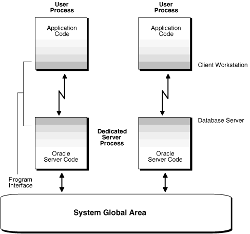
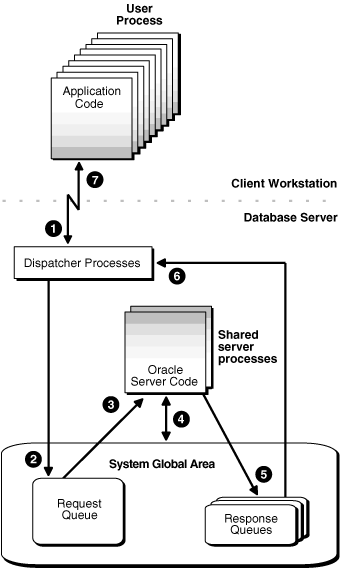

## 3 Managing Processes

Oracle Databases uses several processes so that multiple users and applications can connect to a single database instance simultaneously.

**Parent topic:** [Basic Database Administration](basic-database-administration.md)

### 3.1 About Dedicated and Shared Server Processes

Oracle Database creates server processes to handle the requests of user processes connected to an instance.

A server process can be either of the following:

- A dedicated server process, which services only one user process
- A shared server process, which can service multiple user processes

Your database is always enabled to allow dedicated server processes, but you must specifically configure and enable shared server by setting one or more initialization parameters.

- Dedicated Server Processes  
	A dedicated server process services only one user process.
- Shared Server Processes  
	A shared server process can service multiple user processes.

**Parent topic:** Managing Processes

#### 3.1.1 Dedicated Server Processes

A dedicated server process services only one user process.

Figure 3-1 illustrates how dedicated server processes work. In this diagram two user processes are connected to the database through dedicated server processes.

In general, it is better to be connected through a dispatcher and use a shared server process. This is illustrated in Figure 3-2. A shared server process can be more efficient because it keeps the number of processes required for the running instance low.

In the following situations, however, users and administrators should explicitly connect to an instance using a dedicated server process:

- To submit a batch job (for example, when a job can allow little or no idle time for the server process)
- To use Recovery Manager (RMAN) to back up, restore, or recover a database

To request a dedicated server connection when Oracle Database is configured for shared server, users must connect using a net service name that is configured to use a dedicated server. Specifically, the net service name value should include the `SERVER=DEDICATED` clause in the connect descriptor.

See Also:

[Oracle Database Net Services Administrator's Guide](https://docs.oracle.com/pls/topic/lookup?ctx=en/database/oracle/oracle-database/21/admin&id=NETAG002) for more information about requesting a dedicated server connection

Figure 3-1 Oracle Database Dedicated Server Processes



> This is a text description of admin013.gif. The figure shows application code for two users. Each piece of application code is shown using its own copy of Oracle server code (dedicated server).
>
> End of image description.
>
> [  
> Copyright © 1996, 2025, Oracle and/or its affiliates.](https://docs.oracle.com/en/database/oracle/oracle-database/dcommon/html/cpyr.htm)


**Parent topic:** About Dedicated and Shared Server Processes

#### 3.1.2 Shared Server Processes

A shared server process can service multiple user processes.

Consider an order entry system with dedicated server processes. A customer phones the order desk and places an order, and the clerk taking the call enters the order into the database. For most of the transaction, the clerk is on the telephone talking to the customer. A server process is not needed during this time, so the server process dedicated to the clerk's user process remains idle. The system is slower for other clerks entering orders, because the idle server process is holding system resources.

Shared server architecture eliminates the need for a dedicated server process for each connection (see Figure 3-2).

Figure 3-2 Oracle Database Shared Server Processes



> This is a text description of admin011.gif. The process that is illustrated by admin011.gif is described in the text that follows the image.
>
> End of image description.
>
> [  
> Copyright © 1996, 2025, Oracle and/or its affiliates.](https://docs.oracle.com/en/database/oracle/oracle-database/dcommon/html/cpyr.htm)


In a shared server configuration, client user processes connect to a dispatcher. The dispatcher can support multiple client connections concurrently. Each client connection is bound to a virtual circuit, which is a piece of shared memory used by the dispatcher for client database connection requests and replies. The dispatcher places a virtual circuit on a common queue when a request arrives.

An idle shared server process picks up the virtual circuit from the common queue, services the request, and relinquishes the virtual circuit before attempting to retrieve another virtual circuit from the common queue. This approach enables a small pool of server processes to serve a large number of clients. A significant advantage of shared server architecture over the dedicated server model is the reduction of system resources, enabling the support of an increased number of users.

For even better resource management, shared server can be configured for session multiplexing, which combines multiple sessions for transmission over a single network connection in order to conserve the operating system's resources.

Shared server architecture requires Oracle Net Services. User processes targeting the shared server must connect through Oracle Net Services, even if they are on the same system as the Oracle Database instance.

See Also:

[Oracle Database Net Services Administrator's Guide](https://docs.oracle.com/pls/topic/lookup?ctx=en/database/oracle/oracle-database/21/admin&id=NETAG154) for more detailed information about shared server, including features such as session multiplexing

**Parent topic:** About Dedicated and Shared Server Processes

### 3.2 About Database Resident Connection Pooling

Database Resident Connection Pooling (DRCP) provides a connection pool in the database server for typical Web application usage scenarios where the application acquires a database connection, works on it for a relatively short duration, and then releases it. DRCP pools "dedicated" servers. A pooled server is the equivalent of a server foreground process and a database session combined.

DRCP complements middle-tier connection pools that share connections between threads in a middle-tier process. In addition, DRCP enables sharing of database connections across middle-tier processes on the same middle-tier host and even across middle-tier hosts. This results in significant reduction in key database resources needed to support a large number of client connections, thereby reducing the database tier memory footprint and boosting the scalability of both the middle-tier and the database tier. Having a pool of readily available servers also has the additional benefit of reducing the cost of creating and tearing down client connections.

DRCP is especially relevant for architectures with multi-process single threaded application servers (such as PHP/Apache) that cannot perform middle-tier connection pooling. The database can still scale to tens of thousands of simultaneous connections with DRCP.

Starting with Oracle Database Release 21c, DRCP can be configured based on the requirements of specific pluggable databases (PDBs). PDB administrators can independently configure, manage, and monitor a connection pool for individual PDBs. Note that the broker processes are owned and configured by the root and shared among the PDB pools.

Note:

- Starting with Oracle Database 12c Release 2 (12.2), proxy sessions that belong to the same user can be shared.
- On Windows platforms, setting the `SQLNET.AUTHENTICATION_SERVICES` parameter value to `nts` is not supported with DRCP.

See Also:

- [Oracle Database Concepts](https://docs.oracle.com/pls/topic/lookup?ctx=en/database/oracle/oracle-database/21/admin&id=CNCPT1896) for more details on DRCP
- [Oracle Database Development Guide](https://docs.oracle.com/pls/topic/lookup?ctx=en/database/oracle/oracle-database/21/admin&id=ADFNS228) for more information about DRCP, including restrictions on using DRCP
- [Oracle Call Interface Programmer's Guide](https://docs.oracle.com/pls/topic/lookup?ctx=en/database/oracle/oracle-database/21/admin&id=LNOCI9110) for information about options that are available when obtaining a DRCP session
- [Oracle Database Development Guide](https://docs.oracle.com/pls/topic/lookup?ctx=en/database/oracle/oracle-database/21/admin&id=ADFNS-GUID-015CA8C1-2386-4626-855D-CC546DDC1086) for information about sharing proxy sessions

When To Use Database Resident Connection Pooling

Database resident connection pooling is useful when multiple clients access the database and when any of the following apply:

- A large number of client connections need to be supported with minimum memory usage.
- The client applications are similar and can share or reuse sessions.
	Applications are similar if they connect with the same database credentials and use the same schema.
- The client applications acquire a database connection, work on it for a relatively short duration, and then release it.
- Session affinity is not required across client requests.
- There are multiple processes and multiple hosts on the client side.

Advantages of Database Resident Connection Pooling

Using database resident connection pooling provides the following advantages:

- Enables resource sharing among multiple middle-tier client applications.
- Improves scalability of databases and applications by reducing resource usage.

Database Resident Connection Pooling and LOGON/LOGOFF Triggers

`LOGON` triggers fire for every authentication and every time a new session is created in DRCP.

`LOGOFF` triggers fire on every log off and when the sessions are destroyed in DRCP. Therefore, a `LOGOFF` trigger fires when a session is terminated due to an idle time limit.

- Comparing DRCP to Dedicated Server and Shared Server  
	Understand the differences between dedicated server, shared server, and database resident connection pooling.

See Also:

- [Oracle Database PL/SQL Language Reference](https://docs.oracle.com/pls/topic/lookup?ctx=en/database/oracle/oracle-database/21/admin&id=LNPLS020)
- [Oracle Database Security Guide](https://docs.oracle.com/pls/topic/lookup?ctx=en/database/oracle/oracle-database/21/admin&id=DBSEG60634)

**Parent topic:** Managing Processes

#### 3.2.1 Comparing DRCP to Dedicated Server and Shared Server

Understand the differences between dedicated server, shared server, and database resident connection pooling.

Table 3-1 lists the differences between dedicated server, shared server, and database resident connection pooling.

Table 3-1 Dedicated Servers, Shared Servers, and Database Resident Connection Pooling

| Dedicated Server | Shared Server | Database Resident Connection Pooling |
| --- | --- | --- |
| When a client request is received, a new server process and a session are created for the client. | When the first request is received from a client, the Dispatcher process places this request on a common queue. The request is picked up by an available shared server process. The Dispatcher process then manages the communication between the client and the shared server process. | When the first request is received from a client, the Connection Broker picks an available pooled server and hands off the client connection to the pooled server.  If no pooled servers are available, the Connection Broker creates one. If the pool has reached its maximum size, the client request is placed on the wait queue until a pooled server is available. |
| Releasing database resources involves terminating the session and server process. | Releasing database resources involves terminating the session. | Releasing database resources involves releasing the pooled server to the pool. |
| Memory requirement is proportional to the number of server processes and sessions. There is one server and one session for each client. | Memory requirement is proportional to the sum of the shared servers and sessions. There is one session for each client. | Memory requirement is proportional to the number of pooled servers and their sessions. There is one session for each pooled server. |
| Session memory is allocated from the PGA. | Session memory is allocated from the SGA. | Session memory is allocated from the PGA. |

Example of Memory Usage for Dedicated Server, Shared Server, and Database Resident Connection Pooling

Consider an application in which the memory required for each session is 400 KB and the memory required for each server process is 4 MB. The pool size is 100 and the number of shared servers used is 100.

If there are 5000 client connections, the memory used by each configuration is as follows:

- Dedicated Server
	Memory used = 5000 X (400 KB + 4 MB) = 22 GB
- Shared Server
	Memory used = 5000 X 400 KB + 100 X 4 MB = 2.5 GB
	Out of the 2.5 GB, 2 GB is allocated from the SGA.
- Database Resident Connection Pooling
	Memory used = 100 X (400 KB + 4 MB) + (5000 X 35KB)= 615 MB
	The cost of each connection to the broker is approximately 35 KB.

**Parent topic:** [About Database Resident Connection Pooling](https://docs.oracle.com/en/database/oracle/oracle-database/21/admin/managing-processes.html#GUID-BB76E57C-3F16-4C85-AEF6-BA14FC1B4777 "Database Resident Connection Pooling (DRCP) provides a connection pool in the database server for typical Web application usage scenarios where the application acquires a database connection, works on it for a relatively short duration, and then releases it. DRCP pools \"dedicated\" servers. A pooled server is the equivalent of a server foreground process and a database session combined.")

### 3.3 About Proxy Resident Connection Pooling

Proxy resident connection pooling uses Proxy Resident Connection Pool that can be configured using Oracle Connection Manager in Traffic Director Mode. Proxy resident connection pooling provides high availability, security, and performance for database clients.

A database client that is based on any of the following technologies can use proxy resident connection pooling to connect to a database instance – Oracle Call Interface (OCI), Java Database Connectivity (JDBC), Oracle Data Provider for.NET (ODP.Net), Open Database Connectivity (ODBC), Pro\*C, Pro\*COBOL, PHP OCI8 extension, Node.js node-oracledb driver, Python cx\_Oracle, ROracle, Ruby-oci8, Perl DBD::Oracle, or Oracle C++ Call Interface (OCCI).

Note:

Proxy resident connection pooling is available starting with Oracle Database 18c.

When to Use Proxy Resident Connection Pooling

Proxy resident connection pooling is useful when multiple clients access a database and when any of the following apply:

- A large number of client connections need to be supported using fewer number of connections to a database.
- A database connection needs to be shared across middle tier connection pools.
- More than 64K sessions need to be supported (when shared servers cannot be used as they have a limit of 64K sessions).
- High availability needs to be supported for older clients that do not support Transparent Application Failover (TAF) and Oracle RAC, or the clients that do not use Oracle Database Resident Connection Pooling (DRCP) or Fast Application Notification (FAN) or Application Continuity (AC).

Advantages of Proxy Resident Connection Pooling

Using proxy resident connection pooling provides the following major advantages:

- Improved high availability (planned and unplanned)
- Improved database security
- Database connection multiplexing

See Also:

The following sections in Oracle Database Net Services Administrator's Guide for more information about enabling proxy resident connection pooling using Oracle Connection Manager in Traffic Director Mode.

- ["About Using Oracle Connection Manager in Traffic Director Mode"](https://docs.oracle.com/pls/topic/lookup?ctx=en/database/oracle/oracle-database/21/admin&id=NETAG-GUID-18E96DB7-00D4-44C6-B541-0B61B488A2DF)
- ["Configuring Oracle Connection Manager in Traffic Director Mode"](https://docs.oracle.com/pls/topic/lookup?ctx=en/database/oracle/oracle-database/21/admin&id=NETAG-GUID-3917FC5D-4B23-4752-85BA-39A88C4D13F8)

**Parent topic:** Managing Processes

### 3.4 Configuring Oracle Database for Shared Server

You can enable shared server and set or alter shared server initialization parameters.

- Initialization Parameters for Shared Server  
	A set of initialization parameters control shared server operation.
- Memory Management for Shared Server  
	Shared server requires some user global area (UGA) in either the shared pool or large pool. For installations with a small number of simultaneous sessions, the default sizes for these system global area (SGA) components are generally sufficient. However, if you expect a large number of sessions for your installation, you may have to tune memory to support shared server.
- Enabling Shared Server  
	Shared server is enabled by setting the `SHARED_SERVERS` initialization parameter to a value greater than 0. The other shared server initialization parameters need not be set.
- Configuring Dispatchers  
	The `DISPATCHERS` initialization parameter configures dispatcher processes in the shared server architecture. At least one dispatcher process is required for shared server to work. If you do not specify a dispatcher, but you enable shared server by setting `SHARED_SERVER` to a nonzero value, then by default Oracle Database creates one dispatcher for the TCP protocol.
- Disabling Shared Server  
	You disable shared server by setting the `SHARED_SERVERS` initialization parameter to 0. You can do this dynamically with the `ALTER` `SYSTEM` statement.
- Shared Server Data Dictionary Views  
	You can query data dictionary views for information about your shared server configuration and to monitor performance.

See Also:

- " About Dedicated and Shared Server Processes "
- [Oracle Database SQL Language Reference](https://docs.oracle.com/pls/topic/lookup?ctx=en/database/oracle/oracle-database/21/admin&id=SQLRF009) for further information about the `ALTER` `SYSTEM` statement

**Parent topic:** Managing Processes

#### 3.4.1 Initialization Parameters for Shared Server

A set of initialization parameters control shared server operation.

The following initialization parameters control shared server operation:

- `SHARED_SERVERS`: Specifies the initial number of shared servers to start and the minimum number of shared servers to keep. This is the only required parameter for using shared servers.
- `MAX_SHARED_SERVERS`: Specifies the maximum number of shared servers that can run simultaneously.
- `SHARED_SERVER_SESSIONS`: Specifies the total number of shared server user sessions that can run simultaneously. Setting this parameter enables you to reserve user sessions for dedicated servers.
- `DISPATCHERS`: Configures dispatcher processes in the shared server architecture.
- `MAX_DISPATCHERS`: Specifies the maximum number of dispatcher processes that can run simultaneously. This parameter can be ignored for now. It will only be useful in a future release when the number of dispatchers is auto-tuned according to the number of concurrent connections.
- `CIRCUITS`: Specifies the total number of virtual circuits that are available for inbound and outbound network sessions.

See Also:

[Oracle Database Reference](https://docs.oracle.com/pls/topic/lookup?ctx=en/database/oracle/oracle-database/21/admin&id=REFRN001) for more information about these initialization parameters

**Parent topic:** Configuring Oracle Database for Shared Server

#### 3.4.2 Memory Management for Shared Server

Shared server requires some user global area (UGA) in either the shared pool or large pool. For installations with a small number of simultaneous sessions, the default sizes for these system global area (SGA) components are generally sufficient. However, if you expect a large number of sessions for your installation, you may have to tune memory to support shared server.

See the "Configuring and Using Memory" section of [Oracle Database Performance Tuning Guide](https://docs.oracle.com/pls/topic/lookup?ctx=en/database/oracle/oracle-database/21/admin&id=TGDBA610) for guidelines.

**Parent topic:** Configuring Oracle Database for Shared Server

#### 3.4.3 Enabling Shared Server

Shared server is enabled by setting the `SHARED_SERVERS` initialization parameter to a value greater than 0. The other shared server initialization parameters need not be set.

- Set shared server dynamically by setting the `SHARED_SERVERS` initialization parameter to a nonzero value with the `ALTER SYSTEM` statement.
- Set the `SHARED_SERVERS` initialization parameter to a nonzero value at database startup by including it in the initialization parameter file.

Because shared server requires at least one dispatcher in order to work, a dispatcher is brought up even if no dispatcher has been configured. Dispatchers are discussed in " Configuring Dispatchers ".

Note:

If `SHARED_SERVERS` is not included in the initialization parameter file at database startup, but `DISPATCHERS` is included and it specifies at least one dispatcher, shared server is enabled. In this case, the default for `SHARED_SERVERS` is 1.

If neither `SHARED_SERVERS` nor `DISPATCHERS` is included in the initialization file, you cannot start shared server after the instance is brought up by just altering the `DISPATCHERS` parameter. You must specifically alter `SHARED_SERVERS` to a nonzero value to start shared server.

Note:

If you create your Oracle database with Database Configuration Assistant (DBCA), DBCA configures a dispatcher for Oracle XML DB (XDB). This is because XDB protocols like HTTP and FTP require shared server. This results in a `SHARED_SERVER` value of 1. Although shared server is enabled, this configuration permits only sessions that connect to the XDB service to use shared server. To enable shared server for regular database sessions (for submitting SQL statements), you must add an additional dispatcher configuration, or replace the existing configuration with one that is not specific to XDB. See " Configuring Dispatchers " for instructions.

- About Determining a Value for SHARED\_SERVERS  
	`The SHARED_SERVERS` initialization parameter specifies the minimum number of shared servers that you want created when the instance is started. After instance startup, Oracle Database can dynamically adjust the number of shared servers based on how busy existing shared servers are and the length of the request queue.
- Decreasing the Number of Shared Server Processes  
	You can decrease the minimum number of shared servers that must be kept active by dynamically setting the `SHARED_SERVERS` parameter to a lower value. Thereafter, until the number of shared servers is decreased to the value of the `SHARED_SERVERS` parameter, any shared servers that become inactive are marked by PMON for termination.
- Limiting the Number of Shared Server Processes  
	The `MAX_SHARED_SERVERS` initialization parameter specifies the maximum number of shared servers that can be automatically created by PMON. It has no default value.
- Limiting the Number of Shared Server Sessions  
	The `SHARED_SERVER_SESSIONS` initialization parameter specifies the maximum number of concurrent shared server user sessions.
- Protecting Shared Memory  
	The `CIRCUITS` initialization parameter sets a maximum limit on the number of virtual circuits that can be created in shared memory. This parameter has no default. If it is not specified, then the system can create circuits as needed, limited by the `DISPATCHERS` initialization parameter and system resources.

**Parent topic:** Configuring Oracle Database for Shared Server

##### 3.4.3.1 About Determining a Value for SHARED\_SERVERS

`The SHARED_SERVERS` initialization parameter specifies the minimum number of shared servers that you want created when the instance is started. After instance startup, Oracle Database can dynamically adjust the number of shared servers based on how busy existing shared servers are and the length of the request queue.

In typical systems, the number of shared servers stabilizes at a ratio of one shared server for every ten connections. For OLTP applications, when the rate of requests is low, or when the ratio of server usage to request is low, the connections-to-servers ratio could be higher. In contrast, in applications where the rate of requests is high or the server usage-to-request ratio is high, the connections-to-server ratio could be lower.

The PMON (process monitor) background process cannot terminate shared servers below the value specified by `SHARED_SERVERS`. Therefore, you can use this parameter to stabilize the load and minimize strain on the system by preventing PMON from terminating and then restarting shared servers because of coincidental fluctuations in load.

If you know the average load on your system, you can set `SHARED_SERVERS` to an optimal value. The following example shows how you can use this parameter:

Assume a database is being used by a telemarketing center staffed by 1000 agents. On average, each agent spends 90% of the time talking to customers and only 10% of the time looking up and updating records. To keep the shared servers from being terminated as agents talk to customers and then spawned again as agents access the database, a DBA specifies that the optimal number of shared servers is 100.

However, not all work shifts are staffed at the same level. On the night shift, only 200 agents are needed. Since `SHARED_SERVERS` is a dynamic parameter, a DBA reduces the number of shared servers to 20 at night, thus allowing resources to be freed up for other tasks such as batch jobs.

**Parent topic:** Enabling Shared Server

##### 3.4.3.2 Decreasing the Number of Shared Server Processes

You can decrease the minimum number of shared servers that must be kept active by dynamically setting the `SHARED_SERVERS` parameter to a lower value. Thereafter, until the number of shared servers is decreased to the value of the `SHARED_SERVERS` parameter, any shared servers that become inactive are marked by PMON for termination.

- Set shared server dynamically by setting the `SHARED_SERVERS` initialization parameter to a nonzero value with the `ALTER SYSTEM` statement.

For example, the following statement reduces the number of shared servers:

```
ALTER SYSTEM SET SHARED_SERVERS = 5;
```

Setting `SHARED_SERVERS` to 0 disables shared server. For more information, see " Disabling Shared Server ".

**Parent topic:** Enabling Shared Server

##### 3.4.3.3 Limiting the Number of Shared Server Processes

The `MAX_SHARED_SERVERS` initialization parameter specifies the maximum number of shared servers that can be automatically created by PMON. It has no default value.

If no value is specified, then PMON starts as many shared servers as is required by the load, subject to these limitations:

- The process limit (set by the `PROCESSES` initialization parameter)
- A minimum number of free process slots (at least one-eighth of the total process slots, or two slots if `PROCESSES` is set to less than 24)
- System resources

To limit the number of shared server processes:

- Set the `MAX_SHARED_SERVERS` initialization parameter.

The value of `SHARED_SERVERS` overrides the value of `MAX_SHARED_SERVERS`. Therefore, you can force PMON to start more shared servers than the `MAX_SHARED_SERVERS` value by setting `SHARED_SERVERS` to a value higher than `MAX_SHARED_SERVERS`. You can subsequently place a new upper limit on the number of shared servers by dynamically altering the `MAX_SHARED_SERVERS` to a value higher than `SHARED_SERVERS`.

The primary reason to limit the number of shared servers is to reserve resources, such as memory and CPU time, for other processes. For example, consider the case of the telemarketing center discussed previously:

The DBA wants to reserve two thirds of the resources for batch jobs at night. He sets `MAX_SHARED_SERVERS` to less than one third of the maximum number of processes (`PROCESSES`). By doing so, the DBA ensures that even if all agents happen to access the database at the same time, batch jobs can connect to dedicated servers without having to wait for the shared servers to be brought down after processing agents' requests.

Another reason to limit the number of shared servers is to prevent the concurrent run of too many server processes from slowing down the system due to heavy swapping, although `PROCESSES` can serve as the upper bound for this rather than `MAX_SHARED_SERVERS`.

Still other reasons to limit the number of shared servers are testing, debugging, performance analysis, and tuning. For example, to see how many shared servers are needed to efficiently support a certain user community, you can vary `MAX_SHARED_SERVERS` from a very small number upward until no delay in response time is noticed by the users.

**Parent topic:** Enabling Shared Server

##### 3.4.3.4 Limiting the Number of Shared Server Sessions

The `SHARED_SERVER_SESSIONS` initialization parameter specifies the maximum number of concurrent shared server user sessions.

Setting this parameter, which is a dynamic parameter, lets you reserve database sessions for dedicated servers. This in turn ensures that administrative tasks that require dedicated servers, such as backing up or recovering the database, are not preempted by shared server sessions.

To limit the number of shared server sessions:

- Set the `SHARED_SERVER_SESSIONS` initialization parameter.

This parameter has no default value. If it is not specified, the system can create shared server sessions as needed, limited by the `SESSIONS` initialization parameter.

**Parent topic:** Enabling Shared Server

##### 3.4.3.5 Protecting Shared Memory

The `CIRCUITS` initialization parameter sets a maximum limit on the number of virtual circuits that can be created in shared memory. This parameter has no default. If it is not specified, then the system can create circuits as needed, limited by the `DISPATCHERS` initialization parameter and system resources.

To protect shared memory by limiting the number of virtual circuits that can be created in shared memory:

- Set the `CIRCUITS` initialization parameter.

**Parent topic:** Enabling Shared Server

#### 3.4.4 Configuring Dispatchers

The `DISPATCHERS` initialization parameter configures dispatcher processes in the shared server architecture. At least one dispatcher process is required for shared server to work. If you do not specify a dispatcher, but you enable shared server by setting `SHARED_SERVER` to a nonzero value, then by default Oracle Database creates one dispatcher for the TCP protocol.

The equivalent `DISPATCHERS` explicit setting of the initialization parameter for this configuration is:

```
dispatchers="(PROTOCOL=tcp)"
```

You can configure more dispatchers, using the `DISPATCHERS` initialization parameter, if either of the following conditions apply:

- You must configure a protocol other than TCP/IP. You configure a protocol address with one of the following attributes of the DISPATCHERS parameter:
	- ADDRESS
		- DESCRIPTION
		- PROTOCOL
- You want to configure one or more of the optional dispatcher attributes:
	- DISPATCHERS
		- CONNECTIONS
		- SESSIONS
		- LISTENER
		- MULTIPLEX
		- SERVICE
		Note:
		Database Configuration Assistant helps you configure this parameter.

To configure a protocol other than TCP/IP or to configure additional dispatchers:

- Set the `DISPATCHERS` initialization parameter and specify the appropriate attributes.

- DISPATCHERS Initialization Parameter Attributes  
	You can set several attributes for the `DISPATCHERS` initialization parameter.
- Determining the Number of Dispatchers  
	Once you know the number of possible connections for each process for the operating system, calculate the initial number of dispatchers to create during instance startup, for each network protocol.
- Setting the Initial Number of Dispatchers  
	You can specify multiple dispatcher configurations by setting `DISPATCHERS` to a comma separated list of strings, or by specifying multiple `DISPATCHERS` initialization parameters in the initialization parameter file.
- Altering the Number of Dispatchers  
	You can control the number of dispatcher processes in the instance. Unlike the number of shared servers, the number of dispatchers does not change automatically. You change the number of dispatchers explicitly with the `ALTER SYSTEM` statement. You can increase the number of dispatchers to more than the limit specified by the `MAX_DISPATCHERS` parameter.
- Shutting Down Specific Dispatcher Processes  
	With the `ALTER SYSTEM SET DISPATCHERS` statement, you leave it up to the database to determine which dispatchers to shut down to reduce the number of dispatchers. Alternatively, it is possible to shut down specific dispatcher processes.

**Parent topic:** Configuring Oracle Database for Shared Server

##### 3.4.4.1 DISPATCHERS Initialization Parameter Attributes

You can set several attributes for the `DISPATCHERS` initialization parameter.

A protocol address is required and is specified using one or more of the following attributes:

| Attribute | Description |
| --- | --- |
| `ADDRESS ` | Specify the network protocol address of the endpoint on which the dispatchers listen. |
| `DESCRIPTION ` | Specify the network description of the endpoint on which the dispatchers listen, including the network protocol address. The syntax is as follows:  ``` (DESCRIPTION=(ADDRESS=...)) ``` |
| `PROTOCOL ` | Specify the network protocol for which the dispatcher generates a listening endpoint. For example:  ``` (PROTOCOL=tcp) ```  See the [Oracle Database Net Services Reference](https://docs.oracle.com/pls/topic/lookup?ctx=en/database/oracle/oracle-database/21/admin&id=NETRF004) for further information about protocol address syntax. |

The following attribute specifies how many dispatchers this configuration should have. It is optional and defaults to 1.

| Attribute | Description |
| --- | --- |
| `DISPATCHERS ` | Specify the initial number of dispatchers to start. |

The following attributes tell the instance about the network attributes of each dispatcher of this configuration. They are all optional.

| Attribute | Description |
| --- | --- |
| `CONNECTIONS ` | Specify the maximum number of network connections to allow for each dispatcher. |
| `SESSIONS` | Specify the maximum number of network sessions to allow for each dispatcher. |
| `LISTENER` | Specify an alias name for the listeners with which the LREG process registers dispatcher information. Set the alias to a name that is resolved through a naming method. |
| `MULTIPLEX ` | Used to enable the Oracle Connection Manager session multiplexing feature. |
| `SERVICE` | Specify the service names the dispatchers register with the listeners. |

You can specify either an entire attribute name a substring consisting of at least the first three characters. For example, you can specify `SESSIONS=3,` `SES=3`, `SESS=3`, or `SESSI=3`, and so forth.

See Also:

[Oracle Database Reference](https://docs.oracle.com/pls/topic/lookup?ctx=en/database/oracle/oracle-database/21/admin&id=REFRN10049) for more detailed descriptions of the attributes of the `DISPATCHERS` initialization parameter

**Parent topic:** Configuring Dispatchers

##### 3.4.4.2 Determining the Number of Dispatchers

Once you know the number of possible connections for each process for the operating system, calculate the initial number of dispatchers to create during instance startup, for each network protocol.

To calculate the initial number of dispatchers to create during instance startup, use the following formula:

```
Number of dispatchers =
   CEIL ( max. concurrent sessions / connections for each dispatcher )
```

`CEIL` returns the result roundest up to the next whole integer.

For example, assume a system that can support 970 connections for each process, and that has:

- A maximum of 4000 sessions concurrently connected through TCP/IP and
- A maximum of 2,500 sessions concurrently connected through TCP/IP with SSL

The `DISPATCHERS` attribute for TCP/IP should be set to a minimum of five dispatchers (4000 / 970), and for TCP/IP with SSL three dispatchers (2500 / 970:

```
DISPATCHERS='(PROT=tcp)(DISP=5)', '(PROT=tcps)(DISP=3)'
```

Depending on performance, you may need to adjust the number of dispatchers.

**Parent topic:** Configuring Dispatchers

##### 3.4.4.3 Setting the Initial Number of Dispatchers

You can specify multiple dispatcher configurations by setting `DISPATCHERS` to a comma separated list of strings, or by specifying multiple `DISPATCHERS` initialization parameters in the initialization parameter file.

- Set the `DISPATCHERS` initialization parameter.

If you specify `DISPATCHERS` multiple times, then the lines must be adjacent to each other in the initialization parameter file. Internally, Oracle Database assigns an `INDEX` value (beginning with zero) to each `DISPATCHERS` parameter. You can later refer to that `DISPATCHERS` parameter in an `ALTER SYSTEM` statement by its index number.

Some examples of setting the `DISPATCHERS` initialization parameter follow.

Example: Typical

This is a typical example of setting the `DISPATCHERS` initialization parameter.

```
DISPATCHERS="(PROTOCOL=TCP)(DISPATCHERS=2)"
```

Example: Forcing the IP Address Used for Dispatchers

The following hypothetical example will create two dispatchers that will listen on the specified IP address. The address must be a valid IP address for the host that the instance is on. (The host may be configured with multiple IP addresses.)

```
DISPATCHERS="(ADDRESS=(PROTOCOL=TCP)(HOST=144.25.16.201))(DISPATCHERS=2)"
```

Example: Forcing the Port Used by Dispatchers

To force the dispatchers to use a specific port as the listening endpoint, add the `PORT` attribute as follows:

```
DISPATCHERS="(ADDRESS=(PROTOCOL=TCP)(PORT=5000))"
DISPATCHERS="(ADDRESS=(PROTOCOL=TCP)(PORT=5001))"
```

**Parent topic:** Configuring Dispatchers

##### 3.4.4.4 Altering the Number of Dispatchers

You can control the number of dispatcher processes in the instance. Unlike the number of shared servers, the number of dispatchers does not change automatically. You change the number of dispatchers explicitly with the `ALTER SYSTEM` statement. You can increase the number of dispatchers to more than the limit specified by the `MAX_DISPATCHERS` parameter.

1. Monitor the following views to determine the load on the dispatcher processes:
	- `V$QUEUE`
	- `V$DISPATCHER`
	- `V$DISPATCHER_RATE`
		If these views indicate that the load on the dispatcher processes is consistently high, then performance may be improved by starting additional dispatcher processes to route user requests. In contrast, if the load on dispatchers is consistently low, reducing the number of dispatchers may improve performance.
		See Also:
		[Oracle Database Performance Tuning Guide](https://docs.oracle.com/pls/topic/lookup?ctx=en/database/oracle/oracle-database/21/admin&id=TGDBA021) for information about monitoring these views to determine dispatcher load and performance
2. To dynamically alter the number of dispatchers when the instance is running, use the `ALTER SYSTEM` statement to modify the `DISPATCHERS` attribute setting for an existing dispatcher configuration. You can also add new dispatcher configurations to start dispatchers with different network attributes.

When you reduce the number of dispatchers for a particular dispatcher configuration, the dispatchers are not immediately removed. Rather, as users disconnect, Oracle Database terminates dispatchers down to the limit you specify in `DISPATCHERS`,

For example, suppose the instance was started with this `DISPATCHERS` setting in the initialization parameter file:

```
DISPATCHERS='(PROT=tcp)(DISP=2)', '(PROT=tcps)(DISP=2)'
```

To increase the number of dispatchers for the TCP/IP protocol from 2 to 3, and decrease the number of dispatchers for the TCP/IP with SSL protocol from 2 to 1, you can issue the following statement:

```
ALTER SYSTEM SET DISPATCHERS = '(INDEX=0)(DISP=3)', '(INDEX=1)(DISP=1)';
```

or

```
ALTER SYSTEM SET DISPATCHERS = '(PROT=tcp)(DISP=3)', '(PROT=tcps)(DISP=1)';
```

Note:

You need not specify (`DISP=1`). It is optional because 1 is the default value for the `DISPATCHERS` parameter.

If fewer than three dispatcher processes currently exist for TCP/IP, the database creates new ones. If multiple dispatcher processes currently exist for TCP/IP with SSL, then the database terminates the extra ones as the connected users disconnect.

- Notes on Altering Dispatchers  
	Understand details about altering dispatchers.

**Parent topic:** Configuring Dispatchers

###### 3.4.4.4.1 Notes on Altering Dispatchers

Understand details about altering dispatchers.

- The `INDEX` keyword can be used to identify which dispatcher configuration to modify. If you do not specify `INDEX`, then the first dispatcher configuration matching the `DESCRIPTION`, `ADDRESS`, or `PROTOCOL` specified will be modified. If no match is found among the existing dispatcher configurations, then a new dispatcher will be added.
- The `INDEX` value can range from 0 to `n` -1, where `n` is the current number of dispatcher configurations. If your `ALTER SYSTEM` statement specifies an `INDEX` value equal to `n`, where `n` is the current number of dispatcher configurations, a new dispatcher configuration will be added.
- To see the values of the current dispatcher configurations--that is, the number of dispatchers and so forth--query the `V$DISPATCHER_CONFIG` dynamic performance view. To see which dispatcher configuration a dispatcher is associated with, query the `CONF_INDX` column of the `V$DISPATCHER` view.
- When you change the `DESCRIPTION`, `ADDRESS`, `PROTOCOL`, `CONNECTIONS`, and `MULTIPLEX` attributes of a dispatcher configuration, the change does not take effect for existing dispatchers but only for new dispatchers. Therefore, in order for the change to be effective for all dispatchers associated with a configuration, you must forcibly terminate existing dispatchers after altering the `DISPATCHERS` parameter, and let the database start new ones in their place with the newly specified properties.
	The attributes `LISTENER` and `SERVICES` are not subject to the same constraint. They apply to existing dispatchers associated with the modified configuration. Attribute `SESSIONS` applies to existing dispatchers only if its value is reduced. However, if its value is increased, it is applied only to newly started dispatchers.

**Parent topic:** Altering the Number of Dispatchers

##### 3.4.4.5 Shutting Down Specific Dispatcher Processes

With the `ALTER SYSTEM SET DISPATCHERS` statement, you leave it up to the database to determine which dispatchers to shut down to reduce the number of dispatchers. Alternatively, it is possible to shut down specific dispatcher processes.

1. To identify the name of the specific dispatcher process to shut down, use the `V$DISPATCHER` dynamic performance view.
	```
	SELECT NAME, NETWORK FROM V$DISPATCHER;
	```
	Each dispatcher is uniquely identified by a name of the form D.
2. Run an ALTER SYSTEM SHUTDOWN IMMEDIATE statement and specify the dispatcher name.
	For example, to shut down dispatcher `D002`, issue the following statement:
	```
	ALTER SYSTEM SHUTDOWN IMMEDIATE 'D002';
	```
	The `IMMEDIATE` keyword stops the dispatcher from accepting new connections, and the database immediately terminates all existing connections through that dispatcher. After all sessions are cleaned up, the dispatcher process shuts down. If `IMMEDIATE` were not specified, then the dispatcher would wait until all of its users disconnected and all of its connections terminated before shutting down.

**Parent topic:** Configuring Dispatchers

#### 3.4.5 Disabling Shared Server

You disable shared server by setting the `SHARED_SERVERS` initialization parameter to 0. You can do this dynamically with the `ALTER` `SYSTEM` statement.

- Set the `SHARED_SERVERS` initialization parameter to 0.

When you disable shared server, no new clients can connect in shared mode. However, Oracle Database retains some shared servers until all shared server connections are closed. The number of shared servers retained is either the number specified by the preceding setting of `SHARED_SERVERS` or the value of the `MAX_SHARED_SERVERS` parameter, whichever is smaller. If both `SHARED_SERVERS` and `MAX_SHARED_SERVERS` are set to 0, then all shared servers will terminate and requests from remaining shared server clients will be queued until the value of `SHARED_SERVERS` or `MAX_SHARED_SERVERS` is raised again.

To terminate dispatchers once all shared server clients disconnect, enter this statement:

```
ALTER SYSTEM SET DISPATCHERS = '';
```

**Parent topic:** Configuring Oracle Database for Shared Server

#### 3.4.6 Shared Server Data Dictionary Views

You can query data dictionary views for information about your shared server configuration and to monitor performance.

| View | Description |
| --- | --- |
| `V$DISPATCHER ` | Provides information on the dispatcher processes, including name, network address, status, various usage statistics, and index number. |
| `V$DISPATCHER_CONFIG` | Provides configuration information about the dispatchers. |
| `V$DISPATCHER_RATE ` | Provides rate statistics for the dispatcher processes. |
| `V$QUEUE` | Contains information on the shared server message queues. |
| `V$SHARED_SERVER` | Contains information on the shared servers. |
| `V$CIRCUIT` | Contains information about virtual circuits, which are user connections to the database through dispatchers and servers. |
| `V$SHARED_SERVER_MONITOR` | Contains information for tuning shared server. |
| `V$SGA` | Contains size information about various system global area (SGA) groups. May be useful when tuning shared server. |
| `V$SGASTAT` | Contains detailed statistical information about the SGA, useful for tuning. |
| `V$SHARED_POOL_RESERVED` | Lists statistics to help tune the reserved pool and space within the shared pool. |

See Also:

[Oracle Database Performance Tuning Guide](https://docs.oracle.com/pls/topic/lookup?ctx=en/database/oracle/oracle-database/21/admin&id=TGDBA021) for specific information about monitoring and tuning shared server

**Parent topic:** Configuring Oracle Database for Shared Server

### 3.5 Configuring Database Resident Connection Pooling

The database server is preconfigured to allow database resident connection pooling. However, you must explicitly enable this feature by starting the connection pool.

- Database Resident Connection Pooling Initialization Parameters  
	You can set initialization parameters to configure database resident connection pooling.
- Enabling Database Resident Connection Pooling  
	Oracle Database includes a default connection pool called `SYS_DEFAULT_CONNECTION_POOL`. This connection pool must be started to enable database resident connection pooling.
- Configuring the Connection Pool for Database Resident Connection Pooling  
	The connection pool is configured using default parameter values. You can use the procedures in the `DBMS_CONNECTION_POOL` package to configure the connection pool according to your usage. In an Oracle Real Application Clusters (Oracle RAC) environment, the configuration parameters are applicable to each Oracle RAC instance.
- Data Dictionary Views for Database Resident Connection Pooling  
	You can query data dictionary views to obtain information about your connection pool and to monitor the performance of database resident connection pooling.
- Determining the States of Connections in the Connection Pool  
	You can query the `V$CPOOL_CONN_INFO` view to determine the current state of each connection in the connection pool.

See Also:

" [About Database Resident Connection Pooling](https://docs.oracle.com/en/database/oracle/oracle-database/21/admin/managing-processes.html#GUID-BB76E57C-3F16-4C85-AEF6-BA14FC1B4777 "Database Resident Connection Pooling (DRCP) provides a connection pool in the database server for typical Web application usage scenarios where the application acquires a database connection, works on it for a relatively short duration, and then releases it. DRCP pools \"dedicated\" servers. A pooled server is the equivalent of a server foreground process and a database session combined.") "

**Parent topic:** Managing Processes

#### 3.5.1 Database Resident Connection Pooling Initialization Parameters

You can set initialization parameters to configure database resident connection pooling.

Use the `DRCP_DEDICATED_OPT` initialization parameter to configure the use of dedicated optimization with Database Resident Connection Pooling (DRCP). You enable dedicated optimization by setting `DRCP_DEDICATED_OPT` to `Yes`. Dedicated optimization makes DRCP behave like a dedicated server when the number of connections to the DRCP broker is less than the DRCP maximum size.

The following initialization parameters are used to configure the authentication pool:

- `MAX_AUTH_SERVERS`
	Specifies the maximum number of authentication servers in the authentication pool. The authentication pool, which is separate from the connection pool, authenticates user connections when client applications connect to DRCP. Set this parameter to a positive integer that is greater than the value specified by the `MIN_AUTH_SERVERS` initialization parameter.
- `MIN_AUTH_SERVERS`
	Specifies the minimum number of authentication servers in the authentication pool. Set this parameter to a positive integer that is lesser than the value specified by the `MAX_AUTH_SERVERS` initialization parameter.
- `ENABLE_PER_PDB_DRCP`
	Set this parameter to `TRUE` to enable the creation of connection pools at the pluggable database (PDB) level. DRCP is started for both authentication pools and connection pools when a PDB is opened. The `MIN_AUTH_SERVERS` and `MAX_AUTH_SERVERS` parameters can be set at the PDB level. Only the PDB administrator can configure DRCP parameters for a PDB. The SYS user must grant the following to the PDB administrator: `CREATE SESSION` privilege, `CREATE                             SYNOMYM` privilege, `EXECUTE` privilege on the `DBMS_CONNECTION_POOL` package, and `SELECT` privilege on the data dictionary views containing DRCP information.
	When this parameter is set to `FALSE`, only the CDB root can manage the connection pool. You can configure DRCP either for the entire database or at the PDB level. When DRCP is enabled at the PDB level, database level DRCP is automatically disabled.
- `DRCP_CONNECTION_LIMIT`
	Specifies the maximum number of Database Resident Connection Pooling (DRCP) connections for a PDB. In `CDB$ROOT`, the default value is `0` (unlimited). In a PDB, if a persistent value for `SESSIONS` was explicitly set for the PDB (`ALTER SYSTEM SET SESSIONS = n SCOPE={SPFILE|BOTH}`), and the PDB was subsequently restarted, then the default value is (10 \* `SESSIONS`). Otherwise, the PDB inherits the value for this parameter from `CDB$ROOT`. `DRCP_CONNECTION_LIMIT` is a PDB-inherited parameter. The value of this parameter in `CDB$ROOT` is not a CDB-wide limit. It is the default value for each PDB.
	In an Oracle RAC environment, different instances can use different values.

#### 3.5.2 Enabling Database Resident Connection Pooling

Oracle Database includes a default connection pool called `SYS_DEFAULT_CONNECTION_POOL`. This connection pool must be started to enable database resident connection pooling.

Note:

If DRCP is configured at the PDB level, the connection pool is started when the PDB is opened. When a PDB is closed, its connection pool is stopped. The PDB administrator can stop, start, or modify the connection pool by using the `DBMS_CONNECTION_POOL` package.

To enable database resident connection pooling:

1. Start the database resident connection pool, as described in " Starting the Database Resident Connection Pool ".
2. Route the client connection requests to the connection pool, as described in " Routing Client Connection Requests to the Connection Pool ".

Starting the Database Resident Connection Pool

To start the connection pool:

1. Start SQL\*Plus and connect to the database as the `SYS` user.
2. Issue the following command:
	```
	SQL> EXECUTE DBMS_CONNECTION_POOL.START_POOL();
	```

Once started, the connection pool remains in this state until it is explicitly stopped. The connection pool is automatically restarted when the database instance is restarted if the pool was active at the time of instance shutdown.

In an Oracle Real Application Clusters (Oracle RAC) environment, you can use any instance to manage the connection pool. Any changes you make to the pool configuration are applicable on all Oracle RAC instances.

Routing Client Connection Requests to the Connection Pool

In the client application, the connect string must specify the connect type as `POOLED`.

The following example shows an easy connect string that enables clients to connect to a database resident connection pool:

```
examplehost.company.com:1521/books.company.com:POOLED
```

The following example shows a TNS connect descriptor that enables clients to connect to a database resident connection pool:

```
(DESCRIPTION=(ADDRESS=(PROTOCOL=tcp) (HOST=myhost)
       (PORT=1521))(CONNECT_DATA=(SERVICE_NAME=sales)
       (SERVER=POOLED)))
```

Note:

Only the TCP protocol is supported for client connections to a database resident connection pool.

Disabling Database Resident Connection Pooling

To disable database resident connection pooling, you must explicitly stop the connection pool. Use the following steps:

1. Start SQL\*Plus and connect to the database as the `SYS` user.
2. ```
	SQL> EXECUTE DBMS_CONNECTION_POOL.STOP_POOL();
	```
	See Also:
	[Oracle Database PL/SQL Packages and Types Reference](https://docs.oracle.com/pls/topic/lookup?ctx=en/database/oracle/oracle-database/21/admin&id=ARPLS215) for more information on the `DBMS_CONNECTION_POOL` package.

Note:

The operation of disabling the database resident connection pool can be completed only when all client requests that have been handed off to a server are completed.

**Parent topic:** Configuring Database Resident Connection Pooling

#### 3.5.3 Configuring the Connection Pool for Database Resident Connection Pooling

The connection pool is configured using default parameter values. You can use the procedures in the `DBMS_CONNECTION_POOL` package to configure the connection pool according to your usage. In an Oracle Real Application Clusters (Oracle RAC) environment, the configuration parameters are applicable to each Oracle RAC instance.

Using the CONFIGURE\_POOL Procedure

The `CONFIGURE_POOL` procedure of the `DBMS_CONNECTION_POOL` package enables you to configure the connection pool with advanced options. This procedure is usually used when you must modify all the parameters of the connection pool.

Using the ALTER\_PARAM Procedure

The `ALTER_PARAM` procedure of the `DBMS_CONNECTION_POOL` package enables you to alter a specific configuration parameter without affecting other parameters.For example, the following command changes the minimum number of pooled servers used:

```
SQL> EXECUTE DBMS_CONNECTION_POOL.ALTER_PARAM ('','MINSIZE','10');
```

The following example, changes the maximum number of connections that each connection broker can handle to 50000.

```
SQL> EXECUTE DBMS_CONNECTION_POOL.ALTER_PARAM ('','MAXCONN_CBROK','50000');
```

Before you run this command, ensure that the maximum number of connections allowed by the platform on which your database is installed is not less than the value you set for `MAXCONN_CBROK`. Note that you cannot use this command when PDB-level connection pooling is configured.

For example, in Linux, the following entry in the `/etc/security/limits.conf` file indicates that the maximum number of connections allowed for the user `test_user` is 30000.

```
test_user HARD NOFILE 30000
```

To set the maximum number of connections that each connection broker can allow to 50000, first change the value in the `limits.conf` file to a value not less than 50000.

Restoring the Connection Pool Default Settings

If you have made changes to the connection pool parameters, but you want to revert to the default pool settings, use the `RESTORE_DEFAULT` procedure of the `DBMS_CONNECTION_POOL` package. The command to restore the connection pool to its default settings is:

```
SQL> EXECUTE DBMS_CONNECTION_POOL.RESTORE_DEFAULTS();
```

- Configuration Parameters for Database Resident Connection Pooling  
	You can specify parameters for subprograms in the `DBMS_CONNECTION_POOL` package to configure database resident connection pooling.

See Also:

[Oracle Database PL/SQL Packages and Types Reference](https://docs.oracle.com/pls/topic/lookup?ctx=en/database/oracle/oracle-database/21/admin&id=ARPLS215) for more information on the `DBMS_CONNECTION_POOL` package.

**Parent topic:** Configuring Database Resident Connection Pooling

##### 3.5.3.1 Configuration Parameters for Database Resident Connection Pooling

You can specify parameters for subprograms in the `DBMS_CONNECTION_POOL` package to configure database resident connection pooling.

When DRCP is enabled at the database level, you must connect to the CDB root and then modify configuration parameters. When DRCP is configured at the PDB level, you must connect to the PDB as the PDB administrator and then modify configuration parameters.

Note:

When DRCP is enabled at the PDB level, the following parameters cannot be altered or set to the maximum value of 2147483647: `MINSIZE`, `NUM_CBROK`, and `MAXCONN_CBROK`.

The following table lists the parameters that you can configure for the connection pool.

Table 3-2 Configuration Parameters for Database Resident Connection Pooling

| Parameter Name | Description |
| --- | --- |
| `MINSIZE` | The minimum number of pooled servers in the pool. The default value is 4 when configuring DRCP at the database level. If DRCP is confired at the PDB level, the default value is 0. |
| `MAXSIZE` | The maximum number of pooled servers in the pool. The default value is 40. |
| `INCRSIZE` | The number of pooled servers by which the pool is incremented if servers are unavailable when a client application request is received. The default value is 2. |
| `SESSION_CACHED_CURSORS` | The number of session cursors to cache in each pooled server session. The default value is 20. |
| `INACTIVITY_TIMEOUT` | The maximum time, in seconds, the pooled server can stay idle in the pool. After this time, the server is terminated. The default value is 300.  This parameter does not apply if the pool is at `MINSIZE`. |
| `MAX_THINK_TIME` | The maximum time of inactivity, in seconds, for a client after it obtains a pooled server from the pool. After obtaining a pooled server from the pool, if the client application does not issue a database call for the time specified by `MAX_THINK_TIME`, then the pooled server is freed and the client connection is terminated. As a result, if a round trip call is attempted on such a connection, the application may encounter an `ORA-3113` or `ORA-3115` error. |
| `MAX_TXN_THINK_TIME` | The maximum time of inactivity, in seconds, for a client after it obtains a pooled server from the pool with an open transaction. After obtaining the pooled server from the pool, if the client application does not issue a database call for the time specified by `MAX_TXN_THINK_TIME`, then the pooled server is freed, and the client connection is terminated. The default value of this parameter is the value of the `MAX_THINK_TIME` parameter. Applications can set the value of the `MAX_TXN_THINK_TIME` parameter to a value higher than the `MAX_THINK_TIME` value to allow more time for the connections with open transactions. |
| `MAX_USE_SESSION` | The number of times a pooled server can be taken and released to the pool. The default value is 500000. |
| `MAX_LIFETIME_SESSION` | The time, in seconds, to live for a pooled server in the pool. The default value is 86400. |
| `NUM_CBROK` | The number of Connection Brokers that are created to handle client requests. The default value is 1.  Creating multiple Connection Broker processes helps distribute the load of client connection requests if there are a large number of client applications.  When using PDB-level connection pooling, the PDB administrator cannot modify the value of this parameter. It can only be modified by using the `CONNECTION_BROKERS` initialization parameter. For example:  ``` ALTER SYSTEM SET CONNECTION_BROKERS='((TYPE=POOLED)(BROKERS=2)(CONNECTIONS=45000))' ``` |
| `MAXCONN_CBROK` | The maximum number of connections that each Connection Broker can handle.  The default value is 40000. But if the maximum connections allowed by the platform on which the database is installed is lesser than the default value, this value overrides the value set using `MAXCONN_CBROK`.  Set the per-process file descriptor limit of the operating system sufficiently high so that it supports the number of connections specified by `MAXCONN_CBROK`.  When using PDB-level connection pooling, you can modify the value of this parameter only by setting `CONNECTION_BROKERS` initialization parameter. |

See Also:

[Oracle Database PL/SQL Packages and Types Reference](https://docs.oracle.com/pls/topic/lookup?ctx=en/database/oracle/oracle-database/21/admin&id=ARPLS215) for more information on the `DBMS_CONNECTION_POOL` package.

**Parent topic:** Configuring the Connection Pool for Database Resident Connection Pooling

#### 3.5.4 Data Dictionary Views for Database Resident Connection Pooling

You can query data dictionary views to obtain information about your connection pool and to monitor the performance of database resident connection pooling.

To view information about all connection pools in the database, connect to the root as the CDB administrator. To view information about connection pools for a pluggable database (PDB), connect to the PDB as the PDB administrator and query the views. You can view statistics for your PDB only. The PDB administrator must be granted permissions to view the connection pooling data dictionary views.

Table 3-3 Data Dictionary Views for Database Resident Connection Pooling

| View | Description |
| --- | --- |
| `DBA_CPOOL_INFO` | Contains information about the connection pool such as the pool status, the maximum and minimum number of connections, and timeout for idle sessions. |
| `V$CPOOL_CONN_INFO` | Contains information about each connection to the connection broker. |
| `V$CPOOL_STATS` | Contains pool statistics such as the number of session requests, number of times a session that matches the request was found in the pool, and total wait time for a session request. |
| `V$CPOOL_CC_INFO` | Contains information about the pool-to-connection class mapping for the pool. |
| `V$CPOOL_CC_STATS` | Contains connection class level statistics for the pool. |

**Parent topic:** Configuring Database Resident Connection Pooling

#### 3.5.5 Determining the States of Connections in the Connection Pool

You can query the `V$CPOOL_CONN_INFO` view to determine the current state of each connection in the connection pool.

You can query this view for detailed information about the state of each connection. For example, you can determine which connections are busy or idle. To determine this information:

- Query the `V$CPOOL_CONN_INFO` view.

Example 3-1 Determining How Long Connections Have Been Waiting

The following query shows the wait time for connections in the `WAITING` state:

```
SELECT USERNAME, SERVICE, LAST_WAIT_TIME
   FROM V$CPOOL_CONN_INFO
   WHERE CONNECTION_STATUS = 'WAITING';
```

Example 3-2 Determining How Long Connections Have Been Active

The following query shows the amount of time each connection has been active for connections in the `ACTIVE` state:

```
SELECT USERNAME, SERVICE, LAST_ACTIVE_TIME
   FROM V$CPOOL_CONN_INFO
   WHERE CONNECTION_STATUS = 'ACTIVE';
```

Example 3-3 Listing the Longest Running Active Connections

The following query shows lists the connections that have been in the `ACTIVE` state the longest amount of time:

```
SELECT USERNAME, SERVICE, ACTIVE_TIME
   FROM V$CPOOL_CONN_INFO
   WHERE CONNECTION_STATUS = 'ACTIVE'
   ORDER BY ACTIVE_TIME DESC;
```

Example 3-4 Determining the Wait Time of the Oldest Connection in the Wait Queue

The following query shows the wait time for sessions in the `WAITING` state:

```
SELECT USERNAME, SERVICE, LAST_WAIT_TIME
   FROM V$CPOOL_CONN_INFO
   WHERE LAST_WAIT_TIME = (
      SELECT max(LAST_WAIT_TIME)
         FROM V$CPOOL_CONN_INFO
         WHERE CONNECTION_STATUS = 'WAITING');
```

**Parent topic:** Configuring Database Resident Connection Pooling

### 3.6 About Oracle Database Background Processes

To maximize performance and accommodate many users, a multiprocess Oracle Database system uses background processes. Background processes consolidate functions that would otherwise be handled by multiple database programs running for each user process. Background processes asynchronously perform I/O and monitor other Oracle Database processes to provide increased parallelism for better performance and reliability.

Table 3-4 describes the fundamental background processes, many of which are discussed in more detail elsewhere in this book. The use of additional database features or options can cause more background processes to be present. For example:

- When you use Oracle Database Advanced Queuing, the queue monitor (QMNn) background process is present.
- When you set the `FILE_MAPPING` initialization parameter to `true` for mapping data files to physical devices on a storage subsystem, the FMON process is present.
- If you use Oracle Automatic Storage Management (Oracle ASM), then additional Oracle ASM–specific background processes are present.

Table 3-4 Oracle Database Background Processes

| Process Name | Description |
| --- | --- |
| Database writer (DBWn or BWnn) | The database writer writes modified blocks from the database buffer cache to the data files. Oracle Database allows a maximum of 100 database writer processes. The names of the first 36 database writer processes are DBW0-DBW9 and DBWa-DBWz. The names of the 37th through 100th database writer processes are BW36-BW99.  The `DB_WRITER_PROCESSES` initialization parameter specifies the number of database writer processes. The database selects an appropriate default setting for this initialization parameter or adjusts a user-specified setting based on the number of CPUs and the number of processor groups.  For more information about setting the `DB_WRITER_PROCESSES` initialization parameter, see the " [Oracle Database Performance Tuning Guide](https://docs.oracle.com/pls/topic/lookup?ctx=en/database/oracle/oracle-database/21/admin&id=TGDBA94512) ". |
| Log writer (LGWR) | The log writer process writes redo log entries to disk. Redo log entries are generated in the redo log buffer of the system global area (SGA). LGWR writes the redo log entries sequentially into a redo log file. If the database has a multiplexed redo log, then LGWR writes the redo log entries to a group of redo log files. See " [Managing the Redo Log](managing-the-redo-log.md) " for information about the log writer process. |
| Checkpoint (CKPT) | At specific times, all modified database buffers in the system global area are written to the data files by DBWn. This event is called a checkpoint. The checkpoint process is responsible for signalling DBWn at checkpoints and updating all the data files and control files of the database to indicate the most recent checkpoint. |
| System monitor (SMON) | The system monitor performs recovery when a failed instance starts up again. In an Oracle Real Application Clusters database, the SMON process of one instance can perform instance recovery for other instances that have failed. SMON also cleans up temporary segments that are no longer in use and recovers terminated transactions skipped during system failure and instance recovery because of file-read or offline errors. These transactions are eventually recovered by SMON when the tablespace or file is brought back online. |
| Process monitor (PMON) | The process monitor performs process recovery when a user process fails. PMON is responsible for detecting processes that have failed. PMON is then responsible for coordinating cleanup performed by the CLMN process and the CL `nn` slaves. The cleanup frees resources that the process was using. |
| Archiver (ARCn) | One or more archiver processes copy the redo log files to archival storage when they are full or a log switch occurs. Archiver processes are the subject of " [Managing Archived Redo Log Files](managing-archived-redo-log-files.md) ". |
| Recoverer (RECO) | The recoverer process is used to resolve distributed transactions that are pending because of a network or system failure in a distributed database. At timed intervals, the local RECO attempts to connect to remote databases and automatically complete the commit or rollback of the local portion of any pending distributed transactions. For information about this process and how to start it, see " [Managing Distributed Transactions](managing-distributed-transactions.md) ". |
| Dispatcher (Dnnn) | Dispatchers are optional background processes, present only when the shared server configuration is used. Shared server was discussed previously in " Configuring Oracle Database for Shared Server ". |

See Also:

[Oracle Database Reference](https://docs.oracle.com/pls/topic/lookup?ctx=en/database/oracle/oracle-database/21/admin&id=REFRN104) for a complete list of Oracle Database background processes

**Parent topic:** Managing Processes

### 3.7 Managing Prespawned Processes

Oracle Database can prespawn processes for better client connection performance.

- About Managing Prespawned Processes  
	Oracle Database can prespawn foreground and background processes in process pools.
- Managing Pools for Prespawned Processes  
	You can use the `DBMS_PROCESS` package to configure and modify the number of prespawned processes in the foreground process pool.

**Parent topic:** Managing Processes

#### 3.7.1 About Managing Prespawned Processes

Oracle Database can prespawn foreground and background processes in process pools.

Oracle Database prespawns foreground processes when a dedicated broker is enabled or threaded execution mode is enabled. When a foreground process is required, it uses the prespawned processes internally to reduce the creation time. A database runs in threaded execution mode when the `THREADED_EXECUTION` initialization parameter is set to `TRUE`. When this parameter is set to `FALSE`, the default, the database runs in process mode, and Oracle Database does not prespawn foreground and background processes in process pools.

Client connection time can be more efficient when processes are prespawned. If threaded execution mode is enabled, then Oracle Database prespawns processes by default in various request pools. Each request pool is for a different kind of process. The `V$PROCESS_POOL` view shows information about these pools, and you can manage these pools using the `DBMS_PROCESS` package.

**Parent topic:** Managing Prespawned Processes

#### 3.7.2 Managing Pools for Prespawned Processes

You can use the `DBMS_PROCESS` package to configure and modify the number of prespawned processes in the foreground process pool.

Oracle Database can create process pools to improve the efficiency of client connections. You can use the `DBMS_PROCESS` package to manage these pools. You can view the current process pools by querying the `V$PROCESS_POOL` view.

Process pools are created only if the database is running in the multithreaded Oracle Database model.

1. Connect to the database as a user with the required privileges.
	The user must have `SYSDBA` administrative privilege, and you must exercise this privilege using `AS SYSDBA` at connect time.
2. Run a subprogram in the `DBMS_PROCESS` package to manage a process pool.

Example 3-5 Stopping a Process Pool

This example stops the `SYS_DEFAULT_FOREGROUND_POOL` process pool.
```
exec DBMS_PROCESS.STOP_POOL('SYS_DEFAULT_FOREGROUND_POOL');
```

The `ENABLED` column in the `V$PROCESS_POOL` view is `FALSE` for the process pool when it is stopped.

Example 3-6 Starting a Process Pool

This example starts the `SYS_DEFAULT_FOREGROUND_POOL` process pool.
```
exec DBMS_PROCESS.START_POOL('SYS_DEFAULT_FOREGROUND_POOL');
```

The `ENABLED` column in the `V$PROCESS_POOL` view is `TRUE` for the process pool when it is enabled.

Example 3-7 Configuring a Process Pool

You can check the current configuration of a process pool by querying the `V$PROCESS_POOL` view. For example, the following query shows the current configuration of the process pools:

```
COLUMN POOL_NAME FORMAT A30
COLUMN ENABLED FORMAT A7
COLUMN MIN_COUNT FORMAT 9999999
COLUMN BATCH_COUNT FORMAT 9999999
COLUMN INIT_COUNT FORMAT 9999999

SELECT POOL_NAME, ENABLED, MIN_COUNT, BATCH_COUNT, INIT_COUNT
   FROM V$PROCESS_POOL;
```

Assume the results are the following:

```
POOL_NAME                      ENABLED MIN_COUNT BATCH_COUNT INIT_COUNT
------------------------------ ------- --------- ----------- ----------
SYS_DEFAULT_FOREGROUND_POOL    TRUE           10          20         29
```

For this process pool, to change the minimum number of prespawned process to 20, the number of prespawned processes created in a batch to 30, and the initial number of prespawned processes to 40, run the following procedure:

```
BEGIN
   DBMS_PROCESS.CONFIGURE_POOL(
      POOL_NAME   => 'SYS_DEFAULT_FOREGROUND_POOL',
      MIN_COUNT   => 20,
      BATCH_COUNT => 30,
      INIT_COUNT  => 40);
END;
/
```

You can confirm your changes by running the query again.

See Also:

- [Oracle Database Reference](https://docs.oracle.com/pls/topic/lookup?ctx=en/database/oracle/oracle-database/21/admin&id=REFRN10335) for more information about the `THREADED_EXECUTION` initialization parameter
- [Oracle Database PL/SQL Packages and Types Reference](https://docs.oracle.com/pls/topic/lookup?ctx=en/database/oracle/oracle-database/21/admin&id=ARPLS-GUID-3D1BA173-E9E8-4177-998A-A10D76B5BCAE) for more information about the `DBMS_PROCESS` package

**Parent topic:** Managing Prespawned Processes

### 3.8 Managing Processes for Parallel SQL Execution

You can manage parallel processing of SQL statements. In this configuration, Oracle Database can divide the work of processing an SQL statement among multiple parallel processes.

Note:

The parallel execution feature described in this section is available with the Oracle Database Enterprise Edition.

- About Parallel Execution Servers  
	The execution of many SQL statements can be parallelized. The degree of parallelism is the number of parallel execution servers that can be associated with a single operation.
- Altering Parallel Execution for a Session  
	You control parallel SQL execution for a session using the `ALTER SESSION` statement.

**Parent topic:** Managing Processes

#### 3.8.1 About Parallel Execution Servers

The execution of many SQL statements can be parallelized. The degree of parallelism is the number of parallel execution servers that can be associated with a single operation.

The degree of parallelism is determined by any of the following:

- A `PARALLEL` clause in a statement
- For objects referred to in a query, the `PARALLEL` clause that was used when the object was created or altered
- A parallel hint inserted into the statement
- A default determined by the database

An example of using parallel SQL execution is contained in " [Parallelizing Table Creation](managing-tables.md) ".

When an instance starts up, Oracle Database creates a pool of parallel execution servers which are available for any parallel operation. A process called the parallel execution coordinator dispatches the execution of a pool of parallel execution servers and coordinates the sending of results from all of these parallel execution servers back to the user.

The parallel execution servers are enabled by default, because the `PARALLEL_MAX_SERVERS` initialization parameter value is set to greater than 0 by default. The processes are available for use by the various Oracle Database features that are capable of exploiting parallelism. Related initialization parameters are tuned by the database for the majority of users, but you can alter them as needed to suit your environment. For ease of tuning, some parameters can be altered dynamically.

Parallelism can be used by several features, including transaction recovery, replication, and SQL execution. In the case of parallel SQL execution, the topic discussed in this book, parallel execution server processes remain associated with a statement throughout its execution phase. When the statement is completely processed, these processes become available to process other statements.

Note:

To disable parallel SQL execution in a database, set the `PARALLEL_MAX_SERVERS` initialization parameter value to 0.

**Parent topic:** Managing Processes for Parallel SQL Execution

#### 3.8.2 Altering Parallel Execution for a Session

You control parallel SQL execution for a session using the `ALTER SESSION` statement.

- Disabling Parallel SQL Execution  
	You disable parallel SQL execution with an `ALTER SESSION DISABLE PARALLEL DML|DDL|QUERY` statement. All subsequent DML (`INSERT`, `UPDATE`, `DELETE`), DDL (`CREATE`, `ALTER`), or query (`SELECT`) operations are executed serially after such a statement is issued. They will be executed serially regardless of any parallel attribute associated with the table or indexes involved. However, statements with a `PARALLEL` hint override the session settings.
- Enabling Parallel SQL Execution  
	You enable parallel SQL execution with an `ALTER SESSION ENABLE PARALLEL DML|DDL|QUERY` statement. Subsequently, when a `PARALLEL` clause or parallel hint is associated with a statement, those DML, DDL, or query statements will execute in parallel. By default, parallel execution is enabled for DDL and query statements.
- Forcing Parallel SQL Execution  
	You can force parallel execution of all subsequent DML, DDL, or query statements for which parallelization is possible with the `ALTER SESSION FORCE             PARALLEL DML|DDL|QUERY` statement.

**Parent topic:** Managing Processes for Parallel SQL Execution

##### 3.8.2.1 Disabling Parallel SQL Execution

You disable parallel SQL execution with an `ALTER SESSION DISABLE PARALLEL DML|DDL|QUERY` statement. All subsequent DML (`INSERT`, `UPDATE`, `DELETE`), DDL (`CREATE`, `ALTER`), or query (`SELECT`) operations are executed serially after such a statement is issued. They will be executed serially regardless of any parallel attribute associated with the table or indexes involved. However, statements with a `PARALLEL` hint override the session settings.

- Run the appropriate `ALTER SESSION DISABLE PARALLEL` statement to disable DML, DDL, or query operations.

For example, to disable parallel DDL operations, run the following statement:

```
ALTER SESSION DISABLE PARALLEL DDL;
```

**Parent topic:** Altering Parallel Execution for a Session

##### 3.8.2.2 Enabling Parallel SQL Execution

You enable parallel SQL execution with an `ALTER SESSION ENABLE PARALLEL DML|DDL|QUERY` statement. Subsequently, when a `PARALLEL` clause or parallel hint is associated with a statement, those DML, DDL, or query statements will execute in parallel. By default, parallel execution is enabled for DDL and query statements.

- Run the appropriate A `LTER SESSION DISABLE PARALLEL` statement to enable DML, DDL, or query operations.

For example, a DML statement can be parallelized only if you specifically issue an `ALTER SESSION` statement to enable parallel DML:

```
ALTER SESSION ENABLE PARALLEL DML;
```

**Parent topic:** Altering Parallel Execution for a Session

##### 3.8.2.3 Forcing Parallel SQL Execution

You can force parallel execution of all subsequent DML, DDL, or query statements for which parallelization is possible with the `ALTER SESSION FORCE             PARALLEL DML|DDL|QUERY` statement.

You can force a specific degree of parallelism to be in effect, overriding any `PARALLEL` clause associated with subsequent statements. If you do not specify a degree of parallelism in the `ALTER                     SESSION` statement, the default degree of parallelism is used. Statement level parallel hints override the forced degree of parallelism. With table level parallel hints, the behavior depends on whether hints are provided for all tables. If all tables contain table-level parallel hints, the maximum value among these hints is used. If at least one table does not contain a table-level parallel hint, the degree of parallelism used is the highest value among the parallel hints and the degree of parallelism specified in the `ALTER SESSION` command.

To force parallel execution:

- Run an `ALTER SESSION FORCE PARALLEL` statement.

For example, the following statement forces parallel execution of subsequent statements and sets the overriding degree of parallelism to 5:

```
ALTER SESSION FORCE PARALLEL DDL PARALLEL 5;
```

**Parent topic:** Altering Parallel Execution for a Session

### 3.9 Managing Processes for External Procedures

An external procedure is a procedure or function written in a programming language and stored in a shared library. An Oracle server can call external procedures or functions using PL/SQL routines.

- About External Procedures  
	External procedures are procedures that are written in a programming language such as C, C++, or Java, compiled, and stored outside of the database, and then called by user sessions. For example, a PL/SQL program unit can call one or more C routines that are required to perform special-purpose processing.
- DBA Tasks to Enable External Procedure Calls  
	To enable external procedure calls, you must modify the listener and manage libraries.

**Parent topic:** Managing Processes

#### 3.9.1 About External Procedures

External procedures are procedures that are written in a programming language such as C, C++, or Java, compiled, and stored outside of the database, and then called by user sessions. For example, a PL/SQL program unit can call one or more C routines that are required to perform special-purpose processing.

These callable routines are stored in a dynamic link library (DLL), or a libunit in the case of a Java class method, and are registered with the base language. Oracle Database provides a special-purpose interface, the call specification (call spec), that enables users to call external procedures.

When a user session calls an external procedure, the database starts an external procedure agent on the database host computer. The default name of the agent is `extproc`. Each session has its own dedicated agent. Optionally, you can create a credential so that the agent runs as a particular operating system user. When a session terminates, the database terminates its agent.

User applications pass to the external procedure agent the name of the DLL or libunit, the name of the external procedure, and any relevant parameters. The external procedure agent then loads the DLL or libunit, runs the external procedure, and passes back to the application any values returned by the external procedure.

See Also:

[Oracle Database Development Guide](https://docs.oracle.com/pls/topic/lookup?ctx=en/database/oracle/oracle-database/21/admin&id=ADFNS010) for information about external procedures

**Parent topic:** Managing Processes for External Procedures

#### 3.9.2 DBA Tasks to Enable External Procedure Calls

To enable external procedure calls, you must modify the listener and manage libraries.

Enabling external procedure calls may involve the following DBA tasks:

- Configuring the listener to start the `extproc` agent
	By default, the database starts the `extproc` process. Under the following circumstances, you must change this default configuration so that the listener starts the `extproc` process:
	- You want to use a multithreaded `extproc` agent
		- The database is running in shared server mode on Windows
		- An `AGENT` clause in the `LIBRARY` specification or an `AGENT` `IN` clause in the `PROCEDURE` or `FUNCTION` specification redirects external procedures to a different `extproc` agent
	Instructions for changing the default configuration are in [Oracle Database Development Guide](https://docs.oracle.com/pls/topic/lookup?ctx=en/database/oracle/oracle-database/21/admin&id=ADFNS705).
- Managing libraries or granting privileges related to managing libraries
	The database requires DLL statements to be accessed through a schema object called a library. For security purposes, by default, only users with the `DBA` role can create and manage libraries. Therefore, you may be asked to:
	- Create a directory object using the `CREATE` `DIRECTORY` statement for the location of the library. After the directory object is created, a `CREATE` `LIBRARY` statement can specify the directory object for the location of the library.
		- Create a credential using the `DBMS_CREDENTIAL.CREATE_CREDENTIAL` PL/SQL procedure. After the credential is created, a `CREATE` `LIBRARY` statement can associate the credential with a library to run the `extproc` agent as a particular operating system user.
		- Use the `CREATE` `LIBRARY` statement to create the library objects that the developers need.
		- Grant the following privileges to developers: `CREATE` `LIBRARY`, `CREATE` `ANY` `LIBRARY`, `ALTER` `ANY` `LIBRARY`, `EXECUTE` `ANY` `LIBRARY`, `EXECUTE` `ON` `library_name`, and `EXECUTE` `ON` `directory_object`.
		Only make an explicit grant of these privileges to trusted users, and never to the `PUBLIC` role. If you plan to create PL/SQL interfaces to libraries, then only grant the `EXECUTE` privilege to the PL/SQL interface. Do not grant `EXECUTE` on the underlying library. You must have the `EXECUTE` object privilege on the library to create the PL/SQL interface. However, users have this privilege automatically in their own schemas. Explicit grants of `EXECUTE` object privilege on a library are rarely required.

See Also:

- [Oracle Database PL/SQL Language Reference](https://docs.oracle.com/pls/topic/lookup?ctx=en/database/oracle/oracle-database/21/admin&id=LNPLS99948) for information about the `CREATE` `LIBRARY` statement
- [Oracle Database Security Guide](https://docs.oracle.com/pls/topic/lookup?ctx=en/database/oracle/oracle-database/21/admin&id=DBSEG656) for information about creating a credential using the `DBMS_CREDENTIAL.CREATE_CREDENTIAL` procedure
- [Oracle Database PL/SQL Packages and Types Reference](https://docs.oracle.com/pls/topic/lookup?ctx=en/database/oracle/oracle-database/21/admin&id=ARPLS73499) for information about the `DBMS_CREDENTIAL` package
- " [Specifying Scheduler Job Credentials](scheduling-jobs-with-oracle-scheduler.md) " for information about using credentials with Oracle Scheduler jobs

**Parent topic:** Managing Processes for External Procedures

### 3.10 Terminating Sessions

Sometimes it is necessary to terminate current user sessions. For example, you might want to perform an administrative operation and need to terminate all non-administrative sessions.

- About Terminating Sessions  
	When a session is terminated, any active transactions of the session are rolled back, and resources held by the session (such as locks and memory areas) are immediately released and available to other sessions.
- Identifying Which Session to Terminate  
	To identify which session to terminate, specify the session index number and serial number.
- Terminating an Active Session  
	Terminating an active session ends the session.
- Terminating an Inactive Session  
	If the session is not making a SQL call to Oracle Database (is `INACTIVE`) when it is terminated, the `ORA-00028` message is not returned immediately. The message is not returned until the user subsequently attempts to use the terminated session.
- Cancelling a SQL Statement in a Session  
	You can cancel a SQL statement in a session using the `ALTER SYSTEM CANCEL SQL` statement.

**Parent topic:** Managing Processes

#### 3.10.1 About Terminating Sessions

When a session is terminated, any active transactions of the session are rolled back, and resources held by the session (such as locks and memory areas) are immediately released and available to other sessions.

You terminate a current session using the SQL statement `ALTER SYSTEM KILL SESSION`. The following statement terminates the session whose system identifier is 7 and serial number is 15:

```
ALTER SYSTEM KILL SESSION '7,15';
```

You can also use the `DBMS_SERVICE.DISCONNECT_SESSION` procedure to terminate sessions with a named service at the current instance.

See Also:

[Oracle Database PL/SQL Packages and Types Reference](https://docs.oracle.com/pls/topic/lookup?ctx=en/database/oracle/oracle-database/21/admin&id=ARPLS68024) for more information about the `DISCONNECT_SESSION` procedure

**Parent topic:** Terminating Sessions

#### 3.10.2 Identifying Which Session to Terminate

To identify which session to terminate, specify the session index number and serial number.

To identify the system identifier (SID) and serial number of a session:

- Query the `V$SESSION` dynamic performance view.

For example, the following query identifies all sessions for the user `jward`:

```
SELECT SID, SERIAL#, STATUS
  FROM V$SESSION
  WHERE USERNAME = 'JWARD';

SID    SERIAL#    STATUS
-----  ---------  --------
    7         15  ACTIVE 
   12         63  INACTIVE
```

A session is `ACTIVE` when it is making a SQL call to Oracle Database. A session is `INACTIVE` if it is not making a SQL call to the database.

See Also:

[Oracle Database Reference](https://docs.oracle.com/pls/topic/lookup?ctx=en/database/oracle/oracle-database/21/admin&id=REFRN30223) for a description of the status values for a session

**Parent topic:** Terminating Sessions

#### 3.10.3 Terminating an Active Session

Terminating an active session ends the session.

If a user session is processing a transaction (`ACTIVE` status) when you terminate the session, then the transaction is rolled back and the user immediately receives the following message:

```
ORA-00028: your session has been killed
```

If, after receiving the `ORA-00028` message, a user submits additional statements before reconnecting to the database, then Oracle Database returns the following message:

```
ORA-01012: not logged on
```

An active session cannot be interrupted when it is performing network I/O or rolling back a transaction. Such a session cannot be terminated until the operation completes. In this case, the session holds all resources until it is terminated. Additionally, the session that issues the `ALTER SYSTEM` statement to terminate a session waits up to 60 seconds for the session to be terminated. If the operation that cannot be interrupted continues past one minute, the issuer of the `ALTER SYSTEM` statement receives a message indicating that the session has been marked to be terminated. A session marked to be terminated is indicated in `V$SESSION` with a status of `KILLED` and a server that is something other than `PSEUDO`.

If you are using Application Continuity, then an active session's activity is recovered when the session terminates. If you do not want to recover a session after you terminate it, then you can include the `NOREPLAY` keyword in the `ALTER` `SYSTEM` statement. For example, the following statement specifies that the session will not be recovered:

```
ALTER SYSTEM KILL SESSION '7,15' NOREPLAY;
```

If you use the `DBMS_SERVICE.DISCONNECT_SESSION` procedure to terminate one or more sessions, then you can specify `DBMS_SERVICE.NOREPLAY` for the `disconnect_option` parameter to indicate that the sessions should not be recovered by Application Continuity. For example, to disconnect all sessions with the service `sales.example.com` and specify that the sessions should not be recovered, run the following procedure:

```
BEGIN
  DBMS_SERVICE.DISCONNECT_SESSION(
    service_name      => 'sales.example.com',
    disconnect_option => DBMS_SERVICE.NOREPLAY);
END;
/
```

See Also:

- " [Oracle Database SQL Language Reference](https://docs.oracle.com/pls/topic/lookup?ctx=en/database/oracle/oracle-database/21/admin&id=MULTI-GUID-BDCC6539-F667-4DC8-8C12-B181AF9655BD) "
- [Oracle Database PL/SQL Packages and Types Reference](https://docs.oracle.com/pls/topic/lookup?ctx=en/database/oracle/oracle-database/21/admin&id=ARPLS68024) for more information about the `DISCONNECT_SESSION` procedure

**Parent topic:** Terminating Sessions

#### 3.10.4 Terminating an Inactive Session

If the session is not making a SQL call to Oracle Database (is `INACTIVE`) when it is terminated, the `ORA-00028` message is not returned immediately. The message is not returned until the user subsequently attempts to use the terminated session.

When an inactive session has been terminated, the `STATUS` of the session in the `V$SESSION` view is `KILLED`. The row for the terminated session is removed from `V$SESSION` after the user attempts to use the session again and receives the `ORA-00028 ` message.

In the following example, an inactive session is terminated. First, `V$SESSION` is queried to identify the `SID` and `SERIAL#` of the session, and then the session is terminated.

```
SELECT SID,SERIAL#,STATUS,SERVER
   FROM V$SESSION
   WHERE USERNAME = 'JWARD';

SID    SERIAL#   STATUS     SERVER
-----  --------  ---------  ---------
    7        15  INACTIVE   DEDICATED
   12        63  INACTIVE   DEDICATED
2 rows selected.

ALTER SYSTEM KILL SESSION '7,15';
Statement processed.

SELECT SID, SERIAL#, STATUS, SERVER
   FROM V$SESSION
   WHERE USERNAME = 'JWARD';

SID    SERIAL#   STATUS     SERVER
-----  --------  ---------  ---------
    7        15  KILLED     PSEUDO
   12        63  INACTIVE   DEDICATED
2 rows selected.
```

**Parent topic:** Terminating Sessions

#### 3.10.5 Cancelling a SQL Statement in a Session

You can cancel a SQL statement in a session using the `ALTER SYSTEM CANCEL SQL` statement.

Instead of terminating a session, you can cancel a high-load SQL statement in a session. When you cancel a DML statement, the statement is rolled back.

The following clauses are required in an `ALTER SYSTEM CANCEL SQL` statement:

- `SID` – Session ID
- `SERIAL` – Session serial number

The following clauses are optional in an `ALTER SYSTEM CANCEL SQL` statement:

- `INST_ID` – Instance ID
- `SQL_ID` – SQL ID of the SQL statement

You can view this information for a session by querying the `GV$SESSION` view.

The following is the syntax for cancelling a SQL statement:

```
ALTER SYSTEM CANCEL SQL 'SID, SERIAL, @INST_ID, SQL_ID';
```

The following example cancels a SQL statement having the session identifier of `20`, session serial number of `51142`, and SQL ID of `8vu7s907prbgr`:

```
ALTER SYSTEM CANCEL SQL '20, 51142, 8vu7s907prbgr';
```

Note:

- If `@INST_ID` is not specified, the instance ID of the current session is used.
- If `SQL_ID` is not specified, the currently running SQL statement in the specified session is terminated.

See Also:

- [Oracle Database 2 Day + Performance Tuning Guide](https://docs.oracle.com/pls/topic/lookup?ctx=en/database/oracle/oracle-database/21/admin&id=TDPPT-GUID-D4D8C985-93B4-402C-A6C9-D5ABA980BEDB) for information about identifying high-load SQL statements
- [Oracle Database Reference](https://docs.oracle.com/pls/topic/lookup?ctx=en/database/oracle/oracle-database/21/admin&id=REFRN-GUID-28E2DC75-E157-4C0A-94AB-117C205789B9) for information about the `GV$SESSION` view

**Parent topic:** Terminating Sessions

### 3.11 Process and Session Data Dictionary Views

You can query data dictionary views for information about processes and sessions.

| View | Description |
| --- | --- |
| `V$PROCESS` | Contains information about the currently active processes |
| `V$SESSION` | Lists session information for each current session |
| `V$SESS_IO` | Contains I/O statistics for each user session |
| `V$SESSION_LONGOPS` | Displays the status of various operations that run for longer than 6 seconds (in absolute time). These operations currently include many backup and recovery functions, statistics gathering, and query execution. More operations are added for every Oracle Database release. |
| `V$SESSION_WAIT` | Displays the current or last wait for each session |
| `V$SESSION_WAIT_HISTORY` | Lists the last ten wait events for each active session |
| `V$WAIT_CHAINS` | Displays information about blocked sessions |
| `V$SESSTAT` | Contains session statistics |
| `V$RESOURCE_LIMIT ` | Provides information about current and maximum global resource utilization for some system resources |
| `V$SQLAREA ` | Contains statistics about shared SQL areas. Contains one row for each SQL string. Provides statistics about SQL statements that are in memory, parsed, and ready for execution |

**Parent topic:** Managing Processes