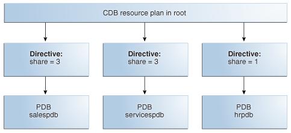
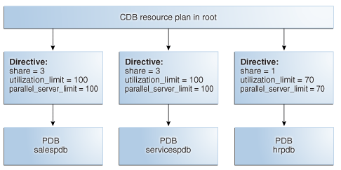
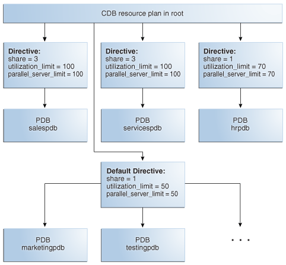

## 26 Managing Resources with Oracle Database Resource Manager

Oracle Database Resource Manager (Resource Manager) enables you to manage resource allocation for a database.

Note:

A multitenant container database is the only supported architecture in Oracle Database 21c. While the documentation is being revised, legacy terminology may persist. In most cases, "database" and "non-CDB" refer to a CDB or PDB, depending on context. In some contexts, such as upgrades, "non-CDB" refers to a non-CDB from a previous release.

Note:

This chapter discusses using PL/SQL package procedures to administer the Resource Manager. An easier way to administer the Resource Manager is with the graphical user interface of Oracle Enterprise Manager Cloud Control (Cloud Control). For instructions about administering Resource Manager with Cloud Control, see the Cloud Control online help.

To use Resource Manager with Cloud Control:

1. Access the Database Home Page.
2. From the Administration menu, select Resource Manager.

- About Oracle Database Resource Manager  
	Oracle Database Resource Manager (the Resource Manager) enables you to manage multiple workloads within a database that are contending for system and database resources.
- Enabling Oracle Database Resource Manager and Switching Plans  
	You enable Oracle Database Resource Manager (the Resource Manager) by setting the `RESOURCE_MANAGER_PLAN` initialization parameter. This parameter specifies the top plan, identifying the plan to be used for the current instance. If no plan is specified with this parameter, the Resource Manager is not enabled.
- Assigning Sessions to Resource Consumer Groups  
	There are automatic and manual methods that database administrators, users, and applications can use to assign sessions to resource consumer groups. When a session is assigned to a resource consumer group, Oracle Database Resource Manager (the Resource Manager) can manage resource allocation for it.
- Managing Resource Plans  
	Resource Manager allocates resources to pluggable databases (PDBs) in a multitenant container database (CDB).
- Putting It All Together: Oracle Database Resource Manager Examples  
	Examples illustrate how to allocate resources with Resource Manager.
- Managing Multiple Database Instances on a Single Server  
	Oracle Database provides a method for managing CPU allocations on a multi-CPU server running multiple database instances. This method is called instance caging. Instance caging and Oracle Database Resource Manager (the Resource Manager) work together to support desired levels of service across multiple instances.
- Maintaining Consumer Groups, Plans, and Directives  
	You can maintain consumer groups, resource plans, and resource plan directives for Oracle Database Resource Manager (the Resource Manager). You perform maintenance tasks using the `DBMS_RESOURCE_MANAGER` PL/SQL package.
- Viewing Database Resource Manager Configuration and Status  
	You can use several static data dictionary views and dynamic performance views to view the current configuration and status of Oracle Database Resource Manager (the Resource Manager).
- Interacting with Operating-System Resource Control  
	Many operating systems provide tools for resource management. These tools often contain "workload manager" or "resource manager" in their names, and are intended to allow multiple applications to share the resources of a single server, using an administrator-defined policy. Examples are Hewlett Packard's Process Resource Manager or Solaris Containers, Zones, and Resource Pools.
- Oracle Database Resource Manager Reference  
	Resource Manager includes predefined resource plans, consumer groups, and consumer groups mapping rules. You can query data dictionary views for information about your Resource Manager configuration.

**Parent topic:** [Database Resource Management and Task Scheduling](database-resource-management-and-task-scheduling.md)

### 26.1 About Oracle Database Resource Manager

Oracle Database Resource Manager (the Resource Manager) enables you to manage multiple workloads within a database that are contending for system and database resources.

Note:

The Resource Manager manages activity in the CDB root automatically.

- CDB and PDB Resource Management  
	Using Oracle Resource Manager (Resource Manager), you can create CDB resource plans and set initialization parameters to allocate resources to PDBs.
- Purpose of Resource Management  
	When database resource allocation decisions are left to the operating system, workload management can be problematic. The Resource Manager helps solve these problems.
- Consumer Groups, Plans, and Plan Directives  
	Resource Manager includes several elements that you can manage.
- User Interface for PDB Resource Management  
	You can manage PDB resources using `DBMS_RESOURCE_MANAGER` and initialization parameters.

**Parent topic:** Managing Resources with Oracle Database Resource Manager

#### 26.1.1 CDB and PDB Resource Management

Using Oracle Resource Manager (Resource Manager), you can create CDB resource plans and set initialization parameters to allocate resources to PDBs.

In a CDB, multiple workloads within multiple PDBs can complete for system and CDB resources. Resource Manager can manage resources on two levels: CDB and PDB.

CDB Resource Plans

A CDB resource plan allocates resources to its PDBs according to its set of resource plan directives (directives). A parent-child relationship exists between a CDB resource plan and its directives. Each resource plan directive references either a set of PDBs or an individual PDB.

A performance profile specifies shares of system resources for a set of PDBs. PDB performance profiles enable you to manage resources for large numbers of PDBs by specifying Resource Manager directives for profiles instead of individual PDBs.

The directives control allocation of CPU and parallel execution servers. A directive can control the allocation of resources to PDBs based on the share value that you specify for each PDB or PDB performance profile. A higher share value results in more guaranteed resources. For PDBs and PDB performance profiles, you can also set utilization limits for CPU and parallel servers.

You can create a CDB resource plan by using the `CREATE_CDB_PLAN` procedure in the `DBMS_RESOURCE_MANAGER` PL/SQL package, and set a CDB resource plan using the `RESOURCE_MANAGER_PLAN` parameter. You create directives for a CDB resource plan by using the `CREATE_CDB_PLAN_DIRECTIVE` procedure.

PDB Resource Plans

A CDB resource plan allocates a portion of the system resources to a PDB. A PDB resource plan determines how this portion is allocated within the PDB.

You can create a PDB resource plan by using the `CREATE_PLAN` procedure in the `DBMS_RESOURCE_MANAGER` PL/SQL package, and set a PDB resource plan using the `RESOURCE_MANAGER_PLAN` parameter. You create directives for a PDB resource plan by using the `CREATE_PLAN_DIRECTIVE` procedure.

PDB-Level Memory Controls

In a CDB, PDBs may contend for SGA or PGA memory. When you set the following initialization parameters with the PDB as the current container, the parameters limit the memory usage of the current PDB.

Examples of important parameters include:
- `SGA_TARGET` specifies the maximum SGA that the PDB can use at any time.
- `PGA_AGGREGATE_LIMIT` sets the maximum PGA that the PDB can use at any time.

The only shared memory sizing parameter that should be set for a PDB is `SGA_TARGET`, which specifies the maximum SGA that the PDB can use at any time.

PDB-Level I/O Controls

Intensive disk I/O can cause poor performance. Several factors can result in excess disk I/O, such as poorly designed SQL or index and table scans in high-volume transactions. If one PDB generates excessive disk I/O, then it can degrade the performance of other PDBs in the same CDB.

On non-Engineered Systems, use one or both of the following initialization parameters to limit the I/O generated by a particular PDB:

- `MAX_IOPS` limits the number of I/O operations for each second.
- `MAX_MBPS` limits the MB/s for I/O operations.

For Engineered Systems, manage PDB I/Os with I/O Resource Management.

See Also:

- Managing Resource Plans
- [Oracle Database Reference](https://docs.oracle.com/pls/topic/lookup?ctx=en/database/oracle/oracle-database/21/admin&id=GUID-68F83472-D74F-4C1D-B515-FC80C40CC61B) to learn more about `DB_CACHE_SIZE` and other initialization parameters
- [Oracle Database PL/SQL Packages and Types Reference](https://docs.oracle.com/pls/topic/lookup?ctx=en/database/oracle/oracle-database/21/admin&id=GUID-9876C289-99E4-416B-AB6F-D8318642053E) to learn more about the `DBMS_RESOURCE_MANAGER` package
- [Oracle Exadata Storage Server Software User's Guide](https://docs.oracle.com/pls/topic/lookup?ctx=en/database/oracle/oracle-database/21/admin&id=SAGUG20421) to learn more about I/O Resource Management

**Parent topic:** About Oracle Database Resource Manager

#### 26.1.2 Purpose of Resource Management

When database resource allocation decisions are left to the operating system, workload management can be problematic. The Resource Manager helps solve these problems.

- Purpose of Resource Management for a CDB  
	Resource Manager allows a CDB to have more control over how hardware resources are allocated.
- Purpose of Resource Management for PDBs  
	In a CDB, workloads within multiple PDBs can compete for system and CDB resources. Resource plans solve this problem.

**Parent topic:** About Oracle Database Resource Manager

##### 26.1.2.1 Purpose of Resource Management for a CDB

Resource Manager allows a CDB to have more control over how hardware resources are allocated.

Resource Management Problems for a CDB

When database resource allocation decisions are left to the operating system, you may encounter the following problems with workload management:

- Excessive overhead
	Excessive overhead results from operating system context switching between Oracle Database server processes when the number of server processes is high.
- Inefficient scheduling
	The operating system deschedules database servers while they hold latches, which is inefficient.
- Inappropriate allocation of resources
	The operating system distributes resources equally among all active processes and cannot prioritize one task over another.
- Inability to manage database-specific resources, such as parallel execution servers and active sessions

The Resource Manager Solution

The Resource Manager helps to overcome these problems by allowing a CDB more control over how hardware resources are allocated. In an environment with multiple concurrent user sessions that run jobs with differing priorities, all sessions should not be treated equally. The Resource Manager enables you to classify sessions into groups based on session attributes, and to then allocate resources to those groups in a way that optimizes hardware utilization for your application environment.

With the Resource Manager, you can:

- Guarantee certain sessions a minimum amount of CPU regardless of the load on the system and the number of users.
- Distribute available CPU by allocating percentages of CPU time to different users and applications. In a data warehouse, a higher percentage can be given to ROLAP (relational online analytical processing) applications than to batch jobs.
- Limit the degree of parallelism of any operation performed by members of a group of users.
- Manage the order of parallel statements in the parallel statement queue. Parallel statements from a critical application can be enqueued ahead of parallel statements from a low priority group of users.
- Limit the number of parallel execution servers that a group of users can use. This ensures that all the available parallel execution servers are not allocated to only one group of users.
- Create an active session pool. An active session pool consists of a specified maximum number of user sessions allowed to be concurrently active within a group of users. Additional sessions beyond the maximum are queued for execution, but you can specify a timeout period, after which queued jobs will terminate. The active session pool limits the total number of sessions actively competing for resources, thereby enabling active sessions to make faster progress.
- Monitor resources
	Automatically record statistics about resource usage. You can examine these statistics using real-time SQL monitoring and the Resource Manager dynamic performance views (the `V$RSRC_*` views). See " Monitoring Oracle Database Resource Manager " for information about using real-time SQL monitoring and the Resource Manager dynamic performance views.
- Limit the amount of PGA memory used by each session that belongs to a group of users.
- Manage runaway sessions or calls in the following ways:
	- By detecting when a session or call consumes more than a specified amount of CPU, physical I/O, logical I/O, or elapsed time, and then automatically either terminating the session or call, or switching to a consumer group with a lower resource allocation or a limit on the percentage of CPU that the group can use. The SQL statements that are terminated due to their excessive consumption of system resources are quarantined, that is, they are not allowed to run again by generating compilation errors during their subsequent runs.
		A logical I/O, also known as a buffer I/O, refers to reads and writes of buffers in the buffer cache. When a requested buffer is not found in memory, the database performs a physical I/O to copy the buffer from either disk or the flash cache into memory, and then a logical I/O to read the cached buffer.
		- By recording detailed information about SQL statements that consume more than a specified amount of CPU, physical I/O, logical I/O, or elapsed time with real-time SQL monitoring.
		- By using the Automatic Workload Repository (AWR) to analyze a persistent record of SQL statements that consume more than a specified amount of CPU, physical I/O, logical I/O, or elapsed time.
		- By logging information about a runaway session without taking any other action related to the session.
- Prevent the execution of operations that the optimizer estimates will run for a longer time than a specified limit.
- Limit the amount of time that a session can be idle. This can be further defined to mean only sessions that are blocking other sessions.
- Allow a database to use different resource plans, based on changing workload requirements. You can dynamically change the resource plan, for example, from a daytime resource plan to a nighttime resource plan, without having to shut down and restart the instance. You can also schedule a resource plan change with Oracle Scheduler. See [Oracle Scheduler Concepts](oracle-scheduler-concepts.md) for more information.

**Parent topic:** Purpose of Resource Management

##### 26.1.2.2 Purpose of Resource Management for PDBs

In a CDB, workloads within multiple PDBs can compete for system and CDB resources. Resource plans solve this problem.

Resource Management Problems for PDBs

When multiple PDBs in a CDB are contending for resources, you may encounter the following problems with workload management:

- Inappropriate allocation of resources among PDBs
	The operating system distributes resources equally among all active processes and cannot prioritize one task over another. Therefore, one or more PDBs might use an inordinate amount of the system resources, leaving the other PDBs starved for resources.
- Inappropriate allocation of resources within a single PDB
	One or more sessions connected to a single PDB might use an inordinate amount of the system resources, leaving other sessions connected to the same PDB starved for resources.
- Inconsistent performance of PDBs
	A single PDB might perform inconsistently when other PDBs are competing for more system resources or less system resources at various times.
- Lack of resource usage data for PDBs
	Resource usage data is critical for monitoring and tuning PDBs. Operating system monitoring tools are typically not useful because there are multiple PDBs running on the system.

The Resource Management Solution in the Multitenant Environment

Resource Manager helps to overcome these problems by enabling you to prioritize and limit the resource usage of specific PDBs. With the Resource Manager, you can:

- Specify that different PDBs should receive different shares of the system resources so that more resources are allocated to the more important PDBs
- Limit the CPU usage of a particular PDB
- Limit the number of parallel execution servers that a particular PDB can use
- Limit the memory usage of a particular PDB
- Specify the amount of memory guaranteed for a particular PDB
- Specify the maximum amount of memory a particular PDB can use
- Use PDB performance profiles for different sets of PDB
	A performance profile for a set of PDBs can specify shares of system resources, CPU usage, and number of parallel execution servers. PDB performance profiles enable you to manage resources for large numbers of PDBs by specifying Resource Manager directives for profiles instead of individual PDBs.
- Limit the resource usage of different sessions connected to a single PDB
- Limit the I/O generated by specific PDBs
- Monitor the resource usage of PDBs

**Parent topic:** Purpose of Resource Management

#### 26.1.3 Consumer Groups, Plans, and Plan Directives

Resource Manager includes several elements that you can manage.

**Parent topic:** About Oracle Database Resource Manager

##### 26.1.3.1 About the Elements of Resource Manager

The elements of the Resource Manager include resource consumer groups, resource plans, and resource plan directives.

| Element | Description |
| --- | --- |
| Resource consumer group | A group of sessions that are grouped together based on resource requirements. The Resource Manager allocates resources to resource consumer groups, not to individual sessions. |
| Resource plan | A container for directives that specify how resources are allocated to resource consumer groups. You specify how the database allocates resources by activating a specific resource plan. |
| Resource plan directive | Associates a resource consumer group with a particular plan and specifies how resources are to be allocated to that resource consumer group. |

You use the `DBMS_RESOURCE_MANAGER` PL/SQL package to create and maintain these elements. The elements are stored in tables in the data dictionary. You can view information about them with data dictionary views.

See Also:

" Resource Manager Data Dictionary Views "

**Parent topic:** Consumer Groups, Plans, and Plan Directives

##### 26.1.3.2 About Resource Consumer Groups

A resource consumer group (consumer group) is a collection of user sessions that are grouped together based on their processing needs.

When a session is created, it is automatically mapped to a consumer group based on mapping rules that you set up. As a database administrator (DBA), you can manually switch a session to a different consumer group. Similarly, an application can run a PL/SQL package procedure that switches its session to a particular consumer group.

Because the Resource Manager allocates resources (such as CPU) only to consumer groups, when a session becomes a member of a consumer group, its resource allocation is determined by the allocation for the consumer group.

There are special consumer groups that are always present in the data dictionary. They cannot be modified or deleted. They are:

- `SYS_GROUP`
	This is the initial consumer group for all sessions created by user accounts `SYS` or `SYSTEM`. This initial consumer group can be overridden by session-to-consumer group mapping rules.
- `OTHER_GROUPS`
	This consumer group contains all sessions that have not been assigned to a consumer group. Every resource plan must contain a directive to `OTHER_GROUPS`.

There can be no more than 28 resource consumer groups in any active plan.

- Consumer Groups for PDBs  
	In a CDB, background and administrative tasks map to the Resource Manager consumer groups that run them optimally.

See Also:

- Table 26-18
- " Specifying Session-to-Consumer Group Mapping Rules "

**Parent topic:** Consumer Groups, Plans, and Plan Directives

###### 26.1.3.2.1 Consumer Groups for PDBs

In a CDB, background and administrative tasks map to the Resource Manager consumer groups that run them optimally.

Resource Manager uses the following rules to map a task to a consumer group:

- A task is mapped to a consumer group in the container that starts the task.
	If a task starts in the CDB root, then the task maps to a consumer group in the CDB root. If the task starts in a PDB, then the task maps to a consumer group in the PDB.
- Many maintenance and administrative tasks automatically map to a consumer group.
	For example, automated maintenance tasks map to `ORA$AUTOTASK`. In certain cases, the tasks map to a consumer group, but the mapping is modifiable. Such tasks include RMAN backup, RMAN image copy, Oracle Data Pump, and In-Memory population.

Note:

[Oracle Database Administrator’s Guide](https://docs.oracle.com/pls/topic/lookup?ctx=en/database/oracle/oracle-database/21/admin&id=ADMIN-GUID-AC101C05-DD43-445C-85F7-0A04DCBC2EE0) to learn more about the mapping rules for predefined consumer groups

**Parent topic:** About Resource Consumer Groups

##### 26.1.3.3 About Resource Plan Directives

The Resource Manager allocates resources to consumer groups according to the set of resource plan directives (directives) that belong to the currently active resource plan.

There is a parent-child relationship between a resource plan and its resource plan directives. Each directive references one consumer group, and no two directives for the currently active plan can reference the same consumer group.

A directive has several ways in which it can limit resource allocation for a consumer group. For example, it can control how much CPU the consumer group gets as a percentage of total CPU, and it can limit the total number of sessions that can be active in the consumer group.

**CDB resource plan** allocates resources to its PDBs according to its set of resource plan directives (directives). A parent-child relationship exists between a CDB resource plan and its resource plan directives. Each directive references either a set of PDBs in a performance profile, or a single PDB. You can specify directives for both individual PDBs and for PDB performance profiles in the same CDB. No two directives for the currently active plan can reference the same PDB or the same PDB performance profile.

- Resources Managed by the Resource Manager  
	Resource plan directives specify how resources are allocated to resource consumer groups or subplans. Each directive can specify several different methods for allocating resources to its consumer group or subplan.
- Resource Plan Directives for PDBs  
	Directives control allocation of CPU and parallel execution servers.
- Performance Profiles for PDBs  
	A **PDB performance profile** configures resource plan directives for a set of PDBs that have the same priorities and resource controls.

**Parent topic:** Consumer Groups, Plans, and Plan Directives

###### 26.1.3.3.1 Resources Managed by the Resource Manager

Resource plan directives specify how resources are allocated to resource consumer groups or subplans. Each directive can specify several different methods for allocating resources to its consumer group or subplan.

- CPU  
	To manage CPU resources, Resource Manager allocates resources among consumer groups and redistributes CPU resources that were allocated but were not used. You can also set a limit on the amount of CPU resources that can be allocated to a particular consumer group.
- Exadata I/O  
	Management attributes enable you to specify CPU resource allocation for Exadata I/O.
- Parallel Execution Servers  
	Resource Manager can manage usage of the available parallel execution servers for a database.
- Program Global Area (PGA)  
	To manage PGA resources, Resource Manager can limit the amount of PGA memory that can be allocated to each session in a particular consumer group.
- Runaway Queries  
	Runaway sessions and calls can adversely impact overall performance if they are not managed properly. Resource Manager can take action when a session or call consumes more than a specified amount of CPU, physical I/O, logical I/O, or elapsed time. Resource Manager can either switch the session or call to a consumer group that is allocated a small amount of CPU or terminate the session or call.
- Active Session Pool with Queuing  
	You can control the maximum number of concurrently active sessions allowed within a consumer group. This maximum defines the active session pool.
- Undo Pool  
	You can specify an undo pool for each consumer group. An undo pool controls the total amount of undo for uncommitted transactions that can be generated by a consumer group.
- Idle Time Limit  
	You can specify an amount of time that a session can be idle, after which it is terminated.

**Parent topic:** About Resource Plan Directives

###### 26.1.3.3.1.1 CPU

To manage CPU resources, Resource Manager allocates resources among consumer groups and redistributes CPU resources that were allocated but were not used. You can also set a limit on the amount of CPU resources that can be allocated to a particular consumer group.

- Management Attributes  
	Management attributes enable you to specify how CPU resources are to be allocated among consumer groups and subplans.
- Utilization Limit  
	Use the `UTILIZATION_LIMIT` attribute to impose an absolute upper limit on CPU utilization for a resource consumer group. This absolute limit overrides any redistribution of CPU within a plan.

**Parent topic:** Resources Managed by the Resource Manager

###### 26.1.3.3.1.1.1 Management Attributes

Management attributes enable you to specify how CPU resources are to be allocated among consumer groups and subplans.

Multiple levels of CPU resource allocation (up to eight levels) provide a means of prioritizing CPU usage within a plan. Consumer groups and subplans at level 2 get resources that were not allocated at level 1 or that were allocated at level 1 but were not completely consumed by a consumer group or subplan at level 1. Similarly, resource consumers at level 3 are allocated resources only when some allocation remains from levels 1 and 2. The same rules apply to levels 4 through 8. Multiple levels not only provide a way of prioritizing, but they provide a way of explicitly specifying how all primary and leftover resources are to be used.

Use the management attributes `MGMT_P` `n`, where n is an integer between 1 and 8, to specify multiple levels of CPU resource allocation. For example, use the `MGMT_P1` directive attribute to specify CPU resource allocation at level 1 and `MGMT_P2` directive attribute to specify resource allocation at level 2.

Use management attributes with parallel statement directive attributes, such as Degree of Parallelism Limit and Parallel Server Limit, to control parallel statement queuing. When parallel statement queuing is used, management attributes are used to determine which consumer group is allowed to issue the next parallel statement. For example, if you set the `MGMT_P1` directive attribute for a consumer group to 80, that group has an 80% chance of issuing the next parallel statement.

See Also:

[Oracle Database VLDB and Partitioning Guide](https://docs.oracle.com/pls/topic/lookup?ctx=en/database/oracle/oracle-database/21/admin&id=VLDBG1396) for information about parallel statement queuing

Table 26-1 illustrates a simple resource plan with three levels.

Table 26-1 A Simple Three-Level Resource Plan

| Consumer Group | Level 1 CPU Allocation | Level 2 CPU Allocation | Level 3 CPU Allocation |
| --- | --- | --- | --- |
| `HIGH_GROUP` | 80% |  |  |
| `LOW_GROUP` |  | 50% |  |
| `MAINT_SUBPLAN` |  | 50% |  |
| `OTHER_GROUPS` |  |  | 100% |

High priority applications run within `HIGH_GROUP`, which is allocated 80% of CPU. Because `HIGH_GROUP` is at level one, it gets priority for CPU utilization, but only up to 80% of CPU. This leaves a remaining 20% of CPU to be shared 50-50 by `LOW_GROUP` and the `MAINT_SUPLAN` at level 2. Any unused allocation from levels 1 and 2 are then available to `OTHER_GROUPS` at level 3. Because `OTHER_GROUPS` has no sibling consumer groups or subplans at its level, 100% is specified.

Within a particular level, CPU allocations are not fixed. If there is not sufficient load in a particular consumer group or subplan, residual CPU can be allocated to remaining consumer groups or subplans. Thus, when there is only one level, unused allocation by any consumer group or subplan can be redistributed to other "sibling" consumer groups or subplans. If there are multiple levels, then the unused allocation is distributed to the consumer groups or subplans at the next level. If the last level has unused allocations, these allocations can be redistributed to all other levels in proportion to their designated allocations.

As an example of redistribution of unused allocations from one level to another, if during a particular period, `HIGH_GROUP` consumes only 25% of CPU, then 75% is available to be shared by `LOW_GROUP` and `MAINT_SUBPLAN`. Any unused portion of the 75% at level 2 is then made available to `OTHER_GROUPS` at level 3. However, if `OTHER_GROUPS` has no session activity at level 3, then the 75% at level 2 can be redistributed to all other consumer groups and subplans in the plan proportionally.

**Parent topic:** CPU

###### 26.1.3.3.1.1.2 Utilization Limit

Use the `UTILIZATION_LIMIT` attribute to impose an absolute upper limit on CPU utilization for a resource consumer group. This absolute limit overrides any redistribution of CPU within a plan.

In the previous scenario, suppose that due to inactivity elsewhere, `LOW_GROUP` acquires 90% of CPU. Suppose that you do not want to allow `LOW_GROUP` to use 90% of the server because you do not want non-critical sessions to inundate the CPUs. The `UTILIZATION_LIMIT` attribute of resource plan directives can prevent this situation.

Setting the `UTILIZATION_LIMIT` attribute is optional. If you omit this attribute for a consumer group, there is no limit on the amount of CPU that the consumer group can use. Therefore, if all the other applications are idle, a consumer group that does not have `UTILIZATION_LIMIT` set can be allocated 100% of the CPU resources.

You can also use the `UTILIZATION_LIMIT` attribute as the sole means of limiting CPU utilization for consumer groups, without specifying level limits.

Table 26-2 shows a variation of the previous plan. In this plan, using `UTILIZATION_LIMIT`, CPU utilization is capped at 75% for `LOW_GROUP`, 50% for `MAINT_SUBPLAN`, and 75% for `OTHER_GROUPS`. (Note that the sum of all utilization limits can exceed 100%. Each limit is applied independently.)

Table 26-2 A Three-Level Resource Plan with Utilization Limits

| Consumer Group | Level 1 CPU Allocation | Level 2 CPU Allocation | Level 3 CPU Allocation | Utilization Limit |
| --- | --- | --- | --- | --- |
| `HIGH_GROUP` | 80% |  |  |  |
| `LOW_GROUP` |  | 50% |  | 75% |
| `MAINT_SUBPLAN` |  | 50% |  | 50% |
| `OTHER_GROUPS` |  |  | 100% | 75% |

In the example described in Table 26-2, if `HIGH_GROUP` is using only 10% of the CPU at a given time, then the remaining 90% is available to `LOW_GROUP` and the consumer groups in `MAINT_SUBPLAN` at level 2. If `LOW_GROUP` uses only 20% of the CPU, then 70% can be allocated to `MAINT_SUBPLAN`. However, `MAINT_SUBPLAN` has a `UTILIZATION_LIMIT` of 50%. Therefore, even though more CPU resources are available, the server cannot allocate more than 50% of the CPU to the consumer groups that belong to the subplan `MAINT_SUBPLAN`.

You can set `UTILIZATION_LIMIT` for both a subplan and the consumer groups that the subplan contains. In such cases, the limit for a consumer group is computed using the limits specified for the subplan and that consumer group. For example, the `MAINT_SUBPLAN` contains the consumer groups `MAINT_GROUP1` and `MAINT_GROUP2`. `MAINT_GROUP1` has `UTILIZATION_LIMIT` set to 40%. However, the limit for `MAINT_SUBPLAN` is set to 50%. Therefore, the limit for consumer group `MAINT_GROUP1` is computed as 40% of 50%, or 20%. For an example of how to compute `UTILIZATION_LIMIT` for a consumer group when limits are specified for both the consumer group and the subplan to which the group belongs, see " Example 4 - Specifying a Utilization Limit for Consumer Groups and Subplans ".

See Also:

- " Creating Resource Plan Directives "
- " Putting It All Together: Oracle Database Resource Manager Examples "

**Parent topic:** CPU

###### 26.1.3.3.1.2 Exadata I/O

Management attributes enable you to specify CPU resource allocation for Exadata I/O.

See Also:

The Exadata documentation for information about using management attributes for Exadata I/O

**Parent topic:** Resources Managed by the Resource Manager

###### 26.1.3.3.1.3 Parallel Execution Servers

Resource Manager can manage usage of the available parallel execution servers for a database.

- Degree of Parallelism Limit  
	You can limit the maximum degree of parallelism for any operation within a consumer group. Use the `PARALLEL_DEGREE_LIMIT_P1` directive attribute to specify the degree of parallelism for a consumer group.
- Parallel Server Limit  
	Use the `PARALLEL_SERVER_LIMIT` directive attribute to specify the maximum percentage of the parallel execution server pool that a particular consumer group can use. The number of parallel execution servers used by a particular consumer group is counted as the sum of the parallel execution servers used by all sessions in that consumer group.
- Parallel Queue Timeout  
	The `PARALLEL_QUEUE_TIMEOUT` directive attribute enables you to specify the maximum time, in seconds, that a parallel statement can wait in the parallel statement queue before it is timed out.

**Parent topic:** Resources Managed by the Resource Manager

###### 26.1.3.3.1.3.1 Degree of Parallelism Limit

You can limit the maximum degree of parallelism for any operation within a consumer group. Use the `PARALLEL_DEGREE_LIMIT_P1` directive attribute to specify the degree of parallelism for a consumer group.

The degree of parallelism limit applies to one operation within a consumer group; it does not limit the total degree of parallelism across all operations within the consumer group. However, you can combine both the `PARALLEL_DEGREE_LIMIT_P1` and the `PARALLEL_SERVER_LIMIT` directive attributes to achieve the desired control. For more information about the `PARALLEL_SERVER_LIMIT` attribute, see " Parallel Server Limit ".

See Also:

[Oracle Database VLDB and Partitioning Guide](https://docs.oracle.com/pls/topic/lookup?ctx=en/database/oracle/oracle-database/21/admin&id=VLDBG14020) for more information about degree of parallelism in producer/consumer operations

**Parent topic:** Parallel Execution Servers

###### 26.1.3.3.1.3.2 Parallel Server Limit

Use the `PARALLEL_SERVER_LIMIT` directive attribute to specify the maximum percentage of the parallel execution server pool that a particular consumer group can use. The number of parallel execution servers used by a particular consumer group is counted as the sum of the parallel execution servers used by all sessions in that consumer group.

It is possible for a single consumer group to launch enough parallel statements to use all of the available parallel execution servers. If this happens when a high-priority parallel statement from a different consumer group is run, then no parallel execution servers are available to allocate to this group. You can avoid such a scenario by limiting the number of parallel execution servers that can be used by a particular consumer group. You can also set the directive `PARALLEL_STMT_CRITICAL` to `BYPASS_QUEUE` for the high-priority consumer group so that parallel statements from the consumer group bypass the parallel statement queue.

For example, assume that the total number of parallel execution servers is 32, as set by the `PARALLEL_SERVERS_TARGET` initialization parameter, and the `PARALLEL_SERVER_LIMIT` directive attribute for the consumer group `MY_GROUP` is set to 50%. This consumer group can use a maximum of 50% of 32, or 16 parallel execution servers.

If your resource plan has management attributes (`MGMT_P1`, `MGMT_P2`, and so on), then a separate parallel statement queue is managed as a First In First Out (FIFO) queue for each management attribute.

If your resource plan does not have any management attributes, then a single parallel statement queue is managed as a FIFO queue.

In the case of an Oracle Real Application Clusters (Oracle RAC) environment, the target number of parallel execution servers is the sum of (`PARALLEL_SERVER_LIMIT` \* `PARALLEL_SERVERS_TARGET` / 100) across all Oracle RAC instances. If a consumer group is using the number of parallel execution servers computed above or more, then it has exceeded its limit, and its parallel statements will be queued.

If a consumer group does not have any parallel statements running within an Oracle RAC database, then the first parallel statement is allowed to exceed the limit specified by `PARALLEL_SERVER_LIMIT`.

Note:

In an Oracle Real Application Clusters (Oracle RAC) environment, the `PARALLEL_SERVER_LIMIT` attribute applies to the entire cluster and not to a single instance.

- Managing Parallel Statement Queuing Using Parallel Server Limit  
	The `PARALLEL_SERVER_LIMIT` attribute enables you to specify when parallel statements from a consumer group can be queued. Oracle Database maintains a separate parallel statement queue for each consumer group.

See Also:

- " Creating Resource Plan Directives "
- " Managing Parallel Statement Queuing Using Parallel Server Limit "
- [Oracle Database VLDB and Partitioning Guide](https://docs.oracle.com/pls/topic/lookup?ctx=en/database/oracle/oracle-database/21/admin&id=VLDBG1396) for information about parallel statement queuing

**Parent topic:** Parallel Execution Servers

###### 26.1.3.3.1.3.2.1 Managing Parallel Statement Queuing Using Parallel Server Limit

The `PARALLEL_SERVER_LIMIT` attribute enables you to specify when parallel statements from a consumer group can be queued. Oracle Database maintains a separate parallel statement queue for each consumer group.

A parallel statement from a consumer group is not run and instead is added to the parallel statement queue of that consumer group if the following conditions are met:

- `PARALLEL_DEGREE_POLICY` is set to `AUTO`.
	Setting this initialization parameter to `AUTO` enables automatic degree of parallelism (Auto DOP), parallel statement queuing, and in-memory parallel execution.
	Note that parallel statements which have `PARALLEL_DEGREE_POLICY` set to `MANUAL` or `LIMITED` are executed immediately and are not added to the parallel statement queue.
- The number of active parallel execution servers across all consumer groups exceeds the `PARALLEL_SERVERS_TARGET` initialization parameter setting. This condition applies regardless of whether you specify `PARALLEL_SERVER_LIMIT`. If `PARALLEL_SERVER_LIMIT` is not specified, then it defaults to 100%.
- The sum of the number of active parallel execution servers for the consumer group and the degree of parallelism of the parallel statement exceeds the target number of active parallel execution servers.
	The target number of active parallel execution servers is computed as follows:
	`PARALLEL_SERVER_LIMIT` /100 \* `PARALLEL_SERVERS_TARGET`

Note:

Although parallel execution server usage is monitored for all sessions, the parallel execution server directive attributes you set affect only sessions for which parallel statement queuing is enabled (`PARALLEL_DEGREE_POLICY` is set to `AUTO`). If a session has the `PARALLEL_DEGREE_POLICY` set to `MANUAL`, parallel statements from this session are not queued. However, any parallel execution servers used by such sessions are included in the count that is used to determine the limit for `PARALLEL_SERVER_LIMIT`. Even if this limit is exceeded, parallel statements from this session are not queued.

See Also:

" Parallel Server Limit "

**Parent topic:** Parallel Server Limit

###### 26.1.3.3.1.3.3 Parallel Queue Timeout

The `PARALLEL_QUEUE_TIMEOUT` directive attribute enables you to specify the maximum time, in seconds, that a parallel statement can wait in the parallel statement queue before it is timed out.

When you use parallel statement queuing, if the database does not have sufficient resources to execute a parallel statement, the statement is queued until the required resources become available. However, there is a chance that a parallel statement may be waiting in the parallel statement queue for longer than is desired. You can prevent such scenarios by specifying the maximum time a parallel statement can wait in the parallel statement queue.

The `PARALLEL_QUEUE_TIMEOUT` attribute can be set for each consumer group. This attribute is applicable even if you do not specify other management attributes (`MGMT_P1`, `MGMT_P2`, and so on) in your resource plan.

See Also:

[Oracle Database VLDB and Partitioning Guide](https://docs.oracle.com/pls/topic/lookup?ctx=en/database/oracle/oracle-database/21/admin&id=VLDBG1396) for more information about parallel statement queuing

Note:

Because the parallel statement queue is clusterwide, all directives related to the parallel statement queue are also clusterwide.

You can control how a timed out parallel statement is handled by setting the `PQ_TIMEOUT_ACTION` attribute for each consumer group. You can set this attribute to the following values:

- `CANCEL` - The statement execution ends with the error `ORA-07454`. This is the default action for a timed out parallel statement.
- `RUN` - The statement runs immediately. If there are not sufficient parallel servers to run the statement immediately, then the statement is downgraded to run at a lower degree of parallelism.

See Also:

" Example of Managing Parallel Statements Using Directive Attributes " for more information about the combined use of all the parallel execution server directive attributes

**Parent topic:** Parallel Execution Servers

###### 26.1.3.3.1.4 Program Global Area (PGA)

To manage PGA resources, Resource Manager can limit the amount of PGA memory that can be allocated to each session in a particular consumer group.

To limit the PGA resources for each session in a consumer group, set the `session_pga_limit` parameter in the package procedure `DBMS_RESOURCE_MANAGER.CREATE_PLAN_DIRECTIVE`. The value of this parameter is the maximum amount of PGA memory, in megabytes, allowed for each session in the consumer group. If a session exceeds the limit set for its consumer group, then error ORA-10260 is raised. This limit includes parallel query slaves and job queue processes.

For example, poorly written PL/SQL code can consume an unbounded amount of PGA. You can use the `session_pga_limit` parameter to limit sessions that run PL/SQL code to ensure that those sessions do not use an inordinate amount of PGA resource.

The following table illustrates a simple resource plan with PGA limits.

Table 26-3 A Simple Resource Plan with PGA Limits

| Consumer Group | session\_pga\_limit Value |
| --- | --- |
| `HIGH_GROUP` | 20 |
| `LOW_GROUP` | 10 |
| `MAINT_SUBPLAN` | Null (unlimited) |
| `OTHER_GROUPS` | Null (unlimited) |

In this resource plan, high priority applications run within `HIGH_GROUP`, and each session in that group is limited to 20 MB of PGA resource. The sessions used by the lower priority applications within `LOW_GROUP` are limited to 10 MB of PGA resource. The sessions used for maintenance jobs within `MAINT_SUPLAN` and other sessions within `OTHER_GROUPS` can use unlimited PGA resource.

Note:

You can limit the PGA usage of a whole instance with the `PGA_AGGREGATE_LIMIT` initialization parameter.

**Parent topic:** Resources Managed by the Resource Manager

###### 26.1.3.3.1.5 Runaway Queries

Runaway sessions and calls can adversely impact overall performance if they are not managed properly. Resource Manager can take action when a session or call consumes more than a specified amount of CPU, physical I/O, logical I/O, or elapsed time. Resource Manager can either switch the session or call to a consumer group that is allocated a small amount of CPU or terminate the session or call.

Note:

Starting with Oracle Database 12c Release 2 (12.2), Resource Manager can also limit the amount of PGA memory that can be allocated to each session in a particular consumer group.

- Automatic Consumer Group Switching  
	You can control resource allocation by specifying criteria that, if met, causes the automatic switching of a session to a specified consumer group.
- Canceling SQL and Terminating Sessions  
	You can use the Resource Manager to cancel long-running SQL queries or to terminate long-running sessions based on their amount of consumption of system resources, such as CPU and I/O.
- Execution Time Limit  
	You can specify a maximum execution time allowed for an operation.

See Also:

" Program Global Area (PGA) "

**Parent topic:** Resources Managed by the Resource Manager

###### 26.1.3.3.1.5.1 Automatic Consumer Group Switching

You can control resource allocation by specifying criteria that, if met, causes the automatic switching of a session to a specified consumer group.

Typically, this method is used to switch a session from a high-priority consumer group—one that receives a high proportion of system resources—to a lower priority consumer group because that session exceeded the expected resource consumption for a typical session in the group.

See " Specifying Automatic Switching by Setting Resource Limits " for more information.

**Parent topic:** Runaway Queries

###### 26.1.3.3.1.5.2 Canceling SQL and Terminating Sessions

You can use the Resource Manager to cancel long-running SQL queries or to terminate long-running sessions based on their amount of consumption of system resources, such as CPU and I/O.

The SQL queries canceled by the Resource Manager can be configured for quarantine using the `DBMS_SQLQ` package subprograms, so that those queries are not allowed to run again.

See Also:

- " Specifying Automatic Switching by Setting Resource Limits " for more information about how to configure the Resource Manager to cancel SQL queries or to terminate sessions based on their consumption of system resources
- " [Quarantine for Execution Plans for SQL Statements Consuming Excessive System Resources](diagnosing-and-resolving-problems.md) " for more information about how to configure quarantine settings for SQL queries using the `DBMS_SQLQ` package subprograms

**Parent topic:** Runaway Queries

###### 26.1.3.3.1.5.3 Execution Time Limit

You can specify a maximum execution time allowed for an operation.

If the database estimates that an operation will run longer than the specified maximum execution time, then the operation is terminated with an error. This error can be trapped and the operation rescheduled.

**Parent topic:** Runaway Queries

###### 26.1.3.3.1.6 Active Session Pool with Queuing

You can control the maximum number of concurrently active sessions allowed within a consumer group. This maximum defines the active session pool.

An active session is a session that is actively processing a transaction or SQL statement. Specifically, an active session is either in a transaction, holding a user enqueue, or has an open cursor and has not been idle for over 5 seconds. An active session is considered active even if it is blocked, for example waiting for an I/O request to complete. When the active session pool is full, a session that is trying to process a call is placed into a queue. When an active session completes, the first session in the queue can then be removed from the queue and scheduled for execution. You can also specify a period after which a session in the execution queue times out, causing the call to terminate with an error.

Active session limits should not be used for OLTP workloads. In addition, active session limits should not be used to implement connection pooling or parallel statement queuing.

To manage parallel statements, you must use parallel statement queuing with the `PARALLEL_SERVER_LIMIT` attribute and management attributes (`MGMT_P1`, `MGMT_P2`, and so on).

**Parent topic:** Resources Managed by the Resource Manager

###### 26.1.3.3.1.7 Undo Pool

You can specify an undo pool for each consumer group. An undo pool controls the total amount of undo for uncommitted transactions that can be generated by a consumer group.

When the total undo generated by a consumer group exceeds its undo limit, the current DML statement generating the undo is terminated. No other members of the consumer group can perform further data manipulation until undo space is freed from the pool.

**Parent topic:** Resources Managed by the Resource Manager

###### 26.1.3.3.1.8 Idle Time Limit

You can specify an amount of time that a session can be idle, after which it is terminated.

You can also specify a more stringent idle time limit that applies to sessions that are idle and blocking other sessions.

**Parent topic:** Resources Managed by the Resource Manager

###### 26.1.3.3.2 Resource Plan Directives for PDBs

Directives control allocation of CPU and parallel execution servers.

A directive can control the allocation of resources to PDBs based on the share value that you specify for each PDB or PDB performance profile. A higher share value results in more resources. The settings apply to the set of PDBs that use each profile.

For example, you can specify that `salespdb` is allocated double the resources allocated to `hrpdb` by setting the share value for `salespdb` twice as high as the share value for `hrpdb`. Similarly, you can specify that the `salespdb` performance profile is allocated double the resources allocated to the `hrpdb` performance profile by setting the share value for the `salespdb` performance profile twice as high as the share value for the `hrpdb` performance profile.

You can also specify utilization limits for PDBs and PDB performance profiles. The limit controls allocation to the PDB or performance profile. For example, the limit can control how much CPU `salespdb` gets as a percentage of the total CPU available to the CDB.

You can use both shares and utilization limits together for precise control over the resources allocated to each PDB and PDB performance profile in a CDB.

See Also:

[Oracle Database SQL Language Reference](https://docs.oracle.com/pls/topic/lookup?ctx=en/database/oracle/oracle-database/21/admin&id=MULTI-GUID-3B2EF996-3BE8-413D-968C-14339FACFC12) for more information about PDB lockdown profiles

**Parent topic:** About Resource Plan Directives

###### 26.1.3.3.3 Performance Profiles for PDBs

A **PDB performance profile** configures resource plan directives for a set of PDBs that have the same priorities and resource controls.

For example, you might create a performance profiles called Gold, Silver, and Bronze. Each profile specifies a different set of directives depending on the importance of the type of PDB. Gold PDBs are more mission critical than Silver PDBs, which are more mission critical than Bronze PDBs. A PDB specifies its performance profile with the `DB_PERFORMANCE_PROFILE` initialization parameter.

You can use PDB lockdown profiles to specify PDB initialization parameters that control resources, such as `SGA_TARGET` and `PGA_AGGREGATE_LIMIT`. A lockdown profile prevents the PDB administrator from modifying the settings.

Oracle recommends using matching names for performance profiles and lockdown profiles. To prevent PDB owners from switching profiles, Oracle recommends putting the PDB performance profile in the PDB lockdown profile.

**Parent topic:** About Resource Plan Directives

##### 26.1.3.4 About Resource Plans

A resource plan is a container for directives that specify how resources are allocated to resource consumer groups.

In addition to the resource plans that are predefined for each Oracle database, you can create any number of resource plans. However, only one resource plan is active at a time. When a resource plan is active, each of its child resource plan directives controls resource allocation for a different consumer group. Each plan must include a directive that allocates resources to the consumer group named `OTHER_GROUPS`. `OTHER_GROUPS` applies to all sessions that belong to a consumer group that is not part of the currently active plan.

Note:

Although the term "resource plan" (or just "plan") denotes one element of the Resource Manager, in this chapter it is also used to refer to a complete resource plan schema, which includes the resource plan element itself, its resource plan directives, and the consumer groups that the directives reference. For example, when this chapter refers to the `DAYTIME` resource plan, it could mean either the resource plan element named `DAYTIME`, or the particular resource allocation schema that the `DAYTIME` resource plan and its directives define. Thus, for brevity, it is acceptable to say, "the `DAYTIME` plan favors interactive applications over batch applications."

- About CDB Resource Plans  
	Create CDB resource plans that allocate shares and resource limits for PDBs.
- About PDB Resource Plans  
	A PDB resource plan determines how the resources for a specific PDB are allocated to consumer groups within this PDB.
- Example: A Simple Resource Plan  
	An example illustrates a simple resource plan.

**Parent topic:** Consumer Groups, Plans, and Plan Directives

###### 26.1.3.4.1 About CDB Resource Plans

Create CDB resource plans that allocate shares and resource limits for PDBs.

- Shares for Allocating Resources to PDBs  
	To allocate resources among PDBs, assign a share value to each PDB or performance profile. A higher share value results in more guaranteed resources for a PDB or the PDBs that use the performance profile.
- Utilization Limits for PDBs  
	A utilization limit restrains the system resource usage of a specific PDB or a specific PDB performance profile.
- The Default Directive for PDBs  
	When you do not explicitly define directives for a PDB, the PDB uses the default directive for PDBs.

**Parent topic:** About Resource Plans

###### 26.1.3.4.1.1 Shares for Allocating Resources to PDBs

To allocate resources among PDBs, assign a share value to each PDB or performance profile. A higher share value results in more guaranteed resources for a PDB or the PDBs that use the performance profile.

Specify a share value for a PDB using the `DBMS_RESOURCE_MANAGER.CREATE_CDB_PLAN_DIRECTIVE` procedure and for a PDB performance profile using the `DBMS_RESOURCE_MANAGER.CREATE_CDB_PROFILE_DIRECTIVE` procedure. In both cases, the `shares` parameter specifies the share value for the PDB. Multiple PDBs can use the same PDB performance profile.

The following figure shows an example of three PDBs with share values specified for them in a CDB resource plan.

Figure 26-1 Shares in a CDB Resource Plan



> This illustration shows a CDB resource plan in root. The plan includes three directives, and each directive specifies a share for a PDB. One directive specifies three shares for the salespdb PDB, a second share specifies three shares for the servicespdb PDB, and a third directive specifies one share for the hrpdb PDB.


The preceding figure shows that the total number of shares is seven (3 plus 3 plus 1). The `salespdb` and the `servicespdb` PDB are each guaranteed 3/7 of the resources, while the `hrpdb` PDB is guaranteed 1/7 of the resources. However, any PDB can use more than the guaranteed amount of a resource when no resource contention exists.

The following table shows the resource allocation to the PDBs in the preceding figure based on the share values. The table assumes that loads of the PDBs consume all system resources allocated.

Table 26-4 Resource Allocation for Sample PDBs

| Resource | Resource Allocation | See Also |
| --- | --- | --- |
| CPU | The `salespdb` and `servicespdb` PDBs can consume the same amount of CPU resources. The `salespdb` and `servicespdb` PDBs are each guaranteed three times more CPU resource than the `hrpdb` PDB. | CPU for more information about this resource |
| Parallel execution servers | Queued parallel queries from the `salespdb` and `servicespdb` PDBs are selected equally. Queued parallel queries from the `salespdb` and `servicespdb` PDBs are selected three times as often as queued parallel queries from the `hrpdb` PDB. | Degree of Parallelism Limit for more information about this resource |

**Parent topic:** About CDB Resource Plans

###### 26.1.3.4.1.2 Utilization Limits for PDBs

A utilization limit restrains the system resource usage of a specific PDB or a specific PDB performance profile.

You can specify utilization limits for CPU and parallel execution servers. Utilization limits for a PDB are set by the CDB resource plan.

The following table describes utilization limits for PDBs and the Resource Manager action taken when a PDB reaches a utilization limit. For limits specified with a PDB performance profile, the limit applies to every PDB that uses the PDB performance profile. For example, if `pdb1` and `pdb20` have a performance profile `BRONZE`, and if `BRONZE` has a limit set to 10%, then `pdb1` has a 10% limit and `pdb20` has a 10% limit.

Table 26-5 Utilization Limits for PDBs

| Resource | Resource Utilization Limit | Resource Manager Action When Limit Is Reached |
| --- | --- | --- |
| CPU | The CPU utilization limit for sessions connected to a PDB is set by the `utilization_limit` parameter in subprograms of the `DBMS_RESOURCE_MANAGER` package. The `utilization_limit` parameter specifies the percentage of the system resources that a PDB can use. The value ranges from 0 to 100.  You can also limit CPU for a PDB by setting the initialization parameters `CPU_COUNT` (upper limit) and `CPU_MIN_COUNT` (lower limit). For example, if you set `CPU_COUNT` to `8` and `CPU_MIN_COUNT` to `.1` at the PDB level, then the PDB cannot use more than 8 CPU threads at any time and must have at least 1 CPU thread 10% of the time. If both `utilization_limit` and `CPU_COUNT` are specified, then the more restrictive (lower) value is enforced. | Resource Manager throttles the PDB sessions so that the CPU utilization for the PDB does not exceed the utilization limit. |
| Parallel execution servers | You can limit the number of parallel execution servers in a PDB by means of parallel statement queuing. The limit is a “queuing point” because the database queues parallel queries when the limit is reached.  You can set the limit (queuing point) in either of the following ways:  - The value of the `PARALLEL_SERVERS_TARGET` initialization parameter setting in the PDB - The value of the `PARALLEL_SERVERS_TARGET` initialization parameter setting in the CDB root multiplied by the value of the `parallel_server_limit` directive set for the PDB in the CDB resource manager plan 	For example, if the `PARALLEL_SERVERS_TARGET` initialization parameter is set to 200 in the CDB root, and if the `parallel_server_limit` directive for a PDB is set to 10%, then utilization limit for the PDB is 20 parallel execution servers (200 \*.10).  If the limit is set in both preceding ways, then the lower limit of the two is used. See [Oracle Database Reference](https://docs.oracle.com/pls/topic/lookup?ctx=en/database/oracle/oracle-database/21/admin&id=REFRN-GUID-B6CE9EA3-B846-4AA7-B668-FD3BEE433A24) for the default value for `PARALLEL_SERVERS_TARGET`.  Note: Oracle recommends using the `PARALLEL_SERVERS_TARGET` initialization parameter instead of the `parallel_server_limit` directive in a CDB plan. | Resource Manager queues parallel queries when the number of parallel execution servers used by the PDB would exceed the limit.  Note: In a CDB, parallel statements are queued based on the `PARALLEL_SERVERS_TARGET` settings at both the PDB and CDB level. A statement is queued when the number of parallel servers used by the PDB exceeds the target for the PDB or when the number of parallel servers used by all PDBs exceeds the target for the CDB. |

The following figure shows an example of three PDBs with shares and utilization limits specified for them in a CDB resource plan.

Figure 26-2 Shares and Utilization Limits in a CDB Resource Plan



> This illustration shows a CDB resource plan in root. The plan includes three directives, and each directive specifies a share, a utilization\_limit, and a parallel\_server\_limit for a PDB. One directive specifies the following for the salespdb PDB:
>
> - share = 3
> - utilization\_limit = 100
> - parallel\_server\_limit = 100
> - memory\_limit = 100
>
> A second directive specifies the following for the servicespdb PDB:
>
> - share = 3
> - utilization\_limit = 100
> - parallel\_server\_limit = 100
> - memory\_limit = 100
>
> A third directive specifies the following for the hrpdb PDB:
>
> - share = 1
> - utilization\_limit = 70
> - parallel\_server\_limit = 70
> - memory\_limit = 70


The preceding figure shows that there are no utilization limits on the `salespdb` and `servicespdb` PDBs because `utilization_limit` and `parallel_server_limit` are both set to 100% for them. However, the `hrpdb` PDB is limited to 70% of the applicable system resources because `utilization_limit` and `parallel_server_limit` are both set to 70%.

Note:

This scenario assumes that the `PARALLEL_SERVERS_TARGET` initialization parameter does not specify a lower limit in a PDB. When the `PARALLEL_SERVERS_TARGET` initialization parameter specifies a lower limit for parallel execution servers in a PDB, the lower limit is used.

See Also:

- Parallel Execution Servers
- [Oracle Database Reference](https://docs.oracle.com/pls/topic/lookup?ctx=en/database/oracle/oracle-database/21/admin&id=REFRN-GUID-78CDCDE7-5A1D-4AC1-B5BD-B185CB296416) to learn about `CPU_COUNT`

**Parent topic:** About CDB Resource Plans

###### 26.1.3.4.1.3 The Default Directive for PDBs

When you do not explicitly define directives for a PDB, the PDB uses the default directive for PDBs.

The following table shows the attributes of the initial default directive for PDBs.

Table 26-6 Initial Default Directive Attributes for PDBs

| Directive Attribute | Value |
| --- | --- |
| `shares` | 1 |
| `utilization_limit` | 100 |
| `parallel_server_limit` | 100 |

When a PDB is plugged into a CDB and no directive is defined for it, the PDB uses the default directive for PDBs.

You can create new directives for the new PDB. You can also change the default directive attribute values for PDBs by using the `UPDATE_CDB_DEFAULT_DIRECTIVE` procedure in the `DBMS_RESOURCE_MANAGER` package.

When a PDB is unplugged from a CDB, the directive for the PDB is retained. If the same PDB is plugged back into the CDB, then it uses the directive defined for it if the directive was not deleted manually.

Figure 26-3 shows an example of the default directive in a CDB resource plan.

Figure 26-3 Default Directive in a CDB Resource Plan



> This illustration shows a CDB resource plan in root. The plan includes three directives and one default directive, and each directive specifies a share, a utilization\_limit, and a parallel\_server\_limit for a PDB. One directive specifies the following for the salespdb PDB:
>
> - share = 3
> - utilization\_limit = 100
> - parallel\_server\_limit = 100
> - memory\_limit = 100
>
> A second directive specifies the following for the servicespdb PDB:
>
> - share = 3
> - utilization\_limit = 100
> - parallel\_server\_limit = 100
> - memory\_limit = 100
>
> A third directive specifies the following for the hrpdb PDB:
>
> - share = 1
> - utilization\_limit = 70
> - parallel\_server\_limit = 70
> - memory\_limit = 70
>
> The default directive specifies the following for any PDB with no directive:
>
> - share = 1
> - utilization\_limit = 50
> - parallel\_server\_limit = 50
> - memory\_limit = 50
>
> The illustration shows the default directive applied to two PDBs with no directive, `marketingpdb` and `testingpdb`, and three dots indicate that the default directive applies to any number of PDBs with no directive.


Figure 26-3 shows that the default PDB directive specifies that the `share` is 1, the `utilization_limit` is 50%, and the `parallel_server_limit` is 50%. Any PDB that is part of the CDB and does not have directives defined for it uses the default PDB directive. Figure 26-3 shows the PDBs `marketingpdb` and `testingpdb` using the default PDB directive. Therefore, `marketingpdb` and `testingpdb` each get 1 share and utilization limits of 50.

See Also:

- " Creating New CDB Resource Plan Directives for a PDB "
- " Updating the Default Directive for PDBs in a CDB Resource Plan "
- " Parallel Server Limit "
- [Oracle Multitenant Administrator's Guide](https://docs.oracle.com/pls/topic/lookup?ctx=en/database/oracle/oracle-database/21/admin&id=MULTI-GUID-9A250D93-5B3B-4643-BE85-F32CC7B0E413) for information about creating and removing PDBs and application containers
- [Oracle Multitenant Administrator's Guide](https://docs.oracle.com/pls/topic/lookup?ctx=en/database/oracle/oracle-database/21/admin&id=MULTI-GUID-893E1D67-BD95-4757-B862-03AD13AFF722) for information about unplugging a PDB from a CDB

**Parent topic:** About CDB Resource Plans

###### 26.1.3.4.2 About PDB Resource Plans

A PDB resource plan determines how the resources for a specific PDB are allocated to consumer groups within this PDB.

A PDB resource plan differs from a CDB resource plan, which determines the amount of resources allocated to each PDB. The following restrictions apply to PDB resource plans:

- A PDB resource plan cannot have subplans.
- A PDB resource plan cannot have a multiple-level scheduling policy.

If you create a PDB by upgrading a non-CDB from a previous release, and if the non-CDB contains resource plans, then these resource plans might not conform to the preceding restrictions. In this case, Oracle Database automatically transforms these resource plans into equivalent PDB resource plans that meet these requirements. The original resource plans and directives are recorded in the `DBA_RSRC_PLANS` and `DBA_RSRC_PLAN_DIRECTIVES` views with the `LEGACY` status.

- CDB Resource Plan Requirements When Creating PDB Resource Plans  
	When you create PDB resource plans, the CDB resource plan must meet certain requirements.
- PDB Resource Plan: Example  
	A one-to-many relationship exists between CDB resource plans and PDB resource plans.

See Also:

- " About CDB Resource Plans "
- Resources Managed by the Resource Manager

**Parent topic:** About Resource Plans

###### 26.1.3.4.2.1 CDB Resource Plan Requirements When Creating PDB Resource Plans

When you create PDB resource plans, the CDB resource plan must meet certain requirements.

Create directives for a CDB resource plan by using the `DBMS_RESOURCE_MANAGER.CREATE_CDB_PLAN_DIRECTIVE` procedure. Create directives for a PDB resource plan using the `CREATE_PLAN_DIRECTIVE` procedure in the same package. When you create one or more PDB resource plans and there is no CDB resource plan, the CDB uses the `DEFAULT_CDB_PLAN` that is supplied with Oracle Database.

When the CDB resource plan is set to `DEFAULT_CDB_PLAN` or `DEFAULT_MAINTENANCE_PLAN`, the share value and utilization limit for each PDB is determined as follows:

`share` = `CPU_MIN_COUNT` of the PDB

`utilization_limit` = `CPU_COUNT` of the PDB/ `CPU_COUNT` of the CDB

The following table describes the requirements for the CDB resource plan and the results when the requirements are not met. The parameter values described in the "CDB Resource Plan Requirements" column are for the `CREATE_CDB_PLAN_DIRECTIVE` procedure. The parameter values described in the "Results When Requirements Are Not Met" column are for the `CREATE_PLAN_DIRECTIVE` procedure.

Table 26-7 CDB Resource Plan Requirements for PDB Resource Plans

| Resource | CDB Resource Plan Requirements | Results When Requirements Are Not Met |
| --- | --- | --- |
| CPU | One of the following requirements must be met:  - A share value must be specified for the PDB using the `shares` parameter. - A utilization limit for CPU below 100 must be specified for the PDB using the `utilization_limit` parameter.  These values can be set in a directive for the specific PDB or in a default directive. | The CPU allocation policy of the PDB resource plan is not enforced.  The CPU limit specified by the `utilization_limit` parameter in the PDB resource plan is not enforced. |
| Parallel execution servers | One of the following requirements must be met:  - A share value must be specified for the PDB using the `shares` parameter. - A parallel server limit below 100 must be specified for the PDB using the `parallel_server_limit` parameter.  These values can be set in a directive for the specific PDB or in a default directive. | The parallel execution server allocation policy of the PDB resource plan is not enforced.  The parallel server limit specified by `parallel_server_limit` in the PDB resource plan is not enforced. However, you can set the `PARALLEL_SERVERS_TARGET` initialization parameter in a PDB to enforce the parallel limit. |

**Parent topic:** About PDB Resource Plans

###### 26.1.3.4.2.2 PDB Resource Plan: Example

A one-to-many relationship exists between CDB resource plans and PDB resource plans.

The following figure shows an example of a CDB resource plan and a PDB resource plan.

Figure 26-4 A CDB Resource Plan and a PDB Resource Plan


> This illustration shows a CDB resource plan in root and a PDB resource plan in the servicespdb PDB.
>
> The CDB resource plan includes three directives, and each directive specifies a share, a utilization\_limit, and a parallel\_server\_limit for a PDB. One directive specifies the following for the salespdb PDB:
>
> - share = 3
> - utilization\_limit = 100
> - parallel\_server\_limit = 100
> - memory\_limit = 100
>
> A second directive specifies the following for the servicespdb PDB:
>
> - share = 3
> - utilization\_limit = 100
> - parallel\_server\_limit = 100
> - memory\_limit = 100
>
> A third directive specifies the following for the hrpdb PDB:
>
> - share = 1
> - utilization\_limit = 70
> - parallel\_server\_limit = 70
> - memory\_limit = 70
>
> The illustration shows the salespdb PDB, the servicespdb PDB, and the hrpdb PDB. It shows the PDB resource plan for the servicespdb PDB. This PDB resource plan includes three directives, and each directive specifies a CPU percentage for a consumer group. One directive specifies 75% of CPU for the "OLTP" consumer group, a second directive specifies 15% of CPU for the "REPORTING" consumer group, and a third directive specifies 10% of CPU for the "OTHER\_GROUPS" consumer group.


The preceding figure shows some of the directives in a PDB resource plan for the `servicespdb` PDB. Other PDBs in the CDB can also have PDB resource plans.

**Parent topic:** About PDB Resource Plans

###### 26.1.3.4.3 Example: A Simple Resource Plan

An example illustrates a simple resource plan.

Figure 26-5 shows a simple resource plan for an organization that runs online transaction processing (OLTP) applications and reporting applications simultaneously during the daytime. The currently active plan, `DAYTIME`, allocates CPU resources among three resource consumer groups. Specifically, `OLTP` is allotted 75% of the CPU time, `REPORTS` is allotted 15%, and `OTHER_GROUPS` receives the remaining 10%. Any group can use more resources than it is guaranteed if there is no resource contention. For example, `OLTP` is guaranteed 75% of the CPU, but if there is no resource contention, it can use up to 100% of the CPU.

Figure 26-5 A Simple Resource Plan


> This is a text description of Figure 26-5. It illustrates the simple resource plan that is described in the preceding text.
>
> [  
> Copyright © 1996, 2025, Oracle and/or its affiliates.](https://docs.oracle.com/en/database/oracle/oracle-database/dcommon/html/cpyr.htm)


Oracle Database provides a procedure (`CREATE_SIMPLE_PLAN`) that enables you to quickly create a simple resource plan. This procedure is discussed in " Creating a Simple Resource Plan ".

Note:

The currently active resource plan does not enforce allocations until CPU usage is at 100%. If the CPU usage is below 100%, the database is not CPU-bound and hence there is no need to enforce allocations to ensure that all sessions get their designated resource allocation.

In addition, when allocations are enforced, unused allocation by any consumer group can be used by other consumer groups. In the previous example, if the `OLTP` group does not use all of its allocation, the Resource Manager permits the `REPORTS` group or `OTHER_GROUPS` group to use the unused allocation.

**Parent topic:** About Resource Plans

##### 26.1.3.5 About Subplans

Instead of referencing a consumer group, a resource plan directive (directive) can reference another resource plan. In this case, the plan is referred to as a subplan.

The subplan itself has directives that allocate resources to consumer groups and other subplans. The resource allocation scheme then works like this: The top resource plan (the currently active plan) divides resources among consumer groups and subplans. Each subplan allocates its portion of the total resource allocation among its consumer groups and subplans. You can create hierarchical plans with any number of subplans.

You create a resource subplan in the same way that you create a resource plan. To create a plan that is to be used only as a subplan, you use the `SUB_PLAN` argument in the package procedure `DBMS_RESOURCE_MANAGER.CREATE_PLAN`.

In any top level plan, you can reference a subplan only once. A subplan is not required to have a directive to `OTHER_GROUPS` and cannot be set as a resource plan.

- Example: A Resource Plan with Subplans  
	An example illustrates a resource plan with subplans.

**Parent topic:** Consumer Groups, Plans, and Plan Directives

###### 26.1.3.5.1 Example: A Resource Plan with Subplans

An example illustrates a resource plan with subplans.

In this example, the Great Bread Company allocates the CPU resource as shown in Figure 26-6. The figure illustrates a top plan (`GREAT_BREAD`) and all of its descendents. For simplicity, the requirement to include the `OTHER_GROUPS` consumer group is ignored, and resource plan directives are not shown, even though they are part of the plan. Rather, the CPU percentages that the directives allocate are shown along the connecting lines between plans, subplans, and consumer groups.

Figure 26-6 A Resource Plan With Subplans


> This is a text description of admin027.gif. It illustrates the Database Resource Manager plan with subplans that is described in the text following the image.
>
> End of image description.
>
> [  
> Copyright © 1996, 2025, Oracle and/or its affiliates.](https://docs.oracle.com/en/database/oracle/oracle-database/dcommon/html/cpyr.htm)


The `GREAT_BREAD` plan allocates resources as follows:

- 20% of CPU resources to the consumer group `MARKET`
- 60% of CPU resources to subplan `SALES_TEAM`, which in turn divides its share equally between the `WHOLESALE` and `RETAIL` consumer groups
- 20% of CPU resources to subplan `DEVELOP_TEAM`, which in turn divides its resources equally between the `BREAD` and `MUFFIN` consumer groups

It is possible for a subplan or consumer group to have multiple parents. An example would be if the `MARKET` group were included in the `SALES_TEAM` subplan. However, a plan cannot contain any loops. For example, the `SALES_TEAM` subplan cannot have a directive that references the `GREAT_BREAD` plan.

See Also:

" Putting It All Together: Oracle Database Resource Manager Examples " for an example of a more complex resource plan.

**Parent topic:** About Subplans

#### 26.1.4 User Interface for PDB Resource Management

You can manage PDB resources using `DBMS_RESOURCE_MANAGER` and initialization parameters.

- About Resource Manager Administration Privileges  
	You must have the required privileges to administer the Resource Manager.
- DBMS\_RESOURCE\_MANAGER for CDBs and PDBs  
	The `DBMS_RESOURCE_MANAGER` package maintains plans, consumer groups, and plan directives for CDBs and PDBs.
- Initialization Parameters for PDB-Level Resources  
	Use initialization parameters to control CPU, memory, sessions, and I/O in a PDB.

**Parent topic:** About Oracle Database Resource Manager

##### 26.1.4.1 About Resource Manager Administration Privileges

You must have the required privileges to administer the Resource Manager.

You must have the system privilege `ADMINISTER_RESOURCE_MANAGER` to administer the Resource Manager. This privilege (with the `ADMIN` option) is granted to database administrators through the `DBA` role.

Being an administrator for the Resource Manager enables you to execute all of the procedures in the `DBMS_RESOURCE_MANAGER` PL/SQL package.

You may, as an administrator with the `ADMIN` option, choose to grant the administrative privilege to other users or roles. To do so, use the `DBMS_RESOURCE_MANAGER_PRIVS` PL/SQL package. The relevant package procedures are listed in the following table.

| Procedure | Description |
| --- | --- |
| `GRANT_SYSTEM_PRIVILEGE` | Grants the `ADMINISTER_RESOURCE_MANAGER` system privilege to a user or role. |
| `REVOKE_SYSTEM_PRIVILEGE` | Revokes the `ADMINISTER_RESOURCE_MANAGER` system privilege from a user or role. |

The following PL/SQL block grants the administrative privilege to user `HR`, but does not grant `HR` the `ADMIN` option. Therefore, `HR` can execute all of the procedures in the `DBMS_RESOURCE_MANAGER` package, but `HR` cannot use the `GRANT_SYSTEM_PRIVILEGE` procedure to grant the administrative privilege to others.

```
BEGIN
  DBMS_RESOURCE_MANAGER_PRIVS.GRANT_SYSTEM_PRIVILEGE(
   GRANTEE_NAME   => 'HR',
   PRIVILEGE_NAME => 'ADMINISTER_RESOURCE_MANAGER',
   ADMIN_OPTION   => FALSE);
END;
/
```

You can revoke this privilege using the `REVOKE_SYSTEM_PRVILEGE` procedure.

Note:

The `ADMINISTER_RESOURCE_MANAGER` system privilege can only be granted or revoked using the `DBMS_RESOURCE_MANAGER_PRIVS` package. It cannot be granted or revoked through the SQL `GRANT` or `REVOKE` statements.

See Also:

- [Oracle Database PL/SQL Packages and Types Reference.](https://docs.oracle.com/pls/topic/lookup?ctx=en/database/oracle/oracle-database/21/admin&id=ARPLS050) for information about the `DBMS_RESOURCE_MANAGER` package
- [Oracle Database PL/SQL Packages and Types Reference.](https://docs.oracle.com/pls/topic/lookup?ctx=en/database/oracle/oracle-database/21/admin&id=ARPLS051) for information about the `DBMS_RESOURCE_MANAGER_PRIVS` package
- [Oracle Database Security Guide](https://docs.oracle.com/pls/topic/lookup?ctx=en/database/oracle/oracle-database/21/admin&id=DBSEG99948) for information about the `ADMIN` option

**Parent topic:** User Interface for PDB Resource Management

##### 26.1.4.2 DBMS\_RESOURCE\_MANAGER for CDBs and PDBs

The `DBMS_RESOURCE_MANAGER` package maintains plans, consumer groups, and plan directives for CDBs and PDBs.

The following table describes the program units related to managing resources in PDBs.

Table 26-8 DBMS\_RESOURCE\_MANAGER Program Units

| PL/SQL Program Unit | Description |
| --- | --- |
| `CREATE_CDB_PLAN_DIRECTIVE` | This procedure creates the plan directives of the CDB resource plan. Plan directives specify the resource allocation policy for PDBs. |
| `CREATE_CDB_PROFILE_DIRECTIVE` | This procedure creates the performance profile directives of the CDB resource plan. The directives specify the resource allocation policy for PDBs that use the performance profile. |
| `CREATE_CDB_PLAN` | This procedure creates entries that define CDB resource plans. |
| `UPDATE_CDB_DEFAULT_DIRECTIVE` | This procedure updates the plan directives of the CDB resource plan. |
| `UPDATE_CDB_PLAN` | This procedure updates the CDB resource plan. |

Note:

[Oracle Database PL/SQL Packages and Types Reference](https://docs.oracle.com/pls/topic/lookup?ctx=en/database/oracle/oracle-database/21/admin&id=ARPLS-GUID-9876C289-99E4-416B-AB6F-D8318642053E) to learn more about `DBMS_RESOURCE_MANAGER`

**Parent topic:** User Interface for PDB Resource Management

##### 26.1.4.3 Initialization Parameters for PDB-Level Resources

Use initialization parameters to control CPU, memory, sessions, and I/O in a PDB.

- CPU-Related Initialization Parameters for PDBs  
	The `CPU_COUNT` initialization parameter specifies the number of CPU threads available to a PDB.
- Memory-Related Initialization Parameters for PDBs  
	Several initialization parameters control the SGA and PGA usage of a PDB.
- Session-Related Initialization Parameters for PDBs  
	Several initialization parameters control how sessions consume resources in a PDB.
- I/O-Related Initialization Parameters for PDBs  
	The `MAX_IOPS` and `MAX_MBPS` initialization parameters limit the disk I/O generated by a PDB.

**Parent topic:** User Interface for PDB Resource Management

###### 26.1.4.3.1 CPU-Related Initialization Parameters for PDBs

The `CPU_COUNT` initialization parameter specifies the number of CPU threads available to a PDB.

The term **CPU thread** refers to a thread of execution on a CPU core. For example, a server might have 4 CPU sockets. Each CPU in a socket might have 2 cores, making a total of 8 cores. If each CPU core were multithreaded, with 2 threads of execution in each core, then the server would have a total of 16 CPU threads.

If CPU Resource Management is enabled for the CDB, then the PDB-level `CPU_MIN_COUNT` and `CPU_COUNT` initialization parameters manage CPU resources for the PDB. CPU Resource Management is enabled, for example, when the `DEFAULT_CDB_PLAN` is set at the CDB level. The CPU Resource Manager cages (restricts) the CPU for the PDB according to the lesser of `CPU_COUNT` and the PDB-level `utilization_limit` directive, if it exists. If the CDB resource plan has no shares or utilization limits set in non-default directives, then the CPU Resource Manager uses the PDB-level `CPU_MIN_COUNT` to set the PDB shares in its CDB resource plan.

Note:

`CPU_COUNT` and `CPU_MIN_COUNT` do not specify where the threads must be obtained, that is, on which specific CPU or core.

Table 26-9 Initialization Parameters That Control CPU Usage in PDBs

| Initialization Parameter | Description | Default Value at PDB Level |
| --- | --- | --- |
| `CPU_COUNT` | Specifies the maximum number of CPU threads that the PDB can use at one time.  If set to a nonzero value, then Oracle Database uses this count rather than the actual number of CPUs, thus disabling dynamic CPU reconfiguration.  `CPU_COUNT` works the same way as the `utilization_limit` directive in the CDB plan. However, the `CPU_COUNT` limit is expressed in terms of number of CPU threads rather than utilization percentage. If both the `utilization_limit` and `CPU_COUNT` are specified, then the lower limit is enforced.  Note: When the PDB is plugged into a new container, the `CPU_COUNT` setting remains with the plugged-in PDB. | `CPU_COUNT` of the CDB |
| `CPU_MIN_COUNT` | Specifies the minimum number of CPU threads for the PDB.  Valid values are `0.1` to the `CPU_COUNT` setting. The value must be a multiple of `0.05`. When less than `1`, the value specifies the minimum percentage of time that the PDB requires a thread. For example, a setting of `0.1` means that over a span of 10 seconds, the PDB requires a CPU thread at least 1 second.  The CDB is oversubscribed when the sum of the PDB-level `CPU_MIN_COUNT` settings across all PDBs that are open on a database instance exceeds the CDB-level `CPU_MIN_COUNT` setting. For example, if a single-instance CDB containing 100 PDBs has a `CPU_MIN_COUNT` of `8`, and if each PDB has a `CPU_MIN_COUNT` setting of `.1`, then the CDB is oversubscribed. The minimum CPU is only guaranteed when the CDB is not oversubscribed. | `CPU_COUNT` |

**Parent topic:** Initialization Parameters for PDB-Level Resources

###### 26.1.4.3.2 Memory-Related Initialization Parameters for PDBs

Several initialization parameters control the SGA and PGA usage of a PDB.

When the PDB is the current container, the initialization parameters in the following table control the memory usage of the current PDB. When one or more of these parameters is set for a PDB, ensure that the CDB and the other PDBs have sufficient memory for their operations.

The initialization parameters in the following table control the memory usage of PDBs only if the following conditions are met:

- The `NONCDB_COMPATIBLE` initialization parameter is set to `FALSE` in the CDB root.
- The `MEMORY_TARGET` initialization parameter is not set or is set to `0` (zero) in the CDB root.

Table 26-10 Initialization Parameters That Control the Memory Usage of PDBs

| Initialization Parameter | Description (When Set at PDB Level) | Default at PDB Level |
| --- | --- | --- |
| `DB_CACHE_SIZE` | Sets the minimum guaranteed buffer cache size for the PDB. This parameter is optional at the PDB level.  If the `SGA_TARGET` initialization parameter is not set, and if the `DB_CACHE_SIZE` initialization parameter is set at the CDB level, then the following requirements must be met:  - The value of `DB_CACHE_SIZE` set in a PDB must be less than or equal to 50% of the `DB_CACHE_SIZE` value at the CDB level. - The sum of the `DB_CACHE_SIZE` values across all the PDBs in the CDB must be less than or equal to 50% of the `DB_CACHE_SIZE` value at the CDB level.  If `SGA_TARGET` is set at the CDB level, then the following requirements must be met to avoid an error:  - The values of `DB_CACHE_SIZE` plus `SHARED_POOL_SIZE` in a PDB must be less than or equal to 50% of the PDB’s `SGA_TARGET` value. - The values of `DB_CACHE_SIZE` plus `SHARED_POOL_SIZE` in a PDB must be less than or equal to 50% of the `SGA_TARGET` value at the CDB level. - The sum of `DB_CACHE_SIZE` plus `SHARED_POOL_SIZE` across all the PDBs in a CDB must be less than or equal to 50% of the `SGA_TARGET` value at the CDB level. | None |
| `SHARED_POOL_SIZE` | Sets the minimum guaranteed shared pool size for the PDB.  If the `SGA_TARGET` initialization parameter is not set, but the `SHARED_POOL_SIZE` initialization parameter is set at the CDB level, then the following requirements must be met:  - The value of `SHARED_POOL_SIZE` set in a PDB must be less than or equal to 50% of the `SHARED_POOL_SIZE` value at the CDB level. - The sum of the `SHARED_POOL_SIZE` values across all the PDBs in the CDB must be less than or equal to 50% of the `SHARED_POOL_SIZE` value at the CDB level.  When the `SGA_TARGET` initialization parameter is set to a nonzero value at the CDB level, the following requirements must be met to avoid an error:  - The values of `DB_CACHE_SIZE` plus `SHARED_POOL_SIZE` in a PDB must be less than or equal to 50% of the PDB’s `SGA_TARGET` value. - The values of `DB_CACHE_SIZE` plus `SHARED_POOL_SIZE` in a PDB must be less than or equal to 50% of the `SGA_TARGET` value at the CDB level. - The sum of `DB_CACHE_SIZE` plus `SHARED_POOL_SIZE` across all the PDBs in a CDB must be less than or equal to 50% of the `SGA_TARGET` value at the CDB level. | None  When this parameter is not set at the PDB level, the PDB has no limit for the amount of shared pool it can use, other than the CDB's shared pool size. |
| `SGA_MIN_SIZE` | Sets the minimum SGA size for the PDB.  The setting must meet the following requirements:  - `SGA_TARGET` initialization parameter must not be set or must be set to `0` (zero) in the CDB root. Otherwise, setting `SGA_MIN_SIZE` in a PDB has no effect. - It must be less than or equal to 50% of the setting for the `SGA_TARGET` in the CDB root. - It must be less than or equal to 50% of the setting for the `SGA_TARGET` in the PDB. - The sum of the `SGA_MIN_SIZE` settings for all PDBs must be less than or equal to 50% of the setting for the `SGA_TARGET` in the CDB root.  Note that setting `SGA_MIN_SIZE` at the CDB level has no effect. | `0` |
| `SGA_TARGET` | Sets the maximum SGA size for the PDB.  The PDB enforces the PDB-level `SGA_TARGET` setting only if the `SGA_TARGET` initialization parameter is set to a nonzero value in the CDB root. The `SGA_TARGET` setting in the PDB must be less than or equal to the `SGA_TARGET` setting in the CDB root. | `SGA_TARGET` at the CDB level multiplied by ratio of PDB-level `CPU_COUNT` / CDB-level `CPU_COUNT` |
| `PGA_AGGREGATE_LIMIT` | Sets the maximum PGA size for the PDB.  If you set `PGA_AGGREGATE_LIMIT` manually, then the value must meet the following requirements:  - It must be less than or equal to the setting for the `PGA_AGGREGATE_LIMIT` in the CDB root. - It must be greater than or equal to two times the setting for the `PGA_AGGREGATE_TARGET` in the PDB. | `PGA_AGGREGATE_LIMIT` at the CDB level multiplied by ratio of PDB-level `CPU_COUNT` / CDB-level `CPU_COUNT` |
| `PGA_AGGREGATE_TARGET` | Sets the target aggregate PGA size for the PDB.  If you set `PGA_AGGREGATE_TARGET` manually, then the value must meet the following requirements:  - It must be less than or equal to the `PGA_AGGREGATE_TARGET` value set at the CDB level. - It must be less than or equal to 50% of the `PGA_AGGREGATE_LIMIT` initialization parameter value set at the CDB level. - It must be less than or equal to 50% of the `PGA_AGGREGATE_LIMIT` value set in the PDB. | `PGA_AGGREGATE_TARGET` at the CDB level multiplied by ratio of PDB-level `CPU_COUNT` / CDB-level `CPU_COUNT` |

Example 26-1 Setting the Maximum Aggregate PGA Memory Available for a PDB

With the PDB as the current container, run the following SQL statement to set the `PGA_AGGREGATE_LIMIT` initialization parameter both in memory and in the SPFILE to 90 MB:

```
ALTER SYSTEM SET PGA_AGGREGATE_LIMIT = 90M SCOPE = BOTH;
```

Example 26-2 Setting the Minimum SGA Size for a PDB

With the PDB as the current container, run the following SQL statement to set the `SGA_MIN_SIZE` initialization parameter both in memory and in the SPFILE to 500 MB:

```
ALTER SYSTEM SET SGA_MIN_SIZE = 500M SCOPE = BOTH;
```

**Parent topic:** Initialization Parameters for PDB-Level Resources

###### 26.1.4.3.3 Session-Related Initialization Parameters for PDBs

Several initialization parameters control how sessions consume resources in a PDB.

Table 26-11 Initialization Parameters That Control the Session Usage of PDBs

| Initialization Parameter | Description (When Set at PDB Level) | Default at PDB Level |
| --- | --- | --- |
| `SESSIONS` | Sets the maximum of number of sessions that a PDB can use.  If the PDB tries to use more sessions than configured by its `SESSIONS` parameter, then an `ORA-00018` error message is generated. For PDBs, the `SESSIONS` parameter does not count recursive sessions and therefore does not require the 10% adjustment.  The `SESSIONS` parameter for a PDB can only be modified by the PDB. It cannot be set higher than the `SESSIONS` value set at the CDB level. | `SESSIONS` at the CDB level multiplied by ratio of PDB-level `CPU_COUNT` / CDB-level `CPU_COUNT` |
| `MAX_IDLE_TIME` | Specifies the maximum number of minutes that a session can be idle. After the maximum is reached, Oracle Database automatically terminates the session. | `0` (not set) |
| `MAX_IDLE_BLOCKER_TIME` | Sets the number of minutes that a session can be idle before it is a candidate for termination.  With this parameter, an idle session is terminated if it is blocking another session. Oracle Database considers a session blocked in any of the following situations:  - The session is holding a lock needed by another session. - The session is a parallel operation and its consumer group, PDB, or CDB has either reached its maximum parallel server limit or has queued parallel operations. - The PDB or database instance for the session is about to hit its sessions or processes limit.  Unlike `MAX_IDLE_TIME`, `MAX_IDLE_BLOCKER_TIME` terminates resources only when they are needed. | `0` (not set) |

**Parent topic:** Initialization Parameters for PDB-Level Resources

###### 26.1.4.3.4 I/O-Related Initialization Parameters for PDBs

The `MAX_IOPS` and `MAX_MBPS` initialization parameters limit the disk I/O generated by a PDB.

A large amount of disk I/O can cause poor performance. Several factors can result in excess disk I/O, such as poorly designed SQL or index and table scans in high-volume transactions. If one PDB is generating heavy disk I/O, then it can degrade the performance of other PDBs.

Use one or both of the following initialization parameters to limit the I/O generated by a specific PDB:

- The `MAX_IOPS` initialization parameter limits the number of I/O operations for each second.
- The `MAX_IOPS` initialization parameter limits the megabytes for I/O operations for each second.

If you set both preceding initialization parameters for a single PDB, then Oracle Database enforces both limits. The `MAX_IOPS` and `MAX_IOPS` limits are not enforced for Oracle Exadata, which uses I/O Resource Management (IORM) to manage I/Os between PDBs.

If these initialization parameters are set with the CDB root as the current container, then the values become the default values for all containers in the CDB. If they are set with an application root as the current container, then the values become the default values for all application PDBs in the application container. When they are set with a PDB or application PDB as the current container, then the settings take precedence over the default settings in the CDB root or the application root.

The default for both initialization parameters is 0 (zero). If these initialization parameters are set to 0 (zero) in a PDB, and the CDB root is set to 0, then there is no I/O limit for the PDB. If these initialization parameters are set to 0 (zero) in an application PDB, and its application root is set to 0, then there is no I/O limit for the application PDB.

Critical I/O operations, such as ones for the control file and password file, are exempted from the limit and continue to run even if the limit is reached. However, all I/O operations, including critical I/O operations, are counted when the number of I/O operations and the megabytes for I/O operations are calculated.

You can use the `DBA_HIST_RSRC_PDB_METRIC` view to calculate a reasonable I/O limit for a PDB. Consider the values in the following columns when calculating a limit: `IOPS`, `IOMBPS`, `IOPS_THROTTLE_EXEMPT`, and `IOMBPS_THROTTLE_EXEMPT`. The `rsmgr:io rate limit` wait event indicates that a limit was reached.

Example 26-3 Limiting the I/O Generated by a PDB

With the PDB as the current container, run the following SQL statement to set the `MAX_IOPS` initialization parameter both in memory and in the SPFILE to a limit of 1,000 I/O operations for each second:

```
ALTER SYSTEM SET MAX_IOPS = 1000 SCOPE = BOTH;
```

Example 26-4 Limiting the Megabytes of I/O Generated by a PDB

With the PDB as the current container, run the following SQL statement to set the `MAX_MBPS` initialization parameter both in memory and in the SPFILE to a limit of 200 MB of I/O for each second:

```
ALTER SYSTEM SET MAX_MBPS = 200 SCOPE = BOTH;
```

See Also:

- [Oracle Multitenant Administrator's Guide](https://docs.oracle.com/pls/topic/lookup?ctx=en/database/oracle/oracle-database/21/admin&id=MULTI-GUID-3AAA613B-C52C-4080-B0C3-7212859E3A2F) for information about modifying a PDB at the system level
- [Oracle Database Reference](https://docs.oracle.com/pls/topic/lookup?ctx=en/database/oracle/oracle-database/21/admin&id=REFRN-GUID-7D89F457-0CE6-4152-98EA-7F1BE4E0ADC7) for more information about the `MAX_IOPS` initialization parameter
- [Oracle Database Reference](https://docs.oracle.com/pls/topic/lookup?ctx=en/database/oracle/oracle-database/21/admin&id=REFRN-GUID-9F7E0143-76FB-488A-9A04-2D85F1417CB6) for more information about the `MAX_MBPS` initialization parameter

**Parent topic:** Initialization Parameters for PDB-Level Resources

### 26.2 Enabling Oracle Database Resource Manager and Switching Plans

You enable Oracle Database Resource Manager (the Resource Manager) by setting the `RESOURCE_MANAGER_PLAN` initialization parameter. This parameter specifies the top plan, identifying the plan to be used for the current instance. If no plan is specified with this parameter, the Resource Manager is not enabled.

By default the Resource Manager is not enabled, except in the following situations:

- During preconfigured maintenance windows, described later in this section.
- When Oracle Database In-Memory is enabled by setting the `INMEMORY_SIZE` initialization parameter to a value greater than 0.

The following statement in a text initialization parameter file activates the Resource Manager upon database startup and sets the top plan as `mydb_plan`.

```
RESOURCE_MANAGER_PLAN = mydb_plan
```

You can also activate or deactivate the Resource Manager, or change the current top plan, using the `DBMS_RESOURCE_MANAGER.SWITCH_PLAN` package procedure or the `ALTER SYSTEM` statement.

The following SQL statement sets the top plan to `mydb_plan`, and activates the Resource Manager if it is not already active:

```
ALTER SYSTEM SET RESOURCE_MANAGER_PLAN = 'mydb_plan';
```

An error message is returned if the specified plan does not exist in the data dictionary.

Automatic Enabling of the Resource Manager by Oracle Scheduler Windows

The Resource Manager automatically activates if an Oracle Scheduler window that specifies a resource plan opens. When the Scheduler window closes, the resource plan associated with the window is disabled, and the resource plan that was running before the Scheduler window opened is reenabled. (If no resource plan was enabled before the window opened, then the Resource Manager is disabled.) In an Oracle Real Application Clusters environment, a Scheduler window applies to all instances, so the window's resource plan is enabled on every instance.

Note that by default a set of automated maintenance tasks run during maintenance windows, which are predefined Scheduler windows that are members of the `MAINTENANCE_WINDOW_GROUP` window group and which specify the `DEFAULT_MAINTENANCE_PLAN` resource plan. Thus, the Resource Manager activates by default during maintenance windows. You can modify these maintenance windows to use a different resource plan, if desired.

Note:

If you change the plan associated with maintenance windows, then ensure that you include the subplan `ORA$AUTOTASK` in the new plan.

See Also:

- " [Windows](https://docs.oracle.com/en/database/oracle/oracle-database/21/admin/oracle-scheduler-concepts.html#GUID-BBFA4965-B688-45CC-B7B4-E6D4E8060C21 "You create windows to automatically start jobs or to change resource allocation among jobs during various time periods of the day, week, and so on. A window is represented by an interval of time with a well-defined beginning and end, such as \"from 12am-6am\".") "
- [Managing Automated Database Maintenance Tasks](managing-automated-database-maintenance-tasks.md)

Disabling Plan Switches by Oracle Scheduler Windows

In some cases, the automatic change of Resource Manager plans at Scheduler window boundaries may be undesirable. For example, if you have an important task to finish, and if you set the Resource Manager plan to give your task priority, then you expect that the plan will remain the same until you change it. However, because a Scheduler window could activate after you have set your plan, the Resource Manager plan might change while your task is running.

To prevent this situation, you can set the `RESOURCE_MANAGER_PLAN` initialization parameter to the name of the plan that you want for the system and prepend " `FORCE:`" to the name, as shown in the following SQL statement:

```
ALTER SYSTEM SET RESOURCE_MANAGER_PLAN = 'FORCE:mydb_plan';
```

Using the prefix `FORCE:` indicates that the current resource plan can be changed only when the database administrator changes the value of the `RESOURCE_MANAGER_PLAN` initialization parameter. This restriction can be lifted by rerunning the command without preceding the plan name with " `FORCE:`".

The `DBMS_RESOURCE_MANAGER.SWITCH_PLAN` package procedure has a similar capability.

See Also:

[Oracle Database PL/SQL Packages and Types Reference](https://docs.oracle.com/pls/topic/lookup?ctx=en/database/oracle/oracle-database/21/admin&id=ARPLS050) for more information on `DBMS_RESOURCE_MANAGER.SWITCH_PLAN`.

Disabling the Resource Manager

To disable the Resource Manager, complete the following steps:

1. ```
	ALTER SYSTEM SET RESOURCE_MANAGER_PLAN = '';
	```
2. Disassociate the Resource Manager from all Oracle Scheduler windows.
	To do so, for any Scheduler window that references a resource plan in its `resource_plan` attribute, use the `DBMS_SCHEDULER.SET_ATTRIBUTE` procedure to set `resource_plan` to the empty string (''). Qualify the window name with the `SYS` schema name if you are not logged in as user `SYS`. You can view Scheduler windows with the `DBA_SCHEDULER_WINDOWS` data dictionary view. See " [Altering Windows](scheduling-jobs-with-oracle-scheduler.md) " and [Oracle Database PL/SQL Packages and Types Reference](https://docs.oracle.com/pls/topic/lookup?ctx=en/database/oracle/oracle-database/21/admin&id=ARPLS72235) for more information.
	Note:
	By default, all maintenance windows reference the `DEFAULT_MAINTENANCE_PLAN` resource plan. To completely disable the Resource Manager, you must alter all maintenance windows to remove this plan. However, use caution, because resource consumption by automated maintenance tasks will no longer be regulated, which may adversely affect the performance of your other sessions. See [Managing Automated Database Maintenance Tasks](managing-automated-database-maintenance-tasks.md) for more information on maintenance windows.

**Parent topic:** Managing Resources with Oracle Database Resource Manager

### 26.3 Assigning Sessions to Resource Consumer Groups

There are automatic and manual methods that database administrators, users, and applications can use to assign sessions to resource consumer groups. When a session is assigned to a resource consumer group, Oracle Database Resource Manager (the Resource Manager) can manage resource allocation for it.

Note:

Sessions that are not assigned to a consumer group are placed in the consumer group `OTHER_GROUPS`.

- Overview of Assigning Sessions to Resource Consumer Groups  
	Before you enable the Resource Manager, you must specify how user sessions are assigned to resource consumer groups.
- Assigning an Initial Resource Consumer Group  
	The initial consumer group of a session is determined by the mapping rules that you configure.
- Specifying Session-to-Consumer Group Mapping Rules  
	You can create and prioritize session-to-consumer group mapping rules.
- Switching Resource Consumer Groups  
	You can switch the resource consumer group of a session.
- Specifying Automatic Consumer Group Switching  
	You can configure the Resource Manager to automatically switch a session to another consumer group when a certain condition is met.
- Granting and Revoking the Switch Privilege  
	A user or application must have the switch privilege to switch a session to a specified resource consumer group.

**Parent topic:** Managing Resources with Oracle Database Resource Manager

#### 26.3.1 Overview of Assigning Sessions to Resource Consumer Groups

Before you enable the Resource Manager, you must specify how user sessions are assigned to resource consumer groups.

You do this by creating mapping rules that enable the Resource Manager to automatically assign each session to a consumer group upon session startup, based upon session attributes. After a session is assigned to its initial consumer group and is running, you can call a procedure to manually switch the session to a different consumer group. You would typically do this if the session is using excessive resources and must be moved to a consumer group that is more limited in its resource allocation. You can also grant the switch privilege to users and to applications so that they can switch their sessions from one consumer group to another.

The database can also automatically switch a session from one consumer group to another (typically lower priority) consumer group when there are changes in session attributes or when a session exceeds designated resource consumption limits.

**Parent topic:** Assigning Sessions to Resource Consumer Groups

#### 26.3.2 Assigning an Initial Resource Consumer Group

The initial consumer group of a session is determined by the mapping rules that you configure.

For information on how to configure mapping rules, see " Specifying Session-to-Consumer Group Mapping Rules ".

**Parent topic:** Assigning Sessions to Resource Consumer Groups

#### 26.3.3 Specifying Session-to-Consumer Group Mapping Rules

You can create and prioritize session-to-consumer group mapping rules.

- About Session-to-Consumer Group Mapping Rules  
	You can specify the initial consumer group for a session and dynamically switch the session to a different consumer group if the session attributes change.
- Creating Consumer Group Mapping Rules  
	You use the `SET_CONSUMER_GROUP_MAPPING` procedure to map a session attribute/value pair to a consumer group.
- Modifying and Deleting Consumer Group Mapping Rules  
	To modify a consumer group mapping rule, run the `SET_CONSUMER_GROUP_MAPPING` procedure against the desired attribute/value pair, specifying a new consumer group.
- Creating Mapping Rule Priorities  
	To resolve conflicting mapping rules, you can establish a priority ordering of the session attributes from most important to least important.

**Parent topic:** Assigning Sessions to Resource Consumer Groups

##### 26.3.3.1 About Session-to-Consumer Group Mapping Rules

You can specify the initial consumer group for a session and dynamically switch the session to a different consumer group if the session attributes change.

By creating session-to-consumer group mapping rules, you can:

- Specify the initial consumer group for a session based on session attributes.
- Enable the Resource Manager to dynamically switch a running session to another consumer group based on changing session attributes.

The mapping rules are based on session attributes such as the user name, the service that the session used to connect to the database, or the name of the client program.

To resolve conflicts among mapping rules, the Resource Manager orders the rules by priority. For example, suppose user `SCOTT` connects to the database with the `SALES` service. If one mapping rule states that user `SCOTT` starts in the `MED_PRIORITY` consumer group, and another states that sessions that connect with the `SALES` service start in the `HIGH_PRIORITY` consumer group, mapping rule priorities resolve this conflict.

There are two types of session attributes upon which mapping rules are based: login attributes and run-time attributes. The login attributes are meaningful only at session login time, when the Resource Manager determines the initial consumer group of the session. Run-time attributes apply any time during and after session login. You can reassign a logged in session to another consumer group by changing any of its run-time attributes.

You use the `SET_CONSUMER_GROUP_MAPPING` and `SET_CONSUMER_GROUP_MAPPING_PRI` procedures to configure the automatic assignment of sessions to consumer groups. You must use a pending area for these procedures. (You must create the pending area, run the procedures, optionally validate the pending area, and then submit the pending area. For examples of using the pending area, see " Creating a Complex Resource Plan ".)

A session is automatically switched to a consumer group through mapping rules at distinct points in time:

- When the session first logs in, the mapping rules are evaluated to determine the initial group of the session.
- If a session attribute is dynamically changed to a new value (which is only possible for run-time attributes), then the mapping rules are reevaluated, and the session might be switched to another consumer group.

Predefined Consumer Group Mapping Rules

Each Oracle database comes with a set of predefined consumer group mapping rules:

- As described in " About Resource Consumer Groups ", all sessions created by user accounts `SYS` or `SYSTEM` are initially mapped to the `SYS_GROUP` consumer group.
- Sessions performing a data load with Data Pump or performing backup or copy operations with RMAN are automatically mapped to the predefined consumer groups designated in Table 26-19.

You can use the `DBMS_RESOURCE_MANAGER`.`SET_CONSUMER_GROUP_MAPPING` procedure to modify or delete any of these predefined mapping rules.

See Also:

- " Assigning an Initial Resource Consumer Group "
- " Specifying Automatic Switching with Mapping Rules "

**Parent topic:** Specifying Session-to-Consumer Group Mapping Rules

##### 26.3.3.2 Creating Consumer Group Mapping Rules

You use the `SET_CONSUMER_GROUP_MAPPING` procedure to map a session attribute/value pair to a consumer group.

The parameters for this procedure are the following:

| Parameter | Description |
| --- | --- |
| `ATTRIBUTE` | The session attribute type, specified as a package constant |
| `VALUE` | The value of the attribute |
| `CONSUMER_GROUP` | The consumer group to map to for this attribute/value pair |

`ATTRIBUTE` can be one of the following:

| Attribute | Type | Description |
| --- | --- | --- |
| `ORACLE_USER` | Login | The Oracle Database user name |
| `SERVICE_NAME` | Login | The database service name used by the client to establish a connection |
| `CLIENT_OS_USER` | Login | The operating system user name of the client that is logging in |
| `CLIENT_PROGRAM` | Login | The name of the client program used to log in to the server |
| `CLIENT_MACHINE` | Login | The name of the computer from which the client is making the connection |
| `CLIENT_ID` | Login | The client identifier for the session  The client identifier session attribute is set by the `DBMS_SESSION.SET_IDENTIFIER` procedure. |
| `MODULE_NAME` | Run-time | The module name in the currently running application as set by the `DBMS_APPLICATION_INFO.SET_MODULE` procedure or the equivalent OCI attribute setting |
| `MODULE_NAME_ACTION` | Run-time | A combination of the current module and the action being performed as set by either of the following procedures or their equivalent OCI attribute setting:  - `DBMS_APPLICATION_INFO.SET_MODULE` - `DBMS_APPLICATION_INFO.SET_ACTION`  The attribute is specified as the module name followed by a period (.), followed by the action name (`module_name.action_name`). |
| `SERVICE_MODULE` | Run-time | A combination of service and module names in this form: `service_name.module_name` |
| `SERVICE_MODULE_ACTION` | Run-time | A combination of service name, module name, and action name, in this form: `service_name.module_name.action_name` |
| `ORACLE_FUNCTION` | Run-time | An RMAN or Data Pump operation. Valid values are `DATALOAD`, `BACKUP`, and `COPY`. There are predefined mappings for each of these values. If your session is performing any of these functions, it is automatically mapped to a predefined consumer group. See Table 26-19 for details. |

For example, the following PL/SQL block causes user `SCOTT` to map to the `DEV_GROUP` consumer group every time that he logs in:

```
BEGIN
  DBMS_RESOURCE_MANAGER.SET_CONSUMER_GROUP_MAPPING  
     (DBMS_RESOURCE_MANAGER.ORACLE_USER, 'SCOTT', 'DEV_GROUP');
END;
/
```

Again, you must create a pending area before running the `SET_CONSUMER_GROUP_MAPPING` procedure.

You can use wildcards for the value of most attributes in the `value` parameter in the `SET_CONSUMER_GROUP_MAPPING` procedure. To specify values with wildcards, use the same semantics as the SQL `LIKE` operator. Specifically, wildcards use the following semantics:

- `%` for a multicharacter wildcard
- `_` for a single character wildcard
- `\` to escape the wildcards

Wildcards can only be used if the attribute is one of the following:

- `CLIENT_OS_USER`
- `CLIENT_PROGRAM`
- `CLIENT_MACHINE`
- `MODULE_NAME`
- `MODULE_NAME_ACTION`
- `SERVICE_MODULE`
- `SERVICE_MODULE_ACTION`

**Parent topic:** Specifying Session-to-Consumer Group Mapping Rules

##### 26.3.3.3 Modifying and Deleting Consumer Group Mapping Rules

To modify a consumer group mapping rule, run the `SET_CONSUMER_GROUP_MAPPING` procedure against the desired attribute/value pair, specifying a new consumer group.

To delete a rule, run the `SET_CONSUMER_GROUP_MAPPING` procedure against the desired attribute/value pair and specify a `NULL` consumer group.

**Parent topic:** Specifying Session-to-Consumer Group Mapping Rules

##### 26.3.3.4 Creating Mapping Rule Priorities

To resolve conflicting mapping rules, you can establish a priority ordering of the session attributes from most important to least important.

You use the `SET_CONSUMER_GROUP_MAPPING_PRI` procedure to set the priority of each attribute to a unique integer from 1 (most important) to 12 (least important). The following example illustrates this setting of priorities:

```
BEGIN
  DBMS_RESOURCE_MANAGER.SET_CONSUMER_GROUP_MAPPING_PRI(
    EXPLICIT => 1,
    SERVICE_MODULE_ACTION => 2,
    SERVICE_MODULE => 3,
    MODULE_NAME_ACTION => 4,
    MODULE_NAME => 5,
    SERVICE_NAME => 6,
    ORACLE_USER => 7,
    CLIENT_PROGRAM => 8,
    CLIENT_OS_USER => 9,
    CLIENT_MACHINE => 10,
    CLIENT_ID => 11);
END;
/
```

In this example, the priority of the database user name is set to 7 (less important), while the priority of the module name is set to 5 (more important).

Note:

`SET_CONSUMER_GROUP_MAPPING_PRI` requires that you include the pseudo-attribute `EXPLICIT` as an argument. It must be set to 1. It indicates that explicit consumer group switches have the highest priority. You explicitly switch consumer groups with these package procedures, which are described in detail in [Oracle Database PL/SQL Packages and Types Reference](https://docs.oracle.com/pls/topic/lookup?ctx=en/database/oracle/oracle-database/21/admin&id=ARPLS050):

- `DBMS_SESSION.SWITCH_CURRENT_CONSUMER_GROUP`
- `DBMS_RESOURCE_MANAGER.SWITCH_CONSUMER_GROUP_FOR_SESS`
- `DBMS_RESOURCE_MANAGER.SWITCH_CONSUMER_GROUP_FOR_USER`

To illustrate how mapping rule priorities work, continuing with the previous example, assume that in addition to the mapping of user `SCOTT` to the `DEV_GROUP` consumer group, there is also a module name mapping rule as follows:

```
BEGIN
  DBMS_RESOURCE_MANAGER.SET_CONSUMER_GROUP_MAPPING
     (DBMS_RESOURCE_MANAGER.MODULE_NAME, 'EOD_REPORTS', 'LOW_PRIORITY');
END;
/
```

Now if the application in user `SCOTT` 's session sets its module name to `EOD_REPORTS`, the session is reassigned to the `LOW_PRIORITY` consumer group, because module name mapping has a higher priority than database user mapping.

You can query the view `DBA_RSRC_MAPPING_PRIORITY` to see the current priority ordering of session attributes.

See Also:

- [Oracle Database PL/SQL Packages and Types Reference](https://docs.oracle.com/pls/topic/lookup?ctx=en/database/oracle/oracle-database/21/admin&id=ARPLS003) for information about setting the module name with the `DBMS_APPLICATION_INFO.SET_MODULE` procedure
- " Granting and Revoking the Switch Privilege "

**Parent topic:** Specifying Session-to-Consumer Group Mapping Rules

#### 26.3.4 Switching Resource Consumer Groups

You can switch the resource consumer group of a session.

- Manually Switching Resource Consumer Groups  
	You can change the resource consumer group of running sessions.
- Enabling Users or Applications to Manually Switch Consumer Groups  
	You can grant a user the switch privilege so that he can switch his current consumer group using the `SWITCH_CURRENT_CONSUMER_GROUP` procedure in the `DBMS_SESSION` package.

**Parent topic:** Assigning Sessions to Resource Consumer Groups

##### 26.3.4.1 Manually Switching Resource Consumer Groups

You can change the resource consumer group of running sessions.

- About Manually Switching Resource Consumer Groups  
	The `DBMS_RESOURCE_MANAGER` PL/SQL package provides two procedures that enable you to change the resource consumer group of running sessions.
- Switching a Single Session  
	The `SWITCH_CONSUMER_GROUP_FOR_SESS` procedure causes the specified session to immediately be moved into the specified resource consumer group. In effect, this procedure can raise or lower priority of the session.
- Switching All Sessions for a User  
	The `SWITCH_CONSUMER_GROUP_FOR_USER` procedure changes the resource consumer group for all sessions pertaining to the specified user name.

**Parent topic:** Switching Resource Consumer Groups

###### 26.3.4.1.1 About Manually Switching Resource Consumer Groups

The `DBMS_RESOURCE_MANAGER` PL/SQL package provides two procedures that enable you to change the resource consumer group of running sessions.

Both of these procedures can also change the consumer group of any parallel execution server sessions associated with the coordinator session. The changes made by these procedures pertain to current sessions only; they are not persistent. They also do not change the initial consumer groups for users.

Instead of terminating a session of a user who is using excessive CPU, you can change that user's consumer group to one that is allocated fewer resources.

**Parent topic:** Manually Switching Resource Consumer Groups

###### 26.3.4.1.2 Switching a Single Session

The `SWITCH_CONSUMER_GROUP_FOR_SESS` procedure causes the specified session to immediately be moved into the specified resource consumer group. In effect, this procedure can raise or lower priority of the session.

The `SWITCH_CONSUMER_GROUP_FOR_SESS` procedure is Oracle Real Application Clusters (Oracle RAC) instance specific. You must connect to the pluggable database in the same Oracle RAC instance where the session to be switched is running and then run this procedure.

The following PL/SQL block switches a specific session to a new consumer group. The session identifier (`SID`) is 17, the session serial number (`SERIAL#`) is 12345, and the new consumer group is the `HIGH_PRIORITY` consumer group.

```
BEGIN
  DBMS_RESOURCE_MANAGER.SWITCH_CONSUMER_GROUP_FOR_SESS ('17', '12345',
   'HIGH_PRIORITY');
END;
/
```

The `SID`, session serial number, and current resource consumer group for a session are viewable using the `V$SESSION` view.

See Also:

[Oracle Database Reference](https://docs.oracle.com/pls/topic/lookup?ctx=en/database/oracle/oracle-database/21/admin&id=REFRN30223) for details about the `V$SESSION` view.

**Parent topic:** Manually Switching Resource Consumer Groups

###### 26.3.4.1.3 Switching All Sessions for a User

The `SWITCH_CONSUMER_GROUP_FOR_USER` procedure changes the resource consumer group for all sessions pertaining to the specified user name.

The following PL/SQL block switches all sessions that belong to user `HR` to the `LOW_GROUP` consumer group:

```
BEGIN
  DBMS_RESOURCE_MANAGER.SWITCH_CONSUMER_GROUP_FOR_USER ('HR',
    'LOW_GROUP'); 
END;
/
```

**Parent topic:** Manually Switching Resource Consumer Groups

##### 26.3.4.2 Enabling Users or Applications to Manually Switch Consumer Groups

You can grant a user the switch privilege so that he can switch his current consumer group using the `SWITCH_CURRENT_CONSUMER_GROUP` procedure in the `DBMS_SESSION` package.

A user can run this procedure from an interactive session, for example from SQL\*Plus, or an application can call this procedure to switch its session, effectively dynamically changing its priority.

The `SWITCH_CURRENT_CONSUMER_GROUP` procedure enables users to switch to only those consumer groups for which they have the switch privilege. If the caller is another procedure, then this procedure enables users to switch to a consumer group for which the owner of that procedure has switch privileges.

The parameters for this procedure are the following:

| Parameter | Description |
| --- | --- |
| `NEW_CONSUMER_GROUP` | The consumer group to which the user is switching. |
| `OLD_CONSUMER_GROUP` | Returns the name of the consumer group from which the user switched. Can be used to switch back later. |
| `INITIAL_GROUP_ON_ERROR` | Controls behavior if a switching error occurs.  If `TRUE`, in the event of an error, the user is switched to the initial consumer group.  If `FALSE`, raises an error. |

The following SQL\*Plus session illustrates switching to a new consumer group. By printing the value of the output parameter `old_group`, the example illustrates how the old consumer group name is saved.

```
SET serveroutput on
DECLARE
    old_group varchar2(30);
BEGIN
  DBMS_SESSION.SWITCH_CURRENT_CONSUMER_GROUP('BATCH_GROUP', old_group, FALSE);
  DBMS_OUTPUT.PUT_LINE('OLD GROUP = ' || old_group);
END;
/
```

The following line is output:

```
OLD GROUP = OLTP_GROUP
```

Note that the Resource Manager considers a switch to have taken place even if the `SWITCH_CURRENT_CONSUMER_GROUP` procedure is called to switch the session to the consumer group that it is already in.

Note:

The Resource Manager also works in environments where a generic database user name is used to log on to an application. The `DBMS_SESSION` package can be called to switch the consumer group assignment of a session at session startup, or as particular modules are called.

See Also:

- " Granting and Revoking the Switch Privilege "
- [Oracle Database PL/SQL Packages and Types Reference](https://docs.oracle.com/pls/topic/lookup?ctx=en/database/oracle/oracle-database/21/admin&id=ARPLS054) for additional examples and more information about the `DBMS_SESSION` package

**Parent topic:** Switching Resource Consumer Groups

#### 26.3.5 Specifying Automatic Consumer Group Switching

You can configure the Resource Manager to automatically switch a session to another consumer group when a certain condition is met.

Automatic switching can occur when: a session attribute changes, causing a new mapping rule to take effect, or a session exceeds the CPU, physical I/O, or logical I/O resource consumption limits set by its consumer group, or it exceeds the elapsed time limit set by its consumer group.

- Specifying Automatic Switching with Mapping Rules  
	If a session attribute changes while the session is running, then the session-to-consumer group mapping rules are reevaluated. If a new rule takes effect, then the session might be moved to a different consumer group.
- Specifying Automatic Switching by Setting Resource Limits  
	You can manage runaway sessions or calls that use CPU, physical I/O, or logical I/O resources beyond a specified limit. A runaway session is a SQL query, while a runaway call is a PL/SQL call.

**Parent topic:** Assigning Sessions to Resource Consumer Groups

##### 26.3.5.1 Specifying Automatic Switching with Mapping Rules

If a session attribute changes while the session is running, then the session-to-consumer group mapping rules are reevaluated. If a new rule takes effect, then the session might be moved to a different consumer group.

See " Specifying Session-to-Consumer Group Mapping Rules " for more information.

**Parent topic:** Specifying Automatic Consumer Group Switching

##### 26.3.5.2 Specifying Automatic Switching by Setting Resource Limits

You can manage runaway sessions or calls that use CPU, physical I/O, or logical I/O resources beyond a specified limit. A runaway session is a SQL query, while a runaway call is a PL/SQL call.

When you create a resource plan directive for a consumer group, you can specify limits for CPU, physical I/O, or logical I/O resource consumption for sessions in that group. You can specify limits for physical I/O and logical I/O separately. You can also specify a limit for elapsed time. If the `SWITCH_FOR_CALL` resource plan directive is set to `FALSE`, then Resource Manager enforces these limits from the start of the session. If the `SWITCH_FOR_CALL` resource plan directive is set to `TRUE`, then Resource Manager enforces these limits from the start of the SQL operation or PL/SQL block.

You can then specify the action that is to be taken if any single session or call exceeds one of these limits. The possible actions are the following:

- The session is dynamically switched to a designated consumer group.
	The target consumer group is typically one that has lower resource allocations.
- The session is terminated.
- The session's current SQL statement is terminated.
- Information about the session is logged, but no other action is taken for the session.

The following are the resource plan directive attributes that are involved in this type of automatic session switching.

- `SWITCH_GROUP`
- `SWITCH_TIME`
- `SWITCH_ESTIMATE`
- `SWITCH_IO_MEGABYTES`
- `SWITCH_IO_REQS`
- `SWITCH_FOR_CALL`
- `SWITCH_IO_LOGICAL`
- `SWITCH_ELAPSED_TIME`

See " Creating Resource Plan Directives " for descriptions of these attributes.

Switches occur for sessions that are running and consuming resources, not waiting for user input or waiting for CPU cycles. After a session is switched, it continues in the target consumer group until it becomes idle, at which point it is switched back to its original consumer group. However, if `SWITCH_FOR_CALL` is set to `TRUE`, then the Resource Manager does not wait until the session is idle to return it to its original resource consumer group. Instead, the session is returned when the current top-level call completes. A top-level call in PL/SQL is an entire PL/SQL block treated as one call. A top-level call in SQL is an individual SQL statement.

`SWITCH_FOR_CALL` is useful for three-tier applications where the middle tier server is using session pooling.

A switched session is allowed to continue running even if the active session pool for the new group is full. Under these conditions, a consumer group can have more sessions running than specified by its active session pool.

When `SWITCH_FOR_CALL` is `FALSE`, the Resource Manager views a session as idle if a certain amount of time passes between calls. This time interval is a few seconds and is not configurable.

The following are examples of automatic switching based on resource limits. You must create a pending area before running these examples.

Example 1

The following PL/SQL block creates a resource plan directive for the `OLTP` group that switches any session in that group to the `LOW_GROUP` consumer group if a call in the sessions exceeds 5 seconds of CPU time. This example prevents unexpectedly long queries from consuming too many resources. The switched-to consumer group is typically one with lower resource allocations.

```
BEGIN
  DBMS_RESOURCE_MANAGER.CREATE_PLAN_DIRECTIVE (
   PLAN             => 'DAYTIME',
   GROUP_OR_SUBPLAN => 'OLTP',
   COMMENT          => 'OLTP group',
   MGMT_P1          => 75,
   SWITCH_GROUP     => 'LOW_GROUP',
   SWITCH_TIME      => 5);
END;
/
```

Example 2

The following PL/SQL block creates a resource plan directive for the `OLTP` group that temporarily switches any session in that group to the `LOW_GROUP` consumer group if the session exceeds 10,000 physical I/O requests or exceeds 2,500 Megabytes of data transferred. The session is returned to its original group after the offending top call is complete.

```
BEGIN
  DBMS_RESOURCE_MANAGER.CREATE_PLAN_DIRECTIVE (
   PLAN                => 'DAYTIME',
   GROUP_OR_SUBPLAN    => 'OLTP',
   COMMENT             => 'OLTP group',
   MGMT_P1             => 75,
   SWITCH_GROUP        => 'LOW_GROUP',
   SWITCH_IO_REQS      => 10000,
   SWITCH_IO_MEGABYTES => 2500,
   SWITCH_FOR_CALL     => TRUE);
END;
/
```

Example 3

The following PL/SQL block creates a resource plan directive for the `REPORTING` group that terminates any session that exceeds 60 seconds of CPU time. This example prevents runaway queries from consuming too many resources.

```
BEGIN
  DBMS_RESOURCE_MANAGER.CREATE_PLAN_DIRECTIVE (
   PLAN             => 'DAYTIME',
   GROUP_OR_SUBPLAN => 'REPORTING',
   COMMENT          => 'Reporting group',
   MGMT_P1          => 75,
   SWITCH_GROUP     => 'KILL_SESSION',
   SWITCH_TIME      => 60);
END;
/
```

In this example, the reserved consumer group name `KILL_SESSION` is specified for `SWITCH_GROUP`. Therefore, the session is terminated when the switch criteria is met. Other reserved consumer group names are `CANCEL_SQL` and `LOG_ONLY`. When `CANCEL_SQL` is specified, the current call is canceled when switch criteria are met, but the session is not terminated. When `LOG_ONLY` is specified, information about the session is recorded in real-time SQL monitoring, but no specific action is taken for the session.

Example 4

The following PL/SQL block creates a resource plan directive for the `OLTP` group that temporarily switches any session in that group to the `LOW_GROUP` consumer group if the session exceeds 100 logical I/O requests. The session is returned to its original group after the offending top call is complete.

```
BEGIN
  DBMS_RESOURCE_MANAGER.CREATE_PLAN_DIRECTIVE (
   PLAN                => 'DAYTIME',
   GROUP_OR_SUBPLAN    => 'OLTP',
   COMMENT             => 'OLTP group',
   MGMT_P1             => 75,
   SWITCH_GROUP        => 'LOW_GROUP',
   SWITCH_IO_LOGICAL   => 100,
   SWITCH_FOR_CALL     => TRUE);
END;
/
```

Example 5

The following PL/SQL block creates a resource plan directive for the `OLTP` group that temporarily switches any session in that group to the `LOW_GROUP` consumer group if a call in a session exceeds five minutes (300 seconds). The session is returned to its original group after the offending top call is complete.

```
BEGIN
  DBMS_RESOURCE_MANAGER.CREATE_PLAN_DIRECTIVE (
   PLAN                => 'DAYTIME',
   GROUP_OR_SUBPLAN    => 'OLTP',
   COMMENT             => 'OLTP group',
   MGMT_P1             => 75,
   SWITCH_GROUP        => 'LOW_GROUP',
   SWITCH_FOR_CALL     => TRUE,
   SWITCH_ELAPSED_TIME => 300);
END;
/
```

See Also:

- " Creating Resource Plan Directives "
- " What Solutions Does the Resource Manager Provide for Workload Management?" for information about logical I/O

**Parent topic:** Specifying Automatic Consumer Group Switching

#### 26.3.6 Granting and Revoking the Switch Privilege

A user or application must have the switch privilege to switch a session to a specified resource consumer group.

- About Granting and Revoking the Switch Privilege  
	Using the `DBMS_RESOURCE_MANAGER_PRIVS` PL/SQL package, you can grant or revoke the switch privilege to a user, role, or `PUBLIC`. The switch privilege enables a user or application to switch a session to a specified resource consumer group.
- Granting the Switch Privilege  
	You can grant a user the privilege to switch to a specific consumer group using the `GRANT_SWITCH_CONSUMER_GROUP` procedure.
- Revoking Switch Privileges  
	You can revoke a user’s privilege to switch to a specific consumer group using the `REVOKE_SWITCH_CONSUMER_GROUP` procedure.

**Parent topic:** Assigning Sessions to Resource Consumer Groups

##### 26.3.6.1 About Granting and Revoking the Switch Privilege

Using the `DBMS_RESOURCE_MANAGER_PRIVS` PL/SQL package, you can grant or revoke the switch privilege to a user, role, or `PUBLIC`. The switch privilege enables a user or application to switch a session to a specified resource consumer group.

The package also enables you to revoke the switch privilege. The relevant package procedures are listed in the following table.

| Procedure | Description |
| --- | --- |
| `GRANT_SWITCH_CONSUMER_GROUP` | Grants permission to a user, role, or `PUBLIC` to switch to a specified resource consumer group. |
| `REVOKE_SWITCH_CONSUMER_GROUP` | Revokes permission for a user, role, or `PUBLIC` to switch to a specified resource consumer group. |

`OTHER_GROUPS` has switch privileges granted to `PUBLIC`. Therefore, all users are automatically granted the switch privilege for this consumer group.

The following switches do not require explicit switch privilege:

- There is a consumer group mapping specified by the `SET_CONSUMER_GROUP_MAPPING` procedure in the `DBMS_RESOURCE_MANAGER` package, and a session is switching to a different consumer group due to the mapping. See " Creating Consumer Group Mapping Rules ".
- There is an automatic consumer group switch when a switch condition is met based on the setting of the `switch_group` parameter of a resource plan directive.

Explicit switch privilege is required for a user to switch a session to a consumer group in all other cases.

See Also:

- " Enabling Users or Applications to Manually Switch Consumer Groups "
- " Specifying Automatic Consumer Group Switching "

**Parent topic:** Granting and Revoking the Switch Privilege

##### 26.3.6.2 Granting the Switch Privilege

You can grant a user the privilege to switch to a specific consumer group using the `GRANT_SWITCH_CONSUMER_GROUP` procedure.

The following example grants user `SCOTT` the privilege to switch to consumer group `OLTP`.

```
BEGIN
  DBMS_RESOURCE_MANAGER_PRIVS.GRANT_SWITCH_CONSUMER_GROUP (
   GRANTEE_NAME   => 'SCOTT',
   CONSUMER_GROUP => 'OLTP',
   GRANT_OPTION   =>  TRUE);
END;
/
```

User `SCOTT` is also granted permission to grant switch privileges for `OLTP` to others.

If you grant permission to a role to switch to a particular resource consumer group, then any user who is granted that role and has enabled that role can switch his session to that consumer group.

If you grant `PUBLIC` the permission to switch to a particular consumer group, then any user can switch to that group.

If the `GRANT_OPTION` argument is `TRUE`, then users granted switch privilege for the consumer group can also grant switch privileges for that consumer group to others.

**Parent topic:** Granting and Revoking the Switch Privilege

##### 26.3.6.3 Revoking Switch Privileges

You can revoke a user’s privilege to switch to a specific consumer group using the `REVOKE_SWITCH_CONSUMER_GROUP` procedure.

The following example revokes user `SCOTT` 's privilege to switch to consumer group `OLTP`.

```
BEGIN
  DBMS_RESOURCE_MANAGER_PRIVS.REVOKE_SWITCH_CONSUMER_GROUP (
   REVOKEE_NAME   => 'SCOTT', 
   CONSUMER_GROUP => 'OLTP');
END;
/
```

If you revoke a user's switch privileges for a particular consumer group, any subsequent attempts by that user to switch to that consumer group manually will fail. The user's session will then be automatically assigned to `OTHER_GROUPS`.

If you revoke from a role the switch privileges to a consumer group, any users who had switch privileges for the consumer group only through that role are no longer able to switch to that consumer group.

If you revoke switch privileges to a consumer group from `PUBLIC`, any users other than those who are explicitly assigned switch privileges either directly or through a role are no longer able to switch to that consumer group.

**Parent topic:** Granting and Revoking the Switch Privilege

### 26.4 Managing Resource Plans

Resource Manager allocates resources to pluggable databases (PDBs) in a multitenant container database (CDB).

This chapter assumes that you meet the following prerequisites:

- You understand how to configure and manage a CDB.

Note:

- You can complete the tasks in this chapter using SQL\*Plus or Oracle SQL Developer.
- You can also administer the Resource Manager with the graphical user interface of Oracle Enterprise Manager Cloud Control (Cloud Control).
- For simplicity, this chapter refers to PDBs, application roots, and application PDBs as “PDBs.”

- Managing CDB Resource Plans  
	In a CDB, PDBs might have different levels of priority. You can create CDB resource plans to distribute resources to different PDBs based on these priorities.
- Managing PDB Resource Plans  
	You can create, enable, and modify resource plans for individual PDBs.
- Creating a Simple Resource Plan  
	You can quickly create a simple resource plan that is adequate for many situations using the `CREATE_SIMPLE_PLAN` procedure.
- Creating a Complex Resource Plan  
	When your situation calls for a more complex resource plan, you must create the plan, with its directives and consumer groups, in a staging area called the pending area, and then validate the plan before storing it in the data dictionary.

**Parent topic:** Managing Resources with Oracle Database Resource Manager

#### 26.4.1 Managing CDB Resource Plans

In a CDB, PDBs might have different levels of priority. You can create CDB resource plans to distribute resources to different PDBs based on these priorities.

- Creating a CDB Resource Plan for Managing PDBs  
	To create a CDB resource plan for individual PDBs and define the directives for the plan, use the `DBMS_RESOURCE_MANAGER` package.
- Creating a CDB Resource Plan for Managing PDBs: Scenario  
	This scenario illustrates each of the steps involved in creating a CDB resource plan for individual PDBs.
- Creating a CDB Resource Plan with PDB Performance Profiles  
	Use the `DBMS_RESOURCE_MANAGER` package to create a CDB resource plan for PDB performance profiles and define the directives for the plan. Each PDB that uses a profile adopts the CDB resource plan directive.
- Creating a CDB Resource Plan for PDB Performance Profiles: Scenario  
	This scenario illustrates the steps involved in creating a CDB resource plan for PDB performance profiles.
- Enabling a CDB Resource Plan  
	You enable the Resource Manager for a CDB by setting the `RESOURCE_MANAGER_PLAN` initialization parameter in the root.
- Modifying a CDB Resource Plan  
	Modifying a CDB resource plan includes tasks such as updating the plan, creating, updating, or deleting plan directives for PDBs, and updating default directives.
- Disabling a CDB Resource Plan  
	Disable the Resource Manager for a CDB by unsetting the `RESOURCE_MANAGER_PLAN` initialization parameter in the CDB root.
- Viewing Information About Plans and Directives in a CDB  
	You can view information about CDB resource plans, CDB resource plan directives, and predefined resource plans in a CDB.

**Parent topic:** Managing Resource Plans

##### 26.4.1.1 Creating a CDB Resource Plan for Managing PDBs

To create a CDB resource plan for individual PDBs and define the directives for the plan, use the `DBMS_RESOURCE_MANAGER` package.

The general steps for creating a CDB resource plan for individual PDBs are the following:

1. Create the pending area using the `CREATE_PENDING_AREA` procedure.
2. Create the CDB resource plan using the `CREATE_CDB_PLAN` procedure.
3. Create directives for the PDBs using the `CREATE_CDB_PLAN_DIRECTIVE` procedure.
4. (Optional) Update the default PDB directive using the `UPDATE_CDB_DEFAULT_DIRECTIVE` procedure.
5. Validate the pending area using the `VALIDATE_PENDING_AREA` procedure.
6. Submit the pending area using the `SUBMIT_PENDING_AREA` procedure.

**Parent topic:** Managing CDB Resource Plans

##### 26.4.1.2 Creating a CDB Resource Plan for Managing PDBs: Scenario

This scenario illustrates each of the steps involved in creating a CDB resource plan for individual PDBs.

The scenario assumes that you want to create a CDB resource plan for a CDB named `newcdb`. The plan includes a directive for each PDB. In this scenario, you also update the default directive and the AutoTask directive.

The directives are defined using various procedures in the `DBMS_RESOURCE_MANAGER` package. The attributes of each directive are defined using parameters in these procedures. Table 26-12 describes the types of directives in the plan.

Table 26-12 Attributes for PDB Directives in a CDB Resource Plan

| Directive Attribute | Description | See Also |
| --- | --- | --- |
| `shares` | Resource allocation share for CPU and parallel execution server resources. | " Shares for Allocating Resources to PDBs " |
| `utilization_limit` | Resource utilization limit for CPU. | " Utilization Limits for PDBs " |
| `parallel_server_limit` | Maximum percentage of parallel execution servers that a PDB can use before queuing parallel statements.  When the `parallel_server_limit` directive is specified for a PDB, the limit is the `PARALLEL_SERVERS_TARGET` value of the CDB root multiplied by the value of the `parallel_server_limit` parameter in the `CREATE_CDB_PLAN_DIRECTIVE` procedure.  Note: Oracle recommends using the `PARALLEL_SERVERS_TARGET` initialization parameter instead of the `parallel_server_limit` directive in a CDB plan. | " Utilization Limits for PDBs " |

Table 26-13 describes how the CDB resource plan allocates resources to its PDBs using the directive attributes described in Table 26-12.

Table 26-13 Sample Directives for PDBs in a CDB Resource Plan

| PDB | shares Directive | utilization\_limit Directive | parallel\_server\_limit Directive |
| --- | --- | --- | --- |
| `salespdb` | 3 | Unlimited | Unlimited |
| `servicespdb` | 3 | Unlimited | Unlimited |
| `hrpdb` | 1 | 70 | 70 |
| Default | 1 | 50 | 50 |
| AutoTask | 1 | 75 | 75 |

The `salespdb` and `servicespdb` PDBs are more important than the other PDBs in the CDB. Therefore, they get a higher share (3), unlimited CPU utilization resource, and unlimited parallel execution server resource.

The default directive applies to PDBs for which specific directives have not been defined. For this scenario, assume that the CDB has several PDBs that use the default directive. This scenario updates the default directive.

In addition, this scenario updates the AutoTask directive. The AutoTask directive applies to automatic maintenance tasks that are run in the root maintenance window.

To create a CDB resource plan:

1. Create a pending area using the `CREATE_PENDING_AREA` procedure:
	```
	exec DBMS_RESOURCE_MANAGER.CREATE_PENDING_AREA();
	```
2. Create a CDB resource plan named `newcdb_plan` using the `CREATE_CDB_PLAN` procedure:
	```
	BEGIN
	  DBMS_RESOURCE_MANAGER.CREATE_CDB_PLAN(
	    plan    => 'newcdb_plan',
	    comment => 'CDB resource plan for newcdb');
	END;
	/
	```
3. Create the CDB resource plan directives for the PDBs using the `CREATE_CDB_PLAN_DIRECTIVE` procedure. Each directive specifies how resources are allocated to a specific PDB.
	Table 26-13 describes the directives for the `salespdb`, `servicespdb`, and `hrpdb` PDBs in this scenario. Run the following procedures to create these directives:
	```
	BEGIN
	  DBMS_RESOURCE_MANAGER.CREATE_CDB_PLAN_DIRECTIVE(
	    plan                  => 'newcdb_plan', 
	    pluggable_database    => 'salespdb', 
	    shares                => 3, 
	    utilization_limit     => 100,
	    parallel_server_limit => 100);
	END;
	/
	BEGIN
	  DBMS_RESOURCE_MANAGER.CREATE_CDB_PLAN_DIRECTIVE(
	    plan                  => 'newcdb_plan', 
	    pluggable_database    => 'servicespdb', 
	    shares                => 3, 
	    utilization_limit     => 100,
	    parallel_server_limit => 100);
	END;
	/
	BEGIN
	  DBMS_RESOURCE_MANAGER.CREATE_CDB_PLAN_DIRECTIVE(
	    plan                  => 'newcdb_plan', 
	    pluggable_database    => 'hrpdb', 
	    shares                => 1, 
	    utilization_limit     => 70,
	    parallel_server_limit => 70);
	END;
	/
	```
	All other PDBs in this CDB use the default PDB directive.
4. If the current default CDB resource plan directive for PDBs does not meet your requirements, then update the directive using the `UPDATE_CDB_DEFAULT_DIRECTIVE` procedure.
	The default directive applies to PDBs for which specific directives have not been defined. See " The Default Directive for PDBs " for more information.
	Table 26-13 describes the default directive that PDBs use in this scenario. Run the following procedure to update the default directive:
	```
	BEGIN
	  DBMS_RESOURCE_MANAGER.UPDATE_CDB_DEFAULT_DIRECTIVE(
	    plan                      => 'newcdb_plan', 
	    new_shares                => 1, 
	    new_utilization_limit     => 50,
	    new_parallel_server_limit => 50);
	END;
	/
	```
5. Validate the pending area using the `VALIDATE_PENDING_AREA` procedure:
	```
	exec DBMS_RESOURCE_MANAGER.VALIDATE_PENDING_AREA();
	```
6. Submit the pending area using the `SUBMIT_PENDING_AREA` procedure:
	```
	exec DBMS_RESOURCE_MANAGER.SUBMIT_PENDING_AREA();
	```

**Parent topic:** Managing CDB Resource Plans

##### 26.4.1.3 Creating a CDB Resource Plan with PDB Performance Profiles

Use the `DBMS_RESOURCE_MANAGER` package to create a CDB resource plan for PDB performance profiles and define the directives for the plan. Each PDB that uses a profile adopts the CDB resource plan directive.

The general steps for creating a CDB resource plan with PDB performance profiles are the following:

1. Create the pending area using the `CREATE_PENDING_AREA` procedure.
2. Create the CDB resource plan using the `CREATE_CDB_PLAN` procedure.
3. Create directives for the PDB performance profiles using the `CREATE_CDB_PROFILE_DIRECTIVE` procedure.
4. (Optional) Update the default PDB directive using the `UPDATE_CDB_DEFAULT_DIRECTIVE` procedure.
5. Validate the pending area using the `VALIDATE_PENDING_AREA` procedure.
6. Submit the pending area using the `SUBMIT_PENDING_AREA` procedure.
7. For each PDB that will use a profile, set the `DB_PERFORMANCE_PROFILE` initialization parameter and specify the profile name.

**Parent topic:** Managing CDB Resource Plans

##### 26.4.1.4 Creating a CDB Resource Plan for PDB Performance Profiles: Scenario

This scenario illustrates the steps involved in creating a CDB resource plan for PDB performance profiles.

The scenario assumes that you want to create a CDB resource plan for a CDB named `newcdb`. The plan includes a directive for each PDB performance profile. In this scenario, you also update the default directive and the AutoTask directive.

In the CDB resource plan, you give each profile a name. In each PDB, you set the `DB_PERFORMANCE_PROFILE` initialization parameter to specify which PDB performance profile the PDB uses.

The directives are defined using various procedures in the `DBMS_RESOURCE_MANAGER` package. The attributes of each directive are defined using parameters in these procedures. The following table describes the types of directives in the plan.

Table 26-14 Attributes for PDB Performance Profile Directives in a CDB Resource Plan

| Directive Attribute | Description | See Also |
| --- | --- | --- |
| `shares` | Resource allocation share for CPU and parallel execution server resources. | " Shares for Allocating Resources to PDBs " |
| `utilization_limit` | Resource utilization limit for CPU. | " Utilization Limits for PDBs " |
| `parallel_server_limit` | Maximum percentage of parallel execution servers that a PDB can use.  When the `parallel_server_limit` directive is specified for a PDB performance profile, the limit is the value of the `PARALLEL_SERVERS_TARGET` initialization parameter setting in the CDB root multiplied by the value of the `parallel_server_limit` parameter in the `CREATE_CDB_PROFILE_DIRECTIVE` procedure. | " Utilization Limits for PDBs " |

The following table describes how the CDB resource plan allocates resources to its PDB performance profiles using the directive attributes described in Table 26-14.

Table 26-15 Sample Directives for PDB Performance Profiles in a CDB Resource Plan

| PDB | shares Directive | utilization\_limit Directive | parallel\_server\_limit Directive |
| --- | --- | --- | --- |
| `gold` | 3 | Unlimited | Unlimited |
| `silver` | 2 | 40 | 40 |
| `bronze` | 1 | 20 | 20 |
| Default | 1 | 10 | 10 |
| AutoTask | 2 | 60 | 60 |

The default directive applies to PDBs for which specific directives have not been defined. For this scenario, assume that the CDB has several PDBs that use the default directive. This scenario updates the default directive.

In addition, this scenario updates the AutoTask directive. The AutoTask directive applies to automatic maintenance tasks that are run in the root maintenance window.

To create a CDB resource plan for PDB performance profiles:

1. For each PDB that will use a profile, set the `DB_PERFORMANCE_PROFILE` initialization parameter to the name of the profile that the PDB will use.
	1. Run an `ALTER SYSTEM` statement to set the parameter.
		For example, with the PDB as the current container, run the following SQL statement:
		```
		ALTER SYSTEM SET DB_PERFORMANCE_PROFILE=gold SCOPE=spfile;
		```
		2. Close the PDB:
		```
		ALTER PLUGGABLE DATABASE CLOSE IMMEDIATE;
		```
		3. Open the PDB:
		```
		ALTER PLUGGABLE DATABASE OPEN;
		```
2. Create a pending area using the `CREATE_PENDING_AREA` procedure:
	```
	exec DBMS_RESOURCE_MANAGER.CREATE_PENDING_AREA();
	```
3. Create a CDB resource plan named `newcdb_plan` using the `CREATE_CDB_PLAN` procedure:
	```
	BEGIN
	  DBMS_RESOURCE_MANAGER.CREATE_CDB_PLAN(
	    plan    => 'newcdb_plan',
	    comment => 'CDB resource plan for newcdb');
	END;
	/
	```
4. Create the CDB resource plan directives for the PDBs using the `CREATE_CDB_PLAN_DIRECTIVE` procedure. Each directive specifies how resources are allocated to a specific PDB.
	Table 26-13 describes the directives for the `gold`, `silver`, and `bronze` profiles in this scenario. Run the following procedures to create these directives:
	```
	BEGIN
	  DBMS_RESOURCE_MANAGER.CREATE_CDB_PROFILE_DIRECTIVE(
	    plan                  => 'newcdb_plan', 
	    profile               => 'gold', 
	    shares                => 3, 
	    utilization_limit     => 100,
	    parallel_server_limit => 100);
	END;
	/
	BEGIN
	  DBMS_RESOURCE_MANAGER.CREATE_CDB_PROFILE_DIRECTIVE(
	    plan                  => 'newcdb_plan', 
	    profile               => 'silver', 
	    shares                => 2, 
	    utilization_limit     => 40,
	    parallel_server_limit => 40);
	END;
	/
	BEGIN
	  DBMS_RESOURCE_MANAGER.CREATE_CDB_PROFILE_DIRECTIVE(
	    plan                  => 'newcdb_plan', 
	    profile               => 'bronze', 
	    shares                => 1, 
	    utilization_limit     => 20,
	    parallel_server_limit => 20);
	END;
	/
	```
	All other PDBs in this CDB use the default PDB directive.
5. If the current default CDB resource plan directive for PDBs does not meet your requirements, then update the directive using the `UPDATE_CDB_DEFAULT_DIRECTIVE` procedure.
	The default directive applies to PDBs for which specific directives have not been defined.
	Table 26-13 describes the default directive that PDBs use in this scenario. Run the following procedure to update the default directive:
	```
	BEGIN
	  DBMS_RESOURCE_MANAGER.UPDATE_CDB_DEFAULT_DIRECTIVE(
	    plan                      => 'newcdb_plan', 
	    new_shares                => 1, 
	    new_utilization_limit     => 10,
	    new_parallel_server_limit => 10);
	END;
	/
	```
6. Validate the pending area using the `VALIDATE_PENDING_AREA` procedure:
	```
	exec DBMS_RESOURCE_MANAGER.VALIDATE_PENDING_AREA();
	```
7. Submit the pending area using the `SUBMIT_PENDING_AREA` procedure:
	```
	exec DBMS_RESOURCE_MANAGER.SUBMIT_PENDING_AREA();
	```

See Also:

" The Default Directive for PDBs "

**Parent topic:** Managing CDB Resource Plans

##### 26.4.1.5 Enabling a CDB Resource Plan

You enable the Resource Manager for a CDB by setting the `RESOURCE_MANAGER_PLAN` initialization parameter in the root.

This parameter specifies the top plan, which is the plan to be used for the current CDB instance. If no plan is specified with this parameter, then the Resource Manager is not enabled.

Prerequisites

The CDB must exist and must contain PDBs. To complete a task that uses the `DBMS_RESOURCE_MANAGER` package, you must have `ADMINISTER_RESOURCE_MANAGER` system privilege.

To enable a CDB resource plan:

1. In SQL\*Plus, ensure that the current container is the root.
2. Perform one of the following actions:
	- Use an `ALTER SYSTEM` statement to set the `RESOURCE_MANAGER_PLAN` initialization parameter to the CDB resource plan.
		The following example sets the CDB resource plan to `newcdb_plan` using an `ALTER SYSTEM` statement:
		```
		ALTER SYSTEM SET RESOURCE_MANAGER_PLAN = 'newcdb_plan';
		```
		- In a text initialization parameter file, set the `RESOURCE_MANAGER_PLAN` initialization parameter to the CDB resource plan, and restart the CDB.
		The following example sets the CDB resource plan to `newcdb_plan` in an initialization parameter file:
		```
		RESOURCE_MANAGER_PLAN = 'newcdb_plan'
		```

See Also:

- [Oracle Multitenant Administrator's Guide](https://docs.oracle.com/pls/topic/lookup?ctx=en/database/oracle/oracle-database/21/admin&id=MULTI-GUID-D75CAF12-1073-40DB-B096-51B63E4C01E3) for information about accessing a container in a CDB
- [Oracle Scheduler Concepts](oracle-scheduler-concepts.md) to learn how to schedule a CDB resource plan change with Oracle Scheduler

**Parent topic:** Managing CDB Resource Plans

##### 26.4.1.6 Modifying a CDB Resource Plan

Modifying a CDB resource plan includes tasks such as updating the plan, creating, updating, or deleting plan directives for PDBs, and updating default directives.

- Updating a CDB Resource Plan  
	You can update a CDB resource plan to change its comment using the `UPDATE_CDB_PLAN` procedure.
- Managing CDB Resource Plan Directives for a PDB  
	You can create, update, and delete CDB resource plan directives for a PDB.
- Managing CDB Resource Plan Directives for a PDB Performance Profile  
	You can create, update, and delete CDB resource plan directives for a PDB performance profile.
- Updating the Default Directive for PDBs in a CDB Resource Plan  
	You can update the default directive for PDBs in a CDB resource plan using the `UPDATE_CDB_DEFAULT_DIRECTIVE` procedure. The default directive applies to PDBs for which specific directives have not been defined.
- Updating the Default Directive for Maintenance Tasks in a CDB Resource Plan  
	You can update the AutoTask directive in a CDB resource plan using the `UPDATE_CDB_AUTOTASK_DIRECTIVE` procedure. The AutoTask directive applies to automatic maintenance tasks that are run in the root maintenance window.
- Deleting a CDB Resource Plan  
	You can delete a CDB resource plan using the `DELETE_CDB_PLAN` procedure.

**Parent topic:** Managing CDB Resource Plans

###### 26.4.1.6.1 Updating a CDB Resource Plan

You can update a CDB resource plan to change its comment using the `UPDATE_CDB_PLAN` procedure.

Prerequisites

The CDB must exist and must contain PDBs. To complete a task that uses the `DBMS_RESOURCE_MANAGER` package, you must have `ADMINISTER_RESOURCE_MANAGER` system privilege.

To update a CDB resource plan:

1. In SQL\*Plus, ensure that the current container is the root.
2. Create a pending area:
	```
	exec DBMS_RESOURCE_MANAGER.CREATE_PENDING_AREA();
	```
3. Run the `UPDATE_CDB_PLAN` procedure, and enter a new comment in the `new_comment` parameter.
	For example, the following procedure changes the comment for the `newcdb_plan` CDB resource plan:
	```
	BEGIN
	  DBMS_RESOURCE_MANAGER.UPDATE_CDB_PLAN(
	    plan        => 'newcdb_plan',
	    new_comment => 'CDB plan for PDBs in newcdb');
	END;
	/
	```
4. Validate the pending area:
	```
	exec DBMS_RESOURCE_MANAGER.VALIDATE_PENDING_AREA();
	```
5. Submit the pending area:
	```
	exec DBMS_RESOURCE_MANAGER.SUBMIT_PENDING_AREA();
	```

See Also:

- " About CDB Resource Plans "
- [Oracle Multitenant Administrator's Guide](https://docs.oracle.com/pls/topic/lookup?ctx=en/database/oracle/oracle-database/21/admin&id=MULTI-GUID-D75CAF12-1073-40DB-B096-51B63E4C01E3)

**Parent topic:** Modifying a CDB Resource Plan

###### 26.4.1.6.2 Managing CDB Resource Plan Directives for a PDB

You can create, update, and delete CDB resource plan directives for a PDB.

- Creating New CDB Resource Plan Directives for a PDB  
	When you create a PDB in a CDB, you can create a CDB resource plan directive for the PDB using the `CREATE_CDB_PLAN_DIRECTIVE` procedure. The directive specifies how resources are allocated to the new PDB.
- Updating CDB Resource Plan Directives for a PDB  
	You can update the CDB resource plan directive for a PDB using the `UPDATE_CDB_PLAN_DIRECTIVE` procedure. The directive specifies how resources are allocated to the PDB.
- Deleting CDB Resource Plan Directives for a PDB  
	You can delete the CDB resource plan directive for a PDB using the `DELETE_CDB_PLAN_DIRECTIVE` procedure.

**Parent topic:** Modifying a CDB Resource Plan

###### 26.4.1.6.2.1 Creating New CDB Resource Plan Directives for a PDB

When you create a PDB in a CDB, you can create a CDB resource plan directive for the PDB using the `CREATE_CDB_PLAN_DIRECTIVE` procedure. The directive specifies how resources are allocated to the new PDB.

Prerequisites

The CDB must exist and must contain PDBs. To complete a task that uses the `DBMS_RESOURCE_MANAGER` package, you must have `ADMINISTER_RESOURCE_MANAGER` system privilege.

To create a new CDB resource plan directive for a PDB:

1. In SQL\*Plus, ensure that the current container is the root.
2. Create a pending area:
	```
	exec DBMS_RESOURCE_MANAGER.CREATE_PENDING_AREA();
	```
3. Run the `CREATE_CDB_PLAN_DIRECTIVE` procedure, and specify the appropriate values for the new PDB.
	For example, the following procedure allocates resources to a PDB named `operpdb` in the `newcdb_plan` CDB resource plan:
	```
	BEGIN
	  DBMS_RESOURCE_MANAGER.CREATE_CDB_PLAN_DIRECTIVE(
	    plan                  => 'newcdb_plan', 
	    pluggable_database    => 'operpdb', 
	    shares                => 1, 
	    utilization_limit     => 20,
	    parallel_server_limit => 30);
	END;
	/
	```
4. Validate the pending area:
	```
	exec DBMS_RESOURCE_MANAGER.VALIDATE_PENDING_AREA();
	```
5. Submit the pending area:
	```
	exec DBMS_RESOURCE_MANAGER.SUBMIT_PENDING_AREA();
	```

See Also:

- " About CDB Resource Plans "
- [Oracle Multitenant Administrator's Guide](https://docs.oracle.com/pls/topic/lookup?ctx=en/database/oracle/oracle-database/21/admin&id=MULTI-GUID-D75CAF12-1073-40DB-B096-51B63E4C01E3)

**Parent topic:** Managing CDB Resource Plan Directives for a PDB

###### 26.4.1.6.2.2 Updating CDB Resource Plan Directives for a PDB

You can update the CDB resource plan directive for a PDB using the `UPDATE_CDB_PLAN_DIRECTIVE` procedure. The directive specifies how resources are allocated to the PDB.

Prerequisites

The CDB must exist and must contain PDBs. To complete a task that uses the `DBMS_RESOURCE_MANAGER` package, you must have `ADMINISTER_RESOURCE_MANAGER` system privilege.

To update a CDB resource plan directive for a PDB:

1. In SQL\*Plus, ensure that the current container is the root.
2. Create a pending area:
	```
	exec DBMS_RESOURCE_MANAGER.CREATE_PENDING_AREA();
	```
3. Run the `UPDATE_CDB_PLAN_DIRECTIVE` procedure, and specify the new resource allocation values for the PDB.
	For example, the following procedure updates the resource allocation to a PDB named `operpdb` in the `newcdb_plan` CDB resource plan:
	```
	BEGIN
	  DBMS_RESOURCE_MANAGER.UPDATE_CDB_PLAN_DIRECTIVE(
	    plan                      => 'newcdb_plan', 
	    pluggable_database        => 'operpdb', 
	    new_shares                => 1, 
	    new_utilization_limit     => 10,
	    new_parallel_server_limit => 20);
	END;
	/
	```
4. Validate the pending area:
	```
	exec DBMS_RESOURCE_MANAGER.VALIDATE_PENDING_AREA();
	```
5. Submit the pending area:
	```
	exec DBMS_RESOURCE_MANAGER.SUBMIT_PENDING_AREA();
	```

See Also:

- [Oracle Multitenant Administrator's Guide](https://docs.oracle.com/pls/topic/lookup?ctx=en/database/oracle/oracle-database/21/admin&id=MULTI-GUID-D75CAF12-1073-40DB-B096-51B63E4C01E3)
- " About CDB Resource Plans "

**Parent topic:** Managing CDB Resource Plan Directives for a PDB

###### 26.4.1.6.2.3 Deleting CDB Resource Plan Directives for a PDB

You can delete the CDB resource plan directive for a PDB using the `DELETE_CDB_PLAN_DIRECTIVE` procedure.

You might delete the directive for a PDB if you unplug or drop the PDB. However, you can retain the directive, and if the PDB is plugged into the CDB in the future, the existing directive applies to the PDB.

Prerequisites

The CDB must exist and must contain PDBs. To complete a task that uses the `DBMS_RESOURCE_MANAGER` package, you must have `ADMINISTER_RESOURCE_MANAGER` system privilege.

To delete a CDB resource plan directive for a PDB:

1. In SQL\*Plus, ensure that the current container is the root.
2. Create a pending area:
	```
	exec DBMS_RESOURCE_MANAGER.CREATE_PENDING_AREA();
	```
3. Run the `DELETE_CDB_PLAN_DIRECTIVE` procedure, and specify the CDB resource plan and the PDB.
	For example, the following procedure deletes the directive for a PDB named `operpdb` in the `newcdb_plan` CDB resource plan:
	```
	BEGIN
	  DBMS_RESOURCE_MANAGER.DELETE_CDB_PLAN_DIRECTIVE(
	    plan               => 'newcdb_plan', 
	    pluggable_database => 'operpdb');
	END;
	/
	```
4. Validate the pending area:
	```
	exec DBMS_RESOURCE_MANAGER.VALIDATE_PENDING_AREA();
	```
5. Submit the pending area:
	```
	exec DBMS_RESOURCE_MANAGER.SUBMIT_PENDING_AREA();
	```

See Also:

- [Oracle Multitenant Administrator's Guide](https://docs.oracle.com/pls/topic/lookup?ctx=en/database/oracle/oracle-database/21/admin&id=MULTI-GUID-D75CAF12-1073-40DB-B096-51B63E4C01E3)
- " About CDB Resource Plans "

**Parent topic:** Managing CDB Resource Plan Directives for a PDB

###### 26.4.1.6.3 Managing CDB Resource Plan Directives for a PDB Performance Profile

You can create, update, and delete CDB resource plan directives for a PDB performance profile.

- Creating New CDB Resource Plan Directives for a PDB Performance Profile  
	You can create a CDB resource plan directive for the a new PDB performance profile using the `CREATE_CDB_PROFILE_DIRECTIVE` procedure. The directive specifies how resources are allocated to the all PDBs that use the new profile.
- Updating CDB Resource Plan Directives for a PDB Performance Profile  
	Update the CDB resource plan directive for a PDB performance profile using the `UPDATE_CDB_PROFILE_DIRECTIVE` procedure. The directive specifies how resources are allocated to the PDBs that use the PDB performance profile.
- Deleting CDB Resource Plan Directives for a PDB Performance Profile  
	You can delete the CDB resource plan directive for a PDB performance profile using the `DELETE_CDB_PROFILE_DIRECTIVE` procedure.

**Parent topic:** Modifying a CDB Resource Plan

###### 26.4.1.6.3.1 Creating New CDB Resource Plan Directives for a PDB Performance Profile

You can create a CDB resource plan directive for the a new PDB performance profile using the `CREATE_CDB_PROFILE_DIRECTIVE` procedure. The directive specifies how resources are allocated to the all PDBs that use the new profile.

Prerequisites

The CDB must exist and must contain PDBs. To complete a task that uses the `DBMS_RESOURCE_MANAGER` package, you must have `ADMINISTER_RESOURCE_MANAGER` system privilege.

To create a new CDB resource plan directive for a PDB performance profile:

1. In SQL\*Plus, ensure that the current container is the root.
2. Create a pending area:
	```
	exec DBMS_RESOURCE_MANAGER.CREATE_PENDING_AREA();
	```
3. Run the `CREATE_CDB_PROFILE_DIRECTIVE` procedure, and specify the appropriate values for the new PDB performance profile.
	For example, the following procedure allocates resources to a PDB performance profile named `copper` in the `newcdb_plan` CDB resource plan:
	```
	BEGIN
	  DBMS_RESOURCE_MANAGER.CREATE_CDB_PROFILE_DIRECTIVE(
	    plan                  => 'newcdb_plan', 
	    profile               => 'copper', 
	    shares                => 1, 
	    utilization_limit     => 20,
	    parallel_server_limit => 30);
	END;
	/
	```
4. Validate the pending area:
	```
	exec DBMS_RESOURCE_MANAGER.VALIDATE_PENDING_AREA();
	```
5. Submit the pending area:
	```
	exec DBMS_RESOURCE_MANAGER.SUBMIT_PENDING_AREA();
	```

Note:

For a PDB to use the new profile, the PDB must have the `DB_PERFORMANCE_PROFILE` initialization parameter set to the profile name.

See Also:

- " About CDB Resource Plans "
- [Oracle Multitenant Administrator's Guide](https://docs.oracle.com/pls/topic/lookup?ctx=en/database/oracle/oracle-database/21/admin&id=MULTI-GUID-D75CAF12-1073-40DB-B096-51B63E4C01E3) for information about accessing containers in a CDB

**Parent topic:** Managing CDB Resource Plan Directives for a PDB Performance Profile

###### 26.4.1.6.3.2 Updating CDB Resource Plan Directives for a PDB Performance Profile

Update the CDB resource plan directive for a PDB performance profile using the `UPDATE_CDB_PROFILE_DIRECTIVE` procedure. The directive specifies how resources are allocated to the PDBs that use the PDB performance profile.

The CDB must exist and must contain PDBs. To complete a task that uses the `DBMS_RESOURCE_MANAGER` package, you must have `ADMINISTER_RESOURCE_MANAGER` system privilege.

To update a CDB resource plan directive for a PDB performance profile:

1. In SQL\*Plus, ensure that the current container is the root.
2. Create a pending area:
	```
	exec DBMS_RESOURCE_MANAGER.CREATE_PENDING_AREA();
	```
3. Run the `UPDATE_CDB_PROFILE_DIRECTIVE` procedure, and specify the new resource allocation values for the PDB performance profile.
	For example, the following procedure updates the resource allocation for a PDB performance profile named `copper` in the `newcdb_plan` CDB resource plan:
	```
	BEGIN
	  DBMS_RESOURCE_MANAGER.UPDATE_CDB_PROFILE_DIRECTIVE(
	    plan                      => 'newcdb_plan', 
	    profile                   => 'copper', 
	    new_shares                => 1, 
	    new_utilization_limit     => 10,
	    new_parallel_server_limit => 20);
	END;
	/
	```
4. Validate the pending area:
	```
	exec DBMS_RESOURCE_MANAGER.VALIDATE_PENDING_AREA();
	```
5. Submit the pending area:
	```
	exec DBMS_RESOURCE_MANAGER.SUBMIT_PENDING_AREA();
	```

See Also:

- " About CDB Resource Plans "
- [Oracle Multitenant Administrator's Guide](https://docs.oracle.com/pls/topic/lookup?ctx=en/database/oracle/oracle-database/21/admin&id=MULTI-GUID-D75CAF12-1073-40DB-B096-51B63E4C01E3) for information about accessing containers in a CDB

**Parent topic:** Managing CDB Resource Plan Directives for a PDB Performance Profile

###### 26.4.1.6.3.3 Deleting CDB Resource Plan Directives for a PDB Performance Profile

You can delete the CDB resource plan directive for a PDB performance profile using the `DELETE_CDB_PROFILE_DIRECTIVE` procedure.

If no PDBs use a performance profile, then you might delete the directive for the profile.

Prerequisites

The CDB must exist and must contain PDBs. To complete a task that uses the `DBMS_RESOURCE_MANAGER` package, you must have `ADMINISTER_RESOURCE_MANAGER` system privilege.

To delete a CDB resource plan directive for a PDB performance profile:

1. In SQL\*Plus, ensure that the current container is the root.
2. Create a pending area:
	```
	exec DBMS_RESOURCE_MANAGER.CREATE_PENDING_AREA();
	```
3. Run the `DELETE_CDB_PROFILE_DIRECTIVE` procedure, and specify the CDB resource plan and the PDB performance profile.
	For example, the following procedure deletes the directive for a PDB named `operpdb` in the `newcdb_plan` CDB resource plan:
	```
	BEGIN
	  DBMS_RESOURCE_MANAGER.DELETE_CDB_PLAN_DIRECTIVE(
	    plan    => 'newcdb_plan', 
	    profile => 'operpdb');
	END;
	/
	```
4. Validate the pending area:
	```
	exec DBMS_RESOURCE_MANAGER.VALIDATE_PENDING_AREA();
	```
5. Submit the pending area:
	```
	exec DBMS_RESOURCE_MANAGER.SUBMIT_PENDING_AREA();
	```

See Also:

- [Oracle Multitenant Administrator's Guide](https://docs.oracle.com/pls/topic/lookup?ctx=en/database/oracle/oracle-database/21/admin&id=MULTI-GUID-D75CAF12-1073-40DB-B096-51B63E4C01E3) for information about accessing containers in a CDB
- " About CDB Resource Plans "

**Parent topic:** Managing CDB Resource Plan Directives for a PDB Performance Profile

###### 26.4.1.6.4 Updating the Default Directive for PDBs in a CDB Resource Plan

You can update the default directive for PDBs in a CDB resource plan using the `UPDATE_CDB_DEFAULT_DIRECTIVE` procedure. The default directive applies to PDBs for which specific directives have not been defined.

Prerequisites

The CDB must exist and must contain PDBs. To complete a task that uses the `DBMS_RESOURCE_MANAGER` package, you must have `ADMINISTER_RESOURCE_MANAGER` system privilege.

To update the default directive for PDBs in a CDB resource plan:

1. In SQL\*Plus, ensure that the current container is the root.
2. Create a pending area:
	```
	exec DBMS_RESOURCE_MANAGER.CREATE_PENDING_AREA();
	```
3. Run the `UPDATE_CDB_DEFAULT_DIRECTIVE` procedure, and specify the appropriate default resource allocation values.
	For example, the following procedure updates the default directive for PDBs in the `newcdb_plan` CDB resource plan:
	```
	BEGIN
	  DBMS_RESOURCE_MANAGER.UPDATE_CDB_DEFAULT_DIRECTIVE(
	    plan                  => 'newcdb_plan', 
	    new_shares            => 2, 
	    new_utilization_limit => 40);
	END;
	/
	```
4. Validate the pending area:
	```
	exec DBMS_RESOURCE_MANAGER.VALIDATE_PENDING_AREA();
	```
5. Submit the pending area:
	```
	exec DBMS_RESOURCE_MANAGER.SUBMIT_PENDING_AREA();
	```

###### 26.4.1.6.5 Updating the Default Directive for Maintenance Tasks in a CDB Resource Plan

You can update the AutoTask directive in a CDB resource plan using the `UPDATE_CDB_AUTOTASK_DIRECTIVE` procedure. The AutoTask directive applies to automatic maintenance tasks that are run in the root maintenance window.

Prerequisites

The CDB must exist and must contain PDBs. To complete a task that uses the `DBMS_RESOURCE_MANAGER` package, you must have `ADMINISTER_RESOURCE_MANAGER` system privilege.

To update the AutoTask directive for maintenance tasks in a CDB resource plan:

1. In SQL\*Plus, ensure that the current container is the root.
2. Create a pending area:
	```
	exec DBMS_RESOURCE_MANAGER.CREATE_PENDING_AREA();
	```
3. Run the `UPDATE_CDB_AUTOTASK_DIRECTIVE` procedure, and specify the appropriate AutoTask resource allocation values.
	For example, the following procedure updates the AutoTask directive for maintenance tasks in the `newcdb_plan` CDB resource plan:
	```
	BEGIN
	  DBMS_RESOURCE_MANAGER.UPDATE_CDB_AUTOTASK_DIRECTIVE(
	    plan                  => 'newcdb_plan', 
	    new_shares            => 2, 
	    new_utilization_limit => 60);
	END;
	/
	```
4. Validate the pending area:
	```
	exec DBMS_RESOURCE_MANAGER.VALIDATE_PENDING_AREA();
	```
5. Submit the pending area:
	```
	exec DBMS_RESOURCE_MANAGER.SUBMIT_PENDING_AREA();
	```

See Also:

- [Oracle Multitenant Administrator's Guide](https://docs.oracle.com/pls/topic/lookup?ctx=en/database/oracle/oracle-database/21/admin&id=MULTI-GUID-D75CAF12-1073-40DB-B096-51B63E4C01E3) for information about accessing containers
- " About CDB Resource Plans "

**Parent topic:** Modifying a CDB Resource Plan

###### 26.4.1.6.6 Deleting a CDB Resource Plan

You can delete a CDB resource plan using the `DELETE_CDB_PLAN` procedure.

The resource plan must be disabled. You might delete a CDB resource plan if the plan is no longer needed. You can enable a different CDB resource plan, or you can disable Resource Manager for the CDB.

Prerequisites

The CDB must exist and must contain PDBs. To complete a task that uses the `DBMS_RESOURCE_MANAGER` package, you must have `ADMINISTER_RESOURCE_MANAGER` system privilege.

To delete a CDB resource plan:

1. In SQL\*Plus, ensure that the current container is the root.
2. Create a pending area:
	```
	exec DBMS_RESOURCE_MANAGER.CREATE_PENDING_AREA();
	```
3. Run the `DELETE_CDB_PLAN` procedure, and specify the CDB resource plan.
	For example, the following procedure deletes the `newcdb_plan` CDB resource plan:
	```
	BEGIN
	  DBMS_RESOURCE_MANAGER.DELETE_CDB_PLAN(
	    plan => 'newcdb_plan');
	END;
	/
	```
4. Validate the pending area:
	```
	exec DBMS_RESOURCE_MANAGER.VALIDATE_PENDING_AREA();
	```
5. Submit the pending area:
	```
	exec DBMS_RESOURCE_MANAGER.SUBMIT_PENDING_AREA();
	```

**Parent topic:** Modifying a CDB Resource Plan

##### 26.4.1.7 Disabling a CDB Resource Plan

Disable the Resource Manager for a CDB by unsetting the `RESOURCE_MANAGER_PLAN` initialization parameter in the CDB root.

A CDB resource plan that specifies shares or utilization limits for PDBs is required to enable CPU management, both between PDBs and within a PDB. If a resource plan with shares or utilization limits is enabled for a PDB, and if the CDB resource plan is not specified, then the CDB resource plan is set to `DEFAULT_CDB_PLAN`. This setting gives equal shares to all PDBs and specifies no utilization limits. To disable CPU resource management throughout the CDB, set `RESOURCE_MANAGER_PLAN` to `ORA$INTERNAL_CDB_PLAN`.

Prerequisites

The CDB must exist and must contain PDBs. To complete a task that uses the `DBMS_RESOURCE_MANAGER` package, you must have `ADMINISTER_RESOURCE_MANAGER` system privilege.

To disable a CDB resource plan:

1. In SQL\*Plus, ensure that the current container is the root.
2. Perform one of the following actions:
	- Use an `ALTER SYSTEM` statement to unset the `RESOURCE_MANAGER_PLAN` initialization parameter for the CDB.
		The following example unsets the `RESOURCE_MANAGER_PLAN` initialization parameter using an `ALTER SYSTEM` statement:
		```
		ALTER SYSTEM SET RESOURCE_MANAGER_PLAN = '';
		```
		- In an initialization parameter file, unset the `RESOURCE_MANAGER_PLAN` initialization parameter, and restart the CDB.
		The following example unsets the `RESOURCE_MANAGER_PLAN` initialization parameter in an initialization parameter file:
		```
		RESOURCE_MANAGER_PLAN =
		```

See Also:

- [Oracle Multitenant Administrator's Guide](https://docs.oracle.com/pls/topic/lookup?ctx=en/database/oracle/oracle-database/21/admin&id=MULTI-GUID-D75CAF12-1073-40DB-B096-51B63E4C01E3) for information about accessing a container
- [Oracle Multitenant Administrator's Guide](https://docs.oracle.com/pls/topic/lookup?ctx=en/database/oracle/oracle-database/21/admin&id=MULTI-GUID-B2AC2F0B-F55E-40CD-AF37-A09E31BAA732)
- [Oracle Multitenant Administrator's Guide](https://docs.oracle.com/pls/topic/lookup?ctx=en/database/oracle/oracle-database/21/admin&id=MULTI-GUID-203404B5-5157-4F29-A241-B8ABC4753819) for information about starting up a database

**Parent topic:** Managing CDB Resource Plans

##### 26.4.1.8 Viewing Information About Plans and Directives in a CDB

You can view information about CDB resource plans, CDB resource plan directives, and predefined resource plans in a CDB.

- Viewing CDB Resource Plans  
	An example illustrates using the `DBA_CDB_RSRC_PLANS` view to display all CDB resource plans defined in the CDB.
- Viewing CDB Resource Plan Directives  
	An example illustrates using the `DBA_CDB_RSRC_PLAN_DIRECTIVES` view to display all directives defined in all CDB resource plans in the CDB.

See Also:

About Resource Manager Views for information about monitoring Oracle Database Resource Manager

**Parent topic:** Managing CDB Resource Plans

###### 26.4.1.8.1 Viewing CDB Resource Plans

An example illustrates using the `DBA_CDB_RSRC_PLANS` view to display all CDB resource plans defined in the CDB.

The `DEFAULT_CDB_PLAN` is supplied with Oracle Database. You can use this default plan if it meets your requirements.

To view CDB resource plans:

1. Start SQL\*Plus or SQL Developer, and log in to the CDB root.
2. Run the following query:
	```
	COLUMN PLAN FORMAT A30
	COLUMN STATUS FORMAT A10
	COLUMN COMMENTS FORMAT A35
	 
	SELECT PLAN, STATUS, COMMENTS 
	FROM   DBA_CDB_RSRC_PLANS 
	ORDER BY PLAN;
	```
	Your output looks similar to the following:
	```
	PLAN                     STATUS      COMMENTS
	------------------------ ----------- ----------------------------
	DEFAULT_CDB_PLAN                     Default CDB plan
	DEFAULT_MAINTENANCE_PLAN             Default CDB maintenance plan
	NEWCDB_PLAN                          CDB plan for PDBs in newcdb
	ORA$INTERNAL_CDB_PLAN                Internal CDB plan
	```

Note:

Plans in the pending area have a status of `PENDING`. Plans in the pending area are being edited. Any plan that is not in the pending area has a `NULL` status.

See Also:

" About CDB Resource Plans "

**Parent topic:** Viewing Information About Plans and Directives in a CDB

###### 26.4.1.8.2 Viewing CDB Resource Plan Directives

An example illustrates using the `DBA_CDB_RSRC_PLAN_DIRECTIVES` view to display all directives defined in all CDB resource plans in the CDB.

The `DEFAULT_CDB_PLAN` is a default CDB plan that is supplied with Oracle Database. With `DEFAULT_CDB_PLAN`, every PDB has 1 share and a utilization limit of 100. If the CDB resource plan has no CPU directives configured, that is, the `shares` and `utilization_limits` directives are unset, then CPU Resource Manager uses the PDB-level `CPU_MIN_COUNT` and `CPU_COUNT` parameters to manage CPU. Note that `ORA$DEFAULT_PDB_DIRECTIVE` is the default directive for PDBs.

To view CDB resource plan directives:

1. Start SQL\*Plus or SQL Developer, and log in to the CDB root.
2. Run the following query:
	```
	COLUMN PLAN HEADING 'Plan' FORMAT A24
	COLUMN PLUGGABLE_DATABASE HEADING 'Pluggable Database' FORMAT A25
	COLUMN SHARES HEADING 'Shares' FORMAT 999
	COLUMN UTILIZATION_LIMIT HEADING 'Utilization|Limit' FORMAT 999
	COLUMN PARALLEL_SERVER_LIMIT HEADING 'Parallel|Server|Limit' FORMAT 999
	 
	SELECT PLAN, 
	       PLUGGABLE_DATABASE, 
	       SHARES, 
	       UTILIZATION_LIMIT,
	       PARALLEL_SERVER_LIMIT
	  FROM DBA_CDB_RSRC_PLAN_DIRECTIVES
	  ORDER BY PLAN;
	```
	Your output looks similar to the following:
	```
	Parallel
	                                                          Utilization   Server
	Plan                     Pluggable Database        Shares       Limit    Limit
	------------------------ ------------------------- ------ ----------- --------
	DEFAULT_CDB_PLAN         ORA$DEFAULT_PDB_DIRECTIVE      1         100      100
	DEFAULT_CDB_PLAN         ORA$AUTOTASK                              90      100
	DEFAULT_MAINTENANCE_PLAN ORA$AUTOTASK                              90      100
	DEFAULT_MAINTENANCE_PLAN ORA$DEFAULT_PDB_DIRECTIVE      1         100      100
	NEWCDB_PLAN              HRPDB                          1          70       70
	NEWCDB_PLAN              SALESPDB                       3         100      100
	NEWCDB_PLAN              ORA$DEFAULT_PDB_DIRECTIVE      1          50       50
	NEWCDB_PLAN              ORA$AUTOTASK                   1          75       75 
	NEWCDB_PLAN              SERVICESPDB                    3         100      100
	```
	The preceding output shows the directives for the `newcdb_plan` created in " Creating a CDB Resource Plan for Managing PDBs: Scenario " and modified in " Modifying a CDB Resource Plan ".

See Also:

- " About CDB Resource Plans "
- " The Default Directive for PDBs "

**Parent topic:** Viewing Information About Plans and Directives in a CDB

#### 26.4.2 Managing PDB Resource Plans

You can create, enable, and modify resource plans for individual PDBs.

- Creating a PDB Resource Plan  
	You create a PDB resource plan by using procedures in the `DBMS_RESOURCE_MANAGER` PL/SQL package.
- Enabling a PDB Resource Plan  
	Enable a PDB resource plan by setting the `RESOURCE_MANAGER_PLAN` initialization parameter to the plan with an `ALTER SYSTEM` statement when the current container is the PDB.
- Modifying a PDB Resource Plan  
	You can use the `DBMS_RESOURCE_MANAGER` package to modify a PDB resource plan.
- Disabling a PDB Resource Plan  
	You disable a PDB resource plan by unsetting the `RESOURCE_MANAGER_PLAN` initialization parameter in the PDB.

**Parent topic:** Managing Resource Plans

##### 26.4.2.1 Creating a PDB Resource Plan

You create a PDB resource plan by using procedures in the `DBMS_RESOURCE_MANAGER` PL/SQL package.

A CDB resource plan allocates a portion of the system's resources to a PDB. A PDB resource plan determines how this portion is allocated within the PDB.

The following is a summary of the steps required to create a PDB resource plan:

1. In SQL\*Plus, ensure that the current container is a PDB.
2. Create a pending area using the `CREATE_PENDING_AREA` procedure.
3. Create, modify, or delete consumer groups using the `CREATE_CONSUMER_GROUP` procedure.
4. Map sessions to consumer groups using the `SET_CONSUMER_GROUP_MAPPING` procedure.
5. Create the PDB resource plan using the `CREATE_PLAN` procedure.
6. Create PDB resource plan directives using the `CREATE_PLAN_DIRECTIVE` procedure.
7. Validate the pending area using the `VALIDATE_PENDING_AREA` procedure.
8. Submit the pending area using the `SUBMIT_PENDING_AREA` procedure.

Ensure that the current container is a PDB and that the user has the required privileges when you complete these steps. See " Creating a Complex Resource Plan " for detailed information about completing these steps.

You also have the option of creating a simple resource plan that is adequate for many situations using the `CREATE_SIMPLE_PLAN` procedure. See " Creating a Simple Resource Plan " for information about creating a simple resource plan.

Note:

Some restrictions apply to PDB resource plans. See " About PDB Resource Plans " for information.

**Parent topic:** Managing PDB Resource Plans

##### 26.4.2.2 Enabling a PDB Resource Plan

Enable a PDB resource plan by setting the `RESOURCE_MANAGER_PLAN` initialization parameter to the plan with an `ALTER SYSTEM` statement when the current container is the PDB.

If no plan is specified with this parameter, then no PDB resource plan is enabled for the PDB.

Prerequisites

The CDB must exist and must contain PDBs. To complete a task that uses the `DBMS_RESOURCE_MANAGER` package, you must have `ADMINISTER_RESOURCE_MANAGER` system privilege.

To enable a PDB resource plan:

1. In SQL\*Plus, ensure that the current container is a PDB.
2. Use an `ALTER SYSTEM` statement to set the `RESOURCE_MANAGER_PLAN` initialization parameter to the PDB resource plan.

You can also schedule a PDB resource plan change with Oracle Scheduler.

Example 26-5 Enabling a PDB Resource Plan

The following example sets the PDB resource plan to `salespdb_plan`.

```
ALTER SYSTEM SET RESOURCE_MANAGER_PLAN = 'salespdb_plan';
```

See Also:

- [Oracle Multitenant Administrator's Guide](https://docs.oracle.com/pls/topic/lookup?ctx=en/database/oracle/oracle-database/21/admin&id=MULTI-GUID-D75CAF12-1073-40DB-B096-51B63E4C01E3) for information about accessing a container
- " [Oracle Scheduler Concepts](oracle-scheduler-concepts.md) " to learn how to schedule a PDB resource plan change with Oracle Scheduler

**Parent topic:** Managing PDB Resource Plans

##### 26.4.2.3 Modifying a PDB Resource Plan

You can use the `DBMS_RESOURCE_MANAGER` package to modify a PDB resource plan.

Prerequisites

The CDB must exist and must contain PDBs. To complete a task that uses the `DBMS_RESOURCE_MANAGER` package, you must have `ADMINISTER_RESOURCE_MANAGER` system privilege.

To modify a PDB resource plan:

1. In SQL\*Plus, ensure that the current container is a PDB.
2. Create a pending area:
	```
	exec DBMS_RESOURCE_MANAGER.CREATE_PENDING_AREA();
	```
3. Modify the PDB resource plan by completing one or more of the following tasks:
	- Update a consumer group using the `UPDATE_CONSUMER_GROUP` procedure.
		- Delete a consumer group using the `DELETE_CONSUMER_GROUP` procedure.
		- Update a resource plan using the `UPDATE_PLAN` procedure.
		- Delete a resource plan using the `DELETE_PLAN` procedure.
		- Update a resource plan directive using the `UPDATE_PLAN_DIRECTIVE` procedure.
		- Delete a resource plan directive using the `DELETE_PLAN_DIRECTIVE` procedure.
4. Validate the pending area:
	```
	exec DBMS_RESOURCE_MANAGER.VALIDATE_PENDING_AREA();
	```
5. Submit the pending area:
	```
	exec DBMS_RESOURCE_MANAGER.SUBMIT_PENDING_AREA();
	```

See Also:

- " About PDB Resource Plans "
- [Oracle Multitenant Administrator's Guide](https://docs.oracle.com/pls/topic/lookup?ctx=en/database/oracle/oracle-database/21/admin&id=MULTI-GUID-D75CAF12-1073-40DB-B096-51B63E4C01E3) for information about accessing a container
- " Maintaining Consumer Groups, Plans, and Directives " for instructions about completing the consumer group tasks

**Parent topic:** Managing PDB Resource Plans

##### 26.4.2.4 Disabling a PDB Resource Plan

You disable a PDB resource plan by unsetting the `RESOURCE_MANAGER_PLAN` initialization parameter in the PDB.

Prerequisites

The CDB must exist and must contain PDBs. To complete a task that uses the `DBMS_RESOURCE_MANAGER` package, you must have `ADMINISTER_RESOURCE_MANAGER` system privilege.

To disable a PDB resource plan:

1. In SQL\*Plus, ensure that the current container is a PDB.
2. Use an `ALTER SYSTEM` statement to unset the `RESOURCE_MANAGER_PLAN` initialization parameter for the PDB.

Example 26-6 Disabling a PDB Resource Plan

The following example disables the PDB resource plan.

```
ALTER SYSTEM SET RESOURCE_MANAGER_PLAN = '';
```

See Also:

- " [Oracle Multitenant Administrator's Guide](https://docs.oracle.com/pls/topic/lookup?ctx=en/database/oracle/oracle-database/21/admin&id=MULTI-GUID-3AAA613B-C52C-4080-B0C3-7212859E3A2F) " for information about modifying a PDB at the system level
- [Oracle Multitenant Administrator's Guide](https://docs.oracle.com/pls/topic/lookup?ctx=en/database/oracle/oracle-database/21/admin&id=MULTI-GUID-D75CAF12-1073-40DB-B096-51B63E4C01E3) for information about accessing a container

**Parent topic:** Managing PDB Resource Plans

#### 26.4.3 Creating a Simple Resource Plan

You can quickly create a simple resource plan that is adequate for many situations using the `CREATE_SIMPLE_PLAN` procedure.

This procedure enables you to both create consumer groups and allocate resources to them by executing a single procedure call. Using this procedure, you are not required to invoke the procedures that are described in succeeding sections for creating a pending area, creating each consumer group individually, specifying resource plan directives, and so on.

You specify the following arguments for the `CREATE_SIMPLE_PLAN` procedure:

| Parameter | Description |
| --- | --- |
| `SIMPLE_PLAN` | Name of the plan |
| `CONSUMER_GROUP1` | Consumer group name for first group |
| `GROUP1_PERCENT` | CPU resource allocated to this group |
| `CONSUMER_GROUP2` | Consumer group name for second group |
| `GROUP2_PERCENT` | CPU resource allocated to this group |
| `CONSUMER_GROUP3` | Consumer group name for third group |
| `GROUP3_PERCENT` | CPU resource allocated to this group |
| `CONSUMER_GROUP4` | Consumer group name for fourth group |
| `GROUP4_PERCENT` | CPU resource allocated to this group |
| `CONSUMER_GROUP5` | Consumer group name for fifth group |
| `GROUP5_PERCENT` | CPU resource allocated to this group |
| `CONSUMER_GROUP6` | Consumer group name for sixth group |
| `GROUP6_PERCENT` | CPU resource allocated to this group |
| `CONSUMER_GROUP7` | Consumer group name for seventh group |
| `GROUP7_PERCENT` | CPU resource allocated to this group |
| `CONSUMER_GROUP8` | Consumer group name for eighth group |
| `GROUP8_PERCENT` | CPU resource allocated to this group |

You can specify up to eight consumer groups with this procedure. The only resource allocation method supported is CPU. The plan uses the `EMPHASIS` CPU allocation policy (the default) and each consumer group uses the `ROUND_ROBIN` scheduling policy (also the default).

Example: Creating a Simple Plan with the CREATE\_SIMPLE\_PLAN Procedure

The following PL/SQL block creates a simple resource plan with two user-specified consumer groups:

```
BEGIN
   DBMS_RESOURCE_MANAGER.CREATE_SIMPLE_PLAN(SIMPLE_PLAN => 'SIMPLE_PLAN1',
   CONSUMER_GROUP1 => 'MYGROUP1', GROUP1_PERCENT => 80,
   CONSUMER_GROUP2 => 'MYGROUP2', GROUP2_PERCENT => 20);
END;
/
```

After executing the preceding statements, you can display the plan created using the following query:
```
SELECT plan, group_or_subplan, mgmt_p1
FROM   dba_rsrc_plan_directives
WHERE  plan = 'SIMPLE_PLAN1';
```
The plan created in a non-multitenant environment is:
```
PLAN                 GROUP_OR_SUBPLAN        MGMT_P1
-------------------- -------------------- ----------
SIMPLE_PLAN1         MYGROUP1                     80
SIMPLE_PLAN1         MYGROUP2                     20
SIMPLE_PLAN1         SYS_GROUP                    50
SIMPLE_PLAN1         OTHER_GROUPS                  5
```

The plan created in a multitenant environment is:
```
PLAN                 GROUP_OR_SUBPLAN        MGMT_P1
-------------------- -------------------- ----------
SIMPLE_PLAN1         MYGROUP1                     80
SIMPLE_PLAN1         MYGROUP2                     20
SIMPLE_PLAN1         OTHER_GROUPS                  5
```

See Also:

- " Creating a Resource Plan " for more information on the `EMPHASIS` CPU allocation policy
- " Creating Resource Consumer Groups " for more information on the `ROUND_ROBIN` scheduling policy
- " Elements of the Resource Manager "

**Parent topic:** Managing Resource Plans

#### 26.4.4 Creating a Complex Resource Plan

When your situation calls for a more complex resource plan, you must create the plan, with its directives and consumer groups, in a staging area called the pending area, and then validate the plan before storing it in the data dictionary.

The following is a summary of the steps required to create a complex resource plan.

Note:

A complex resource plan is any resource plan that is not created with the `DBMS_RESOURCE_MANAGER.CREATE_SIMPLE_PLAN` procedure.

Step 1: Create a pending area.

Step 2: Create, modify, or delete consumer groups.

Step 3: Map sessions to consumer groups.

Step 4: Create the resource plan.

Step 5: Create resource plan directives.

Step 6: Validate the pending area.

Step 7: Submit the pending area.

You use procedures in the `DBMS_RESOURCE_MANAGER` PL/SQL package to complete these steps.

- About the Pending Area  
	The pending area is a staging area where you can create a new resource plan, update an existing plan, or delete a plan without affecting currently running applications.
- Creating a Pending Area  
	You create a pending area with the `CREATE_PENDING_AREA` procedure.
- Creating Resource Consumer Groups  
	You create a resource consumer group using the `CREATE_CONSUMER_GROUP` procedure.
- Mapping Sessions to Consumer Groups  
	You can map sessions to consumer groups using the `SET_CONSUMER_GROUP_MAPPING` procedure.
- Creating a Resource Plan  
	You create a resource plan with the `CREATE_PLAN` procedure.
- Creating Resource Plan Directives  
	You use the `CREATE_PLAN_DIRECTIVE` procedure to create resource plan directives. Each directive belongs to a plan or subplan and allocates resources to either a consumer group or subplan.
- Validating the Pending Area  
	At any time when you are making changes in the pending area, you can call `VALIDATE_PENDING_AREA` to ensure that the pending area is valid so far.
- Submitting the Pending Area  
	After you have validated your changes, call the `SUBMIT_PENDING_AREA` procedure to make your changes active.
- Clearing the Pending Area  
	You can clear the pending area at any time using the `CLEAR_PENDING_AREA` procedure.

See Also:

- Predefined Consumer Group Mapping Rules
- [Oracle Database PL/SQL Packages and Types Reference](https://docs.oracle.com/pls/topic/lookup?ctx=en/database/oracle/oracle-database/21/admin&id=ARPLS050) for details on the `DBMS_RESOURCE_MANAGER` PL/SQL package.
- " Elements of the Resource Manager "

**Parent topic:** Managing Resource Plans

##### 26.4.4.1 About the Pending Area

The pending area is a staging area where you can create a new resource plan, update an existing plan, or delete a plan without affecting currently running applications.

When you create a pending area, the database initializes it and then copies existing plans into the pending area so that they can be updated.

Tip:

After you create the pending area, if you list all plans by querying the `DBA_RSRC_PLANS` data dictionary view, you see two copies of each plan: one with the `PENDING` status, and one without. The plans with the `PENDING` status reflect any changes you made to the plans since creating the pending area. Pending changes can also be viewed for consumer groups using `DBA_RSRC_CONSUMER_GROUPS` and for resource plan directives using `DBA_RSRC_PLAN_DIRECTIVES`. See Resource Manager Data Dictionary Views for more information.

After you make changes in the pending area, you validate the pending area and then submit it. Upon submission, all pending changes are applied to the data dictionary, and the pending area is cleared and deactivated.

If you attempt to create, update, or delete a plan (or create, update, or delete consumer groups or resource plan directives) without first creating the pending area, you receive an error message.

Submitting the pending area does not activate any new plan that you create; it just stores new or updated plan information in the data dictionary. However, if you modify a plan that is currently active, the plan is reactivated with the new plan definition. See " Enabling Oracle Database Resource Manager and Switching Plans " for information about activating a resource plan.

When you create a pending area, no other users can create one until you submit or clear the pending area or log out.

**Parent topic:** Creating a Complex Resource Plan

##### 26.4.4.2 Creating a Pending Area

You create a pending area with the `CREATE_PENDING_AREA` procedure.

Example: Creating a pending area:

The following PL/SQL block creates and initializes a pending area:

```
BEGIN
  DBMS_RESOURCE_MANAGER.CREATE_PENDING_AREA();
END;
/
```

**Parent topic:** Creating a Complex Resource Plan

##### 26.4.4.3 Creating Resource Consumer Groups

You create a resource consumer group using the `CREATE_CONSUMER_GROUP` procedure.

You can specify the following parameters:

| Parameter | Description |
| --- | --- |
| `CONSUMER_GROUP` | Name to assign to the consumer group. |