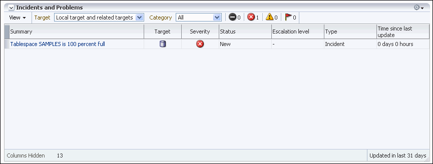
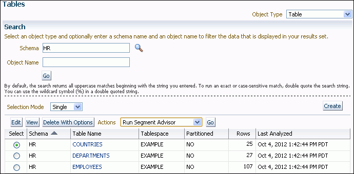
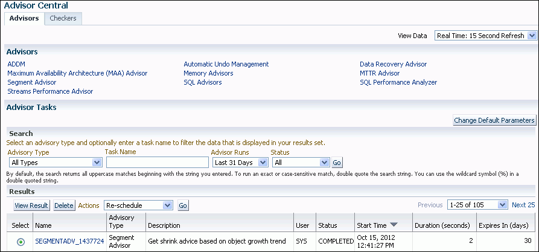
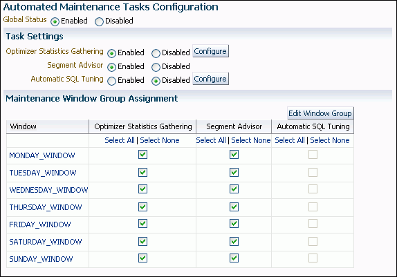

## 18 Managing Space for Schema Objects

Managing space for schema objects involves tasks such as managing tablespace alerts and space allocation, reclaiming unused space, dropping unused object storage, monitoring space usage, and capacity planning.

- Managing Tablespace Alerts  
	Oracle Database provides proactive help in managing disk space for tablespaces by alerting you when available space is running low.
- Managing Resumable Space Allocation  
	You can suspend, and later resume, the execution of large database operations.
- Reclaiming Unused Space  
	You can reclaim unused space. Segment Advisor, is an Oracle Database component that identifies segments that have space available for reclamation.
- Dropping Unused Object Storage  
	The `DBMS_SPACE_ADMIN` package includes the `DROP_EMPTY_SEGMENTS` procedure, which enables you to drop segments for empty tables and partitions that have been migrated from previous releases. This includes segments of dependent objects of the table, such as index segments, where possible.
- Understanding Space Usage of Data Types  
	When creating tables and other data structures, you must know how much space they will require. Each data type has different space requirements.
- Displaying Information About Space Usage for Schema Objects  
	Oracle Database provides data dictionary views and PL/SQL packages that allow you to display information about the space usage of schema objects.
- Capacity Planning for Database Objects  
	Oracle Database provides two ways to plan capacity for database objects: with Cloud Control or with the `DBMS_SPACE` PL/SQL package. Three procedures in the `DBMS_SPACE` package enable you to predict the size of new objects and monitor the size of existing database objects.

**Parent topic:** [Schema Objects](schema-objects.md)

### 18.1 Managing Tablespace Alerts

Oracle Database provides proactive help in managing disk space for tablespaces by alerting you when available space is running low.

**Parent topic:** Managing Space for Schema Objects

#### 18.1.1 About Managing Tablespace Alerts

Two alert thresholds are defined by default: warning and critical. The warning threshold is the limit at which space is beginning to run low. The critical threshold is a serious limit that warrants your immediate attention. The database issues alerts at both thresholds.

There are two ways to specify alert thresholds for both locally managed and dictionary managed tablespaces:

- By percent full
	For both warning and critical thresholds, when space used becomes greater than or equal to a percent of total space, an alert is issued.
- By free space remaining (in kilobytes (KB))
	For both warning and critical thresholds, when remaining space falls below an amount in KB, an alert is issued. Free-space-remaining thresholds are more useful for very large tablespaces.

Alerts for locally managed tablespaces are server-generated. For dictionary managed tablespaces, Oracle Enterprise Manager Cloud Control (Cloud Control) provides this functionality. See " [Monitoring a Database with Server-Generated Alerts](monitoring-the-database.md) " for more information.

New tablespaces are assigned alert thresholds as follows:

- Locally managed tablespace—When you create a new locally managed tablespace, it is assigned the default threshold values defined for the database. A newly created database has a default of 85% full for the warning threshold and 97% full for the critical threshold. Defaults for free space remaining thresholds for a new database are both zero (disabled). You can change these database defaults, as described later in this section.
- Dictionary managed tablespace—When you create a new dictionary managed tablespace, it is assigned the threshold values that Cloud Control lists for "All others" in the metrics categories "Tablespace Free Space (MB) (dictionary managed)" and "Tablespace Space Used (%) (dictionary managed)." You change these values on the Metric and Policy Settings page.

Note:

In a database that is upgraded from Oracle 9i or earlier to Oracle Database 10g or later, database defaults for all locally managed tablespace alert thresholds are set to zero. This setting effectively disables the alert mechanism to avoid excessive alerts in a newly migrated database.

**Parent topic:** Managing Tablespace Alerts

#### 18.1.2 Setting Alert Thresholds

For each tablespace, you can set just percent-full thresholds, just free-space-remaining thresholds, or both types of thresholds simultaneously. Setting either type of threshold to zero disables it.

The ideal setting for the warning threshold is one that issues an alert early enough for you to resolve the problem before it becomes critical. The critical threshold should be one that issues an alert still early enough so that you can take immediate action to avoid loss of service.

To set alert threshold values for locally managed tablespaces:

- Do one of the following:
	- Use the Tablespaces page of Cloud Control.
		See the Cloud Control online help for information about changing the space usage alert thresholds for a tablespace.
		- Use the `DBMS_SERVER_ALERT.SET_THRESHOLD` package procedure.
		See [Oracle Database PL/SQL Packages and Types Reference](https://docs.oracle.com/pls/topic/lookup?ctx=en/database/oracle/oracle-database/21/admin&id=ARPLS016) for details.

To set alert threshold values for dictionary managed tablespaces:

- Use the Tablespaces page of Cloud Control.
	See the Cloud Control online help for information about changing the space usage alert thresholds for a tablespace.

Example - Setting an Alert Threshold with Cloud Control

You receive an alert in Cloud Control when a space usage threshold for a tablespace is reached. There are two types of space usage alerts that you can enable: warning, for when tablespace space is somewhat low, and critical, for when the tablespace is almost completely full and action must be taken immediately.

For both warning and critical alerts, you can specify alert thresholds in the following ways:

- By space used (%)
	When space used becomes greater than or equal to a percentage of total space, an alert is issued.
- By free space (MB)
	When remaining space falls below an amount (in MB), an alert is issued.
	Free-space thresholds are more useful for large tablespaces. For example, for a 10 TB tablespace, setting the percentage full critical alert to as high as 99 percent means that the database would issue an alert when there is still 100 GB of free space remaining. Usually, 100 GB remaining would not be a critical situation, and the alert would not be useful. For this tablespace, it might be better to use a free-space threshold, which you could set to issue a critical alert when 5 GB of free space remains.

For both warning and critical alerts for a tablespace, you can enable either the space used threshold or the free-space threshold, or you can enable both thresholds.

To change space usage alert thresholds for tablespaces:

1. Go to the Database Home page.
2. From the Administration menu, select Storage, then Tablespaces.
	The Tablespaces page appears.
3. Select the tablespace whose threshold you want to change, and then click Edit.
	The Edit Tablespace page appears, showing the General subpage.
4. Click the Thresholds tab at the top of the page to display the Thresholds subpage.
5. In the Space Used (%) section, do one of the following:
	- Accept the default thresholds.
		- Select Specify Thresholds, and then enter a Warning (%) threshold and a Critical (%) threshold.
		- Select Disable Thresholds to disable the percentage full thresholds.
6. In the Free Space (MB) section, do one of the following:
	- Accept the default thresholds.
		- Select Specify Thresholds, and then enter a Warning (MB) threshold and a Critical (MB) threshold.
		- Select Disable Thresholds to disable the threshold for free space remaining.
7. Click Apply.
	A confirmation message appears.

Example—Setting an Alert Threshold Value with a Package Procedure

The following example sets the free-space-remaining thresholds in the `USERS` tablespace to 10 MB (warning) and 2 MB (critical), and disables the percent-full thresholds. The `USERS` tablespace is a locally managed tablespace.

```
BEGIN
DBMS_SERVER_ALERT.SET_THRESHOLD(
   metrics_id              => DBMS_SERVER_ALERT.TABLESPACE_BYT_FREE,
   warning_operator        => DBMS_SERVER_ALERT.OPERATOR_LE,
   warning_value           => '10240',
   critical_operator       => DBMS_SERVER_ALERT.OPERATOR_LE,
   critical_value          => '2048',
   observation_period      => 1,
   consecutive_occurrences => 1,
   instance_name           => NULL,
   object_type             => DBMS_SERVER_ALERT.OBJECT_TYPE_TABLESPACE,
   object_name             => 'USERS');

DBMS_SERVER_ALERT.SET_THRESHOLD(
   metrics_id              => DBMS_SERVER_ALERT.TABLESPACE_PCT_FULL,
   warning_operator        => DBMS_SERVER_ALERT.OPERATOR_GT,
   warning_value           => '0',
   critical_operator       => DBMS_SERVER_ALERT.OPERATOR_GT,
   critical_value          => '0',
   observation_period      => 1,
   consecutive_occurrences => 1,
   instance_name           => NULL,
   object_type             => DBMS_SERVER_ALERT.OBJECT_TYPE_TABLESPACE,
   object_name             => 'USERS');
END;
/
```

Note:

When setting nonzero values for percent-full thresholds, use the greater-than-or-equal-to operator, `OPERATOR_GE`.

Restoring a Tablespace to Database Default Thresholds

After explicitly setting values for locally managed tablespace alert thresholds, you can cause the values to revert to the database defaults by setting them to `NULL` with `DBMS_SERVER_ALERT.SET_THRESHOLD`.

Modifying Database Default Thresholds

To modify database default thresholds for locally managed tablespaces, invoke `DBMS_SERVER_ALERT.SET_THRESHOLD` as shown in the previous example, but set `object_name` to `NULL`. All tablespaces that use the database default are then switched to the new default.

**Parent topic:** Managing Tablespace Alerts

#### 18.1.3 Viewing Alerts

You view alerts by accessing a Database Home page in Cloud Control and viewing the Incidents and Problems section.



> This screenshot shows a tablespace full alert.
>
> [  
> Copyright © 1996, 2025, Oracle and/or its affiliates.](https://docs.oracle.com/en/database/oracle/oracle-database/dcommon/html/cpyr.htm)


You can also view alerts for locally managed tablespaces with the `DBA_OUTSTANDING_ALERTS` view. See " [Server-Generated Alerts Data Dictionary Views](monitoring-the-database.md) " for more information.

**Parent topic:** Managing Tablespace Alerts

#### 18.1.4 Limitations

Threshold-based alerts have the some limitations.

These limitations include the following:

- Alerts are not issued for locally managed tablespaces that are offline or in read-only mode. However, the database reactivates the alert system for such tablespaces after they become read/write or available.
- When you take a tablespace offline or put it in read-only mode, you should disable the alerts for the tablespace by setting the thresholds to zero. You can then reenable the alerts by resetting the thresholds when the tablespace is once again online and in read/write mode.

See Also:

- " [Monitoring a Database with Server-Generated Alerts](monitoring-the-database.md) " for additional information on server-generated alerts in general
- [Oracle Database PL/SQL Packages and Types Reference](https://docs.oracle.com/pls/topic/lookup?ctx=en/database/oracle/oracle-database/21/admin&id=ARPLS016) for information on the procedures of the `DBMS_SERVER_ALERT` package and how to use them
- " Reclaiming Unused Space " for various ways to reclaim space that is no longer being used in the tablespace
- " [Purging Objects in the Recycle Bin](managing-tables.md) " for information on reclaiming recycle bin space

**Parent topic:** Managing Tablespace Alerts

### 18.2 Managing Resumable Space Allocation

You can suspend, and later resume, the execution of large database operations.

- Resumable Space Allocation Overview  
	Oracle Database provides a means for suspending, and later resuming, the execution of large database operations in the event of space allocation failures. Therefore, you can take corrective action instead of the Oracle Database server returning an error to the user. After the error condition is corrected, the suspended operation automatically resumes. This feature is called resumable space allocation. The statements that are affected are called resumable statements.
- Enabling and Disabling Resumable Space Allocation  
	You enable and disable resumable space allocation by running SQL statements and setting certain initialization parameters.
- Using a LOGON Trigger to Set Default Resumable Mode  
	Another method of setting default resumable mode, other than setting the `RESUMABLE_TIMEOUT` initialization parameter, is that you can register a database level `LOGON` trigger to alter a user's session to enable resumable and set a timeout interval.
- Detecting Suspended Statements  
	When a resumable statement is suspended, the error is not raised to the client. In order for corrective action to be taken, Oracle Database provides alternative methods for notifying users of the error and for providing information about the circumstances.
- Operation-Suspended Alert  
	When a resumable session is suspended, an operation-suspended alert is issued on the object that needs allocation of resource for the operation to complete.
- Resumable Space Allocation Example: Registering an AFTER SUSPEND Trigger  
	An example illustrates how to create a system wide `AFTER SUSPEND` trigger and register it as user `SYS` at the database level.

**Parent topic:** Managing Space for Schema Objects

#### 18.2.1 Resumable Space Allocation Overview

Oracle Database provides a means for suspending, and later resuming, the execution of large database operations in the event of space allocation failures. Therefore, you can take corrective action instead of the Oracle Database server returning an error to the user. After the error condition is corrected, the suspended operation automatically resumes. This feature is called resumable space allocation. The statements that are affected are called resumable statements.

- How Resumable Space Allocation Works  
	An overview shows how resumable space allocation works.
- What Operations are Resumable?  
	Some operations are resumable.
- What Errors are Correctable?  
	Some errors are correctable.
- Resumable Space Allocation and Distributed Operations  
	In a distributed environment, if a user enables or disables resumable space allocation, or a DBA alters the `RESUMABLE_TIMEOUT` initialization parameter, then the local instance is affected. `RESUMABLE` cannot be enabled remotely.
- Parallel Execution and Resumable Space Allocation  
	In parallel execution, if one of the parallel execution server processes encounters a correctable error, then that server process suspends its execution.

**Parent topic:** Managing Resumable Space Allocation

##### 18.2.1.1 How Resumable Space Allocation Works

An overview shows how resumable space allocation works.

1. A statement executes in resumable mode only if its session has been enabled for resumable space allocation by one of the following actions:
	- The `ALTER SESSION ENABLE RESUMABLE` statement is issued in the session before the statement executes when the `RESUMABLE_TIMEOUT` initialization parameter is set to a nonzero value.
		- The `ALTER SESSION ENABLE RESUMABLE TIMEOUT` `timeout_value` statement is issued in the session before the statement executes, and the `timeout_value` is a nonzero value.
2. A resumable statement is suspended when one of the following conditions occur (these conditions result in corresponding errors being signalled for non-resumable statements):
	- Out of space condition
		- Maximum extents reached condition
		- Space quota exceeded condition.
3. When the execution of a resumable statement is suspended, there are mechanisms to perform user supplied operations, log errors, and query the status of the statement execution. When a resumable statement is suspended the following actions are taken:
	- The error is reported in the alert log.
		- The system issues the Resumable Session Suspended alert.
		- If the user registered a trigger on the `AFTER SUSPEND` system event, the user trigger is executed. A user supplied PL/SQL procedure can access the error message data using the `DBMS_RESUMABLE` package and the `DBA_` or `USER_RESUMABLE` view.
4. Suspending a statement automatically results in suspending the transaction. Thus all transactional resources are held through a statement suspend and resume.
5. When the error condition is resolved (for example, as a result of user intervention or perhaps sort space released by other queries), the suspended statement automatically resumes execution and the Resumable Session Suspended alert is cleared.
6. A suspended statement can be forced to throw the exception using the `DBMS_RESUMABLE.ABORT()` procedure. This procedure can be called by a DBA, or by the user who issued the statement.
7. A suspension time out interval, specified by the `RESUMABLE_TIMEOUT` initialization parameter or by the timeout value in the `ALTER` `SESSION` `ENABLE` `RESUMABLE` `TIMEOUT` statement, is associated with resumable statements. A resumable statement that is suspended for the timeout interval wakes up and returns the exception to the user if the error condition is not resolved within the timeout interval.
8. A resumable statement can be suspended and resumed multiple times during execution.

**Parent topic:** Resumable Space Allocation Overview

##### 18.2.1.2 What Operations are Resumable?

Some operations are resumable.

The following operations are resumable:

- Queries
	`SELECT` statements that run out of temporary space (for sort areas) are candidates for resumable execution. When using OCI, the calls `OCIStmtExecute()` and `OCIStmtFetch()` are candidates.
- DML
	`INSERT`, `UPDATE`, and `DELETE` statements are candidates. The interface used to execute them does not matter; it can be OCI, PL/SQL, or another interface. Also, `INSERT INTO...SELECT` from external tables can be resumable.
- Import/Export
	As for SQL\*Loader, a command line parameter controls whether statements are resumable after recoverable errors.
- DDL
	The following statements are candidates for resumable execution:
	- `CREATE` `TABLE`... `AS` `SELECT`
		- `CREATE` `INDEX`
		- `ALTER` `INDEX`... `REBUILD`
		- `ALTER` `TABLE`... `MOVE` `PARTITION`
		- `ALTER` `TABLE`... `SPLIT` `PARTITION`
		- `ALTER` `INDEX`... `REBUILD` `PARTITION`
		- `ALTER` `INDEX`... `SPLIT` `PARTITION`
		- `CREATE` `MATERIALIZED` `VIEW`
		- `CREATE` `MATERIALIZED` `VIEW` `LOG`

**Parent topic:** Resumable Space Allocation Overview

##### 18.2.1.3 What Errors are Correctable?

Some errors are correctable.

There are three classes of correctable errors:

- Out of space condition
	The operation cannot acquire any more extents for a table/index/temporary segment/undo segment/cluster/LOB/table partition/index partition in a tablespace. For example, the following errors fall in this category:
	```
	ORA-01653 unable to extend table ... in tablespace ...
	ORA-01654 unable to extend index ... in tablespace ...
	```
- Maximum extents reached condition
	The number of extents in a table/index/temporary segment/undo segment/cluster/LOB/table partition/index partition equals the maximum extents defined on the object. For example, the following errors fall in this category:
	```
	ORA-01631 max # extents ... reached in table ...
	ORA-01632 max # extents ... reached in index ...
	```
- Space quota exceeded condition
	The user has exceeded his assigned space quota in the tablespace. Specifically, this is noted by the following error:
	```
	ORA-01536 space quote exceeded for tablespace string
	```

**Parent topic:** Resumable Space Allocation Overview

##### 18.2.1.4 Resumable Space Allocation and Distributed Operations

In a distributed environment, if a user enables or disables resumable space allocation, or a DBA alters the `RESUMABLE_TIMEOUT` initialization parameter, then the local instance is affected. `RESUMABLE` cannot be enabled remotely.

In a distributed transaction, sessions on remote instances are suspended only if the remote instance has already enabled `RESUMABLE` on the instance or sessions at its site.

**Parent topic:** Resumable Space Allocation Overview

##### 18.2.1.5 Parallel Execution and Resumable Space Allocation

In parallel execution, if one of the parallel execution server processes encounters a correctable error, then that server process suspends its execution.

Other parallel execution server processes will continue executing their respective tasks, until either they encounter an error or are blocked (directly or indirectly) by the suspended server process. When the correctable error is resolved, the suspended process resumes execution and the parallel operation continues execution. If the suspended operation is terminated, then the parallel operation terminates, throwing the error to the user.

Different parallel execution server processes may encounter one or more correctable errors. This may result in firing an `AFTER SUSPEND` trigger multiple times, in parallel. Also, if a parallel execution server process encounters a non-correctable error while another parallel execution server process is suspended, the suspended statement is immediately terminated.

For parallel execution, every parallel execution coordinator and server process has its own entry in the `DBA` \_ or `USER_RESUMABLE` view.

**Parent topic:** Resumable Space Allocation Overview

#### 18.2.2 Enabling and Disabling Resumable Space Allocation

You enable and disable resumable space allocation by running SQL statements and setting certain initialization parameters.

- About Enabling and Disabling Resumable Space Allocation  
	Resumable space allocation is only possible when statements are executed within a session that has resumable mode enabled.
- Setting the RESUMABLE\_TIMEOUT Initialization Parameter  
	You can specify a default system wide timeout interval by setting the `RESUMABLE_TIMEOUT` initialization parameter.
- Using ALTER SESSION to Enable and Disable Resumable Space Allocation  
	Within a session, a user can issue the `ALTER SESSION SET` statement to set the `RESUMABLE_TIMEOUT` initialization parameter and enable resumable space allocation, change a timeout value, or to disable resumable mode.

**Parent topic:** Managing Resumable Space Allocation

##### 18.2.2.1 About Enabling and Disabling Resumable Space Allocation

Resumable space allocation is only possible when statements are executed within a session that has resumable mode enabled.

Resumable space allocation is enabled for a session when the `ALTER SESSION ENABLE RESUMABLE` statement is executed, and the `RESUMABLE_TIMEOUT` initialization parameter is set to a non-zero value for the session. When the `RESUMABLE_TIMEOUT` initialization parameter is set at the system level, it is the default for an `ALTER SESSION ENABLE RESUMABLE` statement that does not specify a timeout value. When an `ALTER SESSION ENABLE RESUMABLE` statement specifies a timeout value, it overrides the system default.

Resumable space allocation is disabled for a session in all of the following cases when the `ALTER SESSION ENABLE RESUMABLE` statement is executed:

- The session does not execute an `ALTER SESSION ENABLE RESUMABLE` statement.
- The session executes an `ALTER SESSION DISABLE RESUMABLE` statement.
- The session executes an `ALTER SESSION ENABLE RESUMABLE` statement, and the timeout value is zero.

Note:

Because suspended statements can hold up some system resources, users must be granted the `RESUMABLE` system privilege before they are allowed to enable resumable space allocation and execute resumable statements.

**Parent topic:** Enabling and Disabling Resumable Space Allocation

##### 18.2.2.2 Setting the RESUMABLE\_TIMEOUT Initialization Parameter

You can specify a default system wide timeout interval by setting the `RESUMABLE_TIMEOUT` initialization parameter.

For example, the following setting of the `RESUMABLE_TIMEOUT` parameter in the initialization parameter file sets the timeout period to 1 hour:

```
RESUMABLE_TIMEOUT  = 3600
```

If this parameter is set to 0, then resumable space allocation is disabled even for sessions that run an `ALTER SESSION ENABLE RESUMABLE` statement without a timeout value.

You can also use the `ALTER SYSTEM SET` statement to change the value of this parameter at the system level. For example, the following statement disables resumable space allocation for all sessions that run an `ALTER SESSION ENABLE RESUMABLE` statement without a timeout value:

```
ALTER SYSTEM SET RESUMABLE_TIMEOUT=0;
```

**Parent topic:** Enabling and Disabling Resumable Space Allocation

##### 18.2.2.3 Using ALTER SESSION to Enable and Disable Resumable Space Allocation

Within a session, a user can issue the `ALTER SESSION SET` statement to set the `RESUMABLE_TIMEOUT` initialization parameter and enable resumable space allocation, change a timeout value, or to disable resumable mode.

A user can enable resumable mode for a session with the default system `RESUMABLE_TIMEOUT` value using the following SQL statement:

```
ALTER SESSION ENABLE RESUMABLE;
```

To disable resumable mode, a user issues the following statement:

```
ALTER SESSION DISABLE RESUMABLE;
```

The default for a new session is resumable mode disabled.

The user can also specify a timeout interval, and can provide a name used to identify a resumable statement. These are discussed separately in following sections.

- Specifying a Timeout Interval  
	When you enable resumable mode, you can set a timeout period, after which a suspended statement will error if no intervention has taken place.
- Naming Resumable Statements  
	Resumable statements can be identified by name.

See Also:

" Using a LOGON Trigger to Set Default Resumable Mode "

**Parent topic:** Enabling and Disabling Resumable Space Allocation

###### 18.2.2.3.1 Specifying a Timeout Interval

When you enable resumable mode, you can set a timeout period, after which a suspended statement will error if no intervention has taken place.

The following statement specifies that resumable transactions will time out and error after 3600 seconds:

```
ALTER SESSION ENABLE RESUMABLE TIMEOUT 3600;
```

The value of `TIMEOUT` remains in effect until it is changed by another `ALTER SESSION ENABLE RESUMABLE` statement, it is changed by another means, or the session ends. If the `RESUMABLE_TIMEOUT` initialization parameter is not set, then the default timeout interval when using the `ENABLE RESUMABLE TIMEOUT` clause to enable resumable mode is 7200 seconds.

See Also:

" Setting the RESUMABLE\_TIMEOUT Initialization Parameter " for other methods of changing the timeout interval for resumable space allocation

**Parent topic:** Using ALTER SESSION to Enable and Disable Resumable Space Allocation

###### 18.2.2.3.2 Naming Resumable Statements

Resumable statements can be identified by name.

The following statement assigns a name to resumable statements:

```
ALTER SESSION ENABLE RESUMABLE TIMEOUT 3600 NAME 'insert into table';
```

The `NAME` value remains in effect until it is changed by another `ALTER SESSION ENABLE RESUMABLE` statement, or the session ends. The default value for `NAME` is ' `User` `username` (`userid`), `Session` `sessionid`, `Instance` `instanceid` '.

The name of the statement is used to identify the resumable statement in the `DBA_RESUMABLE` and `USER_RESUMABLE` views.

**Parent topic:** Using ALTER SESSION to Enable and Disable Resumable Space Allocation

#### 18.2.3 Using a LOGON Trigger to Set Default Resumable Mode

Another method of setting default resumable mode, other than setting the `RESUMABLE_TIMEOUT` initialization parameter, is that you can register a database level `LOGON` trigger to alter a user's session to enable resumable and set a timeout interval.

Note:

If there are multiple triggers registered that change default mode and timeout for resumable statements, the result will be unspecified because Oracle Database does not guarantee the order of trigger invocation.

**Parent topic:** Managing Resumable Space Allocation

#### 18.2.4 Detecting Suspended Statements

When a resumable statement is suspended, the error is not raised to the client. In order for corrective action to be taken, Oracle Database provides alternative methods for notifying users of the error and for providing information about the circumstances.

- Notifying Users: The AFTER SUSPEND System Event and Trigger  
	When a resumable statement encounters a correctable error, the system internally generates the `AFTER SUSPEND` system event. Users can register triggers for this event at both the database and schema level. If a user registers a trigger to handle this system event, the trigger is executed after a SQL statement has been suspended.
- Using Views to Obtain Information About Suspended Statements  
	You can query a set of views for information about the status of resumable statements.
- Using the DBMS\_RESUMABLE Package  
	The `DBMS_RESUMABLE` package helps control resumable space allocation.

**Parent topic:** Managing Resumable Space Allocation

##### 18.2.4.1 Notifying Users: The AFTER SUSPEND System Event and Trigger

When a resumable statement encounters a correctable error, the system internally generates the `AFTER SUSPEND` system event. Users can register triggers for this event at both the database and schema level. If a user registers a trigger to handle this system event, the trigger is executed after a SQL statement has been suspended.

SQL statements executed within a `AFTER SUSPEND` trigger are always non-resumable and are always autonomous. Transactions started within the trigger use the `SYSTEM` rollback segment. These conditions are imposed to overcome deadlocks and reduce the chance of the trigger experiencing the same error condition as the statement.

Users can use the `USER_RESUMABLE` or `DBA_RESUMABLE` views, or the `DBMS_RESUMABLE.SPACE_ERROR_INFO` function, within triggers to get information about the resumable statements.

Triggers can also call the `DBMS_RESUMABLE` package to terminate suspended statements and modify resumable timeout values. In the following example, the default system timeout is changed by creating a system wide `AFTER SUSPEND` trigger that calls `DBMS_RESUMABLE` to set the timeout to 3 hours:

```
CREATE OR REPLACE TRIGGER resumable_default_timeout
AFTER SUSPEND
ON DATABASE
BEGIN
   DBMS_RESUMABLE.SET_TIMEOUT(10800);
END;
/
```

See Also:

[Oracle Database PL/SQL Language Reference](https://docs.oracle.com/pls/topic/lookup?ctx=en/database/oracle/oracle-database/21/admin&id=LNPLS020) for information about triggers and system events

**Parent topic:** Detecting Suspended Statements

##### 18.2.4.2 Using Views to Obtain Information About Suspended Statements

You can query a set of views for information about the status of resumable statements.

| View | Description |
| --- | --- |
| `DBA_RESUMABLE`  `USER_RESUMABLE` | These views contain rows for all currently executing or suspended resumable statements. They can be used by a DBA, `AFTER SUSPEND` trigger, or another session to monitor the progress of, or obtain specific information about, resumable statements. |
| `V$SESSION_WAIT` | When a statement is suspended the session invoking the statement is put into a wait state. A row is inserted into this view for the session with the `EVENT` column containing "statement suspended, wait error to be cleared". |

**Parent topic:** Detecting Suspended Statements

##### 18.2.4.3 Using the DBMS\_RESUMABLE Package

The `DBMS_RESUMABLE` package helps control resumable space allocation.

You can invoke the following procedures:

| Procedure | Description |
| --- | --- |
| `ABORT(sessionID)` | This procedure terminates a suspended resumable statement. The parameter `sessionID` is the session ID in which the statement is executing. For parallel DML/DDL,`                                     sessionID` is any session ID which participates in the parallel DML/DDL.  Oracle Database guarantees that the `ABORT` operation always succeeds. It may be called either inside or outside of the `AFTER SUSPEND` trigger.  The caller of `ABORT` must be the owner of the session with `sessionID`, have `ALTER SYSTEM` privilege, or have DBA privileges. |
| `GET_SESSION_TIMEOUT(sessionID)` | This function returns the current timeout value of resumable space allocation for the session with `sessionID`. This returned timeout is in seconds. If the session does not exist, this function returns -1. |
| `SET_SESSION_TIMEOUT(sessionID, timeout)` | This procedure sets the timeout interval of resumable space allocation for the session with `sessionID`. The parameter `timeout` is in seconds. The new `timeout` setting will applies to the session immediately. If the session does not exist, no action is taken. |
| `GET_TIMEOUT()` | This function returns the current `timeout` value of resumable space allocation for the current session. The returned value is in seconds. |
| `SET_TIMEOUT(timeout)` | This procedure sets a `timeout` value for resumable space allocation for the current session. The parameter `timeout` is in seconds. The new timeout setting applies to the session immediately. |

See Also:

[Oracle Database PL/SQL Packages and Types Reference](https://docs.oracle.com/pls/topic/lookup?ctx=en/database/oracle/oracle-database/21/admin&id=ARPLS143) for details about the `DBMS_RESUMABLE` package.

**Parent topic:** Detecting Suspended Statements

#### 18.2.5 Operation-Suspended Alert

When a resumable session is suspended, an operation-suspended alert is issued on the object that needs allocation of resource for the operation to complete.

Once the resource is allocated and the operation completes, the operation-suspended alert is cleared. See " Managing Tablespace Alerts " for more information on system-generated alerts.

**Parent topic:** Managing Resumable Space Allocation

#### 18.2.6 Resumable Space Allocation Example: Registering an AFTER SUSPEND Trigger

An example illustrates how to create a system wide `AFTER SUSPEND` trigger and register it as user `SYS` at the database level.

Whenever a resumable statement is suspended in any session, this trigger can have either of two effects:

- If an undo segment has reached its space limit, then a message is sent to the DBA and the statement is terminated.
- If any other recoverable error has occurred, the timeout interval is reset to 8 hours.

Here are the statements for this example:

```
CREATE OR REPLACE TRIGGER resumable_default
AFTER SUSPEND
ON DATABASE
DECLARE
   /* declare transaction in this trigger is autonomous */
   /* this is not required because transactions within a trigger
      are always autonomous */
   PRAGMA AUTONOMOUS_TRANSACTION;
   cur_sid           NUMBER;
   cur_inst          NUMBER;
   errno             NUMBER;
   err_type          VARCHAR2;
   object_owner      VARCHAR2;
   object_type       VARCHAR2;
   table_space_name  VARCHAR2;
   object_name       VARCHAR2;
   sub_object_name   VARCHAR2;
   error_txt         VARCHAR2;
   msg_body          VARCHAR2;
   ret_value         BOOLEAN;
   mail_conn         UTL_SMTP.CONNECTION;
BEGIN
   -- Get session ID
   SELECT DISTINCT(SID) INTO cur_SID FROM V$MYSTAT;

   -- Get instance number
   cur_inst := userenv('instance');

   -- Get space error information
   ret_value := 
   DBMS_RESUMABLE.SPACE_ERROR_INFO(err_type,object_type,object_owner,
        table_space_name,object_name, sub_object_name);
   /*
   -- If the error is related to undo segments, log error, send email
   -- to DBA, and terminate the statement. Otherwise, set timeout to 8 hours.
   -- 
   -- sys.rbs_error is a table which is to be
   -- created by a DBA manually and defined as
   -- (sql_text VARCHAR2(1000), error_msg VARCHAR2(4000),
   -- suspend_time DATE)
   */

   IF OBJECT_TYPE = 'UNDO SEGMENT' THEN
       /* LOG ERROR */
       INSERT INTO sys.rbs_error (
           SELECT SQL_TEXT, ERROR_MSG, SUSPEND_TIME
           FROM DBMS_RESUMABLE
           WHERE SESSION_ID = cur_sid AND INSTANCE_ID = cur_inst
        );
       SELECT ERROR_MSG INTO error_txt FROM DBMS_RESUMABLE 
           WHERE SESSION_ID = cur_sid and INSTANCE_ID = cur_inst;

        -- Send email to receipient through UTL_SMTP package
        msg_body:='Subject: Space Error Occurred

                   Space limit reached for undo segment ' || object_name || 
                   on ' || TO_CHAR(SYSDATE, 'Month dd, YYYY, HH:MIam') ||
                   '. Error message was ' || error_txt;

        mail_conn := UTL_SMTP.OPEN_CONNECTION('localhost', 25);
        UTL_SMTP.HELO(mail_conn, 'localhost');
        UTL_SMTP.MAIL(mail_conn, 'sender@localhost');
        UTL_SMTP.RCPT(mail_conn, 'recipient@localhost');
        UTL_SMTP.DATA(mail_conn, msg_body);
        UTL_SMTP.QUIT(mail_conn);

        -- Terminate the statement
        DBMS_RESUMABLE.ABORT(cur_sid);
    ELSE
        -- Set timeout to 8 hours
        DBMS_RESUMABLE.SET_TIMEOUT(28800);
    END IF;

    /* commit autonomous transaction */
    COMMIT;   
END;
/
```

**Parent topic:** Managing Resumable Space Allocation

### 18.3 Reclaiming Unused Space

You can reclaim unused space. Segment Advisor, is an Oracle Database component that identifies segments that have space available for reclamation.

- About Reclaimable Unused Space  
	Over time, updates and deletes on objects within a tablespace can create pockets of empty space that individually are not large enough to be reused for new data. This type of empty space is referred to as fragmented free space.
- The Segment Advisor  
	The Segment Advisor identifies segments that have space available for reclamation.
- Shrinking Database Segments Online  
	You use online segment shrink to reclaim fragmented free space below the high water mark in an Oracle Database segment.
- Deallocating Unused Space  
	When you deallocate unused space, the database frees the unused space at the unused (high water mark) end of the database segment and makes the space available for other segments in the tablespace.

**Parent topic:** Managing Space for Schema Objects

#### 18.3.1 About Reclaimable Unused Space

Over time, updates and deletes on objects within a tablespace can create pockets of empty space that individually are not large enough to be reused for new data. This type of empty space is referred to as fragmented free space.

Objects with fragmented free space can result in much wasted space, and can impact database performance. The preferred way to defragment and reclaim this space is to perform an online segment shrink. This process consolidates fragmented free space below the high water mark and compacts the segment. After compaction, the high water mark is moved, resulting in new free space above the high water mark. That space above the high water mark is then deallocated. The segment remains available for queries and DML during most of the operation, and no extra disk space need be allocated.

You use the Segment Advisor to identify segments that would benefit from online segment shrink. Only segments in locally managed tablespaces with automatic segment space management (ASSM) are eligible. Other restrictions on segment type exist. For more information, see " Shrinking Database Segments Online ".

If a table with reclaimable space is not eligible for online segment shrink, or if you want to make changes to logical or physical attributes of the table while reclaiming space, then you can use online table redefinition as an alternative to segment shrink. Online redefinition is also referred to as reorganization. Unlike online segment shrink, it requires extra disk space to be allocated. See " [Redefining Tables Online](managing-tables.md) " for more information.

**Parent topic:** Reclaiming Unused Space

#### 18.3.2 The Segment Advisor

The Segment Advisor identifies segments that have space available for reclamation.

- About the Segment Advisor  
	The Segment Advisor performs its analysis by examining usage and growth statistics in the Automatic Workload Repository (AWR), and by sampling the data in the segment.
- Using the Segment Advisor  
	To use the Segment Advisor, check the results of Automatic Segment Advisor, and, optionally, run the Segment Advisor manually.
- Automatic Segment Advisor  
	The Automatic Segment Advisor is an automated maintenance task that is configured to run during all maintenance windows.
- Running the Segment Advisor Manually  
	You can manually run the Segment Advisor at any time with Cloud Control or with PL/SQL package procedure calls.
- Viewing Segment Advisor Results  
	The Segment Advisor creates several types of results: recommendations, findings, actions, and objects.
- Configuring the Automatic Segment Advisor  
	The Automatic Segment Advisor is an automated maintenance task. As such, you can use Cloud Control or PL/SQL package procedure calls to modify when (and if) this task runs. You can also control the resources allotted to it by modifying the appropriate resource plans.
- Viewing Automatic Segment Advisor Information  
	You can query views to display information specific to the Automatic Segment Advisor.

**Parent topic:** Reclaiming Unused Space

##### 18.3.2.1 About the Segment Advisor

The Segment Advisor performs its analysis by examining usage and growth statistics in the Automatic Workload Repository (AWR), and by sampling the data in the segment.

It is configured to run during maintenance windows as an automated maintenance task, and you can also run it on demand (manually). The Segment Advisor automated maintenance task is known as the Automatic Segment Advisor. You can use this information for capacity planning and for arriving at an informed decision about which segments to shrink.

The Segment Advisor generates the following types of advice:

- If the Segment Advisor determines that an object has a significant amount of free space, it recommends online segment shrink. If the object is a table that is not eligible for shrinking, as in the case of a table in a tablespace without automatic segment space management, the Segment Advisor recommends online table redefinition.
- If the Segment Advisor determines that a table could benefit from compression with the advanced row compression method, it makes a recommendation to that effect. (Automatic Segment Advisor only. See " Automatic Segment Advisor ".)
- If the Segment Advisor encounters a table with row chaining above a certain threshold, it records that fact that the table has an excess of chained rows.
	Note:
	The Segment Advisor flags only the type of row chaining that results from updates that increase row length.

If you receive a space management alert, or if you decide that you want to reclaim space, you should start with the Segment Advisor.

**Parent topic:** The Segment Advisor

##### 18.3.2.2 Using the Segment Advisor

To use the Segment Advisor, check the results of Automatic Segment Advisor, and, optionally, run the Segment Advisor manually.

To use the Segment Advisor:

1. Check the results of the Automatic Segment Advisor.
	To understand the Automatic Segment Advisor, see " Automatic Segment Advisor ", later in this section. For details on how to view results, see " Viewing Segment Advisor Results ".
2. (Optional) Obtain updated results on individual segments by rerunning the Segment Advisor manually.
	See " Running the Segment Advisor Manually ", later in this section.

**Parent topic:** The Segment Advisor

##### 18.3.2.3 Automatic Segment Advisor

The Automatic Segment Advisor is an automated maintenance task that is configured to run during all maintenance windows.

The Automatic Segment Advisor does not analyze every database object. Instead, it examines database statistics, samples segment data, and then selects the following objects to analyze:

- Tablespaces that have exceeded a critical or warning space threshold
- Segments that have the most activity
- Segments that have the highest growth rate

In addition, the Automatic Segment Advisor evaluates tables that are at least 10MB and that have at least three indexes to determine the amount of space saved if the tables are compressed with the advanced row compression method.

If an object is selected for analysis but the maintenance window expires before the Segment Advisor can process the object, the object is included in the next Automatic Segment Advisor run.

You cannot change the set of tablespaces and segments that the Automatic Segment Advisor selects for analysis. You can, however, enable or disable the Automatic Segment Advisor task, change the times during which the Automatic Segment Advisor is scheduled to run, or adjust automated maintenance task system resource utilization. See " Configuring the Automatic Segment Advisor " for more information.

##### 18.3.2.4 Running the Segment Advisor Manually

You can manually run the Segment Advisor at any time with Cloud Control or with PL/SQL package procedure calls.

Reasons to manually run the Segment Advisor include the following:

- You want to analyze a tablespace or segment that was not selected by the Automatic Segment Advisor.
- You want to repeat the analysis of an individual tablespace or segment to get more up-to-date recommendations.

You can request advice from the Segment Advisor at three levels:

- Segment level—Advice is generated for a single segment, such as an unpartitioned table, a partition or subpartition of a partitioned table, an index, or a LOB column.
- Object level—Advice is generated for an entire object, such as a table or index. If the object is partitioned, advice is generated on all the partitions of the object. In addition, if you run Segment Advisor manually from Cloud Control, you can request advice on the object's dependent objects, such as indexes and LOB segments for a table.
- Tablespace level—Advice is generated for every segment in a tablespace.

The `OBJECT_TYPE` column of Table 18-2 shows the types of objects for which you can request advice.

- Running the Segment Advisor Manually with Cloud Control  
	You can run the Segment Advisor manually with Cloud Control
- Running the Segment Advisor Manually with PL/SQL  
	You can run the Segment Advisor with the `DBMS_ADVISOR` package.

**Parent topic:** The Segment Advisor

###### 18.3.2.4.1 Running the Segment Advisor Manually with Cloud Control

You can run the Segment Advisor manually with Cloud Control

You must have the `OEM_ADVISOR` role to run the Segment Advisor manually with Cloud Control. There are two ways to run the Segment Advisor:

- Using the Segment Advisor Wizard
	This method enables you to request advice at the tablespace level or object level. At the object level, you can request advice on tables, indexes, table partitions, and index partitions.
- Using the Run Segment Advisor command on a schema object page.
	For example, if you display a list of tables on the Tables page (accessible from the Schema menu), you can select a table and then select Run Segment Advisor from the Actions menu.
	Figure 18-1 Tables page
	

> This screenshot shows the Tables page in Cloud Control. It contains a list of tables in the HR schema. One table is selected, and the Actions drop-down list is set to "Run Segment Advisor". The GO button next to the Actions list causes the command to be executed.
>
> [  
> Copyright © 1996, 2025, Oracle and/or its affiliates.](https://docs.oracle.com/en/database/oracle/oracle-database/dcommon/html/cpyr.htm)

	This method enables you to include the schema object's dependent objects in the Segment Advisor run. For example, if you select a table and select Run Segment Advisor, Cloud Control displays the table's dependent objects, such as partitions, index segments, LOB segments, and so on. You can then select dependent objects to include in the run.

In both cases, Cloud Control creates the Segment Advisor task as an Oracle Database Scheduler job. You can schedule the job to run immediately, or can take advantage of advanced scheduling features offered by the Scheduler.

To run the Segment Advisor manually with the Segment Advisor Wizard:

1. Access the Database Home page.
2. From the Performance menu, select Advisors Home.
	The Advisor Central page appears. (See Figure 18-2.)
3. Under Advisors, click Segment Advisor.
	The first page of the Segment Advisor wizard appears.
4. Follow the wizard steps to schedule the Segment Advisor job, and then click Submit on the final wizard page.
	The Advisor Central page reappears, with the new Segment Advisor job at the top of the list under the Results heading. The job status is `SCHEDULED` or `RUNNING`. (If you do not see your job, then use the search fields above the list to display it.)
5. Check the status of the job. If it is not `COMPLETED`, then use the Refresh control at the top of the page to refresh the page. (Do not use your browser's Refresh icon.)
	When the job status changes to `COMPLETED`, select the job by clicking in the Select column, and then click View Result.
	Figure 18-2 Advisor Central page
	

> This screenshot shows the Advisor Central page in Cloud Control. The Results list shows one entry for a Segment Advisor task. The status of the task is COMPLETED, and it is selected. Clicking the View Result button will display the Segment Advisor recommendations.
>
> [  
> Copyright © 1996, 2025, Oracle and/or its affiliates.](https://docs.oracle.com/en/database/oracle/oracle-database/dcommon/html/cpyr.htm)


See Also:

[Scheduling Jobs with Oracle Scheduler](scheduling-jobs-with-oracle-scheduler.md) for more information about the advanced scheduling features of the Scheduler.

**Parent topic:** Running the Segment Advisor Manually

###### 18.3.2.4.2 Running the Segment Advisor Manually with PL/SQL

You can run the Segment Advisor with the `DBMS_ADVISOR` package.

You use package procedures to create a Segment Advisor task, set task arguments, and then execute the task. You must have the `ADVISOR` privilege. Table 18-1 shows the procedures that are relevant for the Segment Advisor. See [Oracle Database PL/SQL Packages and Types Reference](https://docs.oracle.com/pls/topic/lookup?ctx=en/database/oracle/oracle-database/21/admin&id=ARPLS350) for more details on these procedures.

Table 18-1 DBMS\_ADVISOR package procedures relevant to the Segment Advisor

| Package Procedure Name | Description |
| --- | --- |
| `CREATE_TASK` | Use this procedure to create the Segment Advisor task. Specify 'Segment Advisor' as the value of the `ADVISOR_NAME` parameter. |
| `CREATE_OBJECT` | Use this procedure to identify the target object for segment space advice. The parameter values of this procedure depend upon the object type. Table 18-2 lists the parameter values for each type of object.  Note: To request advice on an IOT overflow segment, use an object type of `TABLE`, `TABLE` `PARTITION`, or `TABLE` `SUBPARTITION`. Use the following query to find the overflow segment for an IOT and to determine the overflow segment table name to use with `CREATE_OBJECT`:  ``` select table_name, iot_name, iot_type from dba_tables; ``` |
| `SET_TASK_PARAMETER` | Use this procedure to describe the segment advice that you need. Table 18-3 shows the relevant input parameters of this procedure. Parameters not listed here are not used by the Segment Advisor. |
| `EXECUTE_TASK` | Use this procedure to execute the Segment Advisor task. |

Table 18-2 Input Parameters for DBMS\_ADVISOR.CREATE\_OBJECT

| OBJECT\_TYPE | ATTR1 | ATTR2 | ATTR3 | ATTR4 |
| --- | --- | --- | --- | --- |
| `TABLESPACE` | `tablespace name` | `NULL` | `NULL` | Unused. Specify `NULL`. |
| `TABLE` | `schema name` | `table name` | `NULL` | Unused. Specify `NULL`. |
| `INDEX` | `schema name` | `index name` | `NULL` | Unused. Specify `NULL`. |
| `TABLE PARTITION` | `schema name` | `table name` | `table partition name` | Unused. Specify `NULL`. |
| `INDEX PARTITION` | `schema name` | `index name` | `index partition name` | Unused. Specify `NULL`. |
| `TABLE SUBPARTITION` | `schema name` | `table name` | `table subpartition name` | Unused. Specify `NULL`. |
| `INDEX SUBPARTITION` | `schema name` | `index name` | `index subpartition name` | Unused. Specify `NULL`. |
| `LOB` | `schema name` | `segment name` | `NULL` | Unused. Specify `NULL`. |
| `LOB PARTITION` | `schema name` | `segment name` | `lob partition name` | Unused. Specify `NULL`. |
| `LOB SUBPARTITION` | `schema name` | `segment name` | `lob subpartition name` | Unused. Specify `NULL`. |

Table 18-3 Input for DBMS\_ADVISOR.SET\_TASK\_PARAMETER

| Input Parameter | Description | Possible Values | Default Value |
| --- | --- | --- | --- |
| `time_limit` | The time limit for the Segment Advisor run, specified in seconds. | Any number of seconds | `UNLIMITED` |
| `recommend_all` | Whether the Segment Advisor should generate findings for all segments. | `TRUE`: Findings are generated on all segments specified, whether or not space reclamation is recommended.  `FALSE`: Findings are generated only for those objects that generate recommendations for space reclamation. | `TRUE` |

Example

The example that follows shows how to use the `DBMS_ADVISOR` procedures to run the Segment Advisor for the sample table `hr.employees`. The user executing these package procedures must have the `EXECUTE` object privilege on the package or the `ADVISOR` system privilege.

Note that passing an object type of `TABLE` to `DBMS_ADVISOR.CREATE_OBJECT` amounts to an object level request. If the table is not partitioned, the table segment is analyzed (without any dependent segments like index or LOB segments). If the table is partitioned, the Segment Advisor analyzes all table partitions and generates separate findings and recommendations for each.

```
variable id number;
begin
  declare
  name varchar2(100);
  descr varchar2(500);
  obj_id number;
  begin
  name:='Manual_Employees';
  descr:='Segment Advisor Example';

  dbms_advisor.create_task (
    advisor_name     => 'Segment Advisor',
    task_id          => :id,
    task_name        => name,
    task_desc        => descr);

  dbms_advisor.create_object (
    task_name        => name,
    object_type      => 'TABLE',
    attr1            => 'HR',
    attr2            => 'EMPLOYEES',
    attr3            => NULL,
    attr4            => NULL,
    attr5            => NULL,
    object_id        => obj_id);

  dbms_advisor.set_task_parameter(
    task_name        => name,
    parameter        => 'recommend_all',
    value            => 'TRUE');

  dbms_advisor.execute_task(name);
  end;
end; 
/
```

**Parent topic:** Running the Segment Advisor Manually

##### 18.3.2.5 Viewing Segment Advisor Results

The Segment Advisor creates several types of results: recommendations, findings, actions, and objects.

You can view results in the following ways:

- With Cloud Control
- By querying the `DBA_ADVISOR_*` views
- By calling the `DBMS_SPACE.ASA_RECOMMENDATIONS` function

Table 18-4 describes the various result types and their associated `DBA_ADVISOR_*` views.

Table 18-4 Segment Advisor Result Types

| Result Type | Associated View | Description |
| --- | --- | --- |
| Recommendations | `DBA_ADVISOR_RECOMMENDATIONS` | If a segment would benefit from a segment shrink, reorganization, or compression, the Segment Advisor generates a recommendation for the segment. Table 18-5 shows examples of generated findings and recommendations. |
| Findings | `DBA_ADVISOR_FINDINGS` | Findings are a report of what the Segment Advisor observed in analyzed segments. Findings include space used and free space statistics for each analyzed segment. Not all findings result in a recommendation. (There may be only a few recommendations, but there could be many findings.) When running the Segment Advisor manually with PL/SQL, if you specify `'TRUE'` for `recommend_all` in the `SET_TASK_PARAMETER` procedure, then the Segment Advisor generates a finding for each segment that qualifies for analysis, whether or not a recommendation is made for that segment. For row chaining advice, the Automatic Segment Advisor generates findings only, and not recommendations. If the Automatic Segment Advisor has no space reclamation recommendations to make, it does not generate findings. However, the Automatic Segment Advisor may generate findings for tables that could benefit from advanced row compression. |
| Actions | `DBA_ADVISOR_ACTIONS` | Every recommendation is associated with a suggested action to perform: either segment shrink, online redefinition (reorganization), or compression. The `DBA_ADVISOR_ACTIONS` view provides either the SQL that you can use to perform a segment shrink or table compression, or a suggestion to reorganize the object. |
| Objects | `DBA_ADVISOR_OBJECTS` | All findings, recommendations, and actions are associated with an object. If the Segment Advisor analyzes multiple segments, as with a tablespace or partitioned table, then one entry is created in the `DBA_ADVISOR_OBJECTS` view for each analyzed segment. Table 18-2 defines the columns in this view to query for information on the analyzed segments. You can correlate the objects in this view with the objects in the findings, recommendations, and actions views. |

- Viewing Segment Advisor Results with Cloud Control  
	With Cloud Control, you can view Segment Advisor results for both Automatic Segment Advisor runs and manual Segment Advisor runs.
- Viewing Segment Advisor Results by Querying the DBA\_ADVISOR\_\* Views  
	You can view Segment Advisor results by querying the `DBA_ADVISOR_*` views.
- Viewing Segment Advisor Results with DBMS\_SPACE.ASA\_RECOMMENDATIONS  
	The `ASA_RECOMMENDATIONS` procedure in the `DBMS_SPACE` package returns a nested table object that contains findings or recommendations for Automatic Segment Advisor runs and, optionally, manual Segment Advisor runs.

See Also:

[Oracle Database PL/SQL Packages and Types Reference](https://docs.oracle.com/pls/topic/lookup?ctx=en/database/oracle/oracle-database/21/admin&id=ARPLS056) for details on the `DBMS_SPACE.ASA_RECOMMENDATIONS` function

**Parent topic:** The Segment Advisor

###### 18.3.2.5.1 Viewing Segment Advisor Results with Cloud Control

With Cloud Control, you can view Segment Advisor results for both Automatic Segment Advisor runs and manual Segment Advisor runs.

You can view the following types of results:

- All recommendations (multiple automatic and manual Segment Advisor runs)
- Recommendations from the last Automatic Segment Advisor run
- Recommendations from a specific run
- Row chaining findings

You can also view a list of the segments that were analyzed by the last Automatic Segment Advisor run.

To view Segment Advisor results with Cloud Control—All runs:

1. Access the Database Home page.
2. From the Administration menu, select Storage, then Segment Advisor.
	The Segment Advisor Recommendations page appears. Recommendations are organized by tablespace.
3. If any recommendations are present, select a tablespace, and then click Recommendation Details.
	The Recommendation Details page appears. You can initiate the recommended activity from this page (shrink or reorganize).
	Tip:
	The list entries are sorted in descending order by reclaimable space. You can click column headings to change the sort order or to change from ascending to descending order.

To view Segment Advisor results with Cloud Control—Last Automatic Segment Advisor run:

1. Access the Database Home page.
2. From the Administration menu, select Storage, then Segment Advisor.
	The Segment Advisor Recommendations page appears. Recommendations are organized by tablespace.
	The Segment Advisor Recommendations page appears.
3. In the View list, select Recommendations from Last Automatic Run.
4. If any recommendations are present, select a tablespace and click Recommendation Details.
	The Recommendation Details page appears. You can initiate the recommended activity from this page (shrink or reorganize).

To view Segment Advisor results with Cloud Control—Specific run:

1. Access the Database Home page.
2. From the Performance menu, select Advisors Home.
	The Advisor Central page appears. (See Figure 18-2.)
3. Check that your task appears in the list under the Results heading. If it does not, complete these steps:
	1. In the Search section of the page, under Advisor Type, select Segment Advisor.
		2. In the Advisor Runs list, select All or the desired time period.
		3. (Optional) Enter a task name.
		4. Click Go.
		Your Segment Advisor task appears in the Results section.
4. Check the status of the job. If it is not `COMPLETED`, use the Refresh control at the top of the page to refresh the page. (Do not use your browser's Refresh icon.)
5. Click the task name.
	The Segment Advisor Task page appears, with recommendations organized by tablespace.
6. Select a tablespace in the list, and then click Recommendation Details.
	The Recommendation Details page appears. You can initiate the recommended activity from this page (shrink or reorganize).

To view row chaining findings:

1. Access the Database Home page.
2. From the Administration menu, select Storage, then Segment Advisor.
	The Segment Advisor Recommendations page appears. Recommendations are organized by tablespace.
	The Segment Advisor Recommendations page appears.
3. Under the Related Links heading, click Chained Row Analysis.
	The Chained Row Analysis page appears, showing all segments that have chained rows, with a chained rows percentage for each.

**Parent topic:** Viewing Segment Advisor Results

###### 18.3.2.5.2 Viewing Segment Advisor Results by Querying the DBA\_ADVISOR\_\* Views

You can view Segment Advisor results by querying the `DBA_ADVISOR_*` views.

The headings of Table 18-5 show the columns in the `DBA_ADVISOR_*` views that contain output from the Segment Advisor. See [Oracle Database Reference](https://docs.oracle.com/pls/topic/lookup?ctx=en/database/oracle/oracle-database/21/admin&id=REFRN23320) for a description of these views. The table contents summarize the possible outcomes. In addition, Table 18-2 defines the columns in the `DBA_ADVISOR_OBJECTS` view that contain information on the analyzed segments.

Before querying the `DBA_ADVISOR_*` views, you can check that the Segment Advisor task is complete by querying the `STATUS` column in `DBA_ADVISOR_TASKS`.

```
select task_name, status from dba_advisor_tasks
   where owner = 'STEVE' and advisor_name = 'Segment Advisor';
 
TASK_NAME                      STATUS
------------------------------ -----------
Manual Employees               COMPLETED
```

The following example shows how to query the `DBA_ADVISOR_*` views to retrieve findings from all Segment Advisor runs submitted by user `STEVE`:

```
select af.task_name, ao.attr2 segname, ao.attr3 partition, ao.type, af.message 
  from dba_advisor_findings af, dba_advisor_objects ao
  where ao.task_id = af.task_id
  and ao.object_id = af.object_id
  and ao.owner = 'STEVE';
```
```
TASK_NAME          SEGNAME      PARTITION       TYPE             MESSAGE
------------------ ------------ --------------- ---------------- --------------------------
Manual_Employees   EMPLOYEES                    TABLE            The free space in the obje
                                                                 ct is less than 10MB.
 
Manual_Salestable4 SALESTABLE4  SALESTABLE4_P1  TABLE PARTITION  Perform shrink, estimated
                                                                 savings is 74444154 bytes.
 
Manual_Salestable4 SALESTABLE4  SALESTABLE4_P2  TABLE PARTITION  The free space in the obje
                                                                 ct is less than 10MB.
```

Table 18-5 Segment Advisor Outcomes: Summary

| MESSAGE column of DBA\_ADVISOR\_FINDINGS | MORE\_INFO column of DBA\_ADVISOR\_FINDINGS | BENEFIT\_TYPE column of DBA\_ADVISOR\_RECOMMENDATIONS | ATTR1 column of DBA\_ADVISOR\_ACTIONS |
| --- | --- | --- | --- |
| Insufficient information to make a recommendation. | \- | \- | \- |
| The free space in the object is less than 10MB. | Allocated Space:xxx: Used Space:xxx: Reclaimable Space:xxx | \- | \- |
| The object has some free space but cannot be shrunk because... | Allocated Space:xxx: Used Space:xxx: Reclaimable Space:xxx | \- | \- |
| The free space in the object is less than the size of the last extent. | Allocated Space:xxx: Used Space:xxx: Reclaimable Space:xxx | \- | \- |
| Perform shrink, estimated savings is xxx bytes. | Allocated Space:xxx: Used Space:xxx: Reclaimable Space:xxx | Perform shrink, estimated savings is xxx bytes. | The command to execute. For example: `ALTER` `object` `SHRINK SPACE`;) |
| Enable row movement of the table schema.table and perform shrink, estimated savings is xxx bytes. | Allocated Space:xxx: Used Space:xxx: Reclaimable Space:xxx | Enable row movement of the table schema.table and perform shrink, estimated savings is xxx bytes | The command to execute. For example: `ALTER` `object` `SHRINK SPACE`;) |
| Perform re-org on the object object, estimated savings is xxx bytes.  (Note: This finding is for objects with reclaimable space that are not eligible for online segment shrink.) | Allocated Space:xxx: Used Space:xxx: Reclaimable Space:xxx | Perform re-org on the object object, estimated savings is xxx bytes. | Perform re-org |
| The object has chained rows that can be removed by re-org. | xx percent chained rows can be removed by re-org. | \- | \- |
| Compress object object\_name, estimated savings is xxx bytes.  (This outcome is generated by the Automatic Segment Advisor only) | Compress object object\_name, estimated savings is xxx bytes. | \- | The command to execute. For example: `ALTER` `TABLE` `T1` `ROW` `STORE` `COMPRESS` `ADVANCED`  For this finding, see also the `ATTR2` column of `DBA_ADVISOR_ACTIONS`. |

**Parent topic:** Viewing Segment Advisor Results

###### 18.3.2.5.3 Viewing Segment Advisor Results with DBMS\_SPACE.ASA\_RECOMMENDATIONS

The `ASA_RECOMMENDATIONS` procedure in the `DBMS_SPACE` package returns a nested table object that contains findings or recommendations for Automatic Segment Advisor runs and, optionally, manual Segment Advisor runs.

Calling this procedure may be easier than working with the `DBA_ADVISOR_*` views, because the procedure performs all the required joins for you and returns information in an easily consumable format.

The following query returns recommendations by the most recent run of the Auto Segment Advisor, with the suggested command to run to follow the recommendations:

```
select tablespace_name, segment_name, segment_type, partition_name,
recommendations, c1 from
table(dbms_space.asa_recommendations('FALSE', 'FALSE', 'FALSE'));

TABLESPACE_NAME                SEGMENT_NAME                   SEGMENT_TYPE
------------------------------ ------------------------------ --------------
PARTITION_NAME
------------------------------
RECOMMENDATIONS
-----------------------------------------------------------------------------
C1
-----------------------------------------------------------------------------
TVMDS_ASSM                     ORDERS1                        TABLE PARTITION
ORDERS1_P2
Perform shrink, estimated savings is 57666422 bytes.
alter table "STEVE"."ORDERS1" modify partition "ORDERS1_P2" shrink space
 
TVMDS_ASSM                     ORDERS1                        TABLE PARTITION
ORDERS1_P1
Perform shrink, estimated savings is 45083514 bytes.
alter table "STEVE"."ORDERS1" modify partition "ORDERS1_P1" shrink space
 
TVMDS_ASSM_NEW                 ORDERS_NEW                     TABLE
 
Perform shrink, estimated savings is 155398992 bytes.
alter table "STEVE"."ORDERS_NEW" shrink space
 
TVMDS_ASSM_NEW                 ORDERS_NEW_INDEX               INDEX
 
Perform shrink, estimated savings is 102759445 bytes.
alter index "STEVE"."ORDERS_NEW_INDEX" shrink space
```

See [Oracle Database PL/SQL Packages and Types Reference](https://docs.oracle.com/pls/topic/lookup?ctx=en/database/oracle/oracle-database/21/admin&id=ARPLS056) for details on `DBMS_SPACE.ASA_RECOMMENDATIONS`.

**Parent topic:** Viewing Segment Advisor Results

##### 18.3.2.6 Configuring the Automatic Segment Advisor

The Automatic Segment Advisor is an automated maintenance task. As such, you can use Cloud Control or PL/SQL package procedure calls to modify when (and if) this task runs. You can also control the resources allotted to it by modifying the appropriate resource plans.

You can call PL/SQL package procedures to make these changes, but the easier way to is to use Cloud Control.

To configure the Automatic Segment Advisor task with Cloud Control:

1. Log in to Cloud Control as user `SYSTEM.`
2. Access the Database Home page.
3. From the Administration menu, select Storage, then Segment Advisor.
	The Segment Advisor Recommendations page appears.
4. Under the Related Links heading, click the link entitled Automated Maintenance Tasks.
	The Automated Maintenance Tasks page appears.
5. Click Configure.
	The Automated Maintenance Tasks Configuration page appears.
	

> This screenshot shows the Automated Maintenance Tasks Configuration page. At the top are the following options next to a Global Status heading: Enabled and Disabled. Beneath these options are two sections, aligned at the left-hand side of the page:
>
> - Task Settings—This section contains a group of three settings, where each setting has an Enabled and Disabled option. The settings are labeled with the three automated maintenance tasks: Optimizer Statistics Gathering, Segment Advisor, and Automatic SQL Tuning. Next to the first and last setting is a Configure button.
> - Maintenance Window Group Assignment—This section contains a matrix of check boxes, with column and row headings. The seven row headings at the left are names of maintenance windows: MONDAY\_WINDOW, TUESDAY\_WINDOW, and so on. The three column headings are the names of the automated maintenance tasks. Just below each column heading is a pair of links: Select All and Select None.

6. To completely disable the Automatic Segment Advisor, under Task Settings, select Disabled next to the Segment Advisor label, and then click Apply.
7. To disable the Automatic Segment Advisor for specific maintenance windows, clear the desired check boxes under the Segment Advisor column, and then click Apply.
8. To modify the start and end times and durations of maintenance windows, click Edit Window Group.
	The Edit Window Group page appears. Click the name of a maintenance window, and then click Edit to change the window's schedule.

See Also:

- [Managing Automated Database Maintenance Tasks](managing-automated-database-maintenance-tasks.md)

**Parent topic:** The Segment Advisor

##### 18.3.2.7 Viewing Automatic Segment Advisor Information

You can query views to display information specific to the Automatic Segment Advisor.

| View | Description |
| --- | --- |
| `DBA_AUTO_SEGADV_SUMMARY` | Each row of this view summarizes one Automatic Segment Advisor run. Fields include number of tablespaces and segments processed, and number of recommendations made. |
| `DBA_AUTO_SEGADV_CTL` | Contains control information that the Automatic Segment Advisor uses to select and process segments. Each row contains information on a single object (tablespace or segment), including whether the object has been processed, and if so, the task ID under which it was processed and the reason for selecting it. |

**Parent topic:** The Segment Advisor

#### 18.3.3 Shrinking Database Segments Online

You use online segment shrink to reclaim fragmented free space below the high water mark in an Oracle Database segment.

The benefits of segment shrink are these:

- Compaction of data leads to better cache utilization, which in turn leads to better online transaction processing (OLTP) performance.
- The compacted data requires fewer blocks to be scanned in full table scans, which in turns leads to better decision support system (DSS) performance.

Segment shrink is an online, in-place operation. DML operations and queries can be issued during the data movement phase of segment shrink. Concurrent DML operations are blocked for a short time at the end of the shrink operation, when the space is deallocated. Indexes are maintained during the shrink operation and remain usable after the operation is complete. Segment shrink does not require extra disk space to be allocated.

Segment shrink reclaims unused space both above and below the high water mark. In contrast, space deallocation reclaims unused space only above the high water mark. In shrink operations, by default, the database compacts the segment, adjusts the high water mark, and releases the reclaimed space.

Segment shrink requires that rows be moved to new locations. Therefore, you must first enable row movement in the object you want to shrink and disable any rowid-based triggers defined on the object. You enable row movement in a table with the `ALTER` `TABLE`... `ENABLE ROW MOVEMENT` command.

Shrink operations can be performed only on segments in locally managed tablespaces with automatic segment space management (ASSM). Within an ASSM tablespace, all segment types are eligible for online segment shrink except these:

- IOT mapping tables
- Tables with rowid based materialized views
- Tables with function-based indexes
- `SECUREFILE` LOBs
- Tables compressed with the following compression methods:
	- Basic table compression using `ROW STORE COMPRESS BASIC`
		- Warehouse compression using `COLUMN STORE COMPRESS FOR QUERY`
		- Archive compression using `COLUMN STORE COMPRESS FOR ARCHIVE`
	However, tables compressed with advanced row compression using `ROW STORE COMPRESS ADVANCED` are eligible for online segment shrink. See " [Consider Using Table Compression](managing-tables.md) " for information about table compression methods.

Note:

Shrinking database segments online might cause dependent database objects to become invalid. See " [About Object Dependencies and Object Invalidation](managing-schema-objects.md) ".

See Also:

[Oracle Database SQL Language Reference](https://docs.oracle.com/pls/topic/lookup?ctx=en/database/oracle/oracle-database/21/admin&id=SQLRF01001) for more information on the `ALTER` `TABLE` command.

Invoking Online Segment Shrink

Before invoking online segment shrink, view the findings and recommendations of the Segment Advisor. For more information, see " Using the Segment Advisor ".

You invoke online segment shrink with Cloud Control or with SQL commands in SQL\*Plus. The remainder of this section discusses the command line method.

Note:

You can invoke segment shrink directly from the Recommendation Details page in Cloud Control. Or, to invoke segment shrink for an individual table in Cloud Control, display the table on the Tables page, select the table, and then click Shrink Segment in the Actions list. (See Figure 18-1.) Perform a similar operation in Cloud Control to shrink indexes, materialized views, and so on.

You can shrink space in a table, index-organized table, index, partition, subpartition, materialized view, or materialized view log. You do this using `ALTER TABLE`, `ALTER` `INDEX`, `ALTER` `MATERIALIZED` `VIEW`, or `ALTER` `MATERIALIZED` `VIEW` `LOG` statement with the `SHRINK SPACE` clause.

Two optional clauses let you control how the shrink operation proceeds:

- The `COMPACT` clause lets you divide the shrink segment operation into two phases. When you specify `COMPACT`, Oracle Database defragments the segment space and compacts the table rows but postpones the resetting of the high water mark and the deallocation of the space until a future time. This option is useful if you have long-running queries that might span the operation and attempt to read from blocks that have been reclaimed. The defragmentation and compaction results are saved to disk, so the data movement does not have to be redone during the second phase. You can reissue the `SHRINK SPACE` clause without the `COMPACT` clause during off-peak hours to complete the second phase.
- The `CASCADE` clause extends the segment shrink operation to all dependent segments of the object. For example, if you specify `CASCADE` when shrinking a table segment, all indexes of the table will also be shrunk. (You need not specify `CASCADE` to shrink the partitions of a partitioned table.) To see a list of dependent segments of a given object, you can run the `OBJECT_DEPENDENT_SEGMENTS` procedure of the `DBMS_SPACE` package.

As with other DDL operations, segment shrink causes subsequent SQL statements to be reparsed because of invalidation of cursors unless you specify the `COMPACT` clause.

Examples

Shrink a table and all of its dependent segments (including `BASICFILE` and `SECUREFILE` LOB segments):

```
ALTER TABLE employees SHRINK SPACE CASCADE;
```

Shrink a `BASICFILE` LOB segment only:

```
ALTER TABLE employees MODIFY LOB (perf_review) (SHRINK SPACE);
```

Shrink a single partition of a partitioned table:

```
ALTER TABLE customers MODIFY PARTITION cust_P1 SHRINK SPACE;
```

Shrink an IOT index segment and the overflow segment:

```
ALTER TABLE cities SHRINK SPACE CASCADE;
```

Shrink an IOT overflow segment only:

```
ALTER TABLE cities OVERFLOW SHRINK SPACE;
```

Shrink a `SECUREFILE` LOB segment and its partitions:

```
ALTER TABLE employees MODIFY LOB (sperf_review) (SHRINK SPACE);
```

See Also:

- [Oracle Database SQL Language Reference](https://docs.oracle.com/pls/topic/lookup?ctx=en/database/oracle/oracle-database/21/admin&id=SQLRF) for the syntax and restrictions of the `ALTER` `TABLE`, `ALTER` `INDEX`, `ALTER` `MATERIALIZED` `VIEW`, and `ALTER` `MATERIALIZED` `VIEW` `LOG` statements with the `SHRINK SPACE` clause
- [Oracle Database SecureFiles and Large Objects Developer's Guide](https://docs.oracle.com/pls/topic/lookup?ctx=en/database/oracle/oracle-database/21/admin&id=ADLOB) for more information about LOB segments

**Parent topic:** Reclaiming Unused Space

#### 18.3.4 Deallocating Unused Space

When you deallocate unused space, the database frees the unused space at the unused (high water mark) end of the database segment and makes the space available for other segments in the tablespace.

Before deallocation, you can run the `UNUSED_SPACE` procedure of the `DBMS_SPACE` package, which returns information about the position of the high water mark and the amount of unused space in a segment. For segments in locally managed tablespaces with automatic segment space management, use the `SPACE_USAGE` procedure for more accurate information on unused space.

See Also:

[Oracle Database PL/SQL Packages and Types Reference](https://docs.oracle.com/pls/topic/lookup?ctx=en/database/oracle/oracle-database/21/admin&id=ARPLS056) contains the description of the `DBMS_SPACE` package

The following statements deallocate unused space in a segment (table, index or cluster):

```
ALTER TABLE table DEALLOCATE UNUSED KEEP integer;
ALTER INDEX index DEALLOCATE UNUSED KEEP integer;
ALTER CLUSTER cluster DEALLOCATE UNUSED KEEP integer;
```

The `KEEP` clause is optional and lets you specify the amount of space retained in the segment. You can verify that the deallocated space is freed by examining the `DBA_FREE_SPACE` view.

See Also:

- [Oracle Database SQL Language Reference](https://docs.oracle.com/pls/topic/lookup?ctx=en/database/oracle/oracle-database/21/admin&id=SQLRF) for details on the syntax and semantics of deallocating unused space
- [Oracle Database Reference](https://docs.oracle.com/pls/topic/lookup?ctx=en/database/oracle/oracle-database/21/admin&id=REFRN23076) for more information about the `DBA_FREE_SPACE` view

**Parent topic:** Reclaiming Unused Space

### 18.4 Dropping Unused Object Storage

The `DBMS_SPACE_ADMIN` package includes the `DROP_EMPTY_SEGMENTS` procedure, which enables you to drop segments for empty tables and partitions that have been migrated from previous releases. This includes segments of dependent objects of the table, such as index segments, where possible.

The following example drops empty segments from every table in the database.

```
BEGIN
  DBMS_SPACE_ADMIN.DROP_EMPTY_SEGMENTS();
END;
```

The following drops empty segments from the `HR.EMPLOYEES` table, including dependent objects.

```
BEGIN
  DBMS_SPACE_ADMIN.DROP_EMPTY_SEGMENTS(
    schema_name  => 'HR',
    table_name   => 'EMPLOYEES');
END;
```

This procedure requires 11.2.0 or higher compatibility level.

See Also:

See [Oracle Database PL/SQL Packages and Types Reference](https://docs.oracle.com/pls/topic/lookup?ctx=en/database/oracle/oracle-database/21/admin&id=ARPLS057) for details about this procedure

**Parent topic:** Managing Space for Schema Objects

### 18.5 Understanding Space Usage of Data Types

When creating tables and other data structures, you must know how much space they will require. Each data type has different space requirements.

The [Oracle Database PL/SQL Language Reference](https://docs.oracle.com/pls/topic/lookup?ctx=en/database/oracle/oracle-database/21/admin&id=LNPLS003) and [Oracle Database SQL Language Reference](https://docs.oracle.com/pls/topic/lookup?ctx=en/database/oracle/oracle-database/21/admin&id=SQLRF002) contain extensive descriptions of data types and their space requirements.

**Parent topic:** Managing Space for Schema Objects

### 18.6 Displaying Information About Space Usage for Schema Objects

Oracle Database provides data dictionary views and PL/SQL packages that allow you to display information about the space usage of schema objects.

- Using PL/SQL Packages to Display Information About Schema Object Space Usage  
	A set of `DBMS_SPACE` subprograms provide information about schema objects.
- Schema Objects Space Usage Data Dictionary Views  
	A set of data dictionary views display information about space usage in schema objects.

**Parent topic:** Managing Space for Schema Objects

#### 18.6.1 Using PL/SQL Packages to Display Information About Schema Object Space Usage

A set of `DBMS_SPACE` subprograms provide information about schema objects.

| Package and Procedure/Function | Description |
| --- | --- |
| `DBMS_SPACE.UNUSED_SPACE` | Returns information about unused space in an object (table, index, or cluster). |
| `DBMS_SPACE.FREE_BLOCKS` | Returns information about free data blocks in an object (table, index, or cluster) whose segment free space is managed by free lists (segment space management is `MANUAL`). |
| `DBMS_SPACE.SPACE_USAGE` | Returns information about free data blocks in an object (table, index, or cluster) whose segment space management is `AUTO`. |

See Also:

[Oracle Database PL/SQL Packages and Types Reference](https://docs.oracle.com/pls/topic/lookup?ctx=en/database/oracle/oracle-database/21/admin&id=ARPLS056) for a description of the `DBMS_SPACE` package

Example: Using DBMS\_SPACE.UNUSED\_SPACE

The following SQL\*Plus example uses the `DBMS_SPACE` package to obtain unused space information.

```
SQL> VARIABLE total_blocks NUMBER
SQL> VARIABLE total_bytes NUMBER
SQL> VARIABLE unused_blocks NUMBER
SQL> VARIABLE unused_bytes NUMBER
SQL> VARIABLE lastextf NUMBER
SQL> VARIABLE last_extb NUMBER
SQL> VARIABLE lastusedblock NUMBER
SQL> exec DBMS_SPACE.UNUSED_SPACE('SCOTT', 'EMP', 'TABLE', :total_blocks, -
>    :total_bytes,:unused_blocks, :unused_bytes, :lastextf, -
>    :last_extb, :lastusedblock);

PL/SQL procedure successfully completed.

SQL> PRINT

TOTAL_BLOCKS
------------
           5

TOTAL_BYTES
-----------
      10240

...

LASTUSEDBLOCK
-------------
            3
```

**Parent topic:** Displaying Information About Space Usage for Schema Objects

#### 18.6.2 Schema Objects Space Usage Data Dictionary Views

A set of data dictionary views display information about space usage in schema objects.

These views display information about space usage in schema objects:

| View | Description |
| --- | --- |
| `DBA_SEGMENTS`  `USER_SEGMENTS` | DBA view describes storage allocated for all database segments. User view describes storage allocated for segments for the current user. |
| `DBA_EXTENTS`  `USER_EXTENTS` | DBA view describes extents comprising all segments in the database. User view describes extents comprising segments for the current user. |
| `DBA_FREE_SPACE`  `USER_FREE_SPACE` | DBA view lists free extents in all tablespaces. User view shows free space information for tablespaces for which the user has quota. |

- Example 1: Displaying Segment Information  
	You can query the `DBA_SEGMENTS` view to display segment information.
- Example 2: Displaying Extent Information  
	You can query the `DBA_EXTENTS` data dictionary view for information about the currently allocated extents in a database.
- Example 3: Displaying the Free Space (Extents) in a Tablespace  
	You can query the `DBA_FREE_SPACE` data dictionary view for information about the free extents (extents not allocated to any segment) in a database.

**Parent topic:** Displaying Information About Space Usage for Schema Objects

##### 18.6.2.1 Example 1: Displaying Segment Information

You can query the `DBA_SEGMENTS` view to display segment information.

The following query returns the name and size of each index segment in schema `hr`:

```
SELECT SEGMENT_NAME, TABLESPACE_NAME, BYTES, BLOCKS, EXTENTS
    FROM DBA_SEGMENTS
    WHERE SEGMENT_TYPE = 'INDEX'
    AND OWNER='HR'
    ORDER BY SEGMENT_NAME;
```

The query output is:

```
SEGMENT_NAME              TABLESPACE_NAME    BYTES BLOCKS EXTENTS
------------------------- --------------- -------- ------ -------
COUNTRY_C_ID_PK           EXAMPLE            65536     32       1
DEPT_ID_PK                EXAMPLE            65536     32       1
DEPT_LOCATION_IX          EXAMPLE            65536     32       1
EMP_DEPARTMENT_IX         EXAMPLE            65536     32       1
EMP_EMAIL_UK              EXAMPLE            65536     32       1
EMP_EMP_ID_PK             EXAMPLE            65536     32       1
EMP_JOB_IX                EXAMPLE            65536     32       1
EMP_MANAGER_IX            EXAMPLE            65536     32       1
EMP_NAME_IX               EXAMPLE            65536     32       1
JHIST_DEPARTMENT_IX       EXAMPLE            65536     32       1
JHIST_EMPLOYEE_IX         EXAMPLE            65536     32       1
JHIST_EMP_ID_ST_DATE_PK   EXAMPLE            65536     32       1
JHIST_JOB_IX              EXAMPLE            65536     32       1
JOB_ID_PK                 EXAMPLE            65536     32       1
LOC_CITY_IX               EXAMPLE            65536     32       1
LOC_COUNTRY_IX            EXAMPLE            65536     32       1
LOC_ID_PK                 EXAMPLE            65536     32       1
LOC_STATE_PROVINCE_IX     EXAMPLE            65536     32       1
REG_ID_PK                 EXAMPLE            65536     32       1

19 rows selected.
```

**Parent topic:** Schema Objects Space Usage Data Dictionary Views

##### 18.6.2.2 Example 2: Displaying Extent Information

You can query the `DBA_EXTENTS` data dictionary view for information about the currently allocated extents in a database.

For example, the following query identifies the extents allocated to each index segment in the `hr` schema and the size of each of those extents:

```
SELECT SEGMENT_NAME, SEGMENT_TYPE, TABLESPACE_NAME, EXTENT_ID, BYTES, BLOCKS
    FROM DBA_EXTENTS
    WHERE SEGMENT_TYPE = 'INDEX'
    AND OWNER='HR'
    ORDER BY SEGMENT_NAME;
```

The query output is:

```
SEGMENT_NAME              SEGMENT_TYPE TABLESPACE_NAME EXTENT_ID    BYTES BLOCKS
------------------------- ------------ --------------- --------- -------- ------
COUNTRY_C_ID_PK           INDEX        EXAMPLE                 0    65536     32
DEPT_ID_PK                INDEX        EXAMPLE                 0    65536     32
DEPT_LOCATION_IX          INDEX        EXAMPLE                 0    65536     32
EMP_DEPARTMENT_IX         INDEX        EXAMPLE                 0    65536     32
EMP_EMAIL_UK              INDEX        EXAMPLE                 0    65536     32
EMP_EMP_ID_PK             INDEX        EXAMPLE                 0    65536     32
EMP_JOB_IX                INDEX        EXAMPLE                 0    65536     32
EMP_MANAGER_IX            INDEX        EXAMPLE                 0    65536     32
EMP_NAME_IX               INDEX        EXAMPLE                 0    65536     32
JHIST_DEPARTMENT_IX       INDEX        EXAMPLE                 0    65536     32
JHIST_EMPLOYEE_IX         INDEX        EXAMPLE                 0    65536     32
JHIST_EMP_ID_ST_DATE_PK   INDEX        EXAMPLE                 0    65536     32
JHIST_JOB_IX              INDEX        EXAMPLE                 0    65536     32
JOB_ID_PK                 INDEX        EXAMPLE                 0    65536     32
LOC_CITY_IX               INDEX        EXAMPLE                 0    65536     32
LOC_COUNTRY_IX            INDEX        EXAMPLE                 0    65536     32
LOC_ID_PK                 INDEX        EXAMPLE                 0    65536     32
LOC_STATE_PROVINCE_IX     INDEX        EXAMPLE                 0    65536     32
REG_ID_PK                 INDEX        EXAMPLE                 0    65536     32

19 rows selected.
```

For the `hr` schema, no segment has multiple extents allocated to it.

**Parent topic:** Schema Objects Space Usage Data Dictionary Views

##### 18.6.2.3 Example 3: Displaying the Free Space (Extents) in a Tablespace

You can query the `DBA_FREE_SPACE` data dictionary view for information about the free extents (extents not allocated to any segment) in a database.

For example, the following query reveals the amount of free space available as free extents in the `SMUNDO` tablespace:

```
SELECT TABLESPACE_NAME, FILE_ID, BYTES, BLOCKS
    FROM DBA_FREE_SPACE
    WHERE TABLESPACE_NAME='SMUNDO';
```

The query output is:

```
TABLESPACE_NAME  FILE_ID    BYTES BLOCKS
--------------- -------- -------- ------
SMUNDO                 3    65536     32
SMUNDO                 3    65536     32
SMUNDO                 3    65536     32
SMUNDO                 3    65536     32
SMUNDO                 3    65536     32
SMUNDO                 3    65536     32
SMUNDO                 3   131072     64
SMUNDO                 3   131072     64
SMUNDO                 3    65536     32
SMUNDO                 3  3407872   1664

10 rows selected.
```

**Parent topic:** Schema Objects Space Usage Data Dictionary Views

### 18.7 Capacity Planning for Database Objects

Oracle Database provides two ways to plan capacity for database objects: with Cloud Control or with the `DBMS_SPACE` PL/SQL package. Three procedures in the `DBMS_SPACE` package enable you to predict the size of new objects and monitor the size of existing database objects.

This documentation discusses the PL/SQL method. See Cloud Control online help and " Using the Segment Advisor " for details on capacity planning with Cloud Control.

- Estimating the Space Use of a Table  
	The size of a database table can vary greatly depending on tablespace storage attributes, tablespace block size, and many other factors. The `CREATE_TABLE_COST` procedure of the `DBMS_SPACE` package lets you estimate the space use cost of creating a table.
- Estimating the Space Use of an Index  
	The `CREATE_INDEX_COST` procedure of the `DBMS_SPACE` package lets you estimate the space use cost of creating an index on an existing table.
- Obtaining Object Growth Trends  
	The `OBJECT_GROWTH_TREND` function of the `DBMS_SPACE` package produces a table of one or more rows, where each row describes the space use of the object at a specific time.

**Parent topic:** Managing Space for Schema Objects

#### 18.7.1 Estimating the Space Use of a Table

The size of a database table can vary greatly depending on tablespace storage attributes, tablespace block size, and many other factors. The `CREATE_TABLE_COST` procedure of the `DBMS_SPACE` package lets you estimate the space use cost of creating a table.

See [Oracle Database PL/SQL Packages and Types Reference](https://docs.oracle.com/pls/topic/lookup?ctx=en/database/oracle/oracle-database/21/admin&id=ARPLS056) for details on the parameters of this procedure.

The procedure has two variants. The first variant uses average row size to estimate size. The second variant uses column information to estimate table size. Both variants require as input the following values:

- `TABLESPACE_NAME`: The tablespace in which the object will be created. The default is the `SYSTEM` tablespace.
- `ROW_COUNT`: The anticipated number of rows in the table.
- `PCT_FREE`: The percentage of free space you want to reserve in each block for future expansion of existing rows due to updates.

In addition, the first variant also requires as input a value for `AVG_ROW_SIZE`, which is the anticipated average row size in bytes.

The second variant also requires for each anticipated column values for `COLINFOS`, which is an object type comprising the attributes `COL_TYPE` (the data type of the column) and `COL_SIZE` (the number of characters or bytes in the column).

The procedure returns two values:

- `USED_BYTES`: The actual bytes used by the data, including overhead for block metadata, `PCT_FREE` space, and so forth.
- `ALLOC_BYTES`: The amount of space anticipated to be allocated for the object taking into account the tablespace extent characteristics.

Note:

The default size of the first extent of any new segment for a partitioned table is 8 MB instead of 64 KB. This helps improve performance of inserts and queries on partitioned tables. Although partitioned tables will start with a larger initial size, once sufficient data is inserted, the space consumption will be the same as in previous releases. You can override this default by setting the `INITIAL` size in the storage clause for the table. This new default only applies to table partitions and LOB partitions.

**Parent topic:** Capacity Planning for Database Objects

#### 18.7.2 Estimating the Space Use of an Index

The `CREATE_INDEX_COST` procedure of the `DBMS_SPACE` package lets you estimate the space use cost of creating an index on an existing table.

The procedure requires as input the following values:

- `DDL`: The `CREATE INDEX` statement that would create the index. The table specified in this DDL statement must be an existing table.
- \[Optional\] `PLAN_TABLE`: The name of the plan table to use. The default is `NULL`.

The results returned by this procedure depend on statistics gathered on the segment. Therefore, be sure to obtain statistics shortly before executing this procedure. In the absence of recent statistics, the procedure does not issue an error, but it may return inappropriate results. The procedure returns the following values:

- `USED_BYTES`: The number of bytes representing the actual index data.
- `ALLOC_BYTES`: The amount of space allocated for the index in the tablespace.

**Parent topic:** Capacity Planning for Database Objects

#### 18.7.3 Obtaining Object Growth Trends

The `OBJECT_GROWTH_TREND` function of the `DBMS_SPACE` package produces a table of one or more rows, where each row describes the space use of the object at a specific time.

The function retrieves the space use totals from the Automatic Workload Repository or computes current space use and combines it with historic space use changes retrieved from Automatic Workload Repository. See [Oracle Database PL/SQL Packages and Types Reference](https://docs.oracle.com/pls/topic/lookup?ctx=en/database/oracle/oracle-database/21/admin&id=ARPLS68110) for detailed information on the parameters of this function.

The function requires as input the following values:

- `OBJECT_OWNER`: The owner of the object.
- `OBJECT_NAME`: The name of the object.
- `PARTITION_NAME`: The name of the table or index partition, is relevant. Specify `NULL` otherwise.
- `OBJECT_TYPE`: The type of the object.
- `START_TIME`: A `TIMESTAMP` value indicating the beginning of the growth trend analysis.
- `END_TIME`: A `TIMESTAMP` value indicating the end of the growth trend analysis. The default is " `NOW` ".
- `INTERVAL`: The length in minutes of the reporting interval during which the function should retrieve space use information.
- `SKIP_INTERPOLATED`: Determines whether the function should omit values based on recorded statistics before and after the `INTERVAL` (' `YES` ') or not (' `NO` '). This setting is useful when the result table will be displayed as a table rather than a chart, because you can see more clearly how the actual recording interval relates to the requested reporting interval.

The function returns a table, each of row of which provides space use information on the object for one interval. If the return table is very large, the results are pipelined so that another application can consume the information as it is being produced. The output table has the following columns:

- `TIMEPOINT`: A `TIMESTAMP` value indicating the time of the reporting interval.
	Records are not produced for values of `TIME` that precede the oldest recorded statistics for the object.
- `SPACE_USAGE`: The number of bytes actually being used by the object data.
- `SPACE_ALLOC`: The number of bytes allocated to the object in the tablespace at that time.
- `QUALITY`: A value indicating how well the requested reporting interval matches the actual recording of statistics. This information is useful because there is no guaranteed reporting interval for object size use statistics, and the actual reporting interval varies over time and from object to object.
	The values of the `QUALITY` column are:
- - `GOOD`: The value whenever the value of `TIME` is based on recorded statistics with a recorded timestamp within 10% of the `INTERVAL` specified in the input parameters.
		- `INTERPOLATED`: The value did not meet the criteria for `GOOD`, but was based on recorded statistics before and after the value of `TIME`. Current in-memory statistics can be collected across all instances in a cluster and treated as the "recorded" value for the present time.
		- `PROJECTION`: The value of `TIME` is in the future as of the time the table was produced. In an Oracle Real Application Clusters environment, the rules for recording statistics allow each instance to choose independently which objects will be selected.
	The output returned by this function is an aggregation of values recorded across all instances in an Oracle RAC environment. Each value can be computed from a combination of `GOOD` and `INTERPOLATED` values. The aggregate value returned is marked `GOOD` if at least 80% of that value was derived from `GOOD` instance values.

**Parent topic:** Capacity Planning for Database Objects