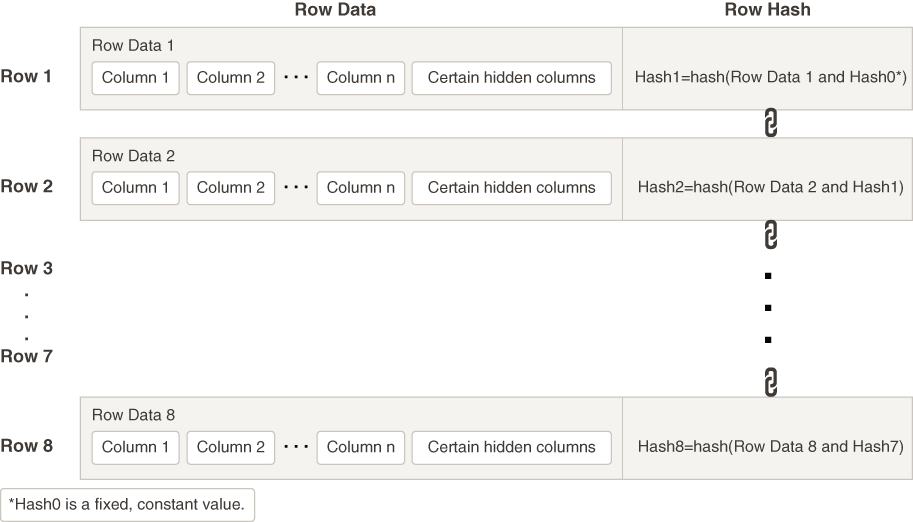

## 19 Managing Tables

Managing tables includes tasks such as creating tables, loading tables, altering tables, and dropping tables.

Live SQL:

To view and run examples related to the ones in this chapter on Oracle Live SQL, go to [Oracle Live SQL: Creating and Modifying Tables](https://livesql.oracle.com/apex/livesql/docs/admin/managing-tables/create-modify.html).

- About Tables  
	Tables are the basic unit of data storage in an Oracle Database. Data is stored in rows and columns.
- Guidelines for Managing Tables  
	Following guidelines can make the management of your tables easier and can improve performance when creating the table, as well as when loading, updating, and querying the table data.
- Creating Tables  
	Create tables using the SQL statement `CREATE TABLE`.
- Loading Tables  
	There are several techniques for loading data into tables.
- Optimizing the Performance of Bulk Updates  
	The `EXECUTE_UPDATE` procedure in the `DBMS_REDEFINITION` package can optimize the performance of bulk updates to a table. Performance is optimized because the updates are not logged in the redo log.
- Automatically Collecting Statistics on Tables  
	The PL/SQL package `DBMS_STATS` lets you generate and manage statistics for cost-based optimization. You can use this package to gather, modify, view, export, import, and delete statistics. You can also use this package to identify or name statistics that have been gathered.
- Altering Tables  
	You alter a table using the `ALTER TABLE` statement. To alter a table, the table must be contained in your schema, or you must have either the `ALTER` object privilege for the table or the `ALTER ANY TABLE` system privilege.
- Redefining Tables Online  
	You can modify the logical or physical structure of a table.
- Researching and Reversing Erroneous Table Changes  
	To enable you to research and reverse erroneous changes to tables, Oracle Database provides a group of features that you can use to view past states of database objects or to return database objects to a previous state without using point-in-time media recovery. These features are known as Oracle Flashback features.
- Recovering Tables Using Oracle Flashback Table  
	Oracle Flashback Table enables you to restore a table to its state as of a previous point in time.
- Dropping Tables  
	To drop a table that you no longer need, use the `DROP TABLE` statement.
- Using Flashback Drop and Managing the Recycle Bin  
	When you drop a table, the database does not immediately remove the space associated with the table. The database renames the table and places it and any associated objects in a recycle bin, where, in case the table was dropped in error, it can be recovered at a later time. This feature is called Flashback Drop, and the `FLASHBACK` `TABLE` statement is used to restore the table.
- Managing Index-Organized Tables  
	An index-organized table's storage organization is a variant of a primary B-tree index. Unlike a heap-organized table, data is stored in primary key order.
- Managing Partitioned Tables  
	Partitioned tables enable your data to be broken down into smaller, more manageable pieces called partitions, or even subpartitions. Each partition can have separate physical attributes, such as compression enabled or disabled, type of compression, physical storage settings, and tablespace, thus providing a structure that can be better tuned for availability and performance. In addition, each partition can be managed individually, which can simplify and reduce the time required for backup and administration.
- Managing External Tables  
	External tables are the tables that do not reside in the database. They reside outside the database, in Object storage or external files, such as operating system files or Hadoop Distributed File System (HDFS) files.
- Managing Hybrid Partitioned Tables  
	A hybrid partitioned table is a partitioned table in which some partitions reside in the database and some partitions reside outside the database in external files, such as operating system files or Hadoop Distributed File System (HDFS) files.
- Managing Immutable Tables  
	Immutable tables provide protection against unauthorized data modification.
- Managing Blockchain Tables  
	Blockchain tables protect data that records important actions, assets, entities, and documents from unauthorized modification or deletion by criminals, hackers, and fraud. Blockchain tables prevent unauthorized changes made using the database and detect unauthorized changes that bypass the database.
- Tables Data Dictionary Views  
	You can query a set of data dictionary views for information about tables.

**Parent topic:** [Schema Objects](schema-objects.md)

### 19.1 About Tables

Tables are the basic unit of data storage in an Oracle Database. Data is stored in rows and columns.

You define a table with a table name, such as `employees`, and a set of columns. You give each column a column name, such as `employee_id`, `last_name`, and `job_id`; a data type, such as `VARCHAR2`, `DATE`, or `NUMBER`; and a width. The width can be predetermined by the data type, as in `DATE`. If columns are of the `NUMBER` data type, define precision and scale instead of width. A row is a collection of column information corresponding to a single record.

You can specify rules for each column of a table. These rules are called integrity constraints. One example is a `NOT NULL` integrity constraint. This constraint forces the column to contain a value in every row.

You can invoke Transparent Data Encryption to encrypt data before storing it. If users attempt to circumvent the database access control mechanisms by looking inside Oracle data files directly with operating system tools, encryption prevents these users from viewing sensitive data.

Tables can also include virtual columns. A virtual column is like any other table column, except that its value is derived by evaluating an expression. The expression can include columns from the same table, constants, SQL functions, and user-defined PL/SQL functions. You cannot explicitly write to a virtual column.

Some column types, such as `LOB` s, varrays, and nested tables, are stored in their own segments. `LOB` s and varrays are stored in `LOB` segments, while nested tables are stored in storage tables. You can specify a `STORAGE` clause for these segments that will override storage parameters specified at the table level.

After you create a table, you insert rows of data using SQL statements or using an Oracle bulk load utility. Table data can then be queried, deleted, or updated using SQL.

See Also:

- [Oracle Database Concepts](https://docs.oracle.com/pls/topic/lookup?ctx=en/database/oracle/oracle-database/21/admin&id=CNCPT211) for an overview of tables
- [Oracle Database SQL Language Reference](https://docs.oracle.com/pls/topic/lookup?ctx=en/database/oracle/oracle-database/21/admin&id=SQLRF0021) for descriptions of Oracle Database data types
- [Managing Space for Schema Objects](managing-space-for-schema-objects.md) for guidelines for managing space for tables
- [Managing Schema Objects](managing-schema-objects.md) for information on additional aspects of managing tables, such as specifying integrity constraints and analyzing tables
- [Oracle Database Advanced Security Guide](https://docs.oracle.com/pls/topic/lookup?ctx=en/database/oracle/oracle-database/21/admin&id=ASOAG600) for a discussion of Transparent Data Encryption

**Parent topic:** Managing Tables

### 19.2 Guidelines for Managing Tables

Following guidelines can make the management of your tables easier and can improve performance when creating the table, as well as when loading, updating, and querying the table data.

- Design Tables Before Creating Them  
	Usually, the application developer is responsible for designing the elements of an application, including the tables. Database administrators are responsible for establishing the attributes of the underlying tablespace that will hold the application tables.
- Specify the Type of Table to Create  
	You can create different types of tables with Oracle Database.
- Specify the Location of Each Table  
	It is advisable to specify the `TABLESPACE` clause in a `CREATE TABLE` statement to identify the tablespace that is to store the new table. For partitioned tables, you can optionally identify the tablespace that is to store each partition.
- Consider Parallelizing Table Creation  
	You can use parallel execution when creating tables using a subquery (`AS SELECT`) in the `CREATE TABLE` statement. Because multiple processes work together to create the table, performance of the table creation operation is improved.
- Consider Using NOLOGGING When Creating Tables  
	To create a table most efficiently use the `NOLOGGING` clause in the `CREATE TABLE...AS SELECT` statement. The `NOLOGGING` clause causes minimal redo information to be generated during the table creation.
- Consider Using Table Compression  
	As your database grows in size, consider using table compression to save space and improve performance.
- Managing Table Compression Using Enterprise Manager Cloud Control  
	You can manage table compression with Oracle Enterprise Manager Cloud Control.
- Consider Using Segment-Level and Row-Level Compression Tiering  
	Segment-level compression tiering enables you to specify compression at the segment level within a table. Row-level compression tiering enables you to specify compression at the row level within a table. You can use a combination of these on the same table for fine-grained control over how the data in the table is stored and managed.
- Consider Using Attribute-Clustered Tables  
	An attribute-clustered table is a heap-organized table that stores data in close proximity on disk based on user-specified clustering directives.
- Consider Using Zone Maps  
	A zone is a set of contiguous data blocks on disk. A zone map tracks the minimum and maximum of specified columns for all individual zones.
- Consider Storing Tables in the In-Memory Column Store  
	The In-Memory Column Store is an optional portion of the system global area (SGA) that stores copies of tables, table partitions, and other database objects that is optimized for rapid scans. In the In-Memory Column Store, table data is stored by column rather than row in the SGA.
- Consider Using Invisible Columns  
	You can use invisible column to make changes to a table without disrupting applications that use the table.
- Consider Encrypting Columns That Contain Sensitive Data  
	You can encrypt individual table columns that contain sensitive data. Examples of sensitive data include social security numbers, credit card numbers, and medical records. Column encryption is transparent to your applications, with some restrictions.
- Understand Deferred Segment Creation  
	When you create heap-organized tables in a locally managed tablespace, the database defers table segment creation until the first row is inserted.
- Materializing Segments  
	The `DBMS_SPACE_ADMIN` package includes the `MATERIALIZE_DEFERRED_SEGMENTS()` procedure, which enables you to materialize segments for tables, table partitions, and dependent objects created with deferred segment creation enabled.
- Estimate Table Size and Plan Accordingly  
	Estimate the sizes of tables before creating them. Preferably, do this as part of database planning. Knowing the sizes, and uses, for database tables is an important part of database planning.
- Restrictions to Consider When Creating Tables  
	There are restrictions to consider when you create tables.

**Parent topic:** Managing Tables

#### 19.2.1 Design Tables Before Creating Them

Usually, the application developer is responsible for designing the elements of an application, including the tables. Database administrators are responsible for establishing the attributes of the underlying tablespace that will hold the application tables.

Either the DBA or the applications developer, or both working jointly, can be responsible for the actual creation of the tables, depending upon the practices for a site. Working with the application developer, consider the following guidelines when designing tables:

- Use descriptive names for tables, columns, indexes, and clusters.
- Be consistent in abbreviations and in the use of singular and plural forms of table names and columns.
- Document the meaning of each table and its columns with the `COMMENT` command.
- Normalize each table.
- Select the appropriate data type for each column.
- Consider whether your applications would benefit from adding one or more virtual columns to some tables.
- Define columns that allow nulls last, to conserve storage space.
- Cluster tables whenever appropriate, to conserve storage space and optimize performance of SQL statements.

Before creating a table, you should also determine whether to use integrity constraints. Integrity constraints can be defined on the columns of a table to enforce the business rules of your database automatically.

**Parent topic:** Guidelines for Managing Tables

#### 19.2.2 Specify the Type of Table to Create

You can create different types of tables with Oracle Database.

Here are the types of tables that you can create:

| Type of Table | Description |
| --- | --- |
| Ordinary (heap-organized) table | This is the basic, general purpose type of table which is the primary subject of this chapter. Its data is stored as an unordered collection (heap). |
| Clustered table | A clustered table is a table that is part of a cluster. A cluster is a group of tables that share the same data blocks because they share common columns and are often used together.  Clusters and clustered tables are discussed in [Managing Clusters](managing-clusters.md). |
| Index-organized table | Unlike an ordinary (heap-organized) table, data for an index-organized table is stored in a B-tree index structure in a primary key sorted manner. Besides storing the primary key column values of an index-organized table row, each index entry in the B-tree stores the nonkey column values as well.  Index-organized tables are discussed in " Managing Index-Organized Tables ". |
| Partitioned table | Partitioned tables enable your data to be broken down into smaller, more manageable pieces called partitions, or even subpartitions. Each partition can have separate physical attributes, such as compression enabled or disabled, type of compression, physical storage settings, and tablespace, thus providing a structure that can be better tuned for availability and performance. In addition, each partition can be managed individually, which can simplify and reduce the time required for backup and administration.  Partitioned tables are discussed in [Oracle Database VLDB and Partitioning Guide](https://docs.oracle.com/pls/topic/lookup?ctx=en/database/oracle/oracle-database/21/admin&id=VLDBG-GUID-EA7EF5CB-DD49-43AF-889A-F83AAC0D7D51). |
| External table | An external table is a table that does not reside in the database, but resides outside the database in external files, such as operating system files or Hadoop Distributed File System (HDFS) files.  External tables are discussed in Managing External Tables. |
| Hybrid partitioned table | A hybrid partitioned table is a partitioned table in which some partitions reside in the database and some partitions reside outside the database in external files, such as operating system files or Hadoop Distributed File System (HDFS) files.  Hybrid partitioned tables are discussed in [Oracle Database VLDB and Partitioning Guide](https://docs.oracle.com/pls/topic/lookup?ctx=en/database/oracle/oracle-database/21/admin&id=VLDBG-GUID-C2B04585-BCFC-40D6-AFAB-47DF99A31C76). |

**Parent topic:** Guidelines for Managing Tables

#### 19.2.3 Specify the Location of Each Table

It is advisable to specify the `TABLESPACE` clause in a `CREATE TABLE` statement to identify the tablespace that is to store the new table. For partitioned tables, you can optionally identify the tablespace that is to store each partition.

Ensure that you have the appropriate privileges and quota on any tablespaces that you use. If you do not specify a tablespace in a `CREATE TABLE` statement, the table is created in your default tablespace.

When specifying the tablespace to contain a new table, ensure that you understand implications of your selection. By properly specifying a tablespace during the creation of each table, you can increase the performance of the database system and decrease the time needed for database administration.

The following situations illustrate how not specifying a tablespace, or specifying an inappropriate one, can affect performance:

- If users' objects are created in the `SYSTEM` tablespace, the performance of the database can suffer, since both data dictionary objects and user objects must contend for the same data files. Users' objects should not be stored in the `SYSTEM` tablespace. To avoid this, ensure that all users are assigned default tablespaces when they are created in the database.
- If application-associated tables are arbitrarily stored in various tablespaces, the time necessary to complete administrative operations (such as backup and recovery) for the data of that application can be increased.

**Parent topic:** Guidelines for Managing Tables

#### 19.2.4 Consider Parallelizing Table Creation

You can use parallel execution when creating tables using a subquery (`AS SELECT`) in the `CREATE TABLE` statement. Because multiple processes work together to create the table, performance of the table creation operation is improved.

Parallelizing table creation is discussed in the section " Parallelizing Table Creation ".

**Parent topic:** Guidelines for Managing Tables

#### 19.2.5 Consider Using NOLOGGING When Creating Tables

To create a table most efficiently use the `NOLOGGING` clause in the `CREATE TABLE...AS SELECT` statement. The `NOLOGGING` clause causes minimal redo information to be generated during the table creation.

Using the `NOLOGGING` clause has the following benefits:

- Space is saved in the redo log files.
- The time it takes to create the table is decreased.
- Performance improves for parallel creation of large tables.

The `NOLOGGING` clause also specifies that subsequent direct loads using SQL\*Loader and direct load `INSERT` operations are not logged. Subsequent DML statements (`UPDATE`, `DELETE`, and conventional path insert) are unaffected by the `NOLOGGING` attribute of the table and generate redo.

If you cannot afford to lose the table after you have created it (for example, you will no longer have access to the data used to create the table) you should take a backup immediately after the table is created. In some situations, such as for tables that are created for temporary use, this precaution may not be necessary.

In general, the relative performance improvement of specifying `NOLOGGING` is greater for larger tables than for smaller tables. For small tables, `NOLOGGING` has little effect on the time it takes to create a table. However, for larger tables the performance improvement can be significant, especially when also parallelizing the table creation.

**Parent topic:** Guidelines for Managing Tables

#### 19.2.6 Consider Using Table Compression

As your database grows in size, consider using table compression to save space and improve performance.

- About Table Compression  
	Compression saves disk space, reduces memory use in the database buffer cache, and can significantly speed query execution during reads.
- Examples Related to Table Compression  
	Examples illustrate using table compression.
- Compression and Partitioned Tables  
	A table can have both compressed and uncompressed partitions, and different partitions can use different compression methods. If the compression settings for a table and one of its partitions do not match, then the partition setting has precedence for the partition.
- Determining If a Table Is Compressed  
	In the `*_TABLES` data dictionary views, compressed tables have `ENABLED` in the `COMPRESSION` column.
- Determining Which Rows Are Compressed  
	To determine the compression level of a row, use the `GET_COMPRESSION_TYPE` function in the `DBMS_COMPRESSION` package.
- Changing the Compression Level  
	You can change the compression level for a partition, table, or tablespace.
- Adding and Dropping Columns in Compressed Tables  
	Some restrictions apply when adding columns to a compressed table or dropping columns from a compressed table.
- Exporting and Importing Hybrid Columnar Compression Tables  
	Hybrid Columnar Compression tables can be imported using the `impdp` command of the Data Pump Import utility.
- Restoring a Hybrid Columnar Compression Table  
	There may be times when a Hybrid Columnar Compression table must be restored from a backup. The table can be restored to a system that supports Hybrid Columnar Compression, or to a system that does not support Hybrid Columnar Compression.
- Notes and Restrictions for Compressed Tables  
	Consider notes and restrictions related to compressed tables.
- Packing Compressed Tables  
	If you use conventional DML on a table compressed with basic table compression or Hybrid Columnar Compression, then all inserted and updated rows are stored uncompressed or in a less-compressed format. To "pack" the compressed table so that these rows are compressed, use an `ALTER` `TABLE` `MOVE` statement.

**Parent topic:** Guidelines for Managing Tables

##### 19.2.6.1 About Table Compression

Compression saves disk space, reduces memory use in the database buffer cache, and can significantly speed query execution during reads.

Compression has a cost in CPU overhead for data loading and DML. However, this cost is offset by reduced I/O requirements. Because compressed table data stays compressed in memory, compression can also improve performance for DML operations, as more rows can fit in the database buffer cache (and flash cache if it is enabled).

Table compression is completely transparent to applications. It is useful in decision support systems (DSS), online transaction processing (OLTP) systems, and archival systems.

You can specify compression for a tablespace, a table, or a partition. If specified at the tablespace level, then all tables created in that tablespace are compressed by default.

Oracle Database supports several methods of table compression. They are summarized in Table 19-1.

Table 19-1 Table Compression Methods

| Table Compression Method | Compression Level | CPU Overhead | Applications | Notes |
| --- | --- | --- | --- | --- |
| Basic table compression | High | Minimal | DSS | None. |
| Advanced row compression | High | Minimal | OLTP, DSS | None. |
| Warehouse compression (Hybrid Columnar Compression) | Higher | Higher | DSS | The compression level and CPU overhead depend on compression level specified (LOW or HIGH). |
| Archive compression (Hybrid Columnar Compression) | Highest | Highest | Archiving | The compression level and CPU overhead depend on compression level specified (LOW or HIGH). |

When you use basic table compression, warehouse compression, or archive compression, compression only occurs when data is bulk loaded or array inserted into a table.

Basic table compression supports limited data types and SQL operations.

Advanced row compression is intended for OLTP applications and compresses data manipulated by any SQL operation. When you use advanced row compression, compression occurs while data is being inserted, updated, or bulk loaded into a table. Operations that permit advanced row compression include:

- Single-row inserts and updates
	Inserts and updates are not compressed immediately. When updating an already compressed block, any columns that are not updated usually remain compressed. Updated columns are stored in an uncompressed format similar to any uncompressed block. The updated values are re-compressed when the block reaches a database-controlled threshold. Inserted data is also compressed when the data in the block reaches a database-controlled threshold.
- Array inserts
	Array inserts include `INSERT INTO SELECT` SQL statements without the `APPEND` hint, and array inserts from programmatic interfaces such as PL/SQL and the Oracle Call Interface (OCI).
- The following direct-path `INSERT` methods:
	- Direct path SQL\*Loader
		- `CREATE` `TABLE` `AS` `SELECT` statements
		- Parallel `INSERT` statements
		- `INSERT` statements with an `APPEND` or `APPEND_VALUES` hint
	Inserts performed with these direct-path `INSERT` methods are compressed immediately.

Warehouse compression and archive compression achieve the highest compression levels because they use Hybrid Columnar Compression technology. Hybrid Columnar Compression technology uses a modified form of columnar storage instead of row-major storage. This enables the database to store similar data together, which improves the effectiveness of compression algorithms. For data that is updated, Hybrid Columnar Compression uses more CPU and moves the updated rows to row format so that future updates are faster. Because of this optimization, you should use it only for data that is updated infrequently.

The higher compression levels of Hybrid Columnar Compression are achieved only with data that is direct-path inserted or array inserted. Conventional inserts and updates are supported, but cause rows to be moved from columnar to row format, and reduce the compression level. You can use Automatic Data Optimization (ADO) policies to move these rows back to the desired level of Hybrid Columnar Compression automatically.

With Hybrid Columnar Compression (warehouse and archive), for array inserts to be compressed immediately, the following conditions must be met:

- The table must be stored in a locally managed tablespace with Automatic Segment Space Management (ASSM) enabled.
- The database compatibility level must be at 12.2.0 or higher.

Regardless of the compression method, `DELETE` operations on a compressed block are identical to `DELETE` operations on a non-compressed block. Any space obtained on a data block, caused by SQL `DELETE` operations, is reused by subsequent SQL `INSERT` operations. With Hybrid Columnar Compression technology, when all the rows in a compression unit are deleted, the space in the compression unit is available for reuse.

Table 19-2 lists characteristics of each table compression method.

Table 19-2 Table Compression Characteristics

| Table Compression Method | CREATE/ALTER TABLE Syntax | Direct-Path or Array Inserts | Notes |
| --- | --- | --- | --- |
| Basic table compression | `ROW STORE COMPRESS [BASIC]` | Rows are compressed with basic table compression. | `ROW STORE COMPRESS` and `ROW STORE COMPRESS` `BASIC` are equivalent.  Rows inserted without using direct-path or array insert and updated rows are uncompressed. |
| Advanced row compression | `ROW STORE COMPRESS ADVANCED` | Rows are compressed with advanced row compression. | Rows inserted with or without using direct-path or array insert and updated rows are compressed using advanced row compression. |
| Warehouse compression (Hybrid Columnar Compression) | `COLUMN STORE COMPRESS FOR QUERY [LOW\|HIGH]` | Rows are compressed with warehouse compression. | This compression method can result in high CPU overhead.  Updated rows and rows inserted without using direct-path or array insert are stored in row format instead of column format, and thus have a lower compression level. |
| Archive compression (Hybrid Columnar Compression) | `COLUMN STORE COMPRESS FOR ARCHIVE [LOW\|HIGH]` | Rows are compressed with archive compression. | This compression method can result in high CPU overhead.  Updated rows and rows inserted without using direct-path or array insert are stored in row format instead of column format, and thus have a lower compression level. |

You specify table compression with the `COMPRESS` clause of the `CREATE` `TABLE` statement. You can enable compression for an existing table by using these clauses in an `ALTER` `TABLE` statement. In this case, only data that is inserted or updated after compression is enabled is compressed. Using the `ALTER` `TABLE` `MOVE` statement also enables compression for data that is inserted and updated, but it compresses existing data as well. Similarly, you can disable table compression for an existing compressed table with the `ALTER` `TABLE`...`NOCOMPRESS` statement. In this case, all data that was already compressed remains compressed, and new data is inserted uncompressed.

The `COLUMN STORE COMPRESS FOR QUERY HIGH` option is the default data warehouse compression mode. It provides good compression and performance when using Hybrid Columnar Compression on Exadata storage. The `COLUMN STORE COMPRESS FOR QUERY LOW` option should be used in environments where load performance is critical. It loads faster than data compressed with the `COLUMN STORE COMPRESS FOR QUERY HIGH` option.

The `COLUMN STORE COMPRESS FOR ARCHIVE LOW` option is the default archive compression mode. It provides a high compression level and is ideal for infrequently-accessed data. The `COLUMN STORE COMPRESS FOR ARCHIVE HIGH` option should be used for data that is rarely accessed.

A compression advisor, provided by the `DBMS_COMPRESSION` package, helps you determine the expected compression level for a particular table with a particular compression method.

Note:

Hybrid Columnar Compression is dependent on the underlying storage system. See [Oracle Database Licensing Information](https://docs.oracle.com/pls/topic/lookup?ctx=en/database/oracle/oracle-database/21/admin&id=DBLIC-GUID-0F9EB85D-4610-4EDF-89C2-4916A0E7AC87) for more information.

See Also:

- [Oracle Database Concepts](https://docs.oracle.com/pls/topic/lookup?ctx=en/database/oracle/oracle-database/21/admin&id=CNCPT1132) for an overview of table compression
- " [About Tablespaces with Default Compression Attributes](managing-tablespaces.md) "

**Parent topic:** Consider Using Table Compression

##### 19.2.6.2 Examples Related to Table Compression

Examples illustrate using table compression.

Example 19-1 Creating a Table with Advanced Row Compression

The following example enables advanced row compression on the table `orders`:

```
CREATE TABLE orders  ...  ROW STORE COMPRESS ADVANCED;
```

Data for the `orders` table is compressed during direct-path `INSERT`, array insert, and conventional DML.

Example 19-2 Creating a Table with Basic Table Compression

The following statements, which are equivalent, enable basic table compression on the `sales_history` table, which is a fact table in a data warehouse:

```
CREATE TABLE sales_history  ...  ROW STORE COMPRESS BASIC;

CREATE TABLE sales_history  ...  ROW STORE COMPRESS;
```

Frequent queries are run against this table, but no DML is expected.

Example 19-3 Using Direct-Path Insert to Insert Rows Into a Table

This example demonstrates using the `APPEND` hint to insert rows into the `sales_history` table using direct-path `INSERT`.

```
INSERT /*+ APPEND */ INTO sales_history SELECT * FROM sales WHERE cust_id=8890;
COMMIT;
```

Example 19-4 Using an Array Insert to Insert Rows Into a Table

This example demonstrates using an array insert in SQL to insert rows into the `sales_history` table.

```
INSERT INTO sales_history SELECT * FROM sales WHERE cust_id=8890;
COMMIT;
```

This example demonstrates using an array insert in PL/SQL to insert rows into the `hr.jobs_test` table.

```
DECLARE
   TYPE table_def IS TABLE OF hr.jobs%ROWTYPE;
   array table_def := table_def();
BEGIN
   SELECT * BULK COLLECT INTO array FROM hr.jobs;
   FORALL i in array.first .. array.last
   INSERT INTO hr.jobs_test VALUES array(i);
COMMIT;
END; 
/
```

Note:

With Hybrid Columnar Compression (warehouse and archive), for array inserts performed in SQL, PL/SQL, or OCI to be compressed immediately, the table must be stored in a locally managed tablespace with Automatic Segment Space Management (ASSM) enabled, and the database compatibility level must be at 12.2.0 or higher.

Example 19-5 Creating a Table with Warehouse Compression

This example enables Hybrid Columnar Compression on the table `sales_history`:

```
CREATE TABLE sales_history  ...  COLUMN STORE COMPRESS FOR QUERY;
```

The table is created with the default `COLUMN STORE COMPRESS FOR QUERY HIGH` option. This option provides a higher level of compression than basic table compression or advanced row compression. It works well when frequent queries are run against this table and no DML is expected.

Example 19-6 Creating a Table with Archive Compression

The following example enables Hybrid Columnar Compression on the table `sales_history`:

```
CREATE TABLE sales_history  ...  COLUMN STORE COMPRESS FOR ARCHIVE;
```

The table is created with the default `COLUMN STORE COMPRESS FOR ARCHIVE LOW` option. This option provides a higher level of compression than basic, advanced row, or warehouse compression. It works well when load performance is critical and data is accessed infrequently. The default `COLUMN STORE COMPRESS FOR ARCHIVE LOW` option provides a lower level of compression than the `COLUMN STORE COMPRESS FOR ARCHIVE HIGH` option.

**Parent topic:** Consider Using Table Compression

##### 19.2.6.3 Compression and Partitioned Tables

A table can have both compressed and uncompressed partitions, and different partitions can use different compression methods. If the compression settings for a table and one of its partitions do not match, then the partition setting has precedence for the partition.

To change the compression method for a partition, do one of the following:

- To change the compression method for new data only, use `ALTER` `TABLE`... `MODIFY` `PARTITION`... `COMPRESS`...
- To change the compression method for both new and existing data, use either `ALTER` `TABLE`... `MOVE` `PARTITION`... `COMPRESS`... or online table redefinition.

When you execute these statements, specify the compression method. For example, run the following statement to change the compression method to advanced row compression for both new and existing data:

```
ALTER TABLE ... MOVE PARTITION ... ROW STORE COMPRESS ADVANCED...
```

**Parent topic:** Consider Using Table Compression

##### 19.2.6.4 Determining If a Table Is Compressed

In the `*_TABLES` data dictionary views, compressed tables have `ENABLED` in the `COMPRESSION` column.

For partitioned tables, this column is null, and the `COMPRESSION` column of the `*_TAB_PARTITIONS` views indicates the partitions that are compressed. In addition, the `COMPRESS_FOR` column indicates the compression method in use for the table or partition.

```
SQL> SELECT table_name, compression, compress_for FROM user_tables;
 
TABLE_NAME       COMPRESSION   COMPRESS_FOR
---------------- ------------  -----------------
T1               DISABLED
T2               ENABLED       BASIC
T3               ENABLED       ADVANCED
T4               ENABLED       QUERY HIGH
T5               ENABLED       ARCHIVE LOW
```
```
SQL> SELECT table_name, partition_name, compression, compress_for
  FROM user_tab_partitions;

TABLE_NAME  PARTITION_NAME   COMPRESSION   COMPRESS_FOR
----------- ---------------- -----------   ------------------------------
SALES       Q4_2004          ENABLED       ARCHIVE HIGH
  ...
SALES       Q3_2008          ENABLED       QUERY HIGH
SALES       Q4_2008          ENABLED       QUERY HIGH
SALES       Q1_2009          ENABLED       ADVANCED
SALES       Q2_2009          ENABLED       ADVANCED
```

**Parent topic:** Consider Using Table Compression

##### 19.2.6.5 Determining Which Rows Are Compressed

To determine the compression level of a row, use the `GET_COMPRESSION_TYPE` function in the `DBMS_COMPRESSION` package.

For example, the following query returns the compression type for a row in the `hr.employees` table:

```
SELECT DECODE(DBMS_COMPRESSION.GET_COMPRESSION_TYPE(
                 ownname    => 'HR', 
                 tabname    => 'EMPLOYEES', 
                 subobjname => '',
                 row_id     => 'AAAVEIAAGAAAABTAAD'), 
   1,  'No Compression',
   2,  'Advanced Row Compression', 
   4,  'Hybrid Columnar Compression for Query High',
   8,  'Hybrid Columnar Compression for Query Low',
   16, 'Hybrid Columnar Compression for Archive High',
   32, 'Hybrid Columnar Compression for Archive Low',
   4096, 'Basic Table Compression', 
   'Unknown Compression Type') compression_type
FROM DUAL;
```

See Also:

[Oracle Database PL/SQL Packages and Types Reference](https://docs.oracle.com/pls/topic/lookup?ctx=en/database/oracle/oracle-database/21/admin&id=ARPLS65610) for additional information about `GET_COMPRESSION_TYPE`

**Parent topic:** Consider Using Table Compression

##### 19.2.6.6 Changing the Compression Level

You can change the compression level for a partition, table, or tablespace.

For example, suppose a company uses warehouse compression for its sales data, but sales data older than six months is rarely accessed. If the sales data is stored in a table that is partitioned based on the age of the data, then the compression level for the older data can be changed to archive compression to free disk space.

To change the compression level for a partition or subpartition, you can use the following statements:

- `ALTER` `TABLE` `...` `MOVE` `PARTITION` `...` `ONLINE`
- `ALTER` `TABLE` `...` `MOVE` `SUBPARTITION` `...` `ONLINE`

These two statements support the `ONLINE` keyword, which enables DML operations to run uninterrupted on the partition or subpartition that is being moved. These statements also automatically keep all the indexes updated while the partition or subpartition is being moved. You can also use the `ALTER TABLE...MODIFY PARTITION` statement or online redefinition to change the compression level for a partition.

If a table is not partitioned, then you can use the `ALTER TABLE...MOVE...COMPRESS FOR...` statement to change the compression level. The `ALTER TABLE...MOVE` statement does not permit DML statements against the table while the command is running. However, you can also use online redefinition to compress a table, which keeps the table available for queries and DML statements during the redefinition.

To change the compression level for a tablespace, use the `ALTER TABLESPACE` statement.

See Also:

- " Moving a Table to a New Segment or Tablespace " for additional information about the `ALTER TABLE` command
- " Redefining Tables Online "
- [Oracle Database PL/SQL Packages and Types Reference](https://docs.oracle.com/pls/topic/lookup?ctx=en/database/oracle/oracle-database/21/admin&id=ARPLS042) for additional information about the `DBMS_REDEFINITION` package

**Parent topic:** Consider Using Table Compression

##### 19.2.6.7 Adding and Dropping Columns in Compressed Tables

Some restrictions apply when adding columns to a compressed table or dropping columns from a compressed table.

The following restrictions apply when adding columns to compressed tables:

- Advanced row compression, warehouse compression, and archive compression: If a default value is specified for an added column and the table is already populated, then the conditions for optimized add column behavior must be met. These conditions are described in [Oracle Database SQL Language Reference](https://docs.oracle.com/pls/topic/lookup?ctx=en/database/oracle/oracle-database/21/admin&id=SQLRF53355).

The following restrictions apply when dropping columns in compressed tables:

- Basic table compression: Dropping a column is not supported.
- Advanced row compression, warehouse compression, and archive compression: `DROP` `COLUMN` is supported, but internally the database sets the column `UNUSED` to avoid long-running decompression and recompression operations.

**Parent topic:** Consider Using Table Compression

##### 19.2.6.8 Exporting and Importing Hybrid Columnar Compression Tables

Hybrid Columnar Compression tables can be imported using the `impdp` command of the Data Pump Import utility.

By default, the `impdp` command preserves the table properties, and the imported table is a Hybrid Columnar Compression table. On tablespaces not supporting Hybrid Columnar Compression, the `impdp` command fails with an error. The tables can also be exported using the `expdp` command.

You can import the Hybrid Columnar Compression table as an uncompressed table using the `TRANSFORM=SEGMENT_ATTRIBUTES:n` option clause of the `impdp` command.

An uncompressed or advanced row-compressed table can be converted to Hybrid Columnar Compression format during import. To convert a non-Hybrid Columnar Compression table to a Hybrid Columnar Compression table, do the following:

1. Specify default compression for the tablespace using the `ALTER TABLESPACE ... SET DEFAULT COMPRESS` command.
2. Override the `SEGMENT_ATTRIBUTES` option of the imported table during import.

See Also:

- [Oracle Database Utilities](https://docs.oracle.com/pls/topic/lookup?ctx=en/database/oracle/oracle-database/21/admin&id=SUTIL300) for additional information about the Data Pump Import utility
- [Oracle Database SQL Language Reference](https://docs.oracle.com/pls/topic/lookup?ctx=en/database/oracle/oracle-database/21/admin&id=SQLRF01002) for additional information about the `ALTER TABLESPACE` command

**Parent topic:** Consider Using Table Compression

##### 19.2.6.9 Restoring a Hybrid Columnar Compression Table

There may be times when a Hybrid Columnar Compression table must be restored from a backup. The table can be restored to a system that supports Hybrid Columnar Compression, or to a system that does not support Hybrid Columnar Compression.

When restoring a table with Hybrid Columnar Compression to a system that supports Hybrid Columnar Compression, restore the file using Oracle Recovery Manager (RMAN) as usual.

When a Hybrid Columnar Compression table is restored to a system that does not support Hybrid Columnar Compression, you must convert the table from Hybrid Columnar Compression to advanced row compression or an uncompressed format. To restore the table, do the following:

1. Ensure there is sufficient storage in environment to hold the data in uncompressed or advanced row compression format.
2. Use RMAN to restore the Hybrid Columnar Compression tablespace.
3. Complete one of the following actions to convert the table from Hybrid Columnar Compression to advanced row compression or an uncompressed format:
	- Use the following statement to change the data compression from Hybrid Columnar Compression to `ROW STORE COMPRESS ADVANCED`:
		```
		ALTER TABLE table_name MOVE ROW STORE COMPRESS ADVANCED;
		```
	- Use the following statement to change the data compression from Hybrid Columnar Compression to `NOCOMPRESS`:
		```
		ALTER TABLE table_name MOVE NOCOMPRESS;
		```
	- Use the following statement to change each partition to `NOCOMPRESS`:
		```
		ALTER TABLE table_name MOVE PARTITION partition_name NOCOMPRESS;
		```
		Change each partition separately.
		If DML is required on the partition while it is being moved, then include the `ONLINE` keyword:
		```
		ALTER TABLE table_name MOVE PARTITION partition_name NOCOMPRESS ONLINE;
		```
		Moving a partition online might take longer than moving a partition offline.
	- Use the following statement to move the data to `NOCOMPRESS` in parallel:
		```
		ALTER TABLE table_name MOVE NOCOMPRESS PARALLEL;
		```

See Also:

- [Oracle Database Backup and Recovery User's Guide](https://docs.oracle.com/pls/topic/lookup?ctx=en/database/oracle/oracle-database/21/admin&id=BRADV89346) for additional information about RMAN
- [Oracle Database SQL Language Reference](https://docs.oracle.com/pls/topic/lookup?ctx=en/database/oracle/oracle-database/21/admin&id=SQLRF01001) for additional information about the `ALTER TABLE` command

**Parent topic:** Consider Using Table Compression

##### 19.2.6.10 Notes and Restrictions for Compressed Tables

Consider notes and restrictions related to compressed tables.

The following are notes and restrictions related to compressed tables:

- Advanced row compression, warehouse compression, and archive compression are not supported for the following types of tables:
	- Index-organized tables
	- External tables
	- Tables with `LONG` or `LONG RAW` columns
	- Temporary tables
	- Tables with `ROWDEPENDENCIES` enabled
	- Clustered tables
- Online segment shrink is not supported for tables compressed with the following compression methods:
	- Basic table compression using `ROW STORE COMPRESS BASIC`
		- Warehouse compression using `COLUMN STORE COMPRESS FOR QUERY`
		- Archive compression using `COLUMN STORE COMPRESS FOR ARCHIVE`
- The table compression methods described in this section do not apply to SecureFiles large objects (LOBs). SecureFiles LOBs have their own compression methods. See [Oracle Database SecureFiles and Large Objects Developer's Guide](https://docs.oracle.com/pls/topic/lookup?ctx=en/database/oracle/oracle-database/21/admin&id=ADLOB4444) for more information.
- Compression technology uses CPU. Ensure that you have enough available CPU to handle the additional load.
- Tables created with basic table compression have the `PCT_FREE` parameter automatically set to `0` unless you specify otherwise.

**Parent topic:** Consider Using Table Compression

##### 19.2.6.11 Packing Compressed Tables

If you use conventional DML on a table compressed with basic table compression or Hybrid Columnar Compression, then all inserted and updated rows are stored uncompressed or in a less-compressed format. To "pack" the compressed table so that these rows are compressed, use an `ALTER` `TABLE` `MOVE` statement.

This operation takes an exclusive lock on the table, and therefore prevents any updates and loads until it completes. If this is not acceptable, then you can use online table redefinition.

When you move a partition or subpartition, you can use the `ALTER` `TABLE` `MOVE` statement to compress the partition or subpartition while still allowing DML operations to run interrupted on the partition or subpartition that is being moved.

See Also:

- [Oracle Database SQL Language Reference](https://docs.oracle.com/pls/topic/lookup?ctx=en/database/oracle/oracle-database/21/admin&id=SQLRF01001) for more details on the `ALTER` `TABLE`...`COMPRESS` and `ALTER` `TABLE`...`MOVE` statements, including restrictions
- [Oracle Database VLDB and Partitioning Guide](https://docs.oracle.com/pls/topic/lookup?ctx=en/database/oracle/oracle-database/21/admin&id=VLDBG00404) for more information on table partitioning
- " Redefining Tables Online "
- " Moving a Table to a New Segment or Tablespace " for more information about moving a table, partition, or subpartition

**Parent topic:** Consider Using Table Compression

#### 19.2.7 Managing Table Compression Using Enterprise Manager Cloud Control

You can manage table compression with Oracle Enterprise Manager Cloud Control.

**Parent topic:** Guidelines for Managing Tables

##### 19.2.7.1 Table Compression and Enterprise Manager Cloud Control

Enterprise Manager displays several central compression pages that summarize the compression features at the database and tablespace levels and contains links to different compression pages. The Compression pages display summaries of the compressed storage space at the database level and the tablespace level.

On the database level, the Compression Summary for Database page shows the total database size (total size of all the objects, both compressed and uncompressed), the total size of compressed objects in the database, the total size of uncompressed objects in the database and the ratio of the total size of compressed objects to the total database size. This provides you with a general idea on how much storage space within a database is compressed. You can then take action based on the information displayed.

Likewise on the tablespace level, the Compression Summary for Tablespace page shows the total tablespace size (total size of all the objects, both compressed and uncompressed), the total size of compressed objects in the tablespace, the total size of uncompressed objects in the tablespace and the ratio of the total size of compressed objects to the total tablespace size.

You can use the Compression feature to perform the following tasks:

- View a summary of the compressed storage space for the top 100 tablespaces at the database level or the top 100 objects at the tablespace level. You can view a summary on how much storage space is compressed within each of top 100 tablespaces that use the most database storage, including the total size of the tablespace, the compressed size of a tablespace, the uncompressed size of tablespace, and the percentage of compressed storage within a tablespace. You can then perform compression tasks based on the information displayed.
- View the storage size that is compressed by each compression type for four object types: Table, Index, LOB (Large Objects), and DBFS (Oracle Database File System).
- Calculate the compression ratio for a specific object.
- Compress an object (tablespace, table, partition or LOB). This allows you to save storage space. You can run the Compression Advisor to ascertain how much space can be saved and then perform the compression action on the object.
- View compression advice from the Segment Advisor. You can access a link to the Segment Advisor to compress segments.

**Parent topic:** Managing Table Compression Using Enterprise Manager Cloud Control

##### 19.2.7.2 Viewing the Compression Summary at the Database Level

You can view the Compression Summary information at the database level.

1. From the Administration menu, choose Storage, then select Compression.
	Enterprise Manager displays the Compression Summary for Top 100 Tablespaces page.
2. You can view the summary information about the storage compression at the database level, including in the Space Usage section the total database size, the total size of compressed objects in the database, and the ratio of the total size of compressed objects to the total database size, and the uncompressed objects size. Similar information for segment counts is also shown here in the Segment Count section.
3. You can view the storage size that is used by each compression type for four object types: Table, Index, LOB (Large Objects), and DBFS (Oracle Database File System). Clicking each color in the chart displays a Compression Summary of Segments page, which shows compression information for the top 100 segments by size in the database for a particular object type and compression type.

**Parent topic:** Managing Table Compression Using Enterprise Manager Cloud Control

##### 19.2.7.3 Viewing the Compression Summary at the Tablespace Level

You can view the Compression Summary information at the tablespace level.

1. From the Administration menu, choose Storage, then select Compression.
	Enterprise Manager displays the Compression Summary for Top 100 Tablespaces page.
2. In the Top 100 Permanent Tablespaces by Size table, click on the row for the tablespace for which you want to view the compression summary.
3. Click Show Compression Details.
	Enterprise Manager displays the Compression Summary for Top 100 Objects in Tablespace page. From this page, you can view the total tablespace size, the total size of compressed objects in the tablespace, the ratio of the total size of compressed objects to the total tablespace size, and the uncompressed objects size in a tablespace.
	You can also view the compressed tablespace storage size by each compression type for four object types: Table, Index, LOB and DBFS. Clicking each color in the chart displays the Compression Summary of Segments dialog box, which shows compression information for the top 100 segments by size in the tablespace for a particular object type and compression type.
	Finally, you can view the compression summary for each of the top 100 segments that use the most tablespace storage.

**Parent topic:** Managing Table Compression Using Enterprise Manager Cloud Control

##### 19.2.7.4 Estimating the Compression Ratio

You can run the Compression Advisor to calculate the compression ratio for a specific object.

1. From the Administration menu, choose Storage, then select Compression.
	Enterprise Manager displays the Compression Summary for Top 100 Tablespaces page.
2. From the Top 100 Permanent Tablespaces by Size table, select a tablespace and click Show Compression Details to view the compression details for the selected tablespace.
	Enterprise Manager displays the Top 100 Objects By Size table.
3. Select an object and click Estimate Compression Ratio for the object.
	Enterprise Manager displays the Estimate Compression Ratio dialog box. Enter the following information:
	- Under the Input Parameters section, enter or select a Temporary Scratch Tablespace. You can enter the name directly or you can choose from the list that appears when you click the icon.
	- Enter the Compression Type. You can choose from Basic, Advanced, Query Low, Query High, Archive Low, or Archive High. For HCC compression types (Query Low, Query High, Archive Low, or Archive High.), be sure the table contains at least one million rows.
	- In the Schedule Job section, enter the Name of the job and a Description.
	- In the Schedule section, enter the job information such as when to Start, whether or not to Repeat the job, whether or not there should be a Grace Period, and Duration information.
	- Enter the Database Credentials and the Host Credentials in their respective sections.
	- Click OK.

The job runs either immediately or is scheduled, and you are returned to the Compression Summary for Top 100 Objects in Tablespace page.

**Parent topic:** Managing Table Compression Using Enterprise Manager Cloud Control

##### 19.2.7.5 Compressing an Object

You can compress an object such as a table.

1. From the Administration menu, choose Storage, then select Compression.
	Enterprise Manager displays the Compression Summary for Top 100 Tablespaces page.
2. From the Top 100 Permanent Tablespaces by Size table, select a tablespace and click Show Compression Details to view Compression details for the selected tablespace.
	Enterprise Manager displays the Compression Summary for Top 100 Objects in Tablespace page.
3. Choose an object, such as a table, and click Compress to compress the object.

**Parent topic:** Managing Table Compression Using Enterprise Manager Cloud Control

##### 19.2.7.6 Viewing Compression Advice

You can view compression advice from the Segment Advisor and take actions based on them.

1. From the Administration menu, choose Storage, then select Compression.
	Enterprise Manager displays the Compression Summary for Top 100 Tablespaces page.
2. In the Compression Advice section, click the number that displays in the Segments with Compression Advice field.
	Enterprise Manager displays the Segment Advisor Recommendations page. You can use the Automatic Segment Advisor job to detect segment issues within maintenance windows. The recommendations are derived from the most recent runs of automatic and user-scheduled segment advisor jobs.

**Parent topic:** Managing Table Compression Using Enterprise Manager Cloud Control

##### 19.2.7.7 Initiating Automatic Data Optimization on an Object

You can initiate Automatic Data Optimization on an object.

1. From the Administration menu, choose Storage, then select Compression.
	Enterprise Manager displays the Compression Summary for Top 100 Tablespaces page.
2. From the Top 100 Permanent Tablespaces by Size table, select a tablespace and click Show Compression Details to view the compression details for the selected tablespace.
	Enterprise Manager displays the Compression Summary for Top 100 Objects in Tablespace page.
3. From the Top 100 Objects by Size table, select an object and click Automatic Data Compression.
	Enterprise Manager displays the Edit page for the object where you can initiate Automatic Data Optimization on the object.

**Parent topic:** Managing Table Compression Using Enterprise Manager Cloud Control

#### 19.2.8 Consider Using Segment-Level and Row-Level Compression Tiering

Segment-level compression tiering enables you to specify compression at the segment level within a table. Row-level compression tiering enables you to specify compression at the row level within a table. You can use a combination of these on the same table for fine-grained control over how the data in the table is stored and managed.

As user modifications to segments and rows change over time, it is often beneficial to change the compression level for them. For example, some segments and rows might be modified often for a short period of time after they are added to the database, but modifications might become less frequent over time.

You can use compression tiering to specify which segments and rows are compressed based on rules. For example, you can specify that rows that have not been modified in two weeks are compressed with advanced row compression. You can also specify that segments that have not been modified in six months are compressed with warehouse compression.

The following prerequisites must be met before you can use segment-level and row-level compression tiering:

- The `HEAT_MAP` initialization parameter must be set to `ON`.
- The `COMPATIBLE` initialization parameter must be set to `12.0.0` or higher.

To use segment-level compression tiering or row-level compression tiering, execute one of the following SQL statements and include an Automatic Data Optimization (ADO) policy that specifies the rules:

- `CREATE` `TABLE`
- `ALTER` `TABLE`

Example 19-7 Row-Level Compression Tiering

This example specifies row-level compression tiering for the `oe.orders` table. Oracle Database compresses rows using warehouse (`QUERY`) compression after 14 days with no modifications.

```
ALTER TABLE oe.orders ILM ADD POLICY
  COLUMN STORE COMPRESS FOR QUERY 
  ROW 
  AFTER 14 DAYS OF NO MODIFICATION;
```

Example 19-8 Segment-Level Compression Tiering

This example specifies segment-level compression tiering for the `oe.order_items` table. Oracle Database compresses segments using archive (`ARCHIVE` `HIGH`) compression after six months with no modifications to any rows in the segment and no queries accessing any rows in the segment.

```
ALTER TABLE oe.order_items ILM ADD POLICY 
  COLUMN STORE COMPRESS FOR ARCHIVE HIGH 
  SEGMENT 
  AFTER 6 MONTHS OF NO ACCESS;
```

Note:

These examples specify Hybrid Columnar Compression, which is dependent on the underlying storage system. See [Oracle Database Licensing Information](https://docs.oracle.com/pls/topic/lookup?ctx=en/database/oracle/oracle-database/21/admin&id=DBLIC2152) for more information.

See Also:

- " Consider Using Table Compression " for information about different compression levels
- " [Improving Query Performance with Oracle Database In-Memory](managing-memory.md) "
- [Oracle Database VLDB and Partitioning Guide](https://docs.oracle.com/pls/topic/lookup?ctx=en/database/oracle/oracle-database/21/admin&id=VLDBG007) for more information about segment-level and row-level compression tiering

**Parent topic:** Guidelines for Managing Tables

#### 19.2.9 Consider Using Attribute-Clustered Tables

An attribute-clustered table is a heap-organized table that stores data in close proximity on disk based on user-specified clustering directives.

Note:

This feature is available starting with Oracle Database 12c Release 1 (12.1.0.2).

The directives are as follows:

- The `CLUSTERING` `...` `BY` `LINEAR` `ORDER` directive orders data in a table according to specified columns.
	`BY` `LINEAR` `ORDER` clustering, which is the default, is best when queries qualify the prefix of columns specified in the clustering clause. For example, if queries of `sh.sales` often specify either a customer ID or both customer ID and product ID, then you could cluster data in the table using the linear column order `cust_id`, `prod_id`. Note that the specified columns can be in multiple tables.
- The `CLUSTERING` `...` `BY` `INTERLEAVED` `ORDER` directive orders data in one or more tables using a special algorithm, similar to a z-order function, that permits multicolumn I/O reduction.
	`BY` `INTERLEAVED` `ORDER` clustering is best when queries specify a variety of column combinations. The columns can be in one or more tables. For example, if queries of `sh.sales` specify different dimensions in different orders, then you could cluster data in the `sales` table according to columns in these dimensions.

Attribute clustering is available for the following types of operations:

- Direct-path `INSERT`
	See " Improving INSERT Performance with Direct-Path INSERT ".
- Online redefinition
	See " Redefining Tables Online ".
- Data movement operations, such as `ALTER` `TABLE` `...` `MOVE` operations
	See " Moving a Table to a New Segment or Tablespace ".
- Partition maintenance operations that create new segments, such as `ALTER` `TABLE` `...` `MERGE` `PARTITION` operations
	See [Oracle Database VLDB and Partitioning Guide](https://docs.oracle.com/pls/topic/lookup?ctx=en/database/oracle/oracle-database/21/admin&id=VLDBG1118).

Attribute clustering is ignored for conventional DML.

An attribute-clustered table has the following advantages:

- More optimized single block I/O is possible for table lookups when attribute clustering is aligned with common index access. For example, optimized I/O is possible for an index range scan on the leading column you chose for attribute clustering.
- Data ordering enables more optimal pruning for Exadata storage indexes and in-memory min/max pruning.
- You can cluster fact tables based on joined attributes from other tables.
- Attribute clustering can improve data compression and in this way indirectly improve table scan costs. When the same values are close to each other on disk, the database can more easily compress them.

Attribute-clustered tables are often used in data warehousing environments, but they are useful in any environment that can benefit from these advantages. Use the `CLUSTERING` clause in a `CREATE` `TABLE` SQL statement to create an attribute-clustered table.

See Also:

- [Oracle Database Concepts](https://docs.oracle.com/pls/topic/lookup?ctx=en/database/oracle/oracle-database/21/admin&id=CNCPT89316) for conceptual information about attribute-clustered tables
- [Oracle Database Data Warehousing Guide](https://docs.oracle.com/pls/topic/lookup?ctx=en/database/oracle/oracle-database/21/admin&id=DWHSG8917) for information about using attribute-clustered tables
- [Oracle Database SQL Language Reference](https://docs.oracle.com/pls/topic/lookup?ctx=en/database/oracle/oracle-database/21/admin&id=SQLRF01402)

**Parent topic:** Guidelines for Managing Tables

#### 19.2.10 Consider Using Zone Maps

A zone is a set of contiguous data blocks on disk. A zone map tracks the minimum and maximum of specified columns for all individual zones.

When a SQL statement contains predicates on columns stored in a zone map, the database compares the predicate values to the minimum and maximum stored in the zone to determine which zones to read during SQL execution. The primary benefit of zone maps is I/O reduction for table scans. I/O is reduced by skipping table blocks that are not needed in the query result. Use the `CREATE MATERIALIZED ZONEMAP` SQL statement to create a zone map.

Whenever attribute clustering is specified on a table, you can automatically create a zone map on the clustered columns. Due to clustering, minimum and maximum values of the columns are correlated with consecutive data blocks in the attribute-clustered table, which allows for more effective I/O pruning using the associated zone map.

Note:

Zone maps and attribute-clustered tables can be used together or separately.

Starting with Oracle Database Release 21c, you can automatically create and maintain basic zone maps for partitioned and non-partitioned heap tables. Use the `DBMS_AUTO_ZONEMAP.CONFIGURE` procedure to manage automatic zone map creation and maintenance.

See Also:

[Oracle Database Licensing Information User Manual](https://docs.oracle.com/pls/topic/lookup?ctx=en/database/oracle/oracle-database/21/admin&id=DBLIC-GUID-0F9EB85D-4610-4EDF-89C2-4916A0E7AC87) for details on which features are supported for different editions and services.

See Also:

- " Consider Using Attribute-Clustered Tables "
- [Oracle Database Concepts](https://docs.oracle.com/pls/topic/lookup?ctx=en/database/oracle/oracle-database/21/admin&id=CNCPT89204) for conceptual information about zone maps
- [Oracle Database Data Warehousing Guide](https://docs.oracle.com/pls/topic/lookup?ctx=en/database/oracle/oracle-database/21/admin&id=DWHSG8935) for information about using zone maps
- [Oracle Database SQL Language Reference](https://docs.oracle.com/pls/topic/lookup?ctx=en/database/oracle/oracle-database/21/admin&id=SQLRF56867) for information about the `CREATE MATERIALIZED ZONEMAP` statement

**Parent topic:** Guidelines for Managing Tables

#### 19.2.11 Consider Storing Tables in the In-Memory Column Store

The In-Memory Column Store is an optional portion of the system global area (SGA) that stores copies of tables, table partitions, and other database objects that is optimized for rapid scans. In the In-Memory Column Store, table data is stored by column rather than row in the SGA.

Note:

This feature is available starting with Oracle Database 12c Release 1 (12.1.0.2).

See Also:

- " [Improving Query Performance with Oracle Database In-Memory](managing-memory.md) "
- [Oracle Database Concepts](https://docs.oracle.com/pls/topic/lookup?ctx=en/database/oracle/oracle-database/21/admin&id=CNCPT89659)

**Parent topic:** Guidelines for Managing Tables

#### 19.2.12 Consider Using Invisible Columns

You can use invisible column to make changes to a table without disrupting applications that use the table.

- Understand Invisible Columns  
	You can make individual table columns invisible. Any generic access of a table does not show the invisible columns in the table.
- Invisible Columns and Column Ordering  
	There are special considerations for invisible columns and column ordering.

**Parent topic:** Guidelines for Managing Tables

##### 19.2.12.1 Understand Invisible Columns

You can make individual table columns invisible. Any generic access of a table does not show the invisible columns in the table.

For example, the following operations do not display invisible columns in the output:

- `SELECT` `*` `FROM` statements in SQL
- `DESCRIBE` commands in SQL\*Plus
- `%ROWTYPE` attribute declarations in PL/SQL
- Describes in Oracle Call Interface (OCI)

You can use a `SELECT` statement to display output for an invisible column only if you explicitly specify the invisible column in the column list. Similarly, you can insert a value into an invisible column only if you explicitly specify the invisible column in the column list for the `INSERT` statement. If you omit the column list in the `INSERT` statement, then the statement can only insert values into visible columns.

You can make a column invisible during table creation or when you add a column to a table, and you can later alter the table to make the same column visible. You can also alter a table to make a visible column invisible.

You might use invisible columns if you want to make changes to a table without disrupting applications that use the table. After you add an invisible column to a table, queries and other operations that must access the invisible column must refer to the column explicitly by name. When you migrate the application to account for the invisible columns, you can make the invisible columns visible.

Virtual columns can be invisible. Also, you can use an invisible column as a partitioning key during table creation.

The following restrictions apply to invisible columns:

- The following types of tables cannot have invisible columns:
	- External tables
		- Cluster tables
		- Temporary tables
- Attributes of user-defined types cannot be invisible.

Note:

Invisible columns are not the same as system-generated hidden columns. You can make invisible columns visible, but you cannot make hidden columns visible.

##### 19.2.12.2 Invisible Columns and Column Ordering

There are special considerations for invisible columns and column ordering.

The database usually stores columns in the order in which they were listed in the `CREATE` `TABLE` statement. If you add a new column to a table, then the new column becomes the last column in the table's column order.

When a table contains one or more invisible columns, the invisible columns are not included in the column order for the table. Column ordering is important when all of the columns in a table are accessed. For example, a `SELECT` `*` `FROM` statement displays columns in the table's column order. Because invisible columns are not included in this type of generic access of a table, they are not included in the column order.

When you make an invisible column visible, the column is included in the table's column order as the last column. When you make a visible column invisible, the invisible column is not included in the column order, and the order of the visible columns in the table might be re-arranged.

For example, consider the following table with an invisible column:

```
CREATE TABLE mytable (a INT, b INT INVISIBLE, c INT);
```

Because column `b` is invisible, this table has the following column order:

| Column | Column Order |
| --- | --- |
| `a` | 1 |
| `c` | 2 |

Next, make column `b` visible:

```
ALTER TABLE mytable MODIFY (b VISIBLE);
```

When you make column `b` visible, it becomes the last column in the table's column order. Therefore, the table has the following column order:

| Column | Column Order |
| --- | --- |
| `a` | 1 |
| `c` | 2 |
| `b` | 3 |

Consider another example that illustrates column ordering in tables with invisible columns. The following table does not contain any invisible columns:

```
CREATE TABLE mytable2 (x INT, y INT, z INT);
```

This table has the following column order:

| Column | Column Order |
| --- | --- |
| `x` | 1 |
| `y` | 2 |
| `z` | 3 |

Next, make column `y` invisible:

```
ALTER TABLE mytable2 MODIFY (y INVISIBLE);
```

When you make column `y` invisible, column `y` is no longer included in the table's column order, and it changes the column order of column `z`. Therefore, the table has the following column order:

| Column | Column Order |
| --- | --- |
| `x` | 1 |
| `z` | 2 |

Make column `y` visible again:

```
ALTER TABLE mytable2 MODIFY (y VISIBLE);
```

Column `y` is now last in the table's column order:

| Column | Column Order |
| --- | --- |
| `x` | 1 |
| `z` | 2 |
| `y` | 3 |

**Parent topic:** Consider Using Invisible Columns

#### 19.2.13 Consider Encrypting Columns That Contain Sensitive Data

You can encrypt individual table columns that contain sensitive data. Examples of sensitive data include social security numbers, credit card numbers, and medical records. Column encryption is transparent to your applications, with some restrictions.

Although encryption is not meant to solve all security problems, it does protect your data from users who try to circumvent the security features of the database and access database files directly through the operating system file system.

Column encryption uses the Transparent Data Encryption feature of Oracle Database, which requires that you create a keystore to store the master encryption key for the database. The keystore must be open before you can create a table with encrypted columns and before you can store or retrieve encrypted data. When you open the keystore, it is available to all sessions, and it remains open until you explicitly close it or until the database is shut down.

Transparent Data Encryption supports industry-standard encryption algorithms, including the following types of encryption algorithms Advanced Encryption Standard (AES) and Triple Data Encryption Standard (3DES) algorithms:

- Advanced Encryption Standard (AES)
- ARIA
- GHOST
- SEED
- Triple Data Encryption Standard (3DES)

See [Oracle Database Advanced Security Guide](https://docs.oracle.com/pls/topic/lookup?ctx=en/database/oracle/oracle-database/21/admin&id=ASOAG9578) for detailed information about the supported encryption algorithms.

You choose the algorithm to use when you create the table. All encrypted columns in the table use the same algorithm. The default is AES192. The encryption key length is implied by the algorithm name. For example, the AES128 algorithm uses 128-bit keys.

If you plan on encrypting many columns in one or more tables, you may want to consider encrypting an entire tablespace instead and storing these tables in that tablespace. Tablespace encryption, which also uses the Transparent Data Encryption feature but encrypts at the physical block level, can perform better than encrypting many columns. Another reason to encrypt at the tablespace level is to address the following limitations of column encryption:

- Certain data types, such as object data types, are not supported for column encryption.
- You cannot use the transportable tablespace feature for a tablespace that includes tables with encrypted columns.
- Other restrictions, which are detailed in [Oracle Database Advanced Security Guide](https://docs.oracle.com/pls/topic/lookup?ctx=en/database/oracle/oracle-database/21/admin&id=ASOAG9518).

See Also:

- [Oracle Database Advanced Security Guide](https://docs.oracle.com/pls/topic/lookup?ctx=en/database/oracle/oracle-database/21/admin&id=ASOAG600) for more information about Transparent Data Encryption
- [Oracle Database Enterprise User Security Administrator's Guide](https://docs.oracle.com/pls/topic/lookup?ctx=en/database/oracle/oracle-database/21/admin&id=DBIMI248) for instructions for creating and opening keystores
- [Oracle Database SQL Language Reference](https://docs.oracle.com/pls/topic/lookup?ctx=en/database/oracle/oracle-database/21/admin&id=SQLRF01402) for information about the `CREATE` `TABLE` statement
- [Oracle Real Application Clusters Administration and Deployment Guide](https://docs.oracle.com/pls/topic/lookup?ctx=en/database/oracle/oracle-database/21/admin&id=RACAD510) for information on using a keystore in an Oracle Real Application Clusters environment

**Parent topic:** Guidelines for Managing Tables

#### 19.2.14 Understand Deferred Segment Creation

When you create heap-organized tables in a locally managed tablespace, the database defers table segment creation until the first row is inserted.

In addition, segment creation is deferred for any LOB columns of the table, any indexes created implicitly as part of table creation, and any indexes subsequently explicitly created on the table.

The advantages of this space allocation method are the following:

- It saves a significant amount of disk space in applications that create hundreds or thousands of tables upon installation, many of which might never be populated.
- It reduces application installation time.

There is a small performance penalty when the first row is inserted, because the new segment must be created at that time.

To enable deferred segment creation, compatibility must be set to `11.2.0` or higher.

The new clauses for the `CREATE` `TABLE` statement are:

- `SEGMENT` `CREATION` `DEFERRED`
- `SEGMENT` `CREATION` `IMMEDIATE`

These clauses override the default setting of the `DEFERRED_SEGMENT_CREATION` initialization parameter, `TRUE`, which defers segment creation. To disable deferred segment creation, set this parameter to `FALSE`.

Note that when you create a table with deferred segment creation, the new table appears in the `*_TABLES` views, but no entry for it appears in the `*_SEGMENTS` views until you insert the first row.

You can verify deferred segment creation by viewing the `SEGMENT_CREATED` column in `*_TABLES`, `*_INDEXES`, and `*_LOBS` views for nonpartitioned tables, and in `*_TAB_PARTITIONS`, `*_IND_PARTITIONS,` and `*_LOB_PARTITIONS` views for partitioned tables.

Note:

With this new allocation method, it is essential that you do proper capacity planning so that the database has enough disk space to handle segment creation when tables are populated. See " [Capacity Planning for Database Objects](managing-space-for-schema-objects.md) ".

The following example creates two tables to demonstrate deferred segment creation. The first table uses the `SEGMENT` `CREATION` `DEFERRED` clause. No segments are created for it initially. The second table uses the `SEGMENT` `CREATION` `IMMEDIATE` clause and, therefore, segments are created for it immediately.

```
CREATE TABLE part_time_employees (
    empno NUMBER(8),
    name VARCHAR2(30),
    hourly_rate NUMBER (7,2)
    )   
    SEGMENT CREATION DEFERRED;
 
CREATE TABLE hourly_employees (
    empno NUMBER(8),
    name VARCHAR2(30),
    hourly_rate NUMBER (7,2)
    ) 
   SEGMENT CREATION IMMEDIATE
   PARTITION BY RANGE(empno)
    (PARTITION empno_to_100 VALUES LESS THAN (100),
    PARTITION empno_to_200 VALUES LESS THAN (200));
```

The following query against `USER_SEGMENTS` returns two rows for `HOURLY_EMPLOYEES`, one for each partition, but returns no rows for `PART_TIME_EMPLOYEES because` segment creation for that table was deferred.

```
SELECT segment_name, partition_name FROM user_segments;
 
SEGMENT_NAME         PARTITION_NAME                                
-------------------- ------------------------------                             
HOURLY_EMPLOYEES     EMPNO_TO_100                       
HOURLY_EMPLOYEES     EMPNO_TO_200
```

The `USER_TABLES` view shows that `PART_TIME_EMPLOYEES` has no segments:

```
SELECT table_name, segment_created FROM user_tables;
```
```
TABLE_NAME                     SEGMENT_CREATED
------------------------------ ----------------------------------------
PART_TIME_EMPLOYEES            NO
HOURLY_EMPLOYEES               N/A
```

For the `HOURLY_EMPLOYEES` table, which is partitioned, the `segment_created` column is `N/A` because the `USER_TABLES` view does not provide that information for partitioned tables. It is available from the `USER_TAB_PARTITIONS` view, shown below.

```
SELECT table_name, segment_created, partition_name
 FROM user_tab_partitions;

TABLE_NAME           SEGMENT_CREATED      PARTITION_NAME
-------------------- -------------------- ------------------------------
HOURLY_EMPLOYEES     YES                  EMPNO_TO_100
HOURLY_EMPLOYEES     YES                  EMPNO_TO_200
```

The following statements add employees to these tables.

```
INSERT INTO hourly_employees VALUES (99, 'FRose', 20.00);
INSERT INTO hourly_employees VALUES (150, 'LRose', 25.00);
 
INSERT INTO part_time_employees VALUES (50, 'KReilly', 10.00);
```

Repeating the same `SELECT` statements as before shows that `PART_TIME_EMPLOYEES` now has a segment, due to the insertion of row data. `HOURLY_EMPLOYEES` remains as before.

```
SELECT segment_name, partition_name FROM user_segments;
 
SEGMENT_NAME         PARTITION_NAME
-------------------- ------------------------------
PART_TIME_EMPLOYEES
HOURLY_EMPLOYEES     EMPNO_TO_100
HOURLY_EMPLOYEES     EMPNO_TO_200
```
```
SELECT table_name, segment_created FROM user_tables;
 
TABLE_NAME           SEGMENT_CREATED
-------------------- --------------------
PART_TIME_EMPLOYEES  YES
HOURLY_EMPLOYEES     N/A
```

The `USER_TAB_PARTITIONS` view does not change.

See Also:

[Oracle Database SQL Language Reference](https://docs.oracle.com/pls/topic/lookup?ctx=en/database/oracle/oracle-database/21/admin&id=SQLRF54479) for notes and restrictions on deferred segment creation

**Parent topic:** Guidelines for Managing Tables

#### 19.2.15 Materializing Segments

The `DBMS_SPACE_ADMIN` package includes the `MATERIALIZE_DEFERRED_SEGMENTS()` procedure, which enables you to materialize segments for tables, table partitions, and dependent objects created with deferred segment creation enabled.

You can add segments as needed, rather than starting with more than you need and using database resources unnecessarily.

The following example materializes segments for the `EMPLOYEES` table in the `HR` schema.

```
BEGIN
  DBMS_SPACE_ADMIN.MATERIALIZE_DEFERRED_SEGMENTS(
    schema_name  => 'HR',
    table_name   => 'EMPLOYEES');
END;
```

See Also:

[Oracle Database PL/SQL Packages and Types Reference](https://docs.oracle.com/pls/topic/lookup?ctx=en/database/oracle/oracle-database/21/admin&id=ARPLS73095) for details about this procedure

**Parent topic:** Guidelines for Managing Tables

#### 19.2.16 Estimate Table Size and Plan Accordingly

Estimate the sizes of tables before creating them. Preferably, do this as part of database planning. Knowing the sizes, and uses, for database tables is an important part of database planning.

You can use the combined estimated size of tables, along with estimates for indexes, undo space, and redo log files, to determine the amount of disk space that is required to hold an intended database. From these estimates, you can make correct hardware purchases.

You can use the estimated size and growth rate of an individual table to better determine the attributes of a tablespace and its underlying data files that are best suited for the table. This can enable you to more easily manage the table disk space and improve I/O performance of applications that use the table.

See Also:

" [Capacity Planning for Database Objects](managing-space-for-schema-objects.md) "

**Parent topic:** Guidelines for Managing Tables

#### 19.2.17 Restrictions to Consider When Creating Tables

There are restrictions to consider when you create tables.

Here are some restrictions that may affect your table planning and usage:

- Tables containing object types cannot be imported into a pre-Oracle8 database.
- You cannot merge an exported table into a preexisting table having the same name in a different schema.
- You cannot move types and extent tables to a different schema when the original data still exists in the database.
- Oracle Database has a limit on the total number of columns that a table (or attributes that an object type) can have. See [Oracle Database Reference](https://docs.oracle.com/pls/topic/lookup?ctx=en/database/oracle/oracle-database/21/admin&id=REFRN004) for this limit.
	Further, when you create a table that contains user-defined type data, the database maps columns of user-defined type to relational columns for storing the user-defined type data. This causes additional relational columns to be created. This results in "hidden" relational columns that are not visible in a `DESCRIBE` table statement and are not returned by a `SELECT *` statement. Therefore, when you create an object table, or a relational table with columns of `REF`, varray, nested table, or object type, be aware that the total number of columns that the database actually creates for the table can be more than those you specify.
	See Also:
	[Oracle Database Object-Relational Developer's Guide](https://docs.oracle.com/pls/topic/lookup?ctx=en/database/oracle/oracle-database/21/admin&id=ADOBJ001) for more information about user-defined types

**Parent topic:** Guidelines for Managing Tables

### 19.3 Creating Tables

Create tables using the SQL statement `CREATE TABLE`.

To create a new table in your schema, you must have the `CREATE TABLE` system privilege. To create a table in another user's schema, you must have the `CREATE ANY TABLE` system privilege. Additionally, the owner of the table must have a quota for the tablespace that contains the table, or the `UNLIMITED TABLESPACE` system privilege.

- Example: Creating a Table  
	An example illustrates creating a table.
- Creating a Temporary Table  
	Temporary tables are useful in applications where a result set is to be buffered (temporarily persisted), perhaps because it is constructed by running multiple DML operations. You can create either a global temporary table or a private temporary table.
- Parallelizing Table Creation  
	When you specify the `AS SELECT` clause to create a table and populate it with data from another table, you can use parallel execution.

See Also:

- [Oracle Database SQL Language Reference](https://docs.oracle.com/pls/topic/lookup?ctx=en/database/oracle/oracle-database/21/admin&id=SQLRF01402) for exact syntax of the `CREATE TABLE` and other SQL statements discussed in this chapter
- [Oracle Database JSON Developer’s Guide](https://docs.oracle.com/pls/topic/lookup?ctx=en/database/oracle/oracle-database/21/admin&id=ADJSN-GUID-E6CC0DCF-3D72-41EF-ACA4-B3BF54EE3CA0) for an example of creating a table with JSON columns

**Parent topic:** Managing Tables

#### 19.3.1 Example: Creating a Table

An example illustrates creating a table.

When you issue the following statement, you create a table named `admin_emp` in the `hr` schema and store it in the `admin_tbs` tablespace:

Live SQL:

View and run a related example on Oracle Live SQL at [Oracle Live SQL: Creating and Modifying Tables](https://livesql.oracle.com/apex/livesql/docs/admin/managing-tables/create-modify.html).

```
CREATE TABLE hr.admin_emp (
         empno      NUMBER(5) PRIMARY KEY,
         ename      VARCHAR2(15) NOT NULL,
         ssn        NUMBER(9) ENCRYPT USING 'AES256',
         job        VARCHAR2(10),
         mgr        NUMBER(5),
         hiredate   DATE DEFAULT (sysdate),
         photo      BLOB,
         sal        NUMBER(7,2),
         hrly_rate  NUMBER(7,2) GENERATED ALWAYS AS (sal/2080),
         comm       NUMBER(7,2),
         deptno     NUMBER(3) NOT NULL
                     CONSTRAINT admin_dept_fkey REFERENCES hr.departments
                     (department_id),
         comments   VARCHAR2(32767),
         status     VARCHAR2(10) INVISIBLE)
   TABLESPACE admin_tbs
   STORAGE ( INITIAL 50K);

COMMENT ON TABLE hr.admin_emp IS 'Enhanced employee table';
```

Note the following about this example:

- Integrity constraints are defined on several columns of the table.
- The `STORAGE` clause specifies the size of the first extent. See [Oracle Database SQL Language Reference](https://docs.oracle.com/pls/topic/lookup?ctx=en/database/oracle/oracle-database/21/admin&id=SQLRF30013) for details on this clause.
- Encryption is defined on one column (`ssn`), through the Transparent Data Encryption feature of Oracle Database. The keystore must therefore be open for this `CREATE` `TABLE` statement to succeed.
- The `photo` column is of data type `BLOB`, which is a member of the set of data types called large objects (LOBs). LOBs are used to store semi-structured data (such as an XML tree) and unstructured data (such as the stream of bits in a color image).
- One column is defined as a virtual column (`hrly_rate`). This column computes the employee's hourly rate as the yearly salary divided by 2,080. See [Oracle Database SQL Language Reference](https://docs.oracle.com/pls/topic/lookup?ctx=en/database/oracle/oracle-database/21/admin&id=SQLRF54465) for a discussion of rules for virtual columns.
- The `comments` column is a `VARCHAR2` column that is larger than 4000 bytes. Beginning with Oracle Database 12c, the maximum size for the `VARCHAR2`, `NVARCHAR2`, and `RAW` data types is increased to 32767 bytes.
	To use extended data types, set the `MAX_STRING_SIZE` initialization parameter to `EXTENDED`. See [Oracle Database Reference](https://docs.oracle.com/pls/topic/lookup?ctx=en/database/oracle/oracle-database/21/admin&id=REFRN10321) for information about setting this parameter.
- The `status` column is invisible.
- A `COMMENT` statement is used to store a comment for the table. You query the `*_TAB_COMMENTS` data dictionary views to retrieve such comments. See [Oracle Database SQL Language Reference](https://docs.oracle.com/pls/topic/lookup?ctx=en/database/oracle/oracle-database/21/admin&id=SQLRF01109) for more information.

See Also:

- [Oracle Database SQL Language Reference](https://docs.oracle.com/pls/topic/lookup?ctx=en/database/oracle/oracle-database/21/admin&id=SQLRF0021) for a description of the data types that you can specify for table columns
- " [Managing Integrity Constraints](managing-schema-objects.md) "
- " Understand Invisible Columns "
- [Oracle Database Advanced Security Guide](https://docs.oracle.com/pls/topic/lookup?ctx=en/database/oracle/oracle-database/21/admin&id=ASOAG600) for information about Transparent Data Encryption
- [Oracle Database SecureFiles and Large Objects Developer's Guide](https://docs.oracle.com/pls/topic/lookup?ctx=en/database/oracle/oracle-database/21/admin&id=ADLOB) for more information about LOBs.

**Parent topic:** Creating Tables

#### 19.3.2 Creating a Temporary Table

Temporary tables are useful in applications where a result set is to be buffered (temporarily persisted), perhaps because it is constructed by running multiple DML operations. You can create either a global temporary table or a private temporary table.

- Overview of Temporary Tables  
	A **temporary table** holds data that exists only for the duration of a transaction or session.
- Considerations When Creating Temporary Tables  
	Be aware of some considerations when you create temporary tables.
- Creating Global Temporary Tables  
	Global temporary tables are permanent database objects that are stored on disk and visible to all sessions connected to the database.
- Creating Private Temporary Tables  
	Private temporary tables are temporary database objects that are dropped at the end of a transaction or session. Private temporary tables are stored in memory and each one is visible only to the session that created it.

**Parent topic:** Creating Tables

##### 19.3.2.1 Overview of Temporary Tables

A **temporary table** holds data that exists only for the duration of a transaction or session.

Data in a temporary table is private to the session. Each session can only see and modify its own data.

You can create either a **global temporary table** or a **private temporary table**. The following table shows the essential differences between them.

Table 19-3 Temporary Table Characteristics

| Characteristic | Global | Private |
| --- | --- | --- |
| Naming rules | Same as for permanent tables | Must be prefixed with `ORA$PTT_` |
| Visibility of table definition | All sessions | Only the session that created the table |
| Storage of table definition | Disk | Memory only |
| Types | Transaction-specific (`ON COMMIT DELETE ROWS`) or session-specific (`ON COMMIT PRESERVE ROWS`) | Transaction-specific (`ON COMMIT DROP DEFINITION`) or session-specific (`ON COMMIT PRESERVE DEFINITION`) |

A third type of temporary table, known as a **cursor-duration temporary table**, is created by the database automatically for certain types of queries.

See Also:

[Oracle Database SQL Tuning Guide](https://docs.oracle.com/pls/topic/lookup?ctx=en/database/oracle/oracle-database/21/admin&id=TGSQL-GUID-C1AE164B-E99F-418A-9B2A-1ADB036048DF) to learn more about cursor-duration temporary tables

**Parent topic:** Creating a Temporary Table

##### 19.3.2.2 Considerations When Creating Temporary Tables

Be aware of some considerations when you create temporary tables.

Unlike permanent tables, temporary tables do not automatically allocate a segment when they are created. Instead, segments are allocated when the first `INSERT` (or `CREATE` `TABLE` `AS` `SELECT`) is performed. Therefore, if a `SELECT`, `UPDATE`, or `DELETE` is performed before the first `INSERT`, then the table appears to be empty.

DDL operations (except `TRUNCATE`) are allowed on an existing temporary table only if no session is currently bound to that temporary table.

If you rollback a transaction, the data you entered is lost, although the table definition persists.

A transaction-specific temporary table allows only one transaction at a time. If there are several autonomous transactions in a single transaction scope, each autonomous transaction can use the table only as soon as the previous one commits.

Because the data in a temporary table is, by definition, temporary, backup and recovery of temporary table data is not available in the event of a system failure. To prepare for such a failure, you should develop alternative methods for preserving temporary table data.

**Parent topic:** Creating a Temporary Table

##### 19.3.2.3 Creating Global Temporary Tables

Global temporary tables are permanent database objects that are stored on disk and visible to all sessions connected to the database.

- About Creating Global Temporary Tables  
	The metadata of a global temporary table is visible to multiple users and their sessions, but its content is local to a session.
- Examples: Creating a Global Temporary Table  
	Examples illustrate how to create a global temporary table.

**Parent topic:** Creating a Temporary Table

###### 19.3.2.3.1 About Creating Global Temporary Tables

The metadata of a global temporary table is visible to multiple users and their sessions, but its content is local to a session.

For example, assume a Web-based airlines reservations application allows a customer to create several optional itineraries. Each itinerary is represented by a row in a global temporary table. The application updates the rows to reflect changes in the itineraries. When the customer decides which itinerary she wants to use, the application moves the row for that itinerary to a persistent table.

During the session, the itinerary data is private. At the end of the session, the optional itineraries are dropped.

The definition of a global temporary table is visible to all sessions, but the data in a global temporary table is visible only to the session that inserts the data into the table.

Use the `CREATE GLOBAL TEMPORARY TABLE` statement to create a global temporary table. The `ON COMMIT` clause indicates if the data in the table is transaction-specific (the default) or session-specific, the implications of which are as follows:

| ON COMMIT Setting | Implications |
| --- | --- |
| `DELETE ROWS` | This creates a global temporary table that is transaction specific. A session becomes bound to the global temporary table with a transactions first insert into the table. The binding goes away at the end of the transaction. The database truncates the table (delete all rows) after each commit. |
| `PRESERVE ROWS` | This creates a global temporary table that is session specific. A session gets bound to the global temporary table with the first insert into the table in the session. This binding goes away at the end of the session or by issuing a `TRUNCATE` of the table in the session. The database truncates the table when you terminate the session. |

**Parent topic:** Creating Global Temporary Tables

###### 19.3.2.3.2 Examples: Creating a Global Temporary Table

Examples illustrate how to create a global temporary table.

This statement creates a global temporary table that is transaction specific:

```
CREATE GLOBAL TEMPORARY TABLE admin_work_area_trans
        (startdate DATE,
         enddate DATE,
         class CHAR(20))
      ON COMMIT DELETE ROWS;
```

This statement creates a global temporary table that is session specific:

```
CREATE GLOBAL TEMPORARY TABLE admin_work_area_session
        (startdate DATE,
         enddate DATE,
         class CHAR(20))
      ON COMMIT PRESERVE ROWS;
```

Indexes can be created on global temporary tables. They are also temporary and the data in the index has the same session or transaction scope as the data in the underlying table.

By default, rows in a global temporary table are stored in the default temporary tablespace of the user who creates it. However, you can assign a global temporary table to another tablespace upon creation of the global temporary table by using the `TABLESPACE` clause of `CREATE GLOBAL TEMPORARY TABLE`. You can use this feature to conserve space used by global temporary tables. For example, if you must perform many small global temporary table operations and the default temporary tablespace is configured for sort operations and thus uses a large extent size, these small operations will consume lots of unnecessary disk space. In this case it is better to allocate a second temporary tablespace with a smaller extent size.

The following two statements create a temporary tablespace with a 64 KB extent size, and then a new global temporary table in that tablespace.

```
CREATE TEMPORARY TABLESPACE tbs_t1 
    TEMPFILE 'tbs_t1.f' SIZE 50m REUSE AUTOEXTEND ON
    MAXSIZE UNLIMITED
    EXTENT MANAGEMENT LOCAL UNIFORM SIZE 64K;

CREATE GLOBAL TEMPORARY TABLE admin_work_area
        (startdate DATE,
         enddate DATE,
         class CHAR(20))
      ON COMMIT DELETE ROWS
      TABLESPACE tbs_t1;
```

See Also:

- " [About Temporary Tablespaces](managing-tablespaces.md) "
- [Oracle Database SQL Language Reference](https://docs.oracle.com/pls/topic/lookup?ctx=en/database/oracle/oracle-database/21/admin&id=SQLRF01402) for more information about using the `CREATE TABLE` statement to create a global temporary table, including restrictions that apply

**Parent topic:** Creating Global Temporary Tables

##### 19.3.2.4 Creating Private Temporary Tables

Private temporary tables are temporary database objects that are dropped at the end of a transaction or session. Private temporary tables are stored in memory and each one is visible only to the session that created it.

- About Creating Private Temporary Tables  
	The metadata and content of a private temporary table is visible only within the session that created the it.
- Examples: Creating a Private Temporary Table  
	These examples illustrate creating a private temporary table.

**Parent topic:** Creating a Temporary Table

###### 19.3.2.4.1 About Creating Private Temporary Tables

The metadata and content of a private temporary table is visible only within the session that created the it.

Private temporary tables are useful in the following situations:

- When an application stores temporary data in transient tables that are populated once, read few times, and then dropped at the end of a transaction or session
- When a session is maintained indefinitely and must create different temporary tables for different transactions
- When the creation of a temporary table must not start a new transaction or commit an existing transaction
- When different sessions of the same user must use the same name for a temporary table
- When a temporary table is required for a read-only database

For example, assume a reporting application uses only one schema, but the application uses multiple connections with the schema to run different reports. The sessions use private temporary tables for calculations during individual transactions, and each session creates a private temporary table with the same name. When each transaction commits, its temporary data is no longer needed. Both the definition of a private temporary table and the data in a private temporary table is visible only to the session that created the table.

Use the `CREATE PRIVATE TEMPORARY TABLE` statement to create a private temporary table. The `ON COMMIT` clause indicates if the data in the table is transaction-specific (the default) or session-specific, the implications of which are as follows:

| ON COMMIT Setting | Implications |
| --- | --- |
| `DROP DEFINITION` | This creates a private temporary table that is transaction specific. All data in the table is lost, and the table is dropped at the end of transaction. |
| `PRESERVE DEFINITION` | This creates a private temporary table that is session specific. All data in the table is lost, and the table is dropped at the end of the session that created the table. |

Note:

Names of private temporary tables must be prefixed according to the initialization parameter `private_temp_table_prefix`.

**Parent topic:** Creating Private Temporary Tables

###### 19.3.2.4.2 Examples: Creating a Private Temporary Table

These examples illustrate creating a private temporary table.

This statement creates a private temporary table that is transaction specific:

```
CREATE PRIVATE TEMPORARY TABLE ORA$PTT_sales_ptt_transaction
    (time_id      DATE,
     amount_sold  NUMBER(10,2))
   ON COMMIT DROP DEFINITION;
```

This statement creates a private temporary table that is session specific:

```
CREATE PRIVATE TEMPORARY TABLE ORA$PTT_sales_ptt_session
    (time_id      DATE,
     amount_sold  NUMBER(10,2))
   ON COMMIT PRESERVE DEFINITION;
```

By default, rows in a private temporary table are stored in the default temporary tablespace of the user who creates it. However, you can assign a private temporary table to another temporary tablespace during the creation of the temporary table by using the `TABLESPACE` clause of `CREATE PRIVATE TEMPORARY TABLE` statement.

See Also:

- " [About Temporary Tablespaces](managing-tablespaces.md) "
- [Oracle Database SQL Language Reference](https://docs.oracle.com/pls/topic/lookup?ctx=en/database/oracle/oracle-database/21/admin&id=SQLRF01402) for more information about using the `CREATE TABLE` statement to create a private temporary table, including restrictions that apply

**Parent topic:** Creating Private Temporary Tables

#### 19.3.3 Parallelizing Table Creation

When you specify the `AS SELECT` clause to create a table and populate it with data from another table, you can use parallel execution.

The `CREATE TABLE...AS SELECT` statement contains two parts: a `CREATE` part (DDL) and a `SELECT` part (query). Oracle Database can parallelize both parts of the statement. The `CREATE` part is parallelized if one of the following is true:

- A `PARALLEL` clause is included in the `CREATE TABLE...AS SELECT` statement
- An `ALTER SESSION FORCE PARALLEL DDL` statement is specified

The query part is parallelized if all of the following are true:

- The query includes a parallel hint specification (`PARALLEL` or `PARALLEL_INDEX`) or the `CREATE` part includes the `PARALLEL` clause or the schema objects referred to in the query have a `PARALLEL` declaration associated with them.
- At least one of the tables specified in the query requires either a full table scan or an index range scan spanning multiple partitions.

If you parallelize the creation of a table, that table then has a parallel declaration (the `PARALLEL` clause) associated with it. Any subsequent DML or queries on the table, for which parallelization is possible, will attempt to use parallel execution.

The following simple statement parallelizes the creation of a table and stores the result in a compressed format, using table compression:

```
CREATE TABLE hr.admin_emp_dept
     PARALLEL COMPRESS
     AS SELECT * FROM hr.employees
     WHERE department_id = 10;
```

In this case, the `PARALLEL` clause tells the database to select an optimum number of parallel execution servers when creating the table.

See Also:

- [Oracle Database VLDB and Partitioning Guide](https://docs.oracle.com/pls/topic/lookup?ctx=en/database/oracle/oracle-database/21/admin&id=VLDBG010) for detailed information on using parallel execution
- " [Managing Processes for Parallel SQL Execution](managing-processes.md) "

**Parent topic:** Creating Tables

### 19.4 Loading Tables

There are several techniques for loading data into tables.

Note:

The default size of the first extent of any new segment for a partitioned table is 8 MB instead of 64 KB. This helps improve performance of inserts and queries on partitioned tables. Although partitioned tables will start with a larger initial size, once sufficient data is inserted, the space consumption will be the same as in previous releases. You can override this default by setting the `INITIAL` size in the storage clause for the table. This new default only applies to table partitions and LOB partitions.

- Methods for Loading Tables  
	There are several means of inserting or initially loading data into your tables.
- Improving INSERT Performance with Direct-Path INSERT  
	When loading large amounts of data, you can improve load performance by using direct-path `INSERT`.
- Using Conventional Inserts to Load Tables  
	During conventional INSERT operations, the database reuses free space in the table, interleaving newly inserted data with existing data. During such operations, the database also maintains referential integrity constraints. Unlike direct-path `INSERT` operations, conventional `INSERT` operations do not require an exclusive lock on the table.
- Avoiding Bulk INSERT Failures with DML Error Logging  
	You can avoid bulk `INSERT` failures by using the DML error logging feature.

**Parent topic:** Managing Tables

#### 19.4.1 Methods for Loading Tables

There are several means of inserting or initially loading data into your tables.

Most commonly used are the following:

| Method | Description |
| --- | --- |
| SQL\*Loader | This Oracle utility program loads data from external files into tables of an Oracle Database.  Starting with Oracle Database 12c, SQL\*Loader supports express mode. SQL\*Loader express mode eliminates the need for a control file. Express mode simplifies loading data from external files. With express mode, SQL\*Loader attempts to use the external table load method. If the external table load method is not possible, then SQL\*Loader attempts to use direct path. If direct path is not possible, then SQL\*Loader uses conventional path.  SQL\*Loader express mode automatically identifies the input datatypes based on the table column types and controls parallelism. SQL\*Loader uses defaults to simplify usage, but you can override many of the defaults with command line parameters. You optionally can specify the direct path or the conventional path load method instead of using express mode.  For information about SQL\*Loader, see [Oracle Database Utilities](https://docs.oracle.com/pls/topic/lookup?ctx=en/database/oracle/oracle-database/21/admin&id=SUTIL003). |
| [`CREATE TABLE`... `AS SELECT`](https://docs.oracle.com/pls/topic/lookup?ctx=en/database/oracle/oracle-database/21/admin&id=SQLRF01402) statement (CTAS) | Using this SQL statement you can create a table and populate it with data selected from another existing table, including an external table. |
| [`INSERT`](https://docs.oracle.com/pls/topic/lookup?ctx=en/database/oracle/oracle-database/21/admin&id=SQLRF01604) statement | The `INSERT` statement enables you to add rows to a table, either by specifying the column values or by specifying a subquery that selects data from another existing table, including an external table.  One form of the `INSERT` statement enables direct-path `INSERT`, which can improve performance, and is useful for bulk loading. See " Improving INSERT Performance with Direct-Path INSERT ".  If you are inserting a lot of data and want to avoid statement termination and rollback if an error is encountered, you can insert with DML error logging. See " Avoiding Bulk INSERT Failures with DML Error Logging ". |
| [`MERGE`](https://docs.oracle.com/pls/topic/lookup?ctx=en/database/oracle/oracle-database/21/admin&id=SQLRF01606) statement | The `MERGE` statement enables you to insert rows into or update rows of a table, by selecting rows from another existing table. If a row in the new data corresponds to an item that already exists in the table, then an `UPDATE` is performed, else an `INSERT` is performed. |

Note:

Only a few details and examples of inserting data into tables are included in this book. Oracle documentation specific to data warehousing and application development provide more extensive information about inserting and manipulating data in tables. See:

- [Oracle Database Data Warehousing Guide](https://docs.oracle.com/pls/topic/lookup?ctx=en/database/oracle/oracle-database/21/admin&id=DWHSG8270)
- [Oracle Database SecureFiles and Large Objects Developer's Guide](https://docs.oracle.com/pls/topic/lookup?ctx=en/database/oracle/oracle-database/21/admin&id=ADLOB45151)

See Also:

" Managing External Tables "

**Parent topic:** Loading Tables

#### 19.4.2 Improving INSERT Performance with Direct-Path INSERT

When loading large amounts of data, you can improve load performance by using direct-path `INSERT`.

- About Direct-Path INSERT  
	Direct-path insert operations are typically faster than conventional insert operations.
- How Direct-Path INSERT Works  
	You can use direct-path `INSERT` on both partitioned and nonpartitioned tables.
- Loading Data with Direct-Path INSERT  
	You can load data with direct-path `INSERT` by using direct-path `INSERT` SQL statements, inserting data in parallel mode, or by using the Oracle SQL\*Loader utility in direct-path mode. A direct-path `INSERT` can be done in either serial or parallel mode.
- Logging Modes for Direct-Path INSERT  
	Direct-path `INSERT` lets you choose whether to log redo and undo information during the insert operation.
- Additional Considerations for Direct-Path INSERT

**Parent topic:** Loading Tables

##### 19.4.2.1 About Direct-Path INSERT

Direct-path insert operations are typically faster than conventional insert operations.

Oracle Database inserts data into a table in one of two ways:

- During conventional INSERT operations, the database reuses free space in the table, interleaving newly inserted data with existing data. During such operations, the database also maintains referential integrity constraints.
- During direct-path INSERT operations, the database appends the inserted data after existing data in the table. Data is written directly into data files, bypassing the buffer cache. Free space in the table is not reused, and referential integrity constraints are ignored. Direct-path `INSERT` can perform significantly better than conventional insert.

The database can insert data either in serial mode, where one process executes the statement, or in parallel mode, where multiple processes work together simultaneously to run a single SQL statement. The latter is referred to as parallel execution.

The following are benefits of direct-path `INSERT`:

- During direct-path `INSERT`, you can disable the logging of redo and undo entries to reduce load time. Conventional insert operations, in contrast, must always log such entries, because those operations reuse free space and maintain referential integrity.
- Direct-path `INSERT` operations ensure atomicity of the transaction, even when run in parallel mode. Atomicity cannot be guaranteed during parallel direct path loads (using SQL\*Loader).

When performing parallel direct path loads, one notable difference between SQL\*Loader and `INSERT` statements is the following: If errors occur during parallel direct path loads with SQL\*Loader, the load completes, but some indexes could be marked `UNUSABLE` at the end of the load. Parallel direct-path `INSERT`, in contrast, rolls back the statement if errors occur during index update.

Note:

A conventional `INSERT` operation checks for violations of `NOT` `NULL` constraints during the insert. Therefore, if a `NOT` `NULL` constraint is violated for a conventional `INSERT` operation, then the error is returned during the insert. A direct-path `INSERT` operation checks for violations of `NOT` `NULL` constraints before the insert. Therefore, if a `NOT` `NULL` constraint is violated for a direct-path `INSERT` operation, then the error is returned before the insert.

**Parent topic:** Improving INSERT Performance with Direct-Path INSERT

##### 19.4.2.2 How Direct-Path INSERT Works

You can use direct-path `INSERT` on both partitioned and nonpartitioned tables.

- Serial Direct-Path INSERT into Partitioned or Nonpartitioned Tables  
	The single process inserts data beyond the current high water mark of the table segment or of each partition segment. (The **high-water mark** is the level at which blocks have never been formatted to receive data.) When a `COMMIT` runs, the high-water mark is updated to the new value, making the data visible to users.
- Parallel Direct-Path INSERT into Partitioned Tables  
	This situation is analogous to serial direct-path `INSERT`. Each parallel execution server is assigned one or more partitions, with no more than one process working on a single partition.
- Parallel Direct-Path INSERT into Nonpartitioned Tables  
	Each parallel execution server allocates a new temporary segment and inserts data into that temporary segment. When a `COMMIT` runs, the parallel execution coordinator merges the new temporary segments into the primary table segment, where it is visible to users.

**Parent topic:** Improving INSERT Performance with Direct-Path INSERT

###### 19.4.2.2.1 Serial Direct-Path INSERT into Partitioned or Nonpartitioned Tables

The single process inserts data beyond the current high water mark of the table segment or of each partition segment. (The **high-water mark** is the level at which blocks have never been formatted to receive data.) When a `COMMIT` runs, the high-water mark is updated to the new value, making the data visible to users.

**Parent topic:** How Direct-Path INSERT Works

###### 19.4.2.2.2 Parallel Direct-Path INSERT into Partitioned Tables

This situation is analogous to serial direct-path `INSERT`. Each parallel execution server is assigned one or more partitions, with no more than one process working on a single partition.

Each parallel execution server inserts data beyond the current high-water mark of its assigned partition segment(s). When a `COMMIT` runs, the high-water mark of each partition segment is updated to its new value, making the data visible to users.

**Parent topic:** How Direct-Path INSERT Works

###### 19.4.2.2.3 Parallel Direct-Path INSERT into Nonpartitioned Tables

Each parallel execution server allocates a new temporary segment and inserts data into that temporary segment. When a `COMMIT` runs, the parallel execution coordinator merges the new temporary segments into the primary table segment, where it is visible to users.

**Parent topic:** How Direct-Path INSERT Works

##### 19.4.2.3 Loading Data with Direct-Path INSERT

You can load data with direct-path `INSERT` by using direct-path `INSERT` SQL statements, inserting data in parallel mode, or by using the Oracle SQL\*Loader utility in direct-path mode. A direct-path `INSERT` can be done in either serial or parallel mode.

- Serial Mode Inserts with SQL Statements  
	There are various ways to activate direct-path `INSERT` in serial mode with SQL.
- Parallel Mode Inserts with SQL Statements  
	When you are inserting in parallel mode, direct-path `INSERT` is the default. However, you can insert in parallel mode using conventional `INSERT` by using the `NOAPPEND` `PARALLEL` hint.

**Parent topic:** Improving INSERT Performance with Direct-Path INSERT

###### 19.4.2.3.1 Serial Mode Inserts with SQL Statements

There are various ways to activate direct-path `INSERT` in serial mode with SQL.

You can activate direct-path `INSERT` in serial mode with SQL in the following ways:

- If you are performing an `INSERT` with a subquery, specify the `APPEND` hint in each `INSERT` statement, either immediately after the `INSERT` keyword, or immediately after the `SELECT` keyword in the subquery of the `INSERT` statement.
- If you are performing an `INSERT` with the `VALUES` clause, specify the `APPEND_VALUES` hint in each `INSERT` statement immediately after the `INSERT` keyword. Direct-path `INSERT` with the `VALUES` clause is best used when there are hundreds of thousands or millions of rows to load. The typical usage scenario is for array inserts using OCI. Another usage scenario might be inserts in a `FORALL` statement in PL/SQL.

If you specify the `APPEND` hint (as opposed to the `APPEND_VALUES` hint) in an `INSERT` statement with a `VALUES` clause, the `APPEND` hint is ignored and a conventional insert is performed.

The following is an example of using the `APPEND` hint to perform a direct-path `INSERT`:

```
INSERT /*+ APPEND */ INTO sales_hist SELECT * FROM sales WHERE cust_id=8890;
```

The following PL/SQL code fragment is an example of using the `APPEND_VALUES` hint:

```
FORALL i IN 1..numrecords
  INSERT /*+ APPEND_VALUES */ INTO orderdata 
  VALUES(ordernum(i), custid(i), orderdate(i),shipmode(i), paymentid(i));
COMMIT;
```

**Parent topic:** Loading Data with Direct-Path INSERT

###### 19.4.2.3.2 Parallel Mode Inserts with SQL Statements

When you are inserting in parallel mode, direct-path `INSERT` is the default. However, you can insert in parallel mode using conventional `INSERT` by using the `NOAPPEND` `PARALLEL` hint.

To run in parallel DML mode, the following requirements must be met:

- You must have Oracle Enterprise Edition installed.
- You must enable parallel DML in your session. To do this, submit the following statement:
	```
	ALTER SESSION { ENABLE | FORCE } PARALLEL DML;
	```
- You must meet at least one of the following requirements:
	- Specify the parallel attribute for the target table, either at create time or subsequently
		- Specify the `PARALLEL` hint for each insert operation
		- Set the database initialization parameter `PARALLEL_DEGREE_POLICY` to `AUTO`

To disable direct-path `INSERT`, specify the `NOAPPEND` hint in each `INSERT` statement. Doing so overrides parallel DML mode.

Note:

You cannot query or modify data inserted using direct-path `INSERT` immediately after the insert is complete. If you attempt to do so, an ORA-12838 error is generated. You must first issue a `COMMIT` statement before attempting to read or modify the newly-inserted data.

See Also:

- " Using Conventional Inserts to Load Tables "
- [Oracle Database SQL Tuning Guide](https://docs.oracle.com/pls/topic/lookup?ctx=en/database/oracle/oracle-database/21/admin&id=TGSQL259) for more information on using hints
- [Oracle Database SQL Language Reference](https://docs.oracle.com/pls/topic/lookup?ctx=en/database/oracle/oracle-database/21/admin&id=SQLRF01604) for more information on the subquery syntax of `INSERT` statements and for additional restrictions on using direct-path `INSERT`

**Parent topic:** Loading Data with Direct-Path INSERT

##### 19.4.2.4 Logging Modes for Direct-Path INSERT

Direct-path `INSERT` lets you choose whether to log redo and undo information during the insert operation.

You specify the logging mode for direct-path `INSERT` in the following ways:

- You can specify logging mode for a table, partition, index, or `LOB` storage at create time (in a `CREATE` statement) or subsequently (in an `ALTER` statement).
- If you do not specify either `LOGGING` or `NOLOGGING` at these times:
	- The logging attribute of a partition defaults to the logging attribute of its table.
		- The logging attribute of a table or index defaults to the logging attribute of the tablespace in which it resides.
		- The logging attribute of `LOB` storage defaults to `LOGGING` if you specify `CACHE` for `LOB` storage. If you do not specify `CACHE`, then the logging attributes defaults to that of the tablespace in which the `LOB` values resides.
- You set the logging attribute of a tablespace in a `CREATE` `TABLESPACE` or `ALTER` `TABLESPACE` statements.
	Note:
	If the database or tablespace is in `FORCE` `LOGGING` mode, then direct-path `INSERT` always logs, regardless of the logging setting.

- Direct-Path INSERT with Logging  
	In this mode, Oracle Database performs full redo logging for instance and media recovery.
- Direct-Path INSERT without Logging  
	In this mode, Oracle Database inserts data without redo or undo logging. Instead, the database logs a small number of block range invalidation redo records and periodically updates the control file with information about the most recent direct write.

**Parent topic:** Improving INSERT Performance with Direct-Path INSERT

###### 19.4.2.4.1 Direct-Path INSERT with Logging

In this mode, Oracle Database performs full redo logging for instance and media recovery.

If the database is in `ARCHIVELOG` mode, then you can archive redo logs to tape. If the database is in `NOARCHIVELOG` mode, then you can recover instance crashes but not disk failures.

**Parent topic:** Logging Modes for Direct-Path INSERT

###### 19.4.2.4.2 Direct-Path INSERT without Logging

In this mode, Oracle Database inserts data without redo or undo logging. Instead, the database logs a small number of block range invalidation redo records and periodically updates the control file with information about the most recent direct write.

Direct-path `INSERT` without logging improves performance. However, if you subsequently must perform media recovery, the invalidation redo records mark a range of blocks as logically corrupt, because no redo data was logged for them. Therefore, it is important that you back up the data after such an insert operation.

You can significantly improve the performance of unrecoverable direct-path inserts by disabling the periodic update of the control files. You do so by setting the initialization parameter `DB_UNRECOVERABLE_SCN_TRACKING` to `FALSE`. However, if you perform an unrecoverable direct-path insert with these control file updates disabled, you will no longer be able to accurately query the database to determine if any data files are currently unrecoverable.

See Also:

- [Oracle Database Backup and Recovery User's Guide](https://docs.oracle.com/pls/topic/lookup?ctx=en/database/oracle/oracle-database/21/admin&id=BRADV89598) for more information about unrecoverable data files
- The section "Determining If a Backup Is Required After Unrecoverable Operations" in [Oracle Data Guard Concepts and Administration](https://docs.oracle.com/pls/topic/lookup?ctx=en/database/oracle/oracle-database/21/admin&id=SBYDB4896)

**Parent topic:** Logging Modes for Direct-Path INSERT

##### 19.4.2.5 Additional Considerations for Direct-Path INSERT

When using direct-path `INSERT`, consider issues related to compressed tables, index maintenance, disk space, and locking.

- Compressed Tables and Direct-Path INSERT  
	If a table is created with the basic table compression, then you must use direct-path `INSERT` to compress table data as it is loaded. If a table is created with advanced row, warehouse, or archive compression, then best compression ratios are achieved with direct-path `INSERT`.
- Index Maintenance with Direct-Path INSERT  
	Oracle Database performs index maintenance at the end of direct-path `INSERT` operations on tables (partitioned or nonpartitioned) that have indexes.
- Space Considerations with Direct-Path INSERT  
	Direct-path `INSERT` requires more space than conventional path `INSERT`.
- Locking Considerations with Direct-Path INSERT  
	During direct-path `INSERT`, the database obtains exclusive locks on the table (or on all partitions of a partitioned table).

**Parent topic:** Improving INSERT Performance with Direct-Path INSERT

###### 19.4.2.5.1 Compressed Tables and Direct-Path INSERT

If a table is created with the basic table compression, then you must use direct-path `INSERT` to compress table data as it is loaded. If a table is created with advanced row, warehouse, or archive compression, then best compression ratios are achieved with direct-path `INSERT`.

See " Consider Using Table Compression " for more information.

**Parent topic:** Additional Considerations for Direct-Path INSERT

###### 19.4.2.5.2 Index Maintenance with Direct-Path INSERT

Oracle Database performs index maintenance at the end of direct-path `INSERT` operations on tables (partitioned or nonpartitioned) that have indexes.

This index maintenance is performed by the parallel execution servers for parallel direct-path `INSERT` or by the single process for serial direct-path `INSERT`. You can avoid the performance impact of index maintenance by making the index unusable before the `INSERT` operation and then rebuilding it afterward.

See Also:

" [Making an Index Unusable](managing-indexes.md) "

**Parent topic:** Additional Considerations for Direct-Path INSERT

###### 19.4.2.5.3 Space Considerations with Direct-Path INSERT

Direct-path `INSERT` requires more space than conventional path `INSERT`.

All serial direct-path `INSERT` operations, as well as parallel direct-path `INSERT` into partitioned tables, insert data above the high-water mark of the affected segment. This requires some additional space.

Parallel direct-path `INSERT` into nonpartitioned tables requires even more space, because it creates a temporary segment for each degree of parallelism. If the nonpartitioned table is not in a locally managed tablespace in automatic segment-space management mode, you can modify the values of the `NEXT` and `PCTINCREASE` storage parameter and ` MINIMUM` `EXTENT` tablespace parameter to provide sufficient (but not excess) storage for the temporary segments. Choose values for these parameters so that:

- The size of each extent is not too small (no less than 1 MB). This setting affects the total number of extents in the object.
- The size of each extent is not so large that the parallel `INSERT` results in wasted space on segments that are larger than necessary.

After the direct-path `INSERT` operation is complete, you can reset these parameters to settings more appropriate for serial operations.

**Parent topic:** Additional Considerations for Direct-Path INSERT

###### 19.4.2.5.4 Locking Considerations with Direct-Path INSERT

During direct-path `INSERT`, the database obtains exclusive locks on the table (or on all partitions of a partitioned table).

As a result, users cannot perform any concurrent insert, update, or delete operations on the table, and concurrent index creation and build operations are not permitted. Concurrent queries, however, are supported, but the query will return only the information before the insert operation.

**Parent topic:** Additional Considerations for Direct-Path INSERT

#### 19.4.3 Using Conventional Inserts to Load Tables

During conventional INSERT operations, the database reuses free space in the table, interleaving newly inserted data with existing data. During such operations, the database also maintains referential integrity constraints. Unlike direct-path `INSERT` operations, conventional `INSERT` operations do not require an exclusive lock on the table.

Several other restrictions apply to direct-path `INSERT` operations that do not apply to conventional `INSERT` operations. See [Oracle Database SQL Language Reference](https://docs.oracle.com/pls/topic/lookup?ctx=en/database/oracle/oracle-database/21/admin&id=SQLRF55049) for information about these restrictions.

You can perform a conventional `INSERT` operation in serial mode or in parallel mode using the `NOAPPEND` hint.

The following is an example of using the `NOAPPEND` hint to perform a conventional `INSERT` in serial mode:

```
INSERT /*+ NOAPPEND */ INTO sales_hist SELECT * FROM sales WHERE cust_id=8890;
```

The following is an example of using the `NOAPPEND` hint to perform a conventional `INSERT` in parallel mode:

```
INSERT /*+ NOAPPEND PARALLEL */ INTO sales_hist
   SELECT * FROM sales;
```

To run in parallel DML mode, the following requirements must be met:

- You must have Oracle Enterprise Edition installed.
- You must enable parallel DML in your session. To do this, submit the following statement:
	```
	ALTER SESSION { ENABLE | FORCE } PARALLEL DML;
	```
- You must meet at least one of the following requirements:
	- Specify the parallel attribute for the target table, either at create time or subsequently
		- Specify the `PARALLEL` hint for each insert operation
		- Set the database initialization parameter `PARALLEL_DEGREE_POLICY` to `AUTO`

**Parent topic:** Loading Tables

#### 19.4.4 Avoiding Bulk INSERT Failures with DML Error Logging

You can avoid bulk `INSERT` failures by using the DML error logging feature.

- Inserting Data with DML Error Logging  
	When you load a table using an `INSERT` statement with subquery, if an error occurs, the statement is terminated and rolled back in its entirety. This can be wasteful of time and system resources. For such `INSERT` statements, you can avoid this situation by using the DML error logging feature.
- Error Logging Table Format  
	The error logging table has a specific format.
- Creating an Error Logging Table  
	You can create an error logging table manually, or you can use a PL/SQL package to automatically create one for you.
- Error Logging Restrictions and Caveats  
	Some errors are not logged in error logging tables.

**Parent topic:** Loading Tables

##### 19.4.4.1 Inserting Data with DML Error Logging

When you load a table using an `INSERT` statement with subquery, if an error occurs, the statement is terminated and rolled back in its entirety. This can be wasteful of time and system resources. For such `INSERT` statements, you can avoid this situation by using the DML error logging feature.

To use DML error logging, you add a statement clause that specifies the name of an error logging table into which the database records errors encountered during DML operations. When you add this error logging clause to the `INSERT` statement, certain types of errors no longer terminate and roll back the statement. Instead, each error is logged and the statement continues. You then take corrective action on the erroneous rows at a later time.

DML error logging works with `INSERT`, `UPDATE`, `MERGE`, and `DELETE` statements. This section focuses on `INSERT` statements.

To insert data with DML error logging:

1. Create an error logging table. (Optional)
	You can create the table manually or use the `DBMS_ERRLOG` package to automatically create it for you. See " Creating an Error Logging Table " for details.
2. Execute an `INSERT` statement and include an error logging clause. This clause:
	- Optionally references the error logging table that you created. If you do not provide an error logging table name, the database logs to an error logging table with a default name. The default error logging table name is `ERR$_` followed by the first 25 characters of the name of the table that is being inserted into.
	- Optionally includes a tag (a numeric or string literal in parentheses) that gets added to the error log to help identify the statement that caused the errors. If the tag is omitted, a `NULL` value is used.
	- Optionally includes a `REJECT LIMIT` subclause.
		This subclause indicates the maximum number of errors that can be encountered before the `INSERT` statement terminates and rolls back. You can also specify `UNLIMITED`. The default reject limit is zero, which means that upon encountering the first error, the error is logged and the statement rolls back. For parallel DML operations, the reject limit is applied to each parallel execution server.
	Note:
	If the statement exceeds the reject limit and rolls back, the error logging table retains the log entries recorded so far.
	See [Oracle Database SQL Language Reference](https://docs.oracle.com/pls/topic/lookup?ctx=en/database/oracle/oracle-database/21/admin&id=SQLRF55061) for error logging clause syntax information.
3. Query the error logging table and take corrective action for the rows that generated errors.
	See " Error Logging Table Format ", later in this section, for details on the error logging table structure.

Example 19-9 Inserting Data with DML Error Logging

The following statement inserts rows into the `DW_EMPL` table and logs errors to the `ERR_EMPL` table. The tag ' `daily_load` ' is copied to each log entry. The statement terminates and rolls back if the number of errors exceeds 25.

```
INSERT INTO dw_empl
  SELECT employee_id, first_name, last_name, hire_date, salary, department_id 
  FROM employees
  WHERE hire_date > sysdate - 7
  LOG ERRORS INTO err_empl ('daily_load') REJECT LIMIT 25
```

For more examples, see [Oracle Database SQL Language Reference](https://docs.oracle.com/pls/topic/lookup?ctx=en/database/oracle/oracle-database/21/admin&id=SQLRF55104) and [Oracle Database Data Warehousing Guide](https://docs.oracle.com/pls/topic/lookup?ctx=en/database/oracle/oracle-database/21/admin&id=DWHSG8337).

**Parent topic:** Avoiding Bulk INSERT Failures with DML Error Logging

##### 19.4.4.2 Error Logging Table Format

The error logging table has a specific format.

The error logging table consists of two parts:

- A mandatory set of columns that describe the error. For example, one column contains the Oracle error number.
	Table 19-4 lists these error description columns.
- An optional set of columns that contain data from the row that caused the error. The column names match the column names from the table being inserted into (the "DML table").
	The number of columns in this part of the error logging table can be zero, one, or more, up to the number of columns in the DML table. If a column exists in the error logging table that has the same name as a column in the DML table, the corresponding data from the offending row being inserted is written to this error logging table column. If a DML table column does not have a corresponding column in the error logging table, the column is not logged. If the error logging table contains a column with a name that does not match a DML table column, the column is ignored.
	Because type conversion errors are one type of error that might occur, the data types of the optional columns in the error logging table must be types that can capture any value without data loss or conversion errors. (If the optional log columns were of the same types as the DML table columns, capturing the problematic data into the log could suffer the same data conversion problem that caused the error.) The database makes a best effort to log a meaningful value for data that causes conversion errors. If a value cannot be derived, `NULL` is logged for the column. An error on insertion into the error logging table causes the statement to terminate.
	Table 19-5 lists the recommended error logging table column data types to use for each data type from the DML table. These recommended data types are used when you create the error logging table automatically with the `DBMS_ERRLOG` package.

Table 19-4 Mandatory Error Description Columns

| Column Name | Data Type | Description |
| --- | --- | --- |
| `ORA_ERR_NUMBER$` | `NUMBER` | Oracle error number |
| `ORA_ERR_MESG$` | `VARCHAR2(2000)` | Oracle error message text |
| `ORA_ERR_ROWID$` | `ROWID` | Rowid of the row in error (for update and delete) |
| `ORA_ERR_OPTYP$` | `VARCHAR2(2)` | Type of operation: insert (`I`), update (`U`), delete (`D`)  Note: Errors from the update clause and insert clause of a `MERGE` operation are distinguished by the `U` and `I` values. |
| `ORA_ERR_TAG$` | `VARCHAR2(2000)` | Value of the tag supplied by the user in the error logging clause |

Table 19-5 Error Logging Table Column Data Types

| DML Table Column Type | Error Logging Table Column Type | Notes |
| --- | --- | --- |
| `NUMBER` | `VARCHAR2(4000)` | Able to log conversion errors |
| `CHAR/VARCHAR2(n)` | `VARCHAR2(4000)` | Logs any value without information loss |
| `NCHAR/NVARCHAR2(n)` | `NVARCHAR2(4000)` | Logs any value without information loss |
| `DATE/TIMESTAMP` | `VARCHAR2(4000)` | Logs any value without information loss. Converts to character format with the default date/time format mask |
| `RAW` | `RAW(2000)` | Logs any value without information loss |
| `ROWID` | `UROWID` | Logs any rowid type |
| `LONG/LOB` |  | Not supported |
| User-defined types |  | Not supported |

**Parent topic:** Avoiding Bulk INSERT Failures with DML Error Logging

##### 19.4.4.3 Creating an Error Logging Table

You can create an error logging table manually, or you can use a PL/SQL package to automatically create one for you.

- Creating an Error Logging Table Automatically  
	You use the `DBMS_ERRLOG` package to automatically create an error logging table.
- Creating an Error Logging Table Manually  
	You use standard DDL to manually create the error logging table.

**Parent topic:** Avoiding Bulk INSERT Failures with DML Error Logging

###### 19.4.4.3.1 Creating an Error Logging Table Automatically

You use the `DBMS_ERRLOG` package to automatically create an error logging table.

The `CREATE_ERROR_LOG` procedure creates an error logging table with all of the mandatory error description columns plus all of the columns from the named DML table, and performs the data type mappings shown in Table 19-5.

The following statement creates the error logging table used in the previous example.

```
EXECUTE DBMS_ERRLOG.CREATE_ERROR_LOG('DW_EMPL', 'ERR_EMPL');
```

See [Oracle Database PL/SQL Packages and Types Reference](https://docs.oracle.com/pls/topic/lookup?ctx=en/database/oracle/oracle-database/21/admin&id=ARPLS680) for details on `DBMS_ERRLOG`.

**Parent topic:** Creating an Error Logging Table

###### 19.4.4.3.2 Creating an Error Logging Table Manually

You use standard DDL to manually create the error logging table.

See " Error Logging Table Format " for table structure requirements. You must include all mandatory error description columns. They can be in any order, but must be the first columns in the table.

**Parent topic:** Creating an Error Logging Table

##### 19.4.4.4 Error Logging Restrictions and Caveats

Some errors are not logged in error logging tables.

Oracle Database logs the following errors during DML operations:

- Column values that are too large
- Constraint violations (`NOT` `NULL`, unique, referential, and check constraints)
- Errors raised during trigger execution
- Errors resulting from type conversion between a column in a subquery and the corresponding column of the table
- Partition mapping errors
- Certain `MERGE` operation errors (`ORA-30926`: Unable to get a stable set of rows for `MERGE` operation.)

Some errors are not logged, and cause the DML operation to terminate and roll back. For a list of these errors and for other DML logging restrictions, see the discussion of the `error_logging_clause` in the `INSERT` section of [Oracle Database SQL Language Reference](https://docs.oracle.com/pls/topic/lookup?ctx=en/database/oracle/oracle-database/21/admin&id=SQLRF55101).

- Space Considerations  
	Ensure that you consider space requirements before using DML error logging. You require available space not only for the table being inserted into, but also for the error logging table.
- Security  
	The user who issues the `INSERT` statement with DML error logging must have `INSERT` privileges on the error logging table.

**Parent topic:** Avoiding Bulk INSERT Failures with DML Error Logging

###### 19.4.4.4.1 Space Considerations

Ensure that you consider space requirements before using DML error logging. You require available space not only for the table being inserted into, but also for the error logging table.

**Parent topic:** Error Logging Restrictions and Caveats

###### 19.4.4.4.2 Security

The user who issues the `INSERT` statement with DML error logging must have `INSERT` privileges on the error logging table.

See Also:

[Oracle Database SQL Language Reference](https://docs.oracle.com/pls/topic/lookup?ctx=en/database/oracle/oracle-database/21/admin&id=SQLRF55101) and [Oracle Database Data Warehousing Guide](https://docs.oracle.com/pls/topic/lookup?ctx=en/database/oracle/oracle-database/21/admin&id=DWHSG8337) for DML error logging examples.

**Parent topic:** Error Logging Restrictions and Caveats

### 19.5 Optimizing the Performance of Bulk Updates

The `EXECUTE_UPDATE` procedure in the `DBMS_REDEFINITION` package can optimize the performance of bulk updates to a table. Performance is optimized because the updates are not logged in the redo log.

The `EXECUTE_UPDATE` procedure automatically uses the components of online table redefinition, such an interim table, a materialized view, and a materialized view log, to enable optimized bulk updates to a table. The `EXECUTE_UPDATE` procedure also removes fragmentation of the affected rows and ensures that the update is atomic. If the bulk updates raise any errors, then you can use the `ABORT_UPDATE` procedure to undo the changes made by the `EXECUTE_UPDATE` procedure.

The following restrictions apply to the `EXECUTE_UPDATE` procedure:

- All of the restrictions that apply to online table redefinition apply to the `EXECUTE_UPDATE` procedure and the `ABORT_UPDATE` procedure.
- You cannot run more than one `EXECUTE_UPDATE` procedure on a table at the same time.
- While the `EXECUTE_UPDATE` procedure is running on a table, do not make DML changes on the table from a different session. These DML changes are lost when the `EXECUTE_UPDATE` procedure completes.
- The table cannot have any triggers that fire on `UPDATE` statements.
- The `UPDATE` statement passed to the `EXECUTE_UPDATE` procedure cannot have a table with a partition-extended name.
- The table cannot have the following user-defined types: varrays, REFs, and nested tables.
- The table cannot have the following Oracle-supplied types: `ANYTYPE`, `ANYDATASET`, URI types, `SDO_TOPO_GEOMETRY`, `SDO_GEORASTER`, and `Expression`.
- The table cannot have the following types of columns: hidden column, virtual column, unused column, pseudocolumns, or identity column.
- The table cannot be an object table.
- The table cannot have a Virtual Private Database (VPD) policy.
- The table cannot have check constraints.
- The table cannot be enabled for row archival.

To optimize the performance of bulk updates:

1. In SQL\*Plus, connect as a user with the required privileges for performing online redefinition of a table.
	Specifically, the user must have the privileges described in " Privileges Required for the DBMS\_REDEFINITION Package ".
2. Run the `EXECUTE_UPDATE` procedure, and specify the SQL statement that performs the bulk update.
	If errors result, then use the `ABORT_UPDATE` procedure to undo the changes made by the `EXECUTE_UPDATE` procedure.
3. Perform a back up of the updated data.
	Because the `EXECUTE_UPDATE` procedure does not log changes in the redo log, recovery is not possible until you perform a back up of the database or of the tablespace that contains the updated table.

Example 19-10 Performing an Optimized Bulk Update of Product Data

This example performs a bulk update on the `oe.order_items` table. Specifically, it sets the `unit_price` of each order item with a `product_id` of `3106` to `45`. If the bulk update fails, then the `ABORT_UPDATE` procedure cancels all of the changes performed by the `EXECUTE_UPDATE` procedure, which returns the data to its state before the procedure was run.

```
DECLARE
   update_stmt VARCHAR2(300) := 'UPDATE oe.order_items SET unit_price = 45
                                    WHERE product_id = 3106';
BEGIN
   DBMS_REDEFINITION.EXECUTE_UPDATE(update_stmt);
EXCEPTION
  WHEN NO_DATA_FOUND THEN
    DBMS_OUTPUT.PUT_LINE ('No Data found for SELECT');
    DBMS_REDEFINITION.ABORT_UPDATE(update_stmt);
  WHEN OTHERS THEN
    DBMS_OUTPUT.PUT_LINE ('Reason for failure is'|| SQLERRM);
       IF (SQLCODE = 100)
       THEN
          DBMS_REDEFINITION.ABORT_UPDATE(update_stmt);
       END IF;
END;
/
```

**Parent topic:** Managing Tables

### 19.6 Automatically Collecting Statistics on Tables

The PL/SQL package `DBMS_STATS` lets you generate and manage statistics for cost-based optimization. You can use this package to gather, modify, view, export, import, and delete statistics. You can also use this package to identify or name statistics that have been gathered.

Formerly, you enabled `DBMS_STATS` to automatically gather statistics for a table by specifying the `MONITORING` keyword in the `CREATE` (or `ALTER`) `TABLE` statement. The `MONITORING` and `NOMONITORING` keywords have been deprecated and statistics are collected automatically. If you do specify these keywords, they are ignored.

Monitoring tracks the approximate number of `INSERT`, `UPDATE`, and `DELETE` operations for the table since the last time statistics were gathered. Information about how many rows are affected is maintained in the SGA, until periodically (about every three hours) SMON incorporates the data into the data dictionary. This data dictionary information is made visible through the `DBA_TAB_MODIFICATIONS,ALL_TAB_MODIFICATIONS`, or `USER_TAB_MODIFICATIONS` views. The database uses these views to identify tables with stale statistics.

The default for the `STATISTICS_LEVEL` initialization parameter is `TYPICAL`, which enables automatic statistics collection. Automatic statistics collection and the `DBMS_STATS` package enable the optimizer to generate accurate execution plans. Setting the `STATISTICS_LEVEL` initialization parameter to `BASIC` disables the collection of many of the important statistics required by Oracle Database features and functionality. To disable monitoring of all tables, set the `STATISTICS_LEVEL` initialization parameter to `BASIC`. Automatic statistics collection and the `DBMS_STATS` package enable the optimizer to generate accurate execution plans.

See Also:

- [Oracle Database Reference](https://docs.oracle.com/pls/topic/lookup?ctx=en/database/oracle/oracle-database/21/admin&id=REFRN10214) for detailed information on the `STATISTICS_LEVEL` initialization parameter
- [Oracle Database SQL Tuning Guide](https://docs.oracle.com/pls/topic/lookup?ctx=en/database/oracle/oracle-database/21/admin&id=TGSQL389) for information on managing optimizer statistics
- [Oracle Database PL/SQL Packages and Types Reference](https://docs.oracle.com/pls/topic/lookup?ctx=en/database/oracle/oracle-database/21/admin&id=ARPLS059) for information about using the `DBMS_STATS` package
- " [About Automated Maintenance Tasks](managing-automated-database-maintenance-tasks.md) " for information on using the Scheduler to collect statistics automatically

**Parent topic:** Managing Tables

### 19.7 Altering Tables

You alter a table using the `ALTER TABLE` statement. To alter a table, the table must be contained in your schema, or you must have either the `ALTER` object privilege for the table or the `ALTER ANY TABLE` system privilege.

Note:

Before altering a table, familiarize yourself with the consequences of doing so. The [Oracle Database SQL Language Reference](https://docs.oracle.com/pls/topic/lookup?ctx=en/database/oracle/oracle-database/21/admin&id=SQLRF01001) lists many of these consequences in the descriptions of the `ALTER TABLE` clauses.

If a view, materialized view, trigger, domain index, function-based index, check constraint, function, procedure of package depends on a base table, the alteration of the base table or its columns can affect the dependent object. See " [Managing Object Dependencies](managing-schema-objects.md) " for information about how the database manages dependencies.

- Reasons for Using the ALTER TABLE Statement  
	There are several reasons to use the `ALTER TABLE` statement.
- Altering Physical Attributes of a Table  
	There are several considerations when you alter the physical attributes of a table.
- Moving a Table to a New Segment or Tablespace  
	You can move a table to a new segment or tablespace to enable compression or to perform data maintenance.
- Manually Allocating Storage for a Table  
	Oracle Database dynamically allocates additional extents for the data segment of a table, as required. However, perhaps you want to allocate an additional extent for a table explicitly. For example, in an Oracle Real Application Clusters environment, an extent of a table can be allocated explicitly for a specific instance.
- Modifying an Existing Column Definition  
	Use the `ALTER TABLE...MODIFY` statement to modify an existing column definition. You can modify column data type, default value, column constraint, column expression (for virtual columns), column encryption, and visible/invisible property.
- Adding Table Columns  
	To add a column to an existing table, use the `ALTER TABLE...ADD` statement.
- Renaming Table Columns  
	Oracle Database lets you rename existing columns in a table. Use the `RENAME COLUMN` clause of the `ALTER TABLE` statement to rename a column.
- Dropping Table Columns  
	You can drop columns that are no longer needed from a table, including an index-organized table. This provides a convenient means to free space in a database, and avoids your having to export/import data then re-create indexes and constraints.
- Placing a Table in Read-Only Mode  
	You can place a table in read-only mode with the `ALTER` `TABLE`...`READ` `ONLY` statement, and return it to read/write mode with the `ALTER` `TABLE`...`READ` `WRITE` statement.

**Parent topic:** Managing Tables

#### 19.7.1 Reasons for Using the ALTER TABLE Statement

There are several reasons to use the `ALTER TABLE` statement.

You can use the `ALTER` `TABLE` statement to perform any of the following actions that affect a table:

- Modify physical characteristics (`INITRANS` or storage parameters)
- Move the table to a new segment or tablespace
- Explicitly allocate an extent or deallocate unused space
- Add, drop, or rename columns, or modify an existing column definition (data type, length, default value, `NOT NULL` integrity constraint, column expression (for virtual columns), and encryption properties.)
- Modify the logging attributes of the table
- Modify the `CACHE` / `NOCACHE` attributes
- Add, modify or drop integrity constraints associated with the table
- Enable or disable integrity constraints or triggers associated with the table
- Modify the degree of parallelism for the table
- Rename a table
- Put a table in read-only mode and return it to read/write mode
- Add or modify index-organized table characteristics
- Alter the characteristics of an external table
- Add or modify `LOB` columns
- Add or modify object type, nested table, or varray columns
- Modify table partitions
	Starting with Oracle Database 12c, you can perform some operations on more than two partitions or subpartitions at a time, such as split partition and merge partitions operations. See [Oracle Database VLDB and Partitioning Guide](https://docs.oracle.com/pls/topic/lookup?ctx=en/database/oracle/oracle-database/21/admin&id=VLDBG1118) for information.

Many of these operations are discussed in succeeding sections.

**Parent topic:** Altering Tables

#### 19.7.2 Altering Physical Attributes of a Table

There are several considerations when you alter the physical attributes of a table.

When altering the transaction entry setting `INITRANS` of a table, note that a new setting for `INITRANS` applies only to data blocks subsequently allocated for the table.

The storage parameters `INITIAL` and `MINEXTENTS` cannot be altered. All new settings for the other storage parameters (for example, `NEXT`, `PCTINCREASE`) affect only extents subsequently allocated for the table. The size of the next extent allocated is determined by the current values of `NEXT` and `PCTINCREASE`, and is not based on previous values of these parameters.

See Also:

The discussions of the physical attributes clause and the storage clause in [Oracle Database SQL Language Reference](https://docs.oracle.com/pls/topic/lookup?ctx=en/database/oracle/oracle-database/21/admin&id=SQLRF021)

**Parent topic:** Altering Tables

#### 19.7.3 Moving a Table to a New Segment or Tablespace

You can move a table to a new segment or tablespace to enable compression or to perform data maintenance.

- About Moving a Table to a New Segment or Tablespace  
	The `ALTER TABLE...MOVE [PARTITION|SUBPARTITION]` statement enables you to move a table, partition, or subpartition to change any physical storage attribute, such as compression, or the tablespace, assuming you have the appropriate quota in the target tablespace.
- Moving a Table  
	Use the `ALTER TABLE...MOVE` statement to move a table to a new segment or tablespace.
- Moving a Table Partition or Subpartition Online  
	Use the `ALTER TABLE...MOVE PARTITION` statement or `ALTER TABLE...MOVE SUBPARTITION` statement to move a table partition or subpartition, respectively.

**Parent topic:** Altering Tables

##### 19.7.3.1 About Moving a Table to a New Segment or Tablespace

The `ALTER TABLE...MOVE [PARTITION|SUBPARTITION]` statement enables you to move a table, partition, or subpartition to change any physical storage attribute, such as compression, or the tablespace, assuming you have the appropriate quota in the target tablespace.

`ALTER TABLE...MOVE` statements support the `ONLINE` keyword, which enables data manipulation language (DML) operations to run uninterrupted on the table, partition, or subpartition that is being moved. The following statements move a table, partition, or subpartition online:

- `ALTER` `TABLE` `...` `MOVE` `...` `ONLINE`
- `ALTER` `TABLE` `...` `MOVE` `PARTITION` `...` `ONLINE`
- `ALTER` `TABLE` `...` `MOVE` `SUBPARTITION` `...` `ONLINE`

Moving a table changes the rowids of the rows in the table. If you move a table and include the `ONLINE` keyword and the `UPDATE INDEXES` clause, then the indexes remain usable during the move operation. If you include the `UPDATE INDEXES` clause but not the `ONLINE` keyword, then the indexes are usable immediately after the move operation. The `UPDATE INDEXES` clause can only change the storage properties for the global indexes on the table or storage properties for the index partitions of any global partitioned index on the table. If you do not include the `UPDATE INDEXES` clause, then the changes to the rowids cause the indexes on the table to be marked `UNUSABLE`, and DML accessing the table using these indexes receive an ORA-01502 error. In this case, the indexes on the table must be dropped or rebuilt.

A move operation causes any statistics for the table to become invalid, and new statistics should be collected after moving the table.

If the table includes `LOB` column(s), then this statement can be used to move the table along with `LOB` data and `LOB` index segments (associated with this table) that are explicitly specified. If not specified, then the default is to not move the `LOB` data and `LOB` index segments.

**Parent topic:** Moving a Table to a New Segment or Tablespace

##### 19.7.3.2 Moving a Table

Use the `ALTER TABLE...MOVE` statement to move a table to a new segment or tablespace.

When you use the `ONLINE` keyword with this statement, data manipulation language (DML) operations can continue to run uninterrupted on the table that is being moved. If you do not include the `ONLINE` keyword, then concurrent DML operations are not possible on the data in the table during the move operation.

To move a table:

1. In SQL\*Plus, connect as a user with the necessary privileges to alter the table.
	See [Oracle Database SQL Language Reference](https://docs.oracle.com/pls/topic/lookup?ctx=en/database/oracle/oracle-database/21/admin&id=SQLRF01001) for information about the privileges required to alter a table.
2. Run the `ALTER` `TABLE` `...` `MOVE` statement.

Example 19-11 Moving a Table to a New Tablespace in Online Mode

The following statement moves the `hr.jobs` table online to a new segment and tablespace, specifying new storage parameters. The `ONLINE` keyword means that DML operations can run on the table uninterrupted during the move operation. The `hr_tbs` tablespace must exist.

```
ALTER TABLE hr.jobs MOVE ONLINE
      STORAGE ( INITIAL 20K
                NEXT 40K
                MINEXTENTS 2
                MAXEXTENTS 20
                PCTINCREASE 0 )
  TABLESPACE hr_tbs;
```

Example 19-12 Moving a Table and Updating the Table’s Indexes

Assume the following statements created a table and its indexes:

```
CREATE TABLE dept_exp (
     DEPTNO NUMBER (2) NOT NULL,
     DNAME VARCHAR2 (14),
     LOC VARCHAR2 (13)) 
   TABLESPACE tbs_1;

CREATE INDEX i1_deptno ON dept_exp(deptno) TABLESPACE tbs_1;
CREATE INDEX i2_dname ON dept_exp(dname) TABLESPACE tbs_1;
```

The following statement moves the table to a new tablespace (`tbs_2`) and compresses the table. It also moves index `i2_dbname` to tablespace `tbs_2` and specifies that both the `i1_deptno` index and the `i2_dname` index are usable after the move operation.

```
ALTER TABLE dept_exp MOVE 
   COMPRESS TABLESPACE tbs_2
   UPDATE INDEXES
      (i1_deptno TABLESPACE tbs_1,
       i2_dname TABLESPACE tbs_2);
```

Notice that this statement does not include the `ONLINE` keyword. However, the `ONLINE` keyword is supported if DML operations must be able to run on the table uninterrupted during the move operation, or if the indexes must be usable during the move operation.

Before running these statements, the `tbs_1` and `tbs_2` tablespaces must exist.

**Parent topic:** Moving a Table to a New Segment or Tablespace

##### 19.7.3.3 Moving a Table Partition or Subpartition Online

Use the `ALTER TABLE...MOVE PARTITION` statement or `ALTER TABLE...MOVE SUBPARTITION` statement to move a table partition or subpartition, respectively.

When you use the `ONLINE` keyword with either of these statements, DML operations can continue to run uninterrupted on the partition or subpartition that is being moved. If you do not include the `ONLINE` keyword, then DML operations are not permitted on the data in the partition or subpartition until the move operation is complete.

When you include the `UPDATE` `INDEXES` clause, these statements maintain both local and global indexes during the move. Therefore, using the `ONLINE` keyword with these statements eliminates the time it takes to regain partition performance after the move by maintaining global indexes and manually rebuilding indexes.

Some restrictions apply to moving table partitions and subpartitions. See [Oracle Database SQL Language Reference](https://docs.oracle.com/pls/topic/lookup?ctx=en/database/oracle/oracle-database/21/admin&id=SQLRF53455) for information about these restrictions.

To move a table partition or subpartition online:

1. In SQL\*Plus, connect as a user with the necessary privileges to alter the table and move the partition or subpartition.
	See [Oracle Database SQL Language Reference](https://docs.oracle.com/pls/topic/lookup?ctx=en/database/oracle/oracle-database/21/admin&id=SQLRF53167) for information about the required privileges.
	See " [Connecting to the Database with SQL\*Plus](getting-started-with-database-administration.md) ".
2. Run the `ALTER` `TABLE` `...` `MOVE` `PARTITION` or `ALTER` `TABLE` `...` `MOVE` `SUBPARTITION` statement.

Example 19-13 Moving a Table Partition to a New Segment

The following statement moves the `sales_q4_2003` partition of the `sh.sales` table to a new segment with advanced row compression and index maintenance included:

```
ALTER TABLE sales MOVE PARTITION sales_q4_2003 
  ROW STORE COMPRESS ADVANCED UPDATE INDEXES ONLINE;
```

See Also:

- [Oracle Database VLDB and Partitioning Guide](https://docs.oracle.com/pls/topic/lookup?ctx=en/database/oracle/oracle-database/21/admin&id=VLDBG1193)
- [Oracle Database SQL Language Reference](https://docs.oracle.com/pls/topic/lookup?ctx=en/database/oracle/oracle-database/21/admin&id=SQLRF53453)

**Parent topic:** Moving a Table to a New Segment or Tablespace

#### 19.7.4 Manually Allocating Storage for a Table

Oracle Database dynamically allocates additional extents for the data segment of a table, as required. However, perhaps you want to allocate an additional extent for a table explicitly. For example, in an Oracle Real Application Clusters environment, an extent of a table can be allocated explicitly for a specific instance.

You can allocate a new extent for a table using the `ALTER TABLE...ALLOCATE EXTENT` statement.

You can also explicitly deallocate unused space using the `DEALLOCATE UNUSED` clause of `ALTER TABLE`. This is described in " [Reclaiming Unused Space](managing-space-for-schema-objects.md) ".

**Parent topic:** Altering Tables

#### 19.7.5 Modifying an Existing Column Definition

Use the `ALTER TABLE...MODIFY` statement to modify an existing column definition. You can modify column data type, default value, column constraint, column expression (for virtual columns), column encryption, and visible/invisible property.

You can increase the length of an existing column, or decrease it, if all existing data satisfies the new length. Beginning with Oracle Database 12c, you can specify a maximum size of 32767 bytes for the `VARCHAR2`, `NVARCHAR2`, and `RAW` data types. Before this release, the maximum size was 4000 bytes for the `VARCHAR2` and `NVARCHAR2` data types, and 2000 bytes for the `RAW` data type. To use extended data types, set the `MAX_STRING_SIZE` initialization parameter to `EXTENDED`.

You can change a column from byte semantics to `CHAR` semantics or vice versa. You must set the initialization parameter `BLANK_TRIMMING=TRUE` to decrease the length of a non-empty `CHAR` column.

If you are modifying a table to increase the length of a column of data type `CHAR`, then realize that this can be a time consuming operation and can require substantial additional storage, especially if the table contains many rows. This is because the `CHAR` value in each row must be blank-padded to satisfy the new column length.

If you modify the visible/invisible property of a column, then you cannot include any other column modification options in the same SQL statement.

Example 19-14 Changing the Length of a Column to a Size Larger Than 4000 Bytes

This example changes the length of the `product_description` column in the `oe.product_information` table to 32767 bytes.

```
ALTER TABLE oe.product_information MODIFY(product_description VARCHAR2(32767));
```

See Also:

- [Oracle Database SQL Language Reference](https://docs.oracle.com/pls/topic/lookup?ctx=en/database/oracle/oracle-database/21/admin&id=SQLRF01001) for additional information about modifying table columns and additional restrictions
- [Oracle Database Reference](https://docs.oracle.com/pls/topic/lookup?ctx=en/database/oracle/oracle-database/21/admin&id=REFRN10321) for information about the `MAX_STRING_SIZE` initialization parameter

**Parent topic:** Altering Tables

#### 19.7.6 Adding Table Columns

To add a column to an existing table, use the `ALTER TABLE...ADD` statement.

The following statement alters the `hr.admin_emp` table to add a new column named `bonus`:

```
ALTER TABLE hr.admin_emp
      ADD (bonus NUMBER (7,2));
```

Live SQL:

View and run a related example on Oracle Live SQL at [Oracle Live SQL: Creating and Modifying Tables](https://livesql.oracle.com/apex/livesql/docs/admin/managing-tables/create-modify.html).

If a new column is added to a table, then the column is initially `NULL` unless you specify the `DEFAULT` clause. If you specify the `DEFAULT` clause for a nullable column for some table types, then the default value is stored as metadata, but the column itself is not populated with data. However, subsequent queries that specify the new column are rewritten so that the default value is returned in the result set. This behavior optimizes the resource usage and storage requirements for the operation.

You can add a column with a `NOT` `NULL` constraint only if the table does not contain any rows, or you specify a default value.

Note:

- If you enable basic table compression on a table, then you can add columns only if you do not specify default values.
- If you enable advanced row compression on a table, then you can add columns to that table with or without default values.
- If the new column is a virtual column, its value is determined by its column expression. (Note that a virtual column's value is calculated only when it is queried.)

See Also:

- [Oracle Database SQL Language Reference](https://docs.oracle.com/pls/topic/lookup?ctx=en/database/oracle/oracle-database/21/admin&id=SQLRF53350) for rules and restrictions for adding table columns
- " Consider Using Table Compression "
- [Oracle Database Concepts](https://docs.oracle.com/pls/topic/lookup?ctx=en/database/oracle/oracle-database/21/admin&id=CNCPT89199)
- " Example: Creating a Table " for an example of a virtual column

**Parent topic:** Altering Tables

#### 19.7.7 Renaming Table Columns

Oracle Database lets you rename existing columns in a table. Use the `RENAME COLUMN` clause of the `ALTER TABLE` statement to rename a column.

The new name must not conflict with the name of any existing column in the table. No other clauses are allowed with the `RENAME COLUMN` clause.

The following statement renames the `comm` column of the `hr.admin_emp` table.

```
ALTER TABLE hr.admin_emp
      RENAME COLUMN comm TO commission;
```

Live SQL:

View and run a related example on Oracle Live SQL at [Oracle Live SQL: Creating and Modifying Tables](https://livesql.oracle.com/apex/livesql/docs/admin/managing-tables/create-modify.html).

As noted earlier, altering a table column can invalidate dependent objects. However, when you rename a column, the database updates associated data dictionary tables to ensure that function-based indexes and check constraints remain valid.

Oracle Database also lets you rename column constraints. This is discussed in " [Renaming Constraints](managing-schema-objects.md) ".

Note:

The `RENAME TO` clause of `ALTER TABLE` appears similar in syntax to the `RENAME COLUMN` clause, but is used for renaming the table itself.

**Parent topic:** Altering Tables

#### 19.7.8 Dropping Table Columns

You can drop columns that are no longer needed from a table, including an index-organized table. This provides a convenient means to free space in a database, and avoids your having to export/import data then re-create indexes and constraints.

Note:

You cannot drop all columns from a table, nor can you drop columns from a table owned by `SYS`. Any attempt to do so results in an error.

- Removing Columns from Tables  
	When you issue an `ALTER TABLE...DROP COLUMN` statement, the column descriptor and the data associated with the target column are removed from each row in the table. You can drop multiple columns with one statement.
- Marking Columns Unused  
	If you are concerned about the length of time it could take to drop column data from all of the rows in a large table, you can use the `ALTER TABLE...SET UNUSED` statement.
- Removing Unused Columns  
	The `ALTER TABLE...DROP UNUSED COLUMNS` statement is the only action allowed on unused columns. It physically removes unused columns from the table and reclaims disk space.
- Dropping Columns in Compressed Tables  
	If you enable advanced row compression on a table, then you can drop table columns. If you enable basic table compression only, then you cannot drop columns.

See Also:

[Oracle Database SQL Language Reference](https://docs.oracle.com/pls/topic/lookup?ctx=en/database/oracle/oracle-database/21/admin&id=SQLRF01001) for information about additional restrictions and options for dropping columns from a table

**Parent topic:** Altering Tables

##### 19.7.8.1 Removing Columns from Tables

When you issue an `ALTER TABLE...DROP COLUMN` statement, the column descriptor and the data associated with the target column are removed from each row in the table. You can drop multiple columns with one statement.

The following statements are examples of dropping columns from the `hr.admin_emp` table. The first statement drops only the `sal` column:

```
ALTER TABLE hr.admin_emp DROP COLUMN sal;
```

The next statement drops both the `bonus` and `comm` columns:

```
ALTER TABLE hr.admin_emp DROP (bonus, commission);
```

Live SQL:

View and run a related example on Oracle Live SQL at [Oracle Live SQL: Creating and Modifying Tables](https://livesql.oracle.com/apex/livesql/docs/admin/managing-tables/create-modify.html).

**Parent topic:** Dropping Table Columns

##### 19.7.8.2 Marking Columns Unused

If you are concerned about the length of time it could take to drop column data from all of the rows in a large table, you can use the `ALTER TABLE...SET UNUSED` statement.

This statement marks one or more columns as unused, but does not actually remove the target column data or restore the disk space occupied by these columns. However, a column that is marked as unused is not displayed in queries or data dictionary views, and its name is removed so that a new column can reuse that name. In most cases, constraints, indexes, and statistics defined on the column are also removed. The exception is that any internal indexes for LOB columns that are marked unused are not removed.

To mark the `hiredate` and `mgr` columns as unused, execute the following statement:

```
ALTER TABLE hr.admin_emp SET UNUSED (hiredate, mgr);
```

Live SQL:

View and run a related example on Oracle Live SQL at [Oracle Live SQL: Creating and Modifying Tables](https://livesql.oracle.com/apex/livesql/docs/admin/managing-tables/create-modify.html).

You can later remove columns that are marked as unused by issuing an `ALTER TABLE...DROP UNUSED COLUMNS` statement. Unused columns are also removed from the target table whenever an explicit drop of any particular column or columns of the table is issued.

The data dictionary views `USER_UNUSED_COL_TABS`, `ALL_UNUSED_COL_TABS`, or `DBA_UNUSED_COL_TABS` can be used to list all tables containing unused columns. The `COUNT` field shows the number of unused columns in the table.

```
SELECT * FROM DBA_UNUSED_COL_TABS;

OWNER                       TABLE_NAME                  COUNT
--------------------------- --------------------------- -----
HR                          ADMIN_EMP                       2
```

For external tables, the `SET` `UNUSED` statement is transparently converted into an `ALTER` `TABLE` `DROP` `COLUMN` statement. Because external tables consist of metadata only in the database, the `DROP` `COLUMN` statement performs equivalently to the `SET` `UNUSED` statement.

**Parent topic:** Dropping Table Columns

##### 19.7.8.3 Removing Unused Columns

The `ALTER TABLE...DROP UNUSED COLUMNS` statement is the only action allowed on unused columns. It physically removes unused columns from the table and reclaims disk space.

In the `ALTER TABLE` statement that follows, the optional clause `CHECKPOINT` is specified. This clause causes a checkpoint to be applied after processing the specified number of rows, in this case 250. Checkpointing cuts down on the amount of undo logs accumulated during the drop column operation to avoid a potential exhaustion of undo space.

```
ALTER TABLE hr.admin_emp DROP UNUSED COLUMNS CHECKPOINT 250;
```

Live SQL:

View and run a related example on Oracle Live SQL at [Oracle Live SQL: Creating and Modifying Tables](https://livesql.oracle.com/apex/livesql/docs/admin/managing-tables/create-modify.html).

**Parent topic:** Dropping Table Columns

##### 19.7.8.4 Dropping Columns in Compressed Tables

If you enable advanced row compression on a table, then you can drop table columns. If you enable basic table compression only, then you cannot drop columns.

See Also:

" Consider Using Table Compression "

**Parent topic:** Dropping Table Columns

#### 19.7.9 Placing a Table in Read-Only Mode

You can place a table in read-only mode with the `ALTER` `TABLE`...`READ` `ONLY` statement, and return it to read/write mode with the `ALTER` `TABLE`...`READ` `WRITE` statement.

An example of a table for which read-only mode makes sense is a configuration table. If your application contains configuration tables that are not modified after installation and that must not be modified by users, your application installation scripts can place these tables in read-only mode.

To place a table in read-only mode, you must have the `ALTER` `TABLE` privilege on the table or the `ALTER` `ANY` `TABLE` privilege. In addition, the `COMPATIBLE` initialization parameter must be set to `11.2.0` or higher.

The following example places the `SALES` table in read-only mode:

```
ALTER TABLE SALES READ ONLY;
```

The following example returns the table to read/write mode:

```
ALTER TABLE SALES READ WRITE;
```

When a table is in read-only mode, operations that attempt to modify table data are disallowed. A `SELECT column_list ON table_name` statement on a table must always return the same data set after a table or partition has been placed in read-only mode.

The following operations are not permitted on a read-only table:

- All DML operations on the read-only table or on a read-only partition
- `TRUNCATE` `TABLE`
- `SELECT` `FOR` `UPDATE`
- `ALTER` `TABLE` `RENAME` / `DROP` `COLUMN`
- `DROP` of a read-only partition or a partition of a read only table
- `ALTER` `TABLE` `SET` `COLUMN` `UNUSED`
- `ALTER` `TABLE` `DROP` / `TRUNCATE` / `EXCHANGE` `(``SUB``)` `PARTITION`
- `ALTER` `TABLE` `UPGRADE` `INCLUDING` `DATA` or `ALTER` `TYPE` `CASCADE` `INCLUDING` `TABLE` `DATA` for a type with read-only table dependents
- Online redefinition
- `FLASHBACK` `TABLE`

The following operations are permitted on a read-only table:

- `SELECT`
- `CREATE` / `ALTER` / `DROP` `INDEX`
- `ALTER` `TABLE` `ADD` / `MODIFY` `COLUMN`
- `ALTER` `TABLE` `ADD` / `MODIFY` / `DROP` / `ENABLE` / `DISABLE` `CONSTRAINT`
- `ALTER` `TABLE` for physical property changes
- `ALTER` `TABLE` `DROP` `UNUSED` `COLUMNS`
- `ALTER` `TABLE` `ADD` / `COALESCE` / `MERGE` / `MODIFY` / `MOVE` / `RENAME` / `SPLIT` `(SUB)PARTITION`
- `ALTER` `TABLE` `MOVE`
- `ALTER` `TABLE` `ENABLE` `ROW` `MOVEMENT` and `ALTER` `TABLE` `SHRINK`
- `RENAME` `TABLE` and `ALTER` `TABLE` `RENAME` `TO`
- `DROP` `TABLE`
- `ALTER` `TABLE` `DEALLOCATE` `UNUSED`
- `ALTER` `TABLE` `ADD` / `DROP` `SUPPLEMENTAL` `LOG`

See Also:

- [Oracle Database SQL Language Reference](https://docs.oracle.com/pls/topic/lookup?ctx=en/database/oracle/oracle-database/21/admin&id=SQLRF01001) for more information about the `ALTER` `TABLE` statement
- [Oracle Database VLDB and Partitioning Guide](https://docs.oracle.com/pls/topic/lookup?ctx=en/database/oracle/oracle-database/21/admin&id=VLDBG-GUID-9D7149B6-A2FF-47CA-8F00-47CBFD33F82B) for more information about read-only partitions

**Parent topic:** Altering Tables

### 19.8 Redefining Tables Online

You can modify the logical or physical structure of a table.

- About Redefining Tables Online  
	In any database system, it is occasionally necessary to modify the logical or physical structure of a table to improve the performance of queries or DML, accommodate application changes, or Manage storage. You can redefine tables online with the `DBMS_REDEFINITION` package.
- Features of Online Table Redefinition  
	Online table redefinition enables you to modify a table in several different ways while the table remains online.
- Privileges Required for the DBMS\_REDEFINITION Package  
	Execute privileges on the `DBMS_REDEFINITION` package are required to run subprograms in the package. Execute privileges on the `DBMS_REDEFINITION` package are granted to `EXECUTE_CATALOG_ROLE`.
- Restrictions for Online Redefinition of Tables  
	Several restrictions apply to online redefinition of tables.
- Performing Online Redefinition with the REDEF\_TABLE Procedure  
	You can use the `REDEF_TABLE` procedure in the `DBMS_REDEFINITION` package to perform online redefinition of a table's storage properties.
- Redefining Tables Online with Multiple Procedures in DBMS\_REDEFINITION  
	You can use multiple procedures in the `DBMS_REDEFINITION` package to redefine tables online.
- Results of the Redefinition Process  
	There are several results of the redefinition process.
- Performing Intermediate Synchronization  
	During the redefinition process, you can synchronize the interim table with the original table if there were a large number of DML statements executed on the original table.
- Refreshing Dependent Materialized Views During Online Table Redefinition  
	To refresh dependent fast refreshable materialized views during online table redefinition, set the `refresh_dep_mviews` parameter to `Y` in the `REDEF_TABLE` procedure or the `START_REDEF_TABLE` procedure.
- Monitoring Online Table Redefinition Progress  
	You can query the `V$ONLINE_REDEF` view to monitor the progress of an online table redefinition operation.
- Restarting Online Table Redefinition After a Failure  
	If online table redefinition fails, then you can check the `DBA_REDEFINITION_STATUS` view to see the error information and restartable information.
- Rolling Back Online Table Redefinition  
	You can enable roll back of a table after online table redefinition to return the table to its original definition and preserve DML changes made to the table.
- Terminating Online Table Redefinition and Cleaning Up After Errors  
	You can terminate the online redefinition process. Doing so drops temporary logs and tables associated with the redefinition process. After this procedure is called, you can drop the interim table and its dependent objects.
- Online Redefinition of One or More Partitions  
	You can redefine online one or more partitions of a table. This is useful if, for example, you want to move partitions to a different tablespace and keep the partitions available for DML during the operation.
- Online Table Redefinition Examples  
	Examples illustrate online redefinition of tables.

**Parent topic:** Managing Tables

#### 19.8.1 About Redefining Tables Online

In any database system, it is occasionally necessary to modify the logical or physical structure of a table to improve the performance of queries or DML, accommodate application changes, or Manage storage. You can redefine tables online with the `DBMS_REDEFINITION` package.

Oracle Database provides a mechanism to make table structure modifications without significantly affecting the availability of the table. The mechanism is called online table redefinition. Redefining tables online provides a substantial increase in availability compared to traditional methods of redefining tables.

When a table is redefined online, it is accessible to both queries and DML during much of the redefinition process. Typically, the table is locked in the exclusive mode only during a very small window that is independent of the size of the table and complexity of the redefinition, and that is completely transparent to users. However, if there are many concurrent DML operations during redefinition, then a longer wait might be necessary before the table can be locked.

Online table redefinition requires an amount of free space that is approximately equivalent to the space used by the table being redefined. More space may be required if new columns are added.

You can perform online table redefinition with the Oracle Enterprise Manager Cloud Control (Cloud Control) Reorganize Objects wizard or with the `DBMS_REDEFINITION` package.

Note:

To invoke the Reorganize Objects wizard:

1. On the Tables page of Cloud Control, click in the Select column to select the table to redefine.
2. In the Actions list, select Reorganize.
3. Click Go.

See Also:

[Oracle Database PL/SQL Packages and Types Reference](https://docs.oracle.com/pls/topic/lookup?ctx=en/database/oracle/oracle-database/21/admin&id=ARPLS042) for a description of the `DBMS_REDEFINITION` package

**Parent topic:** Redefining Tables Online

#### 19.8.2 Features of Online Table Redefinition

Online table redefinition enables you to modify a table in several different ways while the table remains online.

Online table redefinition enables you to:

- Modify the storage parameters of a table or cluster
- Move a table or cluster to a different tablespace
	Note:
	If it is not important to keep a table available for DML when moving it to another tablespace, then you can use the simpler `ALTER` `TABLE` `MOVE` command. See " Moving a Table to a New Segment or Tablespace ".
- Add, modify, or drop one or more columns in a table or cluster
- Add or drop partitioning support (non-clustered tables only)
- Change partition structure
- Change physical properties of a single table partition or subpartition, including moving it to a different tablespace in the same schema
	Starting with Oracle Database 12c, you can move a partition or subpartition online without using online table redefinition. DML operations can continue to run uninterrupted on the partition or subpartition that is being moved. See " Moving a Table to a New Segment or Tablespace ".
- Change physical properties of a materialized view log or an Oracle Database Advanced Queuing queue table
	Note:
	The `REDEF_TABLE` procedure in the `DBMS_REDEFINITION` package does not support changing physical properties of an Oracle Database Advanced Queuing queue table.
- Add support for parallel queries
- Re-create a table or cluster to reduce fragmentation
	Note:
	In many cases, online segment shrink is an easier way to reduce fragmentation. See " [Reclaiming Unused Space](managing-space-for-schema-objects.md) ".
- Change the organization of a normal table (heap organized) to an index-organized table, or do the reverse.
- Convert a relational table into a table with object columns, or do the reverse.
- Convert an object table into a relational table or a table with object columns, or do the reverse.
- Compress, or change the compression type for, a table, partition, index key, or LOB columns.
- Convert LOB columns from BasicFiles LOB storage to SecureFiles LOB storage, or do the reverse.
- You can enable roll back of a table after online table redefinition to return the table to its original definition and preserve DML changes made to the table.
- You can refresh dependent fast refreshable materialized views during online table redefinition by setting the `refresh_dep_mviews` parameter to `Y` in the `REDEF_TABLE` procedure or the `START_REDEF_TABLE` procedure.
- You can query the `V$ONLINE_REDEF` view to monitor the progress of an online table redefinition operation.
- When online table redefinition fails, often you can correct the problem that caused the failure and restart the online redefinition process where it last stopped.

You can combine two or more of the usage examples above into one operation. See " Example 8 " in " Online Table Redefinition Examples " for an example.

**Parent topic:** Redefining Tables Online

#### 19.8.3 Privileges Required for the DBMS\_REDEFINITION Package

Execute privileges on the `DBMS_REDEFINITION` package are required to run subprograms in the package. Execute privileges on the `DBMS_REDEFINITION` package are granted to `EXECUTE_CATALOG_ROLE`.

In addition, for a user to redefine a table in the user's schema using the package, the user must be granted the following privileges:

- `CREATE` `TABLE`
- `CREATE` `MATERIALIZED` `VIEW`

The `CREATE TRIGGER` privilege is also required to execute the `COPY_TABLE_DEPENDENTS` procedure.

For a user to redefine a table in other schemas using the package, the user must be granted the following privileges:

- `CREATE` `ANY` `TABLE`
- `ALTER` `ANY` `TABLE`
- `DROP` `ANY` `TABLE`
- `LOCK` `ANY TABLE`
- `SELECT` `ANY` `TABLE`

The following additional privileges are required to execute `COPY_TABLE_DEPENDENTS` on tables in other schemas:

- `CREATE` `ANY` `TRIGGER`
- `CREATE` `ANY` `INDEX`

**Parent topic:** Redefining Tables Online

#### 19.8.4 Restrictions for Online Redefinition of Tables

Several restrictions apply to online redefinition of tables.

The following restrictions apply to the online redefinition of tables:

- If the table is to be redefined using primary key or pseudo-primary keys (unique keys or constraints with all component columns having not null constraints), then the post-redefinition table must have the same primary key or pseudo-primary key columns. If the table is to be redefined using rowids, then the table must not be an index-organized table.
- After redefining a table that has a materialized view log, the subsequent refresh of any dependent materialized view must be a complete refresh.
	There is an exception to this restriction. When online table redefinition uses the `REDEF_TABLE` or `START_REDEF_TABLE` procedure, and the `refresh_dep_mviews` parameter is set to `Y` in the procedure, any dependent materialized views configured for incremental refresh are refreshed during the online table redefinition operation.
- Tables that are replicated in an n-way master configuration can be redefined, but horizontal subsetting (subset of rows in the table), vertical subsetting (subset of columns in the table), and column transformations are not allowed.
- The overflow table of an index-organized table cannot be redefined online independently.
- Tables for which Flashback Data Archive is enabled cannot be redefined online. You cannot enable Flashback Data Archive for the interim table.
- Tables with `LONG` columns can be redefined online, but those columns must be converted to `CLOBS`. Also, `LONG RAW` columns must be converted to `BLOBS`. Tables with `LOB` columns are acceptable.
- On a system with sufficient resources for parallel execution, and in the case where the interim table is not partitioned, redefinition of a `LONG` column to a `LOB` column can be executed in parallel, provided that:
	- The segment used to store the `LOB` column in the interim table belongs to a locally managed tablespace with Automatic Segment Space Management (ASSM) enabled.
		- There is a simple mapping from one `LONG` column to one `LOB` column, and the interim table has only one `LOB` column.
	In the case where the interim table is partitioned, the normal methods for parallel execution for partitioning apply.
- Tables in the `SYS` and `SYSTEM` schema cannot be redefined online.
- Temporary tables cannot be redefined.
- A subset of rows in the table cannot be redefined.
- Only simple deterministic expressions, sequences, and `SYSDATE` can be used when mapping the columns in the interim table to those of the original table. For example, subqueries are not allowed.
- If new columns are being added as part of the redefinition and there are no column mappings for these columns, then they must not be declared `NOT` `NULL` until the redefinition is complete.
- There cannot be any referential constraints between the table being redefined and the interim table.
- Table redefinition cannot be done `NOLOGGING`.
- For materialized view logs and queue tables, online redefinition is restricted to changes in physical properties. No horizontal or vertical subsetting is permitted, nor are any column transformations. The only valid value for the column mapping string is `NULL`.
- You cannot perform online redefinition on a partition that includes one or more nested tables.
- You can convert a `VARRAY` to a nested table with the `CAST` operator in the column mapping. However, you cannot convert a nested table to a `VARRAY`.
- When the columns in the `col_mapping` parameter of the `DBMS_REDEFINITION.START_REDEF_TABLE` procedure include a sequence, the `orderby_cols` parameter must be `NULL`.
- For tables with a Virtual Private Database (VPD) security policy, when the `copy_vpd_opt` parameter is specified as `DBMS_REDEFINITION.CONS_VPD_AUTO`, the following restrictions apply:
	- The column mapping string between the original table and interim table must be `NULL` or `'*'`.
		- No VPD policies can exist on the interim table.
	See " Handling Virtual Private Database (VPD) Policies During Online Redefinition ". Also, see [Oracle Database Security Guide](https://docs.oracle.com/pls/topic/lookup?ctx=en/database/oracle/oracle-database/21/admin&id=DBSEG242) for information about VPD policies.
- Online redefinition cannot run on multiple tables concurrently in separate `DBMS_REDEFINITION` sessions if the tables are related by reference partitioning.
	See [Oracle Database VLDB and Partitioning Guide](https://docs.oracle.com/pls/topic/lookup?ctx=en/database/oracle/oracle-database/21/admin&id=VLDBG1093) for more information about reference partitioning.
- Online redefinition of an object table or `XMLType` table can cause a dangling `REF` in other tables if those other tables have a `REF` column that references the redefined table.
	See [Oracle Database SQL Language Reference](https://docs.oracle.com/pls/topic/lookup?ctx=en/database/oracle/oracle-database/21/admin&id=SQLRF51006) for more information about dangling `REF` s.
- Tables that use Oracle Label Security (OLS) cannot be redefined online.
	See [Oracle Label Security Administrator’s Guide](https://docs.oracle.com/pls/topic/lookup?ctx=en/database/oracle/oracle-database/21/admin&id=OLSAG001).
- Tables with fine-grained access control cannot be redefined online.
- Tables that use Oracle Real Application Security cannot be redefined online.
	See [Oracle Database Security Guide](https://docs.oracle.com/pls/topic/lookup?ctx=en/database/oracle/oracle-database/21/admin&id=DBSEG-GUID-4C76D168-B534-4E12-A4AA-B434FC3E3328).

**Parent topic:** Redefining Tables Online

#### 19.8.5 Performing Online Redefinition with the REDEF\_TABLE Procedure

You can use the `REDEF_TABLE` procedure in the `DBMS_REDEFINITION` package to perform online redefinition of a table's storage properties.

The `REDEF_TABLE` procedure enables you to perform online redefinition a table's storage properties in a single step when you want to change the following properties:

- Tablespace changes, including a tablespace change for a table, partition, index, or LOB columns
- Compression type changes, including a compression type change for a table, partition, index key, or LOB columns
- For LOB columns, a change to `SECUREFILE` or `BASICFILE` storage

When your online redefinition operation is not limited to these changes, you must perform online redefinition of the table using multiple steps. The steps include invoking multiple procedures in the `DBMS_REDEFINITION` package, including the following procedures: `CAN_REDEF_TABLE`, `START_REDEF_TABLE`, `COPY_TABLE_DEPENDENTS`, and `FINISH_REDEF_TABLE`.

Note:

Online table redefinition rollback is not supported when the `REDEF_TABLE` procedure is used to redefine a table.

**Parent topic:** Redefining Tables Online

#### 19.8.6 Redefining Tables Online with Multiple Procedures in DBMS\_REDEFINITION

You can use multiple procedures in the `DBMS_REDEFINITION` package to redefine tables online.

- Performing Online Redefinition with Multiple Procedures in DBMS\_REDEFINITION  
	You can use multiple procedures in the `DBMS_REDEFINITION` package to perform online redefinition of a table.
- Constructing a Column Mapping String  
	The column mapping string that you pass as an argument to `START_REDEF_TABLE` contains a comma-delimited list of column mapping pairs.
- Handling Virtual Private Database (VPD) Policies During Online Redefinition  
	If the original table being redefined has VPD policies specified for it, then you can use the `copy_vpd_opt` parameter in the `START_REDEF_TABLE` procedure to handle these policies during online redefinition.
- Creating Dependent Objects Automatically  
	You use the `COPY_TABLE_DEPENDENTS` procedure to automatically create dependent objects on the interim table.
- Creating Dependent Objects Manually  
	If you manually create dependent objects on the interim table with SQL\*Plus or Cloud Control, then you must use the `REGISTER_DEPENDENT_OBJECT` procedure to register the dependent objects. Registering dependent objects enables the redefinition completion process to restore dependent object names to what they were before redefinition.

**Parent topic:** Redefining Tables Online

##### 19.8.6.1 Performing Online Redefinition with Multiple Procedures in DBMS\_REDEFINITION

You can use multiple procedures in the `DBMS_REDEFINITION` package to perform online redefinition of a table.

To redefine a table online using multiple steps:

1. Choose the redefinition method: by key or by rowid
	By key—Select a primary key or pseudo-primary key to use for the redefinition. Pseudo-primary keys are unique keys with all component columns having `NOT NULL` constraints. For this method, the versions of the tables before and after redefinition should have the same primary key columns. This is the preferred and default method of redefinition.
	By rowid—Use this method if no key is available. In this method, a hidden column named `M_ROW$$` is added to the post-redefined version of the table. It is recommended that this column be dropped or marked as unused after the redefinition is complete. The final phase of redefinition automatically sets this column unused. You can then use the `ALTER` `TABLE`... `DROP` `UNUSED` `COLUMNS` statement to drop it.
	You cannot use this method on index-organized tables.
2. Verify that the table can be redefined online by invoking the `CAN_REDEF_TABLE` procedure. If the table is not a candidate for online redefinition, then this procedure raises an error indicating why the table cannot be redefined online.
3. Create an empty interim table (in the same schema as the table to be redefined) with all of the desired logical and physical attributes. If columns are to be dropped, then do not include them in the definition of the interim table. If a column is to be added, then add the column definition to the interim table. If a column is to be modified, then create it in the interim table with the properties that you want.
	It is not necessary to create the interim table with all the indexes, constraints, grants, and triggers of the table being redefined, because these will be defined in step 7 when you copy dependent objects.
4. If you are redefining a partitioned table with the rowid method, then enable row movement on the interim table.
	```
	ALTER TABLE ... ENABLE ROW MOVEMENT;
	```
5. (Optional) If you are redefining a large table and want to improve the performance of the next step by running it in parallel, issue the following statements:
	```
	ALTER SESSION FORCE PARALLEL DML PARALLEL degree-of-parallelism;
	ALTER SESSION FORCE PARALLEL QUERY PARALLEL degree-of-parallelism;
	```
6. Start the redefinition process by calling `START_REDEF_TABLE`, providing the following:
	- The schema and table name of the table to be redefined in the `uname` and `orig_table` parameters, respectively
	- The interim table name in the `int_table` parameter
	- A column mapping string that maps the columns of table to be redefined to the columns of the interim table in the `col_mapping` parameter
		See " Constructing a Column Mapping String " for details.
	- The redefinition method in the `options_flag` parameter
		Package constants are provided for specifying the redefinition method. `DBMS_REDEFINITION.CONS_USE_PK` is used to indicate that the redefinition should be done using primary keys or pseudo-primary keys. `DBMS_REDEFINITION.CONS_USE_ROWID` is use to indicate that the redefinition should be done using rowids. If this argument is omitted, the default method of redefinition (`CONS_USE_PK`) is assumed.
	- Optionally, the columns to be used in ordering rows in the `orderby_cols` parameter
	- The partition name or names in the `part_name` parameter when redefining one partition or multiple partitions of a partitioned table
		See " Online Redefinition of One or More Partitions " for details.
	- The method for handling Virtual Private Database (VPD) policies defined on the table in the `copy_vpd_opt` parameter
		See " Handling Virtual Private Database (VPD) Policies During Online Redefinition " for details.
	Because this process involves copying data, it may take a while. The table being redefined remains available for queries and DML during the entire process.
	Note:
	- You can query the `DBA_REDEFINITION_OBJECTS` view to list the objects currently involved in online redefinition.
	- If `START_REDEF_TABLE` fails for any reason, you must call `ABORT_REDEF_TABLE`, otherwise subsequent attempts to redefine the table will fail.
7. Copy dependent objects (such as triggers, indexes, materialized view logs, grants, and constraints) and statistics from the table being redefined to the interim table, using one of the following two methods. Method 1 is the preferred method because it is more automatic, but there may be times that you would choose to use method 2. Method 1 also enables you to copy table statistics to the interim table.
	- Method 1: Automatically Creating Dependent Objects
		Use the `COPY_TABLE_DEPENDENTS` procedure to automatically create dependent objects on the interim table. This procedure also registers the dependent objects. Registering the dependent objects enables the identities of these objects and their copied counterparts to be automatically swapped later as part of the redefinition completion process. The result is that when the redefinition is completed, the names of the dependent objects will be the same as the names of the original dependent objects.
		For more information, see " Creating Dependent Objects Automatically ".
	- Method 2: Manually Creating Dependent Objects
		You can manually create dependent objects on the interim table and then register them. For more information, see " Creating Dependent Objects Manually ".
		Note:
		In Oracle9i, you were required to manually create the triggers, indexes, grants, and constraints on the interim table, and there may still be situations where you want to or must do so. In such cases, any referential constraints involving the interim table (that is, the interim table is either a parent or a child table of the referential constraint) must be created disabled. When online redefinition completes, the referential constraint is automatically enabled. In addition, until the redefinition process is either completed or terminated, any trigger defined on the interim table does not execute.
8. Execute the `FINISH_REDEF_TABLE` procedure to complete the redefinition of the table. During this procedure, the original table is locked in exclusive mode for a very short time, independent of the amount of data in the original table. However, `FINISH_REDEF_TABLE` will wait for all pending DML to commit before completing the redefinition.
	You can use the `dml_lock_timeout` parameter in the `FINISH_REDEF_TABLE` procedure to specify how long the procedure waits for pending DML to commit. The parameter specifies the number of seconds to wait before the procedure ends gracefully. When you specify a non- `NULL` value for this parameter, you can restart the `FINISH_REDEF_TABLE` procedure, and it continues from the point at which it timed out. When the parameter is set to `NULL`, the procedure does not time out. In this case, if you stop the procedure manually, then you must terminate the online table redefinition using the `ABORT_REDEF_TABLE` procedure and start over from step 6.
9. Wait for any long-running queries against the interim (former) table to complete, and then drop the interim table.
	If you drop the interim table while there are active queries running against it, you may encounter error `ORA-08103 object no                             longer exists`.

See Also:

- " Online Table Redefinition Examples "
- [Oracle Database PL/SQL Packages and Types Reference](https://docs.oracle.com/pls/topic/lookup?ctx=en/database/oracle/oracle-database/21/admin&id=ARPLS042) for package details

**Parent topic:** Redefining Tables Online with Multiple Procedures in DBMS\_REDEFINITION

##### 19.8.6.2 Constructing a Column Mapping String

The column mapping string that you pass as an argument to `START_REDEF_TABLE` contains a comma-delimited list of column mapping pairs.

Each pair has the following syntax:

```
[expression]  column_name
```

The `column_name` term indicates a column in the interim table. The optional `expression` can include columns from the table being redefined, constants, operators, function or method calls, and so on, in accordance with the rules for expressions in a SQL `SELECT` statement. However, only simple deterministic subexpressions—that is, subexpressions whose results do not vary between one evaluation and the next—plus sequences and `SYSDATE` can be used. No subqueries are permitted. In the simplest case, the expression consists of just a column name from the table being redefined.

If an expression is present, its value is placed in the designated interim table column during redefinition. If the expression is omitted, it is assumed that both the table being redefined and the interim table have a column named `column_name`, and the value of that column in the table being redefined is placed in the same column in the interim table.

For example, if the `override` column in the table being redefined is to be renamed to `override_commission`, and every override commission is to be raised by 2%, the correct column mapping pair is:

```
override*1.02  override_commission
```

If you supply ' `*` ' or `NULL` as the column mapping string, it is assumed that all the columns (with their names unchanged) are to be included in the interim table. Otherwise, only those columns specified explicitly in the string are considered. The order of the column mapping pairs is unimportant.

For examples of column mapping strings, see " Online Table Redefinition Examples ".

Data Conversions

When mapping columns, you can convert data types, with some restrictions.

If you provide ' `*` ' or `NULL` as the column mapping string, only the implicit conversions permitted by SQL are supported. For example, you can convert from `CHAR` to `VARCHAR2`, from `INTEGER` to `NUMBER`, and so on.

To perform other data type conversions, including converting from one object type to another or one collection type to another, you must provide a column mapping pair with an expression that performs the conversion. The expression can include the `CAST` function, built-in functions like `TO_NUMBER`, conversion functions that you create, and so on.

**Parent topic:** Redefining Tables Online with Multiple Procedures in DBMS\_REDEFINITION

##### 19.8.6.3 Handling Virtual Private Database (VPD) Policies During Online Redefinition

If the original table being redefined has VPD policies specified for it, then you can use the `copy_vpd_opt` parameter in the `START_REDEF_TABLE` procedure to handle these policies during online redefinition.

You can specify the following values for this parameter:

| Parameter Value | Description |
| --- | --- |
| `DBMS_REDEFINITION.CONS_VPD_NONE` | Specify this value if there are no VPD policies on the original table. This value is the default.  If this value is specified, and VPD policies exist for the original table, then an error is raised. |
| `DBMS_REDEFINITION.CONS_VPD_AUTO` | Specify this value to copy the VPD policies automatically from the original table to the new table during online redefinition. |
| `DBMS_REDEFINITION.CONS_VPD_MANUAL` | Specify this value to copy the VPD policies manually from the original table to the new table during online redefinition. |

If there are no VPD policies specified for the original table, then specify the default value of `DBMS_REDEFINITION.CONS_VPD_NONE` for the `copy_vpd_opt` parameter.

Specify `DBMS_REDEFINITION.CONS_VPD_AUTO` for the `copy_vpd_opt` parameter when the column names and column types are the same for the original table and the interim table. To use this value, the column mapping string between original table and interim table must be `NULL` or `'*'`. When you use `DBMS_REDEFINITION.CONS_VPD_AUTO` for the `copy_vpd_opt` parameter, only the table owner and the user invoking online redefinition can access the interim table during online redefinition.

Specify `DBMS_REDEFINITION.CONS_VPD_MANUAL` for the `copy_vpd_opt` parameter when either of the following conditions are true:

- There are VPD policies specified for the original table, and there are column mappings between the original table and the interim table.
- You want to add or modify VPD policies during online redefinition of the table.

To copy the VPD policies manually, you specify the VPD policies for the interim table before you run the `START_REDEF_TABLE` procedure. When online redefinition of the table is complete, the redefined table has the modified policies.

See Also:

- " Restrictions for Online Redefinition of Tables " for restrictions related to tables with VPD policies
- " Online Table Redefinition Examples " for an example that redefines a table with VPD policies
- [Oracle Database Security Guide](https://docs.oracle.com/pls/topic/lookup?ctx=en/database/oracle/oracle-database/21/admin&id=DBSEG007)

**Parent topic:** Redefining Tables Online with Multiple Procedures in DBMS\_REDEFINITION

##### 19.8.6.4 Creating Dependent Objects Automatically

You use the `COPY_TABLE_DEPENDENTS` procedure to automatically create dependent objects on the interim table.

You can discover if errors occurred while copying dependent objects by checking the `num_errors` output argument. If the `ignore_errors` argument is set to `TRUE`, the `COPY_TABLE_DEPENDENTS` procedure continues copying dependent objects even if an error is encountered when creating an object. You can view these errors by querying the `DBA_REDEFINITION_ERRORS` view.

Reasons for errors include:

- A lack of system resources
- A change in the logical structure of the table that would require recoding the dependent object.
	See Example 3 in " Online Table Redefinition Examples " for a discussion of this type of error.

If `ignore_errors` is set to `FALSE`, the `COPY_TABLE_DEPENDENTS` procedure stops copying objects as soon as any error is encountered.

After you correct any errors you can again attempt to copy the dependent objects by reexecuting the `COPY_TABLE_DEPENDENTS` procedure. Optionally you can create the objects manually and then register them as explained in " Creating Dependent Objects Manually ". The `COPY_TABLE_DEPENDENTS` procedure can be used multiple times as necessary. If an object has already been successfully copied, it is not copied again.

**Parent topic:** Redefining Tables Online with Multiple Procedures in DBMS\_REDEFINITION

##### 19.8.6.5 Creating Dependent Objects Manually

If you manually create dependent objects on the interim table with SQL\*Plus or Cloud Control, then you must use the `REGISTER_DEPENDENT_OBJECT` procedure to register the dependent objects. Registering dependent objects enables the redefinition completion process to restore dependent object names to what they were before redefinition.

The following are examples changes that require you to create dependent objects manually:

- Moving an index to another tablespace
- Modifying the columns of an index
- Modifying a constraint
- Modifying a trigger
- Modifying a materialized view log

When you run the `REGISTER_DEPENDENT_OBJECT` procedure, you must specify that type of the dependent object with the `dep_type` parameter. You can specify the following constants in this parameter:

- `DEMS_REDEFINITION.CONS_INDEX` when the dependent object is an index
- `DEMS_REDEFINITION.CONS_CONSTRAINT` when the dependent object type is a constraint
- `DEMS_REDEFINITION.CONS_TRIGGER` when the dependent object is a trigger
- `DEMS_REDEFINITION.CONS_MVLOG` when the dependent object is a materialized view log

You would also use the `REGISTER_DEPENDENT_OBJECT` procedure if the `COPY_TABLE_DEPENDENTS` procedure failed to copy a dependent object and manual intervention is required.

You can query the `DBA_REDEFINITION_OBJECTS` view to determine which dependent objects are registered. This view shows dependent objects that were registered explicitly with the `REGISTER_DEPENDENT_OBJECT` procedure or implicitly with the `COPY_TABLE_DEPENDENTS` procedure. Only current information is shown in the view.

The `UNREGISTER_DEPENDENT_OBJECT` procedure can be used to unregister a dependent object on the table being redefined and on the interim table.

Note:

- Manually created dependent objects do not have to be identical to their corresponding original dependent objects. For example, when manually creating a materialized view log on the interim table, you can log different columns. In addition, the interim table can have more or fewer dependent objects.
- If the table being redefined includes named LOB segments, then the LOB segment names are replaced by system-generated names during online redefinition. To avoid this, you can create the interim table with new LOB segment names.

See Also:

Example 4 in " Online Table Redefinition Examples " for an example that registers a dependent object

**Parent topic:** Redefining Tables Online with Multiple Procedures in DBMS\_REDEFINITION

#### 19.8.7 Results of the Redefinition Process

There are several results of the redefinition process.

The following are the end results of the redefinition process:

- The original table is redefined with the columns, indexes, constraints, grants, triggers, and statistics of the interim table, assuming that either `REDEF_TABLE` or `COPY_TABLE_DEPENDENTS` was used.
- Dependent objects that were registered, either explicitly using `REGISTER_DEPENDENT_OBJECT` or implicitly using `COPY_TABLE_DEPENDENTS`, are renamed automatically so that dependent object names on the redefined table are the same as before redefinition.
	Note:
	If no registration is done or no automatic copying is done, then you must manually rename the dependent objects.
- The referential constraints involving the interim table now involve the redefined table and are enabled.
- Any indexes, triggers, materialized view logs, grants, and constraints defined on the original table (before redefinition) are transferred to the interim table and are dropped when the user drops the interim table. Any referential constraints involving the original table before the redefinition now involve the interim table and are disabled.
- Some PL/SQL objects, views, synonyms, and other table-dependent objects may become invalidated. Only those objects that depend on elements of the table that were changed are invalidated. For example, if a PL/SQL procedure queries only columns of the redefined table that were unchanged by the redefinition, the procedure remains valid. See " [Managing Object Dependencies](managing-schema-objects.md) " for more information about schema object dependencies.

**Parent topic:** Redefining Tables Online

#### 19.8.8 Performing Intermediate Synchronization

During the redefinition process, you can synchronize the interim table with the original table if there were a large number of DML statements executed on the original table.

After the redefinition process has been started by calling `START_REDEF_TABLE` and before `FINISH_REDEF_TABLE` has been called, a large number of DML statements might have been executed on the original table. If you know that this is the case, then it is recommended that you periodically synchronize the interim table with the original table.

When you start an online table redefinition operation with the `START_REDEF_TABLE` procedure, it creates an internal materialized view to facilitate synchronization. This internal materialized view is refreshed to synchronize the interim table with the original table.

To synchronize the interim table with the original table:

- Run the `SYNC_INTERIM_TABLE` procedure in the `DBMS_REDEFINITION` package.

Calling this procedure reduces the time taken by `FINISH_REDEF_TABLE` to complete the redefinition process. There is no limit to the number of times that you can call `SYNC_INTERIM_TABLE`.

The small amount of time that the original table is locked during `FINISH_REDEF_TABLE` is independent of whether `SYNC_INTERIM_TABLE` has been called.

**Parent topic:** Redefining Tables Online

#### 19.8.9 Refreshing Dependent Materialized Views During Online Table Redefinition

To refresh dependent fast refreshable materialized views during online table redefinition, set the `refresh_dep_mviews` parameter to `Y` in the `REDEF_TABLE` procedure or the `START_REDEF_TABLE` procedure.

A dependent materialized view is any materialized view that is defined on the table being redefined. Performing a complete refresh of dependent materialized views after online table redefinition can be time consuming. You can incrementally refresh fast refreshable materialized views during online table redefinition to make the operation more efficient.

The following restrictions apply to refreshing a dependent materialized view:

- The materialized view must be fast refreshable.
- `ROWID` materialized views are not supported.
- Materialized join views are not supported.

A complete refresh of dependent `ROWID` materialized views and materialized join views is required after online table redefinition.

1. In SQL\*Plus, connect as a user with the required privileges for performing online redefinition of a table.
	Specifically, the user must have the privileges described in " Privileges Required for the DBMS\_REDEFINITION Package ".
	See " [Connecting to the Database with SQL\*Plus](getting-started-with-database-administration.md) ".
2. Perform an online redefinition of a table using one of the following methods:
	- Running the `REDEF_TABLE` procedure and ensuring that the `refresh_dep_mviews` parameter is set to `Y`.
		With this method, fast refresh of dependent materialized views is performed once at the end of the redefinition operation.
		- Starting online table redefinition with the `START_REDEF_TABLE` procedure and ensuring that the `refresh_dep_mviews` parameter is set to `Y`. This method ends with the `FINISH_REDEF_TABLE` procedure.
		With this method, fast refresh of dependent materialized views is performed when the `START_REDEF_TABLE` procedure is run, each time the `SYNC_INTERIM_TABLE` procedure is run, and when the `FINISH_REDEF_TABLE` procedure is run.
		Note:
		- You can check the value of the `refresh_dep_mviews` parameter for an online table redefinition operation by querying the `DBA_REDEFINITION_STATUS` view.
		- You can check on the progress of a refresh that is run automatically during online table redefinition by querying the `REFRESH_STATEMENT_SQL_ID` and `REFRESH_STATEMENT` columns in the `V$ONLINE_REDEF` view. You can use the `SQL_ID` value returned in the `REFRESH_STATEMENT_SQL_ID` column to monitor the progress of a refresh in views such as the `V$SQL` view and the `V$SQL_MONITOR` view.
		- If you want to change the value of the `refresh_dep_mviews` parameter during an online table redefinition operation, then you can use the `DBMS_REDEFINITION.SET_PARAM` procedure to reset the parameter.

Example 19-15 Refreshing Dependent Materialized Views While Running the REDEF\_TABLE Procedure

This example redefines the `hr.employees` table to compress the table with advanced row compression and refreshes dependent materialized views.
```
BEGIN
  DBMS_REDEFINITION.REDEF_TABLE(
    uname                  => 'HR',
    tname                  => 'EMPLOYEES',
    table_compression_type => 'ROW STORE COMPRESS ADVANCED',
    refresh_dep_mviews     => 'Y');
END;
/
```

Example 19-16 Refreshing Dependent Materialized Views While Starting with the START\_REDEF\_TABLE Procedure

Assume that you want to redefine the `oe.orders` table. The table definition is:

```
CREATE TABLE oe.orders(
     order_id      NUMBER(12),
     order_date    TIMESTAMP WITH LOCAL TIME ZONE, 
     order_mode    VARCHAR2(8),
     customer_id   NUMBER(6), 
     order_status  NUMBER(2),
     order_total   NUMBER(8,2),
     sales_rep_id  NUMBER(6),
     promotion_id  NUMBER(6));
```

This example redefines the table to increase the size of the `order_mode` column to `16`. The interim table definition is:

```
CREATE TABLE oe.int_orders(
     order_id      NUMBER(12),
     order_date    TIMESTAMP WITH LOCAL TIME ZONE, 
     order_mode    VARCHAR2(16),
     customer_id   NUMBER(6), 
     order_status  NUMBER(2),
     order_total   NUMBER(8,2),
     sales_rep_id  NUMBER(6),
     promotion_id  NUMBER(6));
```

Also assume that this table has dependent materialized views. The table has a materialized view log created with the following statement:

```
CREATE MATERIALIZED VIEW LOG ON oe.orders WITH PRIMARY KEY, ROWID;
```

The `oe.orders` table has the following dependent materialized views:

```
CREATE MATERIALIZED VIEW oe.orders_pk REFRESH FAST AS
 SELECT * FROM oe.orders;

CREATE MATERIALIZED VIEW oe.orders_rowid REFRESH FAST WITH ROWID AS
 SELECT * FROM oe.orders;
```

The `oe.orders_pk` materialized view is a fast refreshable, primary key materialized view. Therefore, it can be refreshed during online table redefinition.

The `oe.orders_rowid` materialized view is fast refreshable, but it is a `ROWID` materialized view. Therefore, it cannot be refreshed during online table redefinition.

Complete the following steps to perform online table redefinition on the `oe.orders` table while refreshing the `oe.orders_pk` materialized view:

1. Start the redefinition process.
	```
	BEGIN
	  DBMS_REDEFINITION.START_REDEF_TABLE(
	    uname              => 'oe', 
	    orig_table         => 'orders',
	    int_table          => 'int_orders',
	    options_flag       => DBMS_REDEFINITION.CONS_USE_PK,
	    refresh_dep_mviews => 'Y');
	END;
	/
	```
2. Copy dependent objects. (Automatically create any triggers, indexes, materialized view logs, grants, and constraints on `oe.int_orders`.)
	```
	DECLARE
	num_errors PLS_INTEGER;
	BEGIN
	  DBMS_REDEFINITION.COPY_TABLE_DEPENDENTS(
	    uname            => 'oe', 
	    orig_table       => 'orders',
	    int_table        => 'int_orders',
	    copy_indexes     => DBMS_REDEFINITION.CONS_ORIG_PARAMS, 
	    copy_triggers    => TRUE, 
	    copy_constraints => TRUE, 
	    copy_privileges  => TRUE, 
	    ignore_errors    => TRUE, 
	    num_errors       => num_errors);
	END;
	/
	```
3. Check the redefinition status:
	```
	SELECT REDEFINITION_ID, REFRESH_DEP_MVIEWS 
	   FROM DBA_REDEFINITION_STATUS 
	   WHERE BASE_TABLE_OWNER = 'OE' AND BASE_TABLE_NAME = 'ORDERS';
	```
4. Perform DML on the original table. For example:
	```
	INSERT INTO oe.orders VALUES(3000,sysdate,'direct',102,1,42283.2,154,NULL); 
	COMMIT;
	```
5. Synchronize the interim table `oe.int_orders`. This step refreshes the dependent materialized view `oe.orders_pk`.
	```
	BEGIN 
	  DBMS_REDEFINITION.SYNC_INTERIM_TABLE(
	    uname      => 'OE', 
	    orig_table => 'ORDERS', 
	    int_table  => 'INT_ORDERS');
	END;
	/
	```
6. Check the refresh status of the dependent materialized views for the `oe.orders` table:
	```
	SELECT m.OWNER, m.MVIEW_NAME, m.STALENESS, m.LAST_REFRESH_DATE
	   FROM ALL_MVIEWS m, ALL_MVIEW_DETAIL_RELATIONS d
	   WHERE m.OWNER=d.OWNER AND 
	         m. MVIEW_NAME=d.MVIEW_NAME AND
	         d.DETAILOBJ_OWNER = 'OE' AND 
	         d.DETAILOBJ_NAME = 'ORDERS';
	```
	The `oe.orders_pk` materialized view was refreshed during the previous step, so it has `FRESH` for its `STALENESS` status. The `oe.orders_rowid` materialized view was not refreshed during the previous step, so it has `NEEDS_COMPLILE` for its `STALENESS` status.
7. Complete the redefinition.
	```
	BEGIN
	  DBMS_REDEFINITION.FINISH_REDEF_TABLE(
	    uname      => 'OE', 
	    orig_table => 'ORDERS', 
	    int_table  => 'INT_ORDERS');
	END;
	/
	```
	You can query the `oe.orders_pk` materialized view to confirm that the new row inserted into the `oe.orders` table exist in the materialized view because it was refreshed during online table redefinition.

#### 19.8.10 Monitoring Online Table Redefinition Progress

You can query the `V$ONLINE_REDEF` view to monitor the progress of an online table redefinition operation.

During the process of redefining a table online, some operations can take a long time to execute. While these operations are executing, you can query the `V$ONLINE_REDEF` view for detailed information about the progress of the operation. For example, it can take a long time for the `DBMS_REDEFINITION.START_REDEF_TABLE` procedure to load data into the interim table.

The `V$ONLINE_REDEF` view provides a percentage complete value for the operation in the `PROGRESS` column. This view shows the current step in the total number of steps required to complete the operation in the `OPERATION` column. For example, if there are 10 steps in the operation, then this column might show `Step 6 out of 10`. The view also includes a `SUBOPERATION` column and a `DETAILED_MESSAGE` column for more granular information about the current operation.

During the online table redefinition process, an internal materialized view is created, and this materialized view is refreshed during some operations to keep the original table and the interim table synchronized. You can check on the progress of a refresh that is run automatically during online table redefinition by querying the `REFRESH_STATEMENT_SQL_ID` and `REFRESH_STATEMENT` columns in the `V$ONLINE_REDEF` view. You can use the `SQL_ID` value returned in the `REFRESH_STATEMENT_SQL_ID` column to monitor the progress of a refresh in views such as the `V$SQL` view and the `V$SQL_MONITOR` view.

1. Connect to the database in a session that is separate from the session that is performing online table redefinition.
2. Query the `V$ONLINE_REDEF` view.

Example 19-17 Monitoring Online Table Redefinition Progress

This example redefines the Oracle-supplied `sh.customers` table by adding a `cust_alt_phone_number` column.

```
CREATE TABLE customers (
    cust_id                NUMBER          NOT NULL,
    cust_first_name        VARCHAR2(20)    NOT NULL,
    cust_last_name         VARCHAR2(40)    NOT NULL,
    cust_gender            CHAR(1)         NOT NULL,
    cust_year_of_birth     NUMBER(4)       NOT NULL,
    cust_marital_status    VARCHAR2(20),
    cust_street_address    VARCHAR2(40)    NOT NULL,
    cust_postal_code       VARCHAR2(10)    NOT NULL,
    cust_city              VARCHAR2(30)    NOT NULL,
    cust_city_id           NUMBER          NOT NULL,
    cust_state_province    VARCHAR2(40)    NOT NULL,
    cust_state_province_id NUMBER          NOT NULL,
    country_id             NUMBER          NOT NULL,
    cust_main_phone_number VARCHAR2(25)    NOT NULL,
    cust_income_level      VARCHAR2(30),
    cust_credit_limit      NUMBER,
    cust_email             VARCHAR2(50),
    cust_total             VARCHAR2(14)    NOT NULL,
    cust_total_id          NUMBER          NOT NULL,
    cust_src_id            NUMBER,
    cust_eff_from          DATE,
    cust_eff_to            DATE,
    cust_valid             VARCHAR2(1));
```

This table contains a large amount of data, and some of the operations in the online table redefinition process will take time. This example monitors various operations by querying the `V$ONLINE_REDEF` view.

1. In SQL\*Plus, connect as a user with the required privileges for performing online redefinition of a table.
	Specifically, the user must have the privileges described in " Privileges Required for the DBMS\_REDEFINITION Package ".
	See " [Connecting to the Database with SQL\*Plus](getting-started-with-database-administration.md) ".
2. Create an interim table `sh.int_customers`.
	```
	CREATE TABLE sh.int_customers (
	    cust_id                NUMBER          NOT NULL,
	    cust_first_name        VARCHAR2(20)    NOT NULL,
	    cust_last_name         VARCHAR2(40)    NOT NULL,
	    cust_gender            CHAR(1)         NOT NULL,
	    cust_year_of_birth     NUMBER(4)       NOT NULL,
	    cust_marital_status    VARCHAR2(20),
	    cust_street_address    VARCHAR2(40)    NOT NULL,
	    cust_postal_code       VARCHAR2(10)    NOT NULL,
	    cust_city              VARCHAR2(30)    NOT NULL,
	    cust_city_id           NUMBER          NOT NULL,
	    cust_state_province    VARCHAR2(40)    NOT NULL,
	    cust_state_province_id NUMBER          NOT NULL,
	    country_id             NUMBER          NOT NULL,
	    cust_main_phone_number VARCHAR2(25)    NOT NULL,
	    cust_income_level      VARCHAR2(30),
	    cust_credit_limit      NUMBER,
	    cust_email             VARCHAR2(50),
	    cust_total             VARCHAR2(14)    NOT NULL,
	    cust_total_id          NUMBER          NOT NULL,
	    cust_src_id            NUMBER,
	    cust_eff_from          DATE,
	    cust_eff_to            DATE,
	    cust_valid             VARCHAR2(1),
	    cust_alt_phone_number  VARCHAR2(25));
	```
3. Start the redefinition process, and monitor the progress of the operation.
	```
	BEGIN
	  DBMS_REDEFINITION.START_REDEF_TABLE(
	    uname        => 'sh', 
	    orig_table   => 'customers',
	    int_table    => 'int_customers',
	    options_flag => DBMS_REDEFINITION.CONS_USE_PK);
	END;
	/
	```
	As this operation is running, and in a session that is separate from the session that is performing online table redefinition, query the `V$ONLINE_REDEF` view to monitor its progress:
	```
	SELECT * FROM V$ONLINE_REDEF;
	```
	Output from this query might show the following:
	- `START_REDEF_TABLE` for `OPERATION`
		- `complete refresh the materialized view` for `SUBOPERATION`
		- `step 6 out of 7` for `PROGRESS`
4. Copy dependent objects. (Automatically create any triggers, indexes, materialized view logs, grants, and constraints on `sh.int_customers`.)
	```
	DECLARE
	num_errors PLS_INTEGER;
	BEGIN
	  DBMS_REDEFINITION.COPY_TABLE_DEPENDENTS(
	    uname            => 'sh', 
	    orig_table       => 'customers',
	    int_table        => 'int_customers',
	    copy_indexes     => DBMS_REDEFINITION.CONS_ORIG_PARAMS, 
	    copy_triggers    => TRUE, 
	    copy_constraints => TRUE, 
	    copy_privileges  => TRUE, 
	    ignore_errors    => TRUE, 
	    num_errors       => num_errors);
	END;
	/
	```
	As this operation is running, and in a session that is separate from the session that is performing online table redefinition, query the `V$ONLINE_REDEF` view to monitor its progress:
	```
	SELECT * FROM V$ONLINE_REDEF;
	```
	Output from this query might show the following:
	- `COPY_TABLE_DEPENDENTS` for `OPERATION`
		- `copy the indexes` for `SUBOPERATION`
		- `step 3 out of 7` for `PROGRESS`
	Note that the `ignore_errors` argument is set to `TRUE` for this call. The reason is that the interim table was created with a primary key constraint, and when `COPY_TABLE_DEPENDENTS` attempts to copy the primary key constraint and index from the original table, errors occur. You can ignore these errors.
5. Synchronize the interim table `hr.int_emp_redef`.
	```
	BEGIN 
	  DBMS_REDEFINITION.SYNC_INTERIM_TABLE(
	    uname      => 'sh', 
	    orig_table => 'customers', 
	    int_table  => 'int_customers');
	END;
	/
	```
6. Complete the redefinition.
	```
	BEGIN
	  DBMS_REDEFINITION.FINISH_REDEF_TABLE(
	    uname      => 'sh', 
	    orig_table => 'customers', 
	    int_table  => 'int_customers');
	END;
	/
	```

#### 19.8.11 Restarting Online Table Redefinition After a Failure

If online table redefinition fails, then you can check the `DBA_REDEFINITION_STATUS` view to see the error information and restartable information.

If `RESTARTABLE` is `Y`, then you can correct the error and restart the online redefinition process where it last stopped. If `RESTARTABLE` is `N`, you must stop the redefinition operation.

In some cases, it is possible to restart the online redefinition of a table after a failure. Restarting the operation means that the online redefinition process begins where it stopped because of the failure, and no work is lost. For example, if a `SYNC_INTERIM_TABLE` procedure call fails because of an “unable to extent table in tablespace” error, then the problem can be corrected by increasing the size of the tablespace that ran out of space and rerunning the `SYNC_INTERIM_TABLE` procedure call.

If online table redefinition fails, then you can complete the following steps to restart it:

1. Query the `DBA_REDEFINITION_STATUS` view to determine the cause of the failure and the action required to correct it.
	For example, run the following query:
	```
	SELECT BASE_TABLE_NAME, 
	       INTERIM_OBJECT_NAME, 
	       OPERATION, 
	       STATUS, 
	       RESTARTABLE, 
	       ACTION 
	   FROM DBA_REDEFINITION_STATUS;
	```
	If the `RESTARTABLE` value is `Y`, then the operation can be restarted. If the `RESTARTABLE` value is `N`, then the operation cannot be restarted, and redefinition must be performed again from the beginning.
2. Perform the action specified in the query results from the previous step.
3. Restart the online redefinition with the operation specified in the query results, and run all of the subsequent operations to finish online redefinition of the table.

Example 19-18 SYNC\_INTERIM\_TABLE Procedure Call Failure

This example illustrates restarting an online redefinition operation that failed on a `SYNC_INTERIM_TABLE` procedure call with the following error:
```
BEGIN
DBMS_REDEFINITION.SYNC_INTERIM_TABLE('U1', 'ORIG', 'INT');
END;
/
ORA-42009: error occurred while synchronizing the redefinition
ORA-01653: unable to extend table U1.INT by 8 in tablespace my_tbs
ORA-06512: at "SYS.DBMS_REDEFINITION", line 148
ORA-06512: at "SYS.DBMS_REDEFINITION", line 2807
ORA-06512: at line 2
```

1. Query the `DBA_REDEFINITION_STATUS` view:
	```
	SELECT BASE_TABLE_NAME,  INT_TABLE_NAME, OPERATION, STATUS, RESTARTABLE, ACTION 
	   FROM DBA_REDEFINITION_STATUS;
	BASE_TABLE_NAME INT_OBJ_NAME OPERATION          STATUS  RESTARTABLE ACTION
	--------------- ------------ ------------------ ------- ----------- ---------
	ORIG            INT          SYNC_INTERIM_TABLE FAILED  Y           Fix error
	```
	The online redefinition operation can be restarted because `RESTARTABLE` is `Y` in the query results. To restart the operation, correct the error returned when the operation failed and restart the operation. In this example, the error is “ORA-01653: unable to extend table `U1.INT` by 8 in tablespace `my_tbs` ”.
2. Increase the size of the `my_tbs` tablespace by adding a data file to it:
	```
	ALTER TABLESPACE my_tbs
	   ADD DATAFILE '/u02/oracle/data/my_tbs2.dbf' SIZE 100M;
	```
3. Rerun `SYNC_INTERIM_TABLE` procedure call:
	```
	BEGIN
	   DBMS_REDEFINITION.SYNC_INTERIM_TABLE('U1', 'ORIG', 'INT');
	END;
	/
	```

Example 19-19 Materialized View Log Problem

After the redefinition is started on the original table, there can be a problem with the materialized view log. For example, the materialized view log might be accidentally dropped or corrupted for some reason. In such cases, errors similar to the following are returned:

```
ERROR at line 1:
ORA-42010: error occurred while synchronizing the redefinition
ORA-12034: materialized view log on "HR"."T1" younger than last refresh
```

Assume a table that was created with the following SQL statement is being redefined:

```
CREATE TABLE hr.t1(
      c1 NUMBER PRIMARY KEY, 
      c2 NUMBER)
   TABLESPACE example_tbs;
```

Assume an interim table was created with the following SQL statement that changes the table’s tablespace:

```
CREATE TABLE hr.int_t1(
      c1 NUMBER PRIMARY KEY, 
      c2 NUMBER)
   TABLESPACE hr_tbs;
```
1. In SQL\*Plus, connect as a user with the required privileges for performing online redefinition of a table.
	Specifically, the user must have the privileges described in " Privileges Required for the DBMS\_REDEFINITION Package ".
	See " [Connecting to the Database with SQL\*Plus](getting-started-with-database-administration.md) ".
2. Start the redefinition process.
	```
	BEGIN
	  DBMS_REDEFINITION.START_REDEF_TABLE(
	    uname           => 'hr', 
	    orig_table      => 't1',
	    int_table       => 'int_t1');
	END;
	/
	```
3. Drop the materialized view log on the original table.
	```
	DROP MATERIALIZED VIEW LOG ON hr.t1;
	```
4. Create a new materialized view log on the original table.
	```
	CREATE MATERIALIZED VIEW LOG ON hr.t1 
	   WITH COMMIT SCN PURGE
	   IMMEDIATE ASYNCHRONOUS;
	```
5. Synchronize the interim table `hr.int_t1`.
	```
	BEGIN 
	  DBMS_REDEFINITION.SYNC_INTERIM_TABLE(
	    uname      => 'hr', 
	    orig_table => 't1',
	    int_table  => 'int_t1');
	END;
	/
	BEGIN
	*
	ERROR at line 1:
	ORA-42010: error occurred while synchronizing the redefinition
	ORA-12034: materialized view log on "HR"."T1" younger than last refresh
	```
6. Because an error was returned, check the `DBA_REDEFINITION_STATUS` view.
	```
	COLUMN BASE_OBJECT_NAME FORMAT A11
	COLUMN OPERATION FORMAT A10
	COLUMN STATUS FORMAT A10
	COLUMN RESTARTABLE FORMAT A11
	COLUMN ERR_TXT FORMAT A15
	COLUMN ACTION FORMAT A18
	SELECT BASE_OBJECT_NAME, OPERATION, STATUS, RESTARTABLE, ERR_TXT, ACTION 
	   FROM DBA_REDEFINITION_STATUS 
	   ORDER BY BASE_TABLE_NAME, BASE_OBJECT_NAME;
	BASE_OBJECT OPERATION  STATUS     RESTARTABLE ERR_TXT         ACTION
	----------- ---------- ---------- ----------- --------------- ------------------
	T1          SYNC_REDEF Failure    N           ORA-12034: mate Abort redefinition
	            _TABLE                            rialized view l
	                                              og on "HR"."T1"
	                                               younger than l
	                                              ast refresh
	```
	The online redefinition operation cannot be restarted because `RESTARTABLE` is `N` in the query results, and the `ACTION` column indicates that the online table redefinition operation must be terminated.
7. Terminate the online table redefinition operation.
	```
	BEGIN 
	  DBMS_REDEFINITION.ABORT_REDEF_TABLE(
	    uname      => 'hr', 
	    orig_table => 't1',
	    int_table  => 'int_t1');
	END;
	/
	```

**Parent topic:** Redefining Tables Online

#### 19.8.12 Rolling Back Online Table Redefinition

You can enable roll back of a table after online table redefinition to return the table to its original definition and preserve DML changes made to the table.

- About Online Table Redefinition Rollback  
	After online table redefinition, you can roll back the table to its definition before online table redefinition while preserving all data manipulation language (DML) changes made to the table.
- Performing Online Table Redefinition Rollback  
	The `ROLLBACK` procedure in the `DBMS_REDEFINITION` package returns a table that was redefined online to its original definition while preserving DML changes.

**Parent topic:** Redefining Tables Online

##### 19.8.12.1 About Online Table Redefinition Rollback

After online table redefinition, you can roll back the table to its definition before online table redefinition while preserving all data manipulation language (DML) changes made to the table.

In some cases, you might want to undo an online redefinition of a table. For example, the performance of operations on the table might be worse after the redefinition than it was before the redefinition. In these cases, you can roll back the table to its original definition while preserving all of the DML changes made to the table after it was redefined. Online table redefinition rollback is used mainly when redefinition changes the storage characteristics of the table, and the changes unexpectedly result in degraded performance.

To enable rollback of online table redefinition, the `ENABLE_ROLLBACK` parameter must be set to `TRUE` in the `DBMS_REDEFINITION.START_TABLE_REDEF` procedure. When this parameter is set to true, Oracle Database maintains the interim table created during redefinition after redefinition is complete. You can run the `SYNC_INTERIM_TABLE` procedure to synchronize the interim table periodically to apply DML changes made to the redefined table to the interim table. An internal materialized view and materialized view log enables maintenance of the interim table. If you decide to roll back the online table redefinition, then the interim table is synchronized, and Oracle Database switches back to it so that the table has its original definition.

The following restrictions apply to online table redefinition rollback:

- When there is no one to one mapping of the original table’s columns to interim table’s columns, there must be no operators or functions in column mappings during redefinition.
	There can be operators and functions in column mappings when there is a one to one mapping of the original table’s columns to interim table’s columns.
- When rollback is enabled for a redefinition, the table cannot be redefined again until the online table redefinition is rolled back or terminated.

**Parent topic:** Rolling Back Online Table Redefinition

##### 19.8.12.2 Performing Online Table Redefinition Rollback

The `ROLLBACK` procedure in the `DBMS_REDEFINITION` package returns a table that was redefined online to its original definition while preserving DML changes.

To use the `ROLLBACK` procedure, online table redefinition rollback must be enabled during online table redefinition. If you decide to retain the changes made by online table redefinition, then you can run the `ABORT_ROLLBACK` procedure.

1. Perform an online redefinition of a table, starting with the `START_REDEF_TABLE` procedure and ending with the `FINISH_REDEF_TABLE` procedure.
	The `ENABLE_ROLLBACK` parameter must be set to `TRUE` in the `START_REDEF_TABLE` procedure. The default for this parameter is `FALSE`.
2. **Optional:** Periodically, run the `SYNC_INTERIM_TABLE` procedure to apply DML changes made to the redefined table to the interim table.
	You can improve the performance of the online table redefinition rollback if you periodically apply the DML changes to the interim table.
3. Choose one of the following options:
	- If you want to undo the changes made by online table redefinition and return to the original table definition, then run the `ROLLBACK` procedure in the `DBMS_REDEFINITION` package.
		- If you want to retain the changes made by online table redefinition, then run the `ABORT_ROLLBACK` procedure in the `DBMS_REDEFINITION` package.
		Terminating the rollback stops maintenance of the interim table and removes the materialized view and materialized view log that enabled rollback.

Example 19-20 Rolling Back Online Table Redefinition

This example illustrates online redefinition of a table by changing the storage characteristics for the table. Specifically, this example compresses the tablespace for the table during online redefinition. Assume that you want to evaluate the performance of the table after online redefinition is complete. If the table does not perform as well as expected, then you want to be able to roll back the changes made by online redefinition.

Assume that the following statements created the original tablespace and table:

```
CREATE TABLESPACE tst_rollback_tbs 
   DATAFILE 'tst_rollback_tbs.dbf' SIZE 10M 
   ONLINE; 

CREATE TABLE hr.tst_rollback
    (rllbck_id    NUMBER(6) PRIMARY KEY,
     rllbck_name  VARCHAR2(20)) 
   TABLESPACE tst_rollback_tbs
   STORAGE (INITIAL 2M);
```
1. In SQL\*Plus, connect as a user with the required privileges for performing online redefinition of a table.
	Specifically, the user must have the privileges described in " Privileges Required for the DBMS\_REDEFINITION Package ".
	See " [Connecting to the Database with SQL\*Plus](getting-started-with-database-administration.md) ".
2. Create a compressed tablespace for the interim table.
	```
	CREATE TABLESPACE tst_cmp_rollback_tbs 
	   DEFAULT ROW STORE COMPRESS ADVANCED
	   DATAFILE 'tst_cmp_rollback_tbs.dbf' SIZE 10M 
	   ONLINE;
	```
3. Create an interim table `hr.int_tst_rollback`.
	```
	CREATE TABLE hr.int_tst_rollback
	    (rllbck_id    NUMBER(6) PRIMARY KEY,
	     rllbck_name  VARCHAR2(20)) 
	   TABLESPACE tst_cmp_rollback_tbs
	   STORAGE (INITIAL 2M);
	```
	Ensure that the interim table uses the compressed tablespace created in the previous step.
4. Start the redefinition process.
	```
	BEGIN
	  DBMS_REDEFINITION.START_REDEF_TABLE(
	    uname           => 'hr', 
	    orig_table      => 'tst_rollback',
	    int_table       => 'int_tst_rollback',
	    options_flag    => DBMS_REDEFINITION.CONS_USE_PK,
	    enable_rollback => TRUE);
	END;
	/
	```
	Ensure that `enable_rollback` is set to `TRUE` so that the changes made by online redefinition can be rolled back.
5. Copy dependent objects.
	```
	DECLARE
	num_errors PLS_INTEGER;
	BEGIN
	  DBMS_REDEFINITION.COPY_TABLE_DEPENDENTS(
	    uname            => 'hr', 
	    orig_table       => 'tst_rollback',
	    int_table        => 'int_tst_rollback',
	    copy_indexes     => DBMS_REDEFINITION.CONS_ORIG_PARAMS, 
	    copy_triggers    => TRUE, 
	    copy_constraints => TRUE, 
	    copy_privileges  => TRUE, 
	    ignore_errors    => TRUE, 
	    num_errors       => num_errors);
	END;
	/
	```
6. Query the `DBA_REDEFINITION_ERRORS` view to check for errors.
	```
	SET LONG  8000
	SET PAGES 8000
	COLUMN OBJECT_NAME HEADING 'Object Name' FORMAT A20
	COLUMN BASE_TABLE_NAME HEADING 'Base Table Name' FORMAT A10
	COLUMN DDL_TXT HEADING 'DDL That Caused Error' FORMAT A40
	 
	SELECT OBJECT_NAME, BASE_TABLE_NAME, DDL_TXT FROM 
	         DBA_REDEFINITION_ERRORS;
	```
	You can ignore errors related to the primary key and indexes.
7. Synchronize the interim table `hr.int_tst_rollback`.
	```
	BEGIN 
	  DBMS_REDEFINITION.SYNC_INTERIM_TABLE(
	    uname      => 'hr', 
	    orig_table => 'tst_rollback',
	    int_table  => 'int_tst_rollback');
	END;
	/
	```
8. Complete the redefinition.
	```
	BEGIN
	  DBMS_REDEFINITION.FINISH_REDEF_TABLE(
	    uname      => 'hr', 
	    orig_table => 'tst_rollback',
	    int_table  => 'int_tst_rollback');
	END;
	/
	```
	The table `hr.tst_rollbck` is locked in the exclusive mode only for a small window toward the end of this step. After this call the table `hr.tst_rollback` is redefined such that it has all the attributes of the `hr.int_tst_rollback` table. In this example, the tablespace for the `hr.tst_rollbck` table is now compressed.
9. During the evaluation period, you can periodically synchronize the interim table `hr.int_tst_rollback`.
	```
	BEGIN 
	  DBMS_REDEFINITION.SYNC_INTERIM_TABLE(
	    uname      => 'hr', 
	    orig_table => 'tst_rollback',
	    int_table  => 'int_tst_rollback');
	END;
	/
	```
	Synchronizing the tables updates the original table with the DML changes made to the redefined table. When you synchronize the tables periodically, a rollback operation is more efficient because fewer DML changes must be made to the original table. You can query the `STATUS` column of the `DBA_REDEFINITION_STATUS` view to determine the status of the rollback operation.
10. Perform one of the following actions:
	- Assume that the redefined table did not perform as well as expected, and roll back the changes made by online redefinition.
		```
		BEGIN 
		  DBMS_REDEFINITION.ROLLBACK(
		    uname      => 'hr', 
		    orig_table => 'tst_rollback',
		    int_table  => 'int_tst_rollback');
		END;
		/
		```
		- Assume that the redefined table performed as expected, and terminate the rollback to retain the changes made by online table redefinition and clean up the database objects that enable rollback.
		```
		BEGIN 
		  DBMS_REDEFINITION.ABORT_ROLLBACK(
		    uname      => 'hr', 
		    orig_table => 'tst_rollback',
		    int_table  => 'int_tst_rollback');
		END;
		/
		```

**Parent topic:** Rolling Back Online Table Redefinition

#### 19.8.13 Terminating Online Table Redefinition and Cleaning Up After Errors

You can terminate the online redefinition process. Doing so drops temporary logs and tables associated with the redefinition process. After this procedure is called, you can drop the interim table and its dependent objects.

To terminate the online redefinition process in the event that an error is raised during the redefinition process, or if you choose to terminate the redefinition process manually:

- Run the `ABORT_REDEF_TABLE` procedure.

If the online redefinition process must be restarted, if you do not first call `ABORT_REDEF_TABLE`, then subsequent attempts to redefine the table will fail.

Note:

It is not necessary to call the `ABORT_REDEF_TABLE` procedure if the redefinition process stops because the `FINISH_REDEF_TABLE` procedure has timed out. The `dml_lock_timeout` parameter in the `FINISH_REDEF_TABLE` procedure controls the time-out period. See step [^1] in " Performing Online Redefinition with Multiple Procedures in DBMS\_REDEFINITION " for more information

**Parent topic:** Redefining Tables Online

#### 19.8.14 Online Redefinition of One or More Partitions

You can redefine online one or more partitions of a table. This is useful if, for example, you want to move partitions to a different tablespace and keep the partitions available for DML during the operation.

You can redefine multiple partitions in a table at one time. If you do, then multiple interim tables are required during the table redefinition process. Ensure that you have enough free space and undo space to complete the table redefinition.

When you redefine multiple partitions, you can specify that the redefinition continues even if it encounters an error for a particular partition. To do so, set the `continue_after_errors` parameter to `TRUE` in redefinition procedures in the `DBMS_REDEFINITION` package. You can check the `DBA_REDEFINITION_STATUS` view to see if any errors were encountered during the redefinition process. The `STATUS` column in this view shows whether the redefinition process succeeded or failed for each partition.

You can also redefine an entire table one partition at a time to reduce resource requirements. For example, to move a very large table to a different tablespace, you can move it one partition at a time to minimize the free space and undo space required to complete the move.

Redefining partitions differs from redefining a table in the following ways:

- There is no need to copy dependent objects. It is not valid to use the `COPY_TABLE_DEPENDENTS` procedure when redefining a single partition.
- You must manually create and register any local indexes on the interim table.
	See " Creating Dependent Objects Manually ".
- The column mapping string for `START_REDEF_TABLE` must be `NULL`.

Note:

Starting with Oracle Database 12c, you can use the simpler `ALTER` `TABLE``...``MOVE` `PARTITION` `...` `ONLINE` statement to move a partition or subpartition online without using online table redefinition. DML operations can continue to run uninterrupted on the partition or subpartition that is being moved. See " Moving a Table to a New Segment or Tablespace ".

- Rules for Online Redefinition of a Single Partition  
	The underlying mechanism for redefinition of a single partition is the exchange partition capability of the database (`ALTER` `TABLE`...`EXCHANGE` `PARTITION`).

See Also:

[Oracle Database VLDB and Partitioning Guide](https://docs.oracle.com/pls/topic/lookup?ctx=en/database/oracle/oracle-database/21/admin&id=VLDBG1193)

**Parent topic:** Redefining Tables Online

##### 19.8.14.1 Rules for Online Redefinition of a Single Partition

The underlying mechanism for redefinition of a single partition is the exchange partition capability of the database (`ALTER` `TABLE`...`EXCHANGE` `PARTITION`).

Rules and restrictions for online redefinition of a single partition are therefore governed by this mechanism. Here are some general restrictions:

- No logical changes (such as adding or dropping a column) are permitted.
- No changes to the partitioning method (such as changing from range partitioning to hash partitioning) are permitted.

Here are the rules for defining the interim table:

- If the partition being redefined is a range, hash, or list partition, then the interim table must be nonpartitioned.
- If the partition being redefined is a range partition of a composite range-hash partitioned table, then the interim table must be a hash partitioned table. In addition, the partitioning key of the interim table must be identical to the subpartitioning key of the range-hash partitioned table, and the number of partitions in the interim table must be identical to the number of subpartitions in the range partition being redefined.
- If the partition being redefined is a range partition of a composite range-list partitioned table, then the interim table must be a list partitioned table. In addition, the partitioning key of the interim table must be identical to the subpartitioning key of the range-list partitioned table, and the values lists of the interim table's list partitions must exactly match the values lists of the list subpartitions in the range partition being redefined.
- If you define the interim table as compressed, then you must use the by-key method of redefinition, not the by-rowid method.

These additional rules apply if the table being redefined is a partitioned index-organized table:

- The interim table must also be index-organized.
- The original and interim tables must have primary keys on the same columns, in the same order.
- If prefix compression is enabled, then it must be enabled for both the original and interim tables, with the same prefix length.
- Both the original and interim tables must have overflow segments, or neither can have them. Likewise for mapping tables.

See Also:

- The section "Exchanging Partitions" in [Oracle Database VLDB and Partitioning Guide](https://docs.oracle.com/pls/topic/lookup?ctx=en/database/oracle/oracle-database/21/admin&id=VLDBG1156)
- " Online Table Redefinition Examples " for examples that redefine tables with partitions

**Parent topic:** Online Redefinition of One or More Partitions

#### 19.8.15 Online Table Redefinition Examples

Examples illustrate online redefinition of tables.

For the following examples, see [Oracle Database PL/SQL Packages and Types Reference](https://docs.oracle.com/pls/topic/lookup?ctx=en/database/oracle/oracle-database/21/admin&id=ARPLS042) for descriptions of all `DBMS_REDEFINITION` subprograms.

| Example | Description |
| --- | --- |
| Example 1 | Redefines a table's storage properties in a single step with the `REDEF_TABLE` procedure. |
| Example 2 | Redefines a table by adding new columns and adding partitioning. |
| Example 3 | Demonstrates redefinition with object data types. |
| Example 4 | Demonstrates redefinition with manually registered dependent objects. |
| Example 5 | Redefines multiple partitions, moving them to different tablespaces. |
| Example 6 | Redefines a table with virtual private database (VPD) policies without changing the properties of any of the table's columns. |
| Example 7 | Redefines a table with VPD policies and changes the properties of one of the table's columns. |
| Example 8 | Redefines a table by making multiple changes using online redefinition. |

Example 1

This example illustrates online redefinition of a table's storage properties using the `REDEF_TABLE` procedure.

The original table, named `print_ads`, is defined in the `pm` schema as follows:

```
Name                                      Null?    Type
----------------------------------------- -------- ----------------------------
AD_ID                                              NUMBER(6)
AD_TEXT                                            CLOB
```

In this table, the LOB column `ad_text` uses BasicFiles LOB storage.

An index for the table was created with the following SQL statement:

```
CREATE INDEX pm.print_ads_ix
    ON print_ads (ad_id)
  TABLESPACE example;
```

The table is redefined as follows:

- The table is compressed with advanced row compression.
- The table's tablespace is changed from `EXAMPLE` to `NEWTBS`. This example assumes that the `NEWTBS` tablespace exists.
- The index is compressed with `COMPRESS 1` compression.
- The index's tablespace is changed from `EXAMPLE` to `NEWIDXTBS`. This example assumes that the `NEWIDXTBS` tablespace exists.
- The LOB column in the table is compressed with `COMPRESS` `HIGH` compression.
- The tablespace for the LOB column is changed from `EXAMPLE` to `NEWLOBTBS`. This example assumes that the `NEWLOBTBS` tablespace exists.
- The LOB column is changed to SecureFiles LOB storage.

The steps in this redefinition are illustrated below.

1. In SQL\*Plus, connect as a user with the required privileges for performing online redefinition of a table.
	Specifically, the user must have the privileges described in " Privileges Required for the DBMS\_REDEFINITION Package ".
	See " [Connecting to the Database with SQL\*Plus](getting-started-with-database-administration.md) ".
2. Run the `REDEF_TABLE` procedure:
	```
	BEGIN
	  DBMS_REDEFINITION.REDEF_TABLE(
	    uname                      => 'PM',
	    tname                      => 'PRINT_ADS',
	    table_compression_type     => 'ROW STORE COMPRESS ADVANCED',
	    table_part_tablespace      => 'NEWTBS',
	    index_key_compression_type => 'COMPRESS 1',
	    index_tablespace           => 'NEWIDXTBS',
	    lob_compression_type       => 'COMPRESS HIGH',
	    lob_tablespace             => 'NEWLOBTBS',
	    lob_store_as               => 'SECUREFILE');
	END;
	/
	```

Note:

If an errors occurs, then the interim table is dropped, and the `REDEF_TABLE` procedure must be re-executed.

Example 2

This example illustrates online redefinition of a table by adding new columns and adding partitioning.

The original table, named `emp_redef`, is defined in the `hr` schema as follows:

```
Name      Type
--------- ----------------------------
EMPNO     NUMBER(5)    <- Primary key
ENAME     VARCHAR2(15)
JOB       VARCHAR2(10)
DEPTNO    NUMBER(3)
```

The table is redefined as follows:

- New columns `mgr`, `hiredate`, `sal`, and `bonus` are added.
- The new column `bonus` is initialized to 0 (zero).
- The column `deptno` has its value increased by 10.
- The redefined table is partitioned by range on `empno`.

The steps in this redefinition are illustrated below.

1. In SQL\*Plus, connect as a user with the required privileges for performing online redefinition of a table.
	Specifically, the user must have the privileges described in " Privileges Required for the DBMS\_REDEFINITION Package ".
	See " [Connecting to the Database with SQL\*Plus](getting-started-with-database-administration.md) ".
2. Verify that the table is a candidate for online redefinition. In this case you specify that the redefinition is to be done using primary keys or pseudo-primary keys.
	```
	BEGIN
	  DBMS_REDEFINITION.CAN_REDEF_TABLE(
	    uname        => 'hr',
	    tname        =>'emp_redef',
	    options_flag => DBMS_REDEFINITION.CONS_USE_PK);
	END;
	/
	```
3. Create an interim table `hr.int_emp_redef`.
	```
	CREATE TABLE hr.int_emp_redef
	        (empno      NUMBER(5) PRIMARY KEY,
	         ename      VARCHAR2(15) NOT NULL,
	         job        VARCHAR2(10),
	         mgr        NUMBER(5),
	         hiredate   DATE DEFAULT (sysdate),
	         sal        NUMBER(7,2),
	         deptno     NUMBER(3) NOT NULL,
	         bonus      NUMBER (7,2) DEFAULT(0))
	     PARTITION BY RANGE(empno)
	       (PARTITION emp1000 VALUES LESS THAN (1000) TABLESPACE admin_tbs,
	        PARTITION emp2000 VALUES LESS THAN (2000) TABLESPACE admin_tbs2);
	```
	Ensure that the specified tablespaces exist.
4. Start the redefinition process.
	```
	BEGIN
	  DBMS_REDEFINITION.START_REDEF_TABLE(
	    uname        => 'hr', 
	    orig_table   => 'emp_redef',
	    int_table    => 'int_emp_redef',
	    col_mapping  => 'empno empno, ename ename, job job, deptno+10 deptno, 
	                     0 bonus',
	    options_flag => DBMS_REDEFINITION.CONS_USE_PK);
	END;
	/
	```
5. Copy dependent objects. (Automatically create any triggers, indexes, materialized view logs, grants, and constraints on `hr.int_emp_redef`.)
	```
	DECLARE
	num_errors PLS_INTEGER;
	BEGIN
	  DBMS_REDEFINITION.COPY_TABLE_DEPENDENTS(
	    uname            => 'hr', 
	    orig_table       => 'emp_redef',
	    int_table        => 'int_emp_redef',
	    copy_indexes     => DBMS_REDEFINITION.CONS_ORIG_PARAMS, 
	    copy_triggers    => TRUE, 
	    copy_constraints => TRUE, 
	    copy_privileges  => TRUE, 
	    ignore_errors    => TRUE, 
	    num_errors       => num_errors);
	END;
	/
	```
	Note that the `ignore_errors` argument is set to `TRUE` for this call. The reason is that the interim table was created with a primary key constraint, and when `COPY_TABLE_DEPENDENTS` attempts to copy the primary key constraint and index from the original table, errors occur. You can ignore these errors, but you must run the query shown in the next step to see if there are other errors.
6. Query the `DBA_REDEFINITION_ERRORS` view to check for errors.
	```
	SET LONG  8000
	SET PAGES 8000
	COLUMN OBJECT_NAME HEADING 'Object Name' FORMAT A20
	COLUMN BASE_TABLE_NAME HEADING 'Base Table Name' FORMAT A10
	COLUMN DDL_TXT HEADING 'DDL That Caused Error' FORMAT A40
	 
	SELECT OBJECT_NAME, BASE_TABLE_NAME, DDL_TXT FROM 
	         DBA_REDEFINITION_ERRORS;
	Object Name          Base Table DDL That Caused Error
	-------------------- ---------- ----------------------------------------
	SYS_C006796          EMP_REDEF  CREATE UNIQUE INDEX "HR"."TMP$$_SYS_C006
	                                7960" ON "HR"."INT_EMP_REDEF" ("EMPNO")
	                                  PCTFREE 10 INITRANS 2 MAXTRANS 255
	                                  STORAGE(INITIAL 65536 NEXT 1048576 MIN
	                                EXTENTS 1 MAXEXTENTS 2147483645
	                                  PCTINCREASE 0 FREELISTS 1 FREELIST GRO
	                                UPS 1
	                                  BUFFER_POOL DEFAULT)
	                                  TABLESPACE "ADMIN_TBS"
	SYS_C006794          EMP_REDEF  ALTER TABLE "HR"."INT_EMP_REDEF" MODIFY
	                                ("ENAME" CONSTRAINT "TMP$$_SYS_C0067940"
	                                 NOT NULL ENABLE NOVALIDATE)
	SYS_C006795          EMP_REDEF  ALTER TABLE "HR"."INT_EMP_REDEF" MODIFY
	                                ("DEPTNO" CONSTRAINT "TMP$$_SYS_C0067950
	                                " NOT NULL ENABLE NOVALIDATE)
	SYS_C006796          EMP_REDEF  ALTER TABLE "HR"."INT_EMP_REDEF" ADD CON
	                                STRAINT "TMP$$_SYS_C0067960" PRIMARY KEY
	                                 ("EMPNO")
	                                  USING INDEX PCTFREE 10 INITRANS 2 MAXT
	                                RANS 255
	                                  STORAGE(INITIAL 65536 NEXT 1048576 MIN
	                                EXTENTS 1 MAXEXTENTS 2147483645
	                                  PCTINCREASE 0 FREELISTS 1 FREELIST GRO
	                                UPS 1
	                                  BUFFER_POOL DEFAULT)
	                                  TABLESPACE "ADMIN_TBS"  ENABLE NOVALID
	                                ATE
	```
	These errors are caused by the existing primary key constraint on the interim table and can be ignored. Note that with this approach, the names of the primary key constraint and index on the post-redefined table are changed. An alternate approach, one that avoids errors and name changes, would be to define the interim table without a primary key constraint. In this case, the primary key constraint and index are copied from the original table.
	Note:
	The best approach is to define the interim table with a primary key constraint, use `REGISTER_DEPENDENT_OBJECT` to register the primary key constraint and index, and then copy the remaining dependent objects with `COPY_TABLE_DEPENDENTS`. This approach avoids errors and ensures that the redefined table always has a primary key and that the dependent object names do not change.
7. (Optional) Synchronize the interim table `hr.int_emp_redef`.
	```
	BEGIN 
	  DBMS_REDEFINITION.SYNC_INTERIM_TABLE(
	    uname      => 'hr', 
	    orig_table => 'emp_redef', 
	    int_table  => 'int_emp_redef');
	END;
	/
	```
8. Complete the redefinition.
	```
	BEGIN
	  DBMS_REDEFINITION.FINISH_REDEF_TABLE(
	    uname      => 'hr', 
	    orig_table => 'emp_redef', 
	    int_table  => 'int_emp_redef');
	END;
	/
	```
	The table `hr.emp_redef` is locked in the exclusive mode only for a small window toward the end of this step. After this call the table `hr.emp_redef` is redefined such that it has all the attributes of the `hr.int_emp_redef` table.
	Consider specifying a non- `NULL` value for the `dml_lock_timeout` parameter in this procedure. See step [^1] in " Performing Online Redefinition with Multiple Procedures in DBMS\_REDEFINITION " for more information.
9. Wait for any long-running queries against the interim table to complete, and then drop the interim table.

Example 3

This example redefines a table to change columns into object attributes. The redefined table gets a new column that is an object type.

The original table, named `customer`, is defined as follows:

```
Name         Type          
------------ ------------- 
CID          NUMBER            <- Primary key
NAME         VARCHAR2(30)  
STREET       VARCHAR2(100) 
CITY         VARCHAR2(30)  
STATE        VARCHAR2(2)   
ZIP          NUMBER(5)
```

The type definition for the new object is:

```
CREATE TYPE addr_t AS OBJECT (  
   street VARCHAR2(100),        
   city VARCHAR2(30),           
   state VARCHAR2(2),           
   zip NUMBER(5, 0) );          
/
```

Here are the steps for this redefinition:

1. In SQL\*Plus, connect as a user with the required privileges for performing online redefinition of a table.
	Specifically, the user must have the privileges described in " Privileges Required for the DBMS\_REDEFINITION Package ".
	See " [Connecting to the Database with SQL\*Plus](getting-started-with-database-administration.md) ".
2. Verify that the table is a candidate for online redefinition. Specify that the redefinition is to be done using primary keys or pseudo-primary keys.
	```
	BEGIN
	  DBMS_REDEFINITION.CAN_REDEF_TABLE(
	    uname        => 'steve',
	    tname        =>'customer',
	    options_flag => DBMS_REDEFINITION.CONS_USE_PK);
	END;
	/
	```
3. Create the interim table `int_customer`.
	```
	CREATE TABLE int_customer(
	  CID   NUMBER,
	  NAME  VARCHAR2(30),          
	  ADDR  addr_t);
	```
	Note that no primary key is defined on the interim table. When dependent objects are copied in step [^2], the primary key constraint and index are copied.
4. Because `customer` is a very large table, specify parallel operations for the next step.
	```
	ALTER SESSION FORCE PARALLEL DML PARALLEL 4;
	ALTER SESSION FORCE PARALLEL QUERY PARALLEL 4;
	```
5. Start the redefinition process using primary keys.
	```
	BEGIN
	  DBMS_REDEFINITION.START_REDEF_TABLE(
	   uname       => 'steve',
	   orig_table  => 'customer',
	   int_table   => 'int_customer',
	   col_mapping => 'cid cid, name name,
	      addr_t(street, city, state, zip) addr');
	END;
	/
	```
	Note that `addr_t(street, city, state, zip)` is a call to the object constructor.
6. Copy dependent objects.
	```
	DECLARE
	num_errors PLS_INTEGER;
	BEGIN
	  DBMS_REDEFINITION.COPY_TABLE_DEPENDENTS(
	    uname            => 'steve', 
	    orig_table       => 'customer',
	    int_table        => 'int_customer',
	    copy_indexes     => DBMS_REDEFINITION.CONS_ORIG_PARAMS, 
	    copy_triggers    => TRUE, 
	    copy_constraints => TRUE, 
	    copy_privileges  => TRUE, 
	    ignore_errors    => FALSE, 
	    num_errors       => num_errors,
	    copy_statistics  => TRUE);
	END;
	/
	```
	Note that for this call, the final argument indicates that table statistics are to be copied to the interim table.
7. Optionally synchronize the interim table.
	```
	BEGIN 
	  DBMS_REDEFINITION.SYNC_INTERIM_TABLE(
	    uname      => 'steve', 
	    orig_table => 'customer', 
	    int_table  => 'int_customer');
	END;
	/
	```
8. Complete the redefinition.
	```
	BEGIN
	  DBMS_REDEFINITION.FINISH_REDEF_TABLE(
	    uname      => 'steve', 
	    orig_table => 'customer', 
	    int_table  => 'int_customer');
	END;
	/
	```
	Consider specifying a non- `NULL` value for the `dml_lock_timeout` parameter in this procedure. See step [^1] in " Performing Online Redefinition with Multiple Procedures in DBMS\_REDEFINITION " for more information.
9. Wait for any long-running queries against the interim table to complete, and then drop the interim table.

Example 4

This example addresses the situation where a dependent object must be manually created and registered.

The table to be redefined is defined as follows:

```
CREATE TABLE steve.t1
  (c1 NUMBER);
```

The table has an index for column c1:

```
CREATE INDEX steve.index1 ON steve.t1(c1);
```

Consider the case where column `c1` becomes column `c2` after the redefinition. In this case, `COPY_TABLE_DEPENDENTS` tries to create an index on the interim table corresponding to `index1`, and tries to create it on a column `c1`, which does not exist in the interim table. This results in an error. You must therefore manually create the index on column `c2` and register it.

Here are the steps for this redefinition:

1. In SQL\*Plus, connect as a user with the required privileges for performing online redefinition of a table.
	Specifically, the user must have the privileges described in " Privileges Required for the DBMS\_REDEFINITION Package ".
	See " [Connecting to the Database with SQL\*Plus](getting-started-with-database-administration.md) ".
2. Ensure that `t1` is a candidate for online redefinition with `CAN_REDEF_TABLE`, and then begin the redefinition process with `START_REDEF_TABLE`.
	```
	BEGIN
	  DBMS_REDEFINITION.CAN_REDEF_TABLE(
	   uname        => 'steve',
	   tname        => 't1',
	   options_flag => DBMS_REDEFINITION.CONS_USE_ROWID);
	END;
	/
	```
3. Create the interim table `int_t1` and create an index `int_index1` on column `c2`.
	```
	CREATE TABLE steve.int_t1
	  (c2 NUMBER);
	CREATE INDEX steve.int_index1 ON steve.int_t1(c2);
	```
4. Start the redefinition process.
	```
	BEGIN
	  DBMS_REDEFINITION.START_REDEF_TABLE(
	    uname        => 'steve', 
	    orig_table   => 't1',
	    int_table    => 'int_t1',
	    col_mapping  => 'c1 c2',
	    options_flag => DBMS_REDEFINITION.CONS_USE_ROWID);
	END;
	/
	```
5. Register the original (`index1`) and interim (`int_index1`) dependent objects.
	```
	BEGIN
	 DBMS_REDEFINITION.REGISTER_DEPENDENT_OBJECT(
	   uname         => 'steve',
	   orig_table    => 't1',
	   int_table     => 'int_t1',
	   dep_type      => DBMS_REDEFINITION.CONS_INDEX,
	   dep_owner     => 'steve',
	   dep_orig_name => 'index1',
	   dep_int_name  => 'int_index1');
	END;
	/
	```
6. Copy the dependent objects.
	```
	DECLARE
	num_errors PLS_INTEGER;
	BEGIN
	  DBMS_REDEFINITION.COPY_TABLE_DEPENDENTS(
	    uname            => 'steve', 
	    orig_table       => 't1',
	    int_table        => 'int_t1',
	    copy_indexes     => DBMS_REDEFINITION.CONS_ORIG_PARAMS, 
	    copy_triggers    => TRUE, 
	    copy_constraints => TRUE, 
	    copy_privileges  => TRUE, 
	    ignore_errors    => TRUE, 
	    num_errors       => num_errors);
	END;
	/
	```
7. Optionally synchronize the interim table.
	```
	BEGIN 
	  DBMS_REDEFINITION.SYNC_INTERIM_TABLE(
	    uname      => 'steve', 
	    orig_table => 't1', 
	    int_table  => 'int_t1');
	END;
	/
	```
8. Complete the redefinition.
	```
	BEGIN
	  DBMS_REDEFINITION.FINISH_REDEF_TABLE(
	    uname      => 'steve', 
	    orig_table => 't1', 
	    int_table  => 'int_t1');
	END;
	/
	```
9. Wait for any long-running queries against the interim table to complete, and then drop the interim table.

Example 5

This example demonstrates redefining multiple partitions. It moves two of the partitions of a range-partitioned sales table to new tablespaces. The table containing the partitions to be redefined is defined as follows:

```
CREATE TABLE steve.salestable
  (s_productid NUMBER,
  s_saledate DATE,
  s_custid NUMBER,
  s_totalprice NUMBER)
  TABLESPACE users
  PARTITION BY RANGE(s_saledate)
  (PARTITION sal10q1 VALUES LESS THAN (TO_DATE('01-APR-2010', 'DD-MON-YYYY')),
  PARTITION sal10q2 VALUES LESS THAN (TO_DATE('01-JUL-2010', 'DD-MON-YYYY')),
  PARTITION sal10q3 VALUES LESS THAN (TO_DATE('01-OCT-2010', 'DD-MON-YYYY')),
  PARTITION sal10q4 VALUES LESS THAN (TO_DATE('01-JAN-2011', 'DD-MON-YYYY')));
```

This example moves the `sal10q1` partition to the `sales1` tablespace and the `sal10q2` partition to the `sales2` tablespace. The `sal10q3` and `sal10q4` partitions are not moved.

To move the partitions, the tablespaces `sales1` and `sales2` must exist. The following examples create these tablespaces:

```
CREATE TABLESPACE sales1 DATAFILE '/u02/oracle/data/sales01.dbf' SIZE 50M
    EXTENT MANAGEMENT LOCAL AUTOALLOCATE;
 
CREATE TABLESPACE sales2 DATAFILE '/u02/oracle/data/sales02.dbf' SIZE 50M
    EXTENT MANAGEMENT LOCAL AUTOALLOCATE;
```

Note:

You can also complete this operation by executing two `ALTER` `TABLE` `...` `MOVE` `PARTITION` `...` `ONLINE` statements. See " Moving a Table to a New Segment or Tablespace ".

The table has a local partitioned index that is defined as follows:

```
CREATE INDEX steve.sales_index ON steve.salestable 
   (s_saledate, s_productid, s_custid) LOCAL;
```

Here are the steps. In the following procedure calls, note the extra argument: partition name (`part_name`).

1. In SQL\*Plus, connect as a user with the required privileges for performing online redefinition of a table.
	Specifically, the user must have the privileges described in " Privileges Required for the DBMS\_REDEFINITION Package ".
	See " [Connecting to the Database with SQL\*Plus](getting-started-with-database-administration.md) ".
2. Ensure that `salestable` is a candidate for redefinition.
	```
	BEGIN
	  DBMS_REDEFINITION.CAN_REDEF_TABLE(
	   uname        => 'steve',
	   tname        => 'salestable',
	   options_flag => DBMS_REDEFINITION.CONS_USE_ROWID,
	   part_name    => 'sal10q1, sal10q2');
	END;
	/
	```
3. Create the interim tables in the new tablespaces. Because this is a redefinition of a range partition, the interim tables are nonpartitioned.
	```
	CREATE TABLE steve.int_salestb1
	  (s_productid NUMBER,
	  s_saledate DATE,
	  s_custid NUMBER,
	  s_totalprice NUMBER)
	  TABLESPACE sales1;
	CREATE TABLE steve.int_salestb2
	  (s_productid NUMBER,
	  s_saledate DATE,
	  s_custid NUMBER,
	  s_totalprice NUMBER)
	  TABLESPACE sales2;
	```
4. Start the redefinition process using rowid.
	```
	BEGIN
	  DBMS_REDEFINITION.START_REDEF_TABLE(
	   uname        => 'steve',
	   orig_table   => 'salestable',
	   int_table    => 'int_salestb1, int_salestb2',
	   col_mapping  => NULL,
	   options_flag => DBMS_REDEFINITION.CONS_USE_ROWID,
	   part_name    => 'sal10q1, sal10q2',
	   continue_after_errors => TRUE);
	END;
	/
	```
	Notice that the `part_name` parameter specifies both of the partitions and that the `int_table` parameter specifies the interim table for each partition. Also, the `continue_after_errors` parameter is set to `TRUE` so that the redefinition process continues even if it encounters an error for a particular partition.
5. Manually create any local indexes on the interim tables.
	```
	CREATE INDEX steve.int_sales1_index ON steve.int_salestb1 
	(s_saledate, s_productid, s_custid)
	TABLESPACE sales1; 
	CREATE INDEX steve.int_sales2_index ON steve.int_salestb2 
	(s_saledate, s_productid, s_custid)
	TABLESPACE sales2;
	```
6. Optionally synchronize the interim tables.
	```
	BEGIN 
	  DBMS_REDEFINITION.SYNC_INTERIM_TABLE(
	   uname      => 'steve', 
	   orig_table => 'salestable', 
	   int_table  => 'int_salestb1, int_salestb2',
	   part_name    => 'sal10q1, sal10q2',
	   continue_after_errors => TRUE);
	END;
	/
	```
7. Complete the redefinition.
	```
	BEGIN 
	  DBMS_REDEFINITION.FINISH_REDEF_TABLE(
	   uname      => 'steve', 
	   orig_table => 'salestable', 
	   int_table  => 'int_salestb1, int_salestb2',
	   part_name    => 'sal10q1, sal10q2',
	   continue_after_errors => TRUE);
	END;
	/
	```
	Consider specifying a non- `NULL` value for the `dml_lock_timeout` parameter in this procedure. See step [^1] in " Performing Online Redefinition with Multiple Procedures in DBMS\_REDEFINITION " for more information.
8. Wait for any long-running queries against the interim tables to complete, and then drop the interim tables.
9. (Optional) Query the `DBA_REDEFINITION_STATUS` view to ensure that the redefinition succeeded for each partition.
	```
	SELECT BASE_TABLE_OWNER, BASE_TABLE_NAME, OPERATION, STATUS
	  FROM DBA_REDEFINITION_STATUS;
	```
	If redefinition failed for any partition, then query the `DBA_REDEFINITION_ERRORS` view to determine the cause of the failure. Correct the conditions that caused the failure, and rerun online redefinition.

The following query shows that two of the partitions in the table have been moved to the new tablespaces:

```
SELECT PARTITION_NAME, TABLESPACE_NAME FROM DBA_TAB_PARTITIONS
 WHERE TABLE_NAME = 'SALESTABLE';
 
PARTITION_NAME                 TABLESPACE_NAME
------------------------------ ------------------------------
SAL10Q1                        SALES1
SAL10Q2                        SALES2
SAL10Q3                        USERS
SAL10Q4                        USERS
 
4 rows selected.
```

Example 6

This example illustrates online redefinition of a table with virtual private database (VPD) policies. The example disables all triggers for a table without changing any of the column names or column types in the table.

The table to be redefined is defined as follows:

```
CREATE TABLE hr.employees( 
   employee_id    NUMBER(6)  PRIMARY KEY, 
   first_name     VARCHAR2(20), 
   last_name      VARCHAR2(25)
              CONSTRAINT     emp_last_name_nn  NOT NULL, 
   email          VARCHAR2(25)
              CONSTRAINT     emp_email_nn  NOT NULL, 
   phone_number   VARCHAR2(20), 
   hire_date      DATE
              CONSTRAINT     emp_hire_date_nn  NOT NULL, 
   job_id         VARCHAR2(10)
              CONSTRAINT     emp_job_nn  NOT NULL, 
   salary         NUMBER(8,2), 
   commission_pct NUMBER(2,2), 
   manager_id     NUMBER(6), 
   department_id  NUMBER(4),
                  CONSTRAINT     emp_salary_min
                     CHECK (salary > 0), 
                  CONSTRAINT     emp_email_uk
                     UNIQUE (email));
```

If you installed the `HR` sample schema, then this table exists in your database.

Assume that the following `auth_emp_dep_100` function is created for the VPD policy:

```
CREATE OR REPLACE FUNCTION hr.auth_emp_dep_100( 
  schema_var IN VARCHAR2,
  table_var IN VARCHAR2
 )
 RETURN VARCHAR2
 AS
  return_val VARCHAR2 (400);
  unm        VARCHAR2(30);
 BEGIN
  SELECT USER INTO unm FROM DUAL;
  IF (unm = 'HR') THEN
  return_val := NULL;
 ELSE
  return_val := 'DEPARTMENT_ID = 100';
  END IF;
 RETURN return_val;
END auth_emp_dep_100;
/
```

The following `ADD_POLICY` procedure specifies a VPD policy for the original table `hr.employees` using the `auth_emp_dep_100` function:

```
BEGIN
  DBMS_RLS.ADD_POLICY (
    object_schema    => 'hr',
    object_name      => 'employees',
    policy_name      => 'employees_policy',
    function_schema  => 'hr',
    policy_function  => 'auth_emp_dep_100',
    statement_types  => 'select, insert, update, delete'
   );
 END;
/
```

In this example, the `hr.employees` table is redefined to disable all of its triggers. No column names or column types are changed during redefinition. Therefore, specify `DBMS_REDEFINITION.CONS_VPD_AUTO` for the `copy_vpd_opt` in the `START_REFEF_TABLE` procedure.

The steps in this redefinition are illustrated below.

1. In SQL\*Plus, connect as a user with the required privileges for performing online redefinition of a table and the required privileges for managing VPD policies.
	Specifically, the user must have the privileges described in " Privileges Required for the DBMS\_REDEFINITION Package " and `EXECUTE` privilege on the `DBMS_RLS` package.
	See " [Connecting to the Database with SQL\*Plus](getting-started-with-database-administration.md) ".
2. Verify that the table is a candidate for online redefinition. In this case you specify that the redefinition is to be done using primary keys or pseudo-primary keys.
	```
	BEGIN
	  DBMS_REDEFINITION.CAN_REDEF_TABLE('hr','employees',
	      DBMS_REDEFINITION.CONS_USE_PK);
	END;
	/
	```
3. Create an interim table `hr.int_employees`.
	```
	CREATE TABLE hr.int_employees( 
	   employee_id    NUMBER(6), 
	   first_name     VARCHAR2(20), 
	   last_name      VARCHAR2(25), 
	   email          VARCHAR2(25), 
	   phone_number   VARCHAR2(20), 
	   hire_date      DATE,
	   job_id         VARCHAR2(10), 
	   salary         NUMBER(8,2), 
	   commission_pct NUMBER(2,2), 
	   manager_id     NUMBER(6), 
	   department_id  NUMBER(4));
	```
4. Start the redefinition process.
	```
	BEGIN
	  DBMS_REDEFINITION.START_REDEF_TABLE (
	    uname          => 'hr',
	    orig_table     => 'employees',
	    int_table      => 'int_employees',
	    col_mapping    => NULL,
	    options_flag   => DBMS_REDEFINITION.CONS_USE_PK,
	    orderby_cols   => NULL,
	    part_name      => NULL,
	    copy_vpd_opt   => DBMS_REDEFINITION.CONS_VPD_AUTO);
	END;
	/
	```
	When the `copy_vpd_opt` parameter is set to `DBMS_REDEFINITION.CONS_VPD_AUTO`, only the table owner and the user invoking online redefinition can access the interim table during online redefinition.
	Also, notice that the `col_mapping` parameter is set to `NULL`. When the `copy_vpd_opt` parameter is set to `DBMS_REDEFINITION.CONS_VPD_AUTO`, the `col_mapping` parameter must be `NULL` or `'*'`. See " Handling Virtual Private Database (VPD) Policies During Online Redefinition ".
5. Copy dependent objects. (Automatically create any triggers, indexes, materialized view logs, grants, and constraints on `hr.int_employees`.)
	```
	DECLARE
	num_errors PLS_INTEGER;
	BEGIN
	  DBMS_REDEFINITION.COPY_TABLE_DEPENDENTS(
	    uname            => 'hr', 
	    orig_table       => 'employees',
	    int_table        => 'int_employees',
	    copy_indexes     => DBMS_REDEFINITION.CONS_ORIG_PARAMS, 
	    copy_triggers    => TRUE, 
	    copy_constraints => TRUE, 
	    copy_privileges  => TRUE, 
	    ignore_errors    => FALSE, 
	    num_errors       => num_errors);
	END;
	/
	```
6. Disable all of the triggers on the interim table.
	```
	ALTER TABLE hr.int_employees
	  DISABLE ALL TRIGGERS;
	```
7. (Optional) Synchronize the interim table `hr.int_employees`.
	```
	BEGIN 
	  DBMS_REDEFINITION.SYNC_INTERIM_TABLE(
	    uname      => 'hr', 
	    orig_table => 'employees', 
	    int_table  => 'int_employees');
	END;
	/
	```
8. Complete the redefinition.
	```
	BEGIN
	  DBMS_REDEFINITION.FINISH_REDEF_TABLE(
	    uname      => 'hr', 
	    orig_table => 'employees', 
	    int_table  => 'int_employees');
	END;
	/
	```
	The table `hr.employees` is locked in the exclusive mode only for a small window toward the end of this step. After this call the table `hr.employees` is redefined such that it has all the attributes of the `hr.int_employees` table.
	Consider specifying a non- `NULL` value for the `dml_lock_timeout` parameter in this procedure. See step [^1] in " Performing Online Redefinition with Multiple Procedures in DBMS\_REDEFINITION " for more information.
9. Wait for any long-running queries against the interim table to complete, and then drop the interim table.

Example 7

This example illustrates online redefinition of a table with virtual private database (VPD) policies. The example changes the name of a column in the table.

The table to be redefined is defined as follows:

```
CREATE TABLE oe.orders( 
   order_id      NUMBER(12)  PRIMARY KEY,
   order_date    TIMESTAMP WITH LOCAL TIME ZONE CONSTRAINT order_date_nn NOT NULL,
   order_mode    VARCHAR2(8),
   customer_id   NUMBER(6) CONSTRAINT order_customer_id_nn NOT NULL,
   order_status  NUMBER(2),
   order_total   NUMBER(8,2),
   sales_rep_id  NUMBER(6),
   promotion_id  NUMBER(6),
   CONSTRAINT    order_mode_lov
                 CHECK (order_mode in ('direct','online')),
   CONSTRAINT    order_total_min
                 check (order_total >= 0));
```

If you installed the `OE` sample schema, then this table exists in your database.

Assume that the following `auth_orders` function is created for the VPD policy:

```
CREATE OR REPLACE FUNCTION oe.auth_orders( 
  schema_var IN VARCHAR2,
  table_var IN VARCHAR2
 )
 RETURN VARCHAR2
 AS
  return_val VARCHAR2 (400);
  unm        VARCHAR2(30);
 BEGIN
  SELECT USER INTO unm FROM DUAL;
  IF (unm = 'OE') THEN
  return_val := NULL;
 ELSE
  return_val := 'SALES_REP_ID = 159';
  END IF;
 RETURN return_val;
END auth_orders;
/
```

The following `ADD_POLICY` procedure specifies a VPD policy for the original table `oe.orders` using the `auth_orders` function:

```
BEGIN
  DBMS_RLS.ADD_POLICY (
    object_schema    => 'oe',
    object_name      => 'orders',
    policy_name      => 'orders_policy',
    function_schema  => 'oe',
    policy_function  => 'auth_orders',
    statement_types  => 'select, insert, update, delete');
 END;
/
```

In this example, the table is redefined to change the `sales_rep_id` column to `sale_pid`. When one or more column names or column types change during redefinition, you must specify `DBMS_REDEFINITION.CONS_VPD_MANUAL` for the `copy_vpd_opt` in the `START_REFEF_TABLE` procedure.

The steps in this redefinition are illustrated below.

1. In SQL\*Plus, connect as a user with the required privileges for performing online redefinition of a table and the required privileges for managing VPD policies.
	Specifically, the user must have the privileges described in " Privileges Required for the DBMS\_REDEFINITION Package " and `EXECUTE` privilege on the `DBMS_RLS` package.
	See " [Connecting to the Database with SQL\*Plus](getting-started-with-database-administration.md) ".
2. Verify that the table is a candidate for online redefinition. In this case you specify that the redefinition is to be done using primary keys or pseudo-primary keys.
	```
	BEGIN
	  DBMS_REDEFINITION.CAN_REDEF_TABLE(
	    uname        => 'oe',
	    tname        => 'orders',
	    options_flag => DBMS_REDEFINITION.CONS_USE_PK);
	END;
	/
	```
3. Create an interim table `oe.int_orders`.
	```
	CREATE TABLE oe.int_orders( 
	   order_id      NUMBER(12),
	   order_date    TIMESTAMP WITH LOCAL TIME ZONE,
	   order_mode    VARCHAR2(8),
	   customer_id   NUMBER(6),
	   order_status  NUMBER(2),
	   order_total   NUMBER(8,2),
	   sales_pid     NUMBER(6),
	   promotion_id  NUMBER(6));
	```
	Note that the `sales_rep_id` column is changed to the `sales_pid` column in the interim table.
4. Start the redefinition process.
	```
	BEGIN
	  DBMS_REDEFINITION.START_REDEF_TABLE (
	    uname          => 'oe',
	    orig_table     => 'orders',
	    int_table      => 'int_orders',
	    col_mapping    => 'order_id order_id, order_date order_date, order_mode 
	                       order_mode, customer_id customer_id, order_status 
	                       order_status, order_total order_total, sales_rep_id 
	                       sales_pid, promotion_id promotion_id',
	    options_flag   => DBMS_REDEFINITION.CONS_USE_PK,
	    orderby_cols   => NULL,
	    part_name      => NULL,
	    copy_vpd_opt   => DBMS_REDEFINITION.CONS_VPD_MANUAL);
	END;
	/
	```
	Because a column name is different in the original table and the interim table, `DBMS_REDEFINITION.CONS_VPD_MANUAL` must be specified for the `copy_vpd_opt` parameter. See " Handling Virtual Private Database (VPD) Policies During Online Redefinition ".
5. Create the VPD policy on the interim table.
	In this example, complete the following steps:
	1. Create a new function called `auth_orders_sales_pid` for the VPD policy that specifies the `sales_pid` column instead of the `sales_rep_id` column:
		```
		CREATE OR REPLACE FUNCTION oe.auth_orders_sales_pid( 
		  schema_var IN VARCHAR2,
		  table_var IN VARCHAR2
		 )
		 RETURN VARCHAR2
		 AS
		  return_val VARCHAR2 (400);
		  unm        VARCHAR2(30);
		 BEGIN
		  SELECT USER INTO unm FROM DUAL;
		  IF (unm = 'OE') THEN
		  return_val := NULL;
		 ELSE
		  return_val := 'SALES_PID = 159';
		  END IF;
		 RETURN return_val;
		END auth_orders_sales_pid;
		/
		```
		2. Run the `ADD_POLICY` procedure and specify the new function `auth_orders_sales_pid` and the interim table `int_orders`:
		```
		BEGIN
		  DBMS_RLS.ADD_POLICY (
		    object_schema    => 'oe',
		    object_name      => 'int_orders',
		    policy_name      => 'orders_policy',
		    function_schema  => 'oe',
		    policy_function  => 'auth_orders_sales_pid',
		    statement_types  => 'select, insert, update, delete');
		 END;
		/
		```
6. Copy dependent objects. (Automatically create any triggers, indexes, materialized view logs, grants, and constraints on `oe.int_orders`.)
	```
	DECLARE
	num_errors PLS_INTEGER;
	BEGIN
	  DBMS_REDEFINITION.COPY_TABLE_DEPENDENTS(
	    uname            => 'oe', 
	    orig_table       => 'orders',
	    int_table        => 'int_orders',
	    copy_indexes     => DBMS_REDEFINITION.CONS_ORIG_PARAMS, 
	    copy_triggers    => TRUE, 
	    copy_constraints => TRUE, 
	    copy_privileges  => TRUE, 
	    ignore_errors    => TRUE, 
	    num_errors       => num_errors);
	END;
	/
	```
	Note that the `ignore_errors` argument is set to `TRUE` for this call. The reason is that the original table has an index and a constraint related to the `sales_rep_id` column, and this column is changed to `sales_pid` in the interim table. The next step shows the errors and describes how to create the index and the constraint on the interim table.
7. Query the `DBA_REDEFINITION_ERRORS` view to check for errors.
	```
	SET LONG  8000
	SET PAGES 8000
	COLUMN OBJECT_NAME HEADING 'Object Name' FORMAT A20
	COLUMN BASE_TABLE_NAME HEADING 'Base Table Name' FORMAT A10
	COLUMN DDL_TXT HEADING 'DDL That Caused Error' FORMAT A40
	 
	SELECT OBJECT_NAME, BASE_TABLE_NAME, DDL_TXT FROM 
	         DBA_REDEFINITION_ERRORS;
	Object Name          Base Table DDL That Caused Error
	-------------------- ---------- ----------------------------------------
	ORDERS_SALES_REP_FK  ORDERS     ALTER TABLE "OE"."INT_ORDERS" ADD CONSTR
	                                AINT "TMP$$_ORDERS_SALES_REP_FK1" FOREIG
	                                N KEY ("SALES_REP_ID")
	                                          REFERENCES "HR"."EMPLOYEES" 
	                                ("EMPLOYE
	                                E_ID") ON DELETE SET NULL DISABLE
	ORD_SALES_REP_IX     ORDERS     CREATE INDEX "OE"."TMP$$_ORD_SALES_REP_I
	                                X0" ON "OE"."INT_ORDERS" ("SALES_REP_ID"
	                                )
	                                  PCTFREE 10 INITRANS 2 MAXTRANS 255 COM
	                                PUTE STATISTICS
	                                  STORAGE(INITIAL 65536 NEXT 1048576 MIN
	                                EXTENTS 1 MAXEXTENTS 2147483645
	                                  PCTINCREASE 0 FREELISTS 1 FREELIST GRO
	                                UPS 1
	                                  BUFFER_POOL DEFAULT)
	                                  TABLESPACE "EXAMPLE"
	TMP$$_ORDERS_SALES_R ORDERS     ALTER TABLE "OE"."INT_ORDERS" ADD CONSTR
	EP_FK0                          AINT "TMP$$_TMP$$_ORDERS_SALES_RE0" FORE
	                                IGN KEY ("SALES_REP_ID")
	                                          REFERENCES "HR"."INT_EMPLOYEES" 
	                                ("EMP
	                                LOYEE_ID") ON DELETE SET NULL DISABLE
	```
	If necessary, correct the errors reported in the output.
	In this example, original table has an index and a foreign key constraint on the `sales_rep_id` column. The index and the constraint could not be copied to the interim table because the name of the column changed from `sales_rep_id` to `sales_pid`.
	To correct the problems, add the index and the constraint on the interim table by completing the following steps:
	1. Add the index:
		```
		ALTER TABLE oe.int_orders 
		  ADD (CONSTRAINT orders_sales_pid_fk 
		      FOREIGN KEY (sales_pid) 
		      REFERENCES hr.employees(employee_id)
		      ON DELETE SET NULL);
		```
		2. Add the foreign key constraint:
		```
		CREATE INDEX ord_sales_pid_ix ON oe.int_orders (sales_pid);
		```
8. (Optional) Synchronize the interim table `oe.int_orders`.
	```
	BEGIN 
	  DBMS_REDEFINITION.SYNC_INTERIM_TABLE(
	    uname      => 'oe', 
	    orig_table => 'orders', 
	    int_table  => 'int_orders');
	END;
	/
	```
9. Complete the redefinition.
	```
	BEGIN
	  DBMS_REDEFINITION.FINISH_REDEF_TABLE(
	    uname      => 'oe', 
	    orig_table => 'orders', 
	    int_table  => 'int_orders');
	END;
	/
	```
	The table `oe.orders` is locked in the exclusive mode only for a small window toward the end of this step. After this call the table `oe.orders` is redefined such that it has all the attributes of the `oe.int_orders` table.
	Consider specifying a non- `NULL` value for the `dml_lock_timeout` parameter in this procedure. See step [^1] in " Performing Online Redefinition with Multiple Procedures in DBMS\_REDEFINITION " for more information.
10. Wait for any long-running queries against the interim table to complete, and then drop the interim table.

Example 8

This example illustrates making multiple changes to a table using online redefinition.

The table to be redefined is defined as follows:

```
CREATE TABLE testredef.original( 
   col1 NUMBER PRIMARY KEY,
   col2 VARCHAR2(10),
   col3 CLOB,
   col4 DATE)
ORGANIZATION INDEX;
```

The table is redefined as follows:

- The table is compressed with advanced row compression.
- The LOB column is changed to SecureFiles LOB storage.
- The table's tablespace is changed from `example` to `testredeftbs`, and the table's block size is changed from 8KB to 16KB.
	This example assumes that the database block size is 8KB. This example also assumes that the `DB_16K_CACHE_SIZE` initialization parameter is set and that the `testredef` tablespace was created with a 16KB block size. For example:
	```
	CREATE TABLESPACE testredeftbs  
	  DATAFILE '/u01/app/oracle/oradata/testredef01.dbf' SIZE 500M   EXTENT MANAGEMENT LOCAL AUTOALLOCATE 
	  SEGMENT SPACE MANAGEMENT AUTO 
	  BLOCKSIZE 16384;
	```
- The table is partitioned on the `col1` column.
- The `col5` column is added.
- The `col2` column is dropped.
- Columns `col3` and `col4` are renamed, and their position in the table is changed.
- The type of the `col3` column is changed from `DATE` to `TIMESTAMP`.
- The table is changed from an index-organized table (IOT) to a heap-organized table.
- The table is defragmented.
	To demonstrate defragmentation, the table must be populated. For the purposes of this example, you can use this PL/SQL block to populate the table:
	```
	DECLARE
	  V_CLOB CLOB;
	BEGIN
	   FOR I IN 0..999 LOOP
	      V_CLOB := NULL;
	      FOR J IN 1..1000 LOOP
	         V_CLOB := V_CLOB||TO_CHAR(I,'0000');
	      END LOOP;
	      INSERT INTO testredef.original VALUES(I,TO_CHAR(I),V_CLOB,SYSDATE+I);
	      COMMIT;
	   END LOOP;
	   COMMIT;
	END;
	/
	```
	Run the following SQL statement to fragment the table by deleting every third row:
	```
	DELETE FROM testredef.original WHERE (COL1/3) <> TRUNC(COL1/3);
	```
	You can confirm the fragmentation by using the `DBMS_SPACE.SPACE_USAGE` procedure.
	See Also:
	[Oracle Database PL/SQL Packages and Types Reference](https://docs.oracle.com/pls/topic/lookup?ctx=en/database/oracle/oracle-database/21/admin&id=ARPLS68113) for more information about the `DBMS_SPACE.SPACE_USAGE` procedure

The steps in this redefinition are illustrated below.

1. In SQL\*Plus, connect as a user with the required privileges for performing online redefinition of a table.
	Specifically, the user must have the privileges described in " Privileges Required for the DBMS\_REDEFINITION Package ".
	See " [Connecting to the Database with SQL\*Plus](getting-started-with-database-administration.md) ".
2. Verify that the table is a candidate for online redefinition. In this case you specify that the redefinition is to be done using primary keys or pseudo-primary keys.
	```
	BEGIN
	  DBMS_REDEFINITION.CAN_REDEF_TABLE(
	    uname        => 'testredef',
	    tname        => 'original',
	    options_flag => DBMS_REDEFINITION.CONS_USE_PK);
	END;
	/
	```
3. Create an interim table `testredef.interim`.
	```
	CREATE TABLE testredef.interim( 
	    col1 NUMBER,
	    col3 TIMESTAMP,
	    col4 CLOB,
	    col5 VARCHAR2(3))
	    LOB(col4) STORE AS SECUREFILE (NOCACHE FILESYSTEM_LIKE_LOGGING)
	    PARTITION BY RANGE (COL1) (
	       PARTITION par1 VALUES LESS THAN (333),
	       PARTITION par2 VALUES LESS THAN (666),
	       PARTITION par3 VALUES LESS THAN (MAXVALUE))
	   TABLESPACE testredeftbs
	   ROW STORE COMPRESS ADVANCED;
	```
4. Start the redefinition process.
	```
	BEGIN
	  DBMS_REDEFINITION.START_REDEF_TABLE(
	     uname        => 'testredef',
	     orig_table   => 'original',
	     int_table    => 'interim',
	     col_mapping  => 'col1 col1, TO_TIMESTAMP(col4) col3, col3 col4',
	     options_flag => DBMS_REDEFINITION.CONS_USE_PK);
	END;
	/
	```
5. Copy the dependent objects.
	```
	DECLARE
	num_errors PLS_INTEGER;
	BEGIN
	  DBMS_REDEFINITION.COPY_TABLE_DEPENDENTS(
	    uname            => 'testredef', 
	    orig_table       => 'original',
	    int_table        => 'interim',
	    copy_indexes     => DBMS_REDEFINITION.CONS_ORIG_PARAMS, 
	    copy_triggers    => TRUE, 
	    copy_constraints => TRUE, 
	    copy_privileges  => TRUE, 
	    ignore_errors    => TRUE, 
	    num_errors       => num_errors);
	END;
	/
	```
6. Optionally synchronize the interim table.
	```
	BEGIN 
	  DBMS_REDEFINITION.SYNC_INTERIM_TABLE(
	    uname       => 'testredef', 
	    orig_table  => 'original',
	    int_table   => 'interim');
	END;
	/
	```
7. Complete the redefinition.
	```
	BEGIN
	  DBMS_REDEFINITION.FINISH_REDEF_TABLE(
	    uname       => 'testredef', 
	    orig_table  => 'original',
	    int_table   => 'interim');
	END;
	/
	```

See Also:

[Oracle Database Sample Schemas](https://docs.oracle.com/pls/topic/lookup?ctx=en/database/oracle/oracle-database/21/admin&id=COMSC)

**Parent topic:** Redefining Tables Online

### 19.9 Researching and Reversing Erroneous Table Changes

To enable you to research and reverse erroneous changes to tables, Oracle Database provides a group of features that you can use to view past states of database objects or to return database objects to a previous state without using point-in-time media recovery. These features are known as Oracle Flashback features.

To research an erroneous change, you can use multiple Oracle Flashback queries to view row data at specific points in time. A more efficient approach would be to use Oracle Flashback Version Query to view all changes to a row over a period of time. With this feature, you append a `VERSIONS` clause to a `SELECT` statement that specifies a system change number (SCN) or timestamp range between which you want to view changes to row values. The query also can return associated metadata, such as the transaction responsible for the change.

After you identify an erroneous transaction, you can use Oracle Flashback Transaction Query to identify other changes that were made by the transaction. You can then use Oracle Flashback Transaction to reverse the erroneous transaction. (Note that Oracle Flashback Transaction must also reverse all dependent transactions—subsequent transactions involving the same rows as the erroneous transaction.) You also have the option of using Oracle Flashback Table, described in " Recovering Tables Using Oracle Flashback Table ".

Note:

You must be using automatic undo management to use Oracle Flashback features. See " [Introduction to Automatic Undo Management](managing-undo.md) ".

See Also:

[Oracle Database Development Guide](https://docs.oracle.com/pls/topic/lookup?ctx=en/database/oracle/oracle-database/21/admin&id=ADFNS1008) for information about Oracle Flashback features.

**Parent topic:** Managing Tables

### 19.10 Recovering Tables Using Oracle Flashback Table

Oracle Flashback Table enables you to restore a table to its state as of a previous point in time.

It provides a fast, online solution for recovering a table that has been accidentally modified or deleted by a user or application. In many cases, Oracle Flashback Table eliminates the need for you to perform more complicated point-in-time recovery operations.

Oracle Flashback Table:

- Restores all data in a specified table to a previous point in time described by a timestamp or SCN.
- Performs the restore operation online.
- Automatically maintains all of the table attributes, such as indexes, triggers, and constraints that are necessary for an application to function with the flashed-back table.
- Maintains any remote state in a distributed environment. For example, all of the table modifications required by replication if a replicated table is flashed back.
- Maintains data integrity as specified by constraints. Tables are flashed back provided none of the table constraints are violated. This includes any referential integrity constraints specified between a table included in the `FLASHBACK TABLE` statement and another table that is not included in the `FLASHBACK TABLE` statement.
- Even after a flashback operation, the data in the original table is not lost. You can later revert to the original state.

Note:

You must be using automatic undo management to use Oracle Flashback Table. See " [Introduction to Automatic Undo Management](managing-undo.md) ".

See Also:

[Oracle Database Backup and Recovery User's Guide](https://docs.oracle.com/pls/topic/lookup?ctx=en/database/oracle/oracle-database/21/admin&id=BRADV81517) for more information about the `FLASHBACK TABLE` statement.

**Parent topic:** Managing Tables

### 19.11 Dropping Tables

To drop a table that you no longer need, use the `DROP TABLE` statement.

The table must be contained in your schema or you must have the `DROP ANY TABLE` system privilege.

Note:

Before dropping a table, familiarize yourself with the consequences of doing so:

- Dropping a table removes the table definition from the data dictionary. All rows of the table are no longer accessible.
- All indexes and triggers associated with a table are dropped.
- All views and PL/SQL program units dependent on a dropped table remain, yet become invalid (not usable). See " [Managing Object Dependencies](managing-schema-objects.md) " for information about how the database manages dependencies.
- All synonyms for a dropped table remain, but return an error when used.
- All extents allocated for a table that is dropped are returned to the free space of the tablespace and can be used by any other object requiring new extents or new objects. All rows corresponding to a clustered table are deleted from the blocks of the cluster. Clustered tables are the subject of [Managing Clusters](managing-clusters.md).

The following statement drops the `hr.int_admin_emp` table:

```
DROP TABLE hr.int_admin_emp;
```

If the table to be dropped contains any primary or unique keys referenced by foreign keys of other tables and you intend to drop the `FOREIGN KEY` constraints of the child tables, then include the `CASCADE` clause in the `DROP TABLE` statement, as shown below:

```
DROP TABLE hr.admin_emp CASCADE CONSTRAINTS;
```

When you drop a table, normally the database does not immediately release the space associated with the table. Rather, the database renames the table and places it in a recycle bin, where it can later be recovered with the `FLASHBACK` `TABLE` statement if you find that you dropped the table in error. If you should want to immediately release the space associated with the table at the time you issue the `DROP TABLE` statement, include the `PURGE` clause as shown in the following statement:

```
DROP TABLE hr.admin_emp PURGE;
```

Perhaps instead of dropping a table, you want to truncate it. The `TRUNCATE` statement provides a fast, efficient method for deleting all rows from a table, but it does not affect any structures associated with the table being truncated (column definitions, constraints, triggers, and so forth) or authorizations. The `TRUNCATE` statement is discussed in " [Truncating Tables and Clusters](managing-schema-objects.md) ".

Live SQL:

View and run a related example on Oracle Live SQL at [Oracle Live SQL: Creating and Modifying Tables](https://livesql.oracle.com/apex/livesql/docs/admin/managing-tables/create-modify.html).

**Parent topic:** Managing Tables

### 19.12 Using Flashback Drop and Managing the Recycle Bin

When you drop a table, the database does not immediately remove the space associated with the table. The database renames the table and places it and any associated objects in a recycle bin, where, in case the table was dropped in error, it can be recovered at a later time. This feature is called Flashback Drop, and the `FLASHBACK` `TABLE` statement is used to restore the table.

Before discussing the use of the `FLASHBACK` `TABLE` statement for this purpose, it is important to understand how the recycle bin works, and how you manage its contents.

- What Is the Recycle Bin?  
	The recycle bin is actually a data dictionary table containing information about dropped objects. Dropped tables and any associated objects such as indexes, constraints, nested tables, and so on are not removed and still occupy space.
- Enabling and Disabling the Recycle Bin  
	When the recycle bin is enabled, dropped tables and their dependent objects are placed in the recycle bin. When the recycle bin is disabled, dropped tables and their dependent objects are not placed in the recycle bin; they are dropped, and you must use other means to recover them (such as recovering from backup).
- Viewing and Querying Objects in the Recycle Bin  
	Oracle Database provides two views for obtaining information about objects in the recycle bin.
- Purging Objects in the Recycle Bin  
	If you decide that you are never going to restore an item from the recycle bin, then you can use the `PURGE` statement to remove the items and their associated objects from the recycle bin and release their storage space. You need the same privileges as if you were dropping the item.
- Restoring Tables from the Recycle Bin  
	Use the `FLASHBACK` `TABLE`... `TO` `BEFORE` `DROP` statement to recover objects from the recycle bin.

**Parent topic:** Managing Tables

#### 19.12.1 What Is the Recycle Bin?

The recycle bin is actually a data dictionary table containing information about dropped objects. Dropped tables and any associated objects such as indexes, constraints, nested tables, and so on are not removed and still occupy space.

They continue to count against user space quotas, until specifically purged from the recycle bin or the unlikely situation where they must be purged by the database because of tablespace space constraints.

Each user can be thought of as having his own recycle bin, because, unless a user has the `SYSDBA` privilege, the only objects that the user has access to in the recycle bin are those that the user owns. A user can view his objects in the recycle bin using the following statement:

```
SELECT * FROM RECYCLEBIN;
```

Only the `DROP` `TABLE` SQL statement places objects in the recycle bin. It adds the table and its associated objects so that they can be recovered as a group. In addition to the table itself, the associated objects that are added to the recycle bin can include the following types of objects:

- Nested tables
- LOB segments
- Indexes
- Constraints (excluding foreign key constraints)
- Triggers
- Clusters

When you drop a tablespace including its contents, the objects in the tablespace are not placed in the recycle bin and the database purges any entries in the recycle bin for objects located in the tablespace. The database also purges any recycle bin entries for objects in a tablespace when you drop the tablespace, not including contents, and the tablespace is otherwise empty. Likewise:

- When you drop a user, any objects belonging to the user are not placed in the recycle bin and any objects in the recycle bin are purged.
- When you drop a cluster, its member tables are not placed in the recycle bin and any former member tables in the recycle bin are purged.
- When you drop a type, any dependent objects such as subtypes are not placed in the recycle bin and any former dependent objects in the recycle bin are purged.

Object Naming in the Recycle Bin

When a dropped table is moved to the recycle bin, the table and its associated objects are given system-generated names. This is necessary to avoid name conflicts that may arise if multiple tables have the same name. This could occur under the following circumstances:

- A user drops a table, re-creates it with the same name, then drops it again.
- Two users have tables with the same name, and both users drop their tables.

The renaming convention is as follows:

```
BIN$unique_id$version
```

where:

- `unique_id` is a 26-character globally unique identifier for this object, which makes the recycle bin name unique across all databases
- `version` is a version number assigned by the database

**Parent topic:** Using Flashback Drop and Managing the Recycle Bin

#### 19.12.2 Enabling and Disabling the Recycle Bin

When the recycle bin is enabled, dropped tables and their dependent objects are placed in the recycle bin. When the recycle bin is disabled, dropped tables and their dependent objects are not placed in the recycle bin; they are dropped, and you must use other means to recover them (such as recovering from backup).

Disabling the recycle bin does not purge or otherwise affect objects already in the recycle bin. The recycle bin is enabled by default.

You enable and disable the recycle bin by changing the `recyclebin` initialization parameter. This parameter is not dynamic, so a database restart is required when you change it with an `ALTER` `SYSTEM` statement.

To enable the recycle bin:

1. Issue one of the following statements:
	```
	ALTER SESSION SET recyclebin = ON;
	ALTER SYSTEM SET recyclebin = ON SCOPE = SPFILE;
	```
2. If you used `ALTER` `SYSTEM`, restart the database.

To disable the recycle bin:

1. Issue one of the following statements:
	```
	ALTER SESSION SET recyclebin = OFF;
	ALTER SYSTEM SET recyclebin = OFF SCOPE = SPFILE;
	```
2. If you used `ALTER` `SYSTEM`, restart the database.

See Also:

[Oracle Multitenant Administrator's Guide](https://docs.oracle.com/pls/topic/lookup?ctx=en/database/oracle/oracle-database/21/admin&id=MULTI-GUID-2DCF90DE-9F5C-48EA-9BE2-47FC2A7DFC30) for a description of dynamic and static initialization parameters

**Parent topic:** Using Flashback Drop and Managing the Recycle Bin

#### 19.12.3 Viewing and Querying Objects in the Recycle Bin

Oracle Database provides two views for obtaining information about objects in the recycle bin.

| View | Description |
| --- | --- |
| `USER_RECYCLEBIN` | This view can be used by users to see their own dropped objects in the recycle bin. It has a synonym `RECYCLEBIN`, for ease of use. |
| `DBA_RECYCLEBIN` | This view gives administrators visibility to all dropped objects in the recycle bin |

One use for these views is to identify the name that the database has assigned to a dropped object, as shown in the following example:

```
SELECT object_name, original_name FROM dba_recyclebin
   WHERE owner = 'HR';

OBJECT_NAME                    ORIGINAL_NAME
------------------------------ --------------------------------
BIN$yrMKlZaLMhfgNAgAIMenRA==$0 EMPLOYEES
```

You can also view the contents of the recycle bin using the SQL\*Plus command `SHOW RECYCLEBIN`.

```
SQL> show recyclebin

ORIGINAL NAME    RECYCLEBIN NAME                OBJECT TYPE  DROP TIME
---------------- ------------------------------ ------------ -------------------
EMPLOYEES        BIN$yrMKlZaVMhfgNAgAIMenRA==$0 TABLE        2003-10-27:14:00:19
```

You can query objects that are in the recycle bin, just as you can query other objects. However, you must specify the name of the object as it is identified in the recycle bin. For example:

```
SELECT * FROM "BIN$yrMKlZaVMhfgNAgAIMenRA==$0";
```

**Parent topic:** Using Flashback Drop and Managing the Recycle Bin

#### 19.12.4 Purging Objects in the Recycle Bin

If you decide that you are never going to restore an item from the recycle bin, then you can use the `PURGE` statement to remove the items and their associated objects from the recycle bin and release their storage space. You need the same privileges as if you were dropping the item.

When you use the `PURGE` statement to purge a table, you can use the name that the table is known by in the recycle bin or the original name of the table. The recycle bin name can be obtained from either the `DBA_` or `USER_RECYCLEBIN` view as shown in " Viewing and Querying Objects in the Recycle Bin ". The following hypothetical example purges the table `hr.int_admin_emp`, which was renamed to `BIN$jsleilx392mk2=293$0` when it was placed in the recycle bin:

```
PURGE TABLE "BIN$jsleilx392mk2=293$0";
```

You can achieve the same result with the following statement:

```
PURGE TABLE int_admin_emp;
```

You can use the `PURGE` statement to purge all the objects in the recycle bin that are from a specified tablespace or only the tablespace objects belonging to a specified user, as shown in the following examples:

```
PURGE TABLESPACE example;
PURGE TABLESPACE example USER oe;
```

Users can purge the recycle bin of their own objects, and release space for objects, by using the following statement:

```
PURGE RECYCLEBIN;
```

If you have the `SYSDBA` privilege or the `PURGE` `DBA_RECYCLEBIN` system privilege, then you can purge the entire recycle bin by specifying `DBA_RECYCLEBIN`, instead of `RECYCLEBIN` in the previous statement.

You can also use the `PURGE` statement to purge an index from the recycle bin or to purge from the recycle bin all objects in a specified tablespace.

See Also:

[Oracle Database SQL Language Reference](https://docs.oracle.com/pls/topic/lookup?ctx=en/database/oracle/oracle-database/21/admin&id=SQLRF01803) for more information on the `PURGE` statement

**Parent topic:** Using Flashback Drop and Managing the Recycle Bin

#### 19.12.5 Restoring Tables from the Recycle Bin

Use the `FLASHBACK` `TABLE`... `TO` `BEFORE` `DROP` statement to recover objects from the recycle bin.

You can specify either the name of the table in the recycle bin or the original table name. An optional `RENAME TO` clause lets you rename the table as you recover it. The recycle bin name can be obtained from either the `DBA_` or `USER_RECYCLEBIN` view as shown in " Viewing and Querying Objects in the Recycle Bin ". To use the `FLASHBACK` `TABLE`... `TO` `BEFORE` `DROP` statement, you need the same privileges required to drop the table.

The following example restores `int_admin_emp` table and assigns to it a new name:

```
FLASHBACK TABLE int_admin_emp TO BEFORE DROP 
   RENAME TO int2_admin_emp;
```

The system-generated recycle bin name is very useful if you have dropped a table multiple times. For example, suppose you have three versions of the `int2_admin_emp` table in the recycle bin and you want to recover the second version. You can do this by issuing two `FLASHBACK TABLE` statements, or you can query the recycle bin and then flashback to the appropriate system-generated name, as shown in the following example. Including the create time in the query can help you verify that you are restoring the correct table.

```
SELECT object_name, original_name, createtime FROM recyclebin;    

OBJECT_NAME                    ORIGINAL_NAME   CREATETIME
------------------------------ --------------- -------------------
BIN$yrMKlZaLMhfgNAgAIMenRA==$0 INT2_ADMIN_EMP  2006-02-05:21:05:52
BIN$yrMKlZaVMhfgNAgAIMenRA==$0 INT2_ADMIN_EMP  2006-02-05:21:25:13
BIN$yrMKlZaQMhfgNAgAIMenRA==$0 INT2_ADMIN_EMP  2006-02-05:22:05:53

FLASHBACK TABLE "BIN$yrMKlZaVMhfgNAgAIMenRA==$0" TO BEFORE DROP;
```

Restoring Dependent Objects

When you restore a table from the recycle bin, dependent objects such as indexes do not get their original names back; they retain their system-generated recycle bin names. You must manually rename dependent objects to restore their original names. If you plan to manually restore original names for dependent objects, ensure that you make note of each dependent object's system-generated recycle bin name before you restore the table.

The following is an example of restoring the original names of some of the indexes of the dropped table `JOB_HISTORY`, from the `HR` sample schema. The example assumes that you are logged in as the `HR` user.

1. After dropping `JOB_HISTORY` and before restoring it from the recycle bin, run the following query:
	```
	SELECT OBJECT_NAME, ORIGINAL_NAME, TYPE FROM RECYCLEBIN;
	OBJECT_NAME                    ORIGINAL_NAME             TYPE
	------------------------------ ------------------------- --------
	BIN$DBo9UChtZSbgQFeMiAdCcQ==$0 JHIST_JOB_IX              INDEX
	BIN$DBo9UChuZSbgQFeMiAdCcQ==$0 JHIST_EMPLOYEE_IX         INDEX
	BIN$DBo9UChvZSbgQFeMiAdCcQ==$0 JHIST_DEPARTMENT_IX       INDEX
	BIN$DBo9UChwZSbgQFeMiAdCcQ==$0 JHIST_EMP_ID_ST_DATE_PK   INDEX
	BIN$DBo9UChxZSbgQFeMiAdCcQ==$0 JOB_HISTORY               TABLE
	```
2. Restore the table with the following command:
	```
	FLASHBACK TABLE JOB_HISTORY TO BEFORE DROP;
	```
3. Run the following query to verify that all `JOB_HISTORY` indexes retained their system-generated recycle bin names:
	```
	SELECT INDEX_NAME FROM USER_INDEXES WHERE TABLE_NAME = 'JOB_HISTORY';
	 
	INDEX_NAME
	------------------------------
	BIN$DBo9UChwZSbgQFeMiAdCcQ==$0
	BIN$DBo9UChtZSbgQFeMiAdCcQ==$0
	BIN$DBo9UChuZSbgQFeMiAdCcQ==$0
	BIN$DBo9UChvZSbgQFeMiAdCcQ==$0
	```
4. Restore the original names of the first two indexes as follows:
	```
	ALTER INDEX "BIN$DBo9UChtZSbgQFeMiAdCcQ==$0" RENAME TO JHIST_JOB_IX;
	ALTER INDEX "BIN$DBo9UChuZSbgQFeMiAdCcQ==$0" RENAME TO JHIST_EMPLOYEE_IX;
	```
	Note that double quotes are required around the system-generated names.

**Parent topic:** Using Flashback Drop and Managing the Recycle Bin

### 19.13 Managing Index-Organized Tables

An index-organized table's storage organization is a variant of a primary B-tree index. Unlike a heap-organized table, data is stored in primary key order.

- What Are Index-Organized Tables?  
	An index-organized table has a storage organization that is a variant of a primary B-tree. Unlike an ordinary (heap-organized) table whose data is stored as an unordered collection (heap), data for an index-organized table is stored in a B-tree index structure in a primary key sorted manner. Each leaf block in the index structure stores both the key and nonkey columns.
- Creating Index-Organized Tables  
	Index-organized tables provide fast primary key access and high availability.
- Maintaining Index-Organized Tables  
	Index-organized tables differ from ordinary tables only in physical organization. Logically, they are manipulated in the same manner as ordinary tables. You can specify an index-organized table just as you would specify a regular table in `INSERT`, `SELECT`, `DELETE`, and `UPDATE` statements.
- Creating Secondary Indexes on Index-Organized Tables  
	A secondary index is an index on an index-organized table. The secondary index is an independent schema object and is stored separately from the index-organized table.
- Analyzing Index-Organized Tables  
	Just like ordinary tables, index-organized tables are analyzed using the `DBMS_STATS` package, or the `ANALYZE` statement.
- Using the ORDER BY Clause with Index-Organized Tables  
	If an `ORDER BY` clause only references the primary key column or a prefix of it, then the optimizer avoids the sorting overhead, as the rows are returned sorted on the primary key columns.
- Converting Index-Organized Tables to Regular Tables  
	You can convert index-organized tables to regular (heap organized) tables using the Oracle import or export utilities, or the `CREATE TABLE...AS SELECT` statement.

**Parent topic:** Managing Tables

#### 19.13.1 What Are Index-Organized Tables?

An index-organized table has a storage organization that is a variant of a primary B-tree. Unlike an ordinary (heap-organized) table whose data is stored as an unordered collection (heap), data for an index-organized table is stored in a B-tree index structure in a primary key sorted manner. Each leaf block in the index structure stores both the key and nonkey columns.

The structure of an index-organized table provides the following benefits:

- Fast random access on the primary key because an index-only scan is sufficient. And, because there is no separate table storage area, changes to the table data (such as adding new rows, updating rows, or deleting rows) result only in updating the index structure.
- Fast range access on the primary key because the rows are clustered in primary key order.
- Lower storage requirements because duplication of primary keys is avoided. They are not stored both in the index and underlying table, as is true with heap-organized tables.

Index-organized tables have full table functionality. They support features such as constraints, triggers, LOB and object columns, partitioning, parallel operations, online reorganization, and replication. And, they offer these additional features:

- Prefix compression
- Overflow storage area and specific column placement
- Secondary indexes, including bitmap indexes.

Index-organized tables are ideal for OLTP applications, which require fast primary key access and high availability. For example, queries and DML on an orders table used in electronic order processing are predominantly based on primary key access, and heavy volume of concurrent DML can cause row chaining and inefficient space usage in indexes, resulting in a frequent need to reorganize. Because an index-organized table can be reorganized online and without invalidating its secondary indexes, the window of unavailability is greatly reduced or eliminated.

Index-organized tables are suitable for modeling application-specific index structures. For example, content-based information retrieval applications containing text, image and audio data require inverted indexes that can be effectively modeled using index-organized tables. A fundamental component of an internet search engine is an inverted index that can be modeled using index-organized tables.

These are but a few of the applications for index-organized tables.

See Also:

- [Oracle Database Concepts](https://docs.oracle.com/pls/topic/lookup?ctx=en/database/oracle/oracle-database/21/admin&id=CNCPT911) for a more thorough description of index-organized tables
- [Oracle Database VLDB and Partitioning Guide](https://docs.oracle.com/pls/topic/lookup?ctx=en/database/oracle/oracle-database/21/admin&id=VLDBG1112) for information about partitioning index-organized tables

**Parent topic:** Managing Index-Organized Tables

#### 19.13.2 Creating Index-Organized Tables

Index-organized tables provide fast primary key access and high availability.

- About Creating Index-Organized Tables  
	You use the `CREATE TABLE` statement to create index-organized tables.
- Example: Creating an Index-Organized Table  
	An example illustrates creating an index-organized table.
- Restrictions for Index-Organized Tables  
	Several restrictions apply when you are creating an index-organized table.
- Creating Index-Organized Tables That Contain Object Types  
	Index-organized tables can store object types.
- Choosing and Monitoring a Threshold Value  
	Choose a threshold value that can accommodate your key columns, as well as the first few nonkey columns (if they are frequently accessed).
- Using the INCLUDING Clause  
	In addition to specifying `PCTTHRESHOLD`, you can use the `INCLUDING` clause to control which nonkey columns are stored with the key columns in an index-organized table.
- Parallelizing Index-Organized Table Creation  
	The `CREATE TABLE...AS SELECT` statement enables you to create an index-organized table and load data from an existing table into it. By including the `PARALLEL` clause, the load can be done in parallel.
- Using Prefix Compression  
	Creating an index-organized table using prefix compression (also known as key compression) enables you to eliminate repeated occurrences of key column prefix values.

**Parent topic:** Managing Index-Organized Tables

##### 19.13.2.1 About Creating Index-Organized Tables

You use the `CREATE TABLE` statement to create index-organized tables.

When you create an index-organized table, but you must provide additional information:

- An `ORGANIZATION INDEX` qualifier, which indicates that this is an index-organized table
- A primary key, specified through a column constraint clause (for a single column primary key) or a table constraint clause (for a multiple-column primary key).

Optionally, you can specify the following:

- An `OVERFLOW` clause, which preserves dense clustering of the B-tree index by enabling the storage of some of the nonkey columns in a separate overflow data segment.
- A `PCTTHRESHOLD` value, which, when an overflow segment is being used, defines the maximum size of the portion of the row that is stored in the index block, as a percentage of block size. Rows columns that would cause the row size to exceed this maximum are stored in the overflow segment. The row is broken at a column boundary into two pieces, a head piece and tail piece. The head piece fits in the specified threshold and is stored along with the key in the index leaf block. The tail piece is stored in the overflow area as one or more row pieces. Thus, the index entry contains the key value, the nonkey column values that fit the specified threshold, and a pointer to the rest of the row.
- An `INCLUDING` clause, which can be used to specify the nonkey columns that are to be stored in the index block with the primary key.

**Parent topic:** Creating Index-Organized Tables

##### 19.13.2.2 Example: Creating an Index-Organized Table

An example illustrates creating an index-organized table.

The following statement creates an index-organized table:

```
CREATE TABLE admin_docindex(
        token char(20), 
        doc_id NUMBER,
        token_frequency NUMBER,
        token_offsets VARCHAR2(2000),
        CONSTRAINT pk_admin_docindex PRIMARY KEY (token, doc_id))
    ORGANIZATION INDEX 
    TABLESPACE admin_tbs
    PCTTHRESHOLD 20
    OVERFLOW TABLESPACE admin_tbs2;
```

This example creates an index-organized table named `admin_docindex`, with a primary key composed of the columns `token` and `doc_id`. The `OVERFLOW` and `PCTTHRESHOLD` clauses specify that if the length of a row exceeds 20% of the index block size, then the column that exceeded that threshold and all columns after it are moved to the overflow segment. The overflow segment is stored in the `admin_tbs2` tablespace.

See Also:

[Oracle Database SQL Language Reference](https://docs.oracle.com/pls/topic/lookup?ctx=en/database/oracle/oracle-database/21/admin&id=SQLRF01402) for more information about the syntax to create an index-organized table

**Parent topic:** Creating Index-Organized Tables

##### 19.13.2.3 Restrictions for Index-Organized Tables

Several restrictions apply when you are creating an index-organized table.

The following are restrictions on creating index-organized tables.

- The maximum number of columns is 1000.
- The maximum number of columns in the index portion of a row is 255, including both key and nonkey columns. If more than 255 columns are required, you must use an overflow segment.
- The maximum number of columns that you can include in the primary key is 32.
- `PCTTHRESHOLD` must be in the range of 1–50. The default is 50.
- All key columns must fit within the specified threshold.
- If the maximum size of a row exceeds 50% of the index block size and you do not specify an overflow segment, the `CREATE` `TABLE` statement fails.
- Index-organized tables cannot have virtual columns.
- When a table has a foreign key, and the parent of the foreign key is an index-organized table, a session that updates a row that contains the foreign key can hang when another session is updating a non-key column in the parent table.
	For example, consider a scenario in which a `departments` table is an index-organized table, and `department_id` is its primary key. There is an `employees` table with a `department_id` column that is a foreign key of the `departments` table. Assume a session is updating the `department_name` in a row in the `departments` table for which the `department_id` is `20` while another session is updating a row in the `employees` table for which the `department_id` is `20`. In this case, the session updating the `employees` table can hang until the session updating the `departments` table commits or rolls back.
- Index-organized tables that contain one or more LOB columns cannot be moved in parallel.

**Parent topic:** Creating Index-Organized Tables

##### 19.13.2.4 Creating Index-Organized Tables That Contain Object Types

Index-organized tables can store object types.

The following example creates object type `admin_typ`, then creates an index-organized table containing a column of object type `admin_typ`:

```
CREATE OR REPLACE TYPE admin_typ AS OBJECT
    (col1 NUMBER, col2 VARCHAR2(6));
CREATE TABLE admin_iot (c1 NUMBER primary key, c2 admin_typ)
    ORGANIZATION INDEX;
```

You can also create an index-organized table of object types. For example:

```
CREATE TABLE admin_iot2 OF admin_typ (col1 PRIMARY KEY)
    ORGANIZATION INDEX;
```

Another example, that follows, shows that index-organized tables store nested tables efficiently. For a nested table column, the database internally creates a storage table to hold all the nested table rows.

```
CREATE TYPE project_t AS OBJECT(pno NUMBER, pname VARCHAR2(80));
/
CREATE TYPE project_set AS TABLE OF project_t;
/
CREATE TABLE proj_tab (eno NUMBER, projects PROJECT_SET)
    NESTED TABLE projects STORE AS emp_project_tab
                ((PRIMARY KEY(nested_table_id, pno)) 
    ORGANIZATION INDEX)
    RETURN AS LOCATOR;
```

The rows belonging to a single nested table instance are identified by a `nested_table_id` column. If an ordinary table is used to store nested table columns, the nested table rows typically get de-clustered. But when you use an index-organized table, the nested table rows can be clustered based on the `nested_table_id` column.

See Also:

- [Oracle Database SQL Language Reference](https://docs.oracle.com/pls/topic/lookup?ctx=en/database/oracle/oracle-database/21/admin&id=SQLRF01402) for details of the syntax used for creating index-organized tables
- [Oracle Database VLDB and Partitioning Guide](https://docs.oracle.com/pls/topic/lookup?ctx=en/database/oracle/oracle-database/21/admin&id=VLDBG1112) for information about creating partitioned index-organized tables
- [Oracle Database Object-Relational Developer's Guide](https://docs.oracle.com/pls/topic/lookup?ctx=en/database/oracle/oracle-database/21/admin&id=ADOBJ001) for information about object types

**Parent topic:** Creating Index-Organized Tables

##### 19.13.2.5 Choosing and Monitoring a Threshold Value

Choose a threshold value that can accommodate your key columns, as well as the first few nonkey columns (if they are frequently accessed).

After choosing a threshold value, you can monitor tables to verify that the value you specified is appropriate. You can use the `ANALYZE` `TABLE`... `LIST` `CHAINED` `ROWS` statement to determine the number and identity of rows exceeding the threshold value.

See Also:

- " [Listing Chained Rows of Tables and Clusters](managing-schema-objects.md) " for more information about chained rows
- [Oracle Database SQL Language Reference](https://docs.oracle.com/pls/topic/lookup?ctx=en/database/oracle/oracle-database/21/admin&id=SQLRF01105) for syntax of the `ANALYZE` statement

**Parent topic:** Creating Index-Organized Tables

##### 19.13.2.6 Using the INCLUDING Clause

In addition to specifying `PCTTHRESHOLD`, you can use the `INCLUDING` clause to control which nonkey columns are stored with the key columns in an index-organized table.

The database accommodates all nonkey columns up to and including the column specified in the `INCLUDING` clause in the index leaf block, provided it does not exceed the specified threshold. All nonkey columns beyond the column specified in the `INCLUDING` clause are stored in the overflow segment. If the `INCLUDING` and `PCTTHRESHOLD` clauses conflict, `PCTTHRESHOLD` takes precedence.

Note:

Oracle Database moves all primary key columns of an indexed-organized table to the beginning of the table (in their key order) to provide efficient primary key–based access. As an example:

```
CREATE TABLE admin_iot4(a INT, b INT, c INT, d INT, 
                primary key(c,b))
    ORGANIZATION INDEX;
```

The stored column order is: `c b a d` (instead of:` a b c d`). The last primary key column is `b`, based on the stored column order. The `INCLUDING` column can be the last primary key column (`b` in this example), or any nonkey column (that is, any column after `b` in the stored column order).

The following `CREATE TABLE` statement is similar to the one shown earlier in " Example: Creating an Index-Organized Table " but is modified to create an index-organized table where the `token_offsets` column value is always stored in the overflow area:

```
CREATE TABLE admin_docindex2(
        token CHAR(20), 
        doc_id NUMBER,
        token_frequency NUMBER,
        token_offsets VARCHAR2(2000),
        CONSTRAINT pk_admin_docindex2 PRIMARY KEY (token, doc_id))
    ORGANIZATION INDEX 
    TABLESPACE admin_tbs
    PCTTHRESHOLD 20
    INCLUDING token_frequency
    OVERFLOW TABLESPACE admin_tbs2;
```

Here, only nonkey columns before `token_offsets` (in this case a single column only) are stored with the key column values in the index leaf block.

**Parent topic:** Creating Index-Organized Tables

##### 19.13.2.7 Parallelizing Index-Organized Table Creation

The `CREATE TABLE...AS SELECT` statement enables you to create an index-organized table and load data from an existing table into it. By including the `PARALLEL` clause, the load can be done in parallel.

The following statement creates an index-organized table in parallel by selecting rows from the conventional table `hr.jobs`:

```
CREATE TABLE admin_iot3(i PRIMARY KEY, j, k, l) 
     ORGANIZATION INDEX 
     PARALLEL
     AS SELECT * FROM hr.jobs;
```

This statement provides an alternative to parallel bulk-load using SQL\*Loader.

**Parent topic:** Creating Index-Organized Tables

##### 19.13.2.8 Using Prefix Compression

Creating an index-organized table using prefix compression (also known as key compression) enables you to eliminate repeated occurrences of key column prefix values.

Prefix compression breaks an index key into a prefix and a suffix entry. Compression is achieved by sharing the prefix entries among all the suffix entries in an index block. This sharing can lead to huge savings in space, allowing you to store more keys in each index block while improving performance.

You can enable prefix compression using the `COMPRESS` clause while:

- Creating an index-organized table
- Moving an index-organized table

You can also specify the prefix length (as the number of key columns), which identifies how the key columns are broken into a prefix and suffix entry.

```
CREATE TABLE admin_iot5(i INT, j INT, k INT, l INT, PRIMARY KEY (i, j, k)) 
    ORGANIZATION INDEX COMPRESS;
```

The preceding statement is equivalent to the following statement:

```
CREATE TABLE admin_iot6(i INT, j INT, k INT, l INT, PRIMARY KEY(i, j, k)) 
    ORGANIZATION INDEX COMPRESS 2;
```

For the list of values (1,2,3), (1,2,4), (1,2,7), (1,3,5), (1,3,4), (1,4,4) the repeated occurrences of (1,2), (1,3) are compressed away.

You can also override the default prefix length used for compression as follows:

```
CREATE TABLE admin_iot7(i INT, j INT, k INT, l INT, PRIMARY KEY (i, j, k)) 
    ORGANIZATION INDEX COMPRESS 1;
```

For the list of values (1,2,3), (1,2,4), (1,2,7), (1,3,5), (1,3,4), (1,4,4), the repeated occurrences of 1 are compressed away.

You can disable compression as follows:

```
ALTER TABLE admin_iot5 MOVE NOCOMPRESS;
```

One application of prefix compression is in a time-series application that uses a set of time-stamped rows belonging to a single item, such as a stock price. Index-organized tables are attractive for such applications because of the ability to cluster rows based on the primary key. By defining an index-organized table with primary key (stock symbol, time stamp), you can store and manipulate time-series data efficiently. You can achieve more storage savings by compressing repeated occurrences of the item identifier (for example, the stock symbol) in a time series by using an index-organized table with prefix compression.

See Also:

[Oracle Database Concepts](https://docs.oracle.com/pls/topic/lookup?ctx=en/database/oracle/oracle-database/21/admin&id=CNCPT1177) for more information about prefix compression

**Parent topic:** Creating Index-Organized Tables

#### 19.13.3 Maintaining Index-Organized Tables

Index-organized tables differ from ordinary tables only in physical organization. Logically, they are manipulated in the same manner as ordinary tables. You can specify an index-organized table just as you would specify a regular table in `INSERT`, `SELECT`, `DELETE`, and `UPDATE` statements.

- Altering Index-Organized Tables  
	All of the alter options available for ordinary tables are available for index-organized tables. This includes `ADD`, `MODIFY`, and `DROP` `COLUMNS` and `CONSTRAINTS`. However, the primary key constraint for an index-organized table cannot be dropped, deferred, or disabled.
- Moving (Rebuilding) Index-Organized Tables  
	Because index-organized tables are primarily stored in a B-tree index, you can encounter fragmentation as a consequence of incremental updates. However, you can use the `ALTER TABLE...MOVE` statement to rebuild the index and reduce this fragmentation.

**Parent topic:** Managing Index-Organized Tables

##### 19.13.3.1 Altering Index-Organized Tables

All of the alter options available for ordinary tables are available for index-organized tables. This includes `ADD`, `MODIFY`, and `DROP` `COLUMNS` and `CONSTRAINTS`. However, the primary key constraint for an index-organized table cannot be dropped, deferred, or disabled.

You can use the `ALTER TABLE` statement to modify physical and storage attributes for both primary key index and overflow data segments. All the attributes specified before the `OVERFLOW` keyword are applicable to the primary key index segment. All attributes specified after the `OVERFLOW` key word are applicable to the overflow data segment. For example, you can set the `INITRANS` of the primary key index segment to 4 and the overflow of the data segment `INITRANS` to 6 as follows:

```
ALTER TABLE admin_docindex INITRANS 4 OVERFLOW INITRANS 6;
```

You can also alter `PCTTHRESHOLD` and `INCLUDING` column values. A new setting is used to break the row into head and overflow tail pieces during subsequent operations. For example, the `PCTHRESHOLD` and `INCLUDING` column values can be altered for the `admin_docindex` table as follows:

```
ALTER TABLE admin_docindex PCTTHRESHOLD 15 INCLUDING doc_id;
```

By setting the `INCLUDING` column to `doc_id`, all the columns that follow `token_frequency` and `token_offsets`, are stored in the overflow data segment.

For index-organized tables created without an overflow data segment, you can add an overflow data segment by using the `ADD OVERFLOW` clause. For example, you can add an overflow segment to table `admin_iot3` as follows:

```
ALTER TABLE admin_iot3 ADD OVERFLOW TABLESPACE admin_tbs2;
```

**Parent topic:** Maintaining Index-Organized Tables

##### 19.13.3.2 Moving (Rebuilding) Index-Organized Tables

Because index-organized tables are primarily stored in a B-tree index, you can encounter fragmentation as a consequence of incremental updates. However, you can use the `ALTER TABLE...MOVE` statement to rebuild the index and reduce this fragmentation.

The following statement rebuilds the index-organized table `admin_docindex`:

```
ALTER TABLE admin_docindex MOVE;
```

You can rebuild index-organized tables online using the `ONLINE` keyword. The overflow data segment, if present, is rebuilt when the `OVERFLOW` keyword is specified. For example, to rebuild the `admin_docindex` table but not the overflow data segment, perform a move online as follows:

```
ALTER TABLE admin_docindex MOVE ONLINE;
```

To rebuild the `admin_docindex` table along with its overflow data segment perform the move operation as shown in the following statement. This statement also illustrates moving both the table and overflow data segment to new tablespaces.

```
ALTER TABLE admin_docindex MOVE TABLESPACE admin_tbs2 
    OVERFLOW TABLESPACE admin_tbs3;
```

In this last statement, an index-organized table with a LOB column (CLOB) is created. Later, the table is moved with the `LOB` index and data segment being rebuilt and moved to a new tablespace.

```
CREATE TABLE admin_iot_lob
   (c1 number (6) primary key,
    admin_lob CLOB)
   ORGANIZATION INDEX
   LOB (admin_lob) STORE AS (TABLESPACE admin_tbs2);
.
.
.
ALTER TABLE admin_iot_lob MOVE LOB (admin_lob) STORE AS (TABLESPACE admin_tbs3);
```

See Also:

[Oracle Database SecureFiles and Large Objects Developer's Guide](https://docs.oracle.com/pls/topic/lookup?ctx=en/database/oracle/oracle-database/21/admin&id=ADLOB45315) for information about LOBs in index-organized tables

**Parent topic:** Maintaining Index-Organized Tables

#### 19.13.4 Creating Secondary Indexes on Index-Organized Tables

A secondary index is an index on an index-organized table. The secondary index is an independent schema object and is stored separately from the index-organized table.

- About Secondary Indexes on Index-Organized Tables  
	You can create secondary indexes on an index-organized tables to provide multiple access paths.
- Creating a Secondary Index on an Index-Organized Table  
	You can create a secondary index on an index-organized table.
- Maintaining Physical Guesses in Logical Rowids  
	A logical rowid can include a guess, which identifies the block location of a row at the time the guess is made. Instead of doing a full key search, the database uses the guess to search the block directly.
- Specifying Bitmap Indexes on Index-Organized Tables  
	Bitmap indexes on index-organized tables are supported, provided the index-organized table is created with a mapping table.

**Parent topic:** Managing Index-Organized Tables

##### 19.13.4.1 About Secondary Indexes on Index-Organized Tables

You can create secondary indexes on an index-organized tables to provide multiple access paths.

Secondary indexes on index-organized tables differ from indexes on ordinary tables in two ways:

- They store logical rowids instead of physical rowids. This is necessary because the inherent movability of rows in a B-tree index results in the rows having no permanent physical addresses. If the physical location of a row changes, its logical rowid remains valid. One effect of this is that a table maintenance operation, such as `ALTER TABLE`... `MOVE`, does not make the secondary index unusable.
- The logical rowid also includes a physical guess which identifies the database block address at which the row is likely to be found. If the physical guess is correct, a secondary index scan would incur a single additional I/O once the secondary key is found. The performance would be similar to that of a secondary index-scan on an ordinary table.

Unique and non-unique secondary indexes, function-based secondary indexes, and bitmap indexes are supported as secondary indexes on index-organized tables.

**Parent topic:** Creating Secondary Indexes on Index-Organized Tables

##### 19.13.4.2 Creating a Secondary Index on an Index-Organized Table

You can create a secondary index on an index-organized table.

The following statement shows the creation of a secondary index on the `docindex` index-organized table where `doc_id` and `token` are the key columns:

```
CREATE INDEX Doc_id_index on Docindex(Doc_id, Token);
```

This secondary index allows the database to efficiently process a query, such as the following, the involves a predicate on `doc_id`:

```
SELECT Token FROM Docindex WHERE Doc_id = 1;
```

**Parent topic:** Creating Secondary Indexes on Index-Organized Tables

##### 19.13.4.3 Maintaining Physical Guesses in Logical Rowids

A logical rowid can include a guess, which identifies the block location of a row at the time the guess is made. Instead of doing a full key search, the database uses the guess to search the block directly.

However, as new rows are inserted, guesses can become stale. The indexes are still usable through the primary key-component of the logical rowid, but access to rows is slower.

1. Collect index statistics with the `DBMS_STATS` package to monitor the staleness of guesses.
	The database checks whether the existing guesses are still valid and records the percentage of rows with valid guesses in the data dictionary.
2. Query the `PCT_DIRECT_ACCESS` column of the `DBA_INDEXES` view (and related views) to show the statistics related to existing guesses.
3. To obtain fresh guesses, you can rebuild the secondary index.

Rebuilding a secondary index on an index-organized table involves reading the base table, unlike rebuilding an index on an ordinary table.

A quicker, more light weight means of fixing the guesses is to use the `ALTER` `INDEX`... `UPDATE` `BLOCK` `REFERENCES` statement. This statement is performed online, while DML is still allowed on the underlying index-organized table.

After you rebuild a secondary index, or otherwise update the block references in the guesses, collect index statistics again.

**Parent topic:** Creating Secondary Indexes on Index-Organized Tables

##### 19.13.4.4 Specifying Bitmap Indexes on Index-Organized Tables

Bitmap indexes on index-organized tables are supported, provided the index-organized table is created with a mapping table.

This is done by specifying the `MAPPING` `TABLE` clause in the `CREATE` `TABLE` statement that you use to create the index-organized table, or in an `ALTER` `TABLE` statement to add the mapping table later.

See Also:

[Oracle Database Concepts](https://docs.oracle.com/pls/topic/lookup?ctx=en/database/oracle/oracle-database/21/admin&id=CNCPT88857) for a description of mapping tables

**Parent topic:** Creating Secondary Indexes on Index-Organized Tables

#### 19.13.5 Analyzing Index-Organized Tables

Just like ordinary tables, index-organized tables are analyzed using the `DBMS_STATS` package, or the `ANALYZE` statement.

- Collecting Optimizer Statistics for Index-Organized Tables  
	To collect optimizer statistics, use the `DBMS_STATS` package.
- Validating the Structure of Index-Organized Tables  
	Use the `ANALYZE` statement to validate the structure of your index-organized table or to list any chained rows.

**Parent topic:** Managing Index-Organized Tables

##### 19.13.5.1 Collecting Optimizer Statistics for Index-Organized Tables

To collect optimizer statistics, use the `DBMS_STATS` package.

For example, the following statement gathers statistics for the index-organized `countries` table in the `hr` schema:

```
EXECUTE DBMS_STATS.GATHER_TABLE_STATS ('HR','COUNTRIES');
```

The `DBMS_STATS` package analyzes both the primary key index segment and the overflow data segment, and computes logical as well as physical statistics for the table.

- The logical statistics can be queried using `USER_TABLES`, `ALL_TABLES` or `DBA_TABLES`.
- You can query the physical statistics of the primary key index segment using `USER_INDEXES`, `ALL_INDEXES` or `DBA_INDEXES` (and using the primary key index name). For example, you can obtain the primary key index segment physical statistics for the table `admin_docindex` as follows:
	```
	SELECT LAST_ANALYZED, BLEVEL,LEAF_BLOCKS, DISTINCT_KEYS 
	   FROM DBA_INDEXES WHERE INDEX_NAME= 'PK_ADMIN_DOCINDEX';
	```
- You can query the physical statistics for the overflow data segment using the `USER_TABLES`, `ALL_TABLES` or `DBA_TABLES`. You can identify the overflow entry by searching for `IOT_TYPE = 'IOT_OVERFLOW'`. For example, you can obtain overflow data segment physical attributes associated with the `admin_docindex` table as follows:
	```
	SELECT LAST_ANALYZED, NUM_ROWS, BLOCKS, EMPTY_BLOCKS 
	   FROM DBA_TABLES WHERE IOT_TYPE='IOT_OVERFLOW' 
	          and IOT_NAME= 'ADMIN_DOCINDEX';
	```

**Parent topic:** Analyzing Index-Organized Tables

##### 19.13.5.2 Validating the Structure of Index-Organized Tables

Use the `ANALYZE` statement to validate the structure of your index-organized table or to list any chained rows.

These operations are discussed in the following sections located elsewhere in this book:

- " [Validating Tables, Indexes, Clusters, and Materialized Views](managing-schema-objects.md) "
- " [Listing Chained Rows of Tables and Clusters](managing-schema-objects.md) "
	Note:
	There are special considerations when listing chained rows for index-organized tables. These are discussed in the [Oracle Database SQL Language Reference](https://docs.oracle.com/pls/topic/lookup?ctx=en/database/oracle/oracle-database/21/admin&id=SQLRF01105).

**Parent topic:** Analyzing Index-Organized Tables

#### 19.13.6 Using the ORDER BY Clause with Index-Organized Tables

If an `ORDER BY` clause only references the primary key column or a prefix of it, then the optimizer avoids the sorting overhead, as the rows are returned sorted on the primary key columns.

The following queries avoid sorting overhead because the data is already sorted on the primary key:

```
SELECT * FROM admin_docindex2 ORDER BY token, doc_id;
SELECT * FROM admin_docindex2 ORDER BY token;
```

If, however, you have an `ORDER BY` clause on a suffix of the primary key column or non-primary-key columns, additional sorting is required (assuming no other secondary indexes are defined).

```
SELECT * FROM admin_docindex2 ORDER BY doc_id;
SELECT * FROM admin_docindex2 ORDER BY token_frequency;
```

**Parent topic:** Managing Index-Organized Tables

#### 19.13.7 Converting Index-Organized Tables to Regular Tables

You can convert index-organized tables to regular (heap organized) tables using the Oracle import or export utilities, or the `CREATE TABLE...AS SELECT` statement.

To convert an index-organized table to a regular table:

- Export the index-organized table data using conventional path.
- Create a regular table definition with the same definition.
- Import the index-organized table data, making sure `IGNORE=y` (ensures that object exists error is ignored).
	Note:
	Before converting an index-organized table to a regular table, be aware that index-organized tables cannot be exported using pre-Oracle8 versions of the Export utility.
	See Also:
	[Oracle Database Utilities](https://docs.oracle.com/pls/topic/lookup?ctx=en/database/oracle/oracle-database/21/admin&id=SUTIL) for more details about using the original `IMP` and `EXP` utilities and the Data Pump import and export utilities

**Parent topic:** Managing Index-Organized Tables

### 19.14 Managing Partitioned Tables

Partitioned tables enable your data to be broken down into smaller, more manageable pieces called partitions, or even subpartitions. Each partition can have separate physical attributes, such as compression enabled or disabled, type of compression, physical storage settings, and tablespace, thus providing a structure that can be better tuned for availability and performance. In addition, each partition can be managed individually, which can simplify and reduce the time required for backup and administration.

See [Oracle Database VLDB and Partitioning Guide](https://docs.oracle.com/pls/topic/lookup?ctx=en/database/oracle/oracle-database/21/admin&id=VLDBG-GUID-EA7EF5CB-DD49-43AF-889A-F83AAC0D7D51) for more information about managing partitioned tables.

**Parent topic:** Managing Tables

### 19.15 Managing External Tables

External tables are the tables that do not reside in the database. They reside outside the database, in Object storage or external files, such as operating system files or Hadoop Distributed File System (HDFS) files.

- About External Tables  
	Oracle Database allows you read-only access to data in external tables. External tables are defined as tables that do not reside in the database, and they can be in any format for which an access driver is provided.
- Creating External Tables  
	You create external tables using the `CREATE TABLE` statement with an `ORGANIZATION EXTERNAL` clause. This statement creates only metadata in the data dictionary.
- Altering External Tables  
	You can modify an external table with the `ALTER TABLE` statement.
- Preprocessing External Tables  
	External tables can be preprocessed by user-supplied preprocessor programs. By using a preprocessing program, users can use data from a file that is not in a format supported by the driver.
- Overriding Parameters for External Tables in a Query  
	The `EXTERNAL MODIFY` clause of a `SELECT` statement modifies external table parameters.
- Using Inline External Tables  
	Inline external tables enable the runtime definition of an external table as part of a SQL statement, without creating the external table as persistent object in the data dictionary.
- Partitioning External Tables  
	For large amounts of data, partitioning for external tables provides fast query performance and enhanced data maintenance.
- Dropping External Tables  
	For an external table, the `DROP` `TABLE` statement removes only the table metadata in the database. It has no affect on the actual data, which resides outside of the database.
- System and Object Privileges for External Tables  
	System and object privileges for external tables are a subset of those for regular table.

**Parent topic:** Managing Tables

#### 19.15.1 About External Tables

Oracle Database allows you read-only access to data in external tables. External tables are defined as tables that do not reside in the database, and they can be in any format for which an access driver is provided.

By providing the database with metadata describing an external table, the database is able to expose the data in the external table as if it were data residing in a regular database table. The external data can be queried directly and in parallel using SQL.

You can, for example, select, join, or sort external table data. You can also create views and synonyms for external tables. However, no DML operations (`UPDATE`, `INSERT`, or `DELETE`) are possible, and no indexes can be created, on external tables.

External tables provide a framework to unload the result of an arbitrary `SELECT` statement into a platform-independent Oracle-proprietary format that can be used by Oracle Data Pump. External tables provide a valuable means for performing basic extraction, transformation, and loading (ETL) tasks that are common for data warehousing.

You define the metadata for external tables with the `CREATE TABLE...ORGANIZATION EXTERNAL` statement. This external table definition can be thought of as a view that allows running any SQL query against external data without requiring that the external data first be loaded into the database. An access driver is the mechanism used to read the external data in the table. When you use external tables to unload data, the metadata is automatically created based on the data types in the `SELECT` statement.

Oracle Database provides access drivers for external tables. The default access driver is `ORACLE_LOADER`, which allows the reading of data from external files using the Oracle loader technology. The `ORACLE_LOADER` access driver provides data mapping capabilities which are a subset of the control file syntax of SQL\*Loader utility. Another access driver, `ORACLE_DATAPUMP`, lets you unload data—that is, read data from the database and insert it into an external table, represented by one or more external files—and then reload it into an Oracle Database.

Starting with Oracle Database 12c Release 2 (12.2), new access drivers `ORACLE_HIVE` and `ORACLE_HDFS` are available. The `ORACLE_HIVE` access driver can extract data stored in Apache Hive. The `ORACLE_HDFS` access driver can extract data stored in a Hadoop Distributed File System (HDFS).

Starting with Oracle Database 18c, inline external tables are supported. Inline external tables enable the runtime definition of an external table as part of a SQL statement, without creating the external table as persistent object in the data dictionary.

Starting with Oracle Database Release 19.10, Object storage is supported as a source for external table data. This enables Oracle databases to use data stored in Cloud applications. Additional data formats such as ORC, Parquet, and Avro are supported with the `ORACLE_BIGDATA` access driver.

Note:

The `ANALYZE` statement is not supported for gathering statistics for external tables. Use the `DBMS_STATS` package instead.

See Also:

- [Oracle Database SQL Language Reference](https://docs.oracle.com/pls/topic/lookup?ctx=en/database/oracle/oracle-database/21/admin&id=SQLRF54503) for restrictions that apply to external tables
- [Oracle Database Utilities](https://docs.oracle.com/pls/topic/lookup?ctx=en/database/oracle/oracle-database/21/admin&id=SUTIL011) for information about access drivers
- [Oracle Database Data Warehousing Guide](https://docs.oracle.com/pls/topic/lookup?ctx=en/database/oracle/oracle-database/21/admin&id=DWHSG8312) for information about using external tables for ETL in a data warehousing environment
- [Oracle Database SQL Tuning Guide](https://docs.oracle.com/pls/topic/lookup?ctx=en/database/oracle/oracle-database/21/admin&id=TGSQL389) for information about using the `DBMS_STATS` package
- [Oracle Database Utilities](https://docs.oracle.com/pls/topic/lookup?ctx=en/database/oracle/oracle-database/21/admin&id=SUTIL-GUID-038ED956-A6EE-4C6D-B7C9-0D406B8088B6) for information about the `ORACLE_HIVE` and `ORACLE_HDFS` drivers and for more information about external tables

**Parent topic:** Managing External Tables

#### 19.15.2 Creating External Tables

You create external tables using the `CREATE TABLE` statement with an `ORGANIZATION EXTERNAL` clause. This statement creates only metadata in the data dictionary.

Note:

- Starting with Oracle Database 12c Release 2 (12.2), you can partition external tables for fast query performance and enhanced data maintenance for large amounts of data.
- External tables can have virtual columns. However, a virtual column in an external table cannot be defined using the `evaluation_edition_clause` or the `unusable_edition_clause`.

Example 19-21 Creating an External Table and Loading Data

This example creates an external table and then uploads the data to a database table. Alternatively, you can unload data through the external table framework by specifying the `AS` `subquery` clause of the `CREATE TABLE` statement. External table data pump unload can use only the `ORACLE_DATAPUMP` access driver.

The data for the external table resides in the two text files `empxt1.dat` and `empxt2.dat`.

The file `empxt1.dat` contains the following sample data:

```
360,Jane,Janus,ST_CLERK,121,17-MAY-2001,3000,0,50,jjanus
361,Mark,Jasper,SA_REP,145,17-MAY-2001,8000,.1,80,mjasper
362,Brenda,Starr,AD_ASST,200,17-MAY-2001,5500,0,10,bstarr
363,Alex,Alda,AC_MGR,145,17-MAY-2001,9000,.15,80,aalda
```

The file `empxt2.dat` contains the following sample data:

```
401,Jesse,Cromwell,HR_REP,203,17-MAY-2001,7000,0,40,jcromwel
402,Abby,Applegate,IT_PROG,103,17-MAY-2001,9000,.2,60,aapplega
403,Carol,Cousins,AD_VP,100,17-MAY-2001,27000,.3,90,ccousins
404,John,Richardson,AC_ACCOUNT,205,17-MAY-2001,5000,0,110,jrichard
```

The following SQL statements create an external table named `admin_ext_employees` in the `hr` schema and load data from the external table into the `hr.employees` table.

```
CONNECT  /  AS SYSDBA;
-- Set up directories and grant access to hr 
CREATE OR REPLACE DIRECTORY admin_dat_dir
    AS '/flatfiles/data'; 
CREATE OR REPLACE DIRECTORY admin_log_dir 
    AS '/flatfiles/log'; 
CREATE OR REPLACE DIRECTORY admin_bad_dir 
    AS '/flatfiles/bad'; 
GRANT READ ON DIRECTORY admin_dat_dir TO hr; 
GRANT WRITE ON DIRECTORY admin_log_dir TO hr; 
GRANT WRITE ON DIRECTORY admin_bad_dir TO hr;
-- hr connects. Provide the user password (hr) when prompted.
CONNECT hr
-- create the external table
CREATE TABLE admin_ext_employees
                   (employee_id       NUMBER(4), 
                    first_name        VARCHAR2(20),
                    last_name         VARCHAR2(25), 
                    job_id            VARCHAR2(10),
                    manager_id        NUMBER(4),
                    hire_date         DATE,
                    salary            NUMBER(8,2),
                    commission_pct    NUMBER(2,2),
                    department_id     NUMBER(4),
                    email             VARCHAR2(25) 
                   ) 
     ORGANIZATION EXTERNAL 
     ( 
       TYPE ORACLE_LOADER 
       DEFAULT DIRECTORY admin_dat_dir 
       ACCESS PARAMETERS 
       ( 
         records delimited by newline 
         badfile admin_bad_dir:'empxt%a_%p.bad' 
         logfile admin_log_dir:'empxt%a_%p.log' 
         fields terminated by ',' 
         missing field values are null 
         ( employee_id, first_name, last_name, job_id, manager_id, 
           hire_date char date_format date mask "dd-mon-yyyy", 
           salary, commission_pct, department_id, email 
         ) 
       ) 
       LOCATION ('empxt1.dat', 'empxt2.dat') 
     ) 
     PARALLEL 
     REJECT LIMIT UNLIMITED; 
-- enable parallel for loading (good if lots of data to load)
ALTER SESSION ENABLE PARALLEL DML;
-- load the data in hr employees table
INSERT INTO employees (employee_id, first_name, last_name, job_id, manager_id,
                       hire_date, salary, commission_pct, department_id, email) 
            SELECT * FROM admin_ext_employees;
```

The following paragraphs contain descriptive information about this example.

The first few statements in this example create the directory objects for the operating system directories that contain the data sources, and for the bad record and log files specified in the access parameters. You must also grant `READ` or `WRITE` directory object privileges, as appropriate.

Note:

When creating a directory object or BFILEs, ensure that the following conditions are met:

- The operating system file must not be a symbolic or hard link.
- The operating system directory path named in the Oracle Database directory object must be an existing OS directory path.
- The operating system directory path named in the directory object should not contain any symbolic links in its components.

The `TYPE` specification indicates the access driver of the external table. The access driver is the API that interprets the external data for the database. If you omit the `TYPE` specification, `ORACLE_LOADER` is the default access driver. You must specify the `ORACLE_DATAPUMP` access driver if you specify the `AS` `subquery` clause to unload data from one Oracle Database and reload it into the same or a different Oracle Database.

The access parameters, specified in the `ACCESS PARAMETERS` clause, are opaque to the database. These access parameters are defined by the access driver, and are provided to the access driver by the database when the external table is accessed. See [Oracle Database Utilities](https://docs.oracle.com/pls/topic/lookup?ctx=en/database/oracle/oracle-database/21/admin&id=SUTIL012) for a description of the `ORACLE_LOADER` access parameters.

The `PARALLEL` clause enables parallel query on the data sources. The granule of parallelism is by default a data source, but parallel access within a data source is implemented whenever possible. For example, if `PARALLEL=3` were specified, then multiple parallel execution servers could be working on a data source. But, parallel access within a data source is provided by the access driver only if all of the following conditions are met:

- The media allows random positioning within a data source.
- It is possible to find a record boundary from a random position.
- The data files are large enough to make it worthwhile to break up into multiple chunks.
	Note:
	Specifying a `PARALLEL` clause is of value only when dealing with large amounts of data. Otherwise, it is not advisable to specify a `PARALLEL` clause, and doing so can be detrimental.

The `REJECT` `LIMIT` clause specifies that there is no limit on the number of errors that can occur during a query of the external data. For parallel access, the `REJECT` `LIMIT` applies to each parallel execution server independently. For example, if a `REJECT` `LIMIT` of 10 is specified, then each parallel query process can allow up to 10 rejections. Therefore, with a parallel degree of two and a `REJECT` `LIMIT` of 10, the statement might fail with between 10 and 20 rejections. If one parallel server processes all 10 rejections, then the limit is reached, and the statement is terminated. However, one parallel execution server could process nine rejections and another parallel execution server could process nine rejections and the statement will succeed with 18 rejections. Hence, the only precisely enforced values for `REJECT` `LIMIT` on parallel query are `0` and `UNLIMITED`.

In this example, the `INSERT` `INTO` `TABLE` statement generates a dataflow from the external data source to the Oracle Database SQL engine where data is processed. As data is parsed by the access driver from the external table sources and provided to the external table interface, the external data is converted from its external representation to its Oracle Database internal data type.

Example 19-22 Creating an External Table for Data Stored in Oracle Cloud

This example creates an external table that enables you to access data stored in Oracle Cloud Infrastructure Object Storage (Object Storage).

Before you create the external table, you must create a credential object to store your object storage credentials. The credential object stores, in an encrypted format, the user name and password (or API signing key) required to access Object Storage credentials. The credential password must match the Auth Token created for the user name in your Cloud service. Ensure that the identity specified by the credential has access to the underlying data in Object Store. Note that this step is required only once, unless your object store credentials change.

The following example creates a credential object named `MY_OCI_CRED`.

```
BEGIN
  DBMS_CLOUD.CREATE_CREDENTIAL(
    credential_name => 'MY_OCI_CRED',
    username => 'oss_user@example.com',
    password => 'password');
END;
/
```

Create an external table on top of your source files using the `DBMS_CLOUD.CREATE_EXTERNAL_TABLE` procedure. This procedure supports external files in the supported cloud object storage services. The credential is a table level property; therefore, the external files must be on the same object store.

The following statement creates an external table to access data stored in Object Storage. The external table is based on the source file `channels.txt`.

```
BEGIN
   DBMS_CLOUD.CREATE_EXTERNAL_TABLE(
    table_name =>'CHANNELS_EXT',
    credential_name =>'MY_OCI_CRED',
    file_uri_list =>'https://objectstorage.us-phoenix-1.oraclecloud.com/n/namespace-string/b/bucketname/o/channels.txt',
    format => json_object('delimiter' value ','),
    column_list => 'CHANNEL_ID NUMBER, CHANNEL_DESC VARCHAR2(20), CHANNEL_CLASS VARCHAR2(20)' );
END;
/
```

where:

- `credential_name` is the name of the credential object created, `MY_OCI_CRED`.
- `file_uri_list` is a comma delimited list of the source files you want to query.
- `format` defines the options you can specify to describe the format of the source file.
- `column_list` is a comma delimited list of the column definitions in the source files.

See Also:

- [Oracle Database SQL Language Reference](https://docs.oracle.com/pls/topic/lookup?ctx=en/database/oracle/oracle-database/21/admin&id=SQLRF01402) provides details of the syntax of the `CREATE TABLE` statement for creating external tables and specifies restrictions on the use of clauses
- [Oracle Database PL/SQL Packages and Types Reference](https://docs.oracle.com/pls/topic/lookup?ctx=en/database/oracle/oracle-database/21/admin&id=ARPLS-GUID-6CCC322D-26A9-47E7-8FF5-5FF23807C968) for information about the DBMS\_CLOUD package and its procedures

**Parent topic:** Managing External Tables

#### 19.15.3 Altering External Tables

You can modify an external table with the `ALTER TABLE` statement.

You can use any of the `ALTER TABLE` clauses shown in Table 19-6 to change the characteristics of an external table. No other clauses are permitted.

Table 19-6 ALTER TABLE Clauses for External Tables

| ALTER TABLE Clause | Description | Example |
| --- | --- | --- |
| `REJECT LIMIT` | Changes the reject limit. The default value is `0`. | ``` ALTER TABLE admin_ext_employees REJECT LIMIT 100; ``` |
| `PROJECT` `COLUMN` | Determines how the access driver validates rows in subsequent queries:  - `PROJECT` `COLUMN` `REFERENCED`: the access driver processes only the columns in the select list of the query. This setting may not provide a consistent set of rows when querying a different column list from the same external table. This is the default setting for big data access drivers `ORACLE_HDFS` and `ORACLE_HIVE` access drivers. - `PROJECT` `COLUMN` `ALL`: the access driver processes all of the columns defined on the external table. This setting always provides a consistent set of rows when querying an external table. This is the default. This is also the default setting for `ORACLE_LOADER` and `ORACLE_DATAPUMP` access drivers. | ``` ALTER TABLE admin_ext_employees PROJECT COLUMN REFERENCED;  ALTER TABLE admin_ext_employees PROJECT COLUMN ALL; ``` |
| `DEFAULT DIRECTORY` | Changes the default directory specification. | ``` ALTER TABLE admin_ext_employees DEFAULT DIRECTORY admin_dat2_dir; ``` |
| `ACCESS PARAMETERS` | Allows access parameters to be changed without dropping and re-creating the external table metadata. | ``` ALTER TABLE admin_ext_employees ACCESS PARAMETERS (FIELDS TERMINATED BY ';'); ``` |
| `LOCATION` | Allows data sources to be changed without dropping and re-creating the external table metadata. | ``` ALTER TABLE admin_ext_employees LOCATION ('empxt3.txt', 'empxt4.txt'); ``` |
| `PARALLEL` | No difference from regular tables. Allows degree of parallelism to be changed. | No new syntax |
| `ADD COLUMN` | No difference from regular tables. Allows a column to be added to an external table. Virtual columns are not permitted. | No new syntax |
| `MODIFY COLUMN` | No difference from regular tables. Allows an external table column to be modified. Virtual columns are not permitted. | No new syntax |
| `SET UNUSED` | Transparently converted into an `ALTER TABLE DROP COLUMN` command. Because external tables consist of metadata only in the database, the `DROP COLUMN` command performs equivalently to the `SET UNUSED` command. | No new syntax |
| `DROP COLUMN` | No difference from regular tables. Allows an external table column to be dropped. | No new syntax |
| `RENAME TO` | No difference from regular tables. Allows external table to be renamed. | No new syntax |

**Parent topic:** Managing External Tables

#### 19.15.4 Preprocessing External Tables

External tables can be preprocessed by user-supplied preprocessor programs. By using a preprocessing program, users can use data from a file that is not in a format supported by the driver.

Caution:

There are security implications to consider when using the `PREPROCESSOR` clause. See [Oracle Database Security Guide](https://docs.oracle.com/pls/topic/lookup?ctx=en/database/oracle/oracle-database/21/admin&id=DBSEG10007) for more information.

For example, a user may want to access data stored in a compressed format. Specifying a decompression program for the `ORACLE_LOADER` access driver allows the data to be decompressed as the access driver processes the data.

To use the preprocessing feature, you must specify the `PREPROCESSOR` clause in the access parameters of the `ORACLE_LOADER` access driver. The preprocessor must be a directory object, and the user accessing the external table must have `EXECUTE` privileges for the directory object. The following example includes the `PREPROCESSOR` clause and specifies the directory and preprocessor program.

```
CREATE TABLE sales_transactions_ext
(PROD_ID NUMBER,
 CUST_ID NUMBER,
 TIME_ID DATE,
 CHANNEL_ID CHAR,
 PROMO_ID NUMBER,
 QUANTITY_SOLD NUMBER,
 AMOUNT_SOLD NUMBER(10,2),
 UNIT_COST NUMBER(10,2),
 UNIT_PRICE NUMBER(10,2))
ORGANIZATION external
(TYPE oracle_loader
 DEFAULT DIRECTORY data_file_dir
 ACCESS PARAMETERS
  (RECORDS DELIMITED BY NEWLINE
   CHARACTERSET AL32UTF8
   PREPROCESSOR exec_file_dir:'zcat'
   BADFILE log_file_dir:'sh_sales.bad_xt'
   LOGFILE log_file_dir:'sh_sales.log_xt'
   FIELDS TERMINATED BY "|" LDRTRIM
  ( PROD_ID,
    CUST_ID,
    TIME_ID,
    CHANNEL_ID,
    PROMO_ID,
    QUANTITY_SOLD,
    AMOUNT_SOLD,
    UNIT_COST,
    UNIT_PRICE))
 location ('sh_sales.dat.gz')
)REJECT LIMIT UNLIMITED;
```

The `PREPROCESSOR` clause is not available for databases that use Oracle Database Vault.

Note:

On the Windows platform, a preprocessor program must have a `.bat` or `.cmd` extension.

See Also:

- [Oracle Database Utilities](https://docs.oracle.com/pls/topic/lookup?ctx=en/database/oracle/oracle-database/21/admin&id=SUTIL1385) provides information more information about the `PREPROCESSOR` clause
- [Oracle Database Security Guide](https://docs.oracle.com/pls/topic/lookup?ctx=en/database/oracle/oracle-database/21/admin&id=DBSEG10007) for more information about the security implications of the `PREPROCESSOR` clause

**Parent topic:** Managing External Tables

#### 19.15.5 Overriding Parameters for External Tables in a Query

The `EXTERNAL MODIFY` clause of a `SELECT` statement modifies external table parameters.

You can override the following clauses for an external table in an `EXTERNAL MODIFY` clause:

- `DEFAULT DIRECTORY`
- `LOCATION`
- `ACCESS PARAMETERS`
- `REJECT LIMIT`

You can modify more than one clause in a single query. A bind variable can be specified for `LOCATION` and `REJECT LIMIT`, but not for `DEFAULT DIRECTORY` or `ACCESS PARAMETERS`.

The modifications only apply to the query. They do not affect the table permanently.

For partitioned external tables, only table-level clauses can be overridden.

1. Connect to the database as a user with the privileges required to query the external table.
2. Issue a `SELECT` statement on the external table with the `EXTERNAL MODIFY` clause.

Example 19-23 Overriding Parameters for External Tables in a Query

Assume an external table named `sales_external` has a `REJECT LIMIT` set to `25`. The following query modifies this setting to `REJECT LIMIT UNLIMITED`:

```
SELECT * FROM sales_external EXTERNAL MODIFY (LOCATION ('sales_9.csv') 
   REJECT LIMIT UNLIMITED);
```

**Parent topic:** Managing External Tables

#### 19.15.6 Using Inline External Tables

Inline external tables enable the runtime definition of an external table as part of a SQL statement, without creating the external table as persistent object in the data dictionary.

With inline external tables, the same syntax that is used to create an external table with a `CREATE TABLE` statement can be used in a `SELECT` statement at runtime. Specify inline external tables in the `FROM` clause of a query block. Queries that include inline external tables can also include regular tables for joins, aggregation, and so on.

The following SQL statement performs a runtime query on external data:

```
SELECT * FROM   EXTERNAL (   
    (time_id        DATE NOT NULL,     
     prod_id        INTEGER NOT NULL,
     quantity_sold  NUMBER(10,2),
     amount_sold    NUMBER(10,2))     
    TYPE ORACLE_LOADER     
    DEFAULT DIRECTORY data_dir1
    ACCESS PARAMETERS (
      RECORDS DELIMITED BY NEWLINE
      FIELDS TERMINATED BY '|')     
   LOCATION ('sales_9.csv') REJECT LIMIT UNLIMITED) sales_external;
```

Although no table named `sales_external` was created previously, this query reads the external data and returns the results.

Note:

Inline external tables do not support partitioning. The query can control which directories and files to scan, so that pruning can be accomplished by omitting files that are not needed for the query.

**Parent topic:** Managing External Tables

#### 19.15.7 Partitioning External Tables

For large amounts of data, partitioning for external tables provides fast query performance and enhanced data maintenance.

- About Partitioning External Tables  
	Partitioning data in external tables is similar to partitioning tables stored in the database, but there are some differences. The files for the partitioned external table can be stored on a file system, in Apache Hive storage, or in a Hadoop Distributed File System (HDFS).
- Restrictions for Partitioned External Tables  
	Some restrictions apply to partitioned external tables.
- Creating a Partitioned External Table  
	You create a non-composite partitioned external table by issuing a `CREATE TABLE` statement with the `ORGANIZATION EXTERNAL` clause and the `PARTITION BY` clause. To create a composite partitioned external table, the `SUBPARTITION BY` clause must also be included.
- Altering a Partitioned External Table  
	You can use the `ALTER TABLE` statement to modify table-level external parameters, but not the partition-level and subpartition-level parameters, of a partitioned external table.

**Parent topic:** Managing External Tables

##### 19.15.7.1 About Partitioning External Tables

Partitioning data in external tables is similar to partitioning tables stored in the database, but there are some differences. The files for the partitioned external table can be stored on a file system, in Apache Hive storage, or in a Hadoop Distributed File System (HDFS).

Before attempting to partition external tables, you should understand the concepts related to partitioning in [Oracle Database VLDB and Partitioning Guide](https://docs.oracle.com/pls/topic/lookup?ctx=en/database/oracle/oracle-database/21/admin&id=VLDBG-GUID-EA7EF5CB-DD49-43AF-889A-F83AAC0D7D51).

The main reason to partition external tables is to take advantage of the same performance improvements provided by partitioning tables stored in the database. Specifically, partition pruning and partition-wise joins can improve query performance. Partition pruning means that queries can focus on a subset of the data in an external table instead of all of the data because the query can apply to only one partition. Partition-wise joins can be applied when two tables are being joined and both tables are partitioned on the join key, or when a reference partitioned table is joined with its parent table. Partition-wise joins break a large join into smaller joins that occur between each of the partitions, completing the overall join in less time.

Most of the partitioning strategies that are supported for tables in the database are supported for external tables. External tables can be partitioned by range or list, and composite partitioning is supported. However, hash partitioning is not supported for external tables.

For a partitioned table that is stored in the database, storage for each partition is specified with a tablespace. For a partitioned external table, storage for each partition is specified by indicating the directory and files for each partition.

Clauses for Creating Partitioned External Tables

The clauses for creating a non-partitioned external table are the following:

- `TYPE` - Specifies the access driver for the type of external table (`ORACLE_LOADER`, `ORACLE_DATAPUMP`, `ORACLE_HIVE`, and `ORACLE_HDFS`).
- `DEFAULT DIRECTORY` - Specifies with a directory object the default directory to use for all input and output files that do not explicitly name a directory object.
- `ACCESS PARAMETERS` - Describe the external data source.
- `LOCATION` - Specifies the files for the external table.
- `REJECT LIMIT` - Specifies the number of errors that can occur during a query of the external data.

When you create a partitioned external table, you must include a `PARTITION` clause that defines each partition. The following table describes the clauses allowed at each level during external table creation.

Table 19-7 External Table Clauses and Partitioning

| Clause | Table Level | Partition Level | Subpartition Level |
| --- | --- | --- | --- |
| `TYPE` | Allowed | Not Allowed | Not Allowed |
| `DEFAULT DIRECTORY` | Allowed | Allowed | Allowed |
| `ACCESS PARAMETERS` | Allowed | Not Allowed | Not Allowed |
| `LOCATION` | Not allowed | Allowed | Allowed |
| `REJECT LIMIT` | Allowed | Not allowed | Not allowed |

For a non-composite partitioned table, files for a partition must be specified in the `LOCATION` clause for the partition. For a composite partitioned table, files for a subpartition must be specified in the `LOCATION` clause for the subpartition. When a partition has subpartitions, the `LOCATION` clause can be specified for subpartitions but not for the partition. If the `LOCATION` clause is omitted for a partition or subpartition, then an empty partition or subpartition is created.

In the `LOCATION` clause, the files are named in the form `directory:file`, and one clause can specify multiple files. The `directory` portion is optional. The following rules apply for the directory used by a partition or subpartition:

- When a directory is specified in the `LOCATION` clause for a partition or subpartition, then it applies to that location only.
- In the `LOCATION` clause for a specific partition, for each file that does not have a directory specification, use the directory specified in the `DEFAULT DIRECTORY` clause for the partition or table level, in order.
	For example, when the `ORGANIZATION EXTERNAL` clause of a `CREATE TABLE` statement includes a `DEFAULT DIRECTORY` clause, and a `PARTITION` clause in the statement does not specify a directory for a file in its `LOCATION` clause, the file uses the directory specified in the `DEFAULT DIRECTORY` clause for the table.
- In the `LOCATION` clause for a specific subpartition, for each file that does not have a directory specification, use the directory specified in the `DEFAULT DIRECTORY` clause for the subpartition, partition, or table level, in order.
	For example, when a `PARTITION` clause includes a `DEFAULT DIRECTORY` clause, and a `SUBPARITION` clause in the partition does not specify a directory for a file in its `LOCATION` clause, the file uses the directory specified in the `DEFAULT DIRECTORY` clause for the partition.
- The default directory for a partition or subpartition cannot be specified in a `LOCATION` clause. It can only be specified in a `DEFAULT DIRECTORY` clause.

See Also:

Example 19-25 illustrates the directory rules

Using the ORACLE\_HIVE Access Driver

Apache Hive has its own partitioning. To create partitioned external tables, use the `CREATE_EXTDDL_FOR_HIVE` procedure in the `DBMS_HADOOP` package. This procedure generates data definition language (DDL) statements that you can use to create a partitioned external table that corresponds with the partitioning in the Apache Hive storage.

The `DBMS_HADOOP` package also includes the `SYNC_PARTITIONS_FOR_HIVE` procedure. This procedure automatically synchronizes the partitioning of the partitioned external table in the Apache Hive storage with the partitioning metadata of the same table stored in the Oracle Database.

##### 19.15.7.2 Restrictions for Partitioned External Tables

Some restrictions apply to partitioned external tables.

The following are restrictions for partitioned external tables:

- All restrictions that apply to non-partitioned external tables also apply to partitioned external tables.
- Partitioning restrictions that apply to tables stored in the database also apply to partitioned external tables, such as the maximum number of partitions.
- Oracle Database cannot guarantee that the external files for partitions contain data that satisfies partitioning definitions.
- Only the `DEFAULT DIRECTORY` and `LOCATION` clauses can be specified in a `PARTITION` or `SUBPARTITION` clause.
- When altering a partitioned external table with the `ALTER TABLE` statement, the following clauses are not supported: `MODIFY PARTITION`, `EXCHANGE PARTITION`, `MOVE PARTITION`, `MERGE PARTITIONS`, `SPLIT PARTITION`, `COALESCE PARTITION`, and `TRUNCATE PARTITION`.
- Reference partitioning, automatic list partitioning, and interval partitioning are not supported.
- Subpartition templates are not supported.
- The `ORACLE_DATAPUMP` access driver cannot populate external files for partitions using a `CREATE TABLE AS SELECT` statement.
- Incremental statistics are not gathered for partitioned external tables.
- In addition to restrictions on partitioning methods that can be used for the other drivers, range and composite partitioning are not supported for the `ORACLE_HIVE` access driver.
- A `SELECT` statement with the `EXTERNAL MODIFY` clause cannot override partition-level or subpartition-level clauses. Only external clauses supported at the table level can be overridden with the `EXTERNAL MODIFY` clause. Because the `LOCATION` clause is not allowed at the table level for a partitioned external table, it cannot be overridden with the `EXTERNAL MODIFY` clause.

See Also:

- " About External Tables "
- [Oracle Database SQL Language Reference](https://docs.oracle.com/pls/topic/lookup?ctx=en/database/oracle/oracle-database/21/admin&id=SQLRF01402) provides details of the syntax of the `CREATE TABLE` statement for creating external tables and specifies restrictions on the use of clauses

**Parent topic:** Partitioning External Tables

##### 19.15.7.3 Creating a Partitioned External Table

You create a non-composite partitioned external table by issuing a `CREATE TABLE` statement with the `ORGANIZATION EXTERNAL` clause and the `PARTITION BY` clause. To create a composite partitioned external table, the `SUBPARTITION BY` clause must also be included.

The `PARTITION BY` clause and the `SUBPARTITION BY` clause specify the locations of the external files for each partition and subpartition.

To create a partitioned external table, the database must be at 12.2.0 compatibility level or higher.

1. Connect to the database as a user with the privileges required to create the external table.
	See [Oracle Database SQL Language Reference](https://docs.oracle.com/pls/topic/lookup?ctx=en/database/oracle/oracle-database/21/admin&id=SQLRF01402) for information about the required privileges.
2. Issue a `CREATE TABLE` statement with the `ORGANIZATION EXTERNAL` clause and the `PARTITION BY` clause. For a composite partitioned table, include the `SUBPARTITION BY` clause also.

Example 19-24 Creating a Partitioned External Table with Access Parameters Common to All Partitions

This example creates an external table named `orders_external_range` that is partitioned by the date data in the `order_date` column. The `ACCESS PARAMETERS` clause is specified at the table level for the `ORACLE_LOADER` access driver. The `data_dir1` directory object is the default directory object used for the partitions `month1`, `month2`, and `month3`. The `pmax` partition specifies the `data_dir2` directory object in the `DEFAULT DIRECTORY` clause, so the `data_dir2` directory object is used for the `pmax` partition.

```
-- Set up directories and grant access to oe
CREATE OR REPLACE DIRECTORY data_dir1
    AS '/flatfiles/data1'; 
CREATE OR REPLACE DIRECTORY data_dir2 
    AS '/flatfiles/data2'; 
CREATE OR REPLACE DIRECTORY bad_dir 
    AS '/flatfiles/bad'; 
CREATE OR REPLACE DIRECTORY log_dir 
    AS '/flatfiles/log'; 
GRANT READ ON DIRECTORY data_dir1 TO oe; 
GRANT READ ON DIRECTORY data_dir2 TO oe; 
GRANT WRITE ON DIRECTORY bad_dir TO oe; 
GRANT WRITE ON DIRECTORY log_dir TO oe; 
-- oe connects. Provide the user password (oe) when prompted.
CONNECT oe
-- create the partitioned external table
CREATE TABLE orders_external_range(
    order_id           NUMBER(12),
    order_date         DATE NOT NULL,
    customer_id        NUMBER(6) NOT NULL,
    order_status       NUMBER(2),
    order_total        NUMBER(8,2),
    sales_rep_id       NUMBER(6))
ORGANIZATION EXTERNAL(
   TYPE ORACLE_LOADER
   DEFAULT DIRECTORY data_dir1
   ACCESS PARAMETERS(
      RECORDS DELIMITED BY NEWLINE
      BADFILE bad_dir: 'sh%a_%p.bad'
      LOGFILE log_dir: 'sh%a_%p.log'
      FIELDS TERMINATED BY '|'
      MISSING FIELD VALUES ARE NULL))
PARALLEL
REJECT LIMIT UNLIMITED
PARTITION BY RANGE (order_date)
  (PARTITION month1 VALUES LESS THAN (TO_DATE('31-12-2014', 'DD-MM-YYYY'))
        LOCATION ('sales_1.csv'),
    PARTITION month2 VALUES LESS THAN (TO_DATE('31-01-2015', 'DD-MM-YYYY'))
        LOCATION ('sales_2.csv'),
    PARTITION month3 VALUES LESS THAN (TO_DATE('28-02-2015', 'DD-MM-YYYY'))
        LOCATION ('sales_3.csv'),
    PARTITION pmax VALUES LESS THAN (MAXVALUE)
        DEFAULT DIRECTORY data_dir2 LOCATION('sales_4.csv'));
```

In the previous example, the default directory `data_dir2` is specified for the `pmax` partition. You can also specify the directory for a specific location in this partition in the `LOCATION` clause in the following way:

```
PARTITION pmax VALUES LESS THAN (MAXVALUE)
   LOCATION ('data_dir2:sales_4.csv')
```

Note that, in this case, the directory `data_dir2` is specified for the location `sales_4.csv`, but the `data_dir2` directory is not the default directory for the partition. Therefore, the default directory for the `pmax` partition is the same as the default directory for the table, which is `data_dir1`.

Example 19-25 Creating a Composite List-Range Partitioned External Table

This example creates an external table named `accounts` that is partitioned by the data in the `region` column. This partition is subpartitioned using range on the data in the `balance` column. The `ACCESS PARAMETERS` clause is specified at the table level for the `ORACLE_LOADER` access driver. A `LOCATION` clause is specified for each subpartition.

There is a table-level `DEFAULT DIRECTORY` clause set to the `data_dir1` directory object, and this directory object is used for all of the subpartitions, except for the following:

- There is a partition-level `DEFAULT DIRECTORY` clause set to the `data_dir2` directory object for partition `p_southcentral`. In that partition, the following subpartitions use this default directory: `p_sc_low`, `p_sc_high`, and `p_sc_extraordinary`.
- In partition `p_southcentral`, the subpartition `p_sc_average` has a subpartition-level `DEFAULT DIRECTORY` clause set to the `data_dir3` directory object, and this subpartition uses the `data_dir3` directory object.
- As previously stated, the default directory for the `p_sc_high` subpartition is `data_dir2`. The `p_sc_high` subpartition does not have a `DEFAULT DIRECTORY` clause, and the default directory `data_dir2` is inherited from the `DEFAULT DIRECTORY` specified in the `PARTITION BY` clause for the partition `p_southcentral`. The files in the `p_sc_high` subpartition use the following directories:
	- The `psch1.csv` file uses `data_dir2`, the default directory for the subpartition.
		- The `psch2.csv` file uses the `data_dir4` directory because the `data_dir4` directory is specified for that location.
```
-- Set up the directories and grant access to oe
CREATE OR REPLACE DIRECTORY data_dir1
    AS '/stage/data1_dir';
CREATE OR REPLACE DIRECTORY data_dir2
    AS '/stage/data2_dir';
CREATE OR REPLACE DIRECTORY data_dir3
    AS '/stage/data3_dir';
CREATE OR REPLACE DIRECTORY data_dir4
    AS '/stage/data4_dir';
CREATE OR REPLACE DIRECTORY bad_dir 
    AS '/stage/bad_dir'; 
CREATE OR REPLACE DIRECTORY log_dir 
    AS '/stage/log_dir';
GRANT READ ON DIRECTORY data_dir1 TO oe;
GRANT READ ON DIRECTORY data_dir2 TO oe;
GRANT READ ON DIRECTORY data_dir3 TO oe;
GRANT READ ON DIRECTORY data_dir4 TO oe;
GRANT WRITE ON DIRECTORY bad_dir TO oe; 
GRANT WRITE ON DIRECTORY log_dir TO oe; 
-- oe connects. Provide the user password (oe) when prompted.
CONNECT oe
-- create the partitioned external table
CREATE TABLE accounts
( id             NUMBER,
  account_number NUMBER,
  customer_id    NUMBER,
  balance        NUMBER,
  branch_id      NUMBER,
  region         VARCHAR(2),
  status         VARCHAR2(1)
)
ORGANIZATION EXTERNAL(
   TYPE ORACLE_LOADER
   DEFAULT DIRECTORY data_dir1
   ACCESS PARAMETERS(
      RECORDS DELIMITED BY NEWLINE
      BADFILE bad_dir: 'sh%a_%p.bad'
      LOGFILE log_dir: 'sh%a_%p.log'
      FIELDS TERMINATED BY '|'
      MISSING FIELD VALUES ARE NULL))
PARALLEL
REJECT LIMIT UNLIMITED
PARTITION BY LIST (region)
SUBPARTITION BY RANGE (balance)
( PARTITION p_northwest VALUES ('OR', 'WA') 
  ( SUBPARTITION p_nw_low VALUES LESS THAN (1000) LOCATION ('pnwl.csv'),
    SUBPARTITION p_nw_average VALUES LESS THAN (10000) LOCATION ('pnwa.csv'),
    SUBPARTITION p_nw_high VALUES LESS THAN (100000) LOCATION ('pnwh.csv'),
    SUBPARTITION p_nw_extraordinary VALUES LESS THAN (MAXVALUE) LOCATION ('pnwe.csv')
  ),
  PARTITION p_southwest VALUES ('AZ', 'UT', 'NM')
  ( SUBPARTITION p_sw_low VALUES LESS THAN (1000) LOCATION ('pswl.csv'),
    SUBPARTITION p_sw_average VALUES LESS THAN (10000) LOCATION ('pswa.csv'),
    SUBPARTITION p_sw_high VALUES LESS THAN (100000) LOCATION ('pswh.csv'),
    SUBPARTITION p_sw_extraordinary VALUES LESS THAN (MAXVALUE) LOCATION ('pswe.csv')
  ),
  PARTITION p_northeast VALUES ('NY', 'VM', 'NJ')
  ( SUBPARTITION p_ne_low VALUES LESS THAN (1000) LOCATION ('pnel.csv'),
    SUBPARTITION p_ne_average VALUES LESS THAN (10000) LOCATION ('pnea.csv'),
    SUBPARTITION p_ne_high VALUES LESS THAN (100000) LOCATION ('pneh.csv'),
    SUBPARTITION p_ne_extraordinary VALUES LESS THAN (MAXVALUE) LOCATION ('pnee.csv')
  ),
  PARTITION p_southeast VALUES ('FL', 'GA')
  ( SUBPARTITION p_se_low VALUES LESS THAN (1000) LOCATION ('psel.csv'),
    SUBPARTITION p_se_average VALUES LESS THAN (10000) LOCATION ('psea.csv'),
    SUBPARTITION p_se_high VALUES LESS THAN (100000) LOCATION ('pseh.csv'),
    SUBPARTITION p_se_extraordinary VALUES LESS THAN (MAXVALUE) LOCATION ('psee.csv')
  ),
  PARTITION p_northcentral VALUES ('SD', 'WI')
  ( SUBPARTITION p_nc_low VALUES LESS THAN (1000) LOCATION ('pncl.csv'),
    SUBPARTITION p_nc_average VALUES LESS THAN (10000) LOCATION ('pnca.csv'),
    SUBPARTITION p_nc_high VALUES LESS THAN (100000) LOCATION ('pnch.csv'),
    SUBPARTITION p_nc_extraordinary VALUES LESS THAN (MAXVALUE) LOCATION ('pnce.csv')
  ),
  PARTITION p_southcentral VALUES ('OK', 'TX') DEFAULT DIRECTORY data_dir2
  ( SUBPARTITION p_sc_low VALUES LESS THAN (1000) LOCATION ('pscl.csv'),
    SUBPARTITION p_sc_average VALUES LESS THAN (10000) 
       DEFAULT DIRECTORY data_dir3 LOCATION ('psca.csv'),
    SUBPARTITION p_sc_high VALUES LESS THAN (100000) 
       LOCATION ('psch1.csv','data_dir4:psch2.csv'),
    SUBPARTITION p_sc_extraordinary VALUES LESS THAN (MAXVALUE) 
       LOCATION ('psce.csv')
  )
);
```

See Also:

[Oracle Database VLDB and Partitioning Guide](https://docs.oracle.com/pls/topic/lookup?ctx=en/database/oracle/oracle-database/21/admin&id=VLDBG-GUID-09CFA3CD-66B7-4CDF-A086-6958D113BDD1)

**Parent topic:** Partitioning External Tables

##### 19.15.7.4 Altering a Partitioned External Table

You can use the `ALTER TABLE` statement to modify table-level external parameters, but not the partition-level and subpartition-level parameters, of a partitioned external table.

The locations of external files are specified in the `PARTITION BY` and `SUBPARTITION BY` clauses. External files for a partition are specified in the partition’s `PARTITION BY` clause. External files for a subpartition are specified in the subpartition's `SUBPARTITION BY` clause.

The only exception is that the `LOCATION` clause cannot be specified at the table level during the creation of a partitioned external table. Therefore, the `LOCATION` clause cannot be added at the table level in an `ALTER TABLE` statement that modifies a partitioned external table.

At the partition level, only `ADD`, `DROP`, and `RENAME` operations are supported. An `ALTER TABLE` statement cannot modify the attributes of existing partitions and subpartitions. However, you can include the `DEFAULT DIRECTORY` and `LOCATION` clauses in a `PARTITION` clause or `SUBPARTITION` clause when you add a new partition or subpartition.

1. Connect to the database as a user with the privileges required to alter the external table.
2. Issue an `ALTER TABLE` statement.

Example 19-26 Renaming a Partition of a Partitioned External Table

This example renames a partition of the partitioned external table named `orders_external_range`.

```
ALTER TABLE orders_external_range RENAME PARTITION pmax TO other_months;
```

**Parent topic:** Partitioning External Tables

#### 19.15.8 Dropping External Tables

For an external table, the `DROP` `TABLE` statement removes only the table metadata in the database. It has no affect on the actual data, which resides outside of the database.

**Parent topic:** Managing External Tables

#### 19.15.9 System and Object Privileges for External Tables

System and object privileges for external tables are a subset of those for regular table.

Only the following system privileges are applicable to external tables:

- `ALTER` `ANY` `TABLE`
- `CREATE` `ANY` `TABLE`
- `DROP` `ANY` `TABLE`
- `READ` `ANY` `TABLE`
- `SELECT` `ANY` `TABLE`

Only the following object privileges are applicable to external tables:

- `ALTER`
- `READ`
- `SELECT`

However, object privileges associated with a directory are:

- `READ`
- `WRITE`

For external tables, `READ` privileges are required on directory objects that contain data sources, while `WRITE` privileges are required for directory objects containing bad, log, or discard files.

**Parent topic:** Managing External Tables

### 19.16 Managing Hybrid Partitioned Tables

A hybrid partitioned table is a partitioned table in which some partitions reside in the database and some partitions reside outside the database in external files, such as operating system files or Hadoop Distributed File System (HDFS) files.

Note:

The restrictions that apply to external tables also apply to hybrid partitioned tables.

See Also:

- " Partitioning External Tables "
- [Oracle Database VLDB and Partitioning Guide](https://docs.oracle.com/pls/topic/lookup?ctx=en/database/oracle/oracle-database/21/admin&id=VLDBG-GUID-C2B04585-BCFC-40D6-AFAB-47DF99A31C76) for more information about managing hybrid partitioned tables

**Parent topic:** Managing Tables

### 19.17 Managing Immutable Tables

Immutable tables provide protection against unauthorized data modification.

- About Immutable Tables  
	Immutable tables are read-only tables that prevent unauthorized data modifications by insiders and accidental data modifications resulting from human errors.
- Guidelines for Managing Immutable Tables  
	You can follow guidelines for working with immutable tables.
- Creating Immutable Tables  
	Use the `CREATE IMMUTABLE TABLE` statement to create an immutable table. The immutable table is created in the specified schema and the table metadata is added to the data dictionary.
- Altering Immutable Tables  
	You can modify the retention period for an immutable table and the retention period for rows within the immutable table.
- Deleting Rows from Immutable Tables  
	Only rows that are outside the specified retention period can be deleted from an immutable table.
- Dropping Immutable Tables  
	An immutable table can be dropped if it is empty or after it has not been modified for a period of time that is defined by its retention period.
- Immutable Tables Data Dictionary Views  
	Data dictionary views provide information about immutable tables in the database.

**Parent topic:** Managing Tables

#### 19.17.1 About Immutable Tables

Immutable tables are read-only tables that prevent unauthorized data modifications by insiders and accidental data modifications resulting from human errors.

Unauthorized modifications can be attempted by compromised or rogue employees who have access to insider credentials.

New rows can be added to an immutable table, but existing rows cannot be modified. You must specify a retention period both for the immutable table and for rows within the immutable table. Rows become obsolete after the specified row retention period. Only obsolete rows can be deleted from the immutable table.

Immutable tables contain system-generated hidden columns. The columns are the same as those for blockchain tables. When a row is inserted, a non-NULL value is set for the `ORABCTAB_CREATION_TIME$` and `ORABCTAB_USER_NUMBER$` columns. The value of the remaining system-generated hidden columns is set to `NULL`.

Using immutable tables requires no changes to existing applications.

Table 19-8 Differences Between Immutable Tables and Blockchain Tables

| Immutable Tables | Blockchain Tables |
| --- | --- |
| Immutable tables prevent unauthorized changes by rogue or compromised insiders who have access to user credentials. | In addition to preventing unauthorized changes by rogue or compromised insiders, blockchain tables provide the following functionality:  - detects unauthorized changes made by bypassing Oracle Database software - detects end user impersonation and insertion of data in a user's name but without their authorization - prevents data tampering and ensures that data was actually inserted in to the table |
| Rows are not chained together. | Each row, except the first row, is chained to the previous row by using a cryptographic hash. The hash value of a row is computed based on the row data and the hash value of the previous row in the chain.  Any modification to a row breaks the chain, thereby indicating that the row was tampered. |
| Inserting rows does not require additional processing at commit time. | Additional processing time is required, at commit time, to chain rows. |

#### 19.17.2 Guidelines for Managing Immutable Tables

You can follow guidelines for working with immutable tables.

- Specify the Retention Period for the Immutable Table  
	Use the `NO DROP` clause in a `CREATE IMMUTABLE             TABLE` statement to set the retention period for the immutable table.
- Specify the Retention Period for Rows in the Immutable Table  
	Use the `NO DELETE` clause in a `CREATE IMMUTABLE             TABLE` statement to specify the retention period for rows in the immutable table.
- Restrictions for Immutable Tables  
	Using immutable tables is subject to certain restrictions.

**Parent topic:** Managing Immutable Tables

##### 19.17.2.1 Specify the Retention Period for the Immutable Table

Use the `NO DROP` clause in a `CREATE IMMUTABLE             TABLE` statement to set the retention period for the immutable table.

Unless the immutable table is empty, it cannot be dropped while it is within the specified retention period.

Specify one of the following clauses:

- `NO DROP`
	Immutable table cannot be dropped.
- `NO DROP UNTIL ` `n` ` DAYS                         IDLE`
	Immutable table cannot be dropped if the newest row is less than `n` days old. The minimum value that is allowed for `n` is 0. However, to ensure security of immutable tables, it is recommended that you set the minimum value to at least 16.
	To set the table retention period to 0 days, the initialization parameter `BLOCKCHAIN_TABLE_MAX_NO_DROP` must be set to 0. This setting is useful for testing immutable tables. Note that when this parameter is set to 0, the only allowed retention period is 0 days. To subsequently set a non-zero retention period, you must reset the value of the `BLOCKCHAIN_TABLE_MAX_NO_DROP` initialization parameter.

Use the `ALTER TABLE` statement to increase the retention period for a immutable table. You cannot reduce the retention period.

**Parent topic:** Guidelines for Managing Immutable Tables

##### 19.17.2.2 Specify the Retention Period for Rows in the Immutable Table

Use the `NO DELETE` clause in a `CREATE IMMUTABLE             TABLE` statement to specify the retention period for rows in the immutable table.

The retention period controls when rows can be deleted from an immutable table.

Use one of the following options to specify the row retention period:

- `NO DELETE [LOCKED]`
	Rows cannot be deleted from the immutable table when `NO                         DELETE` is used.
	To ensure that rows are never deleted from the immutable table, use the `NO DELETE LOCKED` clause in the `CREATE IMMUTABLE                         TABLE` statement. The `LOCKED` keyword specifies that the row retention setting cannot be modified.
- `NO DELETE UNTIL ` `n` ` DAYS AFTER                         INSERT [LOCKED]`
	A row cannot be deleted until `n` days after it was added. Use the `ALTER TABLE` statement with the `NO                         DELETE UNTIL` clause to modify this setting and increase the retention period. You cannot reduce the retention period.
	The minimum value for `n` is 16 days. If `LOCKED` is included, you cannot subsequently modify the row retention.

**Parent topic:** Guidelines for Managing Immutable Tables

##### 19.17.2.3 Restrictions for Immutable Tables

Using immutable tables is subject to certain restrictions.

- The following data types are not supported with immutable tables: `ROWID`, `UROWID`, `LONG`, object type, REF, varray, nested table, `TIMESTAMP WITH TIME                         ZONE`, `TIMESTAMP WITH LOCAL TIME ZONE`, `BFILE`, and `XMLType`.
	`XMLType` tables are also not supported.
- Immutable tables can not be index-organized tables, `ORGANIZATION CUBE`, `ORGANIZATION EXTERNAL`, or hybrid partitioned.
- Immutable tables can not be index-organized tables, `ORGANIZATION                         CUBE`, `ORGANIZATION EXTERNAL`, or hybrid partitioned.
- The maximum number of user-created columns is 980.
- When immutable tables are exported and imported using Oracle Data Pump, they are exported and imported as regular tables without the system-generated hidden columns.
- The following operations are not supported with immutable tables:
	- Creating immutable tables in the CDB root or application root
		- Updating rows, merging rows, adding columns, renaming columns, dropping columns, and dropping partitions
		- Truncating the immutable table
		- Sharded tables
		- Direct-path loading
		- Flashback table
		- Defining `BEFORE ROW` triggers that fire for update operations (other triggers are allowed)
		- Creating Automatic Data Optimization (ADO) policies
		- Creating Oracle Label Security (OLS) policies
		- Online redefinition using the `DBMS_REDEFINITION` package
		- Transient Logical Standby and rolling upgrades
		DDL and DML on immutable tables are not supported and not replicated.
		- Logical Standby and Oracle GoldenGate
		DDL and DML on immutable tables succeed on the primary database but are not replicated to standby databases.
		- Converting a regular table to an immutable table or vice versa
- Flashback Database and point-in-time recovery of a database undo the changes made to all tables, including immutable tables. For example, if a database is flashed back to SCN 1000, or a backup is restored and recovered up to SCN 1000, all changes since SCN 1000 are removed from the database.
	Oracle Database does not prevent flashback and point-in-time recovery operations since they may be required to undo physical and logical corruptions.
- Correctly enforcing retention policies in immutable tables relies on the system time. The privilege to change the system time must not be granted widely, and changes to the system time must be audited and reviewed.

**Parent topic:** Guidelines for Managing Immutable Tables

#### 19.17.3 Creating Immutable Tables

Use the `CREATE IMMUTABLE TABLE` statement to create an immutable table. The immutable table is created in the specified schema and the table metadata is added to the data dictionary.

The `COMPATIBLE` initialization parameter must be set to 19.11.0.0 or higher.

The `CREATE TABLE` system privilege is required to create immutable tables in your own schema. The `CREATE ANY TABLE` system privilege is required to create immutable tables in another user's schema. The `NO DROP` and `NO DELETE` clauses are mandatory in a `CREATE IMMUTABLE TABLE` statement.

Example 19-27 Creating an Immutable Table

The following example creates an immutable table named `trade_ledger` in your user schema. A row cannot be deleted until 100 days after it has been inserted. The immutable table can be dropped only after 40 days of inactivity

```
CREATE IMMUTABLE TABLE trade_ledger (id NUMBER, luser VARCHAR2(40), value NUMBER)
       NO DROP UNTIL 40 DAYS IDLE    
       NO DELETE UNTIL 100 DAYS AFTER INSERT;
```

**Parent topic:** Managing Immutable Tables

#### 19.17.4 Altering Immutable Tables

You can modify the retention period for an immutable table and the retention period for rows within the immutable table.

The immutable table must be contained in your schema, or you must have either the `ALTER` object privilege for the immutable table or the `ALTER ANY TABLE` system privilege.

Use the `ALTER TABLE` statement with the `NO DROP` or `NO DELETE` clauses to alter the definition of an immutable table.

Note that you cannot reduce the retention period for an immutable table.

Example 19-28 Modifying the Retention Period for an Immutable Table

The following statement modifies the definition of the immutable table `trade_ledger` and specifies that it cannot be dropped if the newest row is less than 50 days old. The previous value for `NO DROP` clause was 30 days.

```
ALTER TABLE trade_ledger NO DROP UNTIL 50 DAYS IDLE;
```

Example 19-29 Modifying the Retention Period for Immutable Tables Rows

The following statement modifies the definition of the immutable table `trade_ledger` and specifies that a row cannot be deleted until 120 days after it was created.

```
ALTER TABLE trade_ledger NO DELETE UNTIL 120 DAYS AFTER INSERT;
```

**Parent topic:** Managing Immutable Tables

#### 19.17.5 Deleting Rows from Immutable Tables

Only rows that are outside the specified retention period can be deleted from an immutable table.

The `SYS` user or the owner of the schema can delete immutable table rows.

Use the `DBMS_IMMUTABLE_TABLE.DELETE_EXPIRED_ROWS` procedure to delete all rows that are beyond the specified retention period or obsolete rows that were created before a specified time.

Example 19-30 Deleting all Expired Rows from an Immutable Table

The following example, when connected as `SYS`, deletes all rows in the immutable table `trade_ledger` that are outside the retention window. The number of rows deleted is stored in the output parameter `num_rows`.

```
DECLARE
   num_rows NUMBER;
BEGIN
   DBMS_IMMUTABLE_TABLE.DELETE_EXPIRED_ROWS('EXAMPLES','TRADE_LEDGER', NULL, num_rows);
   DBMS_OUTPUT.PUT_LINE('Number_of_rows_deleted = ' || num_rows);
END;
/
```

Example 19-31 Deleting Eligible Rows Based on their Creation Time

The following example when connected as `SYS`, deletes obsolete rows that were created 30 days before the current system date. The number of rows deleted is stored in the output parameter `num_rows`.

```
DECLARE
       num_rows NUMBER;
BEGIN
       DBMS_IMMUTABLE_TABLE.DELETE_EXPIRED_ROWS('EXAMPLES','TRADE_LEDGER', SYSDATE-30, num_rows);
       DBMS_OUTPUT.PUT_LINE('Number_of_rows_deleted=' || num_rows);
END;
/
```

**Parent topic:** Managing Immutable Tables

#### 19.17.6 Dropping Immutable Tables

An immutable table can be dropped if it is empty or after it has not been modified for a period of time that is defined by its retention period.

The immutable table must be contained in your schema or you must have the `DROP ANY TABLE` system privilege.

Use the `DROP TABLE` statement to drop an immutable table. Dropping an immutable table removes its definition from the data dictionary, deletes all its rows, and deletes any indexes and triggers defined on the table.

The following statement drops the immutable table named `trade_ledger` in the `examples` schema:

```
DROP TABLE examples.trade_ledger;
```

**Parent topic:** Managing Immutable Tables

#### 19.17.7 Immutable Tables Data Dictionary Views

Data dictionary views provide information about immutable tables in the database.

Query one of the following views for information about immutable tables: `DBA_IMMUTABLE_TABLES`, `USER_IMMUTABLE_TABLES`, or `ALL_IMMUTABLE_TABLES`. The information includes the row retention period and table retention period. The `DBA` view describes all the immutable tables in the database, `ALL` view describes all immutable tables accessible to the user, and `USER` view is limited to immutable tables owned by the user.

Example 19-32 Displaying Immutable Table Information

The following query displays details of the immutable table `trade_ledger` in the examples schema.

```
SELECT row_retention "Row Retention Period", row_retention_locked "Row Retention Lock", table_inactivity_retention "Table Retention Period"
FROM dba_immutable_tables
WHERE table_name = 'TRADE_LEDGER';

Row Retention Period Row Retention Locked Table Retention Period
-------------------- -------------------- ----------------------
                 110                   NO                     16
```

**Parent topic:** Managing Immutable Tables

### 19.18 Managing Blockchain Tables

Blockchain tables protect data that records important actions, assets, entities, and documents from unauthorized modification or deletion by criminals, hackers, and fraud. Blockchain tables prevent unauthorized changes made using the database and detect unauthorized changes that bypass the database.

- About Blockchain Tables  
	Blockchain tables are insert-only tables that organize rows into a number of chains. Each row in a chain, except the first row, is chained to the previous row in the chain by using a cryptographic hash.
- Guidelines for Managing Blockchain Tables  
	You can follow guidelines for creating and using blockchain tables.
- Creating Blockchain Tables  
	You create a blockchain table using the `CREATE BLOCKCHAIN             TABLE` statement. This statement creates the blockchain table in the specified schema and the table metadata in the data dictionary.
- Altering Blockchain Tables  
	You can modify the retention period for the blockchain table and for rows within the blockchain table.
- Adding Certificates Used to Sign Blockchain Table Rows  
	Certificates can be used to verify the signature of a blockchain table row.
- Adding the Certificate of a Certificate Authority to the Database  
	The digital certificate used to sign blockchain table rows is issued by a Certificate Authority. The digital certificate of this Certificate Authority is used in the process of verifying the validity of a user's digital certificate.
- Deleting Certificates  
	Delete any certificates that are no longer required to verify the signature of blockchain table rows.
- Adding a Signature to Blockchain Table Rows  
	Signing a row sets a user signature for a previously created row. A signature is optional and provides additional security against tampering.
- Validating Data in Blockchain Tables  
	The PL/SQL procedure `DBMS_BLOCKCHAIN_TABLE.VERIFY_ROWS` verifies that rows in a blockchain table were not modified since they were inserted. Being tamper-resistant is a key requirement for blockchain tables.
- Verifying the Integrity of Blockchain Tables  
	Maintain the integrity of blockchain tables by continuously verifying that the blockchain table data has not been compromised.
- Deleting Rows from Blockchain Tables  
	Only rows that are outside the retention period can be deleted from a blockchain table.
- Dropping Blockchain Tables  
	A blockchain table can be dropped if it contains no rows or after it has not been modified for a period of time that is defined by its retention period.
- Determining the Data Format for Row Content to Compute Row Hash  
	To compute the hash value for a row, the data format for row content is determined using the `DBMS_BLOCKCHAIN_TABLE.GET_BYTES_FOR_ROW_HASH` procedure.
- Determining the Data Format to Compute Row Signature  
	You can determine the data format for the row content that is used to compute the signature of a row. The row signature is computed based on the hash value of that row.
- Displaying the Byte Values of Data in Blockchain Tables  
	You can retrieve the byte values of data, both rows and columns, in a blockchain table.
- Blockchain Tables Data Dictionary Views  
	Data dictionary views provide information about blockchain tables.

**Parent topic:** Managing Tables

#### 19.18.1 About Blockchain Tables

Blockchain tables are insert-only tables that organize rows into a number of chains. Each row in a chain, except the first row, is chained to the previous row in the chain by using a cryptographic hash.

Rows in a blockchain table are tamper-resistant. Each row contains a cryptographic hash value which is based on the data in that row and the hash value of the previous row in the chain. If a row is tampered with, the hash value of the row changes and this causes the hash value of the next row in the chain to change. For enhanced fraud protection, an optional user signature can be added to a row. If you sign a blockchain table row, a digital certificate must be used. While verifying the chains in a blockchain table, the database needs the certificate to verify the row signature.

Blockchain tables can be indexed and partitioned. You can control whether and when rows are deleted from a blockchain table. You can also control whether the blockchain table can be dropped. Blockchain tables can be used along with (regular) tables in transactions and queries.

Blockchain tables can be used to implement blockchain applications where the participants trust the Oracle Database, but want a means to verify that their data has not been tampered. The participants are different database users who trust Oracle Database to maintain a verifiable, tamper-resistant blockchain of transactions. All participants must have privileges to insert data into the blockchain table. The contents of the blockchain are defined and managed by the application. By leveraging a trusted provider with verifiable crypto-secure data management practices, such applications can avoid the distributed consensus requirements. This provides most of the protection of the distributed peer-to-peer blockchains, but with much higher throughput and lower transaction latency compared to peer-to-peer blockchains using distributed consensus.

Use blockchain tables when immutability of data is critical for your centralized applications and you need to maintain a tamper-resistant ledger of current and historical transactions. A blockchain table is a building block. You must define the triggers or stored procedures required to perform the tasks that will implement a centralized blockchain. Information Lifecycle Management (ILM) is used to manage the lifecycle of data in blockchain tables. When the data in one or more partitions of a blockchain table is old, it can be moved to cheaper storage using ILM techniques.

- Benefits of Using Blockchain Tables  
	Blockchain tables address data protection challenges faced by enterprises and governments by focusing on protecting data from criminals, hackers, and fraud.
- Chaining Rows in Blockchain Tables  
	A row in a blockchain table is chained to the previous row in the chain, and the chain of rows is verifiable by all participants.
- Hidden Columns in Blockchain Tables  
	Each row in a blockchain table contains hidden columns whose values are managed by the database.

**Parent topic:** Managing Blockchain Tables

##### 19.18.1.1 Benefits of Using Blockchain Tables

Blockchain tables address data protection challenges faced by enterprises and governments by focusing on protecting data from criminals, hackers, and fraud.

Traditional data security technologies focus on preventing unauthorized users from accessing vital data. Techniques include using passwords, privileges, encryption, and firewalls. Blockchain tables provide enhanced data security by preventing unauthorized modification or deletion of data that records important actions, assets, entities, and documents. Unauthorized modification of important records can result in loss of assets, loss of business, and possible legal issues.

Blockchain tables provide the following benefits:

- Prevents unauthorized modification of data by insiders or criminals who use stolen insider insider credentials
	This is achieved by making the table insert-only. The database does not permit modification or deletion of existing data by removing the ability of users to perform the following actions:
	- Update or delete rows
		- Change the blockchain table definition
		- Convert the blockchain table to an updatable table or vice-versa
		- Modify table metadata in database dictionary
- Prevents undetected modification of data by hackers
	The is achieved by using the following techniques:
	- Cryptographic chaining of blockchain table rows on insert by using database-calculated row hashes, which include the current row’s data and previous row’s hash and a corresponding PL/SQL function to verify the chains
		A change to any row causes the chain to break thereby indicating that rows were subject to tampering. Cryptographic chaining is effective even when hackers take control of the database or operating system. Data changes that bypass SQL can be detected using an Oracle-provided PL/SQL function.
		- Cryptographic digest of the blockchain table generated on request and signed with the database schema owner’s private key for non-repudiation
		The cryptographic digest is computed based on the content of the blockchain table (metadata columns for the last row of every chain in the table). Therefore, any data modification results in a change to the digest value. You can periodically compute a cryptographic digest and distribute it to safe repositories or interested parties. To detect cover-ups of unauthorized changes made by the database operator or highly sophisticated hackers, you can verify the digest on a range of rows between two timestamps by using an Oracle-provided PL/SQL function.
- Prevents undetected, unauthorized modifications of data by using stolen end-user credentials
	The is achieved by using the following techniques:
	- Cryptographic signing of new data by the end user by using an Oracle-provided PL/SQL function to insert a signature over the row data
		End users can use a digital certificate and a private key to cryptographically sign rows that they insert into a blockchain table. This guards against impersonation by another end user, hackers with stolen end-user credentials, or unauthorized users who bypass application credential checking. It can also help to verify that data being recorded has not been modified in transit or in the application, and that it was actually inserted by the end user. User’s signature provides non-repudiation because the end user cannot claim that the data was inserted by some other user if it is signed by their private key and verified by the public key using a PKI certificate provided by the user.
		- Cryptographic signing of the blockchain table digest by the table schema owner
		The signed digest for a blockchain table ensures that the end user data was received and recorded, signature provided by the end user matches the recorded data, and cryptographic digest includes the new data. It prevents repudiation of data by end users.
- Prevents unauthorized modifications made by using the database and detects unauthorized changes that bypass the database
- Integrates blockchain technology in the Oracle database, thereby enhancing data protection with minimal changes to existing applications and no new infrastructure requirements
- Enables users to mix database and regular tables in queries and transactions
- Enables the use of advanced Oracle database functionality, including analytics capabilities, on cryptographically secured data
- Enables users to maintain history of all transactions in regular tables by creating a paired blockchain table for an audit trail and recording the history in the blockchain table by using a triggered stored procedure on the original table

**Parent topic:** About Blockchain Tables

##### 19.18.1.2 Chaining Rows in Blockchain Tables

A row in a blockchain table is chained to the previous row in the chain, and the chain of rows is verifiable by all participants.

For each Oracle Real Application Clusters (Oracle RAC) instance, a blockchain table contains thirty two chains, ranging from 0 through 31. A chain contains multiple rows and is identified by a unique combination of instance ID and chain ID. A row consists of user columns and hidden columns (created by the database). When a row is inserted, it is assigned a unique sequence number within the chain, and linked to the previous row in the chain. The sequence number of a row is 1 higher than the sequence number of the previous row in the chain. Each row, except the first row in a chain, has a unique previous row. A row can be uniquely identified using a combination of the instance ID, chain ID, and sequence number. It is recommended that you create an index on the combination of instance ID, chain ID, sequence number.

Figure 19-1 illustrates how rows are chained. The row data for a row consists of the user columns and certain hidden columns. The hash value of a row is computed based on the row data and the hash value of the previous row in the chain. The SHA2-512 hashing algorithm is used to compute the hash value. Rows are chained together by using the hash value.

Figure 19-1 Rows in a Single Chain of a Blockchain Table



> This is a text description of blockchain\_table\_rows.gif. It illustrates the rows within a single chain of a blockchain table.
>
> [  
> Copyright © 1996, 2025, Oracle and/or its affiliates.](https://docs.oracle.com/en/database/oracle/oracle-database/dcommon/html/cpyr.htm)


A single transaction can insert rows into multiple blockchain tables. Rows in a blockchain table that are inserted by a single transaction are added to the same chain, and their positions on the chain respect the order in which they were inserted into the blockchain table. The chain for the rows is selected automatically by the database when the transaction commits.

When multiple users insert rows simultaneously into the same chain in a blockchain table, the sequence for adding the rows depends on the commit order of the transactions that inserted these rows.

Rows are linked to the blockchain when the transaction commits. Inserting a large number of rows in a single transaction results in a higher commit latency. Therefore, it is better to avoid inserting a very large number of rows in a single transaction.

##### 19.18.1.3 Hidden Columns in Blockchain Tables

Each row in a blockchain table contains hidden columns whose values are managed by the database.

Hidden columns are populated when an inserted row is committed. They are used to implement sequencing of rows and verify that data is tamper-resistant. You can create indexes on hidden columns. Hidden columns can only be displayed by explicitly including the column names in the query.

Table 19-9 Hidden Columns in Blockchain Tables

| Column Name | Data Type | Description |
| --- | --- | --- |
| `ORABCTAB_INST_ID$` | `NUMBER (22)` | Instance ID of the database instance into which the row is inserted. |
| `ORABCTAB_CHAIN_ID$` | `NUMBER (22)` | Chain ID of the chain, in the database instance, into which the row is inserted. Valid values for chain ID are 0 through 31. |
| `ORABCTAB_SEQ_NUM$` | `NUMBER(22)` | Sequence number of the row on the chain. Each row inserted into a chain of a blockchain table is assigned a unique sequence number that starts with 1. The sequence number of a row is 1 higher than the sequence number of the previous row in the chain. Missing rows can be detected using this column.  The combination of instance ID, chain ID, and sequence number uniquely identifies a row in the blockchain table. |
| `ORABCTAB_CREATION_TIME$` | `TIMESTAMP WITH TIME ZONE` | Time, in UTC format, when a row is created. |
| `ORABCTAB_USER_NUMBER$` | `NUMBER (22)` | User ID of the database user who inserted the row. |
| `ORABCTAB_HASH$` | `RAW(2000)` | Hash value of the row. The hash value is computed based on the row content of the row and the hash value of the previous row in the chain. |
| `ORABCTAB_SIGNATURE$` | `RAW(2000)` | User signature of the row. The signature is computed using the hash value of the row. |
| `ORABCTAB_SIGNATURE_ALG$` | `NUMBER(22)` | Signature algorithm used to produce the user signature of a signed row. |
| `ORABCTAB_SIGNATURE_CERT$` | `RAW(16)` | GUID of the certificate associated with the signature on a signed row. |
| `ORABCTAB_SPARE$` | `RAW(2000)` | This column is reserved for future use. |

**Parent topic:** About Blockchain Tables

#### 19.18.2 Guidelines for Managing Blockchain Tables

You can follow guidelines for creating and using blockchain tables.

Note:

The guidelines for creating tables are also applicable to blockchain tables. Additional guidelines are described in this section.
- For each chain in a database instance, periodically save the current hash and the corresponding sequence number outside the database. This enables you to verify that no chain in the blockchain table has been shortened or overwritten.
- In an Oracle Data Guard environment, consider using the maximum protection mode or maximum availability mode to avoid loss of data.

- Specify the Retention Period for the Blockchain Table  
	Use the `NO DROP` clause in a `CREATE BLOCKCHAIN                         TABLE` statement to specify the retention period for the blockchain table.
- Specify the Retention Period for Rows in the Blockchain Table  
	Use the `NO DELETE` clause in a `CREATE BLOCKCHAIN                         TABLE` statement to specify the retention period for rows in the blockchain table.
- Exporting and Importing Blockchain Tables with Oracle Data Pump  
	To export or import blockchain tables, review these minimum requirements, restrictions, and guidelines.
- Restrictions for Blockchain Tables  
	Using blockchain tables is subject to certain restrictions.

**Parent topic:** Managing Blockchain Tables

##### 19.18.2.1 Specify the Retention Period for the Blockchain Table

Use the `NO DROP` clause in a `CREATE BLOCKCHAIN                         TABLE` statement to specify the retention period for the blockchain table.

If a blockchain table contains rows, it cannot be dropped while it is within the specified retention period.

Include one of the following clauses to specify retention period:

- `NO DROP`
	Blockchain table cannot be dropped.
- `NO DROP UNTIL n DAYS IDLE`
	Blockchain table cannot be dropped if the newest row is less than n days old. The minimum value that is allowed for n is 0. However, to ensure the security of blockchain tables, it is recommended that you set the minimum value to at least 16.
	To set the table retention period to zero days, the dynamic initialization parameter `BLOCKCHAIN_TABLE_MAX_NO_DROP` must be set to its default value or zero. This setting is useful for testing blockchain tables. Note that when this parameter is set to zero, the only allowed retention period is 0 days. To subsequently set a non-zero retention period, you must reset the value of the `BLOCKCHAIN_TABLE_MAX_NO_DROP` parameter.
	Use the `ALTER TABLE` statement to increase the retention period for a blockchain table. You cannot reduce the retention period.

**Parent topic:** Guidelines for Managing Blockchain Tables

##### 19.18.2.2 Specify the Retention Period for Rows in the Blockchain Table

Use the `NO DELETE` clause in a `CREATE BLOCKCHAIN                         TABLE` statement to specify the retention period for rows in the blockchain table.

The retention period controls when rows can be deleted from a blockchain table. Use one of the following options to specify the retention period:

- `NO DELETE [LOCKED]`
	Rows cannot be deleted from the blockchain table when `NO DELETE` is used.
	To ensure that rows are never deleted from the blockchain table, use the `NO DELETE LOCKED` clause in the `CREATE BLOCKCHAIN TABLE` statement. The `LOCKED` keyword specifies that the row retention setting cannot be modified.
- `NO DELETE UNTIL n DAYS AFTER INSERT                                                 [LOCKED]`
	Rows cannot be deleted until n days after the most recent row was added. You can use the `ALTER                                                 TABLE` statement with the `NO DELETE                                                 UNTIL` clause to modify this setting and increase the retention period. You cannot reduce the retention period.
	The minimum value for n is 16 days. If `LOCKED` is included, you cannot subsequently modify the row retention.

**Parent topic:** Guidelines for Managing Blockchain Tables

##### 19.18.2.3 Exporting and Importing Blockchain Tables with Oracle Data Pump

To export or import blockchain tables, review these minimum requirements, restrictions, and guidelines.

If you use Oracle Data Pump with blockchain tables, then you can use only `CONVENTIONAL access_method`.

Blockchain tables are exported only under the following conditions:

- The `VERSION` parameter for the export is explicitly set to `21.0.0.0.0` or later.
- The `VERSION` parameter is set to (or defaults to) `COMPATIBLE`, and the database compatibility is set to `21.0.0.0.0` or later.
- The `VERSION` parameter is set to `LATEST`, and the database release is set to `21.0.0.0.0` or later.

If you attempt to use Oracle Data Pump options that are not supported with blockchain tables, then you receive errors when you attempt to use those options.

The following options of Oracle Data Pump are not supported with blockchain tables:

- `ACCESS_METHOD=[DIRECT_PATH, EXTERNAL_TABLE,                     INSERT_AS_SELECT]`
- `TABLE_EXISTS_ACTION=[REPLACE | APPEND | TRUNCATE]                     `
	These options result in errors when you attempt to use them to import data into an existing blockchain table.
- `CONTENT=DATA_ONLY `
	This option results in error when you attempt to import data into a blockchain table.
- `PARTITION_OPTIONS= [DEPARTITIONING | MERGE] `
	If you request departitioning using this option with blockchain tables, then the blockchain tables are skipped during departitioning.
- `NETWORK IMPORT`
- `TRANSPORTABLE`
- `SAMPLE, QUERY and REMAP_DATA`

**Parent topic:** Guidelines for Managing Blockchain Tables

##### 19.18.2.4 Restrictions for Blockchain Tables

Using blockchain tables is subject to certain restrictions.

- The following data types are not supported with blockchain tables: `ROWID`, `UROWID`, `LONG`, object type, REF, varray, nested table, `TIMESTAMP WITH TIME ZONE`, `TIMESTAMP             WITH LOCAL TIME ZONE`, `BFILE`, and `XMLType`.
	`XMLType` tables are not supported.
- Immutable tables can not be index-organized tables, `ORGANIZATION CUBE`, `ORGANIZATION EXTERNAL`, or hybrid partitioned.
- The maximum number of user-created columns is 980.
- When using Oracle Golden Gate or the `DBMS_ROLLING` package, DML statements (inserts, updates, and deletes) on blockchain tables succeed on the primary or source database, but are not replicated to the standby or target database.
- The following operations are not supported with blockchain tables:
	- Creating blockchain tables in the CDB root or application root
		- Updating rows, merging rows, adding columns, dropping columns, and renaming columns
		- Truncating the blockchain table
		- Dropping partitions
		- Sharded tables
		- Distributed transactions
		Inserting data into a blockchain table using Active Data Guard DML redirection is not supported because it internally relies on the distributed transaction framework using in-memory database links.
		- Direct-path loading and inserting data using parallel DML
		- Flashback table
		- Defining `BEFORE ROW` triggers that fire for update operations (other triggers are allowed)
		- XA transactions
		- Creating Automatic Data Optimization (ADO) policies
		- Creating Oracle Virtual Private Database (VPD) policies
		- Creating Oracle Label Security (OLS) policies
		- Online redefinition using the `DBMS_REDEFINITION` package
		- Transient Logical Standby and rolling upgrades
		DDL and DML on blockchain tables are not supported and not replicated.
		- Logical Standby and Oracle GoldenGate
		DDL and DML on blockchain tables succeed on the primary database but are not replicated to standby databases.
		- Converting a regular table to a blockchain table or vice versa
- Flashback Database and point-in-time recovery of a database undo the changes made to all tables, including blockchain tables. For example, if a database is flashed back to SCN 1000, or a backup is restored and recovered up to SCN 1000, all changes since SCN 1000 are removed from the database.
	Oracle Database does not prevent flashback and point-in-time recovery operations since they may be required to undo physical and logical corruptions. To detect any loss of data in a blockchain table, you must periodically publish a signed blockchain digest.
- Correctly enforcing retention policies in blockchain tables relies on the system time. The privilege to change the system time must not be granted widely, and changes to the system time must be audited and reviewed.

**Parent topic:** Guidelines for Managing Blockchain Tables

#### 19.18.3 Creating Blockchain Tables

You create a blockchain table using the `CREATE BLOCKCHAIN             TABLE` statement. This statement creates the blockchain table in the specified schema and the table metadata in the data dictionary.

Note:

Blockchain tables cannot be created in the root container and in an application root container.

The `CREATE TABLE` system privilege is required to create blockchain tables in your own schema. The `CREATE ANY TABLE` system privilege is required to create blockchain tables in another user's schema.

The `NO DROP`, `NO DELETE`, `HASHING USING`, and `VERSION` clauses are mandatory in a `CREATE BLOCKCHAIN TABLE` statement.

Example 19-33 Creating a Simple Blockchain Table

This example creates a blockchain table named `bank_ledger`, with the specified columns, in your schema. Rows can never be deleted. The blockchain table can be dropped only after 31 days of inactivity.

```
CREATE BLOCKCHAIN TABLE bank_ledger (bank VARCHAR2(128), deposit_date DATE, deposit_amount NUMBER)
         NO DROP UNTIL 31 DAYS IDLE
         NO DELETE LOCKED
         HASHING USING "SHA2_512" VERSION "v1";
```

Example 19-34 Creating a Partitioned Blockchain Table

This example creates a blockchain table `bctab_part` with the specified columns and partitions. The table can be dropped only after 16 days of inactivity. Rows cannot be deleted until 25 days after they were inserted. The blockchain table is partitioned on the `trans_date` column.

```
CREATE BLOCKCHAIN TABLE bctab_part (trans_id number primary key, sender varchar2(50), recipient varchar2(50), trans_date DATE, amount number) 
     NO DROP UNTIL 16 DAYS IDLE
     NO DELETE UNTIL 25 DAYS AFTER INSERT
     HASHING USING "SHA2_512" VERSION "v1"
     PARTITION BY RANGE(trans_date)
      (PARTITION p1 VALUES LESS THAN (TO_DATE('30-09-2019','dd-mm-yyyy')),
       PARTITION p2 VALUES LESS THAN (TO_DATE('31-12-2019','dd-mm-yyyy')),
       PARTITION p3 VALUES LESS THAN (TO_DATE('31-03-2020','dd-mm-yyyy')),
       PARTITION p4 VALUES LESS THAN (TO_DATE('30-06-2020','dd-mm-yyyy'))
      );
```

Example 19-35 Displaying Blockchain Table Columns (including hidden columns)

This example displays the details of columns, including hidden columns, in a blockchain table.

```
Col ID Column Name                    Data Type                      Data Length
---------- ------------------------------ ------------------------------ -----------
         1 BANK                           VARCHAR2                               128
         2 DEPOSIT_DATE                   DATE                                     7
         3 DEPOSIT_AMOUNT                 NUMBER                                  22
         4 ORABCTAB_INST_ID$              NUMBER                                  22
         5 ORABCTAB_CHAIN_ID$             NUMBER                                  22
         6 ORABCTAB_SEQ_NUM$              NUMBER                                  22
         7 ORABCTAB_CREATION_TIME$        TIMESTAMP(6) WITH TIME ZONE             13
         8 ORABCTAB_USER_NUMBER$          NUMBER                                  22
         9 ORABCTAB_HASH$                 RAW                                   2000
        10 ORABCTAB_SIGNATURE$            RAW                                   2000
        11 ORABCTAB_SIGNATURE_ALG$        NUMBER                                  22
        12 ORABCTAB_SIGNATURE_CERT$       RAW                                     16
        13 ORABCTAB_SPARE$                RAW                                   2000

13 rows selected.
```

**Parent topic:** Managing Blockchain Tables

#### 19.18.4 Altering Blockchain Tables

You can modify the retention period for the blockchain table and for rows within the blockchain table.

The retention period cannot be reduced while altering a blockchain table definition. For example, assume you create a blockchain table and set the retention period to 30 days. You cannot subsequently alter it and set the retention period to 20 days.

- Use the `ALTER TABLE` statement with the `NO DROP` or `NO                                                 DELETE` clauses. Using the `NO DELETE                                                 LOCKED` clause specifies that rows can never be deleted from the blockchain table.
	The following statement modifies the definition of the blockchain table `bank_ledger` and specifies that it cannot be dropped if the newest row is less than 16 days old.
	```
	ALTER TABLE bank_ledger NO DROP UNTIL 16 DAYS IDLE;
	```
	The following statement modifies the definition of the blockchain table `bctab` and specifies that rows cannot be deleted until 20 days after they were created. The `LOCKED` clause indicates that this setting can never be modified.
	```
	ALTER TABLE bctab NO DELETE UNTIL 20 DAYS AFTER INSERT LOCKED;
	```

**Parent topic:** Managing Blockchain Tables

#### 19.18.5 Adding Certificates Used to Sign Blockchain Table Rows

Certificates can be used to verify the signature of a blockchain table row.

You need to obtain an X.509 digital certificate from a Certificate Authority (CA). This certificate is added to the database, as a BLOB, and then used to add and verify the signature of one or more blockchain table rows. Multiple certificates can be used to sign rows in one blockchain table. Use OpenSSL APIs to manipulate digital certificates.

The digital certificate to be added must be stored as a `BLOB` in the database. The `BLOB` can be within a directory object.

- Use the `DBMS_USER_CERTS.ADD_CERTIFICATE` procedure to add a certificate.
	When a certificate is added to the database, it is assigned a unique certificate ID. This ID is the output of the `DBMS_USER_CERTS.ADD_CERTIFICATE` procedure. The certificate ID is used when adding and verifying signatures for a blockchain table row. You must remember this certificate ID, else you cannot use the associated digital certificate.

Example 19-36 Adding a Digital Certificate to the Database

This example adds the digital certificate that is stored, in binary format, in the file `u1_cert.der`. This file is stored in the `MY_DIR` directory object. Procedures in the `DBMS_LOB` package are used to open the certificate and read its contents into the variable `buffer`. The variable `cert_id` stores the procedure output, the certificate ID.

```
DECLARE
    file       BFILE;
    buffer     BLOB;
    amount     NUMBER := 32767;
    cert_id  RAW(16);
BEGIN
    file := BFILENAME('MY_DIR', 'u1_cert.der');
    DBMS_LOB.FILEOPEN(file);
    DBMS_LOB.READ(file, amount, 1, buffer);
    DBMS_LOB.FILECLOSE(file);
    DBMS_USER_CERTS.ADD_CERTIFICATE(buffer, cert_id);
    DBMS_OUTPUT.PUT_LINE('Certificate ID = ' || cert_id);
END;
/
Certificate ID = 9D267F1C280B60D8E053E5885A0A25FA

PL/SQL procedure successfully completed.
```

Example 19-37 Viewing Information About Certificates

This example displays information about the existing certificates by querying the `DBA_CERTIFICATES` data dictionary view. Other views that contain information about certificates are `CDB_CERTIFICATES` and `USER_CERTIFICATES`.

```
SELECT user_name, distinguished_name, UTL_RAW.LENGTH(certificate_id) CERT_ID_LEN, DBMS_LOB.GETLENGTH(certificate) CERT_LEN
FROM DBA_CERTIFICATES ORDER BY user_name;

USER_NAME  DISTINGUISHED_NAME
---------- ---------------------------------------------------------------------
CERT_ID_LEN   CERT_LEN
------------- ----------
U1         CN=USER1,OU=Americas,O=oracle,L=redwoodshores,ST=CA,C=US
           16        835

U2         CN=USER2,OU=IT-Department,O=Global-Security,L=London,ST=London,C=GB
           16       1465
```

**Parent topic:** Managing Blockchain Tables

#### 19.18.6 Adding the Certificate of a Certificate Authority to the Database

The digital certificate used to sign blockchain table rows is issued by a Certificate Authority. The digital certificate of this Certificate Authority is used in the process of verifying the validity of a user's digital certificate.

A Certificate Revocation List (CRL) stores the list of digital certificates that were revoked by the Certificate Authority (CA) before their specified expiration date. The CRL and the digital certificate of the CA are used during the process of validating user digital certificates. Before a user signs a row using a digital certificate, the CRL is checked to verify that the digital certificate has not been revoked. The digital certificate of the CA is used to verify the authenticity of the CRL.

You must download the CRL associated with your Certificate Authority and store it in the `WALLET_ROOT/` `PDB_GUID` `/bctable/crl` directory. `WALLET_ROOT` is an initialization parameter that specifies the path to the root of a directory tree containing a subdirectory for each pluggable database (PDB) and `PDB_GUID` is the GUID of the pluggable database (PDB) that contains the blockchain table.

The certificate to be added to the database must be stored as a BLOB in the database.

- Use the `DBMS_USER_CERTS.ADD_CERTIFICATE` procedure to add the digital certificate of a Certificate Authority to the database.
	The database assigns a unique certificate ID to the new certificate. This ID is the output parameter of the `DBMS_USER_CERTS.ADD_CERTIFICATE` procedure. You must note down this certificate ID for later use.

After the certificate is added, rename the downloaded CRL as `ca_cert_id``.crl`, where `ca_cert_id` is the unique certificate ID of the Certificate Authority. The file name must be in this format for the database to be able to use it to verify the validity of user digital certificates.

**Parent topic:** Managing Blockchain Tables

#### 19.18.7 Deleting Certificates

Delete any certificates that are no longer required to verify the signature of blockchain table rows.

To delete a certificate from the database, you must either have the `SYSBA` privilege or be the owner of the certificate. You must also know the GUID that was generated when the certificate was added to the database.

- Use the `DBMS_USER_CERTS.DROP_CERTIFICATE` procedure to delete a certificate.

Example 19-38 Deleting a Certificate

This example deletes the certificate whose GUID is 9CCC45ABA31D5DC2E0532A26C40A860F.

```
declare
    certificate_guid RAW(16):='9CCC45ABA31D5DC2E0532A26C40A860F';
begin
    DBMS_USER_CERTS.DROP_CERTIFICATE(certificate_guid);
end;
```

**Parent topic:** Managing Blockchain Tables

#### 19.18.8 Adding a Signature to Blockchain Table Rows

Signing a row sets a user signature for a previously created row. A signature is optional and provides additional security against tampering.

You must use a digital certificate when adding a signature to a blockchain table row. The signature is validated using the specified digital certificate and signature algorithm. The signature algorithms supported are SIGN\_ALGO\_RSA\_SHA2\_256, SIGN\_ALGO\_RSA\_SHA2\_384, and SIGN\_ALGO\_RSA\_SHA2\_512.

Before adding a user signature to a row, Oracle Database verifies that the current user owns the row being updated, the hash (if provided) matches the stored hash value of the row, and the digital certificate used to sign the row is valid. The database checks the Certificate Revocation List (CRL) file for the list of digital certificates that were revoked by the Certificate Authority before their scheduled expiration date. If the certificate of the Certificate Authority who issued the user's digital certificate is not added to the database, or the CRL file is not in the specified location, the user certificate is assumed to be valid.

The prerequisites for signing a blockchain table row are as follows:

- You must have the `INSERT` privilege on the blockchain table.
- The existing signature of the row to which a signature is being added must be NULL.
- The CRL of the Certificate Authority who issued the digital certificate used to sign the row must be stored in the `WALLET_ROOT/` `PDB_GUID` `/bctable/crl` directory.
	`WALLET_ROOT` is an initialization parameter that specifies the path to the root of a directory tree containing a subdirectory for each pluggable database (PDB) and `PDB_GUID` represents the GUID of the pluggable database (PDB) that contains the blockchain table.
- The name of the CRL file must be in the format `ca_cert_id``.crl`, where `ca_cert_id` represents the unique certificate ID of the Certificate Authority.

To add a signature to an existing blockchain table row:

- Run the `DBMS_BLOCKCHAIN_TABLE.SIGN_ROW` procedure.
	Specify the following input values: blockchain table name, schema that contains the blockchain table, instance ID, chain ID, sequence ID, user signature, certificate ID of the user's digital certificate, and signature algorithm.

Note:

The `DBMS_BLOCKCHAIN_TABLE.SIGN_ROW` procedure depends on information specific to a pluggable database (PDB) and is applicable only to rows that were inserted in the current PDB by users, applications, or utilities other than Oracle Data Pump. For example, suppose you insert a row into a blockchain table in the PDB `my_pdb1`, commit the transaction, use Oracle Data Pump to export the blockchain table, and use Oracle Data Pump to import the blockchain table into the PDB `my_pdb2`. If you try to sign this row in the PDB `my_pdb2` by using the `DBMS_BLOCKCHAIN_TABLE.SIGN_ROW` procedure, an exception is raised.

Before you use Oracle Data Pump to create a copy of the blockchain table, you must sign all rows in a blockchain table that need to be signed.

Example 19-39 Signing a Blockchain Table Row

This example adds a signature to the row in the `bank_ledger` table with bank name as 'my\_bank'. This table is in the `examples` schema. The signature is computed outside the database, by using standard OpenSSL commands, and stored in binary format in the file `ulr1_sign.dat`. The signature algorithm used is `DBMS_BLOCKCHAIN_TABLE.SIGN_ALGO_RSA_SHA2_512`. The variable `cert_guid` represents the GUID of the certificate that was added to the database and used to generate the signature.

```
DECLARE
        inst_id binary_integer;
        chain_id binary_integer;
        sequence_no binary_integer;
        file BFILE;
        amount NUMBER;
        signature RAW(2000);
        cert_guid RAW (16) := HEXTORAW('9CCC45ABA31D5DC2E0532A26C40A860F');
BEGIN
        SELECT ORABCTAB_INST_ID$, ORABCTAB_CHAIN_ID$, ORABCTAB_SEQ_NUM$ INTO inst_id, chain_id, sequence_no 
                FROM bank_ledger WHERE bank='my_bank';
        file := bfilename('MY_DIR1', 'u1r1_sign.dat');
        DBMS_LOB.FILEOPEN(file);
        dbms_lob.READ(file, amount, 1, signature);
        dbms_lob.FILECLOSE(file);
        DBMS_BLOCKCHAIN_TABLE.SIGN_ROW('EXAMPLES','BANK_LEDGER', inst_id, chain_id, sequence_no, NULL, signature, cert_guid, DBMS_BLOCKCHAIN_TABLE.SIGN_ALGO_RSA_SHA2_512);
END;
/

PL/SQL procedure successfully completed.

SQL> SELECT bank, UTL_RAW.LENGTH(ORABCTAB_SIGNATURE$) sign_len, ORABCTAB_SIGNATURE_ALG$,
  2    UTL_RAW.LENGTH(ORABCTAB_SIGNATURE_CERT$) sign_cert_guid_len
  3    FROM examples.bank_ledger ORDER BY bank;

BANK               SIGN_LEN ORABCTAB_SIGNATURE_ALG$ SIGN_CERT_GUID_LEN
---------------- ---------- ----------------------- ------------------
my_bank                 512                       1                 16
bank2                   256                       3                 16
```

#### 19.18.9 Validating Data in Blockchain Tables

The PL/SQL procedure `DBMS_BLOCKCHAIN_TABLE.VERIFY_ROWS` verifies that rows in a blockchain table were not modified since they were inserted. Being tamper-resistant is a key requirement for blockchain tables.

You must have the `SELECT` privilege on the blockchain table to run this procedure.

- Use the `DBMS_BLOCKCHAIN_TABLE.VERIFY_ROWS` procedure to verify the integrity of the hash column in a blockchain table. If a row contains a signature, the signature can be verified.
	You can validate all rows in the blockchain table or specify criteria to filter rows that must be validated. Rows can be filtered using the instance ID, chain ID, or row creation time.

Example 19-40 Validating Blockchain Table Rows In a Specific Instance

The following PL/SQL block verifies that the rows in the blockchain table `bank_ledger`, with instance IDs between 1 and 4, have not been tampered with since they were created.

Because the `verify_signature` parameter of the `DBMS_BLOCKCHAIN_TABLE.VERIFY_ROWS` procedure is omitted, the default value of TRUE is used. The row contents and the row signature (if present) are verified. If the `verify_signature` parameter is set to FALSE, the row contents are verified, but the row signature is not. You may chose to skip signature verification to conserve the additional time and resources spent on this process.

```
DECLARE
        verify_rows NUMBER;
        instance_id NUMBER;
BEGIN
        FOR instance_id IN 1 .. 4 LOOP
             DBMS_BLOCKCHAIN_TABLE.VERIFY_ROWS('EXAMPLES','BANK_LEDGER', NULL, NULL, instance_id, NULL, verify_rows);
             DBMS_OUTPUT.PUT_LINE('Number of rows verified in instance Id '|| instance_id || ' = '|| verify_rows);
        END LOOP;
END;
/

Number of rows verified in instance Id 1 = 3
Number of rows verified in instance Id 2 = 12
Number of rows verified in instance Id 3 = 8
Number of rows verified in instance Id 4 = 10

PL/SQL procedure successfully completed.
```

See Also:

[Oracle Database PL/SQL Packages and Types Reference](https://docs.oracle.com/pls/topic/lookup?ctx=en/database/oracle/oracle-database/21/admin&id=ARPLS-GUID-DC570B9F-369C-4BBB-B34B-EDABA6FA7383#GUID-DC570B9F-369C-4BBB-B34B-EDABA6FA7383) for detailed information about the `DBMS_BLOCKCHAIN_TABLE.VERIFY_ROWS` procedure

**Parent topic:** Managing Blockchain Tables

#### 19.18.10 Verifying the Integrity of Blockchain Tables

Maintain the integrity of blockchain tables by continuously verifying that the blockchain table data has not been compromised.

To verify the integrity of blockchain table data:

1. Verify the links between all the chains in the blockchain table by using the `DBMS_BLOCKCHAIN_TABLE.VERIFY_ROWS` procedure.
	For rows that contain a user signature, the row signature is also verified.
2. Generate a signature and signed digest for the blockchain table using the `DBMS_BLOCKCHAIN_TABLE.GET_SIGNED_BLOCKCHAIN_DIGEST` function.
	Assume that this signature and signed digest were generated at time T1. Store these generated details, including the generated date and time, in your repository. The repository must be outside the database that stores the blockchain table. It can be another relational database.
3. At another point in time, generate a signature and signed digest for the blockchain table using the `DBMS_BLOCKCHAIN_TABLE.GET_SIGNED_BLOCKCHAIN_DIGEST` function.
	Assume that this signature and signed digest were generated at time T2. Store the generated details, with generation date and time, in your repository.
4. Verify the integrity of rows that were created between time T1 and T2 by running the `DBMS_BLOCKCHAIN_TABLE.VERIFY_TABLE_BLOCKCHAIN` procedure.
	The inputs to this procedure are the signed digests generated at times T1 and T2. The integrity of rows is verified using the time information that is part of the signed digest.
5. Repeat the process in Steps 2 through 4, at different time periods, to verify the integrity of rows inserted between different time periods.
	For example, compute the signed digest at times T3 and T4 and then verify the integrity of rows created in the period between times T3 and T4.

It is recommended that you verify of the integrity of blockchain table data at regular intervals. This technique of continuous comparison and verification, between different periods of times, provides a guarantee that the rows in the blockchain table are not compromised.

- Generating a Signed Digest for Blockchain Tables  
	The signed digest consists of metadata and data about the last row in each chain of a blockchain table. It can be used when verifying the integrity of blockchain table data.
- Verifying Blockchain Table Rows Created in a Specified Time Period  
	Verifying rows created between specified time periods enables you to validate the integrity of the blockchain table during that period.

**Parent topic:** Managing Blockchain Tables

##### 19.18.10.1 Generating a Signed Digest for Blockchain Tables

The signed digest consists of metadata and data about the last row in each chain of a blockchain table. It can be used when verifying the integrity of blockchain table data.

The database computes a signature that is based on the contents of the signed digest. The signature uses the private key and certificate of the blockchain table owner. You can use third-party tools to verify the signature generated by the database. Ensure that you store the signature and signed digest generated at various times in your repository.

An important aspect of maintaining the integrity of blockchain table data is to ensure that all rows are intact. Computing a signed digest provides a snapshot of the metadata and data about the last row in all chains at a particular time. You must store this information in a repository. Signed digests generated at various times comprise the input to the `DBMS_BLOCKCHAIN_TABLE.VERIFY_TABLE_BLOCKCHAIN` procedure. Use this procedure to verify the integrity of rows created between two specified times.

Prerequisites

The certificate of blockchain table owner must be added to database using `DBMS_USER_CERTS.ADD_CERTIFICATE` procedure. The PKI private key and certificate of blockchain table owner must be stored in a wallet that is located in the `WALLET_ROOT/pdb_guid` `/bctable/` directory, where `pdb_guid` is the GUID of the PDB that contains the blockchain table. `WALLET_ROOT` specifies the path to the root of a directory tree containing a subdirectory for each PDB, under which a directory structure is used to store the various wallets associated with the PDB.

To generate a signed digest and signature for a blockchain table:

- Use the `DBMS_BLOCKCHAIN_TABLE.GET_SIGNED_BLOCKCHAIN_DIGEST` function.
	The function first checks if the certificate of the blockchain table owner is valid. It then computes a signed digest of data type `BLOB` and a PL/SQL array version of the signed digest. The signed digest contains metadata and data of the last row in each chain of the blockchain table. The PL/SQL array identifies the last row in each chain of the signed digest. The function returns a signature that is based on the signed digest.

Note:

A signed digest contains table information specific to a pluggable database (PDB). Therefore, you can use this signed digest only in the PDB in which it was created and only for the table that was used to create the digest.

Example 19-41 Generating a Signed Digest and Signature for Blockchain Tables

This example computes the signed digest and generates a signature for the blockchain `EXAMPLES.BANK_LEDGER`. The signed digest is in binary format and consists of metadata and data of the last rows in each chain. It is stored in `signed_bytes`. The PL/SQL array version of the signed digest is stored in the output parameter `signed_row_array`. The GUID of the certificate used to generate the signature is stored in `certificate_guid`. The algorithm used is `DBMS_BLOCKCHAIN_TABLE.SIGN_ALGO_RSA_SHA2_512`.

```
DECLARE
   signed_bytes             BLOB:=EMPTY_BLOB();
   signed_row_array       SYS.ORABCTAB_ROW_ARRAY_T;
   certificate_guid       RAW(2000);
   signature              RAW(2000);
BEGIN
   signature := DBMS_BLOCKCHAIN_TABLE.GET_SIGNED_BLOCKCHAIN_DIGEST('EXAMPLES',
                   'BANK_LEDGER', signed_bytes, signed_row_array,
                   certificate_guid, dbms_blockchain_table.SIGN_ALGO_RSA_SHA2_512);
   DBMS_OUTPUT.PUT_LINE('Certificate GUID = ' || certificate_guid);
   DBMS_OUTPUT.PUT_LINE('Signature length = ' || UTL_RAW.LENGTH(signature));
   DBMS_OUTPUT.PUT_LINE('Number of chains = ' || signed_row_array.count);
   DBMS_OUTPUT.PUT_LINE('Signature content buffer length = ' || DBMS_LOB.GETLENGTH(signed_bytes));
END;
/

Certificate GUID = AF27H7FE3EEA473GE0783FE56A0AFCEB
Signature length = 256
Number of chains = 10
Signature content buffer length = 1248

PL/SQL procedure successfully completed.
```

##### 19.18.10.2 Verifying Blockchain Table Rows Created in a Specified Time Period

Verifying rows created between specified time periods enables you to validate the integrity of the blockchain table during that period.

The `DBMS_BLOCKCHAIN_TABLE.VERIFY_ROWS` procedure verifies the integrity of all rows in the blockchain table. Instead of verifying the entire table every time, you can just verify the rows that were created since the most recent verification. For example, if you ran `DBMS_BLOCKCHAIN_TABLE.VERIFY_ROWS` two days ago, you can verify only the rows added since that verification.

To verify blockchain table rows created within a specified time period:

- Use the `DBMS_BLOCKCHAIN_TABLE.VERIFY_TABLE_BLOCKCHAIN` procedure.
	The inputs to this procedure are two signed digests that were generated at different times by using the `DBMS_BLOCKCHAIN_TABLE.GET_SIGNED_BLOCKCHAIN_DIGEST` function. The time period for verification is determined by using the information in the signed digests. The minimum row creation time from the first signed digest and the maximum row creation time from the second signed digest are considered. The output is the number of rows verified.

Note:

Both signed digests must be generated in the current pluggable database (PDB) and for the same blockchain table. For example, assume that you create a signed digest for a blockchain table in the PDB `my_pdb1`, use Oracle Data Pump to export the blockchain table, and then use Oracle Data Pump to import the blockchain table into the PDB `my_pdb2`. The signed digest created in the PDB `my_pdb1` cannot be used in the PDB `my_pdb2`. You need to create a new signed digest in the PDB `my_pdb2`.

Example 19-42 Verifying Blockchain Table Rows Created Between a Specified Time Period

This example verifies the rows created in the `EXAMPLES.BANK_LEDGER` blockchain table between a specified time period. The signed digest of the blockchain table at two different times is stored in `signed_bytes1` and `signed_bytes2`. The value of `signed_bytes1` is read from the `signed_digest_repo` table which is a repository for signed digests and signatures. The value of `signed_bytes2` is computed using the `DBMS_BLOCKCHAIN_TABLE.GET_SIGNED_BLOCKCHAIN_DIGEST` function. Rows created between the minimum row creation time in `signed_bytes1` and the maximum row creation time in `signed_bytes2` are considered for the verification.

```
DECLARE
    signature              RAW(2000);
    sign_row_array         SYS.ORABCTAB_ROW_ARRAY_T;
    signed_bytes1          BLOB;
    certificate_guid       RAW(2000);
    signed_bytes2          BLOB;
    rows_verified          NUMBER;
BEGIN
    SELECT signed_digest INTO signed_bytes1 FROM signed_digest_repo WHERE time>=SYSDATE-1;
    signature := DBMS_BLOCKCHAIN_TABLE.GET_SIGNED_BLOCKCHAIN_DIGEST('EXAMPLES',
                      'BANK_LEDGER', signed_bytes2, sign_row_array, certificate_guid);
    DBMS_BLOCKCHAIN_TABLE.VERIFY_TABLE_BLOCKCHAIN(signed_bytes2,signed_bytes1, rows_verified);
    dbms_output.put_line('Rows verified = ' || rows_verified);
END;
/

Rows verified = 10
PL/SQL procedure successfully completed.
```

**Parent topic:** Verifying the Integrity of Blockchain Tables

#### 19.18.11 Deleting Rows from Blockchain Tables

Only rows that are outside the retention period can be deleted from a blockchain table.

The `SYS` user or the owner of the schema can delete rows from a blockchain table.

The PL/SQL procedure `DBMS_BLOCKCHAIN_TABLE.DELETE_EXPIRED_ROWS` deletes rows that are beyond the retention period from a blockchain table. You can either delete all rows outside the retention period or rows that were created before a specified date.

Example 19-43 Deleting Eligible Rows from a Blockchain Table

The following example, when connected as `SYS`, deletes all rows in the blockchain table `bank_ledger` that are outside the retention window. The number of rows deleted is stored in the output parameter `num_rows`.

```
DECLARE
        num_rows NUMBER;
BEGIN
        DBMS_BLOCKCHAIN_TABLE.DELETE_EXPIRED_ROWS('EXAMPLES','BANK_LEDGER', NULL, num_rows);
        DBMS_OUTPUT.PUT_LINE('Number_of_rows_deleted=' || num_rows);
END;
/
Number_of_rows_deleted=2
    
PL/SQL procedure successfully completed.
```

Example 19-44 Deleting Eligible Rows Based on their Creation Time

The following example, when connected as `SYS`, deletes rows outside the retention period that were created before 10-OCT-2019. The number of rows deleted is stored in the output parameter `num_rows`.

```
DECLARE
        num_rows NUMBER;
BEGIN
        DBMS_BLOCKCHAIN_TABLE.DELETE_EXPIRED_ROWS('EXAMPLES','BANK_LEDGER', TO_DATE('10-OCT-19','DD-MON-YY'), num_rows);
        DBMS_OUTPUT.PUT_LINE('Number_of_rows_deleted=' || num_rows);
END;
    Number_of_rows_deleted=5
    
    PL/SQL procedure successfully completed.
```

**Parent topic:** Managing Blockchain Tables

#### 19.18.12 Dropping Blockchain Tables

A blockchain table can be dropped if it contains no rows or after it has not been modified for a period of time that is defined by its retention period.

The blockchain table must be contained in your schema or you must have the `DROP ANY TABLE` system privilege. It is recommended that you include the `PURGE` option when you drop a blockchain table.

- Use the `DROP TABLE` statement to drop a blockchain table. Dropping a blockchain table removes its definition from the data dictionary, deletes all its rows, and deletes any indexes and triggers defined on the blockchain table.
	The following command drops the blockchain table named `my_blockchain_table` in the `examples` schema:
	```
	DROP TABLE examples.my_blockchain_table PURGE;
	```

**Parent topic:** Managing Blockchain Tables

#### 19.18.13 Determining the Data Format for Row Content to Compute Row Hash

To compute the hash value for a row, the data format for row content is determined using the `DBMS_BLOCKCHAIN_TABLE.GET_BYTES_FOR_ROW_HASH` procedure.

If you want to independently verify the hash value of a row that was computed by the database, first determine the data format for its row content (in bytes). Then use the SHA2-512 hashing algorithm on the combination of row content and hash value of the previous row in the chain.

To enable the database character set and the national character set to be changed without invalidating row hashes in blockchain tables, each row hash in a blockchain table is computed over normalized values for each column with a character data type or a character `LOB` data type. Specifically, the value in a `VARCHAR2` column or a `CHAR` column is converted to an AL32UTF8 representation before being hashed. The value in an `NVARCHAR2` column, an `NCHAR` column, a `CLOB` column, or an `NCLOB` column is converted to an AL16UTF16 representation before being hashed. A column value already in AL32UTF8 or AL16UTF16 is not converted but may be checked for illegal character codes.

`CHAR` and `NCHAR` values are further normalized by removing trailing blanks. A `CHAR` or `NCHAR` value consisting of all blanks is normalized to a single blank to avoid becoming a null.

Use the `DBMS_BLOCKCHAIN_TABLE.GET_BYTES_FOR_ROW_HASH` procedure to determine the data format for row content when computing the row hash. This procedure returns the bytes, in column position order, for the specified row followed by the hash value (in data format) of the previous row in the chain.

To specify a row, you must provide the instance ID, chain ID, and sequence number of the row.

Example 19-45 Verifying the Stored Row Hash Value

This example retrieves the data format for the row content of the most recently-added row in a specific database instance and chain of the `BANK_LEDGER` table. The `DBMS_CRYPTO.HASH` function is used to compute the hash value. To independently verify the hash value, the computed hash value is compared with the value retrieved from the database.

You must have the permissions required to run the `DBMS_CRYPTO` package. The value for data format must be 1.

```
set serveroutput on;

DECLARE
        row_data BLOB;
        row_id ROWID;
        row_hash RAW(64);
        computed_hash RAW(64);
        buffer RAW(4000);
        inst_id BINARY_INTEGER;
        chain_id BINARY_INTEGER;
        sequence_no BINARY_INTEGER;
BEGIN
        -- Get the row details and hash value of the most recently inserted row with the specified instance ID and chain ID
        SELECT MAX(ORABCTAB_SEQ_NUM$) INTO sequence_no 
               FROM EXAMPLES.BANK_LEDGER 
               WHERE ORABCTAB_INST_ID$=1 AND ORABCTAB_CHAIN_ID$=4;
        SELECT ORABCTAB_INST_ID$, ORABCTAB_CHAIN_ID$, ORABCTAB_SEQ_NUM$, ORABCTAB_HASH$ INTO inst_id, chain_id, sequence_no, row_hash 
               FROM EXAMPLES.BANK_LEDGER
               WHERE ORABCTAB_INST_ID$=1 AND ORABCTAB_CHAIN_ID$=4 AND ORABCTAB_SEQ_NUM$ = sequence_no;
        -- Compute the row hash externally from row column bytes
        DBMS_BLOCKCHAIN_TABLE.GET_BYTES_FOR_ROW_HASH('EXAMPLES', 'BANK_LEDGER', inst_id, chain_id, sequence_no, 1, row_data);
        computed_hash := DBMS_CRYPTO.HASH(row_data, DBMS_CRYPTO.HASH_SH512);
        -- Verify that the row's hash and externally computed hash are same
        if UTL_RAW.COMPARE(row_hash, computed_hash) = 0 THEN
                DBMS_OUTPUT.PUT_LINE('Hash verification successful');
        else
                DBMS_OUTPUT.PUT_LINE('Hash verification failed');
END IF;
END;

Hash verification successful

PL/SQL procedure successfully completed.
```

#### 19.18.14 Determining the Data Format to Compute Row Signature

You can determine the data format for the row content that is used to compute the signature of a row. The row signature is computed based on the hash value of that row.

Use the `DBMS_BLOCKCHAIN_TABLE.GET_BYTES_FOR_ROW_SIGNATURE` procedure to determine the data format for row content to compute the row signature. This procedure returns the bytes for the specified row, in row content format.

Example 19-46 Computing the Signature of a Row in the Blockchain Table

This example computes the bytes for the row with `bank` value 'my\_bank' in the `examples.bank_ledger` table. The bytes are stored in the variable `row_data`.

```
DECLARE
        row_data BLOB;
        buffer RAW(4000);
        inst_id BINARY_INTEGER;
        chain_id BINARY_INTEGER;
        sequence_no BINARY_INTEGER;
        row_len BINARY_INTEGER;
BEGIN
        SELECT ORABCTAB_INST_ID$, ORABCTAB_CHAIN_ID$, ORABCTAB_SEQ_NUM$ INTO inst_id, chain_id, sequence_no 
             FROM EXAMPLES.BANK_LEDGER where bank='my_bank';
        DBMS_BLOCKCHAIN_TABLE.GET_BYTES_FOR_ROW_SIGNATURE('EXAMPLES','BANK_LEDGER',inst_id, chain_id, sequence_no, 1, row_data);
        row_len := DBMS_LOB.GETLENGTH(row_data);
        DBMS_LOB.READ(row_data, row_len, 1, buffer);
END;
/

PL/SQL procedure successfully completed.
```

**Parent topic:** Managing Blockchain Tables

#### 19.18.15 Displaying the Byte Values of Data in Blockchain Tables

You can retrieve the byte values of data, both rows and columns, in a blockchain table.

Use one of the following procedures to view the byte values of data in a blockchain table or a regular table:

- Use the `DBMS_TABLE_DATA.GET_BYTES_FOR_COLUMN` procedure to determine the column data, in bytes, for a single column.
	The following example determines the byte value for one `bank` column in the `bank_ledger` table of the `examples` schema.
	```
	DECLARE
	        row_id ROWID;
	        col_data BLOB;
	        buffer RAW(4000);
	        data_len BINARY_INTEGER;
	begin
	        SELECT rowid INTO row_id FROM bank_ledger WHERE bank='my_bank';
	        DBMS_TABLE_DATA.GET_BYTES_FOR_COLUMN('EXAMPLES', 'BANK_LEDGER', row_id,'BANK', col_data);
	        data_len := dbms_lob.getlength(col_data);
	        DBMS_LOB.READ(col_data, data_len, 1, buffer);
	        DBMS_OUTPUT.PUT_LINE('len=' || data_len || ', data=' || RAWTOHEX(buffer));
	end;
	```
- Use the `DBMS_TABLE_DATA.GET_BYTES_FOR_COLUMNS` procedure to determine the column data, in bytes, for a set of columns. The set of columns is provided to the procedure using a `VARRAY`.
- Use the `DBMS_TABLE_DATA.GET_BYTES_FOR_ROW` procedure to determine the row data, in bytes, for a single row.
	The following example displays the row data, in bytes, for a specific row in the table `bank_ledger`.
	```
	DECLARE
	        row_data blob;
	        data_len binary_integer;
	        row_id rowid;
	        inst_id binary_integer;
	        chain_id binary_integer;
	        sequence_no binary_integer;
	BEGIN
	        SELECT rowid INTO row_id FROM bank_ledger WHERE bank='my_bank';
	        DBMS_TABLE_DATA.GET_BYTES_FOR_ROW('EXAMPLES','BANK_LEDGER',row_id, row_data);
	        data_len := DBMS_LOB.GETLENGTH(row_data);
	        DBMS_OUTPUT.PUT_LINE('Row data-length=' || data_len);
	END;
	/
	Row data-length=908.
	PL/SQL procedure successfully completed.
	```

#### 19.18.16 Blockchain Tables Data Dictionary Views

Data dictionary views provide information about blockchain tables.

Query one of the following views: `DBA_BLOCKCHAIN_TABLES`, `ALL_BLOCKCHAIN_TABLES`, or `USER_BLOCKCHAIN_TABLES` for information about blockchain tables. Information includes the row retention period, table retention period, and hashing algorithm used to chain rows. The `DBA` view describes all the blockchain tables in the database, `ALL` view describes all blockchain tables accessible to the user, and `USER` view is limited to blockchain tables owned by the user.

Example 19-47 Displaying Blockchain Table Information

The following command displays the details of blockchain table `bank_ledger` in the `examples` schema.

```
SELECT row_retention "Row Retention Period", row_retention_locked "Row Retention Lock", table_inactivity_retention "Table Retention Period", hash_algorithm "Hash Algorithm"
FROM dba_blockchain_tables WHERE table_name='BANK_LEDGER';

Row Retention Period Row Retention Lock   Table  Retention Period Hash Algorithm
-------------------- ------------------  ------------------------ --------------
                  16 YES                                    31 SHA2_512
```

**Parent topic:** Managing Blockchain Tables

### 19.19 Tables Data Dictionary Views

You can query a set of data dictionary views for information about tables.

| View | Description |
| --- | --- |
| `DBA_TABLES`  `ALL_TABLES`  `USER_TABLES` | `DBA` view describes all relational tables in the database. `ALL` view describes all tables accessible to the user. `USER` view is restricted to tables owned by the user. Some columns in these views contain statistics that are generated by the `DBMS_STATS` package or `ANALYZE` statement. |
| `DBA_TAB_COLUMNS`  `ALL_TAB_COLUMNS`  `USER_TAB_COLUMNS` | These views describe the columns of tables, views, and clusters in the database. Some columns in these views contain statistics that are generated by the `DBMS_STATS` package or `ANALYZE` statement. |
| `DBA_ALL_TABLES`  `ALL_ALL_TABLES`  `USER_ALL_TABLES` | These views describe all relational and object tables in the database. Object tables are not specifically discussed in this book. |
| `DBA_TAB_COMMENTS`  `ALL_TAB_COMMENTS`  `USER_TAB_COMMENTS` | These views display comments for tables and views. Comments are entered using the `COMMENT` statement. |
| `DBA_COL_COMMENTS`  `ALL_COL_COMMENTS`  `USER_COL_COMMENTS` | These views display comments for table and view columns. Comments are entered using the `COMMENT` statement. |
| `DBA_EXTERNAL_TABLES`  `ALL_EXTERNAL_TABLES`  `USER_EXTERNAL_TABLES` | These views list the specific attributes of external tables in the database. |
| `DBA_EXTERNAL_LOCATIONS`  `ALL_EXTERNAL_LOCATIONS`  `USER_EXTERNAL_LOCATIONS` | These views list the data sources for external tables. |
| `DBA_XTERNAL_PART_TABLES`  `ALL_XTERNAL_PART_TABLES`  `USER_XTERNAL_PART_TABLES` | These views list the specific attributes of partitioned external tables in the database. |
| `DBA_XTERNAL_TAB_PARTITIONS`  `ALL_XTERNAL_TAB_PARTITIONS`  `USER_XTERNAL_TAB_PARTITIONS` | These views list the partition-level information for partitioned external tables in the database. |
| `DBA_XTERNAL_TAB_SUBPARTITIONS`  `ALL_XTERNAL_TAB_SUBPARTITIONS`  `USER_XTERNAL_TAB_SUBPARTITIONS` | These views list the subpartition-level information for partitioned external tables in the database. |
| `DBA_XTERNAL_LOC_PARTITIONS`  `ALL_XTERNAL_LOC_PARTITIONS`  `USER_XTERNAL_LOC_PARTITIONS` | These views list the data sources for partitions in external tables. |
| `DBA_XTERNAL_LOC_SUBPARTITIONS`  `ALL_XTERNAL_LOC_SUBPARTITIONS`  `USER_XTERNAL_LOC_SUBPARTITIONS` | These views list the data sources for subpartitions in external tables. |
| `DBA_TAB_HISTOGRAMS`  `ALL_TAB_HISTOGRAMS`  `USER_TAB_HISTOGRAMS` | These views describe histograms on tables and views. |
| `DBA_TAB_STATISTICS`  `ALL_TAB_STATISTICS`  `USER_TAB_STATISTICS` | These views contain optimizer statistics for tables. |
| `DBA_TAB_COL_STATISTICS`  `ALL_TAB_COL_STATISTICS`  `USER_TAB_COL_STATISTICS` | These views provide column statistics and histogram information extracted from the related `TAB_COLUMNS` views. |
| `DBA_TAB_MODIFICATIONS`  `ALL_TAB_MODIFICATIONS`  `USER_TAB_MODIFICATIONS` | These views describe tables that have been modified since the last time table statistics were gathered on them. They are not populated immediately, but after a time lapse (usually 3 hours). |
| `DBA_ENCRYPTED_COLUMNS`  `ALL_ENCRYPTED_COLUMNS`  `USER_ENCRYPTED_COLUMNS` | These views list table columns that are encrypted, and for each column, lists the encryption algorithm in use. |
| `DBA_UNUSED_COL_TABS`  `ALL_UNUSED_COL_TABS`  `USER_UNUSED_COL_TABS` | These views list tables with unused columns, as marked by the `ALTER TABLE ... SET UNUSED` statement. |
| `DBA_PARTIAL_DROP_TABS`  `ALL_PARTIAL_DROP_TABS`  `USER_PARTIAL_DROP_TABS` | These views list tables that have partially completed `DROP COLUMN` operations. These operations could be incomplete because the operation was interrupted by the user or a system failure. |

Example: Displaying Column Information

Column information, such as name, data type, length, precision, scale, and default data values can be listed using one of the views ending with the `_COLUMNS` suffix. For example, the following query lists all of the default column values for the `emp` and `dept` tables:

```
SELECT TABLE_NAME, COLUMN_NAME, DATA_TYPE, DATA_LENGTH, LAST_ANALYZED
    FROM DBA_TAB_COLUMNS
    WHERE OWNER = 'HR'
    ORDER BY TABLE_NAME;
```

The following is the output from the query:

```
TABLE_NAME           COLUMN_NAME          DATA_TYPE   DATA_LENGTH LAST_ANALYZED
-------------------- -------------------- ---------- ------------ -------------
COUNTRIES            COUNTRY_ID           CHAR                  2 05-FEB-03
COUNTRIES            COUNTRY_NAME         VARCHAR2             40 05-FEB-03
COUNTRIES            REGION_ID            NUMBER               22 05-FEB-03
DEPARTMENTS          DEPARTMENT_ID        NUMBER               22 05-FEB-03
DEPARTMENTS          DEPARTMENT_NAME      VARCHAR2             30 05-FEB-03
DEPARTMENTS          MANAGER_ID           NUMBER               22 05-FEB-03
DEPARTMENTS          LOCATION_ID          NUMBER               22 05-FEB-03
EMPLOYEES            EMPLOYEE_ID          NUMBER               22 05-FEB-03
EMPLOYEES            FIRST_NAME           VARCHAR2             20 05-FEB-03
EMPLOYEES            LAST_NAME            VARCHAR2             25 05-FEB-03
EMPLOYEES            EMAIL                VARCHAR2             25 05-FEB-03
.
.
.
LOCATIONS            COUNTRY_ID           CHAR                  2 05-FEB-03
REGIONS              REGION_ID            NUMBER               22 05-FEB-03
REGIONS              REGION_NAME          VARCHAR2             25 05-FEB-03

51 rows selected.
```

See Also:

- [Oracle Database Object-Relational Developer's Guide](https://docs.oracle.com/pls/topic/lookup?ctx=en/database/oracle/oracle-database/21/admin&id=ADOBJ7034) for information about object tables
- [Oracle Database SQL Tuning Guide](https://docs.oracle.com/pls/topic/lookup?ctx=en/database/oracle/oracle-database/21/admin&id=TGSQL389) for information about histograms and generating statistics for tables
- " [About Analyzing Tables, Indexes, and Clusters](managing-schema-objects.md) "

**Parent topic:** Managing Tables

[^1]: Execute the `FINISH_REDEF_TABLE` procedure to complete the redefinition of the table. During this procedure, the original table is locked in exclusive mode for a very short time, independent of the amount of data in the original table. However, `FINISH_REDEF_TABLE` will wait for all pending DML to commit before completing the redefinition.

You can use the `dml_lock_timeout` parameter in the `FINISH_REDEF_TABLE` procedure to specify how long the procedure waits for pending DML to commit. The parameter specifies the number of seconds to wait before the procedure ends gracefully. When you specify a non- `NULL` value for this parameter, you can restart the `FINISH_REDEF_TABLE` procedure, and it continues from the point at which it timed out. When the parameter is set to `NULL`, the procedure does not time out. In this case, if you stop the procedure manually, then you must terminate the online table redefinition using the `ABORT_REDEF_TABLE` procedure and start over from step 6.

[^undefined]: Wait for any long-running queries against the interim (former) table to complete, and then drop the interim table.

If you drop the interim table while there are active queries running against it, you may encounter error `ORA-08103 object no                             longer exists`.

[^2]: Copy dependent objects.

```
DECLARE
num_errors PLS_INTEGER;
BEGIN
  DBMS_REDEFINITION.COPY_TABLE_DEPENDENTS(
    uname            => 'steve', 
    orig_table       => 'customer',
    int_table        => 'int_customer',
    copy_indexes     => DBMS_REDEFINITION.CONS_ORIG_PARAMS, 
    copy_triggers    => TRUE, 
    copy_constraints => TRUE, 
    copy_privileges  => TRUE, 
    ignore_errors    => FALSE, 
    num_errors       => num_errors,
    copy_statistics  => TRUE);
END;
/
```

Note that for this call, the final argument indicates that table statistics are to be copied to the interim table.

[^undefined]: Optionally synchronize the interim table.

```
BEGIN 
  DBMS_REDEFINITION.SYNC_INTERIM_TABLE(
    uname      => 'steve', 
    orig_table => 'customer', 
    int_table  => 'int_customer');
END;
/
```

[^undefined]: Complete the redefinition.

```
BEGIN
  DBMS_REDEFINITION.FINISH_REDEF_TABLE(
    uname      => 'steve', 
    orig_table => 'customer', 
    int_table  => 'int_customer');
END;
/
```

Consider specifying a non- `NULL` value for the `dml_lock_timeout` parameter in this procedure. See step 8 in " Performing Online Redefinition with Multiple Procedures in DBMS\_REDEFINITION " for more information.

[^undefined]: Wait for any long-running queries against the interim table to complete, and then drop the interim table.