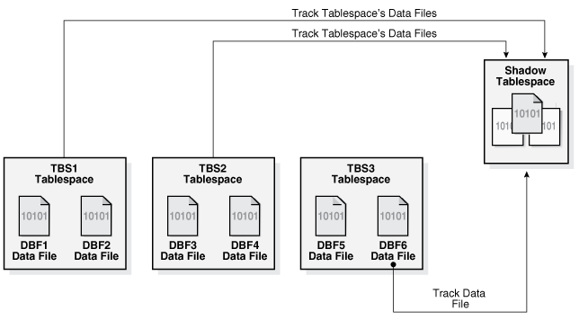

## 11 Managing Tablespaces

A tablespace is a database storage unit that groups related logical structures together. The database data files are stored in tablespaces.

Note:

A multitenant container database is the only supported architecture in Oracle Database 21c. While the documentation is being revised, legacy terminology may persist. In most cases, "database" and "non-CDB" refer to a CDB or PDB, depending on context. In some contexts, such as upgrades, "non-CDB" refers to a non-CDB from a previous release.

- Guidelines for Managing Tablespaces  
	You can follow guidelines for working with tablespaces.
- Creating Tablespaces  
	You create a tablespace to group related logical structures, such as tables and indexes, together. The database data files are stored in tablespaces.
- Consider Storing Tablespaces in the In-Memory Column Store  
	You can enable a tablespace for the In-Memory Column Store during tablespace creation or by altering a tablespace. When this enable a tablespace for the In-Memory Column Store, all tables in the tablespace are enabled for the In-Memory Column Store by default.
- Specifying Nonstandard Block Sizes for Tablespaces  
	You can create tablespaces with block sizes different from the standard database block size, which is specified by the `DB_BLOCK_SIZE` initialization parameter. This feature lets you transport tablespaces with unlike block sizes between databases.
- Controlling the Writing of Redo Records  
	For some database operations, you can control whether the database generates redo records.
- Altering Tablespace Availability  
	You can take an online tablespace offline so that it is temporarily unavailable for general use. The rest of the database remains open and available for users to access data. Conversely, you can bring an offline tablespace online to make the schema objects within the tablespace available to database users. The database must be open to alter the availability of a tablespace.
- Using Read-Only Tablespaces  
	A tablespace can be put into read-only mode. This prevents any data stored in it from being updated.
- Altering and Maintaining Tablespaces  
	You can alter and maintain tablespaces by performing such tasks as adding data files and temp files to them.
- Renaming Tablespaces  
	Using the `RENAME TO` clause of the `ALTER TABLESPACE`, you can rename a permanent or temporary tablespace.
- Dropping Tablespaces  
	You can drop a tablespace and its contents (the segments contained in the tablespace) from the database if the tablespace and its contents are no longer required.
- Managing Lost Write Protection with Shadow Tablespaces  
	A data block lost write occurs when an I/O subsystem acknowledges the completion of the block write, but the write did not occur in the persistent storage. Shadow lost write protection can protect against lost writes.
- Managing the SYSAUX Tablespace  
	The `SYSAUX` tablespace was installed as an auxiliary tablespace to the `SYSTEM` tablespace when you created your database. Some database components that formerly created and used separate tablespaces now occupy the `SYSAUX` tablespace.
- Correcting Problems with Locally Managed Tablespaces  
	Oracle Database includes aids for correcting problems with locally managed tablespaces.
- Migrating the SYSTEM Tablespace to a Locally Managed Tablespace  
	Use the `DBMS_SPACE_ADMIN.TABLESPACE_MIGRATE_TO_LOCAL` procedure to migrate the `SYSTEM` tablespace from dictionary-managed to locally managed.
- Viewing Information About Tablespaces  
	Oracle Database includes data dictionary views that you can query for information about tablespaces.

See Also:

- [Oracle Database Concepts](https://docs.oracle.com/pls/topic/lookup?ctx=en/database/oracle/oracle-database/21/admin&id=CNCPT402)
- [Using Oracle Managed Files](using-oracle-managed-files.md) for information about creating data files and temp files that are both created and managed by the Oracle Database server
- " [Transporting Tablespaces Between Databases](transporting-data.md) "

**Parent topic:** [Oracle Database Structure and Storage](oracle-database-structure-and-storage.md)

### 11.1 Guidelines for Managing Tablespaces

You can follow guidelines for working with tablespaces.

- Use Multiple Tablespaces  
	Using multiple tablespaces allows you more flexibility in performing database operations.
- Assign Tablespace Quotas to Users  
	Grant to users who will be creating tables, clusters, materialized views, indexes, and other objects the privilege to create the object and a quota (space allowance or limit) in the tablespace intended to hold the object segment.

**Parent topic:** Managing Tablespaces

#### 11.1.1 Use Multiple Tablespaces

Using multiple tablespaces allows you more flexibility in performing database operations.

When a database has multiple tablespaces, you can:

- Separate user data from data dictionary data to reduce I/O contention.
- Separate data of one application from the data of another to prevent multiple applications from being affected if a tablespace must be taken offline.
- Store the data files of different tablespaces on different disk drives to reduce I/O contention.
- Take individual tablespaces offline while others remain online, providing better overall availability.
- Optimizing tablespace use by reserving a tablespace for a particular type of database use, such as high update activity, read-only activity, or temporary segment storage.
- Back up individual tablespaces.

Some operating systems set a limit on the number of files that can be open simultaneously. Such limits can affect the number of tablespaces that can be simultaneously online. To avoid exceeding your operating system limit, plan your tablespaces efficiently. Create only enough tablespaces to fulfill your needs, and create these tablespaces with as few files as possible. If you must increase the size of a tablespace, then add one or two large data files, or create data files with autoextension enabled, rather than creating many small data files.

Review your data in light of these factors and decide how many tablespaces you need for your database design.

**Parent topic:** Guidelines for Managing Tablespaces

#### 11.1.2 Assign Tablespace Quotas to Users

Grant to users who will be creating tables, clusters, materialized views, indexes, and other objects the privilege to create the object and a quota (space allowance or limit) in the tablespace intended to hold the object segment.

Note:

For PL/SQL objects such as packages, procedures, and functions, users only need the privileges to create the objects. No explicit tablespace quota is required to create these PL/SQL objects.

See Also:

[Oracle Database Security Guide](https://docs.oracle.com/pls/topic/lookup?ctx=en/database/oracle/oracle-database/21/admin&id=DBSEG002) for information about creating users and assigning tablespace quotas.

**Parent topic:** Guidelines for Managing Tablespaces

### 11.2 Creating Tablespaces

You create a tablespace to group related logical structures, such as tables and indexes, together. The database data files are stored in tablespaces.

- About Creating Tablespaces  
	To create a new tablespace, use the SQL statement `CREATE TABLESPACE` or `CREATE TEMPORARY TABLESPACE`. You must have the `CREATE TABLESPACE` system privilege to create a tablespace.
- Locally Managed Tablespaces  
	A locally managed tablespace uses a bitmap stored in each data file to manage the extents.
- Bigfile Tablespaces  
	Bigfile tablespaces can increase the storage capacity of a database and reduce the burden of managing many data files and temp files.
- Tablespaces with Default Compression Attributes  
	When you create a tablespace, you can specify that all tables and indexes, or their partitions, created in a tablespace are compressed by default.
- Encrypted Tablespaces  
	You can encrypt any permanent tablespace to protect sensitive data.
- Temporary Tablespaces  
	Temporary tablespaces can improve the concurrency of multiple sort operations that do not fit in memory. These tablespaces also improve the efficiency of space management operations during sorts.
- Temporary Tablespace Groups  
	A temporary tablespace group is a tablespace group that is assigned as the default temporary tablespace for the database.

**Parent topic:** Managing Tablespaces

#### 11.2.1 About Creating Tablespaces

To create a new tablespace, use the SQL statement `CREATE TABLESPACE` or `CREATE TEMPORARY TABLESPACE`. You must have the `CREATE TABLESPACE` system privilege to create a tablespace.

Before you can create a tablespace, you must create a database to contain it. The primary tablespace in any database is the `SYSTEM` tablespace, which contains information basic to the functioning of the database server, such as the data dictionary and the system rollback segment. The `SYSTEM` tablespace is the first tablespace created at database creation. It is managed as any other tablespace, but requires a higher level of privilege and is restricted in some ways. For example, you cannot rename or drop the `SYSTEM` tablespace or take it offline.

The `SYSAUX` tablespace, which acts as an auxiliary tablespace to the `SYSTEM` tablespace, is also always created when you create a database. It contains the schemas used by various Oracle products and features, so that those products do not require their own tablespaces. As for the `SYSTEM` tablespace, management of the `SYSAUX` tablespace requires a higher level of security and you cannot rename or drop it. The management of the `SYSAUX` tablespace is discussed separately in " Managing the SYSAUX Tablespace ".

The steps for creating tablespaces vary by operating system, but the first step is always to use your operating system to create a directory structure in which your data files will be allocated. On most operating systems, you specify the size and fully specified file names of data files when you create a new tablespace or alter an existing tablespace by adding data files. Whether you are creating a new tablespace or modifying an existing one, the database automatically allocates and formats the data files as specified.

You can also use the `CREATE UNDO TABLESPACE` statement to create a special type of tablespace called an undo tablespace, which is specifically designed to contain undo records. These are records generated by the database that are used to roll back, or undo, changes to the database for recovery, read consistency, or as requested by a `ROLLBACK` statement. Creating and managing undo tablespaces is the subject of [Managing Undo](managing-undo.md) .

You can use the `ALTER TABLESPACE` or `ALTER DATABASE` statements to alter the tablespace. You must have the `ALTER TABLESPACE` or `ALTER DATABASE` system privilege, correspondingly.

See Also:

- [Oracle Multitenant Administrator's Guide](https://docs.oracle.com/pls/topic/lookup?ctx=en/database/oracle/oracle-database/21/admin&id=MULTI-GUID-807DE711-C82C-4BB2-8C31-5EE89CA71349) and your Oracle Database installation documentation for your operating system for information about tablespaces that are created at database creation
- [Oracle Database SQL Language Reference](https://docs.oracle.com/pls/topic/lookup?ctx=en/database/oracle/oracle-database/21/admin&id=SQLRF) for more information about the syntax and semantics of the `CREATE TABLESPACE`, `CREATE TEMPORARY TABLESPACE`, `ALTER TABLESPACE`, and `ALTER DATABASE` statements.
- [Oracle Multitenant Administrator's Guide](https://docs.oracle.com/pls/topic/lookup?ctx=en/database/oracle/oracle-database/21/admin&id=MULTI-GUID-55124C2D-98FF-4305-8F25-58245C9BEC1E) for information about initialization parameters necessary to create tablespaces with nonstandard block sizes

**Parent topic:** Creating Tablespaces

#### 11.2.2 Locally Managed Tablespaces

A locally managed tablespace uses a bitmap stored in each data file to manage the extents.

- About Locally Managed Tablespaces  
	Locally managed tablespaces track all extent information in the tablespace itself by using bitmaps.
- Creating a Locally Managed Tablespace  
	Create a locally managed tablespace by specifying `LOCAL` in the `EXTENT MANAGEMENT` clause of the `CREATE TABLESPACE` statement.
- Specifying Segment Space Management in Locally Managed Tablespaces  
	In a locally managed tablespace, there are two methods that Oracle Database can use to manage segment space: automatic and manual.

**Parent topic:** Creating Tablespaces

##### 11.2.2.1 About Locally Managed Tablespaces

Locally managed tablespaces track all extent information in the tablespace itself by using bitmaps.

Locally managed tablespaces provide the following benefits:

- Fast, concurrent space operations. Space allocations and deallocations modify locally managed resources (bitmaps stored in header files).
- Enhanced performance
- Readable standby databases are allowed, because locally managed temporary tablespaces do not generate any undo or redo.
- Space allocation is simplified, because when the `AUTOALLOCATE` clause is specified, the database automatically selects the appropriate extent size.
- User reliance on the data dictionary is reduced, because the necessary information is stored in file headers and bitmap blocks.
- Coalescing free extents is unnecessary for locally managed tablespaces.

All tablespaces, including the `SYSTEM` tablespace, can be locally managed.

The `DBMS_SPACE_ADMIN` package provides maintenance procedures for locally managed tablespaces.

See Also:

- [Oracle Multitenant Administrator's Guide](https://docs.oracle.com/pls/topic/lookup?ctx=en/database/oracle/oracle-database/21/admin&id=MULTI-GUID-D8061728-6A13-4F30-AA91-EBE52F276AC3), " Migrating the SYSTEM Tablespace to a Locally Managed Tablespace ", and " Diagnosing and Repairing Locally Managed Tablespace Problems "
- " Bigfile Tablespaces " for information about creating another type of locally managed tablespace that contains only a single data file or temp file.
- [Oracle Database PL/SQL Packages and Types Reference](https://docs.oracle.com/pls/topic/lookup?ctx=en/database/oracle/oracle-database/21/admin&id=ARPLS057) for information on the `DBMS_SPACE_ADMIN` package

**Parent topic:** Locally Managed Tablespaces

##### 11.2.2.2 Creating a Locally Managed Tablespace

Create a locally managed tablespace by specifying `LOCAL` in the `EXTENT MANAGEMENT` clause of the `CREATE TABLESPACE` statement.

This is the default for new permanent tablespaces, but you must specify the `EXTENT` `MANAGEMENT` `LOCAL` clause to specify either the `AUTOALLOCATE` clause or the `UNIFORM` clause. You can have the database manage extents for you automatically with the `AUTOALLOCATE` clause (the default), or you can specify that the tablespace is managed with uniform extents of a specific size (`UNIFORM`).

If you expect the tablespace to contain objects of varying sizes requiring many extents with different extent sizes, then `AUTOALLOCATE` is the best choice. `AUTOALLOCATE` is also a good choice if it is not important for you to have a lot of control over space allocation and deallocation, because it simplifies tablespace management. Some space may be wasted with this setting, but the benefit of having Oracle Database manage your space most likely outweighs this drawback.

If you want exact control over unused space, and you can predict exactly the space to be allocated for an object or objects and the number and size of extents, then `UNIFORM` is a good choice. This setting ensures that you will never have unusable space in your tablespace.

When you do not explicitly specify the type of extent management, Oracle Database determines extent management as follows:

- If the `CREATE TABLESPACE` statement omits the `DEFAULT` storage clause, then the database creates a locally managed autoallocated tablespace.
- If the `CREATE TABLESPACE` statement includes a `DEFAULT` storage clause, then the database considers the following:
	- If you specified the `MINIMUM EXTENT` clause, the database evaluates whether the values of `MINIMUM EXTENT`, `INITIAL`, and `NEXT` are equal and the value of `PCTINCREASE` is 0. If so, the database creates a locally managed uniform tablespace with extent size = `INITIAL`. If the `MINIMUM EXTENT`, `INITIAL`, and `NEXT` parameters are not equal, or if `PCTINCREASE` is not 0, then the database ignores any extent storage parameters you may specify and creates a locally managed, autoallocated tablespace.
		- If you did not specify `MINIMUM EXTENT` clause, then the database evaluates only whether the storage values of `INITIAL` and `NEXT` are equal and `PCTINCREASE` is 0. If so, the tablespace is locally managed and uniform. Otherwise, the tablespace is locally managed and autoallocated.

For example, the following statement creates a locally managed tablespace named `lmtbsb` and specifies `AUTOALLOCATE`:

```
CREATE TABLESPACE lmtbsb DATAFILE '/u02/oracle/data/lmtbsb01.dbf' SIZE 50M
    EXTENT MANAGEMENT LOCAL AUTOALLOCATE;
```

`AUTOALLOCATE` causes the tablespace to be system managed with a minimum extent size of 64K.

The alternative to `AUTOALLOCATE` is `UNIFORM`. which specifies that the tablespace is managed with extents of uniform size. You can specify that size in the `SIZE` clause of `UNIFORM`. If you omit `SIZE`, then the default size is 1M.

The following example creates a tablespace with uniform 128K extents. (In a database with 2K blocks, each extent would be equivalent to 64 database blocks). Each 128K extent is represented by a bit in the extent bitmap for this file.

```
CREATE TABLESPACE lmtbsb DATAFILE '/u02/oracle/data/lmtbsb01.dbf' SIZE 50M
    EXTENT MANAGEMENT LOCAL UNIFORM SIZE 128K;
```

You cannot specify the `DEFAULT` storage clause, `MINIMUM EXTENT`, or `TEMPORARY` when you explicitly specify `EXTENT MANAGEMENT LOCAL`. To create a temporary locally managed tablespace, use the `CREATE TEMPORARY TABLESPACE` statement.

Note:

When you allocate a data file for a locally managed tablespace, you should allow space for metadata used for space management (the extent bitmap or space header segment) which are part of user space. For example, if you specify the `UNIFORM` clause in the extent management clause but you omit the `SIZE` parameter, then the default extent size is 1MB. In that case, the size specified for the data file must be larger (at least one block plus space for the bitmap) than 1MB.

**Parent topic:** Locally Managed Tablespaces

##### 11.2.2.3 Specifying Segment Space Management in Locally Managed Tablespaces

In a locally managed tablespace, there are two methods that Oracle Database can use to manage segment space: automatic and manual.

Manual segment space management uses linked lists called "freelists" to manage free space in the segment, while automatic segment space management uses bitmaps. Automatic segment space management is the more efficient method, and is the default for all new permanent, locally managed tablespaces.

Automatic segment space management delivers better space utilization than manual segment space management. It is also self-tuning, in that it scales with increasing number of users or instances. In an Oracle Real Application Clusters environment, automatic segment space management allows for a dynamic affinity of space to instances. In addition, for many standard workloads, application performance with automatic segment space management is better than the performance of a well-tuned application using manual segment space management.

Although automatic segment space management is the default for all new permanent, locally managed tablespaces, you can explicitly enable it with the `SEGMENT SPACE MANAGEMENT AUTO` clause.

For example, the following statement creates tablespace `lmtbsb` with automatic segment space management:

```
CREATE TABLESPACE lmtbsb DATAFILE '/u02/oracle/data/lmtbsb01.dbf' SIZE 50M
    EXTENT MANAGEMENT LOCAL 
    SEGMENT SPACE MANAGEMENT AUTO;
```

The `SEGMENT SPACE MANAGEMENT MANUAL` clause disables automatic segment space management.

The segment space management that you specify at tablespace creation time applies to all segments subsequently created in the tablespace. You cannot change the segment space management mode of a tablespace.

Note:

- If you set extent management to `LOCAL` `UNIFORM`, then you must ensure that each extent contains at least 5 database blocks.
- If you set extent management to `LOCAL` `AUTOALLOCATE`, and if the database block size is 16K or greater, then Oracle manages segment space by creating extents with a minimum size of 5 blocks rounded up to 64K.
- You cannot specify automatic segment space management for the `SYSTEM` tablespace.

Locally managed tablespaces using automatic segment space management can be created as single-file or bigfile tablespaces, as described in " Bigfile Tablespaces ".

**Parent topic:** Locally Managed Tablespaces

#### 11.2.3 Bigfile Tablespaces

Bigfile tablespaces can increase the storage capacity of a database and reduce the burden of managing many data files and temp files.

- About Bigfile Tablespaces  
	A bigfile tablespace is a tablespace with a single, but potentially very large (up to 4G blocks) data file. Traditional smallfile tablespaces, in contrast, can contain multiple data files, but the files cannot be as large.
- Creating a Bigfile Tablespace  
	To create a bigfile tablespace, specify the `BIGFILE` keyword of the `CREATE` `TABLESPACE` statement (`CREATE` `BIGFILE` `TABLESPACE`...).
- Identifying a Bigfile Tablespace  
	You can query a set of data dictionary views for information about bigfile tablespaces.

**Parent topic:** Creating Tablespaces

##### 11.2.3.1 About Bigfile Tablespaces

A bigfile tablespace is a tablespace with a single, but potentially very large (up to 4G blocks) data file. Traditional smallfile tablespaces, in contrast, can contain multiple data files, but the files cannot be as large.

The benefits of bigfile tablespaces are the following:

- A bigfile tablespace with 8K blocks can contain a 32 terabyte data file. A bigfile tablespace with 32K blocks can contain a 128 terabyte data file. The maximum number of data files in an Oracle Database is limited (usually to 64K files). Therefore, bigfile tablespaces can significantly enhance the storage capacity of an Oracle Database.
- Bigfile tablespaces can reduce the number of data files needed for a database. An additional benefit is that the `DB_FILES` initialization parameter and `MAXDATAFILES` parameter of the `CREATE DATABASE` and `CREATE CONTROLFILE` statements can be adjusted to reduce the amount of SGA space required for data file information and the size of the control file.
- Bigfile tablespaces simplify database management by providing data file transparency. SQL syntax for the `ALTER` `TABLESPACE` statement lets you perform operations on tablespaces, rather than the underlying individual data files.

Bigfile tablespaces are supported only for locally managed tablespaces with automatic segment space management, with three exceptions: locally managed undo tablespaces, temporary tablespaces, and the `SYSTEM` tablespace.

Note:

- Bigfile tablespaces are intended to be used with Automatic Storage Management (Oracle ASM) or other logical volume managers that supports striping or RAID, and dynamically extensible logical volumes.
- Avoid creating bigfile tablespaces on a system that does not support striping because of negative implications for parallel query execution and RMAN backup parallelization.
- Using bigfile tablespaces on platforms that do not support large file sizes is not recommended and can limit tablespace capacity. See your operating system specific documentation for information about maximum supported file sizes.

**Parent topic:** Bigfile Tablespaces

##### 11.2.3.2 Creating a Bigfile Tablespace

To create a bigfile tablespace, specify the `BIGFILE` keyword of the `CREATE` `TABLESPACE` statement (`CREATE` `BIGFILE` `TABLESPACE`...).

Oracle Database automatically creates a locally managed tablespace with automatic segment space management. You can, but need not, specify `EXTENT` `MANAGEMENT` `LOCAL` and `SEGMENT` `SPACE` `MANAGEMENT` `AUTO` in this statement. However, the database returns an error if you specify `EXTENT` `MANAGEMENT` `DICTIONARY` or `SEGMENT` `SPACE` `MANAGEMENT` `MANUAL`. The remaining syntax of the statement is the same as for the `CREATE TABLESPACE` statement, but you can only specify one data file. For example:

```
CREATE BIGFILE TABLESPACE bigtbs 
    DATAFILE '/u02/oracle/data/bigtbs01.dbf' SIZE 50G
...
```

You can specify `SIZE` in kilobytes (K), megabytes (M), gigabytes (G), or terabytes (T).

If the default tablespace type was set to `BIGFILE` at database creation, you need not specify the keyword `BIGFILE` in the `CREATE TABLESPACE` statement. A bigfile tablespace is created by default.

If the default tablespace type was set to `BIGFILE` at database creation, but you want to create a traditional (smallfile) tablespace, then specify a `CREATE` `SMALLFILE` `TABLESPACE` statement to override the default tablespace type for the tablespace that you are creating.

See Also:

[Oracle Multitenant Administrator's Guide](https://docs.oracle.com/pls/topic/lookup?ctx=en/database/oracle/oracle-database/21/admin&id=MULTI-GUID-35A12594-29EB-4545-A6AD-63B9AC3A5671)

**Parent topic:** Bigfile Tablespaces

##### 11.2.3.3 Identifying a Bigfile Tablespace

You can query a set of data dictionary views for information about bigfile tablespaces.

The following views contain a `BIGFILE` column that identifies a tablespace as a bigfile tablespace:

- `DBA_TABLESPACES `
- `USER_TABLESPACES `
- `V$TABLESPACE `

Query these views for information about bigfile tablespaces.

You can also identify a bigfile tablespace by the relative file number of its single data file. That number is 1024 on most platforms, but 4096 on OS/390.

**Parent topic:** Bigfile Tablespaces

#### 11.2.4 Tablespaces with Default Compression Attributes

When you create a tablespace, you can specify that all tables and indexes, or their partitions, created in a tablespace are compressed by default.

- About Tablespaces with Default Compression Attributes  
	When you create a tablespace, you can specify the default compression of data for all tables and indexes created in the tablespace. The default compression level also applies to the partitions that comprise the tablespace. Compressing this data can reduce disk use.
- Creating Tablespaces with Default Compression Attributes  
	When you create a tablespace, you can specify the type of table compression using the `DEFAULT` keyword, followed by the table compression clause including the compression type. You can also specify the type of index compression using the `DEFAULT` keyword, followed by index compression clause and the index compression type.

**Parent topic:** Creating Tablespaces

##### 11.2.4.1 About Tablespaces with Default Compression Attributes

When you create a tablespace, you can specify the default compression of data for all tables and indexes created in the tablespace. The default compression level also applies to the partitions that comprise the tablespace. Compressing this data can reduce disk use.

**Parent topic:** Tablespaces with Default Compression Attributes

##### 11.2.4.2 Creating Tablespaces with Default Compression Attributes

When you create a tablespace, you can specify the type of table compression using the `DEFAULT` keyword, followed by the table compression clause including the compression type. You can also specify the type of index compression using the `DEFAULT` keyword, followed by index compression clause and the index compression type.

The following statement indicates that all tables and partitions created in the tablespace are to use advanced row compression, unless otherwise specified:

```
CREATE TABLESPACE ... DEFAULT ROW STORE COMPRESS ADVANCED ... ;
```

You can override the default tablespace compression specification when you create a table or partition in that tablespace.

The following statement indicates that all indexes created in the tablespace are to use high level advanced index compression, unless otherwise specified:

```
CREATE TABLESPACE ... DEFAULT INDEX COMPRESS ADVANCED HIGH ... ;
```

You can override the default tablespace compression specification when you create an index in that tablespace.

**Parent topic:** Tablespaces with Default Compression Attributes

#### 11.2.5 Encrypted Tablespaces

You can encrypt any permanent tablespace to protect sensitive data.

- About Encrypted Tablespaces  
	Encrypted tablespaces primarily protect your data from unauthorized access by means other than through the database. For example, when encrypted tablespaces are written to backup media for travel from one Oracle database to another or for travel to an off-site facility for storage, they remain encrypted.
- Creating Encrypted Tablespaces  
	You can create encrypted tablespaces to protect your data from unauthorized access.
- Viewing Information About Encrypted Tablespaces  
	You can query the `DBA_TABLESPACES` and `USER_TABLESPACES` data dictionary views for information about encrypted tablespaces.

**Parent topic:** Creating Tablespaces

##### 11.2.5.1 About Encrypted Tablespaces

Encrypted tablespaces primarily protect your data from unauthorized access by means other than through the database. For example, when encrypted tablespaces are written to backup media for travel from one Oracle database to another or for travel to an off-site facility for storage, they remain encrypted.

Also, encrypted tablespaces protect data from users who try to circumvent the security features of the database and access database files directly through the operating system file system. Tablespace encryption is completely transparent to your applications, so no application modification is necessary.

Tablespace encryption does not address all security issues. It does not, for example, provide access control from within the database. Any user who is granted privileges on objects stored in an encrypted tablespace can access those objects without providing any kind of additional password or key.

When you encrypt a tablespace, all tablespace blocks are encrypted. All segment types are supported for encryption, including tables, clusters, indexes, LOBs (`BASICFILE` and `SECUREFILE`), table and index partitions, and so on.

Note:

There is no need to use LOB encryption on `SECUREFILE` LOBs stored in an encrypted tablespace.

To maximize security, data from an encrypted tablespace is automatically encrypted when written to the undo tablespace, to the redo logs, and to any temporary tablespace. However, starting with Oracle Database 12c Release 2 (12.2), you can optionally encrypt undo tablespaces and temporary tablespaces.

For partitioned tables and indexes that have different partitions in different tablespaces, it is permitted to use both encrypted and non-encrypted tablespaces in the same table or index.

Tablespace encryption uses the Transparent Data Encryption feature of Oracle Database, which requires that you create a keystore to store the master encryption key for the database. The keystore must be open before you can create the encrypted tablespace and before you can store or retrieve encrypted data. When you open the keystore, it is available to all session, and it remains open until you explicitly close it or until the database is shut down.

Transparent Data Encryption supports industry-standard encryption algorithms, including the following types of encryption algorithms Advanced Encryption Standard (AES) and Triple Data Encryption Standard (3DES) algorithms:

- Advanced Encryption Standard (AES)
- ARIA
- GHOST
- SEED
- Triple Data Encryption Standard (3DES)

See [Oracle Database Advanced Security Guide](https://docs.oracle.com/pls/topic/lookup?ctx=en/database/oracle/oracle-database/21/admin&id=ASOAG9578) for detailed information about the supported encryption algorithms.

The encryption key length is implied by the algorithm name. For example, the AES128 algorithm uses 128-bit keys. You specify the algorithm to use when you create the tablespace, and different tablespaces can use different algorithms. Although longer key lengths theoretically provide greater security, there is a trade-off in CPU overhead. If you do not specify the algorithm in your `CREATE` `TABLESPACE` statement, then AES128 is the default. There is no disk space overhead for encrypting a tablespace.

After an encrypted table is created, you can use an `ALTER TABLESPACE` statement to decrypt it or change its key. You can also use an `ALTER TABLESPACE` statement to encrypt a tablespace that is not encrypted.

Restrictions

The following are restrictions for encrypted tablespaces:

- Encrypted tablespaces are subject to restrictions when they are transported to another database. See " [General Limitations on Transporting Data](transporting-data.md) ".
- When recovering a database with encrypted tablespaces (for example after a `SHUTDOWN` `ABORT` or a catastrophic error that brings down the database instance), you must open the keystore after database mount and before database open, so that the recovery process can decrypt data blocks and redo.

In addition, see [Oracle Database Advanced Security Guide](https://docs.oracle.com/pls/topic/lookup?ctx=en/database/oracle/oracle-database/21/admin&id=ASOAG9518) for general restrictions for Transparent Data Encryption.

See Also:

- [Oracle Database Advanced Security Guide](https://docs.oracle.com/pls/topic/lookup?ctx=en/database/oracle/oracle-database/21/admin&id=ASOAG-GUID-62AA9447-FDCD-4A4C-B563-32DE04D55952) for more information about Transparent Data Encryption
- " [Consider Encrypting Columns That Contain Sensitive Data](managing-tables.md) " for an alternative to encrypting an entire tablespace
- [Oracle Real Application Clusters Administration and Deployment Guide](https://docs.oracle.com/pls/topic/lookup?ctx=en/database/oracle/oracle-database/21/admin&id=RACAD510) for information on using a keystore in an Oracle Real Application Clusters environment
- [Oracle Database SQL Language Reference](https://docs.oracle.com/pls/topic/lookup?ctx=en/database/oracle/oracle-database/21/admin&id=SQLRF01403) for information about the `CREATE` `TABLESPACE` statement

**Parent topic:** Encrypted Tablespaces

##### 11.2.5.2 Creating Encrypted Tablespaces

You can create encrypted tablespaces to protect your data from unauthorized access.

To encrypt a tablespace, you must open the database with the `COMPATIBLE` initialization parameter set to `11.2.0` or higher. Any user who can create a tablespace can create an encrypted tablespace.

To create an encrypted tablespace:

- Run a `CREATE TABLESPACE` statement with an `ENCRYPTION` clause.

Starting with Oracle Database Release 21c, use the `TABLESPACE_ENCRYPTION_DEFAULT_ALGORITHM` initialization parameter to specify the default encryption algorithm. You can set this parameter either in the initialization parameter file or by using the `ALTER                     SYSTEM` statement. With wallet-based TDE, set this parameter before the first `ADMINISTER KEY MANAGEMENT CREATE KEYSTORE` command. With OKV-based TDE deployments, set this parameter before the first `ADMINISTER                     KEY MANAGEMENT SET ENCRYPTION KEY` command.

Examples

The following statement sets the default encryption algorithm to AES192:

```
ALTER SYSTEM SET TABLESPACE_ENCRYPTION_DEFAULT_ALGORITHM=AES192;
```

The following statement creates an encrypted tablespace with the default encryption algorithm:

```
CREATE TABLESPACE securespace
DATAFILE '/u01/app/oracle/oradata/orcl/secure01.dbf' SIZE 100M
ENCRYPTION ENCRYPT;
```

If the default encryption algorithm was not explicitly set using an `ALTER                     SYSTEM` command, then the default encryption algorithm used is AES128.

The following statement creates the same tablespace with the AES256 algorithm:

```
CREATE TABLESPACE securespace
DATAFILE '/u01/app/oracle/oradata/orcl/secure01.dbf' SIZE 100M
ENCRYPTION USING 'AES256' ENCRYPT;
```

See Also:

[Oracle Database Advanced Security Guide](https://docs.oracle.com/pls/topic/lookup?ctx=en/database/oracle/oracle-database/21/admin&id=ASOAG-GUID-F95E13AA-FE30-423B-930C-13D355CE46B3)

**Parent topic:** Encrypted Tablespaces

##### 11.2.5.3 Viewing Information About Encrypted Tablespaces

You can query the `DBA_TABLESPACES` and `USER_TABLESPACES` data dictionary views for information about encrypted tablespaces.

The `DBA_TABLESPACES` and `USER_TABLESPACES` data dictionary views include a column named `ENCRYPTED`. This column contains `YES` for encrypted tablespaces.

The view `V$ENCRYPTED_TABLESPACES` lists all currently encrypted tablespaces. The following query displays the name and encryption algorithm of encrypted tablespaces:

```
SELECT t.name, e.encryptionalg algorithm 
FROM  v$tablespace t, v$encrypted_tablespaces e
WHERE t.ts# = e.ts#;
 
NAME                           ALGORITHM 
------------------------------ --------- 
SECURESPACE                    AES256
```

Note:

You can convert an existing tablespace to an encrypted tablespace.

See Also:

[Oracle Database Advanced Security Guide](https://docs.oracle.com/pls/topic/lookup?ctx=en/database/oracle/oracle-database/21/admin&id=ASOAG620) for information about convert an existing tablespace to an encrypted tablespace

**Parent topic:** Encrypted Tablespaces

#### 11.2.6 Temporary Tablespaces

Temporary tablespaces can improve the concurrency of multiple sort operations that do not fit in memory. These tablespaces also improve the efficiency of space management operations during sorts.

- About Temporary Tablespaces  
	A temporary tablespace contains transient data that persists only for the duration of the session. Temporary tablespaces can improve the concurrency of multiple sort operations that do not fit in memory and can improve the efficiency of space management operations during sorts.
- Creating a Locally Managed Temporary Tablespace  
	Because space management is much simpler and more efficient in locally managed tablespaces, they are ideally suited for temporary tablespaces.
- Creating a Bigfile Temporary Tablespace  
	Just as for regular tablespaces, you can create single-file (bigfile) temporary tablespaces.
- Viewing Space Usage for Temporary Tablespaces  
	The `DBA_TEMP_FREE_SPACE` dictionary view contains information about space usage for each temporary tablespace.

**Parent topic:** Creating Tablespaces

##### 11.2.6.1 About Temporary Tablespaces

A temporary tablespace contains transient data that persists only for the duration of the session. Temporary tablespaces can improve the concurrency of multiple sort operations that do not fit in memory and can improve the efficiency of space management operations during sorts.

Temporary tablespaces are used to store the following:

- Intermediate sort results
- Temporary tables and temporary indexes
- Temporary LOBs
- Temporary B-trees

Within a temporary tablespace, all sort operations for a particular instance share a single sort segment, and sort segments exist for every instance that performs sort operations that require temporary space. A sort segment is created by the first statement after startup that uses the temporary tablespace for sorting, and is released only at shutdown.

By default, a single temporary tablespace named `TEMP` is created for each new Oracle Database installation. You can create additional temporary tablespaces with the `CREATE` `TABLESPACE` statement. You can assign a temporary tablespace to each database user with the `CREATE USER` or `ALTER USER` statement. A single temporary tablespace can be shared by multiple users.

You cannot explicitly create objects in a temporary tablespace.

Note:

The exception to the preceding statement is a temporary table. When you create a temporary table, its rows are stored in your default temporary tablespace, unless you create the table in a new temporary tablespace. See " [Creating a Temporary Table](managing-tables.md) " for more information.

Starting with Oracle Database 12c Release 2 (12.2), local temporary tablespaces are available. A local temporary tablespace stores separate, non-shared temp files for every database instance. A local temporary tablespace is used only for spilling temporary results of SQL statements, such as queries that involve sorts, hash aggregations, and joins. These results are only accessible within an instance. In contrast, a shared temporary tablespace resides on a shared disk and is available to all instances. To create a local temporary tablespace, use a `CREATE LOCAL TEMPORARY TABLESPACE` statement. Shared temporary tablespaces were available in prior releases of Oracle Database and were called "temporary tablespaces." In this Oracle Database Administrator’s Guide, the term "temporary tablespace" refers to a shared temporary tablespace unless specified otherwise.

Default Temporary Tablespace

Users who are not explicitly assigned a temporary tablespace use the database default temporary tablespace, which for new installations is `TEMP`. You can change the default temporary tablespace for the database with the following command:

```
ALTER DATABASE DEFAULT TEMPORARY TABLESPACE tablespace_name;
```

To determine the current default temporary tablespace for the database, run the following query:

```
SELECT PROPERTY_NAME, PROPERTY_VALUE FROM DATABASE_PROPERTIES WHERE
   PROPERTY_NAME='DEFAULT_TEMP_TABLESPACE';

PROPERTY_NAME              PROPERTY_VALUE
-------------------------- ------------------------------
DEFAULT_TEMP_TABLESPACE    TEMP
```

Space Allocation in a Temporary Tablespace

You can view the allocation and deallocation of space in a temporary tablespace sort segment using the `V$SORT_SEGMENT` view. The `V$TEMPSEG_USAGE` view identifies the current sort users in those segments.

When a sort operation that uses temporary space completes, allocated extents in the sort segment are not deallocated; they are just marked as free and available for reuse. The `DBA_TEMP_FREE_SPACE` view displays the total allocated and free space in each temporary tablespace. See " Viewing Space Usage for Temporary Tablespaces " for more information. You can manually shrink a locally managed temporary tablespace that has a large amount of unused space. See " Shrinking a Locally Managed Temporary Tablespace " for details.

Automatic Temporary Tablespace Shrink and Extension

Queries, sorts, hash joins, query transformations, and other operations can cause a temporary tablespace to grow very large due to spikes in usage. The Automatic Temporary Tablespace Shrink and Extension feature can automatically shrink the tablespace in the background after the usage has subsided. In addition, if the database detects that temporary tablespace use is increasing, it will preemptively grow the temporary tablespace to ensure performance is not impacted. This feature requires no intervention of the database administrator.

See Also:

- [Oracle Database Security Guide](https://docs.oracle.com/pls/topic/lookup?ctx=en/database/oracle/oracle-database/21/admin&id=DBSEG002) for information about creating users and assigning temporary tablespaces
- [Oracle Database Concepts](https://docs.oracle.com/pls/topic/lookup?ctx=en/database/oracle/oracle-database/21/admin&id=CNCPT1092) for more information about local temporary tablespaces, shared temporary tablespaces, and the default temporary tablespace
- [Oracle Database Reference](https://docs.oracle.com/pls/topic/lookup?ctx=en/database/oracle/oracle-database/21/admin&id=REFRN) for more information about the `V$SORT_SEGMENT`, `V$TEMPSEG_USAGE`, and `DBA_TEMP_FREE_SPACE` views
- [Oracle Database Performance Tuning Guide](https://docs.oracle.com/pls/topic/lookup?ctx=en/database/oracle/oracle-database/21/admin&id=TGDBA346) for a discussion on tuning sorts
- [Oracle Real Application Clusters Administration and Deployment Guide](https://docs.oracle.com/pls/topic/lookup?ctx=en/database/oracle/oracle-database/21/admin&id=RACAD-GUID-E84E3BA2-7F36-406B-B630-CD651E0C856F) for more information about local temporary tablespace

**Parent topic:** Temporary Tablespaces

##### 11.2.6.2 Creating a Locally Managed Temporary Tablespace

Because space management is much simpler and more efficient in locally managed tablespaces, they are ideally suited for temporary tablespaces.

Locally managed temporary tablespaces use temp files, which do not modify data outside of the temporary tablespace or generate any redo for temporary tablespace data. Because of this, they enable you to perform on-disk sorting operations in a read-only or standby database.

You also use different views for viewing information about temp files than you would for data files. The `V$TEMPFILE` and `DBA_TEMP_FILES` views are analogous to the `V$DATAFILE` and `DBA_DATA_FILES` views.

To create a locally managed temporary tablespace, you use the `CREATE TEMPORARY TABLESPACE` statement, which requires that you have the `CREATE TABLESPACE` system privilege.

The following statement creates a temporary tablespace in which each extent is 16M. Each 16M extent (which is the equivalent of 8000 blocks when the standard block size is 2K) is represented by a bit in the bitmap for the file.

```
CREATE TEMPORARY TABLESPACE lmtemp TEMPFILE '/u02/oracle/data/lmtemp01.dbf' 
     SIZE 20M REUSE
     EXTENT MANAGEMENT LOCAL UNIFORM SIZE 16M;
```

The extent management clause is optional for temporary tablespaces because all temporary tablespaces are created with locally managed extents of a uniform size. If an extent size is specified in the `EXTENT SIZE` clause, then it is used. If it is not specified, then, Oracle Database uses the tablespace size and file sizes to determine the default extent size.

Note:

On some operating systems, the database does not allocate space for the temp file until the temp file blocks are actually accessed. This delay in space allocation results in faster creation and resizing of temp files, but it requires that sufficient disk space is available when the temp files are later used. See your operating system documentation to determine whether the database allocates temp file space in this way on your system.

**Parent topic:** Temporary Tablespaces

##### 11.2.6.3 Creating a Bigfile Temporary Tablespace

Just as for regular tablespaces, you can create single-file (bigfile) temporary tablespaces.

To create a bigfile temporary tablespace:

- Run the `CREATE BIGFILE TEMPORARY TABLESPACE` statement to create a single-temp file tablespace.

See the sections " Creating a Bigfile Tablespace " and " Altering a Bigfile Tablespace " for information about bigfile tablespaces, but consider that you are creating temporary tablespaces that use temp files instead of data files.

**Parent topic:** Temporary Tablespaces

##### 11.2.6.4 Viewing Space Usage for Temporary Tablespaces

The `DBA_TEMP_FREE_SPACE` dictionary view contains information about space usage for each temporary tablespace.

The information includes the space allocated and the free space. You can query this view for these statistics using the following statement:

```
SELECT * from DBA_TEMP_FREE_SPACE;
 
TABLESPACE_NAME                     TABLESPACE_SIZE ALLOCATED_SPACE FREE_SPACE
----------------------------------- --------------- --------------- ----------
TEMP                                250609664       250609664       249561088
```

**Parent topic:** Temporary Tablespaces

#### 11.2.7 Temporary Tablespace Groups

A temporary tablespace group is a tablespace group that is assigned as the default temporary tablespace for the database.

- Multiple Temporary Tablespaces: Using Tablespace Groups  
	A tablespace group enables a user to consume temporary space from multiple tablespaces. Using a tablespace group, rather than a single temporary tablespace, can alleviate problems caused where one tablespace is inadequate to hold the results of a sort, particularly on a table that has many partitions. A tablespace group enables parallel execution servers in a single parallel operation to use multiple temporary tablespaces.
- Creating a Tablespace Group  
	You create a tablespace group implicitly when you include the `TABLESPACE GROUP` clause in the `CREATE TEMPORARY TABLESPACE` or `ALTER TABLESPACE` statement and the specified tablespace group does not currently exist.
- Changing Members of a Tablespace Group  
	You can add a tablespace to an existing tablespace group by specifying the existing group name in the `TABLESPACE GROUP` clause of the `CREATE TEMPORARY TABLESPACE` or `ALTER TABLESPACE` statement.
- Assigning a Tablespace Group as the Default Temporary Tablespace  
	Use the `ALTER DATABASE...DEFAULT` `TEMPORARY` `TABLESPACE` statement to assign a tablespace group as the default temporary tablespace for the database.

**Parent topic:** Creating Tablespaces

##### 11.2.7.1 Multiple Temporary Tablespaces: Using Tablespace Groups

A tablespace group enables a user to consume temporary space from multiple tablespaces. Using a tablespace group, rather than a single temporary tablespace, can alleviate problems caused where one tablespace is inadequate to hold the results of a sort, particularly on a table that has many partitions. A tablespace group enables parallel execution servers in a single parallel operation to use multiple temporary tablespaces.

A tablespace group has the following characteristics:

- It contains at least one tablespace. There is no explicit limit on the maximum number of tablespaces that are contained in a group.
- It shares the namespace of tablespaces, so its name cannot be the same as any tablespace.
- You can specify a tablespace group name wherever a tablespace name would appear when you assign a default temporary tablespace for the database or a temporary tablespace for a user.

You do not explicitly create a tablespace group. Rather, it is created implicitly when you assign the first temporary tablespace to the group. The group is deleted when the last temporary tablespace it contains is removed from it.

The view `DBA_TABLESPACE_GROUPS` lists tablespace groups and their member tablespaces.

See Also:

[Oracle Database Security Guide](https://docs.oracle.com/pls/topic/lookup?ctx=en/database/oracle/oracle-database/21/admin&id=DBSEG10240) for more information about assigning a temporary tablespace or tablespace group to a user

**Parent topic:** Temporary Tablespace Groups

##### 11.2.7.2 Creating a Tablespace Group

You create a tablespace group implicitly when you include the `TABLESPACE GROUP` clause in the `CREATE TEMPORARY TABLESPACE` or `ALTER TABLESPACE` statement and the specified tablespace group does not currently exist.

For example, if neither `group1` nor `group2` exists, then the following statements create those groups, each of which has only the specified tablespace as a member:

```
CREATE TEMPORARY TABLESPACE lmtemp2 TEMPFILE '/u02/oracle/data/lmtemp201.dbf'
     SIZE 50M
     TABLESPACE GROUP group1;

ALTER TABLESPACE lmtemp TABLESPACE GROUP group2;
```

**Parent topic:** Temporary Tablespace Groups

##### 11.2.7.3 Changing Members of a Tablespace Group

You can add a tablespace to an existing tablespace group by specifying the existing group name in the `TABLESPACE GROUP` clause of the `CREATE TEMPORARY TABLESPACE` or `ALTER TABLESPACE` statement.

For example, the following statement adds a tablespace to an existing group. It creates and adds tablespace `lmtemp3` to `group1`, so that `group1` contains tablespaces `lmtemp2` and `lmtemp3`.

```
CREATE TEMPORARY TABLESPACE lmtemp3 TEMPFILE '/u02/oracle/data/lmtemp301.dbf'
     SIZE 25M
     TABLESPACE GROUP group1;
```

The following statement also adds a tablespace to an existing group, but in this case because tablespace `lmtemp2` already belongs to `group1`, it is in effect moved from `group1` to `group2`:

```
ALTER TABLESPACE lmtemp2 TABLESPACE GROUP group2;
```

Now `group2` contains both `lmtemp` and `lmtemp2`, while `group1` consists of only `tmtemp3`.

You can remove a tablespace from a group as shown in the following statement:

```
ALTER TABLESPACE lmtemp3 TABLESPACE GROUP '';
```

Tablespace `lmtemp3` no longer belongs to any group. Further, since there are no longer any members of `group1`, this results in the implicit deletion of `group1`.

**Parent topic:** Temporary Tablespace Groups

##### 11.2.7.4 Assigning a Tablespace Group as the Default Temporary Tablespace

Use the `ALTER DATABASE...DEFAULT` `TEMPORARY` `TABLESPACE` statement to assign a tablespace group as the default temporary tablespace for the database.

For example:

```
ALTER DATABASE DEFAULT TEMPORARY TABLESPACE group2;
```

Any user who has not explicitly been assigned a temporary tablespace will now use tablespaces `lmtemp` and `lmtemp2`.

If a tablespace group is specified as the default temporary tablespace, you cannot drop any of its member tablespaces. You must first remove the tablespace from the tablespace group. Likewise, you cannot drop a single temporary tablespace as long as it is the default temporary tablespace.

**Parent topic:** Temporary Tablespace Groups

### 11.3 Consider Storing Tablespaces in the In-Memory Column Store

You can enable a tablespace for the In-Memory Column Store during tablespace creation or by altering a tablespace. When this enable a tablespace for the In-Memory Column Store, all tables in the tablespace are enabled for the In-Memory Column Store by default.

Note:

This feature is available starting with Oracle Database 12c Release 1 (12.1.0.2).

The In-Memory Column Store is an optional portion of the system global area (SGA) that stores copies of tables, table partitions, and other database objects that is optimized for rapid scans. In the In-Memory Column Store, table data is stored by column rather than row in the SGA.

See Also:

" [Improving Query Performance with Oracle Database In-Memory](managing-memory.md) "

**Parent topic:** Managing Tablespaces

### 11.4 Specifying Nonstandard Block Sizes for Tablespaces

You can create tablespaces with block sizes different from the standard database block size, which is specified by the `DB_BLOCK_SIZE` initialization parameter. This feature lets you transport tablespaces with unlike block sizes between databases.

To create a tablespace with a block size different from the database standard block size:

- Use the `BLOCKSIZE` clause of the `CREATE TABLESPACE` statement.

In order for the `BLOCKSIZE` clause to succeed, you must have already set the `DB_CACHE_SIZE` and at least one `DB_nK_CACHE_SIZE` initialization parameter. Further, and the integer you specify in the `BLOCKSIZE` clause must correspond with the setting of one `DB_nK_CACHE_SIZE` parameter setting. Although redundant, specifying a `BLOCKSIZE` equal to the standard block size, as specified by the `DB_BLOCK_SIZE` initialization parameter, is allowed.

The following statement creates tablespace `lmtbsb`, but specifies a block size that differs from the standard database block size (as specified by the `DB_BLOCK_SIZE` initialization parameter):

```
CREATE TABLESPACE lmtbsb DATAFILE '/u02/oracle/data/lmtbsb01.dbf' SIZE 50M
    EXTENT MANAGEMENT LOCAL UNIFORM SIZE 128K
    BLOCKSIZE 8K;
```

### 11.5 Controlling the Writing of Redo Records

For some database operations, you can control whether the database generates redo records.

Without redo, no media recovery is possible. However, suppressing redo generation can improve performance, and may be appropriate for easily recoverable operations. An example of such an operation is a `CREATE TABLE...AS SELECT` statement, which can be repeated in case of database or instance failure.

To suppress redo when these operations are performed for objects within the tablespace:

- Specify the `NOLOGGING` clause in the `CREATE TABLESPACE` statement.

If you do not include this clause, or if you specify `LOGGING` instead, then the database generates redo when changes are made to objects in the tablespace. Redo is never generated for temporary segments or in temporary tablespaces, regardless of the logging attribute.

The logging attribute specified at the tablespace level is the default attribute for objects created within the tablespace. You can override this default logging attribute by specifying `LOGGING` or `NOLOGGING` at the schema object level--for example, in a `CREATE TABLE` statement.

If you have a standby database, `NOLOGGING` mode causes problems with the availability and accuracy of the standby database. To overcome this problem, you can specify `FORCE LOGGING` mode. When you include the `FORCE LOGGING` clause in the `CREATE TABLESPACE` statement, you force the generation of redo records for all operations that make changes to objects in a tablespace. This overrides any specification made at the object level.

If you transport a tablespace that is in `FORCE LOGGING` mode to another database, the new tablespace will not maintain the `FORCE LOGGING` mode.

See Also:

- [Oracle Database SQL Language Reference](https://docs.oracle.com/pls/topic/lookup?ctx=en/database/oracle/oracle-database/21/admin&id=SQLRF30009) for information about operations that can be done in `NOLOGGING` mode
- " [Oracle Database SQL Language Reference](https://docs.oracle.com/pls/topic/lookup?ctx=en/database/oracle/oracle-database/21/admin&id=MULTI-GUID-ACEA5B83-D70F-4F30-A85B-3030248F597B) " for more information about `FORCE LOGGING` mode and for information about the effects of the `FORCE LOGGING` clause used with the `CREATE DATABASE` statement

**Parent topic:** Managing Tablespaces

### 11.6 Altering Tablespace Availability

You can take an online tablespace offline so that it is temporarily unavailable for general use. The rest of the database remains open and available for users to access data. Conversely, you can bring an offline tablespace online to make the schema objects within the tablespace available to database users. The database must be open to alter the availability of a tablespace.

To alter the availability of a tablespace, use the `ALTER TABLESPACE` statement. You must have the `ALTER TABLESPACE` or `MANAGE TABLESPACE` system privilege.

- Taking Tablespaces Offline  
	Taking a tablespace offline makes it unavailable for normal access.
- Bringing Tablespaces Online  
	You can bring any tablespace in an Oracle Database online whenever the database is open. A tablespace is normally online so that the data contained within it is available to database users.

See Also:

" [Altering Data File Availability](managing-data-files-and-temp-files.md) " for information about altering the availability of individual data files within a tablespace

**Parent topic:** Managing Tablespaces

#### 11.6.1 Taking Tablespaces Offline

Taking a tablespace offline makes it unavailable for normal access.

You may want to take a tablespace offline for any of the following reasons:

- To make a portion of the database unavailable while allowing normal access to the remainder of the database
- To perform an offline tablespace backup (even though a tablespace can be backed up while online and in use)
- To make an application and its group of tables temporarily unavailable while updating or maintaining the application
- To rename or relocate tablespace data files
	See " [Renaming and Relocating Data Files](managing-data-files-and-temp-files.md) " for details.

To take a tablespace offline:

- Run an `ALTER TABLESPACE` statement with the `OFFLINE` clause.

When a tablespace is taken offline, the database takes all the associated files offline.

You cannot take the following tablespaces offline:

- `SYSTEM `
- The undo tablespace
- Temporary tablespaces

Before taking a tablespace offline, consider altering the tablespace allocation of any users who have been assigned the tablespace as a default tablespace. Doing so is advisable because those users will not be able to access objects in the tablespace while it is offline.

You can specify any of the following parameters as part of the `ALTER TABLESPACE...OFFLINE` statement:

| Clause | Description |
| --- | --- |
| `NORMAL ` | A tablespace can be taken offline normally if no error conditions exist for any of the data files of the tablespace. No data file in the tablespace can be currently offline as the result of a write error. When you specify `OFFLINE NORMAL`, the database takes a checkpoint for all data files of the tablespace as it takes them offline. `NORMAL` is the default. |
| `TEMPORARY ` | A tablespace can be taken offline temporarily, even if there are error conditions for one or more files of the tablespace. When you specify `OFFLINE TEMPORARY`, the database takes offline the data files that are not already offline, checkpointing them as it does so.  If no files are offline, but you use the temporary clause, media recovery is not required to bring the tablespace back online. However, if one or more files of the tablespace are offline because of write errors, and you take the tablespace offline temporarily, the tablespace requires recovery before you can bring it back online. |
| `IMMEDIATE ` | A tablespace can be taken offline immediately, without the database taking a checkpoint on any of the data files. When you specify `OFFLINE IMMEDIATE`, media recovery for the tablespace is required before the tablespace can be brought online. You cannot take a tablespace offline immediately if the database is running in `NOARCHIVELOG` mode. |

Note:

If you must take a tablespace offline, use the `NORMAL` clause (the default) if possible. This setting guarantees that the tablespace will not require recovery to come back online, even if after incomplete recovery you reset the redo log sequence using an `ALTER DATABASE OPEN RESETLOGS` statement.

Specify `TEMPORARY` only when you cannot take the tablespace offline normally. In this case, only the files taken offline because of errors need to be recovered before the tablespace can be brought online. Specify `IMMEDIATE` only after trying both the normal and temporary settings.

The following example takes the `users` tablespace offline normally:

```
ALTER TABLESPACE users OFFLINE NORMAL;
```

**Parent topic:** Altering Tablespace Availability

#### 11.6.2 Bringing Tablespaces Online

You can bring any tablespace in an Oracle Database online whenever the database is open. A tablespace is normally online so that the data contained within it is available to database users.

To bring a tablespace online:

- Run an `ALTER TABLESPACE` statement with the `ONLINE` clause.

If a tablespace to be brought online was not taken offline "cleanly" (that is, using the `NORMAL` clause of the `ALTER TABLESPACE OFFLINE` statement), you must first perform media recovery on the tablespace before bringing it online. Otherwise, the database returns an error and the tablespace remains offline.

For example, the following statement brings the `users` tablespace online:

```
ALTER TABLESPACE users ONLINE;
```

See Also:

[Oracle Database Backup and Recovery User's Guide](https://docs.oracle.com/pls/topic/lookup?ctx=en/database/oracle/oracle-database/21/admin&id=BRADV) for information about performing media recovery

**Parent topic:** Altering Tablespace Availability

### 11.7 Using Read-Only Tablespaces

A tablespace can be put into read-only mode. This prevents any data stored in it from being updated.

- About Read-Only Tablespaces  
	Making a tablespace read-only prevents write operations on the data files in the tablespace.
- Making a Tablespace Read-Only  
	You can make a tablespace read-only using the `ALTER TABLESPACE` statement with the `READ ONLY` clause.
- Making a Read-Only Tablespace Writable  
	Making a read-only tablespace writable allows write operations on the data files in the tablespace.
- Creating a Read-Only Tablespace on a WORM Device  
	You can create a read-only tablespace on a CD-ROM or WORM (Write Once-Read Many) device.
- Delaying the Opening of Data Files in Read-Only Tablespaces  
	You can delay the opening of data files for read-only tablespaces until there is an attempt to access them.

**Parent topic:** Managing Tablespaces

#### 11.7.1 About Read-Only Tablespaces

Making a tablespace read-only prevents write operations on the data files in the tablespace.

The primary purpose of read-only tablespaces is to eliminate the need to perform backup and recovery of large, static portions of a database. Read-only tablespaces also provide a way to protecting historical data so that users cannot modify it. Making a tablespace read-only prevents updates on all tables in the tablespace, regardless of a user's update privilege level.

Note:

Making a tablespace read-only cannot in itself be used to satisfy archiving or data publishing requirements, because the tablespace can only be brought online in the database in which it was created. However, you can meet such requirements by using the transportable tablespace feature, as described in " [Transporting Tablespaces Between Databases](transporting-data.md) ".

You can drop items, such as tables or indexes, from a read-only tablespace, but you cannot create or alter objects in a read-only tablespace. You can execute statements that update the file description in the data dictionary, such as `ALTER                 TABLE...ADD` or `ALTER TABLE...MODIFY`, but you will not be able to use the new description until the tablespace is made read/write. Note that you cannot add a column of data type `BLOB` when you alter a table definition.

Read-only tablespaces can be transported to other databases. And, since read-only tablespaces can never be updated, they can reside on CD-ROM or WORM (Write Once-Read Many) devices.

See Also:

" [Transporting Tablespaces Between Databases](transporting-data.md) "

**Parent topic:** Using Read-Only Tablespaces

#### 11.7.2 Making a Tablespace Read-Only

You can make a tablespace read-only using the `ALTER TABLESPACE` statement with the `READ ONLY` clause.

All tablespaces are initially created as read/write. You must have the `ALTER TABLESPACE` or `MANAGE TABLESPACE` system privilege.

Before you can make a tablespace read-only, the following conditions must be met.

- The tablespace must be online. This is necessary to ensure that there is no undo information that must be applied to the tablespace.
- The tablespace cannot be the active undo tablespace or `SYSTEM` tablespace.
- The tablespace must not currently be involved in an online backup, because the end of a backup updates the header file of all data files in the tablespace.
- The tablespace cannot be a temporary tablespace.

To change a tablespace to read-only:

- Use the `READ ONLY` clause in the `ALTER TABLESPACE` statement.

For example the following statement makes the `flights` tablespace read-only:

```
ALTER TABLESPACE flights READ ONLY;
```

For better performance while accessing data in a read-only tablespace, you can issue a query that accesses all of the blocks of the tables in the tablespace just before making it read-only. A simple query, such as `SELECT COUNT (*)`, executed against each table ensures that the data blocks in the tablespace can be subsequently accessed most efficiently. This eliminates the need for the database to check the status of the transactions that most recently modified the blocks.

You can issue the `ALTER TABLESPACE...READ ONLY` statement while the database is processing transactions. After the statement is issued, the tablespace is put into a transitional read-only mode, and the `ALTER` command waits for existing transactions to complete by committing or by rolling back. No further DML operations are allowed to the tablespace, and if a DML statement attempts further changes, then an error is returned.

The `ALTER TABLESPACE...READ ONLY` statement waits for the following transactions to either commit or roll back before returning: transactions that have pending or uncommitted changes to the tablespace and that were started before you issued the statement. If a transaction started before the statement remains active, but rolls back to a savepoint, rolling back its changes to the tablespace, then the statement no longer waits for this active transaction.

If you find it is taking a long time for the `ALTER TABLESPACE` statement to complete, then you can identify the transactions that are preventing the read-only state from taking effect. You can then notify the owners of those transactions and decide whether to terminate the transactions, if necessary.

The following example identifies the transaction entry for the `ALTER TABLESPACE...READ ONLY` statement and displays its session address (`saddr`):

```
SELECT SQL_TEXT, SADDR 
    FROM V$SQLAREA,V$SESSION
    WHERE V$SQLAREA.ADDRESS = V$SESSION.SQL_ADDRESS    
        AND SQL_TEXT LIKE 'alter tablespace%'; 

SQL_TEXT                                 SADDR   
---------------------------------------- --------
alter tablespace tbs1 read only          80034AF0
```

The start SCN of each active transaction is stored in the `V$TRANSACTION` view. Displaying this view sorted by ascending start SCN lists the transactions in execution order. From the preceding example, you already know the session address of the transaction entry for the read-only statement, and you can now locate it in the `V$TRANSACTION` view. All transactions with smaller start SCN, which indicates an earlier execution, can potentially hold up the quiesce and subsequent read-only state of the tablespace.

```
SELECT SES_ADDR, START_SCNB 
    FROM V$TRANSACTION
    ORDER BY START_SCNB;

SES_ADDR START_SCNB
-------- ----------
800352A0       3621   --> waiting on this txn
80035A50       3623   --> waiting on this txn
80034AF0       3628   --> this is the ALTER TABLESPACE statement
80037910       3629   --> don't care about this txn
```

You can now find the owners of the blocking transactions.

```
SELECT T.SES_ADDR, S.USERNAME, S.MACHINE
   FROM V$SESSION S, V$TRANSACTION T
   WHERE T.SES_ADDR = S.SADDR
   ORDER BY T.SES_ADDR

SES_ADDR USERNAME             MACHINE
-------- -------------------- --------------------
800352A0 DAVIDB               DAVIDBLAP             --> Contact this user
80035A50 MIKEL                LAB61                 --> Contact this user
80034AF0 DBA01                STEVEFLAP           
80037910 NICKD                NICKDLAP
```

After making the tablespace read-only, it is advisable to back it up immediately. As long as the tablespace remains read-only, no further backups of the tablespace are necessary, because no changes can be made to it.

See Also:

[Oracle Database Backup and Recovery User's Guide](https://docs.oracle.com/pls/topic/lookup?ctx=en/database/oracle/oracle-database/21/admin&id=BRADV002)

**Parent topic:** Using Read-Only Tablespaces

#### 11.7.3 Making a Read-Only Tablespace Writable

Making a read-only tablespace writable allows write operations on the data files in the tablespace.

You must have the `ALTER TABLESPACE` or `MANAGE TABLESPACE` system privilege.

To change a tablespace to allow write operations:

- Use the `READ WRITE` keywords in the `ALTER TABLESPACE` statement

A prerequisite to making the tablespace read/write is that all of the data files in the tablespace, as well as the tablespace itself, must be online. Use the `DATAFILE...ONLINE` clause of the `ALTER DATABASE ` statement to bring a data file online. The `V$DATAFILE` view lists the current status of data files.

For example, the following statement makes the `flights` tablespace writable:

```
ALTER TABLESPACE flights READ WRITE;
```

Making a read-only tablespace writable updates the control file entry for the data files, so that you can use the read-only version of the data files as a starting point for recovery.

**Parent topic:** Using Read-Only Tablespaces

#### 11.7.4 Creating a Read-Only Tablespace on a WORM Device

You can create a read-only tablespace on a CD-ROM or WORM (Write Once-Read Many) device.

Follow these steps to create a read-only tablespace on a CD-ROM or WORM device.

1. Create a writable tablespace on another device. Create the objects that belong in the tablespace and insert your data.
2. Alter the tablespace to make it read-only.
3. Copy the data files of the tablespace onto the WORM device. Use operating system commands to copy the files.
4. Take the tablespace offline.
5. Rename the data files to coincide with the names of the data files you copied onto your WORM device. Use `ALTER TABLESPACE` with the `RENAME DATAFILE` clause. Renaming the data files changes their names in the control file.
6. Bring the tablespace back online.

**Parent topic:** Using Read-Only Tablespaces

#### 11.7.5 Delaying the Opening of Data Files in Read-Only Tablespaces

You can delay the opening of data files for read-only tablespaces until there is an attempt to access them.

When substantial portions of a very large database are stored in read-only tablespaces that are located on slow-access devices or hierarchical storage, you should consider setting the `READ_ONLY_OPEN_DELAYED` initialization parameter to `TRUE`. This speeds certain operations, primarily opening the database, by causing data files in read-only tablespaces to be accessed for the first time only when an attempt is made to read data stored within them.

Setting `READ_ONLY_OPEN_DELAYED=TRUE` has the following side-effects:

- A missing or bad read-only file is not detected at open time. It is only discovered when there is an attempt to access it.
- `ALTER SYSTEM CHECK DATAFILES` does not check read-only files.
- `ALTER TABLESPACE...ONLINE` and `ALTER DATABASE` `DATAFILE...ONLINE` do not check read-only files. They are checked only upon the first access.
- `V$RECOVER_FILE`, `V$BACKUP`, and `V$DATAFILE_HEADER` do not access read-only files. Read-only files are indicated in the results list with the error " `DELAYED OPEN` ", with zeroes for the values of other columns.
- `V$DATAFILE` does not access read-only files. Read-only files have a size of "0" listed.
- `V$RECOVERY_LOG` does not access read-only files. Logs they could need for recovery are not added to the list.
- `ALTER DATABASE NOARCHIVELOG` does not access read-only files. It proceeds even if there is a read-only file that requires recovery.
	Note:
	- `RECOVER DATABASE` and `ALTER DATABASE OPEN RESETLOGS ` continue to access all read-only data files regardless of the parameter value. To avoid accessing read-only files for these operations, take those files offline.
	- If a backup control file is used, the read-only status of some files may be inaccurate. This can cause some of these operations to return unexpected results. Care should be taken in this situation.

**Parent topic:** Using Read-Only Tablespaces

### 11.8 Altering and Maintaining Tablespaces

You can alter and maintain tablespaces by performing such tasks as adding data files and temp files to them.

- Increasing the Size of a Tablespace  
	You can increase the size of a tablespace by either increasing the size of a data file in the tablespace or adding one.
- Altering a Locally Managed Tablespace  
	You can add a data file to a locally managed tablespace, alter its availability, make it read-only or read/write, rename it, or enable/disable autoextension.
- Altering a Bigfile Tablespace  
	You can resize or autoextend a bigfile tablespace.
- Altering a Locally Managed Temporary Tablespace  
	You can alter a locally managed temporary tablespace to add a temp file, take a temp file offline, or bring a temp file online.
- Shrinking a Locally Managed Temporary Tablespace  
	You can shrink locally managed temporary tablespaces and release unused space.

**Parent topic:** Managing Tablespaces

#### 11.8.1 Increasing the Size of a Tablespace

You can increase the size of a tablespace by either increasing the size of a data file in the tablespace or adding one.

See " [Changing Data File Size](managing-data-files-and-temp-files.md) " and " [Creating Data Files and Adding Data Files to a Tablespace](managing-data-files-and-temp-files.md) " for more information.

Additionally, you can enable automatic file extension (`AUTOEXTEND`) to data files and bigfile tablespaces. See " [Enabling and Disabling Automatic Extension for a Data File](managing-data-files-and-temp-files.md) ".

**Parent topic:** Altering and Maintaining Tablespaces

#### 11.8.2 Altering a Locally Managed Tablespace

You can add a data file to a locally managed tablespace, alter its availability, make it read-only or read/write, rename it, or enable/disable autoextension.

You cannot alter a locally managed tablespace to a locally managed temporary tablespace, nor can you change its method of segment space management. Coalescing free extents is unnecessary for locally managed tablespaces. However, you can use the `ALTER TABLESPACE` statement on locally managed tablespaces for some operations, including the following:

- Adding a data file. For example:
	```
	ALTER TABLESPACE lmtbsb
	   ADD DATAFILE '/u02/oracle/data/lmtbsb02.dbf' SIZE 1M;
	```
- Altering tablespace availability (`ONLINE` / `OFFLINE`).
- Making a tablespace read-only or read/write.
- Renaming a data file, or enabling or disabling the autoextension of the size of a data file in the tablespace.

#### 11.8.3 Altering a Bigfile Tablespace

You can resize or autoextend a bigfile tablespace.

Two clauses of the `ALTER TABLESPACE` statement support data file transparency when you are using bigfile tablespaces:

- `RESIZE`: The `RESIZE` clause lets you resize the single data file in a bigfile tablespace to an absolute size, without referring to the data file. For example:
	```
	ALTER TABLESPACE bigtbs RESIZE 80G;
	```
- `AUTOEXTEND` (used outside of the `ADD` `DATAFILE` clause):
	With a bigfile tablespace, you can use the `AUTOEXTEND` clause outside of the `ADD` `DATAFILE` clause. For example:
	```
	ALTER TABLESPACE bigtbs AUTOEXTEND ON NEXT 20G;
	```

An error is raised if you specify an `ADD` `DATAFILE` clause for a bigfile tablespace.

**Parent topic:** Altering and Maintaining Tablespaces

#### 11.8.4 Altering a Locally Managed Temporary Tablespace

You can alter a locally managed temporary tablespace to add a temp file, take a temp file offline, or bring a temp file online.

Note:

You cannot use the `ALTER TABLESPACE` statement, with the `TEMPORARY` keyword, to change a locally managed permanent tablespace into a locally managed temporary tablespace. You must use the `CREATE TEMPORARY TABLESPACE` statement to create a locally managed temporary tablespace.

You can use `ALTER TABLESPACE` to add a temp file, take a temp file offline, or bring a temp file online, as illustrated in the following examples:

```
ALTER TABLESPACE lmtemp
   ADD TEMPFILE '/u02/oracle/data/lmtemp02.dbf' SIZE 18M REUSE;

ALTER TABLESPACE lmtemp TEMPFILE OFFLINE;
ALTER TABLESPACE lmtemp TEMPFILE ONLINE;
```

Note:

You cannot take a temporary tablespace offline. Instead, you take its temp file offline. The view `V$TEMPFILE` displays online status for a temp file.

The `ALTER DATABASE` statement can be used to alter temp files.

The following statements take offline and bring online temp files. They behave identically to the last two `ALTER` `TABLESPACE` statements in the previous example.

```
ALTER DATABASE TEMPFILE '/u02/oracle/data/lmtemp02.dbf' OFFLINE;
ALTER DATABASE TEMPFILE '/u02/oracle/data/lmtemp02.dbf' ONLINE;
```

The following statement resizes a temp file:

```
ALTER DATABASE TEMPFILE '/u02/oracle/data/lmtemp02.dbf' RESIZE 18M;
```

The following statement drops a temp file and deletes its operating system file:

```
ALTER DATABASE TEMPFILE '/u02/oracle/data/lmtemp02.dbf' DROP
    INCLUDING DATAFILES;
```

The tablespace to which this temp file belonged remains. A message is written to the alert log for the temp file that was deleted. If an operating system error prevents the deletion of the file, the statement still succeeds, but a message describing the error is written to the alert log.

It is also possible to use the `ALTER DATABASE` statement to enable or disable the automatic extension of an existing temp file, and to rename a temp file. See [Oracle Database SQL Language Reference](https://docs.oracle.com/pls/topic/lookup?ctx=en/database/oracle/oracle-database/21/admin&id=SQLRF00802) for the required syntax.

Note:

To rename a temp file, you take the temp file offline, use operating system commands to rename or relocate the temp file, and then use the `ALTER` `DATABASE` `RENAME` `FILE` command to update the database control files.

**Parent topic:** Altering and Maintaining Tablespaces

#### 11.8.5 Shrinking a Locally Managed Temporary Tablespace

You can shrink locally managed temporary tablespaces and release unused space.

Large sort operations performed by the database may result in a temporary tablespace growing and occupying a considerable amount of disk space. After the sort operation completes, the extra space is not released; it is just marked as free and available for reuse. Therefore, a single large sort operation might result in a large amount of allocated temporary space that remains unused after the sort operation is complete. For this reason, the database enables you to shrink locally managed temporary tablespaces and release unused space.

To shrink a temporary tablespace:

- Use the `SHRINK SPACE` clause of the `ALTER TABLESPACE` statement.

To shrink a specific temp file of a temporary tablespace:

- Use the `SHRINK TEMPFILE` clause of the `ALTER TABLESPACE` statement.

Shrinking frees as much space as possible while maintaining the other attributes of the tablespace or temp file. The optional `KEEP` clause defines a minimum size for the tablespace or temp file.

Shrinking is an online operation, which means that user sessions can continue to allocate sort extents if needed, and already-running queries are not affected.

The following example shrinks the locally managed temporary tablespace `lmtmp1` while ensuring a minimum size of 20M.

```
ALTER TABLESPACE lmtemp1 SHRINK SPACE KEEP 20M;
```

The following example shrinks the temp file `lmtemp02.dbf` of the locally managed temporary tablespace `lmtmp2`. Because the `KEEP` clause is omitted, the database attempts to shrink the temp file to the minimum possible size.

```
ALTER TABLESPACE lmtemp2 SHRINK TEMPFILE '/u02/oracle/data/lmtemp02.dbf';
```

**Parent topic:** Altering and Maintaining Tablespaces

### 11.9 Renaming Tablespaces

Using the `RENAME TO` clause of the `ALTER TABLESPACE`, you can rename a permanent or temporary tablespace.

For example, the following statement renames the `users` tablespace:

```
ALTER TABLESPACE users RENAME TO usersts;
```

When you rename a tablespace the database updates all references to the tablespace name in the data dictionary, control file, and (online) data file headers. The database does not change the tablespace ID so if this tablespace were, for example, the default tablespace for a user, then the renamed tablespace would show as the default tablespace for the user in the `DBA_USERS` view.

The following affect the operation of this statement:

- If the tablespace being renamed is the `SYSTEM` tablespace or the `SYSAUX` tablespace, then it will not be renamed and an error is raised.
- If any data file in the tablespace is offline, or if the tablespace is offline, then the tablespace is not renamed and an error is raised.
- If the tablespace is read only, then data file headers are not updated. This should not be regarded as corruption; instead, it causes a message to be written to the alert log indicating that data file headers have not been renamed. The data dictionary and control file are updated.
- If the tablespace is the default temporary tablespace, then the corresponding entry in the database properties table is updated and the `DATABASE_PROPERTIES` view shows the new name.
- If the tablespace is an undo tablespace and if the following conditions are met, then the tablespace name is changed to the new tablespace name in the server parameter file (`SPFILE`).
	- The server parameter file was used to start up the database.
		- The tablespace name is specified as the `UNDO_TABLESPACE` for any instance.
	If a traditional initialization parameter file (`PFILE`) is being used then a message is written to the alert log stating that the initialization parameter file must be manually changed.

**Parent topic:** Managing Tablespaces

### 11.10 Dropping Tablespaces

You can drop a tablespace and its contents (the segments contained in the tablespace) from the database if the tablespace and its contents are no longer required.

You must have the `DROP` `TABLESPACE` system privilege to drop a tablespace.

Note:

Once a tablespace has been dropped, the data in the tablespace is not recoverable. Therefore, ensure that all data contained in a tablespace to be dropped will not be required in the future. Also, immediately before and after dropping a tablespace from a database, back up the database completely. This is strongly recommended so that you can recover the database if you mistakenly drop a tablespace, or if the database experiences a problem in the future after the tablespace has been dropped.

When you drop a tablespace, the file pointers in the control file of the associated database are removed. You can optionally direct Oracle Database to delete the operating system files (data files) that constituted the dropped tablespace. If you do not direct the database to delete the data files at the same time that it deletes the tablespace, you must later use the appropriate commands of your operating system to delete them.

You cannot drop a tablespace that contains any active segments. For example, if a table in the tablespace is currently being used or the tablespace contains undo data needed to roll back uncommitted transactions, you cannot drop the tablespace. The tablespace can be online or offline, but it is best to take the tablespace offline before dropping it.

To drop a tablespace:

- Use the `DROP TABLESPACE` statement.

The following statement drops the `users` tablespace, including the segments in the tablespace:

```
DROP TABLESPACE users INCLUDING CONTENTS;
```

If the tablespace is empty (does not contain any tables, views, or other structures), you do not need to specify the `INCLUDING CONTENTS ` clause. Use the `CASCADE CONSTRAINTS` clause to drop all referential integrity constraints from tables outside the tablespace that refer to primary and unique keys of tables inside the tablespace.

To delete the data files associated with a tablespace at the same time that the tablespace is dropped, use the `INCLUDING CONTENTS AND DATAFILES` clause. The following statement drops the `users` tablespace and its associated data files:

```
DROP TABLESPACE users INCLUDING CONTENTS AND DATAFILES;
```

A message is written to the alert log for each data file that is deleted. If an operating system error prevents the deletion of a file, the `DROP TABLESPACE` statement still succeeds, but a message describing the error is written to the alert log.

See Also:

" [Dropping Data Files](managing-data-files-and-temp-files.md) "

**Parent topic:** Managing Tablespaces

### 11.11 Managing Lost Write Protection with Shadow Tablespaces

A data block lost write occurs when an I/O subsystem acknowledges the completion of the block write, but the write did not occur in the persistent storage. Shadow lost write protection can protect against lost writes.

- About Shadow Lost Write Protection  
	A data block lost write occurs when an I/O subsystem acknowledges the completion of the block write even though the write did not occur or when a former image of the block overwrites the current image. Shadow lost write protection can protect against lost writes for tablespaces or for individual data files.
- Creating Shadow Tablespaces for Shadow Lost Write Protection  
	To create a shadow tablespace for shadow lost write protection, issue a `CREATE BIGFILE TABLESPACE` statement with the `LOST WRITE PROTECTION` clause.
- Enabling Shadow Lost Write Protection for a Database  
	To enable shadow lost write protection for a multitenant container database (CDB), use the `ALTER DATABASE` statement with the `ENABLE LOST WRITE             PROTECTION` clause. To enable shadow lost write protection for a pluggable database (PDB), use the `ALTER PLUGGABLE DATABASE` statement with the `ENABLE LOST WRITE PROTECTION` clause.
- Enabling Shadow Lost Write Protection for Tablespaces and Data Files  
	You can enable shadow lost write protection for tablespaces and data files.
- Disabling Shadow Lost Write Protection for a Database  
	To disable shadow lost write protection for a multitenant container database (CDB), issue an `ALTER DATABASE` statement with the `DISABLE LOST             WRITE PROTECTION` clause. To disable shadow lost write protection for a pluggable database (PDB), issue an `ALTER PLUGGABLE DATABASE` statement with the `DISABLE LOST WRITE PROTECTION` clause.
- Removing or Suspending Shadow Lost Write Protection  
	You can remove or suspend shadow lost write protection for a tablespace or a data file.
- Dropping a Shadow Tablespace  
	You can drop a shadow tablespace using the `DROP TABLESPACE` statement. If you use the `DROP TABLESPACE` statement with the `INCLUDING CONTENTS` clause, then the shadow tablespace is dropped along with its contents. If you use the `DROP TABLESPACE` statement without the `INCLUDING CONTENTS` clause, then before dropping the shadow tablespace, its contents are moved to another shadow tablespace, if it exists and has a sufficient free space.

**Parent topic:** Managing Tablespaces

#### 11.11.1 About Shadow Lost Write Protection

A data block lost write occurs when an I/O subsystem acknowledges the completion of the block write even though the write did not occur or when a former image of the block overwrites the current image. Shadow lost write protection can protect against lost writes for tablespaces or for individual data files.

Shadow lost write protection provides fast detection and immediate response to a lost write. Using shadow lost write protection can minimize data loss and the time required to repair a database.

To use shadow lost write protection, you must enable it for the database and create one or more shadow tablespaces. A shadow tablespace is a special-purpose bigfile tablespace that contains only system change numbers (SCNs) for tracked data files. You create a shadow tablespace by including the `LOST WRITE PROTECTION` clause in the `CREATE TABLESPACE` statement.

When a tracked data block is read from disk, shadow lost write protection can detect a lost write by comparing the SCN for the block in the shadow tablespace with the SCN of the most recent write in the block being read. If the shadow entry has an SCN greater than the data block being read, then a lost write has occurred. When a lost write is detected, an error is returned.

An undetected lost write can result in data corruption because the incorrect data can be used for other DML transactions. Shadow lost write protection detects a lost write before it is consumed to prevent data corruption. You can enable shadow lost write protection for specific tablespaces and data files. Therefore, you can choose to enable it only for your most important data. You do not need to use it to track all of your data. In addition, shadow tablespaces are flexible. You can replace one shadow tablespace with another to change its configuration or location.

Figure 11-1 Shadow Lost Write Protection



> This illustration shows three regular tablespaces and one shadow tablespace. The regular tablespaces are named TBS1, TSB2, and TBS3. The TBS1 tablespace has two data files named DBF1 and DBF2. The TBS2 tablespace has two data files named DBF3 and DBF4. The TBS3 tablespace has two data files named DBF5 and DBF6.
>
> There is an arrow going from tablespaces TBS1 and TBS2 to the shadow tablespace, and each arrow is labeled “Track Tablespace’s Data Files.” In the TBS3 tablespace, there is an arrow going from the DBF2 data file to the shadow tablespace, and this arrow is labeled “Track Data File.”
>
> End of image description.


When shadow lost write protection is enabled, it is enabled for normal DML operations and SQL\*Loader conventional path load and direct path load operations. It is also enabled for Recovery Manager (RMAN) backups. An RMAN backup checks the blocks being read for lost writes and raises an error if such a block is found.

After shadow lost write protection is enabled for a tablespace or data file, you can suspend it if you want to stop collecting new lost write information and checking for lost writes for them. When shadow lost write protection is suspended. the tracking data is preserved in the shadow tablespace, and you can re-enable shadow lost write protection. If you remove shadow lost write protection for a data file or a tablespace, then its tracking data is deleted and is no longer reusable.

You enable a tablespace for shadow lost write protection by including the `LOST WRITE PROTECTION` clause in an `ALTER TABLESPACE` statement, and you enable a data file for shadow lost write protection by including the `LOST WRITE PROTECTION` clause in an `ALTER DATABASE data_file_name` statement. When shadow lost write protection is enabled for a tablespace, all of the tablespace’s current and future data files are enabled for shadow lost write protection.

Oracle Database assigns a tracked data file to a specific shadow tablespace automatically. You cannot specify which shadow tablespace is used for a particular data file. The amount of space in shadow tablespaces should be at least 2% of the space used by the data files enabled for shadow lost write protection.

Note:

- If you increase the size of a tracked data file, then shadow lost write protection attempts to resize the tracking data in the corresponding shadow tablespace. If there is insufficient space to track all of the data, then shadow lost write protection inserts a warning message into the log and continues to track the data that it can using the available shadow space.
- A flashback of a database causes any shadow lost write protection data to be removed. After the flashback, shadow lost write protection tracks the data as it is repopulated and updates are made to the shadow tracking data as block updates occur.
- Shadow lost write protection is not related to lost write protection that is configured with the `DB_LOST_WRITE_PROTECT` initialization parameter and a standby database.

**Parent topic:** Managing Lost Write Protection with Shadow Tablespaces

#### 11.11.2 Creating Shadow Tablespaces for Shadow Lost Write Protection

To create a shadow tablespace for shadow lost write protection, issue a `CREATE BIGFILE TABLESPACE` statement with the `LOST WRITE PROTECTION` clause.

A shadow tablespace can be used by any tablespace or data file enabled for shadow lost write protection. The amount of space in shadow tablespaces should be at least 2% of the space used by data files enabled for shadow lost write protection. A shadow tablespace must be a bigfile tablespace.

Note:

For creating shadow tablespaces, the database compatibility level must be 18.0.0 or higher.

To create a shadow tablespace in a database:

1. In SQL\*Plus, connect to the database as a user with `CREATE TABLESPACE` system privilege.
2. Issue a `CREATE BIGFILE TABLESPACE` statement with the `LOST WRITE PROTECTION` clause.

Example 11-1 Creating a Shadow Tablespace for Shadow Lost Write Protection

This example creates the `shadow_lwp1` tablespace as a shadow tablespace for shadow lost write protection.

```
CREATE BIGFILE TABLESPACE shadow_lwp1 DATAFILE 'shadow_lwp1.df' 
   SIZE 10M LOST WRITE PROTECTION;
```

**Parent topic:** Managing Lost Write Protection with Shadow Tablespaces

#### 11.11.3 Enabling Shadow Lost Write Protection for a Database

To enable shadow lost write protection for a multitenant container database (CDB), use the `ALTER DATABASE` statement with the `ENABLE LOST WRITE             PROTECTION` clause. To enable shadow lost write protection for a pluggable database (PDB), use the `ALTER PLUGGABLE DATABASE` statement with the `ENABLE LOST WRITE PROTECTION` clause.

Before you can enable individual tablespaces and data files for shadow lost write protection, you must create at least one shadow tablespace, and you must enable the database that contains it for shadow lost write protection. After doing so, you can use `ALTER TABLESPACE` statements to enable tablespaces for shadow lost write protection, and you can use `ALTER DATABASE` statements to enable data files for shadow lost write protection.

Note:

- For enabling shadow lost write protection for a database, the database compatibility level must be 18.0.0 or higher, and at least one shadow tablespace must exist.
- Enabling or disabling shadow lost write protection for a CDB root does not impact the shadow lost write protection for the PDBs. Therefore, shadow lost write protection can be enabled for a PDB even if it is disabled for the CDB root.
- When you enable shadow lost write protection for a database, a shadow tablespace is automatically assigned to it.

To enable shadow lost write protection for a database:

1. In SQL\*Plus, connect to a user with the required privileges:
	- In a CDB root, connect as a user with `ALTER DATABASE` system privilege.
		- In an application root, PDB, or application PDB, connect as a user with `ALTER PLUGGABLE DATABASE` system privilege.
2. Do one of the following:
	- For a CDB root, issue an `ALTER DATABASE` statement with the `ENABLE LOST WRITE PROTECTION` clause.
		- For an application root, PDB, or application PDB, issue an `ALTER PLUGGABLE DATABASE` statement with the `ENABLE LOST WRITE PROTECTION` clause.

Example 11-2 Enabling Shadow Lost Write Protection for a CDB Root

```
ALTER DATABASE ENABLE LOST WRITE PROTECTION;
```

Example 11-3 Enabling Shadow Lost Write Protection for a PDB

```
ALTER PLUGGABLE DATABASE ENABLE LOST WRITE PROTECTION;
```

#### 11.11.4 Enabling Shadow Lost Write Protection for Tablespaces and Data Files

You can enable shadow lost write protection for tablespaces and data files.

To enable shadow lost write protection for a tablespace, issue an `ALTER TABLESPACE` statement with the `ENABLE LOST WRITE PROTECTION` clause. To enable shadow lost write protection for a data file, issue an `ALTER DATABASE data_file_name` statement with the `ENABLE LOST WRITE PROTECTION` clause. When you enable shadow lost write protection for a tablespace, all of the data files of the tablespace are enabled for shadow lost write protection, and any data files added to the tablespace are enabled for shadow lost write protection.

Note:

- To enable shadow lost write protection for a tablespace or data file, shadow lost write protection must be enabled for the database and at least one shadow tablespace must exist.
- When you enable shadow lost write protection for a tablespace or data file, a shadow tablespace is automatically assigned to it.

To enable shadow lost write protection for a tablespace or a data file:

1. In SQL\*Plus, connect to the database as a user with the required privileges:
	- If you are enabling shadow lost write protection for a tablespace, then connect as a user with `ALTER TABLESPACE` privilege.
		- If you are enabling shadow lost write protection for a data file used by a CDB root, then connect as a user with `ALTER DATABASE` privilege.
		- If you are enabling shadow lost write protection for a data file used by an application root, PDB, or application PDB, then connect as a user with `ALTER PLUGGABLE DATABASE` privilege.
2. Perform one of the following actions:
	- To enable shadow lost write protection for a tablespace, issue an `ALTER TABLESPACE` statement with the `ENABLE LOST WRITE PROTECTION` clause.
		- To enable shadow lost write protection for a data file that is used by a CDB root, issue an `ALTER DATABASE DATAFILE                             data_file_name` statement with the `ENABLE LOST                             WRITE PROTECTION` clause, and replace `data_file_name` with the name of the data file.
		- To enable shadow lost write protection for a data file that is used by an application root, PDB, or application PDB, issue an `ALTER PLUGGABLE DATABASE DATAFILE data_file_name` statement with the `ENABLE LOST WRITE PROTECTION` clause, and replace `data_file_name` with the name of the data file.

Example 11-4 Enabling Shadow Lost Write Protection for a Tablespace

This example enables lost write protection for the `tbsu1` tablespace.

```
ALTER TABLESPACE tbsu1 ENABLE LOST WRITE PROTECTION;
```

Example 11-5 Enabling Shadow Lost Write Protection for a Data File Used by a CDB Root

This example enables shadow lost write protection for the `dfile1.df` data file.

```
ALTER DATABASE DATAFILE 'dfile1.df' ENABLE LOST WRITE PROTECTION;
```

Example 11-6 Enabling Shadow Lost Write Protection for a Data File Used by an Application Root, a PDB, or an Application PDB

This example enables shadow lost write protection for the `dfile2.df` data file.

```
ALTER PLUGGABLE DATABASE DATAFILE 'dfile2.df' ENABLE LOST WRITE PROTECTION;
```

#### 11.11.5 Disabling Shadow Lost Write Protection for a Database

To disable shadow lost write protection for a multitenant container database (CDB), issue an `ALTER DATABASE` statement with the `DISABLE LOST             WRITE PROTECTION` clause. To disable shadow lost write protection for a pluggable database (PDB), issue an `ALTER PLUGGABLE DATABASE` statement with the `DISABLE LOST WRITE PROTECTION` clause.

When you disable shadow lost write protection for a database, no tablespaces or data files in the database can be protected by shadow lost write protection.

Note:

- Disabling shadow lost write protection does not remove the data in the existing shadow tablespace, but this data is no longer updated or checked. If you want to remove the data in the shadow tablespace, then you can drop the shadow tablespace using the `DROP TABLESPACE` statement with the `INCLUDING CONTENTS` clause.
- Enabling or disabling shadow lost write protection for a CDB root does not impact the shadow lost write protection for the PDBs.

To disable shadow lost write protection for a database:

1. In SQL\*Plus, connect to a user with the required privileges:
	- In a CDB root, connect as a user with `ALTER DATABASE` system privilege.
		- In an application root, PDB, or application PDB, connect as a user with `ALTER PLUGGABLE DATABASE` system privilege.
2. Do one of the following:
	- For a CDB root, issue an `ALTER DATABASE` statement with the `DISABLE LOST WRITE PROTECTION` clause.
		- For an application root, PDB, or application PDB, issue an `ALTER PLUGGABLE DATABASE` statement with the `DISABLE LOST WRITE PROTECTION` clause.

Example 11-7 Disabling Shadow Lost Write Protection for a CDB Root

```
ALTER DATABASE DISABLE LOST WRITE PROTECTION;
```

Example 11-8 Disabling Shadow Lost Write Protection for a PDB

```
ALTER PLUGGABLE DATABASE DISABLE LOST WRITE PROTECTION;
```

#### 11.11.6 Removing or Suspending Shadow Lost Write Protection

You can remove or suspend shadow lost write protection for a tablespace or a data file.

When shadow lost write protection is no longer needed for a tablespace or data file, you can choose one of the following options:

- You can remove shadow lost write protection. This option deletes tracking information for the tablespace or data file from shadow tablespaces. This option also stops the collection of new lost write information for the tablespace or data file and stops checking for new lost writes for them.
- You can suspend shadow lost write protection. This option stops the collection of new lost write information for the tablespace or data file and stops checking for new lost writes for them. However, the old lost write information remains in the shadow tablespace. If shadow lost write protection is re-enabled for the tablespace or data file, then the old lost write information can be used for them.

When you remove or suspend shadow lost write protection for a tablespace, shadow lost write protection is removed or suspended for all of the data files of the tablespace.

To remove or suspend shadow lost write protection for a tablespace or a data file:

1. In SQL\*Plus, connect to the database as a user with the required privileges:
	- If you are removing or suspending shadow lost write protection for a tablespace, then connect as a user with `ALTER TABLESPACE` privilege.
		- If you are removing or suspending shadow lost write protection for a data file used by a CDB root, then connect as a user with `ALTER                             DATABASE` privilege.
		- If you are removing or suspending shadow lost write protection for a data file used by an application root, PDB, or application PDB, then connect as a user with `ALTER PLUGGABLE DATABASE` privilege.
2. Perform one of the following actions:
	- To remove or suspend shadow lost write protection for a tablespace, issue an `ALTER TABLESPACE` statement with the `REMOVE LOST WRITE PROTECTION` clause or the `SUSPEND LOST WRITE PROTECTION` clause, respectively.
		- To remove or suspend shadow lost write protection for a data file that is used by a CDB root, issue an `ALTER DATABASE DATAFILE                                 data_file_name` statement with the `REMOVE                             LOST WRITE PROTECTION` clause or `SUSPEND LOST WRITE                             PROTECTION` clause, respectively, and replace `data_file_name` with the name of the data file.
		- To remove or suspend shadow lost write protection for a data file that is used by an application root, PDB, or application PDB, issue an `ALTER PLUGGABLE DATABASE DATAFILE data_file_name` statement with the `REMOVE LOST WRITE PROTECTION` clause or `SUSPEND LOST WRITE PROTECTION` clause, respectively, and replace `data_file_name` with the name of the data file.

Example 11-9 Removing Shadow Lost Write Protection for a Tablespace

This example removes lost write protection for the `tbsu1` tablespace.

```
ALTER TABLESPACE tbsu1 REMOVE LOST WRITE PROTECTION;
```

Example 11-10 Suspending Shadow Lost Write Protection for a Data File Used by a CDB Root

This example suspends shadow lost write protection for the `dfile1.df` data file.

```
ALTER DATABASE DATAFILE 'dfile1.df' SUSPEND LOST WRITE PROTECTION;
```

Example 11-11 Removing Shadow Lost Write Protection for a Data File Used by a PDB

This example removes shadow lost write protection for the `dfile2.df` data file, which is used by a PDB.

```
ALTER PLUGGABLE DATABASE DATAFILE 'dfile2.df' SUSPEND LOST WRITE PROTECTION;
```

**Parent topic:** Managing Lost Write Protection with Shadow Tablespaces

#### 11.11.7 Dropping a Shadow Tablespace

You can drop a shadow tablespace using the `DROP TABLESPACE` statement. If you use the `DROP TABLESPACE` statement with the `INCLUDING CONTENTS` clause, then the shadow tablespace is dropped along with its contents. If you use the `DROP TABLESPACE` statement without the `INCLUDING CONTENTS` clause, then before dropping the shadow tablespace, its contents are moved to another shadow tablespace, if it exists and has a sufficient free space.

**Parent topic:** Managing Lost Write Protection with Shadow Tablespaces

### 11.12 Managing the SYSAUX Tablespace

The `SYSAUX` tablespace was installed as an auxiliary tablespace to the `SYSTEM` tablespace when you created your database. Some database components that formerly created and used separate tablespaces now occupy the `SYSAUX` tablespace.

If the `SYSAUX` tablespace becomes unavailable, core database functionality will remain operational. The database features that use the `SYSAUX` tablespace could fail, or function with limited capability.

- Monitoring Occupants of the SYSAUX Tablespace  
	You can monitor the occupants of the `SYSAUX` tablespace.
- Moving Occupants Out Of or Into the SYSAUX Tablespace  
	The `V$SYSAUX_OCCUPANTS` view provides a move procedure for each occupant of the `SYSAUX` tablespace.
- Controlling the Size of the SYSAUX Tablespace  
	The `SYSAUX` tablespace is occupied by several database components, and its total size is governed by the space consumed by those components. The space consumed by the components, in turn, depends on which features or functionality are being used and on the nature of the database workload.

**Parent topic:** Managing Tablespaces

#### 11.12.1 Monitoring Occupants of the SYSAUX Tablespace

You can monitor the occupants of the `SYSAUX` tablespace.

The list of registered occupants of the `SYSAUX` tablespace are discussed in " [Oracle Database SQL Language Reference](https://docs.oracle.com/pls/topic/lookup?ctx=en/database/oracle/oracle-database/21/admin&id=MULTI-GUID-C70E0886-7D9A-4B0D-BA0B-DF71AB5A2154) ". These components can use the `SYSAUX` tablespace, and their installation provides the means of establishing their occupancy of the `SYSAUX` tablespace.

To monitor the occupants of the `SYSAUX` tablespace:

- Query the `V$SYSAUX_OCCUPANTS` view.

This view lists the following information about the occupants of the `SYSAUX` tablespace:

- Name of the occupant
- Occupant description
- Schema name
- Move procedure
- Current space usage

View information is maintained by the occupants.

See Also:

[Oracle Database Reference](https://docs.oracle.com/pls/topic/lookup?ctx=en/database/oracle/oracle-database/21/admin&id=REFRN30271) for a detailed description of the `V$SYSAUX_OCCUPANTS` view

**Parent topic:** Managing the SYSAUX Tablespace

#### 11.12.2 Moving Occupants Out Of or Into the SYSAUX Tablespace

The `V$SYSAUX_OCCUPANTS` view provides a move procedure for each occupant of the `SYSAUX` tablespace.

You will have an option at component install time to specify that you do not want the component to reside in `SYSAUX`. Also, if you later decide that the component should be relocated to a designated tablespace, you can use the move procedure for that component, as specified in the `V$SYSAUX_OCCUPANTS` view, to perform the move.

The move procedure also lets you move a component from another tablespace into the `SYSAUX` tablespace.

**Parent topic:** Managing the SYSAUX Tablespace

#### 11.12.3 Controlling the Size of the SYSAUX Tablespace

The `SYSAUX` tablespace is occupied by several database components, and its total size is governed by the space consumed by those components. The space consumed by the components, in turn, depends on which features or functionality are being used and on the nature of the database workload.

The largest portion of the `SYSAUX` tablespace is occupied by the Automatic Workload Repository (AWR). The space consumed by the AWR is determined by several factors, including the number of active sessions in the system at any given time, the snapshot interval, and the historical data retention period. A typical system with an average of 10 concurrent active sessions may require approximately 200 MB to 300 MB of space for its AWR data. You can control the size of the AWR by changing the snapshot interval and historical data retention period.

Another major occupant of the `SYSAUX` tablespace is the embedded Oracle Enterprise Manager Cloud Control repository. This repository is used by Cloud Control to store its metadata. The size of this repository depends on database activity and on configuration-related information stored in the repository.

Other database components in the `SYSAUX` tablespace will grow in size only if their associated features (for example, Oracle Text and Oracle Streams) are in use. If the features are not used, then these components do not have any significant effect on the size of the `SYSAUX` tablespace.

The following table provides guidelines on sizing the `SYSAUX` tablespace based on the system configuration and expected load.

| Parameter/Recommendation | Small | Medium | Large |
| --- | --- | --- | --- |
| Number of CPUs | 2 | 8 | 32 |
| Number of concurrently active sessions | 10 | 20 | 100 |
| Number of user objects: tables and indexes | 500 | 5,000 | 50,000 |
| Estimated `SYSAUX` size at steady state with default configuration | 500 MB | 2 GB | 5 GB |

**Parent topic:** Managing the SYSAUX Tablespace

### 11.13 Correcting Problems with Locally Managed Tablespaces

Oracle Database includes aids for correcting problems with locally managed tablespaces.

- Diagnosing and Repairing Locally Managed Tablespace Problems  
	Oracle Database includes the `DBMS_SPACE_ADMIN` package, which is a collection of aids for diagnosing and repairing problems in locally managed tablespaces.
- Scenario 1: Fixing Bitmap When Allocated Blocks are Marked Free (No Overlap)  
	The `TABLESPACE_VERIFY` procedure discovers that a segment has allocated blocks that are marked free in the bitmap, but no overlap between segments is reported.
- Scenario 2: Dropping a Corrupted Segment  
	You cannot drop a segment because the bitmap has segment blocks marked "free". The system has automatically marked the segment corrupted.
- Scenario 3: Fixing Bitmap Where Overlap is Reported  
	The `TABLESPACE_VERIFY` procedure reports some overlapping. Some of the real data must be sacrificed based on previous internal errors.
- Scenario 4: Correcting Media Corruption of Bitmap Blocks  
	A set of bitmap blocks has media corruption.
- Scenario 5: Migrating from a Dictionary-Managed to a Locally Managed Tablespace  
	Use the `TABLESPACE_MIGRATE_TO_LOCAL` procedure to migrate a dictionary-managed tablespace to a locally managed tablespace.

**Parent topic:** Managing Tablespaces

#### 11.13.1 Diagnosing and Repairing Locally Managed Tablespace Problems

Oracle Database includes the `DBMS_SPACE_ADMIN` package, which is a collection of aids for diagnosing and repairing problems in locally managed tablespaces.

DBMS\_SPACE\_ADMIN Package Procedures

The following table lists the `DBMS_SPACE_ADMIN` package procedures. See [Oracle Database PL/SQL Packages and Types Reference](https://docs.oracle.com/pls/topic/lookup?ctx=en/database/oracle/oracle-database/21/admin&id=ARPLS057) for details on each procedure.

| Procedure | Description |
| --- | --- |
| `ASSM_SEGMENT_VERIFY` | Verifies the integrity of segments created in tablespaces that have automatic segment space management enabled. Outputs a dump file named `sid` `_ora_` `process_id`.`trc` to the location that corresponds to the `Diag` `Trace` entry in the `V$DIAG_INFO` view.  Use `SEGMENT_VERIFY` for tablespaces with manual segment space management. |
| `ASSM_TABLESPACE_VERIFY` | Verifies the integrity of tablespaces that have automatic segment space management enabled. Outputs a dump file named `sid` `_ora_` `process_id`.`trc` to the location that corresponds to the `Diag` `Trace` entry in the `V$DIAG_INFO` view.  Use `TABLESPACE_VERIFY` for tablespaces with manual segment space management. |
| `DROP_EMPTY_SEGMENTS` | Drops segments from empty tables or table partitions and dependent objects |
| `MATERIALIZE_DEFERRED_SEGMENTS` | Materializes segments for tables and table partitions with deferred segment creation and their dependent objects. |
| `SEGMENT_CORRUPT` | Marks the segment corrupt or valid so that appropriate error recovery can be done |
| `SEGMENT_DROP_CORRUPT` | Drops a segment currently marked corrupt (without reclaiming space) |
| `SEGMENT_DUMP` | Dumps the segment header and bitmap blocks of a specific segment to a dump file named `sid` `_ora_` `process_id`.`trc` in the location that corresponds to the `Diag` `Trace` entry in the `V$DIAG_INFO` view. Provides an option to select a slightly abbreviated dump, which includes segment header and includes bitmap block summaries, without percent-free states of each block. |
| `SEGMENT_VERIFY` | Verifies the consistency of the extent map of the segment |
| `TABLESPACE_FIX_BITMAPS` | Marks the appropriate DBA range (extent) as free or used in bitmap |
| `TABLESPACE_FIX_SEGMENT_STATES` | Fixes the state of the segments in a tablespace in which migration was stopped |
| `TABLESPACE_MIGRATE_FROM_LOCAL` | Migrates a locally managed tablespace to dictionary-managed tablespace |
| `TABLESPACE_MIGRATE_TO_LOCAL` | Migrates a dictionary-managed tablespace to a locally managed tablespace |
| `TABLESPACE_REBUILD_BITMAPS` | Rebuilds the appropriate bitmaps |
| `TABLESPACE_REBUILD_QUOTAS` | Rebuilds quotas for a specific tablespace |
| `TABLESPACE_RELOCATE_BITMAPS` | Relocates the bitmaps to the specified destination |
| `TABLESPACE_VERIFY` | Verifies that the bitmaps and extent maps for the segments in the tablespace are synchronized |

The following scenarios describe typical situations in which you can use the `DBMS_SPACE_ADMIN` package to diagnose and resolve problems.

Note:

Some of these procedures can result in lost and unrecoverable data if not used properly. You should work with Oracle Support Services if you have doubts about these procedures.

See Also:

- [Oracle Database PL/SQL Packages and Types Reference](https://docs.oracle.com/pls/topic/lookup?ctx=en/database/oracle/oracle-database/21/admin&id=ARPLS057) for details about the `DBMS_SPACE_ADMIN` package
- " [Viewing ADR Locations with the V$DIAG\_INFO View](diagnosing-and-resolving-problems.md) "

**Parent topic:** Correcting Problems with Locally Managed Tablespaces

#### 11.13.2 Scenario 1: Fixing Bitmap When Allocated Blocks are Marked Free (No Overlap)

The `TABLESPACE_VERIFY` procedure discovers that a segment has allocated blocks that are marked free in the bitmap, but no overlap between segments is reported.

In this scenario, perform the following tasks:

1. Call the `SEGMENT_DUMP` procedure to dump the ranges that the administrator allocated to the segment.
2. For each range, call the `TABLESPACE_FIX_BITMAPS` procedure with the `TABLESPACE_EXTENT_MAKE_USED` option to mark the space as used.
3. Call `TABLESPACE_REBUILD_QUOTAS` to rebuild quotas.

**Parent topic:** Correcting Problems with Locally Managed Tablespaces

#### 11.13.3 Scenario 2: Dropping a Corrupted Segment

You cannot drop a segment because the bitmap has segment blocks marked "free". The system has automatically marked the segment corrupted.

In this scenario, perform the following tasks:

1. Call the `SEGMENT_VERIFY` procedure with the `SEGMENT_VERIFY_EXTENTS_GLOBAL` option. If no overlaps are reported, then proceed with steps 2 through 5.
2. Call the `SEGMENT_DUMP` procedure to dump the DBA ranges allocated to the segment.
3. For each range, call `TABLESPACE_FIX_BITMAPS` with the `TABLESPACE_EXTENT_MAKE_FREE` option to mark the space as free.
4. Call `SEGMENT_DROP_CORRUPT` to drop the `SEG$` entry.
5. Call `TABLESPACE_REBUILD_QUOTAS` to rebuild quotas.

**Parent topic:** Correcting Problems with Locally Managed Tablespaces

#### 11.13.4 Scenario 3: Fixing Bitmap Where Overlap is Reported

The `TABLESPACE_VERIFY` procedure reports some overlapping. Some of the real data must be sacrificed based on previous internal errors.

After choosing the object to be sacrificed, in this case say, table `t1`, perform the following tasks:

1. Make a list of all objects that `t1` overlaps.
2. Drop table `t1`. If necessary, follow up by calling the `SEGMENT_DROP_CORRUPT` procedure.
3. Call the `SEGMENT_VERIFY` procedure on all objects that `t1` overlapped. If necessary, call the `TABLESPACE_FIX_BITMAPS` procedure to mark appropriate bitmap blocks as used.
4. Rerun the `TABLESPACE_VERIFY` procedure to verify that the problem is resolved.

**Parent topic:** Correcting Problems with Locally Managed Tablespaces

#### 11.13.5 Scenario 4: Correcting Media Corruption of Bitmap Blocks

A set of bitmap blocks has media corruption.

In this scenario, perform the following tasks:

1. Call the `TABLESPACE_REBUILD_BITMAPS` procedure, either on all bitmap blocks, or on a single block if only one is corrupt.
2. Call the `TABLESPACE_REBUILD_QUOTAS` procedure to rebuild quotas.
3. Call the `TABLESPACE_VERIFY` procedure to verify that the bitmaps are consistent.

**Parent topic:** Correcting Problems with Locally Managed Tablespaces

#### 11.13.6 Scenario 5: Migrating from a Dictionary-Managed to a Locally Managed Tablespace

Use the `TABLESPACE_MIGRATE_TO_LOCAL` procedure to migrate a dictionary-managed tablespace to a locally managed tablespace.

This operation is done online, but space management operations are blocked until the migration has been completed. Therefore, you can read or modify data while the migration is in progress, but if you are loading a large amount of data that requires the allocation of additional extents, then the operation may be blocked.

Assume that the database block size is 2K and the existing extent sizes in tablespace `tbs_1` are 10, 50, and 10,000 blocks (used, used, and free). The `MINIMUM EXTENT` value is 20K (10 blocks). Allow the system to choose the bitmap allocation unit. The value of 10 blocks is chosen, because it is the highest common denominator and does not exceed `MINIMUM EXTENT`.

The statement to convert `tbs_1` to a locally managed tablespace is as follows:

```
EXEC DBMS_SPACE_ADMIN.TABLESPACE_MIGRATE_TO_LOCAL ('tbs_1');
```

If you choose to specify an allocation unit size, it must be a factor of the unit size calculated by the system.

**Parent topic:** Correcting Problems with Locally Managed Tablespaces

### 11.14 Migrating the SYSTEM Tablespace to a Locally Managed Tablespace

Use the `DBMS_SPACE_ADMIN.TABLESPACE_MIGRATE_TO_LOCAL` procedure to migrate the `SYSTEM` tablespace from dictionary-managed to locally managed.

Before performing the migration the following conditions must be met:

- The database has a default temporary tablespace that is not `SYSTEM.`
- There are no rollback segments in the dictionary-managed tablespace.
- There is at least one online rollback segment in a locally managed tablespace, or if using automatic undo management, an undo tablespace is online.
- All tablespaces other than the tablespace containing the undo space (that is, the tablespace containing the rollback segment or the undo tablespace) are in read-only mode.
- The `SYSAUX` tablespace is offline.
- The system is in restricted mode.
- There is a cold backup of the database.

All of these conditions, except for the cold backup, are enforced by the `TABLESPACE_MIGRATE_TO_LOCAL` procedure.

The following statement performs the migration:

```
SQL> EXECUTE DBMS_SPACE_ADMIN.TABLESPACE_MIGRATE_TO_LOCAL('SYSTEM');
```

Note:

After the `SYSTEM` tablespace is migrated to locally managed, any dictionary-managed tablespaces in the database cannot be made read/write. If you want to use the dictionary-managed tablespaces in read/write mode, then Oracle recommends that you first migrate these tablespaces to locally managed before migrating the `SYSTEM` tablespace.

**Parent topic:** Managing Tablespaces

### 11.15 Viewing Information About Tablespaces

Oracle Database includes data dictionary views that you can query for information about tablespaces.

- Tablespace Data Dictionary Views  
	The following data dictionary and dynamic performance views provide useful information about the tablespaces of a database.
- Example 1: Listing Tablespaces and Default Storage Parameters  
	You can query the `DBA_TABLESPACES` view to list the names and default storage parameters.
- Example 2: Listing the Data Files and Associated Tablespaces of a Database  
	You can query the `DBA_DATA_FILES` view to list the names, sizes, and associated tablespaces of a database.
- Example 3: Displaying Statistics for Free Space (Extents) of Each Tablespace  
	You can query the `DBA_FREE_SPACE` view to display statistics about free extents and coalescing activity for each tablespace in the database.

**Parent topic:** Managing Tablespaces

#### 11.15.1 Tablespace Data Dictionary Views

The following data dictionary and dynamic performance views provide useful information about the tablespaces of a database.

| View | Description |
| --- | --- |
| `V$TABLESPACE` | Name and number of all tablespaces from the control file. |
| `V$ENCRYPTED_TABLESPACES` | Name and encryption algorithm of all encrypted tablespaces. |
| `DBA_TABLESPACES`, `USER_TABLESPACES` | Descriptions of all (or user accessible) tablespaces. |
| `DBA_TABLESPACE_GROUPS` | Displays the tablespace groups and the tablespaces that belong to them. |
| `DBA_SEGMENTS`, `USER_SEGMENTS` | Information about segments within all (or user accessible) tablespaces. |
| `DBA_EXTENTS`, `USER_EXTENTS` | Information about data extents within all (or user accessible) tablespaces. |
| `DBA_FREE_SPACE`, `USER_FREE_SPACE` | Information about free extents within all (or user accessible) tablespaces. |
| `DBA_TEMP_FREE_SPACE` | Displays the total allocated and free space in each temporary tablespace. |
| `V$DATAFILE` | Information about all data files, including tablespace number of owning tablespace. |
| `V$TEMPFILE` | Information about all temp files, including tablespace number of owning tablespace. |
| `DBA_DATA_FILES` | Shows files (data files) belonging to tablespaces. |
| `DBA_TEMP_FILES` | Shows files (temp files) belonging to temporary tablespaces. |
| `V$TEMP_EXTENT_MAP` | Information for all extents in all locally managed temporary tablespaces. |
| `V$TEMP_EXTENT_POOL` | For locally managed temporary tablespaces: the state of temporary space cached and used for by each instance. |
| `V$TEMP_SPACE_HEADER` | Shows space used/free for each temp file. |
| `DBA_USERS` | Default and temporary tablespaces for all users. |
| `DBA_TS_QUOTAS` | Lists tablespace quotas for all users. |
| `V$SORT_SEGMENT` | Information about every sort segment in a given instance. The view is only updated when the tablespace is of the `TEMPORARY` type. |
| `V$TEMPSEG_USAGE` | Describes temporary (sort) segment usage by user for temporary or permanent tablespaces. |

**Parent topic:** Viewing Information About Tablespaces

#### 11.15.2 Example 1: Listing Tablespaces and Default Storage Parameters

You can query the `DBA_TABLESPACES` view to list the names and default storage parameters.

To list the names and default storage parameters of all tablespaces in a database, use the following query on the `DBA_TABLESPACES` view:

```
SELECT TABLESPACE_NAME "TABLESPACE",
   INITIAL_EXTENT "INITIAL_EXT",
   NEXT_EXTENT "NEXT_EXT",
   MIN_EXTENTS "MIN_EXT",
   MAX_EXTENTS "MAX_EXT",
   PCT_INCREASE
   FROM DBA_TABLESPACES;

TABLESPACE  INITIAL_EXT  NEXT_EXT  MIN_EXT   MAX_EXT    PCT_INCREASE  
----------  -----------  --------  -------   -------    ------------ 
RBS             1048576   1048576        2        40               0
SYSTEM           106496    106496        1        99               1
TEMP             106496    106496        1        99               0
TESTTBS           57344     16384        2        10               1
USERS             57344     57344        1        99               1
```

**Parent topic:** Viewing Information About Tablespaces

#### 11.15.3 Example 2: Listing the Data Files and Associated Tablespaces of a Database

You can query the `DBA_DATA_FILES` view to list the names, sizes, and associated tablespaces of a database.

To list the names, sizes, and associated tablespaces of a database, enter the following query on the `DBA_DATA_FILES` view:

```
SELECT  FILE_NAME, BLOCKS, TABLESPACE_NAME
   FROM DBA_DATA_FILES;

FILE_NAME                                      BLOCKS  TABLESPACE_NAME
------------                               ----------  -------------------
/U02/ORACLE/IDDB3/DBF/RBS01.DBF                  1536  RBS
/U02/ORACLE/IDDB3/DBF/SYSTEM01.DBF               6586  SYSTEM
/U02/ORACLE/IDDB3/DBF/TEMP01.DBF                 6400  TEMP
/U02/ORACLE/IDDB3/DBF/TESTTBS01.DBF              6400  TESTTBS
/U02/ORACLE/IDDB3/DBF/USERS01.DBF                 384  USERS
```

**Parent topic:** Viewing Information About Tablespaces

#### 11.15.4 Example 3: Displaying Statistics for Free Space (Extents) of Each Tablespace

You can query the `DBA_FREE_SPACE` view to display statistics about free extents and coalescing activity for each tablespace in the database.

To produce statistics about free extents and coalescing activity for each tablespace in the database, enter the following query:

```
SELECT TABLESPACE_NAME "TABLESPACE", FILE_ID,
   COUNT(*)    "PIECES",
   MAX(blocks) "MAXIMUM",
   MIN(blocks) "MINIMUM",
   AVG(blocks) "AVERAGE",
   SUM(blocks) "TOTAL"
   FROM DBA_FREE_SPACE
GROUP BY TABLESPACE_NAME, FILE_ID;

TABLESPACE    FILE_ID  PIECES   MAXIMUM    MINIMUM  AVERAGE    TOTAL
----------    -------  ------   -------    -------  -------   ------
RBS                 2       1       955        955      955      955
SYSTEM              1       1       119        119      119      119
TEMP                4       1      6399       6399     6399     6399
TESTTBS             5       5      6364          3     1278     6390
USERS               3       1       363        363      363      363
```

`PIECES` shows the number of free space extents in the tablespace file, `MAXIMUM` and `MINIMUM` show the largest and smallest contiguous area of space in database blocks, `AVERAGE` shows the average size in blocks of a free space extent, and `TOTAL` shows the amount of free space in each tablespace file in blocks. This query is useful when you are going to create a new object or you know that a segment is about to extend, and you want to ensure that there is enough space in the containing tablespace.

**Parent topic:** Viewing Information About Tablespaces