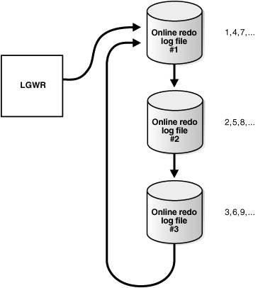
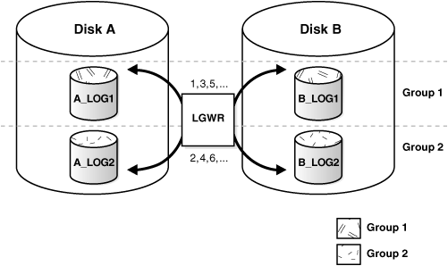
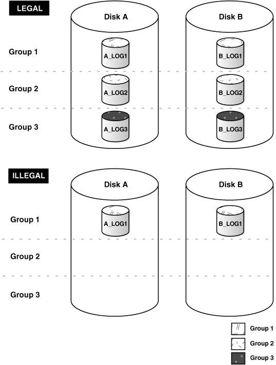

## 9 Managing the Redo Log

You manage the redo log by completing tasks such as creating redo log groups and members, relocating and renaming redo log members, dropping redo log groups and members, and forcing log switches.

Note:

A multitenant container database is the only supported architecture in Oracle Database 21c. While the documentation is being revised, legacy terminology may persist. In most cases, "database" and "non-CDB" refer to a CDB or PDB, depending on context. In some contexts, such as upgrades, "non-CDB" refers to a non-CDB from a previous release.

- What Is the Redo Log?  
	The most crucial structure for recovery operations is the redo log, which consists of two or more preallocated files that store all changes made to the database as they occur. Every instance of an Oracle Database has an associated redo log to protect the database in case of an instance failure.
- Planning the Redo Log  
	You can follow guidelines when configuring a database instance redo log.
- Creating Redo Log Groups and Members  
	Plan the redo log for a database and create all required groups and members of redo log files during database creation. However, there are situations where you might want to create additional groups or members. For example, adding groups to a redo log can correct redo log group availability problems.
- Relocating and Renaming Redo Log Members  
	You can use operating system commands to relocate redo logs, then use the `ALTER DATABASE` statement to make their new names (locations) known to the database.
- Dropping Redo Log Groups and Members  
	In some cases, you may want to drop an entire group of redo log members.
- Forcing Log Switches  
	A log switch occurs when LGWR stops writing to one redo log group and starts writing to another. By default, a log switch occurs automatically when the current redo log file group fills.
- Verifying Blocks in Redo Log Files  
	You can configure the database to use checksums to verify blocks in the redo log files.
- Clearing a Redo Log File  
	A redo log file might become corrupted while the database is open, and ultimately stop database activity because archiving cannot continue.
- Precedence of FORCE LOGGING Settings  
	You can set `FORCE LOGGING` and `NOLOGGING` at various levels, such as for a database, pluggable database (PDB), tablespace, or database object. When `FORCE LOGGING` is set at one or more levels, the precedence of `FORCE LOGGING` settings determines what is logged in the redo log.
- Redo Log Data Dictionary Views  
	You can query a set of data dictionary views for information about the redo log.

See Also:

[Using Oracle Managed Files](using-oracle-managed-files.md) for information about redo log files that are both created and managed by the Oracle Database server

**Parent topic:** [Oracle Database Structure and Storage](oracle-database-structure-and-storage.md)

### 9.1 What Is the Redo Log?

The most crucial structure for recovery operations is the redo log, which consists of two or more preallocated files that store all changes made to the database as they occur. Every instance of an Oracle Database has an associated redo log to protect the database in case of an instance failure.

- Redo Threads  
	When speaking in the context of multiple database instances, the redo log for each database instance is also referred to as a redo thread.
- Redo Log Contents  
	Redo log files are filled with redo records.
- How Oracle Database Writes to the Redo Log  
	The redo log for a database consists of two or more redo log files. The database requires a minimum of two files to guarantee that one is always available for writing while the other is being archived (if the database is in `ARCHIVELOG` mode).

**Parent topic:** Managing the Redo Log

#### 9.1.1 Redo Threads

When speaking in the context of multiple database instances, the redo log for each database instance is also referred to as a redo thread.

In typical configurations, only one database instance accesses an Oracle Database, so only one thread is present. In an Oracle Real Application Clusters environment, however, two or more instances concurrently access a single database and each instance has its own thread of redo. A separate redo thread for each instance avoids contention for a single set of redo log files, thereby eliminating a potential performance bottleneck.

This chapter describes how to configure and manage the redo log on a standard single-instance Oracle Database. The thread number can be assumed to be 1 in all discussions and examples of statements. For information about redo log groups in an Oracle Real Application Clusters environment, see [Oracle Real Application Clusters Administration and Deployment Guide](https://docs.oracle.com/pls/topic/lookup?ctx=en/database/oracle/oracle-database/21/admin&id=RACAD704).

**Parent topic:** What Is the Redo Log?

#### 9.1.2 Redo Log Contents

Redo log files are filled with redo records.

A redo record, also called a redo entry, is made up of a group of change vectors, each of which is a description of a change made to a single block in the database. For example, if you change a salary value in an employee table, you generate a redo record containing change vectors that describe changes to the data segment block for the table, the undo segment data block, and the transaction table of the undo segments.

Redo entries record data that you can use to reconstruct all changes made to the database, including the undo segments. Therefore, the redo log also protects rollback data. When you recover the database using redo data, the database reads the change vectors in the redo records and applies the changes to the relevant blocks.

Redo records are buffered in a circular fashion in the redo log buffer of the SGA (see " How Oracle Database Writes to the Redo Log ") and are written to one of the redo log files by the Log Writer (LGWR) database background process. Whenever a transaction is committed, LGWR writes the transaction redo records from the redo log buffer of the SGA to a redo log file, and assigns a system change number (SCN) to identify the redo records for each committed transaction. Only when all redo records associated with a given transaction are safely on disk in the online logs is the user process notified that the transaction has been committed.

Redo records can also be written to a redo log file before the corresponding transaction is committed. If the redo log buffer fills, or another transaction commits, LGWR flushes all of the redo log entries in the redo log buffer to a redo log file, even though some redo records may not be committed. If necessary, the database can roll back these changes.

**Parent topic:** What Is the Redo Log?

#### 9.1.3 How Oracle Database Writes to the Redo Log

The redo log for a database consists of two or more redo log files. The database requires a minimum of two files to guarantee that one is always available for writing while the other is being archived (if the database is in `ARCHIVELOG` mode).

See " [Managing Archived Redo Log Files](managing-archived-redo-log-files.md) " for more information.

LGWR writes to redo log files in a circular fashion. When the current redo log file fills, LGWR begins writing to the next available redo log file. When the last available redo log file is filled, LGWR returns to the first redo log file and writes to it, starting the cycle again. Figure 9-1 illustrates the circular writing of the redo log file. The numbers next to each line indicate the sequence in which LGWR writes to each redo log file.

Filled redo log files are available to LGWR for reuse depending on whether archiving is enabled.

- If archiving is disabled (the database is in `NOARCHIVELOG` mode), a filled redo log file is available after the changes recorded in it have been written to the data files.
- If archiving is enabled (the database is in `ARCHIVELOG` mode), a filled redo log file is available to LGWR after the changes recorded in it have been written to the data files and the file has been archived.

Figure 9-1 Reuse of Redo Log Files by LGWR



> This is a text description of admin054.gif. The image shows how LGWR reuses online redo log files. This process is described in the text preceding the image.
>
> End of image description.
>
> [  
> Copyright © 1996, 2025, Oracle and/or its affiliates.](https://docs.oracle.com/en/database/oracle/oracle-database/dcommon/html/cpyr.htm)


- Active (Current) and Inactive Redo Log Files  
	Oracle Database uses only one redo log file at a time to store redo records written from the redo log buffer. The redo log file that LGWR is actively writing to is called the current redo log file.
- Log Switches and Log Sequence Numbers  
	A log switch is the point at which the database stops writing to one redo log file and begins writing to another. Normally, a log switch occurs when the current redo log file is completely filled and writing must continue to the next redo log file.

**Parent topic:** What Is the Redo Log?

##### 9.1.3.1 Active (Current) and Inactive Redo Log Files

Oracle Database uses only one redo log file at a time to store redo records written from the redo log buffer. The redo log file that LGWR is actively writing to is called the current redo log file.

Redo log files that are required for instance recovery are called active redo log files. Redo log files that are no longer required for instance recovery are called inactive redo log files.

If you have enabled archiving (the database is in `ARCHIVELOG` mode), then the database cannot reuse or overwrite an active online log file until one of the archiver background processes (ARCn) has archived its contents. If archiving is disabled (the database is in `NOARCHIVELOG` mode), then when the last redo log file is full, LGWR continues by overwriting the next log file in the sequence when it becomes inactive.

**Parent topic:** How Oracle Database Writes to the Redo Log

##### 9.1.3.2 Log Switches and Log Sequence Numbers

A log switch is the point at which the database stops writing to one redo log file and begins writing to another. Normally, a log switch occurs when the current redo log file is completely filled and writing must continue to the next redo log file.

However, you can configure log switches to occur at regular intervals, regardless of whether the current redo log file is completely filled. You can also force log switches manually.

Oracle Database assigns each redo log file a new log sequence number every time a log switch occurs and LGWR begins writing to it. When the database archives redo log files, the archived log retains its log sequence number. A redo log file that is cycled back for use is given the next available log sequence number.

Each online or archived redo log file is uniquely identified by its log sequence number. During crash, instance, or media recovery, the database properly applies redo log files in ascending order by using the log sequence number of the necessary archived and redo log files.

**Parent topic:** How Oracle Database Writes to the Redo Log

### 9.2 Planning the Redo Log

You can follow guidelines when configuring a database instance redo log.

Starting with Oracle Database Release 21c, on non-Exadata Linux systems, redo logs can be stored in a persistent memory (PMEM) DAX file system. The tasks and commands for managing redo logs in PMEM are the same as those for managing redo logs on disk.

Oracle Database requires the persistent memory to be configured with App Direct Mode, preferably with interleaved configuration. A DAX-enabled file system such as XFS or EXT4 must be configured on the namespaces used by the database. On compute nodes, the database only supports FSDAX configuration and does not support Device DAX (devdax) configuration.

See Also:

[Persistent Memory documentation](https://software.intel.com/EN-US/ARTICLES/QUICK-START-GUIDE-CONFIGURE-INTEL-OPTANE-DC-PERSISTENT-MEMORY-ON-LINUX) for information about provisioning Intel Optane DC persistent memory

**Parent topic:** Managing the Redo Log

#### 9.2.1 Multiplexing Redo Log Files

To protect against a failure involving the redo log itself, Oracle Database allows a multiplexed redo log, meaning that two or more identical copies of the redo log can be automatically maintained in separate locations.

For the most benefit, these locations should be on separate disks. Even if all copies of the redo log are on the same disk, however, the redundancy can help protect against I/O errors, file corruption, and so on. When redo log files are multiplexed, LGWR concurrently writes the same redo log information to multiple identical redo log files, thereby eliminating a single point of redo log failure.

Multiplexing is implemented by creating groups of redo log files. A group consists of a redo log file and its multiplexed copies. Each identical copy is said to be a member of the group. Each redo log group is defined by a number, such as group 1, group 2, and so on.

Figure 9-2 Multiplexed Redo Log Files



> This is a text description of admin052.gif. This image shows two disks, DISK A and DISK B, containing online redo log files. Each disk contains identical online redo log files. LGWR writes concurrently to the online redo log files. Each identical set of redo log files is called a group. This image shows two groups.Group 1 consists of the following:
>
> - A\_LOG1 on DISK A
> - B\_LOG1 on DISK B
>
> Group 2 consists of the following:
>
> - A\_LOG2 on DISK A
> - B\_LOG2 on DISK B
>
> End of image description.


In Figure 9-2, `A_LOG1` and `B_LOG1` are both members of Group 1, `A_LOG2` and `B_LOG2` are both members of Group 2, and so forth. Each member in a group must be the same size.

Each member of a log file group is concurrently active—that is, concurrently written to by LGWR—as indicated by the identical log sequence numbers assigned by LGWR. In Figure 9-2, first LGWR writes concurrently to both `A_LOG1` and `B_LOG1`. Then it writes concurrently to both `A_LOG2` and `B_LOG2`, and so on. LGWR never writes concurrently to members of different groups (for example, to `A_LOG1` and `B_LOG2`).

Note:

Oracle recommends that you multiplex your redo log files. The loss of the log file data can be catastrophic if recovery is required. Note that when you multiplex the redo log, the database must increase the amount of I/O that it performs. Depending on your configuration, this may impact overall database performance.

- Responding to Redo Log Failure  
	Whenever LGWR cannot write to a member of a group, the database marks that member as `INVALID` and writes an error message to the LGWR trace file and to the database alert log to indicate the problem with the inaccessible files.
- Legal and Illegal Configurations  
	In most cases, a multiplexed redo log should be symmetrical: all groups of the redo log should have the same number of members. However, the database does not require that a multiplexed redo log be symmetrical.

**Parent topic:** Planning the Redo Log

##### 9.2.1.1 Responding to Redo Log Failure

Whenever LGWR cannot write to a member of a group, the database marks that member as `INVALID` and writes an error message to the LGWR trace file and to the database alert log to indicate the problem with the inaccessible files.

The specific reaction of LGWR when a redo log member is unavailable depends on the reason for the lack of availability, as summarized in the table that follows.

| Condition | LGWR Action |
| --- | --- |
| LGWR can successfully write to at least one member in a group | Writing proceeds as normal. LGWR writes to the available members of a group and ignores the unavailable members. |
| LGWR cannot access the next group at a log switch because the group must be archived | Database operation temporarily halts until the group becomes available or until the group is archived. |
| All members of the next group are inaccessible to LGWR at a log switch because of media failure | Oracle Database returns an error, and the database instance shuts down. In this case, you may need to perform media recovery on the database from the loss of a redo log file.  If the database checkpoint has moved beyond the lost redo log, media recovery is not necessary, because the database has saved the data recorded in the redo log to the data files. You need only drop the inaccessible redo log group. If the database did not archive the bad log, use `ALTER DATABASE CLEAR LOGFILE UNARCHIVED` to disable archiving before the log can be dropped. |
| All members of a group suddenly become inaccessible to LGWR while it is writing to them | Oracle Database returns an error and the database instance immediately shuts down. In this case, you may need to perform media recovery. If the media containing the log is not actually lost--for example, if the drive for the log was inadvertently turned off--media recovery may not be needed. In this case, you need only turn the drive back on and let the database perform automatic instance recovery. |

**Parent topic:** Multiplexing Redo Log Files

##### 9.2.1.2 Legal and Illegal Configurations

In most cases, a multiplexed redo log should be symmetrical: all groups of the redo log should have the same number of members. However, the database does not require that a multiplexed redo log be symmetrical.

For example, one group can have only one member, and other groups can have two members. This configuration protects against disk failures that temporarily affect some redo log members but leave others intact.

The only requirement for an instance redo log is that it have at least two groups. Figure 9-3 shows legal and illegal multiplexed redo log configurations. The second configuration is illegal because it has only one group.

Figure 9-3 Legal and Illegal Multiplexed Redo Log Configuration



> This is a text description of admin053.gif. This figure shows two multiplexed online redo log configurations. One is labeled LEGAL. The other is labeled ILLEGAL. The LEGAL configuration shows DISK A and DISK B, which contain 3 online redo log groups, each with 2 members. The ILLEGAL configuration shows DISK A and DISK B, but they contain only one online redo log group with 2 members. This is illegal because there must be at least 2 online redo log groups.
>
> End of image description.


**Parent topic:** Multiplexing Redo Log Files

#### 9.2.2 Placing Redo Log Members on Different Disks

When setting up a multiplexed redo log, place members of a group on different physical disks. If a single disk fails, then only one member of a group becomes unavailable to LGWR and other members remain accessible to LGWR, so the instance can continue to function.

If you archive the redo log, spread redo log members across disks to eliminate contention between the LGWR and ARCn background processes. For example, if you have two groups of multiplexed redo log members (a duplexed redo log), place each member on a different disk and set your archiving destination to a fifth disk. Doing so will avoid contention between LGWR (writing to the members) and ARCn (reading the members).

Data files should also be placed on different disks from redo log files to reduce contention in writing data blocks and redo records.

**Parent topic:** Planning the Redo Log

#### 9.2.3 Planning the Size of Redo Log Files

When setting the size of redo log files, consider whether you will be archiving the redo log. Redo log files should be sized so that a filled group can be archived to a single unit of offline storage media (such as a tape or disk), with the least amount of space on the medium left unused.

For example, suppose only one filled redo log group can fit on a tape and 49% of the tape storage capacity remains unused. In this case, it is better to decrease the size of the redo log files slightly, so that two log groups could be archived on each tape.

All members of the same multiplexed redo log group must be the same size. Members of different groups can have different sizes. However, there is no advantage in varying file size between groups. If checkpoints are not set to occur between log switches, make all groups the same size to guarantee that checkpoints occur at regular intervals.

The minimum size permitted for a redo log file is 4 MB.

See Also:

Your operating system–specific Oracle documentation. The default size of redo log files is operating system dependent.

**Parent topic:** Planning the Redo Log

#### 9.2.4 Planning the Block Size of Redo Log Files

Unlike the database block size, which can be between 2K and 32K, redo log files always default to a block size that is equal to the physical sector size of the disk. Historically, this has typically been 512 bytes (512B).

Some newer high-capacity disk drives offer 4K byte (4K) sector sizes for both increased ECC capability and improved format efficiency. Most Oracle Database platforms are able to detect this larger sector size. The database then automatically creates redo log files with a 4K block size on those disks.

However, with a block size of 4K, there is increased redo wastage. In fact, the amount of redo wastage in 4K blocks versus 512B blocks is significant. You can determine the amount of redo wastage by viewing the statistics stored in the `V$SESSTAT` and `V$SYSSTAT` views.

```
SQL> SELECT name, value FROM v$sysstat WHERE name = 'redo wastage';
 
NAME                                  VALUE
-------------------------------- ----------
redo wastage                       17941684
```

To avoid the additional redo wastage, if you are using emulation-mode disks—4K sector size disk drives that emulate a 512B sector size at the disk interface—you can override the default 4K block size for redo logs by specifying a 512B block size or, for some platforms, a 1K block size. However, you will incur a significant performance degradation when a redo log write is not aligned with the beginning of the 4K physical sector. Because seven out of eight 512B slots in a 4K physical sector are not aligned, performance degradation typically does occur. Thus, you must evaluate the trade-off between performance and disk wastage when planning the redo log block size on 4K sector size emulation-mode disks.

You can specify the block size of online redo log files with the `BLOCKSIZE` keyword in the `CREATE` `DATABASE`, `ALTER` `DATABASE`, and `CREATE` `CONTROLFILE` statements. On some platforms, the permissible block sizes are 512 and 4096. On other platforms, the permissible block sizes are 1024 and 4096.

The following statement adds a redo log file group with a block size of 512B. The `BLOCKSIZE` `512` clause is valid but not required for 512B sector size disks. For 4K sector size emulation-mode disks, the `BLOCKSIZE` `512` clause overrides the default 4K size.

```
ALTER DATABASE orcl ADD LOGFILE
  GROUP 4 ('/u01/logs/orcl/redo04a.log','/u01/logs/orcl/redo04b.log')
  SIZE 100M BLOCKSIZE 512 REUSE;
```

To ascertain the redo log file block size, run the following query:

```
SQL> SELECT BLOCKSIZE FROM V$LOG;

BLOCKSIZE
---------
      512
```

See Also:

- [Oracle Database SQL Language Reference](https://docs.oracle.com/pls/topic/lookup?ctx=en/database/oracle/oracle-database/21/admin&id=SQLRF00802) for information about the `ALTER` `DATABASE` command.
- [Oracle Database Reference](https://docs.oracle.com/pls/topic/lookup?ctx=en/database/oracle/oracle-database/21/admin&id=REFRN30232) for information about the `V$SESSTAT` view
- [Oracle Database Reference](https://docs.oracle.com/pls/topic/lookup?ctx=en/database/oracle/oracle-database/21/admin&id=REFRN30272) for information about the `V$SYSSTAT` view

**Parent topic:** Planning the Redo Log

#### 9.2.5 Choosing the Number of Redo Log Files

The best way to determine the appropriate number of redo log files for a database instance is to test different configurations. The optimum configuration has the fewest groups possible without hampering LGWR from writing redo log information.

In some cases, a database instance may require only two groups. In other situations, a database instance may require additional groups to guarantee that a recycled group is always available to LGWR. During testing, the easiest way to determine whether the current redo log configuration is satisfactory is to examine the contents of the LGWR trace file and the database alert log. If messages indicate that LGWR frequently has to wait for a group because a checkpoint has not completed or a group has not been archived, add groups.

Consider the parameters that can limit the number of redo log files before setting up or altering the configuration of an instance redo log. The following parameters limit the number of redo log files that you can add to a database:

- The `MAXLOGFILES` parameter used in the `CREATE` `DATABASE` statement determines the maximum number of groups of redo log files for each database. Group values can range from 1 to `MAXLOGFILES`. You can exceed the `MAXLOGFILES` limit, and the control files expand as needed. If `MAXLOGFILES` is not specified for the `CREATE` `DATABASE` statement, then the database uses an operating system specific default value.
- The `MAXLOGMEMBERS` parameter used in the `CREATE` `DATABASE` statement determines the maximum number of members for each group. As with `MAXLOGFILES`, the only way to override this upper limit is to re-create the database or control file. Therefore, it is important to consider this limit before creating a database. If no `MAXLOGMEMBERS` parameter is specified for the `CREATE` `DATABASE` statement, then the database uses an operating system default value.
	See Also:
	Your operating system specific Oracle documentation for the default and legal values of the `MAXLOGFILES` and `MAXLOGMEMBERS` parameters

**Parent topic:** Planning the Redo Log

#### 9.2.6 Controlling Archive Lag

You can force all enabled redo log threads to switch their current logs at regular time intervals.

In a primary/standby database configuration, changes are made available to the standby database by archiving redo logs at the primary site and then shipping them to the standby database. The changes that are being applied by the standby database can lag behind the changes that are occurring on the primary database, because the standby database must wait for the changes in the primary database redo log to be archived (into the archived redo log) and then shipped to it. To limit this lag, you can set the `ARCHIVE_LAG_TARGET` initialization parameter. Setting this parameter lets you specify in seconds how long that lag can be.

- Setting the ARCHIVE\_LAG\_TARGET Initialization Parameter  
	When you set the `ARCHIVE_LAG_TARGET` initialization parameter, you cause the database to examine the current redo log for the instance periodically and determine when to switch the log.
- Factors Affecting the Setting of ARCHIVE\_LAG\_TARGET  
	There are several factors to consider when you are setting the `ARCHIVE_LAG_TARGET` initialization parameter.

**Parent topic:** Planning the Redo Log

##### 9.2.6.1 Setting the ARCHIVE\_LAG\_TARGET Initialization Parameter

When you set the `ARCHIVE_LAG_TARGET` initialization parameter, you cause the database to examine the current redo log for the instance periodically and determine when to switch the log.

If the following conditions are met, then the instance will switch the log:

- The current log was created before n seconds ago, and the estimated archival time for the current log is m seconds (proportional to the number of redo blocks used in the current log), where n + m exceeds the value of the `ARCHIVE_LAG_TARGET` initialization parameter.
- The current log contains redo records.

In an Oracle Real Application Clusters environment, the instance also causes other threads to switch and archive their logs if they are falling behind. This can be particularly useful when one instance in the cluster is more idle than the other instances (as when you are running a 2-node primary/secondary configuration of Oracle Real Application Clusters).

The `ARCHIVE_LAG_TARGET` initialization parameter provides an upper limit for how long (in seconds) the current log of the database can span. Because the estimated archival time is also considered, this is not the exact log switch time.

- Set the `ARCHIVE_LAG_TARGET` initialization parameter.

The following initialization parameter setting sets the log switch interval to 30 minutes (a typical value).

```
ARCHIVE_LAG_TARGET = 1800
```

A value of 0 disables this time-based log switching functionality. This is the default setting.

You can set the `ARCHIVE_LAG_TARGET` initialization parameter even if there is no standby database. For example, the `ARCHIVE_LAG_TARGET` parameter can be set specifically to force logs to be switched and archived.

`ARCHIVE_LAG_TARGET` is a dynamic parameter and can be set with the `ALTER SYSTEM SET` statement.

Note:

The `ARCHIVE_LAG_TARGET` parameter must be set to the same value in all instances of an Oracle Real Application Clusters environment. Failing to do so results in unpredictable behavior.

**Parent topic:** Controlling Archive Lag

##### 9.2.6.2 Factors Affecting the Setting of ARCHIVE\_LAG\_TARGET

There are several factors to consider when you are setting the `ARCHIVE_LAG_TARGET` initialization parameter.

Consider the following factors when determining if you want to set the `ARCHIVE_LAG_TARGET` initialization parameter and in determining the value for this parameter.

- Overhead of switching (as well as archiving) logs
- How frequently normal log switches occur as a result of log full conditions
- How much redo loss is tolerated in the standby database

Setting `ARCHIVE_LAG_TARGET` may not be very useful if natural log switches already occur more frequently than the interval specified. However, in the case of irregularities of redo generation speed, the interval does provide an upper limit for the time range each current log covers.

If the `ARCHIVE_LAG_TARGET` initialization parameter is set to a very low value, there can be a negative impact on performance. This can force frequent log switches. Set the parameter to a reasonable value so as not to degrade the performance of the primary database.

**Parent topic:** Controlling Archive Lag

### 9.3 Creating Redo Log Groups and Members

Plan the redo log for a database and create all required groups and members of redo log files during database creation. However, there are situations where you might want to create additional groups or members. For example, adding groups to a redo log can correct redo log group availability problems.

To create new redo log groups and members, you must have the `ALTER DATABASE` system privilege. A database can have up to `MAXLOGFILES` groups.

- Creating Redo Log Groups  
	To create a new group of redo log files, use the SQL statement `ALTER DATABASE` with the `ADD LOGFILE` clause.
- Creating Redo Log Members  
	In some cases, it might not be necessary to create a complete group of redo log files. A group could already exist, but not be complete because one or more members of the group were dropped (for example, because of a disk failure). In this case, you can add new members to an existing group.

See Also:

[Oracle Database SQL Language Reference](https://docs.oracle.com/pls/topic/lookup?ctx=en/database/oracle/oracle-database/21/admin&id=SQLRF00802) for a complete description of the `ALTER DATABASE` statement

**Parent topic:** Managing the Redo Log

#### 9.3.1 Creating Redo Log Groups

To create a new group of redo log files, use the SQL statement `ALTER DATABASE` with the `ADD LOGFILE` clause.

- Run the SQL statement `ALTER DATABASE` with the `ADD LOGFILE` clause.

For example, the following statement adds a new group of redo logs to the database:

```
ALTER DATABASE
  ADD LOGFILE ('/oracle/dbs/log1c.rdo', '/oracle/dbs/log2c.rdo') SIZE 100M;
```

Note:

Provide full path names of new log members to specify their location. Otherwise, the files are created in either the default or current directory of the database server, depending upon your operating system.

You can also specify the number that identifies the group using the `GROUP` clause:

```
ALTER DATABASE 
  ADD LOGFILE GROUP 10 ('/oracle/dbs/log1c.rdo', '/oracle/dbs/log2c.rdo')
      SIZE 100M BLOCKSIZE 512;
```

Using group numbers can make administering redo log groups easier. However, the group number must be between 1 and `MAXLOGFILES`. Do not skip redo log file group numbers (that is, do not number your groups 10, 20, 30, and so on), or you will consume unnecessary space in the control files of the database.

In the preceding statement, the `BLOCKSIZE` clause is optional. See " Planning the Block Size of Redo Log Files " for more information.

**Parent topic:** Creating Redo Log Groups and Members

#### 9.3.2 Creating Redo Log Members

In some cases, it might not be necessary to create a complete group of redo log files. A group could already exist, but not be complete because one or more members of the group were dropped (for example, because of a disk failure). In this case, you can add new members to an existing group.

To create new redo log members for an existing group:

- Run the SQL statement `ALTER DATABASE` with the `ADD LOGFILE MEMBER` clause.

For example, the following statement adds a new redo log member to redo log group number 2:

```
ALTER DATABASE ADD LOGFILE MEMBER '/oracle/dbs/log2b.rdo' TO GROUP 2;
```

Notice that file names must be specified, but sizes need not be. The size of the new members is determined from the size of the existing members of the group.

When using the `ALTER DATABASE` statement, you can alternatively identify the target group by specifying all of the other members of the group in the `TO` clause, as shown in the following example:

```
ALTER DATABASE ADD LOGFILE MEMBER '/oracle/dbs/log2c.rdo'
    TO ('/oracle/dbs/log2a.rdo', '/oracle/dbs/log2b.rdo');
```

Note:

Fully specify the file names of new log members to indicate where the operating system files should be created. Otherwise, the files will be created in either the default or current directory of the database server, depending upon your operating system. You may also note that the status of the new log member is shown as `INVALID`. This is normal and it will change to active (blank) when it is first used.

**Parent topic:** Creating Redo Log Groups and Members

### 9.4 Relocating and Renaming Redo Log Members

You can use operating system commands to relocate redo logs, then use the `ALTER DATABASE` statement to make their new names (locations) known to the database.

This procedure is necessary, for example, if the disk currently used for some redo log files is going to be removed, or if data files and several redo log files are stored on the same disk and should be separated to reduce contention.

To rename redo log members, you must have the `ALTER DATABASE` system privilege. Additionally, you might also need operating system privileges to copy files to the desired location and privileges to open and back up the database.

Before relocating your redo logs, or making any other structural changes to the database, completely back up the database in case you experience problems while performing the operation. As a precaution, after renaming or relocating a set of redo log files, immediately back up the database control file.

Use the following steps for relocating redo logs. The example used to illustrate these steps assumes:

- The log files are located on two disks: `diska` and `diskb`.
- The redo log is duplexed: one group consists of the members `/diska/logs/log1a.rdo ` and `/diskb/logs/log1b.rdo`, and the second group consists of the members `/diska/logs/log2a.rdo` and `/diskb/logs/log2b.rdo`.
- The redo log files located on `diska` must be relocated to `diskc`. The new file names will reflect the new location: `/diskc/logs/log1c.rdo` and `/diskc/logs/log2c.rdo`.

To rename redo log members:

1. ```
	SHUTDOWN
	```
2. Copy the redo log files to the new location.
	Operating system files, such as redo log members, must be copied using the appropriate operating system commands. See your operating system specific documentation for more information about copying files.
	Note:
	You can execute an operating system command to copy a file (or perform other operating system commands) without exiting SQL\*Plus by using the `HOST` command. Some operating systems allow you to use a character in place of the word `HOST`. For example, you can use an exclamation point (!) in UNIX.
	The following example uses operating system commands (UNIX) to move the redo log members to a new location:
	```
	mv /diska/logs/log1a.rdo /diskc/logs/log1c.rdo
	mv /diska/logs/log2a.rdo /diskc/logs/log2c.rdo
	```
3. Startup the database, mount, but do not open it.
	```
	CONNECT / as SYSDBA
	STARTUP MOUNT
	```
4. Use the `ALTER DATABASE` statement with the `RENAME FILE` clause to rename the database redo log files.
	```
	ALTER DATABASE 
	  RENAME FILE '/diska/logs/log1a.rdo', '/diska/logs/log2a.rdo' 
	           TO '/diskc/logs/log1c.rdo', '/diskc/logs/log2c.rdo';
	```
5. Open the database for normal operation.
	The redo log alterations take effect when the database is opened.
	```
	ALTER DATABASE OPEN;
	```

**Parent topic:** Managing the Redo Log

### 9.5 Dropping Redo Log Groups and Members

In some cases, you may want to drop an entire group of redo log members.

For example, you want to reduce the number of groups in an instance redo log. In a different case, you may want to drop one or more specific redo log members. For example, if a disk failure occurs, you may need to drop all the redo log files on the failed disk so that the database does not try to write to the inaccessible files. In other situations, particular redo log files become unnecessary. For example, a file might be stored in an inappropriate location.

- Dropping Log Groups  
	You can drop a redo log group.
- Dropping Redo Log Members  
	You can drop redo log members.

**Parent topic:** Managing the Redo Log

#### 9.5.1 Dropping Log Groups

You can drop a redo log group.

To drop a redo log group, you must have the `ALTER DATABASE` system privilege. Before dropping a redo log group, consider the following restrictions and precautions:

- An instance requires at least two groups of redo log files, regardless of the number of members in the groups. (A group comprises one or more members.)
- You can drop a redo log group only if it is inactive. If you must drop the current group, then first force a log switch to occur.
- Make sure a redo log group is archived (if archiving is enabled) before dropping it. To see whether this has happened, use the `V$LOG` view.
	```
	SELECT GROUP#, ARCHIVED, STATUS FROM V$LOG;
	   GROUP# ARC STATUS
	--------- --- ----------------
	        1 YES ACTIVE
	        2 NO  CURRENT
	        3 YES INACTIVE
	        4 YES INACTIVE
	```

To drop a redo log group:

- Run the SQL statement `ALTER DATABASE` with the `DROP LOGFILE` clause.

For example, the following statement drops redo log group number 3:

```
ALTER DATABASE DROP LOGFILE GROUP 3;
```

When a redo log group is dropped from the database, and you are not using the Oracle Managed Files feature, the operating system files are not deleted from disk. Rather, the control files of the associated database are updated to drop the members of the group from the database structure. After dropping a redo log group, ensure that the drop completed successfully, and then use the appropriate operating system command to delete the dropped redo log files.

When using Oracle Managed Files, the cleanup of operating systems files is done automatically for you.

**Parent topic:** Dropping Redo Log Groups and Members

#### 9.5.2 Dropping Redo Log Members

You can drop redo log members.

To drop a redo log member, you must have the `ALTER DATABASE` system privilege. Consider the following restrictions and precautions before dropping individual redo log members:

- It is permissible to drop redo log files so that a multiplexed redo log becomes temporarily asymmetric. For example, if you use duplexed groups of redo log files, you can drop one member of one group, even though all other groups have two members each. However, you should rectify this situation immediately so that all groups have at least two members, and thereby eliminate the single point of failure possible for the redo log.
- An instance always requires at least two valid groups of redo log files, regardless of the number of members in the groups. (A group comprises one or more members.) If the member you want to drop is the last valid member of the group, you cannot drop the member until the other members become valid. To see a redo log file status, use the `V$LOGFILE` view. A redo log file becomes `INVALID` if the database cannot access it. It becomes `STALE` if the database suspects that it is not complete or correct. A stale log file becomes valid again the next time its group is made the active group.
- You can drop a redo log member only if it is not part of an active or current group. To drop a member of an active group, first force a log switch to occur.
- Make sure the group to which a redo log member belongs is archived (if archiving is enabled) before dropping the member. To see whether this has happened, use the `V$LOG` view.

To drop specific inactive redo log members:

- Run the `ALTER DATABASE` statement with the `DROP LOGFILE MEMBER` clause.

The following statement drops the redo log `/oracle/dbs/log3c.rdo`:

```
ALTER DATABASE DROP LOGFILE MEMBER '/oracle/dbs/log3c.rdo';
```

When a redo log member is dropped from the database, the operating system file is not deleted from disk. Rather, the control files of the associated database are updated to drop the member from the database structure. After dropping a redo log file, ensure that the drop completed successfully, and then use the appropriate operating system command to delete the dropped redo log file.

To drop a member of an active group, you must first force a log switch.

**Parent topic:** Dropping Redo Log Groups and Members

### 9.6 Forcing Log Switches

A log switch occurs when LGWR stops writing to one redo log group and starts writing to another. By default, a log switch occurs automatically when the current redo log file group fills.

You can force a log switch to make the currently active group inactive and available for redo log maintenance operations. For example, you want to drop the currently active group, but are not able to do so until the group is inactive. You may also want to force a log switch if the currently active group must be archived at a specific time before the members of the group are completely filled. This option is useful in configurations with large redo log files that take a long time to fill.

To force a log switch, you must have the `ALTER SYSTEM` privilege.

To force a log switch,

- Run the `ALTER SYSTEM` statement with the `SWITCH LOGFILE` clause.

For example, the following statement forces a log switch:

```
ALTER SYSTEM SWITCH LOGFILE;
```

**Parent topic:** Managing the Redo Log

### 9.7 Verifying Blocks in Redo Log Files

You can configure the database to use checksums to verify blocks in the redo log files.

If you set the initialization parameter `DB_BLOCK_CHECKSUM` to `TYPICAL` (the default), then the database computes a checksum for each database block when it is written to disk, including each redo log block as it is being written to the current log. The checksum is stored the header of the block.

Oracle Database uses the checksum to detect corruption in a redo log block. The database verifies the redo log block when the block is read from an archived log during recovery and when it writes the block to an archive log file. An error is raised and written to the alert log if corruption is detected.

If corruption is detected in a redo log block while trying to archive it, the system attempts to read the block from another member in the group. If the block is corrupted in all members of the redo log group, then archiving cannot proceed.

The value of the `DB_BLOCK_CHECKSUM` parameter can be changed dynamically using the `ALTER SYSTEM` statement.

Note:

There is a slight overhead and decrease in database performance with `DB_BLOCK_CHECKSUM` enabled. Monitor your database performance to decide if the benefit of using data block checksums to detect corruption outweighs the performance impact.

See Also:

[Oracle Database Reference](https://docs.oracle.com/pls/topic/lookup?ctx=en/database/oracle/oracle-database/21/admin&id=REFRN10030) for a description of the `DB_BLOCK_CHECKSUM` initialization parameter

**Parent topic:** Managing the Redo Log

### 9.8 Clearing a Redo Log File

A redo log file might become corrupted while the database is open, and ultimately stop database activity because archiving cannot continue.

In this situation, to reinitialize the file without shutting down the database:

- Run the `ALTER DATABASE CLEAR LOGFILE` SQL statement.

The following statement clears the log files in redo log group number 3:

```
ALTER DATABASE CLEAR LOGFILE GROUP 3;
```

This statement overcomes two situations where dropping redo logs is not possible:

- If there are only two log groups
- The corrupt redo log file belongs to the current group

If the corrupt redo log file has not been archived, use the `UNARCHIVED` keyword in the statement.

```
ALTER DATABASE CLEAR UNARCHIVED LOGFILE GROUP 3;
```

This statement clears the corrupted redo logs and avoids archiving them. The cleared redo logs are available for use even though they were not archived.

If you clear a log file that is needed for recovery of a backup, then you can no longer recover from that backup. The database writes a message in the alert log describing the backups from which you cannot recover.

Note:

If you clear an unarchived redo log file, you should make another backup of the database.

To clear an unarchived redo log that is needed to bring an offline tablespace online, use the `UNRECOVERABLE DATAFILE` clause in the `ALTER DATABASE CLEAR LOGFILE` statement.

If you clear a redo log needed to bring an offline tablespace online, you will not be able to bring the tablespace online again. You will have to drop the tablespace or perform an incomplete recovery. Note that tablespaces taken offline normal do not require recovery.

**Parent topic:** Managing the Redo Log

### 9.9 Precedence of FORCE LOGGING Settings

You can set `FORCE LOGGING` and `NOLOGGING` at various levels, such as for a database, pluggable database (PDB), tablespace, or database object. When `FORCE LOGGING` is set at one or more levels, the precedence of `FORCE LOGGING` settings determines what is logged in the redo log.

You can put a multitenant container database (CDB) into `FORCE                 LOGGING` mode. In this mode, the database logs all changes in the database except for changes in temporary tablespaces and temporary segments. This setting takes precedence over and is independent of any `NOLOGGING` or `FORCE                 LOGGING` settings you specify for individual tablespaces and any `NOLOGGING` settings you specify for individual database objects.

You can also put a tablespace into `FORCE LOGGING` mode. The database logs all changes to all objects in the tablespace except changes to temporary segments, overriding any `NOLOGGING` setting for individual objects.

In addition, you can specify a logging attribute with the logging\_clause for various types of database objects that determines whether certain DML operations will be logged in the redo log file (`LOGGING`) or not (`NOLOGGING`). You can specify a logging attribute for the following types of database objects:

- Tables
- Indexes
- Materialized views

The following table summarizes the logging settings at each level and shows the result for a CDB.

Table 9-1 Precedence of FORCE LOGGING Settings for a CDB

| CDB | PDB | Tablespace | Database Object LOGGING Attribute | Result |
| --- | --- | --- | --- | --- |
| `FORCE LOGGING` | Ignored | Ignored | Ignored | Logged |
| `NO FORCE LOGGING` | `ENABLE FORCE LOGGING` | Ignored | Ignored | Logged |
| `NO FORCE LOGGING` | `ENABLE FORCE NOLOGGING` | Ignored | Ignored | Not Logged |
| `NO FORCE LOGGING` | `DISABLE FORCE [NO]LOGGING` (no setting) | `FORCE LOGGING` | Ignored | Logged |
| `NO FORCE LOGGING` | `DISABLE FORCE [NO]LOGGING` (no setting) | `NO FORCE LOGGING` | `LOGGING` | Logged |
| `NO FORCE LOGGING` | `DISABLE FORCE [NO]LOGGING` (no setting) | `NO FORCE LOGGING` | `NOLOGGING` | Not Logged |

**Parent topic:** Managing the Redo Log

### 9.10 Redo Log Data Dictionary Views

You can query a set of data dictionary views for information about the redo log.

The following views provide information on redo logs.

| View | Description |
| --- | --- |
| `V$LOG` | Displays the redo log file information from the control file |
| `V$LOGFILE` | Identifies redo log groups and members and member status |
| `V$LOG_HISTORY` | Contains log history information |

The following query returns the control file information about the redo log for a database.

```
SELECT GROUP#, THREAD#, SEQUENCE#, BYTES, MEMBERS, ARCHIVED, 
       STATUS, FIRST_CHANGE#, FIRST_TIME
  FROM V$LOG;

GROUP# THREAD#   SEQ   BYTES  MEMBERS  ARC STATUS     FIRST_CHANGE# FIRST_TIM
------ ------- ----- -------  -------  --- ---------  ------------- ---------
     1       1 10605 1048576        1  YES ACTIVE          11515628 16-APR-00
     2       1 10606 1048576        1  NO  CURRENT         11517595 16-APR-00
     3       1 10603 1048576        1  YES INACTIVE        11511666 16-APR-00
     4       1 10604 1048576        1  YES INACTIVE        11513647 16-APR-00
```

To see the names of all of the member of a group, use a query similar to the following:

```
SELECT GROUP#, STATUS, MEMBER FROM V$LOGFILE;

GROUP#   STATUS  MEMBER
------  -------  ----------------------------------
     1           D:\ORANT\ORADATA\IDDB2\REDO04.LOG
     2           D:\ORANT\ORADATA\IDDB2\REDO03.LOG
     3           D:\ORANT\ORADATA\IDDB2\REDO02.LOG
     4           D:\ORANT\ORADATA\IDDB2\REDO01.LOG
```

If `STATUS` is blank for a member, then the file is in use.

**Parent topic:** Managing the Redo Log