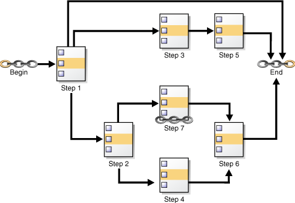
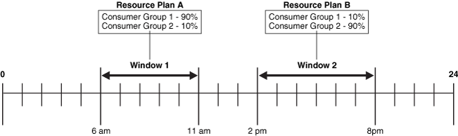
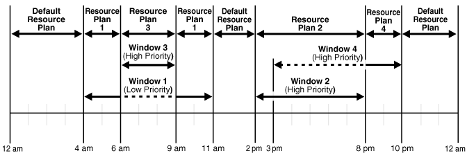
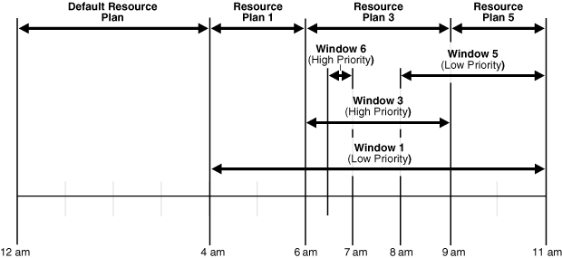
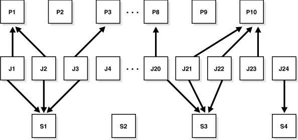
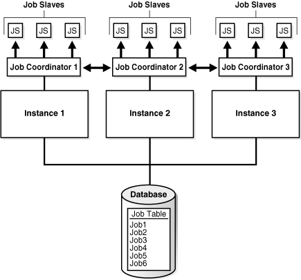
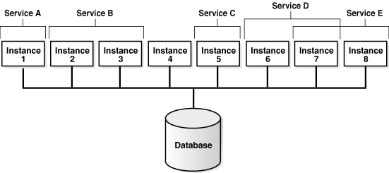

## 27 Oracle Scheduler Concepts

You can schedule tasks with Oracle Scheduler.

- Overview of Oracle Scheduler  
	Oracle Database includes Oracle Scheduler, an enterprise job scheduler to help you simplify the scheduling of hundreds or even thousands of tasks. Oracle Scheduler (the Scheduler) is implemented by the procedures and functions in the `DBMS_SCHEDULER` PL/SQL package.
- Jobs and Supporting Scheduler Objects  
	You use jobs and other scheduler objects for task scheduling.
- More About Jobs  
	There are different types of jobs. A job instance represents a specific run of a job. You can supply job arguments to override the default program argument values.
- Scheduler Architecture  
	Scheduler components handle jobs.
- Processes to Close a PDB  
	If a PDB is closed with the immediate option, then the coordinator terminates jobs running in the PDB, and the jobs must be recovered before they can run again.
- Scheduler Support for Oracle Data Guard  
	Beginning with Oracle Database 11g Release 1 (11.1), the Scheduler can run jobs based on whether a database is a primary database or a logical standby in an Oracle Data Guard environment.

**Parent topic:** [Database Resource Management and Task Scheduling](database-resource-management-and-task-scheduling.md)

### 27.1 Overview of Oracle Scheduler

Oracle Database includes Oracle Scheduler, an enterprise job scheduler to help you simplify the scheduling of hundreds or even thousands of tasks. Oracle Scheduler (the Scheduler) is implemented by the procedures and functions in the `DBMS_SCHEDULER` PL/SQL package.

The Scheduler enables you to control when and where various computing tasks take place in the enterprise environment. The Scheduler helps you effectively manage and plan these tasks. By ensuring that many routine computing tasks occur without manual intervention, you can lower operating costs, implement more reliable routines, minimize human error, and shorten the time windows needed.

The Scheduler provides sophisticated, flexible enterprise scheduling functionality, which you can use to:

- Run database program units
	You can run program units, that is, PL/SQL anonymous blocks, PL/SQL stored procedures, and Java stored procedures on the local database or on one or more remote Oracle databases.
- Run external executables, (executables that are external to the database)
	You can run external executables, such as applications, shell scripts, and batch files, on the local system or on one or more remote systems. Remote systems do not require an Oracle Database installation; they require only a Scheduler agent. Scheduler agents are available for all platforms supported by Oracle Database and some additional platforms.
- Schedule job execution using the following methods:
	- Time-based scheduling
		You can schedule a job to run at a particular date and time, either once or on a repeating basis. You can define complex repeat intervals, such as "every Monday and Thursday at 3:00 a.m. except on public holidays" or "the last Wednesday of each business quarter." See " [Creating, Running, and Managing Jobs](scheduling-jobs-with-oracle-scheduler.md) " for more information.
		- Event-based scheduling
		You can start jobs in response to system or business events. Your applications can detect events and then signal the Scheduler. Depending on the type of signal sent, the Scheduler starts a specific job. Examples of event-based scheduling include starting jobs when a file arrives on a system, when inventory falls below predetermined levels, or when a transaction fails. Beginning with Oracle Database 11g Release 2 (11.2), a Scheduler object called a file watcher simplifies the task of configuring a job to start when a file arrives on a local or remote system. See " [Using Events to Start Jobs](scheduling-jobs-with-oracle-scheduler.md) " for more information.
		- Dependency scheduling
		You can set the Scheduler to run tasks based on the outcome of one or more previous tasks. You can define complex dependency chains that include branching and nested chains. See " [Creating and Managing Job Chains](scheduling-jobs-with-oracle-scheduler.md) " for more information.
- Prioritize jobs based on business requirements.
	The Scheduler provides control over resource allocation among competing jobs, thus aligning job processing with your business needs. This is accomplished in the following ways:
	- Controlling Resources by Job Class
		You can group jobs that share common characteristics and behavior into larger entities called job classes. You can prioritize among the classes by controlling the resources allocated to each class. Therefore, you can ensure that your critical jobs have priority and enough resources to complete. For example, for a critical project to load a data warehouse, you can combine all the data warehousing jobs into one class and give it priority over other jobs by allocating a high percentage of the available resources to it. You can also assign relative priorities to the jobs within a job class.
		- Controlling Job Prioritization based on Schedules
		You can change job priorities based on a schedule. Because your definition of a critical job can change over time, the Scheduler also enables you to change the priority among your jobs over that time frame. For example, extract, transfer, and load (ETL) jobs used to load a data warehouse may be critical during non-peak hours but not during peak hours. Additionally, jobs that must run during the close of a business quarter may need to take priority over the ETL jobs. In these cases, you can change the priority among the job classes by changing the resources allocated to each class. See " [Creating Job Classes](scheduling-jobs-with-oracle-scheduler.md) " and " [Creating Windows](scheduling-jobs-with-oracle-scheduler.md) " for more information.
- Manage and monitor jobs
	You can manage and monitor the multiple states that jobs go through, from creation to completion. The Scheduler logs activity so that you can easily track information such as the status of the job and the last run time of the job by querying views using Oracle Enterprise Manager Cloud Control or SQL. These views provide valuable information about jobs and their execution that can help you schedule and better manage your jobs. For example, a DBA can easily track all jobs that failed for a particular user. See " [Scheduler Data Dictionary Views](administering-oracle-scheduler.md) ".
	When you create a multiple-destination job, a job that is defined at one database but that runs on multiple remote hosts, you can monitor the status of the job at each destination individually or the overall status of the parent job as a whole.
	For advanced job monitoring, your applications can subscribe to job state change notifications that the Scheduler delivers in event queues. The Scheduler can also send e-mail notifications when a job changes state.
	See " [Monitoring and Managing the Scheduler](administering-oracle-scheduler.md) ".
- Execute and manage jobs in a clustered environment
	A cluster is a set of database instances that cooperates to perform the same task. Oracle Real Application Clusters (Oracle RAC) provides scalability and reliability without any change to your applications. The Scheduler fully supports execution of jobs in such a clustered environment. To balance the load on your system and for better performance, you can also specify the database service where you want a job to run. See " The Scheduler and Real Application Clusters " for more information.

**Parent topic:** Oracle Scheduler Concepts

### 27.2 Jobs and Supporting Scheduler Objects

You use jobs and other scheduler objects for task scheduling.

**Parent topic:** Oracle Scheduler Concepts

#### 27.2.1 About Jobs and Supporting Scheduler Objects

To use the Scheduler, you create Scheduler objects. Schema objects define the what, when, and where for job scheduling. Scheduler objects enable a modular approach to managing tasks. One advantage of the modular approach is that objects can be reused when creating new tasks that are similar to existing tasks.

The principal Scheduler object is the job. A job defines the action to perform, the schedule for the action, and the location or locations where the action takes place. Most other scheduler objects are created to support jobs.

Note:

The Oracle Scheduler job replaces the `DBMS_JOB` package, which is still supported for backward compatibility. This chapter assumes that you are only using Scheduler jobs. If you are using both at once, or migrating from `DBMS_JOB` to Scheduler jobs, see [Support for DBMS\_JOB](support-for-DBMS_JOB.md).

Each of these objects is described in detail later in this section.

Because Scheduler objects belong to schemas, you can grant object privileges on them. Some Scheduler objects, including job classes, windows, and window groups, are always created in the `SYS` schema, even if the user is not `SYS`. All other objects are created in the user's own schema or in a designated schema.

See Also:

" [Scheduler Privileges](administering-oracle-scheduler.md) "

**Parent topic:** Jobs and Supporting Scheduler Objects

#### 27.2.2 Programs

A program object (program) describes what is to be run by the Scheduler.

A program includes:

- An action: For example, the name of a stored procedure, the name of an executable found in the operating system file system (an "external executable"), or the text of a PL/SQL anonymous block.
- A type: `STORED_PROCEDURE`, `PLSQL_BLOCK`, `SQL_SCRIPT`, `EXTERNAL_SCRIPT`, ` BACKUP_SCRIPT`, or `EXECUTABLE`, where `EXECUTABLE` indicates an external executable.
- Number of arguments: The number of arguments that the stored procedure or external executable accepts.

A program is a separate entity from a job. A job runs at a certain time or because a certain event occurred, and invokes a certain program. You can create jobs that point to existing program objects, which means that different jobs can use the same program and run the program at different times and with different settings. With the right privileges, different users can use the same program without having to redefine it. Therefore, you can create program libraries, where users can select from a list of existing programs.

If a stored procedure or external executable referenced by the program accepts arguments, you define these arguments in a separate step after creating the program. You can optionally define a default value for each argument.

See Also:

- " [Creating Programs](scheduling-jobs-with-oracle-scheduler.md) "
- " Jobs " for an overview of jobs

**Parent topic:** Jobs and Supporting Scheduler Objects

#### 27.2.3 Schedules

A schedule object (schedule) specifies when and how many times a job is run.

Schedules can be shared by multiple jobs. For example, the end of a business quarter may be a common time frame for many jobs. Rather than defining an end-of-quarter schedule each time a new job is defined, job creators can point to a named schedule.

There are two types of schedules:

- time schedules
	With time schedules, you can schedule jobs to run immediately or at a later time. Time schedules include a start date and time, optional end date and time, and optional repeat interval.
- event schedules
	With event schedules, you can specify that a job executes when a certain event occurs, such as inventory falling below a threshold or a file arriving on a system. For more information on events, see " [Using Events to Start Jobs](scheduling-jobs-with-oracle-scheduler.md) ".

See Also:

" [Creating Schedules](scheduling-jobs-with-oracle-scheduler.md) "

**Parent topic:** Jobs and Supporting Scheduler Objects

#### 27.2.4 Jobs

A job describes a user-defined task.

- About Jobs  
	A job object (job) is a collection of metadata that describes a user-defined task. It defines what must be executed (the action), when (the one-time or recurring schedule or a triggering event), where (the destinations), and with what credentials. A job has an owner, which is the schema in which it is created.
- Specifying a Job Action  
	You can specify a job action by specifying the database program unit or external executable to be run or the name of an existing program object (program).
- Specifying a Job Schedule  
	You can specify a job schedule by setting attributes of the job object or the name of an existing schedule object (schedule).
- Specifying a Job Destination  
	You can specify a job destination in several different ways.
- Specifying a Job Credential  
	You can specify a job credential by specifying a named credential object or by allowing the credential attribute of the job to remain `NULL`.

**Parent topic:** Jobs and Supporting Scheduler Objects

##### 27.2.4.1 About Jobs

A job object (job) is a collection of metadata that describes a user-defined task. It defines what must be executed (the action), when (the one-time or recurring schedule or a triggering event), where (the destinations), and with what credentials. A job has an owner, which is the schema in which it is created.

A job that runs a database program unit is known as a database job. A job that runs an external executable is known as an external job.

Jobs that run database program units at one or more remote locations are called remote database jobs. Jobs that run external executables at one or more remote locations are called remote external jobs.

You define where a job runs by specifying a one or more destinations. Destinations are also Scheduler objects and are described later in this section. If you do not specify a destination, it is assumed that the job runs on the local database.

**Parent topic:** Jobs

##### 27.2.4.2 Specifying a Job Action

You can specify a job action by specifying the database program unit or external executable to be run or the name of an existing program object (program).

You specify the job action in one of the following ways:

- By specifying as a job attribute the database program unit or external executable to be run. This is known as specifying the job action inline.
- By specifying as a job attribute the name of an existing program, that specifies the database program unit or external executable to be run. The job owner must have the `EXECUTE` privilege on the program or the `EXECUTE` `ANY` `PROGRAM` system privilege.

**Parent topic:** Jobs

##### 27.2.4.3 Specifying a Job Schedule

You can specify a job schedule by setting attributes of the job object or the name of an existing schedule object (schedule).

You specify the job schedule in one of the following ways:

- By setting attributes of the job object to define start and end dates and a repeat interval, or to define an event that starts the job. This is known as specifying the schedule inline.
- By specifying as a job attribute the name of an existing schedule, which defines start and end dates and a repeat interval, or defines an event.

**Parent topic:** Jobs

##### 27.2.4.4 Specifying a Job Destination

You can specify a job destination in several different ways.

You specify the job destinations in one of the following ways:

- By specifying as a job attribute a single named destination object. In this case, the job runs on one remote location.
- By specifying as a job attribute a named destination group, which is equivalent to a list of remote locations. In this case, the job runs on all remote locations.
- By not specifying a destination attribute, in which case the job runs locally. The job runs either of the following:
	- A database program unit on the local database (the database on which the job is created)
		- An external executable on the local host, depending on the job action type

**Parent topic:** Jobs

##### 27.2.4.5 Specifying a Job Credential

You can specify a job credential by specifying a named credential object or by allowing the credential attribute of the job to remain `NULL`.

You specify the job credentials in one of the following ways:

- By specifying as a job attribute a named credential object, which contains a database user name and password (for database jobs).
	The job runs as the user named in the credential.
- By allowing the credential attribute of the job to remain `NULL`, in which case a local database job runs as the job owner. (See Table 27-1.) The job owner is the schema in which the job was created.

Note:

A local database job always runs as the user is who is the job owner and will ignore any named credential.

After you create a job and enable it, the Scheduler automatically runs the job according to its schedule or when the specified event is detected. You can view the run status of job and its job log by querying data dictionary views. If a job runs on multiple destinations, you can query the status of the job at each destination.

#### 27.2.5 Destinations

You can specify external and database destinations for running a job.

- About Destinations  
	A destination object (destination) defines a location for running a job.
- About Destinations and Scheduler Agents  
	The remote location specified in a destination object must have a Scheduler agent running, and the agent must be registered with the database creating the job.

**Parent topic:** Jobs and Supporting Scheduler Objects

##### 27.2.5.1 About Destinations

A destination object (destination) defines a location for running a job.

There are two types of destinations:

- External destination: Specifies a remote host name and IP address for running a remote external job.
- Database destination: Specifies a remote database instance for running a remote database job.

Jobs that run external executables (external jobs) must specify external destinations, and jobs that run database program units (database jobs) must specify database destinations.

If you specify a destination when you create a job, the job runs on that destination. If you do not specify a destination, the job runs locally, on the system on which it is created.

You can also create a destination group, which consists of a list of destinations, and reference this destination group when creating a job. In this case, the job runs on all destinations in the group.

Note:

Destination groups can also include the keyword `LOCAL` as a group member, indicating that the job also runs on the local host or local database.

No object privileges are required to use a destination created by another user.

**Parent topic:** Destinations

##### 27.2.5.2 About Destinations and Scheduler Agents

The remote location specified in a destination object must have a Scheduler agent running, and the agent must be registered with the database creating the job.

The Scheduler agent enables the local Scheduler to communicate with the remote host, start and stop jobs there, and return remote job status to the local database. For complete details, see " [Specifying Destinations](scheduling-jobs-with-oracle-scheduler.md) ".

- External Destinations  
	You cannot explicitly create external destinations. They are created in your local database when you register a Scheduler agent with that database.
- Database Destinations  
	You create database destinations with the `DBMS_SCHEDULER.CREATE_DATABASE_DESTINATION` procedure.

**Parent topic:** Destinations

###### 27.2.5.2.1 External Destinations

You cannot explicitly create external destinations. They are created in your local database when you register a Scheduler agent with that database.

The name assigned to the external destination is the name of the agent. You can configure an agent name after you install it, or you can accept the default agent name, which is the first part of the host name (before the first dot separator). For example, if you install an agent on the host `dbhost1.us.example.com`, the agent name defaults to `DBHOST1`.

**Parent topic:** About Destinations and Scheduler Agents

###### 27.2.5.2.2 Database Destinations

You create database destinations with the `DBMS_SCHEDULER.CREATE_DATABASE_DESTINATION` procedure.

Note:

If you have multiple database instances running on the local host, you can run jobs on the other instances by creating database destinations for those instances. Thus, "remote" database instances do not necessarily have to reside on remote hosts. The local host must be running a Scheduler agent to support running remote database jobs on these additional instances.

See Also:

- " [Specifying Destinations](scheduling-jobs-with-oracle-scheduler.md) "
- " [Installing and Configuring the Scheduler Agent on a Remote Host](administering-oracle-scheduler.md) "

**Parent topic:** About Destinations and Scheduler Agents

#### 27.2.6 File Watchers

A file watcher object (file watcher) defines the location, name, and other properties of a file whose arrival on a system causes the Scheduler to start a job.

You create a file watcher and then create any number of event-based jobs or event schedules that reference the file watcher. When the file watcher detects the arrival of the designated file, it raises a file arrival event. The job started by the file arrival event can retrieve the event message to learn about the newly arrived file.

A file watcher can watch for a file on the local system (the same host computer running Oracle Database) or a remote system, provided that the remote system is running the Scheduler agent.

To use file watchers, the database Java virtual machine (JVM) component must be installed.

See " [About File Watchers](scheduling-jobs-with-oracle-scheduler.md) " for more information.

See Also:

" [Creating File Watchers and File Watcher Jobs](scheduling-jobs-with-oracle-scheduler.md) "

**Parent topic:** Jobs and Supporting Scheduler Objects

#### 27.2.7 Credentials

Credentials are user name and password pairs stored in a dedicated database object.

Scheduler jobs use credentials to authenticate themselves with a database instance or the operating system in order to run. You use credentials for:

- Remote database jobs: The credential contains a database user name and password. The stored procedure or PL/SQL block specified in the remote database job runs as this database user.
- External jobs (local or remote): The credential contains a host operating system user name and password. The external executable of the job then runs with this user name and password.
- File watchers: The credential contains a host operating system user name and password. The job that processes the file arrival event uses this user name and password to access the arrived file.

You can query the `*_CREDENTIALS` views to see a list of credentials in the database. Credential passwords are stored obfuscated, and are not displayed in these views.

See Also:

- " [Specifying Scheduler Job Credentials](scheduling-jobs-with-oracle-scheduler.md) "
- [Oracle Database Security Guide](https://docs.oracle.com/pls/topic/lookup?ctx=en/database/oracle/oracle-database/21/admin&id=DBSEG656) for information about creating a credential using the `DBMS_CREDENTIAL.CREATE_CREDENTIAL` procedure

**Parent topic:** Jobs and Supporting Scheduler Objects

#### 27.2.8 Chains

Chains are the means by which you can implement dependency scheduling, in which job starts depend on the outcomes of one or more previous jobs.

A chain consists of multiple steps that are combined using dependency rules. The dependency rules define the conditions that can be used to start or stop a step or the chain itself. Conditions can include the success, failure, or completion- or exit-codes of previous steps. Logical expressions, such as AND/OR, can be used in the conditions. In a sense, a chain resembles a decision tree, with many possible paths for selecting which tasks run and when.

In its simplest form, a chain consists of two or more Scheduler program objects (programs) that are linked together for a single, combined objective. An example of a chain might be "run program A followed by program B, and then run program C only if programs A and B complete successfully, otherwise wait an hour and then run program D."

As an example, you might want to create a chain to combine the different programs necessary for a successful financial transaction, such as validating and approving a loan application, and then funding the loan.

A Scheduler job can point to a chain instead of pointing to a single program object. The job then serves to start the chain. This job is referred to as the chain job. Multiple chain jobs can point to the same chain, and more than one of these jobs can run simultaneously, thereby creating multiple instances of the same chain, each at a different point of progress in the chain.

Each position within a chain is referred to as a step. Typically, after an initial set of chain steps has started, the execution of successive steps depends on the completion of one or more previous steps. Each step can point to one of the following:

- A program object (program)
	The program can run a database program unit (such as a stored procedure or PL/SQL anonymous block) or an external executable.
- Another chain (a nested chain)
	Chains can be nested to any level.
- An event schedule, inline event, or file watcher
	After starting a step that points to an event schedule or that has an inline event specification, the step waits until the specified event is raised. Likewise, a step that references a file watcher inline or that points to an event schedule that references a file watcher waits until the file arrival event is raised. For a file arrival event or any other type of event, when the event occurs, the step completes, and steps that are dependent on the event step can run. A common example of an event in a chain is a user intervention, such an approval or rejection.

Multiple steps in the chain can invoke the same program or nested chain.

For each step, you can specify either a database destination or an external destination on which the step should run. If a destination is not specified, the step runs on the originating (local) database or the local host. Each step in a chain can run on a different destination.

Figure 27-1 shows a chain with multiple branches. The figure makes use of icons to indicate `BEGIN`, `END`, and a nested chain, which is Step 7, in the lower subbranch.

In this figure, rules could be defined as follows:

- If Step 1 completes successfully, start Step 2.
- If Step 1 fails with error code 20100, start Step 3.
- If Step 1 fails with any other error code, end the chain.

Additional rules govern the running of steps 4, 5, 6, and 7.

Figure 27-1 Chain with Multiple Branches

> This image depicts a chain of steps, with a BEGIN icon at the left, an END icon at the right, and three different branches that connect the BEGIN and END points. Steps along the branches are indicated by a step icon. Immediately to the right the BEGIN icon is Step 1, with an arrow pointing from BEGIN to Step 1. From Step 1, three branches emerge that head toward the END icon. Two branches have multiple icons along them, where each icon represents a step. Right-pointing arrows connect the steps along a branch, indicating the order that the steps are run. The third branch has no steps after Step 1, and goes right to END. One of the other branches with steps on it momentary branches itself into two branches, which merge back into the single branch before proceeding to END.
>
> Focusing on one branch, the branch goes like this: BEGIN, Step1, Step 3, Step 5, END.

While a job pointing to a chain is running, the current state of all steps of the running chain can be monitored. For every step, the Scheduler creates a step job with the same job name and owner as the chain job. Each step job additionally has a step job subname to uniquely identify it. The step job subname is included as the `JOB_SUBNAME` column in the views `*_SCHEDULER_RUNNING_JOBS`, `*_SCHEDULER_JOB_LOG`, and `*_SCHEDULER_JOB_RUN_DETAILS`, and as the `STEP_JOB_SUBNAME` column in the `*_SCHEDULER_RUNNING_CHAINS` views.

See Also:

" [Creating and Managing Job Chains](scheduling-jobs-with-oracle-scheduler.md) "

**Parent topic:** Jobs and Supporting Scheduler Objects

#### 27.2.9 Job Classes

Job classes enable you to assign the same attributes to member jobs, set resource allocation for member jobs, and group jobs for prioritization.

You typically create job classes only when you are in the role of Scheduler administrator.

Job classes provide a way to:

- Assign the same set of attribute values to member jobs
	Each job class specifies a set of attributes, such as logging level. When you assign a job to a job class, the job inherits those attributes. For example, you can specify the same policy for purging log entries for all payroll jobs.
- Set service affinity for member jobs
	You can set the `service` attribute of a job class to a desired database service name. This determines the instances in a Real Application Clusters environment that run the member jobs, and optionally, the system resources that are assigned to member jobs. See " Service Affinity when Using the Scheduler " for more information.
- Set resource allocation for member jobs
	Job classes provide the link between the Database Resource Manager and the Scheduler, because each job class can specify a resource consumer group as an attribute. Member jobs then belong to the specified consumer group and are assigned resources according to settings in the current resource plan.
	Alternatively, you can leave the `resource_consumer_group` attribute `NULL` and set the `service` attribute of a job class to a desired database service name. That service can in turn be mapped to a resource consumer group. If both the `resource_consumer_group` and `service` attributes are set, and the designated service maps to a resource consumer group, the resource consumer group named in the `resource_consumer_group` attribute takes precedence.
	See [Managing Resources with Oracle Database Resource Manager](managing-resources-with-oracle-database-resource-manager.md) for more information on mapping services to consumer groups.
- Group jobs for prioritization
	Within the same job class, you can assign priority values of 1-5 to individual jobs so that if two jobs in the class are scheduled to start at the same time, the one with the higher priority takes precedence. This ensures that you do not have a less important job preventing the timely completion of a more important one.
	If two jobs have the same assigned priority value, the job with the earlier start date takes precedence. If no priority is assigned to a job, its priority defaults to 3.
	Note:
	Job priorities are used only to prioritize among jobs in the same class.
	There is no guarantee that a high priority job in class A will be started before a low priority job in class B, even if they share the same schedule. Prioritizing among jobs of different classes depends on the current resource plan and on the designated resource consumer group or service name of each job class.

When defining job classes, try to classify jobs by functionality. Consider dividing jobs into groups that access similar data, such as marketing, production, sales, finance, and human resources.

The default public classes are as follows:

- `DEFAULT_JOB_CLASS`: This is the default job class for regular jobs.
- `DEFAULT_IN_MEMORY_JOB_CLASS`: This is the default job class for in-memory runtime and in-memory full jobs.
- `ORA$AUTOTASK_JOB_CLASS`: This is the job class used by autotask jobs. The resource consumer group of this job class is `ORA$AUTOTASK`.

Some of the restrictions to keep in mind are:

- A job must be part of exactly one class. When you create a job, you can specify which class the job is part of. If you do not specify a class, the job automatically becomes part of the class `DEFAULT_JOB_CLASS`.
- Dropping a class while there are still jobs in that class results in an error. You can force a class to be dropped even if there are still jobs that are members of that class, but all jobs referring to that class are then automatically disabled and assigned to the class `DEFAULT_JOB_CLASS`. Jobs belonging to the dropped class that are already running continue to run under class settings determined at the start of the job.

See Also:

- " [Creating Job Classes](scheduling-jobs-with-oracle-scheduler.md) "
- [Oracle Database Reference](https://docs.oracle.com/pls/topic/lookup?ctx=en/database/oracle/oracle-database/21/admin&id=REFRN20345) to view job classes

**Parent topic:** Jobs and Supporting Scheduler Objects

#### 27.2.10 Windows

A window is an interval of time to run a job.

- About Windows  
	You create windows to automatically start jobs or to change resource allocation among jobs during various time periods of the day, week, and so on. A window is represented by an interval of time with a well-defined beginning and end, such as "from 12am-6am".
- Overlapping Windows  
	Although Oracle does not recommend it, windows can overlap.

**Parent topic:** Jobs and Supporting Scheduler Objects

##### 27.2.10.1 About Windows

You create windows to automatically start jobs or to change resource allocation among jobs during various time periods of the day, week, and so on. A window is represented by an interval of time with a well-defined beginning and end, such as "from 12am-6am".

You typically create windows only when you are in the role of Scheduler administrator.

Windows work with job classes to control resource allocation. Each window specifies the resource plan to activate when the window opens (becomes active), and each job class specifies a resource consumer group or specifies a database service, which can map to a consumer group. A job that runs within a window, therefore, has resources allocated to it according to the consumer group of its job class and the resource plan of the window.

In a multitenant container database (CDB), there are two levels of windows. At the PDB level, windows can be used to set resource plans that allocate resources among consumer groups belonging to that PDB. At the root database level, windows can allocate resources to different PDBs. Therefore, at any time, there can be a window open in the root database and one in each PDB.

Figure 27-2 shows a workday that includes two windows. In this configuration, jobs belonging to the job class that links to `Consumer Group 1` get more resources in the morning than in the afternoon. The opposite is true for jobs in the job class that links to `Consumer Group 2`.

Figure 27-2 Windows help define the resources that are allocated to jobs

> Figure 26-2 shows a 24-hour timeline, starting with hour zero at the left and hour 24 at the right. Window 1 is shown as a two-sided arrow that points from 6am to 11am. Window 2 goes from 2pm to 8pm. Window 1 points to Resource Plan A, which allocates 90% of resources to Consumer Group 1 and 10% to Consumer Group 2. Window 2 points to Resource Plan B, which allocates 10% of resources to Consumer Group 1 and 90% to Consumer Group 2.

See [Managing Resources with Oracle Database Resource Manager](managing-resources-with-oracle-database-resource-manager.md) for more information on resource plans and consumer groups.

You can assign a priority to each window. If windows overlap, the window with the highest priority is chosen over other windows with lower priorities. The Scheduler automatically opens and closes windows as window start times and end times come and go.

A job can name a window in its `schedule_name` attribute. The Scheduler then starts the job when the window opens. If a window is already open, and a new job is created that points to that window, the new job does not start until the next time the window opens.

Note:

If necessary, you can temporarily block windows from switching the current resource plan. For more information, see " [Enabling Oracle Database Resource Manager and Switching Plans](managing-resources-with-oracle-database-resource-manager.md) ", or the discussion of the `DBMS_RESOURCE_MANAGER.SWITCH_PLAN` package procedure in [Oracle Database PL/SQL Packages and Types Reference](https://docs.oracle.com/pls/topic/lookup?ctx=en/database/oracle/oracle-database/21/admin&id=ARPLS050).

See Also:

" [Creating Windows](scheduling-jobs-with-oracle-scheduler.md) "

**Parent topic:** Windows

##### 27.2.10.2 Overlapping Windows

Although Oracle does not recommend it, windows can overlap.

Because only one window can be active at one time, the following rules are used to determine which window is active when windows overlap:

- If windows of the same priority overlap, the window that is active will stay open. However, if the overlap is with a window of higher priority, the lower priority window will close and the window with the higher priority will open. Jobs currently running that had a schedule naming the low priority window may be stopped depending on the behavior you assigned when you created the job.
- If, at the end of a window, there are multiple windows defined, the window with the highest priority opens. If all windows have the same priority, the window that has the highest percentage of time remaining opens.
- An open window that is dropped automatically closes. At that point, the previous rule applies.

Whenever two windows overlap, an entry is written in the Scheduler log.

- Examples of Overlapping Windows  
	Examples illustrate overlapping windows.

**Parent topic:** Windows

###### 27.2.10.2.1 Examples of Overlapping Windows

Examples illustrate overlapping windows.

Figure 27-3 illustrates a typical example of how windows, resource plans, and priorities might be determined for a 24 hour schedule. In the following two examples, assume that Window1 has been associated with Resource Plan1, Window2 with Resource Plan2, and so on.

Figure 27-3 Windows and Resource Plans (Example 1)

> This figure illustrates the following windows over a 24 hour repeating schedule:
>
> - Window1 from 4AM to 11AM is Low Priority.
> - Window3 from 6AM to 9AM is High Priority.
> - Window2 from 2PM to 8PM is High Priority.
> - Window4 from 3PM to 10PM is High Priority.
>
> In addition, the following resource plans are scheduled:
>
> - A default resource plan from 12AM to 4AM.
> - Resource plan 1 from 4AM to 6AM.
> - Resource plan 3 from 6AM to 9AM.
> - Resource plan 1 from 9AM to 11AM.
> - A default resource plan from 11AM to 2PM.
> - Resource plan 2 from 2PM to 8PM.
> - Resource plan 4 from 8PM to 10PM.
> - A default resource plan from 10PM to 12AM.
>
> The accompanying text explains which windows take effect when and why.
>
> End of image description.

In Figure 27-3, the following occurs:

- From 12AM to 4AM
	No windows are open, so a default resource plan is in effect.
- From 4AM to 6AM
	Window1 has been assigned a low priority, but it opens because there are no high priority windows. Therefore, Resource Plan 1 is in effect.
- From 6AM to 9AM
	Window3 will open because it has a higher priority than Window1, so Resource Plan 3 is in effect. The dotted line indicates Window1 is inactive.
- From 9AM to 11AM
	Even though Window1 was closed at 6AM because of a higher priority window opening, at 9AM, this higher priority window is closed and Window1 still has two hours remaining on its original schedule. It will be reopened for these remaining two hours and resource plan will be in effect.
- From 11AM to 2PM
	A default resource plan is in effect because no windows are open.
- From 2PM to 3PM
	Window2 will open so Resource Plan 2 is in effect.
- From 3PM to 8PM
	Window4 is of the same priority as Window2, so it does not interrupt Window2 and Resource Plan 2 is in effect. The dotted line indicates Window4 is inactive.
- From 8PM to 10PM
	Window4 will open so Resource Plan 4 is in effect.
- From 10PM to 12AM
	A default resource plan is in effect because no windows are open.

Figure 27-4 illustrates another example of how windows, resource plans, and priorities might be determined for a 24 hour schedule.

Figure 27-4 Windows and Resource Plans (Example 2)

> This figure illustrates the following windows over a repeating schedule that runs from 12AM to 11AM:
>
> - Window1 from 4AM to 11AM is Low Priority.
> - Window3 from 6AM to 9AM is High Priority.
> - Window6 from 6:30AM to 7AM is High Priority.
> - Window5 from 8AM to 11AM is Low Priority.
>
> In addition, the following resource plans are scheduled:
>
> - A default resource plan from 12AM to 4AM
> - Resource plan 1 from 4AM to 6AM
> - Resource plan 3 from 6AM to 9AM
> - Resource plan 5 from 9AM to 11AM
>
> The accompanying text explains which windows take effect when and why.
>
> End of image description.

In Figure 27-4, the following occurs:

- From 12AM to 4AM
	A default resource plan is in effect.
- From 4AM to 6AM
	Window1 has been assigned a low priority, but it opens because there are no high priority windows, so Resource Plan 1 is in effect.
- From 6AM to 9AM
	Window3 will open because it has a higher priority than Window1. Note that Window6 does not open because another high priority window is already in effect.
- From 9AM to 11AM
	At 9AM, Window5 or Window1 are the two possibilities. They both have low priorities, so the choice is made based on which has a greater percentage of its duration remaining. Window5 has a larger percentage of time remaining compared to the total duration than Window1. Even if Window1 were to extend to, say, 11:30AM, Window5 would have 2/3 \* 100% of its duration remaining, while Window1 would have only 2.5/7 \* 100%, which is smaller. Thus, Resource Plan 5 will be in effect.

**Parent topic:** Overlapping Windows

#### 27.2.11 Groups

A group designates a list of Scheduler objects.

- About Groups  
	Instead of passing a list of objects as an argument to a `DBMS_SCHEDULER` package procedure, you create a group that has those objects as its members, and then pass the group name to the procedure.
- Destination Groups  
	When you want a job to run at multiple destinations, you create a database destination group or external destination group and assign it to the `destination_name` attribute of the job.
- Window Groups  
	You can group windows for ease of use in scheduling jobs.

**Parent topic:** Jobs and Supporting Scheduler Objects

##### 27.2.11.1 About Groups

Instead of passing a list of objects as an argument to a `DBMS_SCHEDULER` package procedure, you create a group that has those objects as its members, and then pass the group name to the procedure.

There are three types of groups:

- Database destination groups: Members are database destinations, for running remote database jobs.
- External destination groups: Members are external destinations, for running remote external jobs.
- Window groups: Members are Scheduler windows.

All members of a group must be of the same type and each member must be unique.

You create a group with the `DBMS_SCHEDULER.CREATE_GROUP` procedure.

**Parent topic:** Groups

##### 27.2.11.2 Destination Groups

When you want a job to run at multiple destinations, you create a database destination group or external destination group and assign it to the `destination_name` attribute of the job.

Specifying a destination group as the `destination_name` attribute of a job is the only valid way to specify multiple destinations for the job.

**Parent topic:** Groups

##### 27.2.11.3 Window Groups

You can group windows for ease of use in scheduling jobs.

You typically create window groups only when you are in the role of Scheduler administrator.

If a job must run during multiple time periods throughout the day, week, and so on, you can create a window for each time period, and then add the windows to a window group. You can then set the `schedule_name` attribute of the job to the name of this window group, and the job executes during all the time periods specified by the windows in the window group.

For example, if you had a window called "Weekends" and a window called "Weeknights," you could add these two windows to a window group called "Downtime." The data warehousing staff could then create a job to run queries according to this Downtime window group—on weeknights and weekends—when the queries could be assigned a high percentage of available resources.

If a window in a window group is already open, and a new job is created that points to that window group, the job is not started until the next window in the window group opens.

#### 27.2.12 Incompatibilities

An incompatibility definition (or, incompatibility) specifies incompatible jobs or programs, where only one of the group can be running at a time.

For example, if jobs A and B are defined as incompatible, the Scheduler ensures that only one of them can be running at any given time, even if their respective job schedules would otherwise cause them to run at the same time.

An incompatibility can be defined at the job level (the default) or the program level. For example, assume the following:

- Jobs J1 and J2 are based on program P1.
- Jobs J3, J4, and J5 and based on program P2.
- Jobs J6 and J7 are based on program P3.

In this scenario:

- If a job-level incompatibility definition specifies J3, J4, and J5, and if job J3 is running, then J4 and J5 cannot be running until J3 finishes.
- If a program-level incompatibility definition specifies P1, P2, and P3, jobs J1 and J2 can run simultaneously (unless a job-level constraint prevents J1 and J2 from running simultaneously); however, no jobs based on programs P2 and P3 can be running until all jobs based on P1 finish.

See Also:

[Using Incompatibility Definitions](scheduling-jobs-with-oracle-scheduler.md)

**Parent topic:** Jobs and Supporting Scheduler Objects

### 27.3 More About Jobs

There are different types of jobs. A job instance represents a specific run of a job. You can supply job arguments to override the default program argument values.

- Job Categories  
	Oracle Scheduler supports several types of jobs.
- Job Instances  
	A job instance represents a specific run of a job. Jobs that are scheduled to run only once have only one instance. Jobs that have a repeating schedule or that run each time an event occurs have multiple instances, each run of the job representing an instance.
- Job Arguments  
	When a job references a program object (program), you can supply job arguments to override the default program argument values, or provide values for program arguments that have no default value. You can also provide argument values to an inline action (for example, a stored procedure) that the job specifies.
- How Programs, Jobs, and Schedules are Related  
	To define what is executed and when, you assign relationships among programs, jobs, and schedules.

See Also:

- " [Creating Jobs](scheduling-jobs-with-oracle-scheduler.md) "
- " [Viewing the Job Log](scheduling-jobs-with-oracle-scheduler.md) "

**Parent topic:** Oracle Scheduler Concepts

#### 27.3.1 Job Categories

Oracle Scheduler supports several types of jobs.

- Database Jobs  
	Database jobs run Oracle Database program units. You can run local and remote database jobs.
- External Jobs  
	External jobs run executables outside of the database. You can run local and remote external jobs.
- Multiple-Destination Jobs  
	A multiple-destination job is a job whose instances run on multiple target databases or hosts, but can be controlled and monitored from one central database.
- Chain Jobs  
	The chain is the Scheduler mechanism that enables dependency-based scheduling.
- Detached Jobs  
	You use a detached job to start a script or application that runs in a separate process, independently and asynchronously to the Scheduler.
- Lightweight Jobs  
	Use lightweight jobs when you have many short-duration jobs that run frequently. Under certain circumstances, using lightweight jobs can deliver a small performance gain.
- In-Memory Jobs  
	Use in-memory jobs when many jobs should be created and run during a short period of time. In-memory jobs have a slightly larger memory footprint, but use memory cache to reduce disk access and the time required for job creation and execution. Performance gains can be significant.
- Script Jobs  
	Beginning with Oracle Database 12c, you can use several new script jobs to run custom user scripts with SQL\*Plus, the RMAN interpreter, or a command shell such as `cmd.exe` for Windows and the `sh` shell or another interpreter for UNIX based systems.

**Parent topic:** More About Jobs

##### 27.3.1.1 Database Jobs

Database jobs run Oracle Database program units. You can run local and remote database jobs.

- About Database Jobs  
	Database jobs run Oracle Database program units, including PL/SQL anonymous blocks, PL/SQL stored procedures, and Java stored procedures.
- Local Database Jobs  
	A local database job runs on the originating database, as the database user who is the job owner. The job owner is the name of the schema in which the job was created.
- Remote Database Job  
	The target database for a remote database job can be an Oracle database on a remote host or another database instance on the same host as the originating database.

**Parent topic:** Job Categories

###### 27.3.1.1.1 About Database Jobs

Database jobs run Oracle Database program units, including PL/SQL anonymous blocks, PL/SQL stored procedures, and Java stored procedures.

For a database job where the action is specified inline, `job_type` is set to `'PLSQL_BLOCK'` or `'STORED_PROCEDURE'`, and `job_action` contains either the text of a PL/SQL anonymous block or the name of a stored procedure. (If a program is a named program object rather than program action specified inline, the corresponding `program_type` and `program_action` must be set accordingly.)

Database jobs that run on the originating database—the database on which they were created—are known as local database jobs, or just jobs. Database jobs that run on a target database other than the originating database are known as remote database jobs.

You can view run results for both local database and remote database jobs in the job log views on the originating database.

**Parent topic:** Database Jobs

###### 27.3.1.1.2 Local Database Jobs

A local database job runs on the originating database, as the database user who is the job owner. The job owner is the name of the schema in which the job was created.

**Parent topic:** Database Jobs

###### 27.3.1.1.3 Remote Database Job

The target database for a remote database job can be an Oracle database on a remote host or another database instance on the same host as the originating database.

You identify a remote database job by specifying the name of an existing database destination object in the `destination_name` attribute of the job.

Creating a remote database job requires Oracle Database 11g Release 2 (11.2) or later. However, the target database for the job can be any release of Oracle Database. No patch is required for the target database; you only need to install a Scheduler agent on the target database host (even if the target database host is the same as the originating database host) and register the agent with the originating database. The agent must be installed from Oracle Client 11g Release 2 (11.2) or later.

Remote database jobs must run as a user that is valid on the target database. You specify the required user name and password with a credential object that you assign to the remote database job.

##### 27.3.1.2 External Jobs

External jobs run executables outside of the database. You can run local and remote external jobs.

- About External Jobs  
	External jobs run external executables. An external executable is an operating system executable that runs outside the database, that is, external to the database.
- About Local External Jobs  
	A local external job runs its external executable on the same computer as the Oracle database that schedules the job. For such a job, the `destination_name` job attribute is `NULL`.
- About Remote External Jobs  
	A remote external job runs its external executable on a remote host. The remote host may or may not have Oracle Database installed.

**Parent topic:** Job Categories

###### 27.3.1.2.1 About External Jobs

External jobs run external executables. An external executable is an operating system executable that runs outside the database, that is, external to the database.

For an external job, `job_type` is specified as `'EXECUTABLE'`. (If using named programs, the corresponding `program_type` would be `'EXECUTABLE'`.) The `job_action` (or corresponding `program_action`) is the full operating system–dependent path of the desired external executable, excluding any command line arguments. An example might be `/usr/local/bin/perl` or `C:\perl\bin\perl`.

Note that a Windows batch file is not directly executable and must be run a command prompt (`cmd.exe`).

Like a database job, you can assign a schema when you create the external job. That schema then becomes the job owner. Although it is possible to create an external job in the `SYS` schema, Oracle recommends against this practice.

Both the `CREATE` `JOB` and `CREATE` `EXTERNAL` `JOB` privileges are required to create local or remote external jobs.

External executables must run as some operating system user. Thus, the Scheduler enables you to assign operating system credentials to any external job that you create. Like remote database jobs, you specify these credentials with a credential object (a credential) and assign the credential to the external job.

There are two types of external jobs: local external jobs and remote external jobs. A local external job runs its external executable on the same computer as the database that schedules the job. A remote external job runs its executable on a remote host. The remote host does not need to have an Oracle database; you need only install and register a Scheduler agent.

Note:

On Windows, the host user that runs the external executable must be assigned the `Log` `on` `as` `a` `batch` `job` logon privilege.

See Also:

- " Credentials "
- " [Using the Oracle Scheduler Agent to Run Remote Jobs](administering-oracle-scheduler.md) "

**Parent topic:** External Jobs

###### 27.3.1.2.2 About Local External Jobs

A local external job runs its external executable on the same computer as the Oracle database that schedules the job. For such a job, the `destination_name` job attribute is `NULL`.

Local external jobs write stdout and stderr output to log files in the directory ORACLE\_HOME/scheduler/log. You can retrieve the contents of these files with `DBMS_SCHEDULER.GET_FILE`.

You do not have to assign a credential to a local external job, although Oracle strongly recommends that you do so for improved security. If you do not assign a credential, the job runs with default credentials. Table 27-1 shows the default credentials for different platforms and different job owners.

Table 27-1 Default Credentials for Local External Jobs

| Job in SYS Schema? | Platform | Default Credentials |
| --- | --- | --- |
| Yes | All | User who installed Oracle Database. |
| No | UNIX and Linux | Values of the `run-user` and `run-group` attributes specified in the file ORACLE\_HOME/rdbms/admin/externaljob.ora |
| No | Windows | User that the `OracleJobScheduler` `SID` Windows service runs as (either the Local System account or a named local or domain user).  Note: You must manually enable and start this service. For improved security, Oracle recommends using a named user instead of the Local System account. |

Note:

Default credentials are included for compatibility with previous releases of Oracle Database, and may be deprecated in a future release. It is, therefore, best to assign a credential to every local external job.

To disable the running of local external jobs that were not assigned credentials, remove the `run_user` attribute from the `ORACLE_HOME` `/rdbms/admin/externaljob.ora` file (UNIX and Linux) or stop the `OracleJobScheduler` service (Windows). These steps do not disable the running of local external jobs in the `SYS` schema.

See Also:

- Your operating system–specific documentation for any post-installation configuration steps to support local external jobs
- [Example 28-6](scheduling-jobs-with-oracle-scheduler.md)

**Parent topic:** External Jobs

###### 27.3.1.2.3 About Remote External Jobs

A remote external job runs its external executable on a remote host. The remote host may or may not have Oracle Database installed.

To enable remote external jobs to run on a specific remote host, you must install a Scheduler agent on the remote host and register it with the local database. The database communicates with the agent to start external executables and to retrieve execution results.

When creating a remote external job, you specify the name of an existing external destination object in the `destination_name` attribute of the job.

Remote external jobs write stdout and stderr output to log files in the directory AGENT\_HOME/data/log. You can retrieve the contents of these files with `DBMS_SCHEDULER.GET_FILE`. [Example 28-6](scheduling-jobs-with-oracle-scheduler.md) illustrates how to retrieve stdout output. Although this example is for a local external job, the method is the same for remote external jobs.

See Also:

- " Credentials "
- " [Using the Oracle Scheduler Agent to Run Remote Jobs](administering-oracle-scheduler.md) "

**Parent topic:** External Jobs

##### 27.3.1.3 Multiple-Destination Jobs

A multiple-destination job is a job whose instances run on multiple target databases or hosts, but can be controlled and monitored from one central database.

For DBAs or system administrators who must manage multiple databases or multiple hosts, a multiple-destination job can make administration considerably easier. With a multiple-destination job, you can:

- Specify several databases or hosts on which a job must run.
- Modify a job that is scheduled on multiple targets with a single operation.
- Stop jobs running on one or more remote targets.
- Determine the status (running, completed, failed, and so on) of the job instance at each of the remote targets.
- Determine the overall status of the collection of job instances.

A multiple-destination job can be viewed as a single entity for certain purposes and as a collection of independently running jobs for other purposes. When creating or altering the job metadata, the multiple-destination job looks like a single entity. However, when the job instances are running, they are better viewed as a collection of jobs that are nearly identical copies of each other. The job created at the source database is known as the parent job, and the job instances that run at the various destinations are known as child jobs.

You create a multiple-destination job by assigning a destination group to the `destination_name` attribute of the job. The job runs at all destinations in the group at its scheduled time, or upon the detection of a specified event. The local host can be included as one of the destinations on which the job runs.

For a job whose action is a database program unit, you must specify a database destination group in the `destination_name` attribute. The members of a database destination group include database destinations and the keyword `LOCAL`, which indicates the originating (local) database. For a job whose action is an external executable, you must specify an external destination group in the `destination_name` attribute. The members of an external destination group include external destinations and the keyword `LOCAL`, which indicates the local host.

Note:

Database destinations do not necessarily have to reference remote databases; they can reference additional database instances running on the same host as the database that creates the job.

Multiple-Destination Jobs and Time Zones

Some job destinations might be in time zones that are different from that of the database on which the parent job is created (the originating database). In this case, the start time of the job is always based on the time zone of the originating database. So, if you create the parent job in London, England, specify a start time of 8:00 p.m., and specify destinations at Tokyo, Los Angeles, and New York, then all child jobs start at 8:00 p.m. London time. Start times at all destinations may not be exact, due to varying system loads, issues that require retries, and so on.

Event-Based Multiple-Destination Jobs

In the case of a multiple-destination job that is event-based, when the parent job detects the event at its host, it starts all the child jobs at all destinations. The child jobs themselves do not detect events at their respective hosts.

##### 27.3.1.4 Chain Jobs

The chain is the Scheduler mechanism that enables dependency-based scheduling.

In its simplest form, it defines a group of program objects and the dependencies among them. A job can point to a chain instead of pointing to a single program object. The job then serves to start the chain. For a chain job, `job_type` is set to `'CHAIN'`.

See Also:

- " Chains "
- " [Creating and Managing Job Chains](scheduling-jobs-with-oracle-scheduler.md) "

**Parent topic:** Job Categories

##### 27.3.1.5 Detached Jobs

You use a detached job to start a script or application that runs in a separate process, independently and asynchronously to the Scheduler.

A detached job typically starts another process and then exits. Upon exit (when the job action is completed) a detached job remains in the running state. The running state indicates that the asynchronous process that the job started is still active. When the asynchronous process finishes its work, it must connect to the database and call `DBMS_SCHEDULER`.`END_DETACHED_JOB_RUN`, which ends the job.

Detached jobs cannot be executed using `run_job` to manually trigger execution, when the `use_current_session` parameter set to `TRUE`.

A job is detached if it points to a program object (program) that has its `detached` attribute set to `TRUE` (a detached program).

You use a detached job under the following two circumstances:

- When it is impractical to wait for the launched asynchronous process to complete because would hold resources unnecessarily.
	An example is sending a request to an asynchronous Web service. It could take hours or days for the Web service to respond, and you do not want to hold a Scheduler job slave while waiting for the response. (See " Scheduler Architecture " for information about job slaves.)
- When it is impossible to wait for the launched asynchronous process to complete because the process shuts down the database.
	An example would be using a Scheduler job to launch an RMAN script that shuts down the database, makes a cold backup, and then restarts the database. See " [Creating Detached Jobs](scheduling-jobs-with-oracle-scheduler.md)."

A detached job works as follows:

1. When it is time for the job to start, the job coordinator assigns a job slave to the job, and the job slave runs the program action defined in the detached program. The program action can be a PL/SQL block, a stored procedure, or an external executable.
2. The program action performs an immediate-return call of another script or executable, referred to here as Process A, and then exits. Because the work of the program action is complete, the job slave exits, but leaves the job in a running state.
3. Process A performs its processing. If it runs any DML against the database, it must commit its work. When processing is complete, Process A logs in to the database and calls `END_DETACHED_JOB_RUN`.
4. The detached job is logged as completed.

You can also call `STOP_JOB` to end a running detached job.

**Parent topic:** Job Categories

##### 27.3.1.6 Lightweight Jobs

Use lightweight jobs when you have many short-duration jobs that run frequently. Under certain circumstances, using lightweight jobs can deliver a small performance gain.

Lightweight jobs have the following characteristics:

- Unlike regular jobs, they are not schema objects.
- They have significantly better create and drop times over regular jobs because they do not have the overhead of creating a schema object.
- They have lower average session create time than regular jobs.
- They have a small footprint on disk for job metadata and run-time data.

You designate a lightweight job by setting the `job_style` job attribute to ' `LIGHTWEIGHT` '. (The default job style is ' `REGULAR` '.)

Like programs and schedules, regular jobs are schema objects. A regular job offers the maximum flexibility but does entail some overhead when it is created or dropped. The user has fine-grained control of the privileges on the job, and the job can have as its action a program or a stored procedure owned by another user.

If a relatively small number of jobs that run infrequently need to be created, then regular jobs are preferred over lightweight jobs.

A lightweight job must reference a program object (program) to specify a job action. The program must be already enabled when the lightweight job is created, and the program type must be either ' `PLSQL_BLOCK` ' or ' `STORED_PROCEDURE` '. Because lightweight jobs are not schema objects, you cannot grant privileges on them. A lightweight job inherits privileges from its specified program. Thus, any user who has a certain set of privileges on the program has corresponding privileges on the lightweight job.

See Also:

" [Creating Jobs Using a Named Program and Job Styles](scheduling-jobs-with-oracle-scheduler.md) "

**Parent topic:** Job Categories

##### 27.3.1.7 In-Memory Jobs

Use in-memory jobs when many jobs should be created and run during a short period of time. In-memory jobs have a slightly larger memory footprint, but use memory cache to reduce disk access and the time required for job creation and execution. Performance gains can be significant.

The following types of in-memory jobs are available: runtime (`IN_MEMORY_RUNTIME`) and full (`IN_MEMORY_FULL`).

- In-memory runtime jobs are based on Lightweight Jobs, so they are persistent. They can have a repeat interval and run multiple times.
	By default, in-memory jobs are associated to the job\_class `DEFAULT_IN_MEMORY_JOB_CLASS`, which has a logging level of `NONE`. This means that by default, in-memory jobs produce no logging in the views related to Scheduler jobs, thus improving performance.
- In-memory full jobs exist only cached in memory, so they are not persistent. They must have a program associated, and they are meant to be run just once and discarded, so they cannot have a repeat interval. Because they do not have a backup on disk, they do not generate redo in creation or at run time, greatly speeding their operation.
	In-memory full jobs are only present in the instance where they were created or in one of the RAC instances. They are not propagated to a logical or physical standby instance, and therefore can no longer run (and will be discarded) if the primary instance is switched out for the standby.

See Also:

" [Creating Jobs Using a Named Program and Job Styles](scheduling-jobs-with-oracle-scheduler.md) "

**Parent topic:** Job Categories

##### 27.3.1.8 Script Jobs

Beginning with Oracle Database 12c, you can use several new script jobs to run custom user scripts with SQL\*Plus, the RMAN interpreter, or a command shell such as `cmd.exe` for Windows and the `sh` shell or another interpreter for UNIX based systems.

These executables all require OS credentials. These script jobs are:

- SQL Script Jobs: Requires a database destination.
	SQL script jobs use the SQL\*Plus interpreter to run Scheduler jobs. Therefore, you can now use all SQL\*Plus features, including query output formatting.
	In order to connect to the database after spawning, SQL script jobs need an authentication step. Users can authenticate inline, in the job action, or using the `connect_credential` functionality provided by the Scheduler. To use the `connect_credential` functionality, the user sets the `connect_credential_name` attribute of a job. Then, the job attempts to connect to the database using the username, password, and role of that `connect_credential.`
- External Script Jobs: requires a normal destination
	External script jobs spawn a new shell interpreter, allowing a simple way to run command line scripts.
- Backup Script Jobs: Requires a database destination.
	Backup script jobs provide a more direct way to specify RMAN scripts that create and execute backup tasks.
	In order to connect to the database after spawning, backup script jobs need an authentication step. Users can authenticate inline, in the job action, or using the `connect_credential` functionality provided by the Scheduler. To use the `connect_credential` functionality, the user sets the `connect_credential_name` attribute of a job. Then, the job attempts to connect to the database using the username, password, and role of that `connect_credential.`

Note that job or program actions must point to an appropriate script for each interpreter or have an appropriate inline script. For further details, see the `job_action` parameters for the `CREATE_JOB` subprogram or the `program_action` parameters for the `CREATE_PROGRAM` subprogram.

See Also:

- [Oracle Database PL/SQL Packages and Types Reference](https://docs.oracle.com/pls/topic/lookup?ctx=en/database/oracle/oracle-database/21/admin&id=ARPLS72301) for the CREATE\_JOB parameters
- [Oracle Database PL/SQL Packages and Types Reference](https://docs.oracle.com/pls/topic/lookup?ctx=en/database/oracle/oracle-database/21/admin&id=ARPLS72307) for CREATE\_PROGRAM parameters

**Parent topic:** Job Categories

#### 27.3.2 Job Instances

A job instance represents a specific run of a job. Jobs that are scheduled to run only once have only one instance. Jobs that have a repeating schedule or that run each time an event occurs have multiple instances, each run of the job representing an instance.

For example, a job that is scheduled to run only on Tuesday, Oct. 8th 2009 has one instance, a job that runs daily at noon for a week has seven instances, and a job that runs when a file arrives on a remote system has one instance for each file arrival event.

Multiple-destination jobs have one instance for each destination. If a multiple-destination job has a repeating schedule, then there is one instance for each run of the job at each destination.

When a job is created, only one entry is added to the Scheduler's job table to represent the job. Depending on the logging level set, each time the job runs, an entry is added to the job log. Therefore, if you create a job that has a repeating schedule, there is one entry in the job views (`*_SCHEDULER_JOBS`) and multiple entries in the job log. Each job instance log entry provides information about a particular run, such as the job completion status and the start and end time. Each run of the job is assigned a unique log id that appears in both the job log and job run details views (`*_SCHEDULER_JOB_LOG` and `*_SCHEDULER_JOB_RUN_DETAILS`).

See Also:

- " [Monitoring Jobs](scheduling-jobs-with-oracle-scheduler.md) "
- " [Scheduler Data Dictionary Views](administering-oracle-scheduler.md) "

**Parent topic:** More About Jobs

#### 27.3.3 Job Arguments

When a job references a program object (program), you can supply job arguments to override the default program argument values, or provide values for program arguments that have no default value. You can also provide argument values to an inline action (for example, a stored procedure) that the job specifies.

A job cannot be enabled until all required program argument values are defined, either as defaults in a referenced program object, or as job arguments.

A common example of a job is one that runs a set of nightly reports. If different departments require different reports, you can create a program for this task that can be shared among different users from different departments. The program action runs a reports script, and the program has one argument: the department number. Each user can then create a job that points to this program and can specify the department number as a job argument.

#### 27.3.4 How Programs, Jobs, and Schedules are Related

To define what is executed and when, you assign relationships among programs, jobs, and schedules.

Figure 27-5 illustrates examples of such relationships.

Figure 27-5 Relationships Among Programs, Jobs, and Schedules

> The image admin.060.gif shows how jobs, programs, and schedules are related. The figure represents at the top level ten programs (P1 through P10; P4 through P7 are represented by ellipses); at the middle level, 24 jobs (J1 through J24; J5 through J19 are represented by ellipses); and at the bottom level, four schedules (S1 through S4).
>
> At the program level, P1 is associated with J1 and J2. P2 is not associated with any jobs. P3 is associated with J3. P8 is associated with J20, and P10 is associated with J21, J22, and J23.
>
> At the schedule level, S1 is associated with J1 and J2 (and thus with P1) and J3 (and thus with P3). S2 is not associated with any jobs. S3 is associated with J20 (and thus P8), J21 and J22 (and thus with P10). S4 is associated with J24 (but not with any programs).
>
> End of image description.

To understand Figure 27-5, consider a situation where tables are being analyzed. In this example, program `P1` analyzes a table using the `DBMS_STATS` package. The program has an input parameter for the table name. Two jobs, `J1` and `J2`, both point to the same program, but each supplies a different table name. Additionally, schedule `S1` specifies a run time of 2:00 a.m. every day. The end result is that the two tables named in `J1` and `J2` are analyzed daily at 2:00 a.m.

Note that `J4` points to no other entity, so it is self-contained with all relevant information defined in the job itself. `P2`, `P9` and `S2` illustrate that you can leave a program or schedule unassigned if you want. You can, for example, create a program that calculates a year-end inventory and temporarily leave it unassigned to any job.

**Parent topic:** More About Jobs

### 27.4 Scheduler Architecture

Scheduler components handle jobs.

- Scheduler Components  
	Scheduler components include the job table, the job coordinator, and job slaves.
- The Job Table  
	The job table is a container for all the jobs, including those run from pluggable databases, with one table for each database. The job table stores information for all jobs such as the owner name or the level of logging. You can find this information in the `*_SCHEDULER_JOBS` views.
- The Job Coordinator  
	The job coordinator starts job slaves.
- How Jobs Execute  
	Job slaves execute the jobs you submit.
- After Jobs Complete  
	The slaves perform several operations after a job completes.
- Using the Scheduler in Real Application Clusters Environments  
	You can use the Scheduler in an Oracle Real Application Clusters environment.

**Parent topic:** Oracle Scheduler Concepts

#### 27.4.1 Scheduler Components

Scheduler components include the job table, the job coordinator, and job slaves.

Figure 27-6 illustrates how jobs are handled by the database.

Figure 27-6 Scheduler Components

> The image admin062.gif illustrates how clients, databases, job coordinators, and job slaves are related. A client interacts with the database in the usual way. The database contains a Job Table, which includes Job1, Job2, Job3, Job4, Job5, and Job6. The Job Table is used by the Job Coordinator, which spawns and controls job slaves. In the figure, the Job Coordinator has three slaves working.End of image description.

**Parent topic:** Scheduler Architecture

#### 27.4.2 The Job Table

The job table is a container for all the jobs, including those run from pluggable databases, with one table for each database. The job table stores information for all jobs such as the owner name or the level of logging. You can find this information in the `*_SCHEDULER_JOBS` views.

Jobs are database objects, and therefore, can accumulate and take up too much space. To avoid this, job objects are automatically dropped by default after completion. This behavior is controlled by the `auto_drop` job attribute.

See " [Scheduler Data Dictionary Views](administering-oracle-scheduler.md) " for the available job views and administration.

**Parent topic:** Scheduler Architecture

#### 27.4.3 The Job Coordinator

The job coordinator starts job slaves.

- About The Job Coordinator  
	The job coordinator, under the control of the database, controls and starts job slaves, making use of the information in the job table.
- Job Coordinator Actions  
	The job coordinator performs several actions.
- Maximum Number of Scheduler Job Processes  
	The coordinator automatically determines how many job slaves to start based on CPU load and the number of outstanding jobs.

**Parent topic:** Scheduler Architecture

##### 27.4.3.1 About The Job Coordinator

The job coordinator, under the control of the database, controls and starts job slaves, making use of the information in the job table.

The job coordinator background process (`cjqNNN`) starts automatically and stops on an as-needed basis. At database startup, the job coordinator is not started, but the database does monitor whether there are any jobs to be executed, or windows to be opened in the near future. If so, it starts the coordinator.

As long as there are jobs or windows running, the coordinator continues to run. After there has been a certain period of Scheduler inactivity and there are no jobs or windows scheduled in the near future, the coordinator is automatically stopped.

When the database determines whether to start the job coordinator, it takes the service affinity of jobs into account. For example, if there is only one job scheduled in the near future and this job belongs to a job class that has service affinity for only two out of the four Oracle RAC instances, only the job coordinators for those two instances are started. See " Service Affinity when Using the Scheduler " for more information.

**Parent topic:** The Job Coordinator

##### 27.4.3.2 Job Coordinator Actions

The job coordinator performs several actions.

The coordinator looks at the root database and all the PDBs and selects jobs based on the job priority, the job scheduled start time, and the availability of resources to run the job. The latter criterion depends on the consumer group of the job and the resource plan currently in effect. The coordinator makes no attempt to be fair to every PDB. The only way to ensure that jobs from a PDB are not starved is to allocate enough resources to it.

The job coordinator:

- Controls and spawns the job slaves
- Queries the job table
- Picks up jobs from the job table on a regular basis and places them in a memory cache. This improves performance by reducing trips to the disk
- Takes jobs from the memory cache and passes them to job slaves for execution
- Cleans up the job slave pool when slaves are no longer needed
- Goes to sleep when no jobs are scheduled
- Wakes up when a new job is about to be executed or a job was created using the `CREATE_JOB` procedure
- Upon database, startup after an abnormal database shutdown, recovers any jobs that were running.

You do not need to set the time that the job coordinator checks the job table; the system chooses the time frame automatically.

One job coordinator is used per instance. This is also the case in Oracle RAC environments.

See Also:

" [Scheduler Data Dictionary Views](administering-oracle-scheduler.md) " for job coordinator administration and " Using the Scheduler in Real Application Clusters Environments " for Oracle RAC information

**Parent topic:** The Job Coordinator

##### 27.4.3.3 Maximum Number of Scheduler Job Processes

The coordinator automatically determines how many job slaves to start based on CPU load and the number of outstanding jobs.

The `JOB_QUEUE_PROCESSES` initialization parameter can be used to limit the number of job slaves that the Scheduler can start. This parameter specifies the maximum number of job slaves per instance that can be created for the execution of `DBMS_JOB` jobs and Oracle Scheduler (`DBMS_SCHEDULER`) jobs. The range of values is 0 to 4000. The default value for `JOB_QUEUE_PROCESSES` across all containers is automatically derived from the number of sessions and CPUs configured in the system. The default is adequate for most use cases.

To limit job slaves in a CDB environment, you can set `JOB_QUEUE_PROCESSES` in the following locations:

- CDB root
	Set `JOB_QUEUE_PROCESSES` to the maximum number of slave processes that Scheduler can use simultaneously in the entire database instance.
	If `JOB_QUEUE_PROCESSES` is 0 in the CDB root, then `DBMS_JOB` and Oracle Scheduler jobs cannot run in the root or any PDB, regardless of the `JOB_QUEUE_PROCESSES` setting at the PDB level.
- PDB
	Set `JOB_QUEUE_PROCESSES` to the maximum number of simultaneous jobs for this PDB. The actual number depends on the resources assigned by Resource Manager and the demand in other containers. When multiple PDBs request jobs, Oracle Scheduler attempts to give all PDBs a fair share of the processes
	If `JOB_QUEUE_PROCESSES` is 0 in a PDB, then `DBMS_JOB` and Oracle Scheduler jobs cannot run in this PDB, regardless of the `JOB_QUEUE_PROCESSES` setting in the CDB root.

You must set all global Oracle Scheduler attributes at the PDB level. For example, if you set the `EMAIL_SENDER` attribute in the root database using `DBMS_SCHEDULER.SET_ATTRIBUTE`, then it applies to the jobs that run in the root, not the jobs running in a specific PDB. If you choose a new `EMAIL_SENDER` for a PDB, then you must set the global attribute in this PDB.

See Also:

[Oracle Database Reference](https://docs.oracle.com/pls/topic/lookup?ctx=en/database/oracle/oracle-database/21/admin&id=REFRN10077) for more information about the `JOB_QUEUE_PROCESSES` initialization parameter

**Parent topic:** The Job Coordinator

#### 27.4.4 How Jobs Execute

Job slaves execute the jobs you submit.

They are awakened by the job coordinator when it is time for a job to be executed. They gather metadata to run the job from the job table.

When a job is picked for processing, the job slave does the following:

1. Gathers all the metadata needed to run the job, for example, program arguments and privilege information.
2. Starts a database session as the owner of the job, starts a transaction, and then starts executing the job.
	For jobs that are run from a pluggable database (PDB), the slave process switches to the PDB that the job belongs to and then executes it.
3. Once the job is complete, the slave commits and ends the transaction.
4. Closes the session.

**Parent topic:** Scheduler Architecture

#### 27.4.5 After Jobs Complete

The slaves perform several operations after a job completes.

When a job is done, the slaves do the following:

- Reschedule the job if required.
- Update the state in the job table to reflect whether the job has completed or is scheduled to run again.
- Insert an entry into the job log table.
- Update the run count, and if necessary, failure and retry counts.
- Clean up.
- Look for new work (if none, they go to sleep).

The Scheduler dynamically sizes the slave pool as required.

**Parent topic:** Scheduler Architecture

#### 27.4.6 Using the Scheduler in Real Application Clusters Environments

You can use the Scheduler in an Oracle Real Application Clusters environment.

- The Scheduler and Real Application Clusters  
	In an Oracle Real Application Clusters (Oracle RAC) environment, the Scheduler uses one job table for each database and one job coordinator for each instance.
- Service Affinity when Using the Scheduler  
	The Scheduler enables you to specify the database service under which a job should be run (service affinity).

**Parent topic:** Scheduler Architecture

##### 27.4.6.1 The Scheduler and Real Application Clusters

In an Oracle Real Application Clusters (Oracle RAC) environment, the Scheduler uses one job table for each database and one job coordinator for each instance.

The job coordinators communicate with each other to keep information current. The Scheduler attempts to balance the load of the jobs of a job class across all available instances when the job class has no service affinity, or across the instances assigned to a particular service when the job class does have service affinity.

Figure 27-7 illustrates a typical Oracle RAC architecture, with the job coordinator for each instance exchanging information with the others.

Figure 27-7 Oracle RAC Architecture and the Scheduler

> The image admin067.gif illustrates a typical RAC architecture and how the Scheduler works with it. It shows the following elements:End of image description.
>
> - A database, which contains a Job Table
> - Instance 1, Instance 2, and Instance 3
> - Job Coordinator 1, which controls three job slaves
> - Job Coordinator 2, which controls three job slaves
> - Job Coordinator 3, which controls three job slaves
> - Nine job slaves
>
> Also, the following relationships apply:
>
> - Job Coordinators 1, 2, and 3 each control three slaves
> - Instance 1 works with Job Coordinator 1
> - Instance 2 which works with Job Coordinator 2
> - Instance 3, which works with Job Coordinator 3
> - The three Job Coordinators exchange information among themselves
>
> End of image description.

**Parent topic:** Using the Scheduler in Real Application Clusters Environments

##### 27.4.6.2 Service Affinity when Using the Scheduler

The Scheduler enables you to specify the database service under which a job should be run (service affinity).

This ensures better availability than instance affinity because it guarantees that other nodes can be dynamically assigned to the service if an instance goes down. Instance affinity does not have this capability, so, when an instance goes down, none of the jobs with an affinity to that instance can run until the instance comes back up. Figure 27-8 illustrates a typical example of how services and instances could be used.

Figure 27-8 Service Affinity and the Scheduler

> The image admin068.gif illustrates that a service can have multiple instances. It also illustrates that one instance can be in multiple services. It shows a database and eight instances, and then the following mappings:
>
> - Instance 1 maps to Service A
> - Instances 2 and 3 map to Service B
> - Instance 4 does not map to anything
> - Instance 5 maps to Service C
> - Instances 6 and 7 map to Service D
> - Instances 7 and 8 map to Service E
>
> In this figure, Instance 7 maps to both Services D and E.
>
> End of image description.

In Figure 27-8, you could change the properties of the services and the Scheduler automatically recognizes the change.

Each job class can specify a database service. If a service is not specified, the job class belongs to an internal service that is guaranteed to be mapped to every running instance.

**Parent topic:** Using the Scheduler in Real Application Clusters Environments

### 27.5 Processes to Close a PDB

If a PDB is closed with the immediate option, then the coordinator terminates jobs running in the PDB, and the jobs must be recovered before they can run again.

In an Oracle RAC database, the coordinator can, in most cases, recover the jobs on another instance where that PDB is open. So, if the coordinator on the first instance can find another instance where the PDB is still open, it moves the jobs there. In certain cases, moving the jobs to another instance may not be possible. For example, if the PDB in question is not open anywhere else, the jobs cannot be moved. Also, moving a job to another instance is not possible when the job has the `INSTANCE_ID` attribute set. In this case the job cannot run until the PDB on that instance is open again.

In a non-Oracle RAC case, the question of moving jobs does not arise. Terminated jobs can only be recovered after the PDB is opened again.

**Parent topic:** Oracle Scheduler Concepts

### 27.6 Scheduler Support for Oracle Data Guard

Beginning with Oracle Database 11g Release 1 (11.1), the Scheduler can run jobs based on whether a database is a primary database or a logical standby in an Oracle Data Guard environment.

For a physical standby database, any changes made to Scheduler objects or any database changes made by Scheduler jobs on the primary database are applied to the physical standby like any other database changes.

For the primary database and logical standby databases, there is additional functionality that enables you to specify that a job can run only when the database is in the role of the primary database or a logical standby. You do this using the `DBMS_SCHEDULER.SET_ATTRIBUTE` procedure to set the `database_role` job attribute to one of two values: `'PRIMARY'` or `'LOGICAL` `STANDBY'`. (To run a job in both roles, you can make a copy of the job and set `database_role` to `'PRIMARY'` for one job and to `'LOGICAL` `STANDBY'` for the other). On switchover or failover, the Scheduler automatically switches to running jobs specific to the new role. DML is replicated to the job event log so that on failover, there is an available record of what ran successfully on the primary database until it failed.

Replication of scheduler jobs from a primary to a logical standby is limited to the upgrade target in a rolling upgrade done using the `DBMS_ROLLING` package.

See Also:

- " [Examples of Setting Attributes](administering-oracle-scheduler.md) " for an example of setting the `database_role` attribute
- " [Example of Creating a Job In an Oracle Data Guard Environment](administering-oracle-scheduler.md) "
- [Oracle Data Guard Concepts and Administration](https://docs.oracle.com/pls/topic/lookup?ctx=en/database/oracle/oracle-database/21/admin&id=SBYDB)

**Parent topic:** Oracle Scheduler Concepts