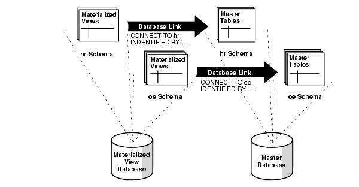

## 37 Planning for Read-Only Materialized Views

Before you begin to plan your read-only materialized view environment, it is important to understand the concepts and architecture related to materialized views. After you understand concepts and architecture of read-only materialized views, there are important considerations for planning a read-only materialized view environment.

- Considerations for Master Tables  
	For master tables, you must consider primary keys, foreign keys, and data types.
- Planning for Master Databases and Materialized View Databases  
	Planning databases in a read-only materialized view environment includes preparing for materialized views and configuring materialized view logs.

**Parent topic:** [Managing Read-Only Materialized Views](managing-read-only-materialized-views.md)

### 37.1 Considerations for Master Tables

For master tables, you must consider primary keys, foreign keys, and data types.

**Parent topic:** Planning for Read-Only Materialized Views

#### 37.1.1 Primary Keys and Master Tables

If possible, each master table should have a primary key.

Where a primary key is not possible, each master table must have a set of columns that can be used as a unique identifier for each row of the table. If the tables that you plan to use in your replication environment do not have a primary key or a set of unique columns, then alter these tables accordingly. In addition, if you plan to create any primary key materialized views based on a master table, then that master must have a primary key.

**Parent topic:** Considerations for Master Tables

#### 37.1.2 Foreign Keys and Master Tables

When replicating tables with foreign key referential constraints, Oracle recommends that you always index foreign key columns and replicate these indexes, unless no updates and deletes are allowed in the parent table. Indexes are not replicated automatically.

**Parent topic:** Considerations for Master Tables

#### 37.1.3 Data Type Considerations for Master Tables

There are several considerations for data types and master tables.

You can create read-only materialized views based on master tables with columns that use the following data types:

- `VARCHAR2`
- `NVARCHAR2`
- `NUMBER`
- `DATE`
- `TIMESTAMP`
- `TIMESTAMP` `WITH` `TIME` `ZONE`
- `TIMESTAMP` `LOCAL` `TIME` `ZONE`
- `INTERVAL` `YEAR` `TO` `MONTH`
- `INTERVAL` `DAY` `TO` `SECOND`
- `RAW`
- `ROWID`
- `CHAR`
- `NCHAR`
- `CLOB` with `BASICFILE` storage
- `NCLOB` with `BASICFILE` storage
- `BLOB` with `BASICFILE` storage
- `XMLType` stored as `CLOB`
- User-defined types that do not use type inheritance or type evolution
- Oracle-supplied types that do not use type inheritance or type evolution

Note:

`XMLType` stored as a `CLOB` is deprecated.

You cannot reference LOB columns in a `WHERE` clause of a materialized view's defining query.

You can create materialized views that use user-defined types, including column objects, object tables, `REF` s, varrays, and nested tables.

You cannot create materialized views based on master tables with columns that use the following data types:

- `FLOAT`
- `BINARY_FLOAT`
- `BINARY_DOUBLE`
- `LONG`
- `LONG` `RAW`
- `CLOB` with `SECUREFILE` storage
- `NCLOB` with `SECUREFILE` storage
- `BLOB` with `SECUREFILE` storage
- `BFILE`
- `XMLType` stored object relationally or as binary XML
- `Expression` type
- User-defined types that use type inheritance or type evolution
- Oracle-supplied types that use type inheritance or type evolution

You should convert `LONG` data types to LOBs with `BASICFILE` storage.

See Also:

[Oracle Database SQL Language Reference](https://docs.oracle.com/pls/topic/lookup?ctx=en/database/oracle/oracle-database/21/admin&id=SQLRF0021) for information about data types

**Parent topic:** Considerations for Master Tables

#### 37.1.4 Unsupported Table Types

Materialized views cannot be based on certain types of tables.

You cannot create materialized views based on these types of tables:

- Tables that have been compressed with the table compression feature
- Tables with virtual columns
- Temporary tables
- Tables in a flashback data archive

**Parent topic:** Considerations for Master Tables

### 37.2 Planning for Master Databases and Materialized View Databases

Planning databases in a read-only materialized view environment includes preparing for materialized views and configuring materialized view logs.

- Characteristics of Master Databases and Materialized View Databases  
	When you are planning your replication environment, you must decide whether the databases participating in the replication environment will be master databases or materialized view databases.
- Advantages of Master Databases  
	Master databases have several advantages.
- Advantages of Materialized View Databases  
	Materialized view databases have certain advantages.
- Preparing for Materialized Views  
	Most problems encountered with materialized view replication result from not preparing the environment properly.
- Creating Materialized View Logs  
	Create a materialized view log on a master table so that materialized views based on the master table can be fast refreshed.
- Logging Columns in a Materialized View Log  
	When you create a materialized view log, you can add columns to the log to enable fast refreshes of materialized views.

**Parent topic:** Planning for Read-Only Materialized Views

#### 37.2.1 Characteristics of Master Databases and Materialized View Databases

When you are planning your replication environment, you must decide whether the databases participating in the replication environment will be master databases or materialized view databases.

Consider the characteristics and advantages of both types of databases when you are deciding whether a particular database in your environment should be a master database or a materialized view database. One replication environment can support both master databases and materialized view databases.

Table 37-1 Characteristics of Master Databases and Materialized View Databases

| Master Databases | Materialized View Databases |
| --- | --- |
| Might communicate with a large number of materialized view databases | Communicate with one master database |
| Contain large amounts of data | Contain small amounts of data that can be subsets of the master database's data |

**Parent topic:** Planning for Master Databases and Materialized View Databases

#### 37.2.2 Advantages of Master Databases

Master databases have several advantages.

Master databases have the following advantages:

- Support for highly available data access by remote databases
- Provide support data manipulation language (DML) changes
- Can provide failover protection

**Parent topic:** Planning for Master Databases and Materialized View Databases

#### 37.2.3 Advantages of Materialized View Databases

Materialized view databases have certain advantages.

Materialized view databases have the following advantages:

- Support disconnected computing
- Can contain a subset of its master database's data

**Parent topic:** Planning for Master Databases and Materialized View Databases

#### 37.2.4 Preparing for Materialized Views

Most problems encountered with materialized view replication result from not preparing the environment properly.

Ensure that the following prerequisites are met before creating your materialized view environment:

- Ensure that the required schemas exist.
- Ensure that the required database links exist.
- Ensure that the required privileges are granted.
- Ensure that the sufficient job processes exit.

- Required Schemas at Materialized View Database  
	A schema containing a materialized view in a remote database must correspond to the schema that contains the master table in the master database.
- Required Database Links for Materialized Views  
	The defining query of a materialized view can use one or more database links to reference remote table data.
- Required Privileges  
	Both the creator and the owner of the materialized view must be able to issue the defining `SELECT` statement of the materialized view.
- Sufficient Job Processes  
	It is important that you have allocated sufficient job processes to handle the automation of your replication environment. The job processes automatically refresh materialized views.

**Parent topic:** Planning for Master Databases and Materialized View Databases

##### 37.2.4.1 Required Schemas at Materialized View Database

A schema containing a materialized view in a remote database must correspond to the schema that contains the master table in the master database.

Therefore, identify the schemas that contain the master tables that you want to replicate with materialized views. After you have identified the target schemas at the master database, create the corresponding accounts with the same names at the remote database. For example, if all master tables are in the `sales` schema of the `ny.example.com` database, then create a corresponding `sales` schema in the materialized view database `sf.example.com`.

See Also:

" [Required Privileges for Materialized View Operations](read-only-materialized-view-concepts.md) "

**Parent topic:** Preparing for Materialized Views

##### 37.2.4.2 Required Database Links for Materialized Views

The defining query of a materialized view can use one or more database links to reference remote table data.

Before creating materialized views, the database links you plan to use must be available. Furthermore, the account that a database link uses to access a remote database defines the security context under which Oracle Database creates and subsequently refreshes a materialized view.

To ensure proper behavior, a materialized view's defining query must use a database link that includes an embedded user name and password in its definition; you cannot use a public database link when creating a materialized view. A database link with an embedded name and password always establishes connections to the remote database using the specified account. Additionally, the remote account that the link uses must have the `SELECT` privileges necessary to access the data referenced in the materialized view's defining query.

Before creating your materialized views, you must create several administrative database links. Specifically, you should create a `PUBLIC` database link from the materialized view database to the master database. Doing so makes defining your private database links easier because you do not need to include the `USING` clause in each link.

For example, the following statement creates a public database link from a materialized view database to a master database:

```
CREATE PUBLIC DATABASE LINK orc1.example.com USING 'orc1.example.com';
```

After the administrative database links have been created, a private database link must be created connecting each replicated materialized view schema at the materialized view database to the corresponding schema at the master database. Be sure to embed the associated master database account information in each private database link at the materialized view database. For example, the `hr` schema at a materialized view database should have a private database link to the master database that connects using the `hr` user name and password.

For example, the following statement creates a private database link from a materialized view database to a master database:

```
CREATE DATABASE LINK orc1.example.com 
   CONNECT TO myuser IDENTIFIED BY password;
```

Figure 37-1 Recommended Schema and Database Link Configuration



> This illustration shows a materialized view database and a master database. The materialized views in the `hr` schema use a private database link to connect to the tables in the `hr` schema at the master database. The database link is shown connecting to the master database in the following way:
>
> ```
> CONNECT TO hr
>   IDENTIFIED BY ...
> ```
>
> The materialized views in the `oe` schema use a private database link to connect to the tables in the `oe` schema at the master database. The database link is shown connecting to the master database in the following way:
>
> ```
> CONNECT TO oe
>   IDENTIFIED BY ...
> ```


The defining query for the materialized view cannot be modified by Virtual Private Database (VPD). VPD must return a `NULL` policy for the schema that performs both the create and refresh of the materialized view. Creating a materialized view with a non- `NULL` VPD policy is allowed when the `USING` `TRUSTED` `CONSTRAINTS` clause is specified. In this case, ensure that the materialized view behaves correctly. Materialized view results are computed based on the rows and columns filtered by VPD policy. Therefore, you must coordinate the materialized view definition with the VPD policy to ensure the correct results.

See Also:

- [Distributed Database Concepts](distributed-database-concepts.md) for more information about database links
- [Oracle Database Security Guide](https://docs.oracle.com/pls/topic/lookup?ctx=en/database/oracle/oracle-database/21/admin&id=DBSEG007) for more information about VPD
- [Oracle Label Security Administrator's Guide](https://docs.oracle.com/pls/topic/lookup?ctx=en/database/oracle/oracle-database/21/admin&id=OLSAG086) for information about Oracle Label Security

**Parent topic:** Preparing for Materialized Views

##### 37.2.4.3 Required Privileges

Both the creator and the owner of the materialized view must be able to issue the defining `SELECT` statement of the materialized view.

The owner is the schema that contains the materialized view.

See Also:

" [Required Privileges for Materialized View Operations](read-only-materialized-view-concepts.md) "

**Parent topic:** Preparing for Materialized Views

##### 37.2.4.4 Sufficient Job Processes

It is important that you have allocated sufficient job processes to handle the automation of your replication environment. The job processes automatically refresh materialized views.

By the nature of materialized view replication, each materialized view database typically has one scheduled link to the master database and requires at least one job process. Materialized view databases typically require between one and three job processes, depending on user-defined jobs and the scheduled link. Also, you need at least one job process for each degree of parallelism.

Alternatively, if your users are responsible for manually refreshing the materialized view through an application interface, then you do not need to create a scheduled link and your materialized view database requires one less job process.

The job processes are defined using the `JOB_QUEUE_PROCESSES` initialization parameter. This initialization parameter is modifiable. Therefore, you can modify it while an instance is running. Oracle Database automatically determines the interval for job processes. That is, Oracle Database determines when the job processes should "wake up" to execute jobs.

See Also:

[Oracle Database Reference](https://docs.oracle.com/pls/topic/lookup?ctx=en/database/oracle/oracle-database/21/admin&id=REFRN10077)

**Parent topic:** Preparing for Materialized Views

#### 37.2.5 Creating Materialized View Logs

Create a materialized view log on a master table so that materialized views based on the master table can be fast refreshed.

Before creating materialized views for a remote materialized view database, ensure that you create the necessary materialized view logs at the master database. A materialized view log is necessary for every master table that supports at least one materialized view with fast refreshes.

To create a materialized view log, you need the following privileges:

- `CREATE` `ANY` `TABLE`
- `CREATE` `ANY` `TRIGGER`
- `SELECT` (on the materialized view log's master table)
- `COMMENT` `ANY` `TABLE`

To create a materialized view log:

1. Connect to the master database as a user with the required privileges to create a materialized view log on the intended table.
2. Run the `CREATE MATERIALIZED VIEW LOG` statement.
	When you create a materialized view log on an object table, you must log the object identifier by specifying the `WITH` `OBJECT` `ID` clause, but you can also specify that the primary key is logged if the object identifier is primary key-based.

Example 37-1 Creating a Materialized View Log

```
CREATE MATERIALIZED VIEW LOG ON hr.employees;
```

Example 37-2 Creating a Materialized View Log on an Object Table

The following SQL statement creates the `categories_typ` user-defined type:

```
CREATE TYPE oe.category_typ AS OBJECT
   (category_name           VARCHAR2(50), 
    category_description    VARCHAR2(1000), 
    category_id             NUMBER(2));
/
```

When you create an object table based on this type, you can either specify that the object identifier should be system-generated or primary key-based:

```
CREATE TABLE oe.categories_tab_sys OF oe.category_typ 
    (category_id    PRIMARY KEY)
    OBJECT ID SYSTEM GENERATED;

CREATE TABLE oe.categories_tab_pkbased OF oe.category_typ 
    (category_id    PRIMARY KEY)
    OBJECT ID PRIMARY KEY;
```

For example, the following statement creates a materialized view log for the `categories_tab_sys` object table and specifies that the object identifier column be logged:

```
CREATE MATERIALIZED VIEW LOG ON oe.categories_tab_sys
   WITH OBJECT ID;
```

The following statement creates a materialized view log for the `categories_tab_pkbased` object table and specifies that the primary key column be logged along with the object identifier column:

```
CREATE MATERIALIZED VIEW LOG ON oe.categories_tab_pkbased
   WITH OBJECT ID, PRIMARY KEY;
```

See Also:

- " [Materialized View Log](read-only-materialized-view-architecture.md) "
- [Oracle Database SQL Language Reference](https://docs.oracle.com/pls/topic/lookup?ctx=en/database/oracle/oracle-database/21/admin&id=SQLRF01303)

**Parent topic:** Planning for Master Databases and Materialized View Databases

#### 37.2.6 Logging Columns in a Materialized View Log

When you create a materialized view log, you can add columns to the log to enable fast refreshes of materialized views.

1. Connect to the master database as a user with the required privileges to create or alter a materialized view log on the intended table.
2. Do one of the following:
	- Run the `CREATE MATERIALIZED VIEW LOG` statement and specify the columns to log.
	- Run the `ALTER MATERIALIZED VIEW LOG` statement and specify the columns to log.

Example 37-3 Logging Columns When Creating a Materialized View

To create the materialized view log on the `oe.orders` table with the `orders.customer_id` and `orders.order_total` columns added, issue the following statement:

```
CREATE MATERIALIZED VIEW LOG ON oe.orders 
  WITH PRIMARY KEY (customer_id,order_total);
```

Example 37-4 Logging Columns of an Existing Materialized View

You can add the `orders.customer_id` and `orders.order_total` columns to the materialized view log on the `oe.orders` table by issuing the following statement:

```
ALTER MATERIALIZED VIEW LOG ON oe.orders ADD (customer_id,order_total);
```

Example 37-5 Logging the Attributes of Column Objects

If you are using user-defined data types, then the attributes of column objects can be logged in the materialized view log. For example, the `oe.customers` table has the `cust_address.postal_code` attribute, which can be logged in the materialized view log by issuing the following statement:

```
ALTER MATERIALIZED VIEW LOG ON oe.customers ADD (cust_address.postal_code);
```

See Also:

- " [Columns Logged in the Materialized View Log](read-only-materialized-view-architecture.md) "
- [Oracle Database SQL Language Reference](https://docs.oracle.com/pls/topic/lookup?ctx=en/database/oracle/oracle-database/21/admin&id=SQLRF01303)

**Parent topic:** Planning for Master Databases and Materialized View Databases