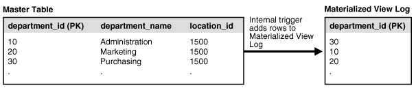

## 36 Read-Only Materialized View Architecture

Several objects are used in materialized view replication. Some of these objects are optional and are used only as needed to support the created materialized view environment. For example, if you have a complex materialized view that cannot be fast refreshed, then you might not have a materialized view log at the master database.

**Parent topic:** [Managing Read-Only Materialized Views](managing-read-only-materialized-views.md)

### 36.1 Master Database Mechanisms

There are mechanisms that support materialized views at the master database.

- Master Database Objects  
	Specific database objects are required at a master database to support fast refreshing of materialized views.
- Master Table  
	The master table is the basis for the materialized view.
- Internal Trigger for the Materialized View Log  
	When changes are made to the master table using DML, an internal trigger records information about the affected rows in the materialized view log.
- Materialized View Logs  
	Materialized view logs enable fast refreshes of materialized views.

**Parent topic:** Read-Only Materialized View Architecture

#### 36.1.1 Master Database Objects

Specific database objects are required at a master database to support fast refreshing of materialized views.

The three database objects displayed in Figure 36-1 are required at a master database to support fast refreshing of materialized views.

Figure 36-1 Master Database Objects



> This illustration shows the following mechanisms:
>
> - Master table
> - Internal trigger for the materialized view log
> - Materialized view log
>
> The internal trigger adds rows to the materialized view log.
>
> [  
> Copyright © 1996, 2025, Oracle and/or its affiliates.](https://docs.oracle.com/en/database/oracle/oracle-database/dcommon/html/cpyr.htm)


**Parent topic:** Master Database Mechanisms

#### 36.1.2 Master Table

The master table is the basis for the materialized view.

A master table is located at the target master database. Remember that a materialized view points to only one master database. Data manipulation language (DML) changes made to the master table, as recorded by the materialized view log, are propagated to the materialized view during the refresh process.

Note:

Fast refreshable materialized views must be based on master tables or synonyms of master tables. Complete refresh must be used for a materialized view based on a view.

**Parent topic:** Master Database Mechanisms

#### 36.1.3 Internal Trigger for the Materialized View Log

When changes are made to the master table using DML, an internal trigger records information about the affected rows in the materialized view log.

This information includes the values of the primary key, rowid, or object id, or both, as well as the values of the other columns logged in the materialized view log. This is an internal `AFTER` `ROW` trigger that is automatically activated when you create a materialized view log for the target master table. It inserts a row into the materialized view log whenever an `INSERT`, `UPDATE`, or `DELETE` statement modifies the table's data. This trigger is always the last trigger to fire.

Note:

When the materialized view contains a subquery, you might need to log columns referenced in a subquery. See " [Data Subsetting with Materialized Views](read-only-materialized-view-concepts.md) " for information about subquery materialized views and " [Logging Columns in a Materialized View Log](planning-for-read-only-materialized-views.md) " for more information about the columns that must be logged.

**Parent topic:** Master Database Mechanisms

#### 36.1.4 Materialized View Logs

Materialized view logs enable fast refreshes of materialized views.

- About Materialized View Logs  
	A materialized view log is required on a master table to perform a fast refresh on materialized views based on the master table.
- Columns Logged in the Materialized View Log  
	When you create a materialized view log, you can add columns to the log when necessary.
- Restriction on Import of Materialized View Logs to a Different Schema  
	Materialized view logs are exported with the schema name explicitly given in the DDL statements. Therefore, materialized view logs cannot be imported into a schema that is different than the schema from which they were exported.

**Parent topic:** Master Database Mechanisms

##### 36.1.4.1 About Materialized View Logs

A materialized view log is required on a master table to perform a fast refresh on materialized views based on the master table.

When you create a materialized view log for a master table, Oracle Database creates an underlying table as the materialized view log. A materialized view log can hold the primary keys, rowids, or object identifiers of rows that have been updated in the master table. A materialized view log can also contain other columns to support fast refreshes of materialized views with subqueries.

The name of a materialized view log's table is `MLOG$_` master\_table\_name. The materialized view log is created in the same schema as the target master table. One materialized view log can support multiple materialized views on its master table. As described in the previous section, the internal trigger adds change information to the materialized view log whenever a DML transaction has taken place on the target master table.

Following are the types of materialized view logs:

- Primary Key: The materialized view records changes to the master table based on the primary key of the affected rows.
- Row ID: The materialized view records changes to the master table based on the rowid of the affected rows.
- Object ID: The materialized view records changes to the master object table based on the object identifier of the affected row objects.
- Combination: The materialized view records changes to the master table based any combination of the three options. It is possible to record changes based on the primary key, the `ROWID`, and the object identifier of the affected rows. Such a materialized view log supports primary key, `ROWID`, and object materialized views, which is helpful for environments that have all three types of materialized views based on a master table.

A combination materialized view log works in the same manner as a materialized view log that tracks only one type of value, except that more than one type of value is recorded. For example, a combination materialized view log can track both the primary key and the rowid of the affected row.

Though the difference between materialized view logs based on primary keys and rowids is small (one records affected rows using the primary key, while the other records affected rows using the physical rowid), the practical impact is large. Using rowid materialized views and materialized view logs makes reorganizing and truncating your master tables difficult because it prevents your `ROWID` materialized views from being fast refreshed. If you reorganize or truncate your master table, then your rowid materialized view must be `COMPLETE` refreshed because the rowids of the master table have changed.

Note:

- You use the `BEGIN_TABLE_REORGANIZATION` and `END_TABLE_REORGANIZATION` procedures in the `DBMS_MVIEW` package to reorganize a master table. See the [Oracle Database PL/SQL Packages and Types Reference](https://docs.oracle.com/pls/topic/lookup?ctx=en/database/oracle/oracle-database/21/admin&id=ARPLS027) for more information.
- Online redefinition of tables is another possible way to reorganize master tables, but online redefinition is not allowed on master tables with materialized view logs and materialized views. Online redefinition is allowed on master tables that do not have materialized view logs. See " [Redefining Tables Online](managing-tables.md) ".

See Also:

" [Creating Materialized View Logs](planning-for-read-only-materialized-views.md) "

**Parent topic:** Materialized View Logs

##### 36.1.4.2 Columns Logged in the Materialized View Log

When you create a materialized view log, you can add columns to the log when necessary.

To perform a fast refresh on a materialized view, the following types of columns must be added to the materialized view log:

- A column referenced in the `WHERE` clause of a subquery that is not part of an equi-join and is not a primary key column. These columns are called filter columns.
- A column in an equi-join that is not a primary key column, if the subquery is either many to many or one to many. If the subquery is many to one, then you do not need to add the join column to the materialized view log.

A collection column cannot be added to a materialized view log. Also, materialized view logs are not required for materialized views that use complete refresh.

For example, consider the following DDL:

```
1) CREATE MATERIALIZED VIEW oe.customers REFRESH FAST AS
2)  SELECT * FROM oe.customers@orc1.example.com c
3)  WHERE EXISTS
4)    (SELECT * FROM oe.orders@orc1.example.com o
5)     WHERE c.customer_id = o.customer_id AND o.order_total > 20000);
```

Notice in line 5 of the preceding DDL that three columns are referenced in the `WHERE` clause. Columns `orders.customer_id` and `customers.customer_id` are referenced as part of the equi-join clause. Because `customers.customer_id` is a primary key column, it is logged by default, but `orders.customer_id` is not a primary key column and so must be added to the materialized view log. Also, the column `orders.order_total` is an additional filter column and so must be logged.

Therefore, add `orders.customer_id` and `orders.order_total` the materialized view log for the `oe.orders` table.

You are encouraged to analyze the defining queries of your planned materialized views and identify which columns must be added to your materialized view logs. If you try to create or refresh a materialized view that requires an added column without adding the column to the materialized view log, then your materialized view creation or refresh might fail.

Note:

To perform a fast refresh on a materialized view, you must add join columns in subqueries to the materialized view log if the join column is not a primary key and the subquery is either many to many or one to many. If the subquery is many to one, then you do not need to add the join column to the materialized view log.

See Also:

- " [Creating Materialized View Logs](planning-for-read-only-materialized-views.md) " for information about creating a materialized view log
- " [Logging Columns in a Materialized View Log](planning-for-read-only-materialized-views.md) "
- " [Data Subsetting with Materialized Views](read-only-materialized-view-concepts.md) " for information about materialized views with subqueries
- " [Restrictions for Materialized Views with Subqueries](read-only-materialized-view-concepts.md) " for additional information about materialized views with subqueries

**Parent topic:** Materialized View Logs

##### 36.1.4.3 Restriction on Import of Materialized View Logs to a Different Schema

Materialized view logs are exported with the schema name explicitly given in the DDL statements. Therefore, materialized view logs cannot be imported into a schema that is different than the schema from which they were exported.

An error is written to the import log file and the items are not imported if you attempt an import using the Data Pump Import utility that specifies the `REMAP_SCHEMA` import parameter to import an export dump file that contains materialized view logs in the specified schema.

**Parent topic:** Materialized View Logs

### 36.2 Materialized View Database Mechanisms

When a materialized view is created, additional mechanisms are created at the materialized view database to support the materialized view. Specifically, at least one index is created.

Note:

The size limit for a materialized view name is 30 bytes. If you try to create a materialized view with a name larger than 30 bytes, Oracle Database returns an error.

- Indexes for Materialized Views  
	At least one index is created at the remote materialized view database for each primary key and `ROWID` materialized view.

**Parent topic:** Read-Only Materialized View Architecture

#### 36.2.1 Indexes for Materialized Views

At least one index is created at the remote materialized view database for each primary key and `ROWID` materialized view.

For a primary key materialized view, the index corresponds to the primary key of the target master table and includes `_PK` in its name. A number is appended if an index with the same name already exists at the materialized view database. For a `ROWID` materialized view, the index is on the `ROWID` column and includes `I_SNAP$_` in its name. Additional indexes can be created by Oracle Database at the remote materialized view database to support fast refreshing of materialized views with subqueries.

**Parent topic:** Materialized View Database Mechanisms

### 36.3 Organizational Mechanisms

Several mechanisms organize the materialized views at the materialized view database. These mechanisms maintain organizational consistency between the materialized view database and its master database.

- Refresh Groups  
	To preserve referential integrity and transactional (read) consistency among multiple materialized views, Oracle Database can refresh individual materialized views as part of a refresh group.
- Refresh Group Size  
	There are a few trade-offs to consider when you are deciding on the size of your refresh groups.

**Parent topic:** Read-Only Materialized View Architecture

#### 36.3.1 Refresh Groups

To preserve referential integrity and transactional (read) consistency among multiple materialized views, Oracle Database can refresh individual materialized views as part of a refresh group.

After refreshing all of the materialized views in a refresh group, the data of all materialized views in the group correspond to the same transactionally consistent point in time.

**Parent topic:** Organizational Mechanisms

#### 36.3.2 Refresh Group Size

There are a few trade-offs to consider when you are deciding on the size of your refresh groups.

Oracle Database is optimized for large refresh groups. So, large refresh groups refresh faster than an equal number of materialized views in small refresh groups, if the materialized views in the groups are similar. For example, refreshing a refresh group with 100 materialized views is faster than refreshing five refresh groups with 20 materialized views each. Also, large refresh groups enable you to refresh a greater number of materialized views with only one call to a PL/SQL subprogram.

Network connectivity must be maintained while performing a refresh. If the connectivity is lost or interrupted during the refresh, then all changes are rolled back so that the database remains consistent. Therefore, in cases where the network connectivity is difficult to maintain, consider using smaller refresh groups.

There is also an optimization for null refresh. That is, if there were no changes to the master tables since the last refresh for a particular materialized view, then almost no extra time is required for the materialized view during refresh.

**Parent topic:** Organizational Mechanisms

### 36.4 Refresh Process

To ensure that a materialized view is consistent with its master table, you must refresh the materialized view periodically.

- About the Refresh Process  
	A **materialized view refresh** is an efficient batch operation that makes a materialized view reflect a more current state of its master table.
- Refresh Types  
	Oracle Database can refresh a materialized view using either a fast, complete, or force refresh.
- Initiating a Refresh  
	When creating a refresh group, you can configure the group so that Oracle Database automatically refreshes the group's materialized views at scheduled intervals. Conversely, you can omit scheduling information so that the refresh group must be refreshed manually or "on-demand." Manual refresh is an ideal solution when the refresh is performed on a system that does not always have a network connection.
- Constraints and Refresh  
	To avoid any integrity constraint violations during refresh of materialized views, make non primary key integrity constraints on each materialized view deferrable.

**Parent topic:** Read-Only Materialized View Architecture

#### 36.4.1 About the Refresh Process

A **materialized view refresh** is an efficient batch operation that makes a materialized view reflect a more current state of its master table.

A materialized view's data does not necessarily match the current data of its master table at all times. A materialized view is a transactionally (read) consistent reflection of its master table as the data existed at a specific point in time (that is, at creation or when a refresh occurs). To keep a materialized view's data relatively current with the data of its master table, the materialized view must be refreshed periodically.

A row in a master table can be updated many times between refreshes of a materialized view, but the refresh updates the row in the materialized view only once with the current data. For example, a row in a master table might be updated 10 times since the last refresh of a materialized view, but the result is still only one update of the corresponding row in the materialized view during the next refresh.

Decide how and when to refresh each materialized view to make it more current. For example, materialized views based on master tables that applications update often might require frequent refreshes. In contrast, materialized views based on relatively static master tables usually require infrequent refreshes. In summary, analyze application characteristics and requirements to determine appropriate materialized view refresh intervals.

To refresh materialized views, Oracle Database supports several refresh types and methods of initiating a refresh.

**Parent topic:** Refresh Process

#### 36.4.2 Refresh Types

Oracle Database can refresh a materialized view using either a fast, complete, or force refresh.

- Complete Refresh  
	To perform a **complete refresh** of a materialized view, the server that manages the materialized view executes the materialized view's defining query, which essentially re-creates the materialized view.
- Fast Refresh  
	To perform a **fast refresh**, the master table that manages the materialized view first identifies the changes that occurred in the master table since the most recent refresh of the materialized view and then applies these changes to the materialized view.
- Force Refresh  
	To perform a **force refresh** of a materialized view, the server that manages the materialized view attempts to perform a fast refresh. If a fast refresh is not possible, then Oracle Database performs a complete refresh.

**Parent topic:** Refresh Process

##### 36.4.2.1 Complete Refresh

To perform a **complete refresh** of a materialized view, the server that manages the materialized view executes the materialized view's defining query, which essentially re-creates the materialized view.

To refresh the materialized view, the result set of the query replaces the existing materialized view data. Oracle Database can perform a complete refresh for any materialized view. Depending on the amount of data that satisfies the defining query, a complete refresh can take a substantially longer amount of time to perform than a fast refresh.

Note:

If complete refresh is used for a materialized view, then set its `PCTFREE` to `0` and `PCTUSED` to `99` for maximum efficiency.

**Parent topic:** Refresh Types

##### 36.4.2.2 Fast Refresh

To perform a **fast refresh**, the master table that manages the materialized view first identifies the changes that occurred in the master table since the most recent refresh of the materialized view and then applies these changes to the materialized view.

Fast refreshes are more efficient than complete refreshes when there are few changes to the master table because the participating server and network replicate a smaller amount of data. You can perform fast refreshes of materialized views only when the master table has a materialized view log. Also, for fast refreshes to be faster than complete refreshes, each join column in the `CREATE` `MATERIALIZED` `VIEW` statement must have an index on it.

After a direct path load on a master table using SQL\*Loader, a fast refresh does not apply the changes that occurred during the direct path load. Also, fast refresh does not apply changes that result from other types of bulk load operations on master tables. Examples of these operations include `INSERT` statements with an `APPEND` hint and `INSERT` `...` `SELECT` `*` `FROM` statements.

If you have materialized views based on partitioned master tables, then you might be able to use Partition Change Tracking (PCT) to identify which materialized view rows correspond to a particular partition. PCT is also used to support fast refresh after partition maintenance operations on a materialized view's master table. PCT-based refresh on a materialized view is possible only if several conditions are satisfied.

See Also:

[Oracle Database Data Warehousing Guide](https://docs.oracle.com/pls/topic/lookup?ctx=en/database/oracle/oracle-database/21/admin&id=DWHSG009) for information about PCT and about PCT-based refresh

**Parent topic:** Refresh Types

##### 36.4.2.3 Force Refresh

To perform a **force refresh** of a materialized view, the server that manages the materialized view attempts to perform a fast refresh. If a fast refresh is not possible, then Oracle Database performs a complete refresh.

Use the force setting when you want a materialized view to refresh if a fast refresh is not possible.

**Parent topic:** Refresh Types

#### 36.4.3 Initiating a Refresh

When creating a refresh group, you can configure the group so that Oracle Database automatically refreshes the group's materialized views at scheduled intervals. Conversely, you can omit scheduling information so that the refresh group must be refreshed manually or "on-demand." Manual refresh is an ideal solution when the refresh is performed on a system that does not always have a network connection.

- Scheduled Refresh  
	When you create a refresh group for automatic refreshing, you must specify a scheduled refresh interval for the group during the creation process.
- On-Demand Refresh  
	On-demand refresh means that the materialized view is refreshed with an explicit procedure call.

**Parent topic:** Refresh Process

##### 36.4.3.1 Scheduled Refresh

When you create a refresh group for automatic refreshing, you must specify a scheduled refresh interval for the group during the creation process.

When setting a group's refresh interval, consider the following characteristics:

- The dates or date expressions specifying the refresh interval must evaluate to a future point in time.
- The refresh interval must be greater than the length of time necessary to perform a refresh.
- Relative date expressions evaluate to a point in time relative to the most recent refresh date. If a network or system failure interferes with a scheduled group refresh, then the evaluation of a relative date expression could change accordingly.
- Explicit date expressions evaluate to specific points in time, regardless of the most recent refresh date.
- Consider your environment's tolerance for stale data: if there is a low tolerance, then refresh often; whereas if there is a high tolerance, then refresh less often.

The following are examples of simple date expressions that you can use to specify an interval:

- An interval of one hour is specifies as:
	```
	SYSDATE + 1/24
	```
- An interval of seven days is specifies as:
	```
	SYSDATE + 7
	```

See Also:

[Oracle Database SQL Language Reference](https://docs.oracle.com/pls/topic/lookup?ctx=en/database/oracle/oracle-database/21/admin&id=SQLRF-GUID-E405BBC7-DA9A-4DF2-9F22-E60CB9EC0705) for more information about date arithmetic

**Parent topic:** Initiating a Refresh

##### 36.4.3.2 On-Demand Refresh

On-demand refresh means that the materialized view is refreshed with an explicit procedure call.

Scheduled materialized view refreshes might not always be the appropriate solution for your environment. For example, immediately following a bulk data load into a master table, dependent materialized views no longer represent the master table's data.

You might also want to refresh your materialized views on-demand when your materialized views are integrated with a sales force automation system located on a disconnected laptop. Developers designing the sales force automation software can create an application control, such as a button, that a salesperson can use to refresh the materialized views when they are ready to transfer the day's orders to the server after establishing a network connection.

The following example illustrates an on-demand refresh of the `hr_refg` refresh group:

```
EXECUTE DBMS_REFRESH.REFRESH('hr_refg');
```

Note:

Do not use the `DBMS_MVIEW.REFRESH_ALL_MVIEWS` or the `DBMS_MVIEW.REFRESH_DEPENDENT` procedure to refresh materialized views used in a replication environment. Instead, use the `DBMS_REFRESH.REFRESH` or the `DBMS_MVIEW.REFRESH` procedure to refresh materialized views in a replication environment.

**Parent topic:** Initiating a Refresh

#### 36.4.4 Constraints and Refresh

To avoid any integrity constraint violations during refresh of materialized views, make non primary key integrity constraints on each materialized view deferrable.

This requirement includes LOB columns with `NOT` `NULL` constraints. In addition, all materialized views that are related by foreign key constraints should be refreshed together or in the same refresh group.

Note:

Primary key constraints on materialized views might or might not be deferrable.

See Also:

[Oracle Database SQL Language Reference](https://docs.oracle.com/pls/topic/lookup?ctx=en/database/oracle/oracle-database/21/admin&id=SQLRF52180) for information about making constraints deferrable

**Parent topic:** Refresh Process