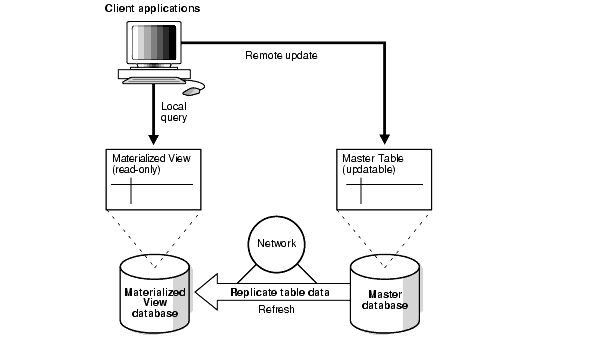
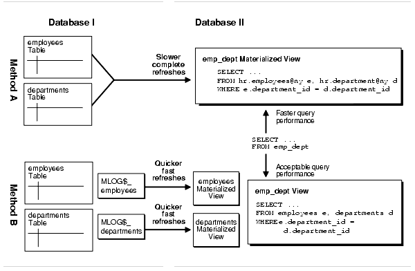
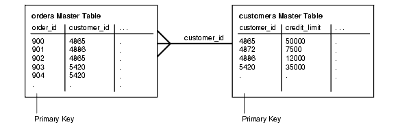
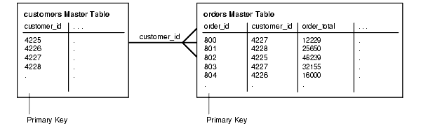
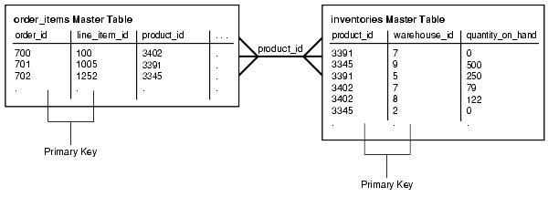
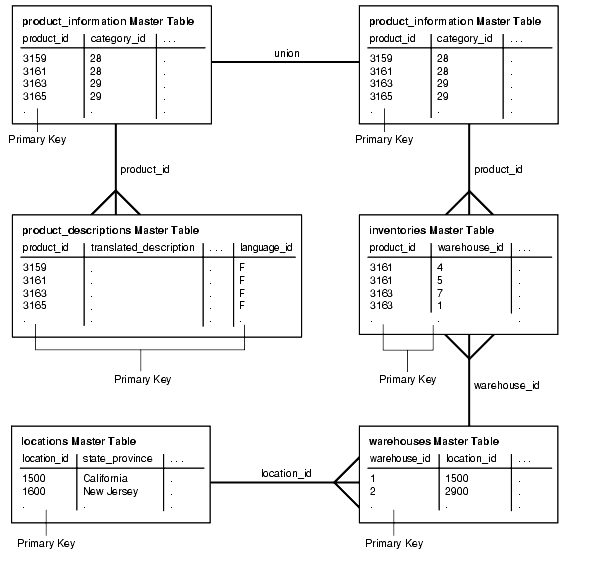

## 35 Read-Only Materialized View Concepts

Understand the concepts related to read-only materialized views.

- Replication Databases  
	**Replication** is the process of copying and maintaining database objects, such as tables, in multiple databases that comprise a distributed database system. One method that supports replication is read-only materialized views.
- Read-Only Materialized Views  
	A read-only materialized view contains a complete or partial copy of a target master table from a single point in time. A partial copy can include a subset of row, a subset of columns, or both.
- The Uses of Materialized Views  
	You can use materialized views to achieve goals such as easing network loads, enabling data subsetting, and enabling disconnected computing.
- Available Materialized Views  
	Available materialized views include primary key materialized views, object materialized views, `ROWID` materialized views, and complex materialized views.
- Users and Privileges Related to Materialized Views  
	The users related to materialized views include the creator, the refresher, and the owner. The privileges required to perform operations on materialized views depend on the type of user performing the operation.
- Data Subsetting with Materialized Views  
	You can use row subsetting and column subsetting to configure materialized views reflect a subset of the data in the master table.
- Materialized View Refresh  
	To ensure that a materialized view is consistent with its master table, you must **refresh** the materialized view periodically.
- Refresh Groups  
	When it is important for materialized views to be transactionally consistent with each other, you can organize them into **refresh groups**.
- Materialized View Log  
	A **materialized view log** is a table at the database that contains materialized view's master table. It records all of the DML changes to the master table.
- Materialized Views and User-Defined Data Types  
	There are special considerations for materialized views with user-defined data types.
- Materialized View Registration at a Master Database  
	At the master database, an Oracle Database automatically registers information about a materialized view based on its master table(s).

**Parent topic:** [Managing Read-Only Materialized Views](managing-read-only-materialized-views.md)

### 35.1 Replication Databases

**Replication** is the process of copying and maintaining database objects, such as tables, in multiple databases that comprise a distributed database system. One method that supports replication is read-only materialized views.

Replication environments support two basic types of databases: **master databases** and **materialized view databases**. Materialized view databases contain an image, or materialized view, of the table data from a certain point in time. The table on which a materialized view is defined is the master table for the materialized view. Typically, a materialized view is refreshed periodically to synchronize it with its master table.

You can organize materialized views into **refresh groups**. Materialized views in a refresh group are refreshed at the same time to ensure that the data in all materialized views in the refresh group correspond to the same transactionally consistent point in time.

Note:

Oracle GoldenGate is Oracle’s full-featured solution for replication. See the Oracle GoldenGate documentation for more information.

**Parent topic:** Read-Only Materialized View Concepts

### 35.2 Read-Only Materialized Views

A read-only materialized view contains a complete or partial copy of a target master table from a single point in time. A partial copy can include a subset of row, a subset of columns, or both.

Read-only materialized views can provide read-only access to the master table's data. Applications can query data from read-only materialized views to avoid network access to the master database, regardless of network availability. However, applications throughout the system must access data at the master database to perform data manipulation language changes (DML). Figure 35-1 illustrates basic, read-only replication.

Figure 35-1 Read-Only Materialized View



> This illustration shows that client applications can query a read-only materialized view at the materialized view database. These applications can update data at the master. The materialized view is updated with the changes at the master when the materialized view refreshes.
>
> [  
> Copyright © 1996, 2025, Oracle and/or its affiliates.](https://docs.oracle.com/en/database/oracle/oracle-database/dcommon/html/cpyr.htm)


Materialized views provide the following benefits:

- Enable local access, which improves response times and availability
- When the materialized view is in a different database than its source, offload queries from the master database, because users can query the local materialized view instead
- Increase data security by enabling you to replicate only a selected subset of the target master's data set

Users can synchronize (refresh) read-only materialized views on demand. When users refresh read-only materialized views, they receive any changes that happened on the master table since the last refresh.

**Parent topic:** Read-Only Materialized View Concepts

### 35.3 The Uses of Materialized Views

You can use materialized views to achieve goals such as easing network loads, enabling data subsetting, and enabling disconnected computing.

**Parent topic:** Read-Only Materialized View Concepts

#### 35.3.1 Ease Network Loads

If one of your goals is to reduce network loads, then you can use materialized views to distribute your corporate database to regional databases.

Instead of the entire company accessing a single database server, user load is distributed across multiple database servers. To decrease the amount of data that is replicated, a materialized view can be a subset of a master table.

**Parent topic:** The Uses of Materialized Views

#### 35.3.2 Enable Data Subsetting

Materialized views enable you to replicate data based on column- and row-level subsetting.

Data subsetting enables you to replicate information that pertains only to a particular database. For example, if you have a regional sales office, then you might replicate only the data that is needed in that region, thereby cutting down on unnecessary network traffic.

Both row and column subsetting enable you to create materialized views that contain a partial copy of the data at a master table. Row subsetting enables you to include only the rows that are needed from the masters in the materialized views by using a `WHERE` clause. Column subsetting enables you to include only the columns that are needed from the masters in the materialized views. You do this by specifying particular columns in the `SELECT` statement during materialized view creation.

**Parent topic:** The Uses of Materialized Views

#### 35.3.3 Enable Disconnected Computing

Materialized views do not require a dedicated network connection.

Though you have the option of automating the refresh process by scheduling a job, you can manually refresh your materialized view on-demand, which is an ideal solution for queries running on a laptop computer.

**Parent topic:** The Uses of Materialized Views

### 35.4 Available Materialized Views

Available materialized views include primary key materialized views, object materialized views, `ROWID` materialized views, and complex materialized views.

- About the Available Materialized Views  
	Oracle offers several types of read-only materialized views to meet the needs of many different replication (and nonreplication) situations.
- Primary Key Materialized Views  
	Primary key materialized views are the default type of materialized view.
- Object Materialized Views  
	If a materialized view is based on an object table and is created using the `OF` type clause, then the materialized view is called an object materialized view.
- ROWID Materialized Views  
	A `ROWID` materialized view is based on the physical row identifiers (rowids) of the rows in a master table.
- Complex Materialized Views  
	Complex materialized views cannot be fast refreshed.

**Parent topic:** Read-Only Materialized View Concepts

#### 35.4.1 About the Available Materialized Views

Oracle offers several types of read-only materialized views to meet the needs of many different replication (and nonreplication) situations.

Whenever you create a materialized view, regardless of its type, always specify the schema name of the table owner in the query for the materialized view. For example, consider the following `CREATE` `MATERIALIZED` `VIEW` statement:

```
CREATE MATERIALIZED VIEW hr.employees
  AS SELECT * FROM hr.employees@orc1.example.com;
```

Here, the schema `hr` is specified in the query.

**Parent topic:** Available Materialized Views

#### 35.4.2 Primary Key Materialized Views

Primary key materialized views are the default type of materialized view.

The following is an example of a SQL statement for creating a primary key materialized view:

```
CREATE MATERIALIZED VIEW oe.customers WITH PRIMARY KEY 
  AS SELECT * FROM oe.customers@orc1.example.com;
```

Because primary key materialized views are the default, the following statement also results in a primary key materialized view:

```
CREATE MATERIALIZED VIEW oe.customers 
  AS SELECT * FROM oe.customers@orc1.example.com;
```

Primary key materialized views can contain a subquery so that you can create a subset of rows at the remote materialized view database. A subquery is a query imbedded within the primary query, so that you have multiple `SELECT` statements in the `CREATE` `MATERIALIZED` `VIEW` statement. This subquery can be as simple as a basic `WHERE` clause or as complex as a multilevel `WHERE` `EXISTS` clause. Primary key materialized views that contain a selected class of subqueries can still be incrementally (or fast) refreshed, if each master referenced has a materialized view log. A fast refresh uses materialized view logs to update only the rows that have changed since the last refresh.

The following materialized view is created with a `WHERE` clause containing a subquery:

```
CREATE MATERIALIZED VIEW oe.orders REFRESH FAST AS
 SELECT * FROM oe.orders@orc1.example.com o
 WHERE EXISTS
   (SELECT * FROM oe.customers@orc1.example.com c
    WHERE o.customer_id = c.customer_id AND c.credit_limit > 10000);
```

This type of materialized view is called a subquery materialized view.

Note:

To create this `oe.orders` materialized view, `credit_limit` must be logged in the master table's materialized view log. See " [Logging Columns in a Materialized View Log](planning-for-read-only-materialized-views.md) " for more information.

See Also:

- " Materialized Views with Subqueries " for more information about materialized views with subqueries
- " [Refresh Types](read-only-materialized-view-architecture.md) " for more information about fast refresh
- " [Materialized View Log](read-only-materialized-view-architecture.md) " for more information about materialized view logs
- [Oracle Database SQL Language Reference](https://docs.oracle.com/pls/topic/lookup?ctx=en/database/oracle/oracle-database/21/admin&id=SQLRF007) for more information about subqueries

**Parent topic:** Available Materialized Views

#### 35.4.3 Object Materialized Views

If a materialized view is based on an object table and is created using the `OF` type clause, then the materialized view is called an object materialized view.

An object materialized view is structured in the same way as an object table. That is, an object materialized view is composed of row objects, and each row object is identified by an object identifier (OID) column.

See Also:

- " Materialized Views Based on Object Tables "
- " [Creating Read-Only Materialized Views](creating-and-managing-read-only-materialized-views.md) " for an example that creates an object materialized view

**Parent topic:** Available Materialized Views

#### 35.4.4 ROWID Materialized Views

A `ROWID` materialized view is based on the physical row identifiers (rowids) of the rows in a master table.

`ROWID` materialized views can be used for materialized views based on master tables that do not have a primary key, or for materialized views that do not include all primary key columns of the master tables.

The following is an example of a `CREATE` `MATERIALIZED` `VIEW` statement that creates a `ROWID` materialized view:

```
CREATE MATERIALIZED VIEW oe.orders REFRESH WITH ROWID AS
 SELECT * FROM oe.orders@orc1.example.com;
```

See Also:

- " [Materialized View Log](read-only-materialized-view-architecture.md) " for more information about the differences between a `ROWID` and primary key materialized view
- [Oracle Database SQL Language Reference](https://docs.oracle.com/pls/topic/lookup?ctx=en/database/oracle/oracle-database/21/admin&id=SQLRF01302) for more information about the `WITH` `ROWID` clause in the `CREATE` `MATERIALIZED` `VIEW` statement

**Parent topic:** Available Materialized Views

#### 35.4.5 Complex Materialized Views

Complex materialized views cannot be fast refreshed.

- About Complex Materialized Views  
	To be fast refreshed, the defining query for a materialized view must observe certain restrictions.
- A Comparison of Simple and Complex Materialized Views  
	For certain applications, you might want to consider using a complex materialized view.

**Parent topic:** Available Materialized Views

##### 35.4.5.1 About Complex Materialized Views

To be fast refreshed, the defining query for a materialized view must observe certain restrictions.

If you require a materialized view whose defining query is more general and cannot observe the restrictions, then the materialized view is complex and cannot be fast refreshed.

Specifically, a materialized view is considered complex when the defining query of the materialized view contains any of the following:

- A `CONNECT` `BY` clause
	For example, the following statement creates a complex materialized view:
	```
	CREATE MATERIALIZED VIEW hr.emp_hierarchy AS
	  SELECT LPAD(' ', 4*(LEVEL-1))||email USERNAME 
	    FROM hr.employees@orc1.example.com START WITH manager_id IS NULL 
	    CONNECT BY PRIOR employee_id = manager_id;
	```
- An `INTERSECT`, `MINUS`, or `UNION` `ALL` set operation
	For example, the following statement creates a complex materialized view because it has a `UNION` `ALL` set operation:
	```
	CREATE MATERIALIZED VIEW hr.mview_employees AS
	  SELECT employees.employee_id, employees.email 
	  FROM hr.employees@orc1.example.com
	UNION ALL
	  SELECT new_employees.employee_id, new_employees.email 
	  FROM hr.new_employees@orc1.example.com;
	```
- The `DISTINCT` or `UNIQUE` keyword
	For example, the following statement creates a complex materialized view:
	```
	CREATE MATERIALIZED VIEW hr.employee_depts AS
	  SELECT DISTINCT department_id FROM hr.employees@orc1.example.com 
	  ORDER BY department_id;
	```
- In some cases, an aggregate function, although it is possible to have an aggregate function in the defining query and still have a simple materialized view
	For example, the following statement creates a complex materialized view:
	```
	CREATE MATERIALIZED VIEW hr.average_sal AS
	  SELECT AVG(salary) "Average" FROM hr.employees@orc1.example.com;
	```
- In some cases, joins other than those in a subquery, although it is possible to have joins in the defining query and still have a simple materialized view
	For example, the following statement creates a complex materialized view:
	```
	CREATE MATERIALIZED VIEW hr.emp_join_dep AS
	  SELECT last_name 
	  FROM hr.employees@orc1.example.com e, hr.departments@orc1.example.com d
	  WHERE e.department_id = d.department_id;
	```
- In some cases, a `UNION` operation
	Specifically, a materialized view with a `UNION` operation is complex if any one of these conditions is true:
	- Any query within the `UNION` is complex. The previous bullet items specify when a query makes a materialized view complex.
		- The outermost `SELECT` list columns do not match for the queries in the `UNION`. In the following example, the first query only has `order_total` in the outermost `SELECT` list while the second query has `customer_id` in the outermost `SELECT` list. Therefore, the materialized view is complex.
		```
		CREATE MATERIALIZED VIEW oe.orders AS
		  SELECT order_total 
		  FROM oe.orders@orc1.example.com o
		  WHERE EXISTS
		    (SELECT cust_first_name, cust_last_name
		       FROM oe.customers@orc1.example.com c
		       WHERE o.customer_id = c.customer_id 
		       AND c.credit_limit > 50)
		UNION    
		  SELECT customer_id 
		  FROM oe.orders@orc1.example.com o
		  WHERE EXISTS
		    (SELECT cust_first_name, cust_last_name 
		       FROM oe.customers@orc1.example.com c
		       WHERE o.customer_id = c.customer_id 
		       AND c.account_mgr_id = 30);
		```
		The innermost `SELECT` list has no bearing on whether a materialized view is complex. In the previous example, the innermost `SELECT` list is `cust_first_name` and `cust_last_name` for both queries in the `UNION`.
- Clauses that do not follow the requirements detailed in " Restrictions for Materialized Views with Subqueries "

Note:

If possible, you should avoid using complex materialized views because they cannot be fast refreshed, which might degrade performance.

See Also:

- " [Refresh Process](read-only-materialized-view-architecture.md) "
- [Oracle Database Data Warehousing Guide](https://docs.oracle.com/pls/topic/lookup?ctx=en/database/oracle/oracle-database/21/admin&id=DWHSG-GUID-E051A04E-0C53-491D-9B16-B71BA00B80C2) for information about materialized views with aggregate functions and joins
- [Oracle Database SQL Language Reference](https://docs.oracle.com/pls/topic/lookup?ctx=en/database/oracle/oracle-database/21/admin&id=SQLRF01302) for more information about the `CONNECT` `BY` clause, set operations, the `DISTINCT` keyword, and aggregate functions

**Parent topic:** Complex Materialized Views

##### 35.4.5.2 A Comparison of Simple and Complex Materialized Views

For certain applications, you might want to consider using a complex materialized view.

Figure 35-2 and the following text discuss some issues that you should consider.

Figure 35-2 Comparison of Simple and Complex Materialized Views



> This illustration shows two databases: Database I is the master database and Database II is the materialized view database. This illustration shows two methods for creating materialized views: Method A creates a complex materialized view by joining two master tables while Method B creates two simple materialized views with each one based on only one master table.
>
> The complex materialized view must perform slower complete refreshes while the simple materialized views can perform quicker fast refreshes. However, queries on the data in the complex materialized view return faster than queries that must join the two simple materialized views.


- Complex Materialized View: Method A in Figure 35-2 shows a complex materialized view. The materialized view in Database II exhibits efficient query performance because the join operation was completed during the materialized view's refresh. However, complete refreshes must be performed because the materialized view is complex, and these refreshes will probably be slower than fast refreshes.
- Simple Materialized Views with a Joined View: Method B in Figure 35-2 shows two simple materialized views in Database II, as well as a view that performs the join in the materialized view's database. Query performance against the view would not be as good as the query performance against the complex materialized view in Method A. However, the simple materialized views can be refreshed more efficiently using fast refresh and materialized view logs.

In summary, to decide which method to use:

- If you refresh rarely and want faster query performance, then use Method A (complex materialized view).
- If you refresh regularly and can sacrifice query performance, then use Method B (simple materialized view).

**Parent topic:** Complex Materialized Views

### 35.5 Users and Privileges Related to Materialized Views

The users related to materialized views include the creator, the refresher, and the owner. The privileges required to perform operations on materialized views depend on the type of user performing the operation.

- Required Privileges for Materialized View Operations  
	Three distinct types of users perform operations on materialized views.
- Creator Is Owner  
	If the creator of a materialized view also owns the materialized view, then this user must have the required privileges to create a materialized view.
- Creator Is Not Owner  
	If the creator of a materialized view is not the owner, then certain privileges must be granted to the creator and to the owner to create a materialized view.
- Refresher Is Owner  
	If the refresher of a materialized view also owns the materialized view, then this user must have the required privileges to create the materialized view.
- Refresher Is Not Owner  
	If the refresher of a materialized view is not the owner, certain privileges must be granted to the refresher and to the owner.

**Parent topic:** Read-Only Materialized View Concepts

#### 35.5.1 Required Privileges for Materialized View Operations

Three distinct types of users perform operations on materialized views.

These users are:

- Creator: The user who creates the materialized view.
- Refresher: The user who refreshes the materialized view.
- Owner: The user who owns the materialized view. The materialized view resides in this user's schema.

One user can perform all of these operations on a particular materialized view. However, in some replication environments, different users perform these operations on a particular materialized view. The privileges required to perform these operations depend on whether the same user performs them or different users perform them.

If the owner of a materialized view at the materialized view database has a private database link to the master database, then the database link connects to the owner of the master table at the master database. Otherwise, the normal rules for connections through database links apply.

Note:

The following sections do not cover the requirements necessary to create materialized views with query rewrite enabled. See the [Oracle Database SQL Language Reference](https://docs.oracle.com/pls/topic/lookup?ctx=en/database/oracle/oracle-database/21/admin&id=SQLRF01302) for information.

See Also:

The following sections discuss database links. See [Distributed Database Concepts](distributed-database-concepts.md) for more information about using database links.

#### 35.5.2 Creator Is Owner

If the creator of a materialized view also owns the materialized view, then this user must have the required privileges to create a materialized view.

The following privileges must be granted explicitly rather than through a role:

- `CREATE` `MATERIALIZED` `VIEW` or `CREATE` `ANY` `MATERIALIZED` `VIEW`
- `CREATE` `TABLE` or `CREATE` `ANY` `TABLE`
- `READ` or `SELECT` object privilege on the master table and the master table's materialized view log or either `READ` `ANY` `TABLE` or `SELECT` `ANY` `TABLE` system privilege
	If the master database is remote, then the `READ` or `SELECT` object privilege must be granted to the user at the master database to which the user at the materialized view database connects through a database link.

#### 35.5.3 Creator Is Not Owner

If the creator of a materialized view is not the owner, then certain privileges must be granted to the creator and to the owner to create a materialized view.

Both the creator's privileges and the owner's privileges must be granted explicitly rather than through a role.

Table 35-1 shows the required privileges when the creator of the materialized view is not the owner.

Table 35-1 Required Privileges for Creating Materialized Views (Creator!= Owner)

| Creator | Owner |
| --- | --- |
| `CREATE` `ANY` `MATERIALIZED` `VIEW` | `CREATE` `TABLE` or `CREATE` `ANY` `TABLE`  `READ` or `SELECT` object privilege on the master table and the master table's materialized view log or either `READ` `ANY` `TABLE` or `SELECT` `ANY` `TABLE` system privilege  If the master database is remote, then the `READ` or `SELECT` object privilege must be granted to the user at the master database to which the user at the materialized view database connects through a database link. |

#### 35.5.4 Refresher Is Owner

If the refresher of a materialized view also owns the materialized view, then this user must have the required privileges to create the materialized view.

Specifically, this user must have `READ` or `SELECT` object privilege on the master table and the master table's materialized view log or either `READ` `ANY` `TABLE` or `SELECT` `ANY` `TABLE` system privilege. If the master database is remote, then the `READ` or `SELECT` object privilege must be granted to the user at the master database to which the user at the materialized view database connects through a database link. This privilege can be granted either explicitly or through a role.

#### 35.5.5 Refresher Is Not Owner

If the refresher of a materialized view is not the owner, certain privileges must be granted to the refresher and to the owner.

These privileges can be granted either explicitly or through a role.

Table 35-2 shows the required privileges when the refresher of the materialized view is not the owner.

Table 35-2 Required Privileges for Refreshing Materialized Views (Refresher!= Owner)

| Refresher | Owner |
| --- | --- |
| `ALTER` `ANY` `MATERIALIZED` `VIEW` | If the master database is local, then `READ` or `SELECT` object privilege must be granted on the master table and master table's materialized view log or either `READ` `ANY` `TABLE` or `SELECT` `ANY` `TABLE` system privilege.  If the master database is remote, then the `READ` or `SELECT` object privilege must be granted to the user at the master database to which the user at the materialized view database connects through a database link. |

### 35.6 Data Subsetting with Materialized Views

You can use row subsetting and column subsetting to configure materialized views reflect a subset of the data in the master table.

- About Data Subsetting with Materialized Views  
	In certain situations, you might want your materialized view to reflect a subset of the data in the master table.
- Materialized Views with Subqueries  
	If you want to replicate data based on the information in multiple tables, then maintaining and defining these materialized views can be difficult.
- Restrictions for Materialized Views with Subqueries  
	The defining query of a materialized view with a subquery is subject to several restrictions to preserve the materialized view's fast refresh capability.
- Restrictions for Materialized Views with Unions Containing Subqueries  
	There are restrictions for fast refresh materialized views with unions containing subqueries.

**Parent topic:** Read-Only Materialized View Concepts

#### 35.6.1 About Data Subsetting with Materialized Views

In certain situations, you might want your materialized view to reflect a subset of the data in the master table.

Row subsetting enables you to include only the rows that are needed from the master table in the materialized views by using a `WHERE` clause. Column subsetting enables you to include only the columns that are needed from the master table in the materialized views. You do this by specifying certain select columns in the `SELECT` statement during materialized view creation.

Some reasons to use data subsetting are to:

- Reduce Network Traffic: In a column-subsetted materialized view, only changes that satisfy the `WHERE` clause of the materialized view's defining query are applied to the materialized view database, thereby reducing the amount of data transferred and reducing network traffic.
- Secure Sensitive Data: Users can only view data that satisfies the defining query for the materialized view.
- Reduce Resource Requirements: If the materialized view is located on a laptop, then hard disks are generally significantly smaller than the hard disks on a corporate server. Subsetted materialized views might require significantly less storage space.
- Improve Refresh Times: Because less data is applied to the materialized view database, the refresh process is faster, which might be essential for those who need to refresh materialized views using a network connection from a laptop.

For example, the following statement creates a materialized view based on the `oe.orders@orc1.example.com` master table and includes only the rows for the sales representative with a `sales_rep_id` number of `173`:

```
CREATE MATERIALIZED VIEW oe.orders REFRESH FAST AS
 SELECT * FROM oe.orders@orc1.example.com
 WHERE sales_rep_id = 173;
```

Rows of the orders table with a `sales_rep_id` number other than `173` are excluded from this materialized view.

**Parent topic:** Data Subsetting with Materialized Views

#### 35.6.2 Materialized Views with Subqueries

If you want to replicate data based on the information in multiple tables, then maintaining and defining these materialized views can be difficult.

- Many to One Subqueries  
	You can create a materialized view with a subquery with a many to one relationship.
- One to Many Subqueries  
	You can create a materialized view with a subquery with a one to many relationship.
- Many to Many Subqueries  
	You can create a materialized view with a subquery with a many to many relationship.
- Materialized Views with Subqueries and Unions  
	You can create a materialized view with subqueries and unions.

**Parent topic:** Data Subsetting with Materialized Views

##### 35.6.2.1 Many to One Subqueries

You can create a materialized view with a subquery with a many to one relationship.

Consider a scenario where you have the `customers` table and `orders` table in the `oe` schema, and you want to create a materialized view of the `orders` table based on data in both the `orders` table and the `customers` table. For example, suppose a salesperson wants to see all of the orders for the customers with a credit limit greater than $10,000. In this case, the `CREATE` `MATERIALIZED` `VIEW` statement that creates the `orders` materialized view has a subquery with a many to one relationship, because there can be many orders for each customer.

Look at the relationships in Figure 35-3, and notice that the `customers` and `orders` tables are related through the `customer_id` column. The following statement satisfies the original goal of the salesperson. That is, the following statement creates a materialized view that contains orders for customers whose credit limit is greater than $10,000:

```
CREATE MATERIALIZED VIEW oe.orders REFRESH FAST AS
  SELECT * FROM oe.orders@orc1.example.com o
  WHERE EXISTS
    (SELECT * FROM oe.customers@orc1.example.com c
     WHERE o.customer_id = c.customer_id AND c.credit_limit > 10000);
```

Note:

To create this `oe.orders` materialized view, `credit_limit` must be logged in the master table's materialized view log. See " [Logging Columns in a Materialized View Log](planning-for-read-only-materialized-views.md) " for more information.

Figure 35-3 Row Subsetting with Many to One Subqueries



> This illustration shows the `orders` master table and the `customers` master table. The `customers` table has a `customer_id` primary key column and the orders table has a `customer_id` foreign key column. There is a many to one relationship between the `orders` and `customers` tables because one customer can have many orders but an order can have only one customer.


As you can see, the materialized view created by this statement is fast refreshable. If new customers are identified that have a credit limit greater than $10,000, then the new data will be propagated to the materialized view database during the subsequent refresh process. Similarly, if a customer's credit limit drops to less than $10,000, then the customer's data will be removed from the materialized view during the subsequent refresh process.

**Parent topic:** Materialized Views with Subqueries

##### 35.6.2.2 One to Many Subqueries

You can create a materialized view with a subquery with a one to many relationship.

Consider a scenario where you have the `customers` table and `orders` table in the `oe` schema, and you want to create a materialized view of the `customers` table based on data in both the `customers` table and the `orders` table. For example, suppose a salesperson wants to see all of the customers who have an order with an order total greater than $20,000. In this case, the most efficient method is to create a materialized view with a one to many subquery in the defining query of a materialized view.

Here, the defining query in the `CREATE` `MATERIALIZED` `VIEW` statement on the `customers` table has a subquery with a one to many relationship. That is, one customer can have many orders.

Look at the relationships in Figure 35-4, and notice that the `orders` table and `customers` table are related through the `customer_id` column. The following statement satisfies the original goal of the salesperson. That is, this statement creates a materialized view that contains customers who have an order with an order total greater than $20,000:

```
CREATE MATERIALIZED VIEW oe.customers REFRESH FAST AS
  SELECT * FROM oe.customers@orc1.example.com c
  WHERE EXISTS
    (SELECT * FROM oe.orders@orc1.example.com o
     WHERE c.customer_id = o.customer_id AND o.order_total > 20000);
```

Note:

To create this `oe.customers` materialized view, `customer_id` and `order_total` must be logged in the materialized view log for the `orders` master table. See " [Logging Columns in a Materialized View Log](planning-for-read-only-materialized-views.md) " for more information.

Figure 35-4 Row Subsetting with One to Many Subqueries



> This illustration shows the `customers` master table and the `orders` master table. The `customers` table has a `customer_id` primary key column and the `orders` table has a `customer_id` foreign key column. There is a one to many relationship between the `customers` and `orders` tables because one customer can have many orders but an order can have only one customer.


The materialized view created by this statement is fast refreshable. If new customers are identified that have an order total greater than $20,000, then the new data will be propagated to the materialized view database during the subsequent refresh process. Similarly, if a customer cancels an order with an order total greater than $20,000 and has no other order totals greater than $20,000, then the customer's data will be removed from the materialized view during the subsequent refresh process.

**Parent topic:** Materialized Views with Subqueries

##### 35.6.2.3 Many to Many Subqueries

You can create a materialized view with a subquery with a many to many relationship.

Consider a scenario where you have the `order_items` table and `inventories` table in the `oe` schema, and you want to create a materialized view of the `inventories` table based on data in both the `inventories` table and the `order_items` table. For example, suppose a salesperson wants to see all of the inventories with a quantity on hand greater than 0 (zero) for each product whose `product_id` is in the `order_items` table. In other words, the salesperson wants to see the inventories that are greater than zero for all of the products that customers have ordered. Here, an inventory is a certain quantity of a product at a particular warehouse. So, a certain product can be in many order items and in many inventories.

To accomplish the salesperson's goal, you can create a materialized view with a subquery on the many to many relationship between the `order_items` table and the `inventories` table.

When you create the `inventories` materialized view, you want to retrieve the inventories with the quantity on hand greater than zero for the products that appear in the `order_items` table. Look at the relationships in Figure 35-5, and note that the `inventories` table and `order_items` table are related through the `product_id` column. The following statement creates the materialized view:

```
CREATE MATERIALIZED VIEW oe.inventories REFRESH FAST AS
  SELECT * FROM oe.inventories@orc1.example.com i
  WHERE i.quantity_on_hand > 0 AND EXISTS
    (SELECT * FROM oe.order_items@orc1.example.com o
     WHERE i.product_id = o.product_id);
```

Note:

To create this `oe.inventories` materialized view, the `product_id` column in the `order_items` master table must be logged in the master table's materialized view log. See " [Logging Columns in a Materialized View Log](planning-for-read-only-materialized-views.md) " for more information.

Figure 35-5 Row Subsetting with Many to Many Subqueries



> This illustration shows the `order_items` master table and the `inventories` master table. The `order_items` table has a primary key that includes both the `order_id` column and the `line_item_id` column. The `inventories` table has a primary key that includes both the `product_id` column and the `warehouse_id` column. The `product_id` column exists in both tables. There is a many to many relationship between the `order_items` and `inventories` tables because many order items can be available in many inventories.


The materialized view created by this statement is fast refreshable. If new inventories that are greater than zero are identified for products in the `order_items` table, then the new data will be propagated to the materialized view database during the subsequent refresh process. Similarly, if a customer cancels an order for a product and there are no other orders for the product in the `order_items` table, then the inventories for the product will be removed from the materialized view during the subsequent refresh process.

**Parent topic:** Materialized Views with Subqueries

##### 35.6.2.4 Materialized Views with Subqueries and Unions

You can create a materialized view with subqueries and unions.

In situations where you want a single materialized view to contain data that matches the complete results of two or more different queries, you can use the `UNION` operator. When you use the `UNION` operator to create a materialized view, you have two `SELECT` statements around each `UNION` operator; one is above it and one is below it. The resulting materialized view contains rows selected by either query.

You can use the `UNION` operator as a way to create fast refreshable materialized views that satisfy "or" conditions without using the `OR` expression in the `WHERE` clause of a subquery. Under some conditions, using an `OR` expression in the `WHERE` clause of a subquery causes the resulting materialized view to be complex, and therefore not fast refreshable.

See Also:

" Restrictions for Materialized Views with Subqueries " for more information about the `OR` expressions in subqueries

For example, suppose a salesperson wants the product information for the products in a particular `category_id` that are either in a warehouse in California or contain the word "Rouge" in their translated product descriptions (for the French translation). The following statement uses the `UNION` operator and subqueries to capture this data in a materialized view for products in `category_id` 29:

```
CREATE MATERIALIZED VIEW oe.product_information REFRESH FAST AS
 SELECT * FROM oe.product_information@orc1.example.com pi
 WHERE pi.category_id = 29 AND EXISTS
  (SELECT * FROM oe.product_descriptions@orc1.example.com pd
  WHERE pi.product_id = pd.product_id AND 
        pd.translated_description LIKE '%Rouge%')  
UNION
 SELECT * FROM oe.product_information@orc1.example.com pi
 WHERE pi.category_id = 29 AND EXISTS
  (SELECT * FROM oe.inventories@orc1.example.com i
  WHERE pi.product_id = i.product_id AND EXISTS
    (SELECT * FROM oe.warehouses@orc1.example.com w
    WHERE i.warehouse_id = w.warehouse_id AND EXISTS
      (SELECT * FROM hr.locations@orc1.example.com l
       WHERE w.location_id = l.location_id 
       AND l.state_province = 'California')));
```

Note:

To create the `oe.product_information` materialized view, `translated_description` in the `oe.product_descriptions` master table, the `state_province` in the `hr.locations` master table, and the `location_id` column in the `oe.warehouses` master table must be logged in each master's materialized view log. See " [Logging Columns in a Materialized View Log](planning-for-read-only-materialized-views.md) " for more information.

Figure 35-6 shows the relationships of the master tables involved in this statement.

Figure 35-6 Row Subsetting with Subqueries and Unions



> This illustration shows that the `product_information` table and the `product_descriptions` table have a one to many relationship through the `product_id` column.
>
> The `product_information` table and the `inventories` table have a one to many relationship through the `product_id` column.
>
> The `inventories` table and the `warehouses` table have a many to one relationship through the `warehouse_id` column.
>
> The `locations` table and the `warehouses` table have a one to many relationship through the `location_id` column.
>
> The primary key of the `product_information` table is the `product_id` column.
>
> The primary key of the `product_descriptions` table includes the `product_id` and `language_id` columns.
>
> The primary key of the `inventories` table includes the `product_id` and `warehouse_id` columns.
>
> The primary key of the `warehouses` table is the `warehouse_id` column.
>
> The primary key of the `locations` table is the `location_id` column.


In addition to the `UNION` operation, this statement contains the following subqueries:

- A subquery referencing the `product_information` table and the `product_descriptions` table. This subquery is one to many because one product can have multiple product descriptions (for different languages).
- A subquery referencing the `product_information` table and the `inventories` table. This subquery is one to many because a product can be in many inventories.
- A subquery referencing the `inventories` table and the `warehouses` table. This subquery is many to one because many inventories can be stored in one warehouse.
- A subquery referencing the `warehouses` table and the `locations` table. This subquery is many to one because many warehouses can be in one location.

The materialized view created by this statement is fast refreshable. If a new product is added that is stored in a warehouse in California or that has the string "Rouge" in the translated product description, then the new data will be propagated to the `product_information` materialized view during the subsequent refresh process.

**Parent topic:** Materialized Views with Subqueries

#### 35.6.3 Restrictions for Materialized Views with Subqueries

The defining query of a materialized view with a subquery is subject to several restrictions to preserve the materialized view's fast refresh capability.

The following are restrictions for fast refresh materialized views with subqueries:

- Materialized views must be primary key materialized views.
- The master table's materialized view log must include certain columns referenced in the subquery. For information about which columns must be included, see " [Logging Columns in a Materialized View Log](planning-for-read-only-materialized-views.md) ".
- If the subquery is many to many or one to many, then join columns that are not part of a primary key must be included in the materialized view log of the master table. This restriction does not apply to many to one subqueries.
- The subquery must be a positive subquery. For example, you can use the `EXISTS` condition, but not the `NOT` `EXISTS` condition.
- The subquery must use `EXISTS` to connect each nested level (`IN` is not allowed).
- Each table can be in only one `EXISTS` expression.
- The join expression must use exact match or equality comparisons (that is, equi-joins).
- Each table can be joined only once within the subquery.
- A primary key must exist for each table at each nested level.
- Each nested level can only reference the table in the level above it.
- Subqueries can include `AND` conditions, but each `OR` condition can only reference columns contained within one row. Multiple `OR` conditions within a subquery can be connected with an `AND` condition.
- All tables referenced in a subquery must reside in the same master database.

Note:

If the `CREATE` `MATERIALIZED` `VIEW` statement includes an `ON` `PREBUILT` `TABLE` clause and a subquery, then the subquery is treated as many to many. Therefore, in this case, the join columns must be recorded in the materialized view log. See the [Oracle Database SQL Language Reference](https://docs.oracle.com/pls/topic/lookup?ctx=en/database/oracle/oracle-database/21/admin&id=SQLRF01302) for more information about the `ON` `PREBUILT` `TABLE` clause in the `CREATE` `MATERIALIZED` `VIEW` statement.

See Also:

- " Primary Key Materialized Views " for more information about primary key materialized views
- " [Determining the Fast Refresh Capabilities of a Materialized View](creating-and-managing-read-only-materialized-views.md) "

**Parent topic:** Data Subsetting with Materialized Views

#### 35.6.4 Restrictions for Materialized Views with Unions Containing Subqueries

There are restrictions for fast refresh materialized views with unions containing subqueries.

The following are restrictions for fast refresh materialized views with unions containing subqueries:

- All of the restrictions described in " Restrictions for Materialized Views with Subqueries " apply to the subqueries in each union block.
- All join columns must be included in the materialized view log of the master table, even if the subquery is many to one.
- All of the restrictions described in " Complex Materialized Views " apply for clauses with `UNIONS`.

- Examples of Materialized Views with Unions Containing Subqueries  
	Examples illustrate creating materialized views with unions containing subqueries.

**Parent topic:** Data Subsetting with Materialized Views

##### 35.6.4.1 Examples of Materialized Views with Unions Containing Subqueries

Examples illustrate creating materialized views with unions containing subqueries.

The following statement creates the `oe.orders` materialized view. This materialized view is fast refreshable because the subquery in each union block satisfies the restrictions for subqueries described in " Restrictions for Materialized Views with Subqueries ".

```
CREATE MATERIALIZED VIEW oe.orders REFRESH FAST AS
  SELECT * FROM oe.orders@orc1.example.com o
  WHERE EXISTS
    (SELECT * FROM oe.customers@orc1.example.com c
     WHERE o.customer_id = c.customer_id 
     AND c.credit_limit > 50)
UNION    
  SELECT * 
  FROM oe.orders@orc1.example.com o
  WHERE EXISTS
    (SELECT * FROM oe.customers@orc1.example.com c
     WHERE o.customer_id = c.customer_id 
     AND c.account_mgr_id = 30);
```

Notice that one of the restrictions for subqueries states that each table can be in only one `EXISTS` expression. Here, the `customers` table appears in two `EXISTS` expressions, but the `EXISTS` expressions are in separate `UNION` blocks. Because the restrictions described in " Restrictions for Materialized Views with Subqueries " only apply to each `UNION` block, not to the entire `CREATE` `MATERIALIZED` `VIEW` statement, the materialized view is fast refreshable.

In contrast, the materialized view created with the following statement cannot be fast refreshed because the `orders` table is referenced in two different `EXISTS` expressions within the same `UNION` block:

```
CREATE MATERIALIZED VIEW oe.orders AS
  SELECT * FROM oe.orders@orc1.example.com o
  WHERE EXISTS
    (SELECT * FROM oe.customers@orc1.example.com c
     WHERE o.customer_id = c.customer_id  -- first reference to orders table
     AND c.credit_limit > 50
     AND EXISTS
        (SELECT * FROM oe.orders@orc1.example.com o
         WHERE order_total > 5000 
         AND o.customer_id = c.customer_id)) -- second reference to orders table
UNION    
  SELECT * 
  FROM oe.orders@orc1.example.com o
  WHERE EXISTS
    (SELECT * FROM oe.customers@orc1.example.com c
     WHERE o.customer_id = c.customer_id 
     AND c.account_mgr_id = 30);
```

See Also:

" [Determining the Fast Refresh Capabilities of a Materialized View](creating-and-managing-read-only-materialized-views.md) "

**Parent topic:** Restrictions for Materialized Views with Unions Containing Subqueries

### 35.7 Materialized View Refresh

To ensure that a materialized view is consistent with its master table, you must **refresh** the materialized view periodically.

Oracle provides the following three methods to refresh materialized views:

- **Fast refresh** uses materialized view logs to update only the rows that have changed since the last refresh.
- **Complete refresh** updates the entire materialized view.
- **Force refresh** performs a fast refresh when possible. When a fast refresh is not possible, force refresh performs a complete refresh.

**Parent topic:** Read-Only Materialized View Concepts

### 35.8 Refresh Groups

When it is important for materialized views to be transactionally consistent with each other, you can organize them into **refresh groups**.

By refreshing the refresh group, you can ensure that the data in all of the materialized views in the refresh group correspond to the same transactionally consistent point in time. A materialized view in a refresh group still can be refreshed individually, but doing so nullifies the benefits of the refresh group because refreshing the materialized view individually does not refresh the other materialized views in the refresh group.

**Parent topic:** Read-Only Materialized View Concepts

### 35.9 Materialized View Log

A **materialized view log** is a table at the database that contains materialized view's master table. It records all of the DML changes to the master table.

A materialized view log is associated with a single master table, and each of those has only one materialized view log, regardless of how many materialized views refresh from the master table. A fast refresh of a materialized view is possible only if the materialized view's master table has a materialized view log. When a materialized view is fast refreshed, entries in the materialized view's associated materialized view log that have appeared since the materialized view was last refreshed are applied to the materialized view.

**Parent topic:** Read-Only Materialized View Concepts

### 35.10 Materialized Views and User-Defined Data Types

There are special considerations for materialized views with user-defined data types.

- How Materialized Views Work with Object Types and Collections  
	You can replicate object types and objects between master databases and materialized view databases in a replication environment.
- Type Agreement at Replication Databases  
	User-defined types include all types created using the `CREATE` `TYPE` statement, including object, nested table, `VARRAY`, and indextype. To replicate schema objects based on user-defined types, the user-defined types themselves must exist, and must be the same, at the master database and the materialized view database.
- Column Subsetting of Masters with Column Objects  
	A read-only materialized view can replicate specific attributes of a column object without replicating other attributes.
- Materialized Views Based on Object Tables  
	You can create a materialized view based on an object table.
- Materialized Views with Collection Columns  
	Collection columns are columns based on varray and nested table data types. Oracle supports the creation of materialized views with collection columns.
- Materialized Views with REF Columns  
	Materialized views can contain `REF` columns.

**Parent topic:** Read-Only Materialized View Concepts

#### 35.10.1 How Materialized Views Work with Object Types and Collections

You can replicate object types and objects between master databases and materialized view databases in a replication environment.

Oracle object types are user-defined data types that make it possible to model complex real-world entities such as customers and orders as single entities, called objects, in the database. You create object types using the `CREATE` `TYPE` `...` `AS` `OBJECT` statement.

An Oracle object that occupies a single column in a table is called a column object. Typically, tables that contain column objects also contain other columns, which can be built-in data types, such as `VARCHAR2` and `NUMBER`. An object table is a special kind of table in which each row represents an object. Each row in an object table is a row object.

You can also replicate collections. Collections are user-defined data types that are based on `VARRAY` and nested table data types. You create varrays with the `CREATE` `TYPE` `...` `AS` `VARRAY` statement, and you create nested tables with the `CREATE` `TYPE` `...` `AS` `TABLE` statement.

Note:

- You cannot create refresh-on-commit materialized views based on a master table with user-defined types or Oracle-supplied types. Refresh-on-commit materialized views are those created using the `ON` `COMMIT` `REFRESH` clause in the `CREATE` `MATERIALIZED` `VIEW` statement.
- Type inheritance and types created with the `NOT` `FINAL` clause are not supported.

See Also:

- [Oracle Database Object-Relational Developer's Guide](https://docs.oracle.com/pls/topic/lookup?ctx=en/database/oracle/oracle-database/21/admin&id=ADOBJ001) for detailed information about user-defined types, Oracle objects, and collections. This section assumes a basic understanding of those concepts.
- [Oracle Database SQL Language Reference](https://docs.oracle.com/pls/topic/lookup?ctx=en/database/oracle/oracle-database/21/admin&id=SQLRF002) for more information about user-defined types and Oracle-supplied types

**Parent topic:** Materialized Views and User-Defined Data Types

#### 35.10.2 Type Agreement at Replication Databases

User-defined types include all types created using the `CREATE` `TYPE` statement, including object, nested table, `VARRAY`, and indextype. To replicate schema objects based on user-defined types, the user-defined types themselves must exist, and must be the same, at the master database and the materialized view database.

When replicating user-defined types and the schema objects on which they are based, the following conditions apply:

- The user-defined types replicated at the master database and materialized view database must be created at the materialized view database before you create any materialized views that depend on these types.
- All of the master tables on which a materialized view is based must be at the same master database to create a materialized view with user-defined types.
- A user-defined type must be the same at all databases:
	- All replication databases must have the same object identifier (OID), schema owner, and type name for each replicated user-defined type.
		- If the user-defined type is an object type, then all databases must agree on the order and data type of the attributes in the object type. You establish the order and data types of the attributes when you create the object type. For example, consider the following object type:
		```
		CREATE TYPE cust_address_typ AS OBJECT
		     (street_address     VARCHAR2(40), 
		      postal_code        VARCHAR2(10), 
		      city               VARCHAR2(30), 
		      state_province     VARCHAR2(10), 
		      country_id         CHAR(2));
		/
		```
		At all databases, `street_address` must be the first attribute for this type and must be `VARCHAR2(40)`, `postal_code` must be the second attribute and must be `VARCHAR2(10)`, `city` must be the third attribute and must be `VARCHAR2(30)`, and so on.
		- All databases must agree on the hashcode of the user-defined type. Oracle examines a user-defined type and assigns the hashcode. This examination includes the type attributes, order of attributes, and type name. When all of these items are the same for two or more types, the types have the same hashcode. You can view the hashcode for a type by querying the `DBA_TYPE_VERSIONS` data dictionary view.

You can use a `CREATE` `TYPE` statement at the materialized view database to create the type. It might be necessary to do this to create a read-only materialized view that uses the type.

If you choose this option, then you must ensure the following:

- The type is in the same schema at both the materialized view database and the master database.
- The type has the same attributes in the same order at both the materialized view database and the master database.
- The type has the same data type for each attribute at both the materialized view database and the master database.
- The type has the same object identifier at both the materialized view database and the master database.

You can find the object identifier for a type by querying the `DBA_TYPES` data dictionary view. For example, to find the object identifier (OID) for the `cust_address_typ`, enter the following query:

```
SELECT TYPE_OID FROM DBA_TYPES WHERE TYPE_NAME = 'CUST_ADDRESS_TYP';

TYPE_OID
--------------------------------
6F9BC33653681B7CE03400400B40A607
```

For example, now that you know the OID for the type at the master database, you can complete the following steps to create the type at the materialized view database:

1. Log in to the materialized view database as the user who owns the type at the master database. If this user does not exist at the materialized view database, then create the user.
2. Issue the `CREATE` `TYPE` statement and specify the OID:
	```
	CREATE TYPE oe.cust_address_typ OID '6F9BC33653681B7CE03400400B40A607' 
	     AS OBJECT (
	     street_address     VARCHAR2(40), 
	     postal_code        VARCHAR2(10), 
	     city               VARCHAR2(30), 
	     state_province     VARCHAR2(10), 
	     country_id         CHAR(2));
	/
	```

The type is now ready for use at the materialized view database.

**Parent topic:** Materialized Views and User-Defined Data Types

#### 35.10.3 Column Subsetting of Masters with Column Objects

A read-only materialized view can replicate specific attributes of a column object without replicating other attributes.

For example, using the `cust_address_typ` user-defined data type described in the previous section, suppose a `customers_sub` master table is created at master database `orc1.example.com`:

```
CREATE TABLE oe.customers_sub (
      customer_id        NUMBER(6)  PRIMARY KEY, 
      cust_first_name    VARCHAR2(20), 
      cust_last_name     VARCHAR2(20),
      cust_address       oe.cust_address_typ);
```

You can create the following read-only materialized view at a remote materialized view database:

```
CREATE MATERIALIZED VIEW oe.customers_mv1 AS
   SELECT customer_id, cust_last_name, c.cust_address.postal_code
   FROM oe.customers_sub@orc1.example.com c;
```

Notice that the `postal_code` attribute is specified in the `cust_address` column object.

**Parent topic:** Materialized Views and User-Defined Data Types

#### 35.10.4 Materialized Views Based on Object Tables

You can create a materialized view based on an object table.

- About Materialized Views Based on Object Tables  
	If a materialized view is based on an object table and is created using the `OF` type clause, then the materialized view is called an object materialized view.
- Materialized Views Based on Object Tables Created Without Using the OF type Clause  
	If you create a materialized view based on an object table without using the `OF` type clause, then the materialized view loses the object properties of the object table on which it is based.
- OID Preservation in Object Materialized Views  
	An object materialized view inherits the object identifier (OID) specifications of its master.

**Parent topic:** Materialized Views and User-Defined Data Types

##### 35.10.4.1 About Materialized Views Based on Object Tables

If a materialized view is based on an object table and is created using the `OF` type clause, then the materialized view is called an object materialized view.

An object materialized view is structured in the same way as an object table. That is, an object materialized view is composed of row objects.

If a materialized view that is based on an object table is created without using the `OF` type clause, then the materialized view is not an object materialized view. That is, such a materialized view has regular rows, not row objects.

To create a materialized view based on an object table, the types on which the materialized view depends must exist at the materialized view database, and each type must have the same object identifier as it does at the master database.

See Also:

" [Creating Read-Only Materialized Views](creating-and-managing-read-only-materialized-views.md) " for an example that creates an object materialized view

**Parent topic:** Materialized Views Based on Object Tables

##### 35.10.4.2 Materialized Views Based on Object Tables Created Without Using the OF type Clause

If you create a materialized view based on an object table without using the `OF` type clause, then the materialized view loses the object properties of the object table on which it is based.

That is, the resulting read-only materialized view contains one or more of the columns of the master table, but each row functions as a row in a relational table. The rows are not row objects.

For example, you can create a materialized view based on the `categories_tab` master by using the following SQL statement:

```
CREATE MATERIALIZED VIEW oe.categories_relmv
   AS SELECT * FROM oe.categories_tab@orc1.example.com;
```

In this case, the rows in this materialized view function in the same way as rows in a relational table.

**Parent topic:** Materialized Views Based on Object Tables

##### 35.10.4.3 OID Preservation in Object Materialized Views

An object materialized view inherits the object identifier (OID) specifications of its master.

If the master table has a primary key-based OID, then the OIDs of row objects in the materialized view are primary key-based. If the master table has a system generated OID, then the OIDs of row objects in the materialized view are system generated. Also, the OID of each row in the object materialized view matches the OID of the same row in the master table, and the OIDs are preserved during refresh of the materialized view. Consequently, `REF` s to the rows in the object table remain valid at the materialized view database.

**Parent topic:** Materialized Views Based on Object Tables

#### 35.10.5 Materialized Views with Collection Columns

Collection columns are columns based on varray and nested table data types. Oracle supports the creation of materialized views with collection columns.

If the collection column is a nested table, then you can optionally specify the nested\_table\_storage\_clause during materialized view creation. The nested\_table\_storage\_clause lets you specify the name of the storage table for the nested table in the materialized view.

For example, suppose you create the master table `people_reltab` at the master database `orc1.example.com` that contains the nested table `phones_ntab`:

```
CREATE TYPE oe.phone_typ AS OBJECT (
   location    VARCHAR2(15),
   num         VARCHAR2(14));
/

CREATE TYPE oe.phone_ntabtyp AS TABLE OF oe.phone_typ;
/

CREATE TABLE oe.people_reltab (
   id               NUMBER(4) CONSTRAINT pk_people_reltab PRIMARY KEY,
   first_name       VARCHAR2(20),
   last_name        VARCHAR2(20),
   phones_ntab      oe.phone_ntabtyp)
   NESTED TABLE phones_ntab STORE AS phone_store_ntab
   ((PRIMARY KEY (NESTED_TABLE_ID, location)));
```

Notice the `PRIMARY` `KEY` specification in the last line of the preceding SQL statement. You must specify a primary key for the storage table if you plan to create materialized views based on its parent table. In this case, the storage table is `phone_store_ntab` and the parent table is `people_reltab`.

To create materialized views that can be fast refreshed, create a materialized view log on both the parent table and the storage table, specifying the nested table column as a filter column for the parent table's materialized view log:

```
CREATE MATERIALIZED VIEW LOG ON oe.people_reltab;

ALTER MATERIALIZED VIEW LOG ON oe.people_reltab ADD(phones_ntab);

CREATE MATERIALIZED VIEW LOG ON oe.phone_store_ntab WITH PRIMARY KEY;
```

At the materialized view database, create the required types, ensuring that the object identifier for each type is the same as the object identifier at the master database. Then, you can create a materialized view based on `people_reltab` and specify its storage table using the following statement:

```
CREATE MATERIALIZED VIEW oe.people_reltab_mv
   NESTED TABLE phones_ntab STORE AS phone_store_ntab_mv 
   REFRESH FAST AS SELECT * FROM oe.people_reltab@orc1.example.com;
```

In this case, the nested\_table\_storage\_clause is the line that begins with " `NESTED` `TABLE` " in the previous example, and it specifies that the storage table's name is `phone_store_ntab_mv`. The nested\_table\_storage\_clause is optional. If you do not specify this clause, then Oracle Database automatically names the storage table. To view the name of a storage table, query the `DBA_NESTED_TABLES` data dictionary table.

The storage table:

- Is a separate, secondary materialized view
- Is refreshed automatically when you refresh the materialized view containing the nested table
- Is dropped automatically when you drop the materialized view containing the nested table
- Inherits the primary key constraint of the master's storage table

Because the storage table inherits the primary key constraint of the master table's storage table, do not specify `PRIMARY` `KEY` in the `STORE` `AS` clause.

The following actions are not allowed directly on the storage table of a nested table in a materialized view:

- Refreshing the storage table
- Altering the storage table
- Dropping the storage table
- Generating replication support on the storage table

These actions can occur indirectly when they are performed on the materialized view that contains the nested table. In addition, you cannot replicate a subset of the columns in a storage table.

- Restrictions for Materialized Views with Collection Columns  
	Restrictions apply to materialized views with collection columns.

See Also:

[Oracle Database SQL Language Reference](https://docs.oracle.com/pls/topic/lookup?ctx=en/database/oracle/oracle-database/21/admin&id=SQLRF53214) for more information about the nested\_table\_col\_properties, which is fully documented in the `CREATE` `TABLE` statement

**Parent topic:** Materialized Views and User-Defined Data Types

##### 35.10.5.1 Restrictions for Materialized Views with Collection Columns

Restrictions apply to materialized views with collection columns.

The following restrictions apply:

- Row subsetting of collection columns is not allowed. However, you can use row subsetting on the parent table of a nested table and doing so can result in a subset of the nested tables in the materialized view.
- Column subsetting of collection columns is not allowed.
- A nested table's storage table must have a primary key.
- For the parent table of a nested table to be fast refreshed, both the parent table and the nested table's storage table must have a materialized view log.

**Parent topic:** Materialized Views with Collection Columns

#### 35.10.6 Materialized Views with REF Columns

Materialized views can contain `REF` columns.

- About Materialized Views with REF Columns  
	You can create materialized views with `REF` columns. A `REF` is an Oracle built-in data type that is a logical "pointer" to a row object in an object table.
- Scoped REF Columns  
	If you are creating a materialized view based on a master table that has a scoped `REF` column, then you can rescope the `REF` to a different object table or object materialized view at the materialized view database.
- Unscoped REF Columns  
	If you create a materialized view based on a remote master table with an unscoped `REF` column, then the `REF` column is created in the materialized view, but the `REF` s are considered dangling because they point to a remote database.
- Logging REF Columns in the Materialized View Log  
	If necessary, you can log `REF` columns in the materialized view log.
- REFs Created Using the WITH ROWID Clause  
	If the `WITH` `ROWID` clause is specified for a `REF` column, then Oracle Database maintains the rowid of the object referenced in the `REF`.

**Parent topic:** Materialized Views and User-Defined Data Types

##### 35.10.6.1 About Materialized Views with REF Columns

You can create materialized views with `REF` columns. A `REF` is an Oracle built-in data type that is a logical "pointer" to a row object in an object table.

A scoped `REF` is a `REF` that can contain references only to a specified object table, while an unscoped `REF` can contain references to any object table in the database that is based on the corresponding object type. A scoped `REF` requires less storage space and provides more efficient access than an unscoped `REF`.

You can rescope a `REF` column to a local materialized view or table at the materialized view database during creation of the materialized view. If you do not rescope the `REF` column, then it continues to point to the remote master table. Unscoped `REF` columns always continue to point to the master table. When a `REF` column at a materialized view database points to a remote master table, the `REF` s are considered dangling. In SQL, dereferencing a dangling `REF` returns a `NULL`. Also, PL/SQL only supports dereferencing `REF` s by using the `UTL_OBJECT` package and raises an exception for dangling `REF` s.

**Parent topic:** Materialized Views with REF Columns

##### 35.10.6.2 Scoped REF Columns

If you are creating a materialized view based on a master table that has a scoped `REF` column, then you can rescope the `REF` to a different object table or object materialized view at the materialized view database.

Typically, you would rescope the `REF` column to the local object materialized view instead of the original remote object table. To rescope a materialized view, you can either use the `SCOPE` `FOR` clause in the `CREATE` `MATERIALIZED` `VIEW` statement, or you can use the `ALTER` `MATERIALIZED` `VIEW` statement after creating the materialized view. If you do not rescope the `REF` column, then the materialized view retains the `REF` scope of the master table.

For example, suppose you create the `customers_with_ref` master table at the `orc1.example.com` master database using the following statements:

```
-- Create the user-defined data type cust_address_typ.
CREATE TYPE oe.cust_address_typ AS OBJECT
   (street_address     VARCHAR2(40),
    postal_code        VARCHAR2(10),
    city               VARCHAR2(30),
    state_province     VARCHAR2(10),
    country_id         CHAR(2));
/

-- Create the object table cust_address_objtab.
CREATE TABLE oe.cust_address_objtab OF oe.cust_address_typ;

-- Create table with REF to cust_address_typ.
CREATE TABLE oe.customers_with_ref (
         customer_id        NUMBER(6) PRIMARY KEY, 
     cust_first_name    VARCHAR2(20), 
     cust_last_name     VARCHAR2(20),
     cust_address       REF oe.cust_address_typ 
                          SCOPE IS oe.cust_address_objtab);
```

Assuming the `cust_address_typ` exists at the materialized view database with the same object identifier as the type at the master database, you can create a `cust_address_objtab_mv` object materialized view using the following statement:

```
CREATE MATERIALIZED VIEW oe.cust_address_objtab_mv OF oe.cust_address_typ AS 
   SELECT * FROM oe.cust_address_objtab@orc1.example.com;
```

Now, you can create a materialized view of the `customers_with_ref` master table and rescope the `REF` to the `cust_address_objtab_mv` materialized view using the following statement:

```
CREATE MATERIALIZED VIEW oe.customers_with_ref_mv
   (SCOPE FOR (cust_address) IS oe.cust_address_objtab_mv)
   AS SELECT * FROM oe.customers_with_ref@orc1.example.com;
```

To use the `SCOPE` `FOR` clause when you create a materialized view, remember to create the materialized view or table specified in the `SCOPE` `FOR` clause first. Otherwise, you cannot specify the `SCOPE` `FOR` clause during materialized view creation. For example, if you had created the `customers_with_ref_mv` materialized view before you created the `cust_address_objtab_mv` materialized view, then you could not use the `SCOPE` `FOR` clause when you created the `customers_with_ref_mv` materialized view. In this case, the `REF` s are considered dangling because they point back to the object table at the remote master database.

However, even if you do not use the `SCOPE` `FOR` clause when you are creating a materialized view, you can alter the materialized view to specify a `SCOPE` `FOR` clause. For example, you can alter the `customers_with_ref_mv` materialized view with the following statement:

```
ALTER MATERIALIZED VIEW oe.customers_with_ref_mv
   MODIFY SCOPE FOR (cust_address) IS oe.cust_address_objtab_mv;
```

**Parent topic:** Materialized Views with REF Columns

##### 35.10.6.3 Unscoped REF Columns

If you create a materialized view based on a remote master table with an unscoped `REF` column, then the `REF` column is created in the materialized view, but the `REF` s are considered dangling because they point to a remote database.

**Parent topic:** Materialized Views with REF Columns

##### 35.10.6.4 Logging REF Columns in the Materialized View Log

If necessary, you can log `REF` columns in the materialized view log.

**Parent topic:** Materialized Views with REF Columns

##### 35.10.6.5 REFs Created Using the WITH ROWID Clause

If the `WITH` `ROWID` clause is specified for a `REF` column, then Oracle Database maintains the rowid of the object referenced in the `REF`.

Oracle Database can find the object referenced directly using the rowid contained in the `REF`, without the need to fetch the rowid from the OID index. Therefore, you use the `WITH` `ROWID` clause to specify a rowid hint. The `WITH` `ROWID` clause is not supported for scoped `REF` s.

Replicating a `REF` created using the `WITH` `ROWID` clause results in an incorrect rowid hint at each replication database except the database where the `REF` was first created or modified. The `ROWID` information in the `REF` is meaningless at the other databases, and Oracle Database does not correct the rowid hint automatically. Invalid rowid hints can cause performance problems. In this case, you can use the `VALIDATE` `STRUCTURE` option of the `ANALYZE` `TABLE` statement to determine which rowid hints at each replication database are incorrect.

See Also:

[Oracle Database SQL Language Reference](https://docs.oracle.com/pls/topic/lookup?ctx=en/database/oracle/oracle-database/21/admin&id=SQLRF01105) for more information about the `ANALYZE` `TABLE` statement

**Parent topic:** Materialized Views with REF Columns

### 35.11 Materialized View Registration at a Master Database

At the master database, an Oracle Database automatically registers information about a materialized view based on its master table(s).

- Viewing Information about Registered Materialized Views  
	A materialized view is registered at its master database.
- Internal Mechanisms  
	Oracle Database automatically registers a materialized view at its master database when you create the materialized view, and unregisters the materialized view when you drop it.
- Manual Materialized View Registration  
	If necessary, you can maintain registration manually.

**Parent topic:** Read-Only Materialized View Concepts

#### 35.11.1 Viewing Information about Registered Materialized Views

A materialized view is registered at its master database.

You can query the `DBA_REGISTERED_MVIEWS` data dictionary view at a master database to list the following information about a remote materialized view:

- The owner, name, and database that contains the materialized view
- The materialized view's defining query
- Other materialized view characteristics, such as its refresh method

You can also query the `DBA_MVIEW_REFRESH_TIMES` view at a master database to obtain the last refresh times for each materialized view. Administrators can use this information to monitor materialized view activity and coordinate changes to materialized view databases if a master table must be dropped, altered, or relocated.

**Parent topic:** Materialized View Registration at a Master Database

#### 35.11.2 Internal Mechanisms

Oracle Database automatically registers a materialized view at its master database when you create the materialized view, and unregisters the materialized view when you drop it.

Note:

Oracle Database cannot guarantee the registration or unregistration of a materialized view at its master database during the creation or drop of the materialized view, respectively. If Oracle Database cannot successfully register a materialized view during creation, then you must complete the registration manually using the `REGISTER_MVIEW` procedure in the `DBMS_MVIEW` package. If Oracle Database cannot successfully unregister a materialized view when you drop the materialized view, then the registration information for the materialized view persists in the master database until it is manually unregistered. It is possible that complex materialized views might not be registered.

**Parent topic:** Materialized View Registration at a Master Database

#### 35.11.3 Manual Materialized View Registration

If necessary, you can maintain registration manually.

Use the `REGISTER_MVIEW` and `UNREGISTER_MVIEW` procedures of the `DBMS_MVIEW` package at the master database to add, modify, or remove materialized view registration information.

See Also:

The `REGISTER_MVIEW` and `UNREGISTER_MVIEW` procedures are described in the [Oracle Database PL/SQL Packages and Types Reference](https://docs.oracle.com/pls/topic/lookup?ctx=en/database/oracle/oracle-database/21/admin&id=ARPLS027)

**Parent topic:** Materialized View Registration at a Master Database