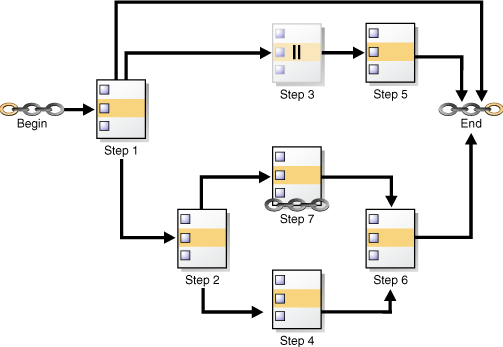
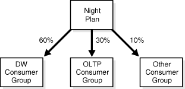

## 28 Scheduling Jobs with Oracle Scheduler

You can create, run, and manage jobs with Oracle Scheduler.

Note:

This chapter describes how to use the `DBMS_SCHEDULER` package to work with Scheduler objects. You can accomplish the same tasks using Oracle Enterprise Manager Cloud Control and many of these tasks with Oracle SQL Developer.

See [Oracle Database PL/SQL Packages and Types Reference](https://docs.oracle.com/pls/topic/lookup?ctx=en/database/oracle/oracle-database/21/admin&id=ARPLS72235) for `DBMS_SCHEDULER` information and the Cloud Control online help for information on Oracle Scheduler pages.

- About Scheduler Objects and Their Naming  
	You operate Oracle Scheduler by creating and managing a set of Scheduler objects. Each Scheduler object is a complete database schema object of the form `[schema.]name`. Scheduler objects follow the naming rules for database objects exactly and share the SQL namespace with other database objects.
- Creating, Running, and Managing Jobs  
	A job is the combination of a schedule and a program, along with any additional arguments required by the program.
- Creating and Managing Programs to Define Jobs  
	A program is a collection of metadata about a particular task. You optionally use a program to help define a job.
- Creating and Managing Schedules to Define Jobs  
	You optionally use a schedule object (a schedule) to define when a job should be run. Schedules can be shared among users by creating and saving them as objects in the database.
- Using Events to Start Jobs  
	Oracle Scheduler can start a job when an event is sent. An event is a message one application or system process sends to another.
- Creating and Managing Job Chains  
	A job chain is a named series of tasks that are linked together for a combined objective.
- Using Incompatibility Definitions  
	An incompatibility definition (or, incompatibility) specifies incompatible jobs or programs, where only one of the group can be running at a time.
- Managing Job Resources  
	You can create and alter resources available for use by jobs, and control how many of a specified resource are available to a job.
- Prioritizing Jobs  
	You prioritize Oracle Scheduler jobs using three Scheduler objects: job classes, windows, and window groups. These objects prioritize jobs by associating jobs with database resource manager consumer groups. This, in turn, controls the amount of resources allocated to these jobs. In addition, job classes enable you to set relative priorities among a group of jobs if all jobs in the group are allocated identical resource levels.
- Monitoring Jobs  
	You can monitor jobs in several different ways.

**Parent topic:** [Database Resource Management and Task Scheduling](database-resource-management-and-task-scheduling.md)

### 28.1 About Scheduler Objects and Their Naming

You operate Oracle Scheduler by creating and managing a set of Scheduler objects. Each Scheduler object is a complete database schema object of the form `[schema.]name`. Scheduler objects follow the naming rules for database objects exactly and share the SQL namespace with other database objects.

Follow SQL naming rules to name Scheduler objects in the `DBMS_SCHEDULER` package. By default, Scheduler object names are uppercase unless they are surrounded by double quotes. For example, when creating a job, `job_name => 'my_job'` is the same as `job_name => 'My_Job'` and `job_name => 'MY_JOB'`, but different from `job_name => '"my_job"'`. These naming rules are also followed in those cases where comma-delimited lists of Scheduler object names are used within the `DBMS_SCHEDULER` package.

See Also:

- [Oracle Database SQL Language Reference](https://docs.oracle.com/pls/topic/lookup?ctx=en/database/oracle/oracle-database/21/admin&id=SQLRF00223) for details regarding naming objects
- " [About Jobs and Supporting Scheduler Objects](oracle-scheduler-concepts.md) "

**Parent topic:** Scheduling Jobs with Oracle Scheduler

### 28.2 Creating, Running, and Managing Jobs

A job is the combination of a schedule and a program, along with any additional arguments required by the program.

- Job Tasks and Their Procedures  
	You use procedures in the `DBMS_SCHEDULER` package to administer common job tasks.
- Creating Jobs  
	You create jobs using the `DBMS_SCHEDULER` package or Cloud Control.
- Altering Jobs  
	You alter a job by modifying its attributes. You do so using the `SET_ATTRIBUTE`, `SET_ATTRIBUTE_NULL`, or `SET_JOB_ATTRIBUTES` procedures in the `DBMS_SCHEDULER` package or Cloud Control.
- Running Jobs  
	A job can be run in several different ways.
- Stopping Jobs  
	You stop one or more running jobs using the `STOP_JOB` procedure in the `DBMS_SCHEDULER` package or Cloud Control.
- Stopping External Jobs  
	The Scheduler offers implementors of external jobs a mechanism to gracefully clean up after their external jobs when `STOP_JOB` is called with `force` set to `FALSE`.
- Stopping a Chain Job  
	If a job that points to a running chain is stopped, then all steps of the chain that are running are stopped.
- Dropping Jobs  
	You drop one or more jobs using the `DROP_JOB` procedure in the `DBMS_SCHEDULER` package or Cloud Control.
- Dropping Running Jobs  
	If a job is running at the time of the `DROP_JOB` procedure call, then attempting to drop the job fails. You can modify this default behavior by setting either the `force` or `defer` option.
- Dropping Multiple Jobs  
	When you specify multiple jobs to drop, the `commit_semantics` argument of the `DBMS_SCHEDULER.DROP_JOB` procedure determines the outcome if an error occurs on one of the jobs.
- Disabling Jobs  
	You disable one or more jobs using the `DISABLE` procedure in the `DBMS_SCHEDULER` package or Cloud Control.
- Enabling Jobs  
	You enable one or more jobs by using the `ENABLE` procedure in the `DBMS_SCHEDULER` package or Cloud Control.
- Copying Jobs  
	You copy a job using the `COPY_JOB` procedure in the `DBMS_SCHEDULER` or Cloud Control.

See Also:

" [Jobs](oracle-scheduler-concepts.md) " for an overview of jobs.

**Parent topic:** Scheduling Jobs with Oracle Scheduler

#### 28.2.1 Job Tasks and Their Procedures

You use procedures in the `DBMS_SCHEDULER` package to administer common job tasks.

Table 28-1 illustrates common job tasks and their appropriate procedures and privileges:

Table 28-1 Job Tasks and Their Procedures

| Task | Procedure | Privilege Needed |
| --- | --- | --- |
| Create a job | `CREATE_JOB` or `CREATE_JOBS` | `CREATE` `JOB` or `CREATE` `ANY` `JOB` |
| Alter a job | `SET_ATTRIBUTE` or `SET_JOB_ATTRIBUTES` | `ALTER` or `CREATE` `ANY` `JOB` or be the owner |
| Run a job | `RUN_JOB` | `ALTER` or `CREATE` `ANY` `JOB` or be the owner |
| Copy a job | `COPY_JOB` | `ALTER` or `CREATE` `ANY` `JOB` or be the owner |
| Drop a job | `DROP_JOB` | `ALTER` or `CREATE` `ANY` `JOB` or be the owner |
| Stop a job | `STOP_JOB` | `ALTER` or `CREATE` `ANY` `JOB` or be the owner |
| Disable a job | `DISABLE` | `ALTER` or `CREATE` `ANY` `JOB` or be the owner |
| Enable a job | `ENABLE` | `ALTER` or `CREATE` `ANY` `JOB` or be the owner |

See " [Scheduler Privileges](administering-oracle-scheduler.md) " for further information regarding privileges.

**Parent topic:** Creating, Running, and Managing Jobs

#### 28.2.2 Creating Jobs

You create jobs using the `DBMS_SCHEDULER` package or Cloud Control.

- Overview of Creating Jobs  
	You create one or more jobs using the `DBMS_SCHEDULER.CREATE_JOB` or `DBMS_SCHEDULER.CREATE_JOBS` procedures or Cloud Control.
- Specifying Job Actions, Schedules, Programs, and Styles  
	Because the `CREATE_JOB` procedure is overloaded, there are several different ways of using it.
- Specifying Scheduler Job Credentials  
	Oracle Scheduler requires job credentials to authenticate with an Oracle database or the operating system before running.
- Specifying Destinations  
	For remote external jobs and remote database jobs, you specify the job destination by creating a destination object and assigning it to the `destination_name` job attribute. A job with a `NULL` `destination_name` attribute runs on the host where the job is created.
- Creating Multiple-Destination Jobs  
	You can create a job that runs on multiple destinations, but that is managed from a single location.
- Setting Job Arguments  
	To set job arguments, use the `SET_JOB_ARGUMENT_VALUE` or `SET_JOB_ANYDATA_VALUE` procedures or Cloud Control. `SET_JOB_ANYDATA_VALUE` is used for complex data types that cannot be represented as a `VARCHAR2` string.
- Setting Additional Job Attributes  
	After creating a job, you can set additional job attributes or change attribute values by using the `SET_ATTRIBUTE` or `SET_JOB_ATTRIBUTES` procedures.
- Creating Detached Jobs  
	A detached job must point to a program object (program) that has its `detached` attribute set to `TRUE`.
- Creating Multiple Jobs in a Single Transaction  
	If you must create many jobs, then you may be able to reduce transaction overhead and experience a performance gain if you use the `CREATE_JOBS` procedure.
- Techniques for External Jobs  
	This section contains the following examples, which demonstrate some practical techniques for external jobs.

**Parent topic:** Creating, Running, and Managing Jobs

##### 28.2.2.1 Overview of Creating Jobs

You create one or more jobs using the `DBMS_SCHEDULER.CREATE_JOB` or `DBMS_SCHEDULER.CREATE_JOBS` procedures or Cloud Control.

You use the `CREATE_JOB` procedure to create a single job. This procedure is overloaded to enable you to create different types of jobs that are based on different objects. You can create multiple jobs in a single transaction using the `CREATE_JOBS` procedure.

You must have the `CREATE` `JOB` privilege to create a job in your own schema, and the `CREATE` `ANY` `JOB` privilege to create a job in any schema except `SYS`.

For each job being created, you specify a job type, an action, and a schedule. You can also optionally specify a credential name, a destination or destination group name, a job class, and other attributes. As soon as you enable a job, it is automatically run by the Scheduler at its next scheduled date and time. By default, jobs are disabled when created and must be enabled with `DBMS_SCHEDULER.ENABLE` to run. You can also set the `enabled` argument of the `CREATE_JOB` procedure to `TRUE`, in which case the job is ready to be automatically run, according to its schedule, as soon as you create it.

Some job attributes cannot be set with `CREATE_JOB`, and instead must be set with `DBMS_SCHEDULER.SET_ATTRIBUTE`. For example, to set the `logging_level` attribute for a job, you must call `SET_ATTRIBUTE` after calling `CREATE_JOB`.

You can create a job in another schema by specifying `schema.job_name`. The creator of a job is, therefore, not necessarily the job owner. The job owner is the user in whose schema the job is created. The NLS environment of the job, when it runs, is the existing environment at the time the job was created.

The following example demonstrates creating a database job called `update_sales`, which calls a package procedure in the `OPS` schema that updates a sales summary table:

```
BEGIN
  DBMS_SCHEDULER.CREATE_JOB (
   job_name           =>  'update_sales',
   job_type           =>  'STORED_PROCEDURE',
   job_action         =>  'OPS.SALES_PKG.UPDATE_SALES_SUMMARY',
   start_date         =>  '28-APR-08 07.00.00 PM Australia/Sydney',
   repeat_interval    =>  'FREQ=DAILY;INTERVAL=2', /* every other day */
   end_date           =>  '20-NOV-08 07.00.00 PM Australia/Sydney',
   auto_drop          =>   FALSE,
   job_class          =>  'batch_update_jobs',
   comments           =>  'My new job');
END;
/
```

Because no `destination_name` attribute is specified, the job runs on the originating (local) database. The job runs as the user who created the job.

The `repeat_interval` argument specifies that this job runs every other day until it reaches the end date and time. Another way to limit the number of times that a repeating job runs is to set its `max_runs` attribute to a positive number.

The job is disabled when it is created, by default. You must enable it with `DBMS_SCHEDULER.ENABLE` before the Scheduler will automatically run it.

Jobs are set to be automatically dropped by default after they complete. Setting the `auto_drop` attribute to `FALSE` causes the job to persist. Note that repeating jobs are not auto-dropped unless the job end date passes, the maximum number of runs (`max_runs`) is reached, or the maximum number of failures is reached (`max_failures`).

After a job is created, it can be queried using the `*_SCHEDULER_JOBS` views.

See Also:

" Specifying Scheduler Job Credentials "

**Parent topic:** Creating Jobs

##### 28.2.2.2 Specifying Job Actions, Schedules, Programs, and Styles

Because the `CREATE_JOB` procedure is overloaded, there are several different ways of using it.

In addition to specifying the job action and job repeat interval as job attributes as shown in the example in " Overview of Creating Jobs ", known as specifying the job action and job schedule inline, you can create a job that points to a program object (program) to specify the job action, a schedule object (schedule) to specify the repeat interval, or both a program and schedule. You can also create jobs by specifying job programs and job styles.

- Creating Jobs Using a Named Program  
	You can create a job by pointing to a named program instead of inlining its action.
- Creating Jobs Using a Named Program and Job Styles  
	You can create jobs using named programs and job styles. The following job styles are available: `'REGULAR'`, ' `LIGHTWEIGHT` ', `'IN_MEMORY_RUNTIME'`, ' `IN_MEMORY_FULL` '.
- Creating Jobs Using a Named Schedule  
	You can create a job by pointing to a named schedule instead of inlining its schedule.
- Creating Jobs Using Named Programs and Schedules  
	A job can be created by pointing to both a named program and a named schedule.

**Parent topic:** Creating Jobs

###### 28.2.2.2.1 Creating Jobs Using a Named Program

You can create a job by pointing to a named program instead of inlining its action.

To create a job using a named program, you specify the value for `program_name` in the `CREATE_JOB` procedure when creating the job and do not specify the values for `job_type`, `job_action`, and `number_of_arguments`.

To use an existing program when creating a job, the owner of the job must be the owner of the program or have `EXECUTE` privileges on it. The following PL/SQL block is an example of a `CREATE_JOB` procedure with a named program that creates a regular job called `my_new_job1`:

```
BEGIN
  DBMS_SCHEDULER.CREATE_JOB (
   job_name          =>  'my_new_job1',
   program_name      =>  'my_saved_program', 
   repeat_interval   =>  'FREQ=DAILY;BYHOUR=12',
   comments          =>  'Daily at noon');
END;
/
```

**Parent topic:** Specifying Job Actions, Schedules, Programs, and Styles

###### 28.2.2.2.2 Creating Jobs Using a Named Program and Job Styles

You can create jobs using named programs and job styles. The following job styles are available: `'REGULAR'`, ' `LIGHTWEIGHT` ', `'IN_MEMORY_RUNTIME'`, ' `IN_MEMORY_FULL` '.

The default job style is `'REGULAR'` which is implied if no job style is provided. Examples of the other job types follow.

`LIGHTWEIGHT` Jobs

The following PL/SQL block creates a lightweight job. Lightweight jobs must reference a program, and the program type must be ' `PLSQL_BLOCK` ' or ' `STORED_PROCEDURE` '. In addition, the program must be already enabled when you create the job.

```
BEGIN
  DBMS_SCHEDULER.CREATE_JOB (
   job_name         =>  'my_lightweight_job1',
   program_name     =>  'polling_prog_n2',
   repeat_interval  =>  'FREQ=SECONDLY;INTERVAL=10',
   end_date         =>  '30-APR-09 04.00.00 AM Australia/Sydney',
   job_style        => 'LIGHTWEIGHT',
   comments         => 'Job that polls device n2 every 10 seconds');
END;
/
```

`IN_MEMORY_RUNTIME` Jobs

The following PL/SQL block creates an in-memory runtime job. In-memory runtime jobs have the same requirements and restrictions as lightweight jobs.

```
BEGIN
  DBMS_SCHEDULER.CREATE_JOB (
    job_name => 'my_repeat_job',
    program_name => 'repeat_prog',
    start_date => systimestamp,
    repeat_interval => 'freq=secondly;interval=10',
    job_style => 'IN_MEMORY_RUNTIME',
    enabled => true);
END;
/
```

`IN_MEMORY_FULL` Jobs

The following PL/SQL creates an in-memory full job. In-memory full jobs require a program and cannot have a schedule or repeat interval. They run automatically when the job is enabled, and after running they are discarded.

```
BEGIN
  DBMS_SCHEDULER.CREATE_JOB (
    job_name => 'my_immediate_job',
    program_name => 'fast_op',
    job_style => 'IN_MEMORY_FULL',
    enabled => true);
END;
/
```

See Also:

" [In-Memory Jobs](oracle-scheduler-concepts.md) "

**Parent topic:** Specifying Job Actions, Schedules, Programs, and Styles

###### 28.2.2.2.3 Creating Jobs Using a Named Schedule

You can create a job by pointing to a named schedule instead of inlining its schedule.

To create a job using a named schedule, you specify the value for `schedule_name` in the `CREATE_JOB` procedure when creating the job and do not specify the values for `start_date`, `repeat_interval`, and `end_date`.

You can use any named schedule to create a job because all schedules are created with access to `PUBLIC`. The following `CREATE_JOB` procedure has a named schedule and creates a regular job called `my_new_job2`:

```
BEGIN
  DBMS_SCHEDULER.CREATE_JOB (
   job_name                 =>  'my_new_job2', 
   job_type                 =>  'PLSQL_BLOCK',
   job_action               =>  'BEGIN SALES_PKG.UPDATE_SALES_SUMMARY; END;',
   schedule_name            =>  'my_saved_schedule');
END;
/
```

**Parent topic:** Specifying Job Actions, Schedules, Programs, and Styles

###### 28.2.2.2.4 Creating Jobs Using Named Programs and Schedules

A job can be created by pointing to both a named program and a named schedule.

For example, the following `CREATE_JOB` procedure creates a regular job called `my_new_job3`, based on the existing program, `my_saved_program1`, and the existing schedule, `my_saved_schedule1`:

```
BEGIN
  DBMS_SCHEDULER.CREATE_JOB (
   job_name            =>  'my_new_job3', 
   program_name        =>  'my_saved_program1', 
   schedule_name       =>  'my_saved_schedule1');
END;
/
```

See Also:

**Parent topic:** Specifying Job Actions, Schedules, Programs, and Styles

##### 28.2.2.3 Specifying Scheduler Job Credentials

Oracle Scheduler requires job credentials to authenticate with an Oracle database or the operating system before running.

For local external jobs, remote external jobs, and remote database jobs, you must specify the credentials under which the job runs. You do so by creating a credential object and assigning it to the `credential_name` job attribute.

Note:

A local database job always runs as the user is who is the job owner and will ignore any named credential.

To create a credential, call the `DBMS_CREDENTIAL.CREATE_CREDENTIAL` procedure.

You must have the `CREATE` `CREDENTIAL` privilege to create a credential in your own schema, and the `CREATE` `ANY` `CREDENTIAL` privilege to create a credential in any schema except `SYS`. A credential can be used only by a job whose owner has `EXECUTE` privileges on the credential or whose owner also owns the credential. Because a credential belongs to a schema like any other schema object, you use the `GRANT` SQL statement to grant privileges on a credential.

Example 28-1 Creating a Credential

```
BEGIN
  DBMS_CREDENTIAL.CREATE_CREDENTIAL('DW_CREDENTIAL', 'dwuser', 'dW001515');
END;
/

GRANT EXECUTE ON DW_CREDENTIAL TO salesuser;
```

You can query the `*_CREDENTIALS` views to see a list of credentials in the database. Credential passwords are stored obfuscated and are not displayed in these views.

Note:

`*_SCHEDULER_CREDENTIALS` is deprecated in Oracle Database 12c, but remains available, for reasons of backward compatibility.

See Also:

[Oracle Database Security Guide](https://docs.oracle.com/pls/topic/lookup?ctx=en/database/oracle/oracle-database/21/admin&id=DBSEG656) for information about creating a credential using the `DBMS_CREDENTIAL.CREATE_CREDENTIAL` procedure

**Parent topic:** Creating Jobs

##### 28.2.2.4 Specifying Destinations

For remote external jobs and remote database jobs, you specify the job destination by creating a destination object and assigning it to the `destination_name` job attribute. A job with a `NULL` `destination_name` attribute runs on the host where the job is created.

- Destination Tasks and Their Procedures  
	You use procedures in the `DBMS_SCHEDULER` package to administer destination tasks.
- Creating Destinations  
	A destination is a Scheduler object that defines a location for running a job.
- Creating Destination Groups for Multiple-Destination Jobs  
	To create a job that runs on multiple destinations, you must create a destination group and assign that group to the `destination_name` attribute of the job.
- Example: Creating a Remote Database Job  
	An example illustrates creating a remote database job.

**Parent topic:** Creating Jobs

###### 28.2.2.4.1 Destination Tasks and Their Procedures

You use procedures in the `DBMS_SCHEDULER` package to administer destination tasks.

Table 28-2 illustrates destination tasks and their procedures and privileges:

Table 28-2 Destination Tasks and Their Procedures

| Task | Procedure | Privilege Needed |
| --- | --- | --- |
| Create an external destination | (none) | See " Creating Destinations " |
| Drop an external destination | `DROP_AGENT_DESTINATION` | `MANAGE` `SCHEDULER` |
| Create a database destination | `CREATE_DATABASE_DESTINATION` | `CREATE` `JOB` or `CREATE` `ANY` `JOB` |
| Drop a database destination | `DROP_DATABASE_DESTINATION` | `CREATE` `ANY` `JOB` or be the owner |
| Create a destination group | `CREATE_GROUP` | `CREATE` `JOB` or `CREATE` `ANY` `JOB` |
| Drop a destination group | `DROP_GROUP` | `CREATE` `ANY` `JOB` or be the owner |
| Add members to a destination group | `ADD_GROUP_MEMBER` | `ALTER` or `CREATE` `ANY` `JOB` or be the owner |
| Remove members from a destination group | `REMOVE_GROUP_MEMBER` | `ALTER` or `CREATE` `ANY` `JOB` or be the owner |

**Parent topic:** Specifying Destinations

###### 28.2.2.4.2 Creating Destinations

A destination is a Scheduler object that defines a location for running a job.

You designate the locations where a job runs by specifying either a single destination or a destination group in the `destination_name` attribute of the job. If you leave the `destination_name` attribute `NULL`, the job runs on the local host (the host where the job was created).

Use external destinations to specify locations where remote external jobs run. Use database destinations to specify locations where remote database jobs run.

You do not need object privileges to use a destination created by another user.

To create an external destination, register a remote Scheduler agent with the database.

See " [Installing and Configuring the Scheduler Agent on a Remote Host](administering-oracle-scheduler.md) " for instructions.

Note:

There is no `DBMS_SCHEDULER` package procedure to create an external destination. You create an external destination implicitly by registering a remote agent.

You can also register a local Scheduler agent if you have other database instances on the same host that are targets for remote jobs. This creates an external destination that references the local host.

The external destination name is automatically set to the agent name. To verify that the external destination was created, query the views `DBA_SCHEDULER_EXTERNAL_DESTS` or `ALL_SCHEDULER_EXTERNAL_DESTS`.

To create a database destination, call the `DBMS_SCHEDULER.CREATE_DATABASE_DESTINATION` procedure.

You must specify the name of an external destination as a procedure argument. This designates the remote host that the database destination points to. You also specify a net service name or complete connect descriptor that identifies the database instance being connected to. If you specify a net service name, it must be resolved by the local `tnsnames.ora` file. If you do not specify a database instance, the remote Scheduler agent connects to its default database, which is specified in the agent configuration file.

To create a database destination, you must have the `CREATE JOB` system privilege. To create a database destination in a schema other than your own, you must have the `CREATE ANY JOB` privilege.

Example 28-2 Creating a Database Destination

The following example creates a database destination named `DBHOST1_ORCLDW`. For this example, assume the following:

- You installed a Scheduler agent on the remote host `dbhost1.example.com`, and you registered the agent with the local database.
- You did not modify the agent configuration file to set the agent name. Therefore the agent name and the external destination name default to `DBHOST1`.
- You used Net Configuration Assistant on the local host to create a connect descriptor in tnsnames.ora for the Oracle Database instance named `orcldw`, which resides on the remote host `dbhost1.example.com`. You assigned a net service name (alias) of `ORCLDW` to this connect descriptor.
```
BEGIN
 DBMS_SCHEDULER.CREATE_DATABASE_DESTINATION (
  destination_name     => 'DBHOST1_ORCLDW',
  agent                => 'DBHOST1',
  tns_name             => 'ORCLDW',
  comments             => 'Instance named orcldw on host dbhost1.example.com');
END;
/
```

To verify that the database destination was created, query the views `*_SCHEDULER_DB_DESTS`.

See Also:

- " [Destinations](oracle-scheduler-concepts.md) " for more information about destinations
- " [Jobs](oracle-scheduler-concepts.md) " to learn about remote external jobs and remote database jobs

**Parent topic:** Specifying Destinations

###### 28.2.2.4.3 Creating Destination Groups for Multiple-Destination Jobs

To create a job that runs on multiple destinations, you must create a destination group and assign that group to the `destination_name` attribute of the job.

You can specify group members (destinations) when you create the group, or you can add group members at a later time.

To create a destination group, call the `DBMS_SCHEDULER.CREATE_GROUP` procedure.

For remote external jobs you must specify a group of type ' `EXTERNAL_DEST` ', and all group members must be external destinations. For remote database jobs, you must specify a group of type ' `DB_DEST` ', and all members must be database destinations.

Members of destination groups have the following format:

```
[[schema.]credential@][schema.]destination
```

where:

- `credential` is the name of an existing credential.
- `destination` is the name of an existing database destination or external destination

The credential portion of a destination member is optional. If omitted, the job using this destination member uses its default credential.

You can include another group of the same type as a member of a destination group. Upon group creation, the Scheduler expands the included group into its members.

If you want the local host to be one of many destinations on which a job runs, you can include the keyword `LOCAL` as a group member for either type of destination group. `LOCAL` can be preceded by a credential only in an external destination group.

A group is owned by the user who creates it. You must have the `CREATE` `JOB` system privilege to create a group in your own schema, and the `CREATE` `ANY` `JOB` system privilege to create a group in another schema. You can grant object privileges on a group to other users by granting `SELECT` on the group.

See Also:

" [Groups](oracle-scheduler-concepts.md) " for an overview of groups.

Example 28-3 Creating a Database Destination Group

This example creates a database destination group. Because some members do not include a credential, a job using this destination group must have default credentials.

```
BEGIN
  DBMS_SCHEDULER.CREATE_GROUP(
    GROUP_NAME    => 'all_dbs',
    GROUP_TYPE    => 'DB_DEST',
    MEMBER        => 'oltp_admin@orcl, orcldw1, LOCAL',
    COMMENTS      => 'All databases managed by me');
END;
/
```

The following code adds another member to the group.

```
BEGIN
  DBMS_SCHEDULER.ADD_GROUP_MEMBER(
    GROUP_NAME    => 'all_dbs',
    MEMBER        => 'dw_admin@orcldw2');
END;
/
```

**Parent topic:** Specifying Destinations

###### 28.2.2.4.4 Example: Creating a Remote Database Job

An example illustrates creating a remote database job.

The following example creates a remote database job by specifying a database destination object in the `destination_name` object of the job. A credential must also be specified so the job can authenticate with the remote database. The example uses the credential created in Example 28-1 and the database destination created in Example 28-2.

```
BEGIN
 DBMS_SCHEDULER.CREATE_JOB (
   job_name            =>  'SALES_SUMMARY1', 
   job_type            =>  'STORED_PROCEDURE',
   job_action          =>  'SALES.SALES_REPORT1',
   start_date          =>  '15-JUL-09 11.00.00 PM Europe/Warsaw',
   repeat_interval     =>  'FREQ=DAILY',
   credential_name     =>  'DW_CREDENTIAL',
   destination_name    =>  'DBHOST1_ORCLDW');
END;
/
```

**Parent topic:** Specifying Destinations

##### 28.2.2.5 Creating Multiple-Destination Jobs

You can create a job that runs on multiple destinations, but that is managed from a single location.

A typical reason to do this is to run a database maintenance job on all of the databases that you administer. Rather than create the job on each database, you create the job once and designate multiple destinations for the job. From the database where you created the job (the local database), you can monitor the state and results of all instances of the job at all locations.

To create a multiple-destination job:

- Call the `DBMS_SCHEDULER.CREATE_JOB` procedure and set the `destination_name` attribute of the job to the name of database destination group or external destination group.
	If not all destination group members include a credential prefix (the schema), assign a default credential to the job.
	To include the local host or local database as one of the destinations on which the job runs, ensure that the keyword `LOCAL` is one of the members of the destination group.

To obtain a list of destination groups, submit this query:

```
SELECT owner, group_name, group_type, number_of_members FROM all_scheduler_groups
  WHERE group_type = 'DB_DEST' or group_type = 'EXTERNAL_DEST';

OWNER           GROUP_NAME      GROUP_TYPE    NUMBER_OF_MEMBERS
--------------- --------------- ------------- -----------------
DBA1            ALL_DBS         DB_DEST                       4
DBA1            ALL_HOSTS       EXTERNAL_DEST                 4
```

The following example creates a multiple-destination database job, using the database destination group created in Example 28-3. The user specified in the credential should have sufficient privileges to perform the job action.

```
BEGIN
 DBMS_CREDENTIAL.CREATE_CREDENTIAL('DBA_CREDENTIAL', 'dba1', 'sYs040533');
 DBMS_SCHEDULER.CREATE_JOB (
   job_name            =>  'MAINT_SET1', 
   job_type            =>  'STORED_PROCEDURE',
   job_action          =>  'MAINT_PROC1',
   start_date          =>  '15-JUL-09 11.00.00 PM Europe/Warsaw',
   repeat_interval     =>  'FREQ=DAILY',
   credential_name     =>  'DBA_CREDENTIAL',
   destination_name    =>  'ALL_DBS');
END;
/
```

##### 28.2.2.6 Setting Job Arguments

To set job arguments, use the `SET_JOB_ARGUMENT_VALUE` or `SET_JOB_ANYDATA_VALUE` procedures or Cloud Control. `SET_JOB_ANYDATA_VALUE` is used for complex data types that cannot be represented as a `VARCHAR2` string.

After creating a job, you may need to set job arguments if:

- The inline job action is a stored procedure or other executable that requires arguments
- The job references a named program object and you want to override one or more default program arguments
- The job references a named program object and one or more of the program arguments were not assigned a default value

An example of a job that might need arguments is one that starts a reporting program that requires a start date and end date. The following code example sets the end date job argument, which is the second argument expected by the reporting program:

```
BEGIN
  DBMS_SCHEDULER.SET_JOB_ARGUMENT_VALUE (
   job_name                => 'ops_reports',
   argument_position       => 2,
   argument_value          => '12-DEC-03');
END;
/
```

If you use this procedure on an argument whose value has already been set, it will be overwritten. You can set argument values using either the argument name or the argument position. To use argument name, the job must reference a named program object, and the argument must have been assigned a name in the program object. If a program is inlined, only setting by position is supported. Arguments are not supported for jobs of type ' `PLSQL_BLOCK` '.

To remove a value that has been set, use the `RESET_JOB_ARGUMENT` procedure. This procedure can be used for both regular and `ANYDATA` arguments.

`SET_JOB_ARGUMENT_VALUE` only supports arguments of SQL type. Therefore, argument values that are not of SQL type, such as booleans, are not supported as program or job arguments.

See Also:

" Defining Program Arguments "

**Parent topic:** Creating Jobs

##### 28.2.2.7 Setting Additional Job Attributes

After creating a job, you can set additional job attributes or change attribute values by using the `SET_ATTRIBUTE` or `SET_JOB_ATTRIBUTES` procedures.

You can also set job attributes with Cloud Control. Although many job attributes can be set with the call to `CREATE_JOB`, some attributes, such as `destination` and `credential_name`, can be set only with `SET_ATTRIBUTE` or `SET_JOB_ATTRIBUTES` after the job has been created.

**Parent topic:** Creating Jobs

##### 28.2.2.8 Creating Detached Jobs

A detached job must point to a program object (program) that has its `detached` attribute set to `TRUE`.

The following example for Linux and UNIX creates a nightly job that performs a cold backup of the database. It contains three steps.

Step 1—Create the Script That Invokes RMAN

Create a shell script that calls an RMAN script to perform a cold backup. The shell script is in `ORACLE_HOME/scripts/coldbackup.sh`. It must be executable by the user who installed Oracle Database (typically the user `oracle`).

```
#!/bin/sh
 
export ORACLE_HOME=/u01/app/oracle/product/database_release_number/db_1
export ORACLE_SID=orcl
export LD_LIBRARY_PATH=$LD_LIBRARY_PATH:$ORACLE_HOME/lib
 
$ORACLE_HOME/bin/rman TARGET / @$ORACLE_HOME/scripts/coldbackup.rman
  trace /u01/app/oracle/backup/coldbackup.out &
exit 0
```

Step 2—Create the RMAN Script

Create an RMAN script that performs the cold backup and then ends the job. The script is in `ORACLE_HOME/scripts/coldbackup.rman`.

```
run {
# Shut down database for backups and put into MOUNT mode
shutdown immediate
startup mount
 
# Perform full database backup
backup full format "/u01/app/oracle/backup/%d_FULL_%U" (database) ;
 
# Open database after backup
alter database open;
 
# Call notification routine to indicate job completed successfully
sql " BEGIN  DBMS_SCHEDULER.END_DETACHED_JOB_RUN(''sys.backup_job'', 0,
  null); END; ";
}
```

Step 3—Create the Job and Use a Detached Program

Submit the following PL/SQL block:

```
BEGIN
  DBMS_SCHEDULER.CREATE_PROGRAM(
    program_name   => 'sys.backup_program',
    program_type   => 'executable',
    program_action => '?/scripts/coldbackup.sh',
    enabled        =>  TRUE);

  DBMS_SCHEDULER.SET_ATTRIBUTE('sys.backup_program', 'detached', TRUE);
 
  DBMS_SCHEDULER.CREATE_JOB(
    job_name        => 'sys.backup_job',
    program_name    => 'sys.backup_program',
    repeat_interval => 'FREQ=DAILY;BYHOUR=1;BYMINUTE=0');

  DBMS_SCHEDULER.ENABLE('sys.backup_job');
END;
/
```

See Also:

" [Detached Jobs](oracle-scheduler-concepts.md) "

**Parent topic:** Creating Jobs

##### 28.2.2.9 Creating Multiple Jobs in a Single Transaction

If you must create many jobs, then you may be able to reduce transaction overhead and experience a performance gain if you use the `CREATE_JOBS` procedure.

Example 28-4 demonstrates how to use this procedure to create multiple jobs in a single transaction.

Example 28-4 Creating Multiple Jobs in a Single Transaction

```
DECLARE
 newjob sys.job_definition;
 newjobarr sys.job_definition_array;
BEGIN
 -- Create an array of JOB_DEFINITION object types
 newjobarr := sys.job_definition_array();

 -- Allocate sufficient space in the array
 newjobarr.extend(5);

 -- Add definitions for 5 jobs
 FOR i IN 1..5 LOOP
   -- Create a JOB_DEFINITION object type
   newjob := sys.job_definition(job_name => 'TESTJOB' || to_char(i),
                     job_style => 'REGULAR',
                     program_name => 'PROG1',
                     repeat_interval => 'FREQ=HOURLY',
                     start_date => systimestamp + interval '600' second,
                     max_runs => 2,
                     auto_drop => FALSE,
                     enabled => TRUE
                    );

   -- Add it to the array
   newjobarr(i) := newjob;
 END LOOP;

 -- Call CREATE_JOBS to create jobs in one transaction
 DBMS_SCHEDULER.CREATE_JOBS(newjobarr, 'TRANSACTIONAL');
END;
/

PL/SQL procedure successfully completed.

SELECT JOB_NAME FROM USER_SCHEDULER_JOBS;
 
JOB_NAME
------------------------------
TESTJOB1
TESTJOB2
TESTJOB3
TESTJOB4
TESTJOB5
 
5 rows selected.
```

See Also:

" [Lightweight Jobs](oracle-scheduler-concepts.md) "

**Parent topic:** Creating Jobs

##### 28.2.2.10 Techniques for External Jobs

This section contains the following examples, which demonstrate some practical techniques for external jobs.

Example 28-5 Creating a Local External Job That Runs a Command Interpreter

This example demonstrates how to create a local external job on Windows that runs an interpreter command (in this case, `mkdir`). The job runs `cmd.exe` with the `/c` option.

```
BEGIN
 DBMS_SCHEDULER.CREATE_JOB(
   job_name             => 'MKDIR_JOB',
   job_type             => 'EXECUTABLE',
   number_of_arguments  => 3,
   job_action           => '\windows\system32\cmd.exe',
   auto_drop            => FALSE,
   credential_name      => 'TESTCRED');

 DBMS_SCHEDULER.SET_JOB_ARGUMENT_VALUE('mkdir_job',1,'/c');
 DBMS_SCHEDULER.SET_JOB_ARGUMENT_VALUE('mkdir_job',2,'mkdir');
 DBMS_SCHEDULER.SET_JOB_ARGUMENT_VALUE('mkdir_job',3,'\temp\extjob_test_dir');
 DBMS_SCHEDULER.ENABLE('MKDIR_JOB');
END;
/
```

Example 28-6 Creating a Local External Job and Viewing the Job Output

This example for Linux and UNIX shows how to create and run a local external job and then view the job output. When an external job runs, the Scheduler automatically retrieves the output from the job and stores it inside the database.

To see the output, query ` *_SCHEDULER_JOB_RUN_DETAILS` views.

```
-- User scott must have CREATE JOB, CREATE CREDENTIAL, and CREATE EXTERNAL JOB
-- privileges
GRANT CREATE JOB, CREATE EXTERNAL JOB TO scott ;
 
CONNECT scott/password
SET SERVEROUTPUT ON
 
-- Create a credential for the job to use
exec DBMS_CREDENTIAL.CREATE_CREDENTIAL('my_cred','host_username','host_passwd')
 
-- Create a job that lists a directory. After running, the job is dropped.
BEGIN
 DBMS_SCHEDULER.CREATE_JOB(
  job_name            => 'lsdir',
  job_type            => 'EXECUTABLE',
  job_action          => '/bin/ls',
  number_of_arguments => 1,
  enabled             => false,
  auto_drop           => true,
  credential_name     => 'my_cred');
 DBMS_SCHEDULER.SET_JOB_ARGUMENT_VALUE('lsdir',1,'/tmp');
 DBMS_SCHEDULER.ENABLE('lsdir');
END;
/
 
-- Wait a bit for the job to run, and then check the job results.
SELECT job_name, status, error#, actual_start_date, additional_info
 FROM user_scheduler_job_run_details WHERE job_name='LSDIR';
 
-- Now use the external log id from the additional_info column to
-- formulate the log file name and retrieve the output
DECLARE
 my_clob clob;
 log_id varchar2(50);
BEGIN
 SELECT regexp_substr(additional_info,'job[_0-9]*') INTO log_id
   FROM user_scheduler_job_run_details WHERE job_name='LSDIR';
 DBMS_LOB.CREATETEMPORARY(my_clob, false);

SELECT job_name, status, error#, errors, output FROM user_scheduler_job_run_details WHERE job_name = 'LSDIR';
END;
/
```

#### 28.2.3 Altering Jobs

You alter a job by modifying its attributes. You do so using the `SET_ATTRIBUTE`, `SET_ATTRIBUTE_NULL`, or `SET_JOB_ATTRIBUTES` procedures in the `DBMS_SCHEDULER` package or Cloud Control.

See the `CREATE_JOB` procedure in [Oracle Database PL/SQL Packages and Types Reference](https://docs.oracle.com/pls/topic/lookup?ctx=en/database/oracle/oracle-database/21/admin&id=ARPLS72235) for details on job attributes.

All jobs can be altered, and, except for the job name, all job attributes can be changed. If there is a running instance of the job when the change is made, it is not affected by the call. The change is only seen in future runs of the job.

In general, you should not alter a job that was automatically created for you by the database. Jobs that were created by the database have the column `SYSTEM` set to `TRUE` in job views. The attributes of a job are available in the `*_SCHEDULER_JOBS` views.

It is valid for running jobs to alter their own job attributes. However, these changes do not take effect until the next scheduled run of the job.

See [Oracle Database PL/SQL Packages and Types Reference](https://docs.oracle.com/pls/topic/lookup?ctx=en/database/oracle/oracle-database/21/admin&id=ARPLS72399) for detailed information about the `SET_ATTRIBUTE`, `SET_ATTRIBUTE_NULL`, and `SET_JOB_ATTRIBUTES` procedures.

The following example changes the `repeat_interval` of the job `update_sales` to once per week on Wednesday.

```
BEGIN
  DBMS_SCHEDULER.SET_ATTRIBUTE (
   name         =>  'update_sales',
   attribute    =>  'repeat_interval',
   value        =>  'freq=weekly; byday=wed');
END;
/
```

**Parent topic:** Creating, Running, and Managing Jobs

#### 28.2.4 Running Jobs

A job can be run in several different ways.

There are three ways in which a job can be run:

- According to the job schedule—In this case, provided that the job is enabled, the job is automatically picked up by the Scheduler job coordinator and run under the control of a job slave. The job runs as the user who is the job owner, or in the case of a local external job with a credential, as the user named in the credential. To find out whether the job succeeded, you must query the job views (`*_SCHEDULER_JOBS`) or the job log (`*_SCHEDULER_JOB_LOG` and `*_SCHEDULER_JOB_RUN_DETAILS`). See " [How Jobs Execute](oracle-scheduler-concepts.md) " for more information job slaves and the Scheduler architecture.
- When an event occurs—Enabled event-based jobs start when a specified event is received on an event queue or when a file watcher raises a file arrival event. (See " Using Events to Start Jobs ".) Event-based jobs also run under the control of a job slave and run as the user who owns the job, or in the case of a local external job with a credential, as the user named in the credential. To find out whether the job succeeded, you must query the job views or the job log.
- By calling `DBMS_SCHEDULER.RUN_JOB` —You can use the `RUN_JOB` procedure to test a job or to run it outside of its specified schedule. You can run the job asynchronously, which is similar to the previous two methods of running a job, or synchronously, in which the job runs in the session that called `RUN_JOB`, and as the user logged in to that session. The `use_current_session` argument of `RUN_JOB` determines whether a job runs synchronously or asynchronously.
	`RUN_JOB` accepts a comma-delimited list of job names.
	The following example asynchronously runs two jobs:
	```
	BEGIN
	  DBMS_SCHEDULER.RUN_JOB(
	    JOB_NAME            => 'DSS.ETLJOB1, DSS.ETLJOB2',
	    USE_CURRENT_SESSION => FALSE);
	END;
	/
	```
	Note:
	It is not necessary to call `RUN_JOB` to run a job according to its schedule. Provided that job is enabled, the Scheduler runs it automatically.

**Parent topic:** Creating, Running, and Managing Jobs

#### 28.2.5 Stopping Jobs

You stop one or more running jobs using the `STOP_JOB` procedure in the `DBMS_SCHEDULER` package or Cloud Control.

`STOP_JOB` accepts a comma-delimited list of jobs, job classes, and job destination IDs. A job destination ID is a number, assigned by the Scheduler, that represents a unique combination of a job, a credential, and a destination. It serves as a convenient method for identifying a particular child job of a multiple-destination job and for stopping just that child. You obtain the job destination ID for a child job from the `*_SCHEDULER_JOB_DESTS` views.

If a job class is supplied, all running jobs in the job class are stopped. For example, the following statement stops job `job1`, all jobs in the job class `dw_jobs`, and two child jobs of a multiple-destination job:

```
BEGIN
  DBMS_SCHEDULER.STOP_JOB('job1, sys.dw_jobs, 984, 1223');
END;
/
```

All instances of the designated jobs are stopped. After stopping a job, the state of a one-time job is set to `STOPPED`, and the state of a repeating job is set to `SCHEDULED` (because the next run of the job is scheduled). In addition, an entry is made in the job log with `OPERATION` set to ' `STOPPED` ', and `ADDITIONAL_INFO` set to ' `REASON="Stop job called by user: ``username"` '.

By default, the Scheduler tries to gracefully stop a job using an interrupt mechanism. This method gives control back to the slave process, which can collect statistics of the job run. If the `force` option is set to `TRUE`, the job is abruptly terminated and certain run-time statistics might not be available for the job run.

Stopping a job that is running a chain automatically stops all running steps (by calling `STOP_JOB` with the `force` option set to `TRUE` on each step).

You can use the `commit_semantics` argument of `STOP_JOB` to control the outcome if multiple jobs are specified and errors occur when trying to stop one or more jobs. If you set this argument to `ABSORB_ERRORS`, the procedure may be able to continue after encountering an error and attempt to stop the remaining jobs. If the procedure indicates that errors occurred, you can query the view `SCHEDULER_BATCH_ERRORS` to determine the nature of the errors. See " Dropping Jobs " for a more detailed discussion of commit semantics.

See [Oracle Database PL/SQL Packages and Types Reference](https://docs.oracle.com/pls/topic/lookup?ctx=en/database/oracle/oracle-database/21/admin&id=ARPLS72435) for detailed information about the `STOP_JOB` procedure.

Note:

When a job is stopped, only the current transaction is rolled back. This can cause data inconsistency.

**Parent topic:** Creating, Running, and Managing Jobs

#### 28.2.6 Stopping External Jobs

The Scheduler offers implementors of external jobs a mechanism to gracefully clean up after their external jobs when `STOP_JOB` is called with `force` set to `FALSE`.

The mechanism described in this section applies only to remote external jobs on the UNIX and Linux platforms.

On UNIX and Linux, a `SIGTERM` signal is sent to the process launched by the Scheduler. The implementor of the external job is expected to trap the `SIGTERM` in an interrupt handler, clean up whatever work the job has done, and exit.

On Windows, `STOP_JOB` with `force` set to `FALSE` is supported. The process launched by the Scheduler is a console process. To stop it, the Scheduler sends a `CTRL+BREAK` to the process. The `CTRL+BREAK` can be handled by registering a handler with the `SetConsoleCtrlHandler()` routine.

**Parent topic:** Creating, Running, and Managing Jobs

#### 28.2.7 Stopping a Chain Job

If a job that points to a running chain is stopped, then all steps of the chain that are running are stopped.

See " Stopping Individual Chain Steps " for information about stopping individual chain steps.

**Parent topic:** Creating, Running, and Managing Jobs

#### 28.2.8 Dropping Jobs

You drop one or more jobs using the `DROP_JOB` procedure in the `DBMS_SCHEDULER` package or Cloud Control.

`DROP_JOB` accepts a comma-delimited list of jobs and job classes. If a job class is supplied, all jobs in the job class are dropped, although the job class itself is not dropped. You cannot use job destination IDs with `DROP_JOB` to drop the child of a multiple-destination job.

Use the `DROP_JOB_CLASS` procedure to drop a job class, as described in " Dropping Job Classes ".

The following statement drops jobs `job1` and `job3`, and all jobs in job classes `jobclass1` and `jobclass2`:

```
BEGIN
  DBMS_SCHEDULER.DROP_JOB ('job1, job3, sys.jobclass1, sys.jobclass2');
END;
/
```

**Parent topic:** Creating, Running, and Managing Jobs

#### 28.2.9 Dropping Running Jobs

If a job is running at the time of the `DROP_JOB` procedure call, then attempting to drop the job fails. You can modify this default behavior by setting either the `force` or `defer` option.

When you set the `force` option to `TRUE`, the Scheduler first attempts to stop the running job by using an interrupt mechanism, calling `STOP_JOB` with the `force` option set to `FALSE`. If the job stops successfully, it is then dropped. Alternatively, you can first call `STOP_JOB` to stop the job and then call `DROP_JOB`. If `STOP_JOB` fails, you can call `STOP_JOB` with the `force` option, provided you have the `MANAGE SCHEDULER` privilege. You can then drop the job. By default, `force` is set to `FALSE` for both the `STOP_JOB` and `DROP_JOB` procedures.

When you set the `defer` option to `TRUE`, the running job is allowed to complete and then dropped. The `force` and `defer` options are mutually exclusive; setting both results in an error.

**Parent topic:** Creating, Running, and Managing Jobs

#### 28.2.10 Dropping Multiple Jobs

When you specify multiple jobs to drop, the `commit_semantics` argument of the `DBMS_SCHEDULER.DROP_JOB` procedure determines the outcome if an error occurs on one of the jobs.

Possible values for this argument are:

- `STOP_ON_FIRST_ERROR`, the default—The call returns on the first error and commits previous successful drop operations to disk.
- `TRANSACTIONAL` —The call returns on the first error and rolls back previous drop operations before the error. `force` must be `FALSE`.
- `ABSORB_ERRORS` —The call tries to absorb any errors, attempts to drop the rest of the jobs, and commits all the drops that were successful.

Setting `commit_semantics` is valid only when no job classes are included in the `job_name` list. When you include job classes, default commit semantics (`STOP_ON_FIRST_ERROR`) are in effect.

The following example drops the jobs `myjob1` and `myjob2` with the `defer` option and uses transactional commit semantics:

```
BEGIN
  DBMS_SCHEDULER.DROP_JOB(
     job_name         => 'myjob1, myjob2',
     defer            => TRUE,
     commit_semantics => 'TRANSACTIONAL');
END;
/
```

This next example illustrates the `ABSORB_ERRORS` commit semantics. Assume that `myjob1` is running when the procedure is called and that `myjob2` is not.

```
BEGIN
  DBMS_SCHEDULER.DROP_JOB(
     job_name         => 'myjob1, myjob2',
     commit_semantics => 'ABSORB_ERRORS');
END;
/
Error report:
ORA-27362: batch API call completed with errors
```

You can query the view `SCHEDULER_BATCH_ERRORS` to determine the nature of the errors.

```
SELECT object_name, error_code, error_message FROM scheduler_batch_errors;

OBJECT_NAME    ERROR CODE ERROR_MESSAGE
-------------- ---------- ---------------------------------------------------
STEVE.MYJOB1        27478 "ORA-27478: job "STEVE.MYJOB1" is running
```

Checking `USER_SCHEDULER_JOBS`, you would find that `myjob2` was successfully dropped and that `myjob1` is still present.

See [Oracle Database PL/SQL Packages and Types Reference](https://docs.oracle.com/pls/topic/lookup?ctx=en/database/oracle/oracle-database/21/admin&id=ARPLS72348) for detailed information about the `DROP_JOB` procedure.

**Parent topic:** Creating, Running, and Managing Jobs

#### 28.2.11 Disabling Jobs

You disable one or more jobs using the `DISABLE` procedure in the `DBMS_SCHEDULER` package or Cloud Control.

Jobs can also become disabled by other means. For example, dropping a job class disables the class jobs. Dropping either the program or the schedule that jobs point to, disables the jobs. However, disabling either the program or the schedule that jobs point to does not disable the jobs, and therefore, results in errors when the Scheduler tries to run them.

Disabling a job means that, although the metadata of the job is there, it should not run and the job coordinator does not pick up these jobs for processing. When a job is disabled, its `state` in the job table is changed to `disabled`.

When a currently running job is disabled with the `force` option set to `FALSE`, an error returns. When `force` is set to `TRUE`, the job is disabled, but the currently running instance is allowed to finish.

If `commit_semantics` is set to `STOP_ON_FIRST_ERROR`, then the call returns on the first error and the previous successful disable operations are committed to disk. If `commit_semantics` is set to `TRANSACTIONAL` and `force` is set to `FALSE`, then the call returns on the first error and rolls back the previous disable operations before the error. If `commit_semantics` is set to `ABSORB_ERRORS`, then the call tries to absorb any errors and attempts to disable the rest of the jobs and commits all the successful disable operations. If the procedure indicates that errors occurred, you can query the view `SCHEDULER_BATCH_ERRORS` to determine the nature of the errors.

By default, `commit_semantics` is set to `STOP_ON_FIRST_ERROR`.

You can also disable several jobs in one call by providing a comma-delimited list of job names or job class names to the `DISABLE` procedure call. For example, the following statement combines jobs with job classes:

```
BEGIN
  DBMS_SCHEDULER.DISABLE('job1, job2, job3, sys.jobclass1, sys.jobclass2');
END;
/
```

See [Oracle Database PL/SQL Packages and Types Reference](https://docs.oracle.com/pls/topic/lookup?ctx=en/database/oracle/oracle-database/21/admin&id=ARPLS72330) for detailed information about the `DISABLE` procedure.

**Parent topic:** Creating, Running, and Managing Jobs

#### 28.2.12 Enabling Jobs

You enable one or more jobs by using the `ENABLE` procedure in the `DBMS_SCHEDULER` package or Cloud Control.

The effect of this procedure is that the job will be picked up by the job coordinator for processing. Jobs are created disabled by default, so you must enable them before they can run. When a job is enabled, a validity check is performed. If the check fails, the job is not enabled.

If you enable a disabled job, it begins to run immediately according to its schedule. Enabling a disabled job also resets the job `RUN_COUNT`, `FAILURE_COUNT`, and `RETRY_COUNT` attributes.

If `commit_semantics` is set to `STOP_ON_FIRST_ERROR`, then the call returns on the first error and the previous successful enable operations are committed to disk. If `commit_semantics` is set to `TRANSACTIONAL`, then the call returns on the first error and the previous enable operations before the error are rolled back. If `commit_semantics` is set to `ABSORB_ERRORS`, then the call tries to absorb any errors and attempts to enable the rest of the jobs and commits all the successful enable operations. If the procedure indicates that errors occurred, you can query the view `SCHEDULER_BATCH_ERRORS` to determine the nature of the errors.

By default, `commit_semantics` is set to `STOP_ON_FIRST_ERROR`.

You can enable several jobs in one call by providing a comma-delimited list of job names or job class names to the `ENABLE` procedure call. For example, the following statement combines jobs with job classes:

```
BEGIN
 DBMS_SCHEDULER.ENABLE ('job1, job2, job3, 
   sys.jobclass1, sys.jobclass2, sys.jobclass3');
END;
/
```

See [Oracle Database PL/SQL Packages and Types Reference](https://docs.oracle.com/pls/topic/lookup?ctx=en/database/oracle/oracle-database/21/admin&id=ARPLS72362) for detailed information about the `ENABLE` procedure.

**Parent topic:** Creating, Running, and Managing Jobs

#### 28.2.13 Copying Jobs

You copy a job using the `COPY_JOB` procedure in the `DBMS_SCHEDULER` or Cloud Control.

This call copies all the attributes of the old job to the new job (except job name). The new job is created disabled.

See [Oracle Database PL/SQL Packages and Types Reference](https://docs.oracle.com/pls/topic/lookup?ctx=en/database/oracle/oracle-database/21/admin&id=ARPLS72288) for detailed information about the `COPY_JOB` procedure.

**Parent topic:** Creating, Running, and Managing Jobs

### 28.3 Creating and Managing Programs to Define Jobs

A program is a collection of metadata about a particular task. You optionally use a program to help define a job.

- Program Tasks and Their Procedures  
	You use procedures in the `DBMS_SCHEDULER` package to administer common program tasks.
- Creating Programs with Scheduler  
	A program describes what is to be run by the Scheduler.
- Altering Programs  
	You alter a program by modifying its attributes. You can use Cloud Control or the `DBMS_SCHEDULER.SET_ATTRIBUTE` and `DBMS_SCHEDULER.SET_ATTRIBUTE_NULL` package procedures to alter programs.
- Dropping Programs  
	You drop one or more programs using the `DROP_PROGRAM` procedure in the `DBMS_SCHEDULER` package or Cloud Control.
- Disabling Programs  
	You disable one or more programs using the `DISABLE` procedure in the `DBMS_SCHEDULER` package or Cloud Control.
- Enabling Programs  
	You enable one or more programs using the `ENABLE` procedure in the `DBMS_SCHEDULER` package or Cloud Control.

See Also:

" [Programs](oracle-scheduler-concepts.md) " for an overview of programs.

**Parent topic:** Scheduling Jobs with Oracle Scheduler

#### 28.3.1 Program Tasks and Their Procedures

You use procedures in the `DBMS_SCHEDULER` package to administer common program tasks.

Table 28-3 illustrates common program tasks and their appropriate procedures and privileges:

Table 28-3 Program Tasks and Their Procedures

| Task | Procedure | Privilege Needed |
| --- | --- | --- |
| Create a program | `CREATE_PROGRAM` | `CREATE` `JOB` or `CREATE` `ANY` `JOB` |
| Alter a program | `SET_ATTRIBUTE` | `ALTER` or `CREATE` `ANY` `JOB` or be the owner |
| Drop a program | `DROP_PROGRAM` | `ALTER` or `CREATE` `ANY` `JOB` or be the owner |
| Disable a program | `DISABLE` | `ALTER` or `CREATE` `ANY` `JOB` or be the owner |
| Enable a program | `ENABLE` | `ALTER` or `CREATE` `ANY` `JOB` or be the owner |

See " [Scheduler Privileges](administering-oracle-scheduler.md) " for further information regarding privileges.

**Parent topic:** Creating and Managing Programs to Define Jobs

#### 28.3.2 Creating Programs with Scheduler

A program describes what is to be run by the Scheduler.

- Creating Programs  
	You create programs by using the `CREATE_PROGRAM` procedure or Cloud Control.
- Defining Program Arguments  
	After creating a program, you can define program arguments.

**Parent topic:** Creating and Managing Programs to Define Jobs

##### 28.3.2.1 Creating Programs

You create programs by using the `CREATE_PROGRAM` procedure or Cloud Control.

By default, programs are created in the schema of the creator. To create a program in another user's schema, you must qualify the program name with the schema name. For other users to use your programs, they must have `EXECUTE` privileges on the program, therefore, once a program has been created, you must grant the `EXECUTE` privilege on it.

The following example creates a program called `my_program1`:

```
BEGIN
  DBMS_SCHEDULER.CREATE_PROGRAM (
   program_name           => 'my_program1',
   program_action         => '/usr/local/bin/date',
   program_type           => 'EXECUTABLE',
   comments               => 'My comments here');
END;
/
```

Programs are created in the disabled state by default; you must enable them before you can enable jobs that point to them.

Do not attempt to enable a program that requires arguments before you define all program arguments, which you must do in a `DEFINE_` `XXX` `_ARGUMENT` procedure as described in " Defining Program Arguments ".

**Parent topic:** Creating Programs with Scheduler

##### 28.3.2.2 Defining Program Arguments

After creating a program, you can define program arguments.

You can define arguments by position in the calling sequence, with an optional argument name and optional default value. If no default value is defined for a program argument, the job that references the program must supply an argument value. (The job can also override a default value.) All argument values must be defined before the job can be enabled.

To set program argument values, use the `DEFINE_PROGRAM_ARGUMENT` or `DEFINE_ANYDATA_ARGUMENT` procedures. Use `DEFINE_ANYDATA_ARGUMENT` for complex types that must be encapsulated in an `ANYDATA` object. An example of a program that might need arguments is one that starts a reporting program that requires a start date and end date. The following code example sets the end date argument, which is the second argument expected by the reporting program. The example also assigns a name to the argument so that you can refer to the argument by name (instead of position) from other package procedures, including `SET_JOB_ANYDATA_VALUE` and `SET_JOB_ARGUMENT_VALUE`.

```
BEGIN
 DBMS_SCHEDULER.DEFINE_PROGRAM_ARGUMENT (
   program_name            => 'operations_reporting',
   argument_position       => 2,
   argument_name           => 'end_date',
   argument_type           => 'VARCHAR2',
   default_value           => '12-DEC-03');
END;
/
```

Valid values for the `argument_type` argument must be SQL data types, therefore booleans are not supported. For external executables, only string types such as `CHAR` or `VARCHAR2` are permitted.

You can drop a program argument either by name or by position, as in the following:

```
BEGIN
 DBMS_SCHEDULER.DROP_PROGRAM_ARGUMENT (
   program_name            => 'operations_reporting',
   argument_position       => 2);

 DBMS_SCHEDULER.DROP_PROGRAM_ARGUMENT (
   program_name            => 'operations_reporting',
   argument_name           => 'end_date');
END;
/
```

In some special cases, program logic depends on the Scheduler environment. The Scheduler has some predefined metadata arguments that can be passed as an argument to the program for this purpose. For example, for some jobs whose schedule is a window name, it is useful to know how much longer the window will be open when the job is started. This is possible by defining the window end time as a metadata argument to the program.

If a program needs access to specific job metadata, you can define a special metadata argument using the `DEFINE_METADATA_ARGUMENT` procedure, so values will be filled in by the Scheduler when the program is executed.

See Also:

" Setting Job Arguments "

**Parent topic:** Creating Programs with Scheduler

#### 28.3.3 Altering Programs

You alter a program by modifying its attributes. You can use Cloud Control or the `DBMS_SCHEDULER.SET_ATTRIBUTE` and `DBMS_SCHEDULER.SET_ATTRIBUTE_NULL` package procedures to alter programs.

See the `DBMS_SCHEDULER.CREATE_PROGRAM` procedure in [Oracle Database PL/SQL Packages and Types Reference](https://docs.oracle.com/pls/topic/lookup?ctx=en/database/oracle/oracle-database/21/admin&id=ARPLS72306) for details on program attributes.

If any currently running jobs use the program that you altered, they continue to run with the program as defined before the alter operation.

The following example changes the executable that program `my_program1` runs:

```
BEGIN
  DBMS_SCHEDULER.SET_ATTRIBUTE (
   name           => 'my_program1',
   attribute      => 'program_action',
   value          => '/usr/local/bin/salesreports1');
END;
/
```

**Parent topic:** Creating and Managing Programs to Define Jobs

#### 28.3.4 Dropping Programs

You drop one or more programs using the `DROP_PROGRAM` procedure in the `DBMS_SCHEDULER` package or Cloud Control.

When the program is dropped, any arguments that pertain it are also dropped. You can drop several programs in one call by providing a comma-delimited list of program names. For example, the following statement drops three programs:

```
BEGIN
  DBMS_SCHEDULER.DROP_PROGRAM('program1, program2, program3');
END;
/
```

Running jobs that point to the program are not affected by the `DROP_PROGRAM` call and are allowed to continue.

If you set the `force` argument to `TRUE`, jobs pointing to this program are disabled and the program is dropped. If you set the `force` argument to `FALSE`, the default, the call fails if there are any jobs pointing to the program.

See [Oracle Database PL/SQL Packages and Types Reference](https://docs.oracle.com/pls/topic/lookup?ctx=en/database/oracle/oracle-database/21/admin&id=ARPLS72352) for detailed information about the `DROP_PROGRAM` procedure.

**Parent topic:** Creating and Managing Programs to Define Jobs

#### 28.3.5 Disabling Programs

You disable one or more programs using the `DISABLE` procedure in the `DBMS_SCHEDULER` package or Cloud Control.

When a program is disabled, the status is changed to `disabled`. A disabled program implies that, although the metadata is still there, jobs that point to this program cannot run.

The `DISABLE` call does not affect running jobs that point to the program and they are allowed to continue. Also, disabling the program does not affect any arguments that pertain to it.

A program can also be disabled by other means, for example, if a program argument is dropped or the `number_of_arguments` is changed so that no arguments are defined.

See [Oracle Database PL/SQL Packages and Types Reference](https://docs.oracle.com/pls/topic/lookup?ctx=en/database/oracle/oracle-database/21/admin&id=ARPLS72330) for detailed information about the `DISABLE` procedure.

**Parent topic:** Creating and Managing Programs to Define Jobs

#### 28.3.6 Enabling Programs

You enable one or more programs using the `ENABLE` procedure in the `DBMS_SCHEDULER` package or Cloud Control.

When a program is enabled, the enabled flag is set to `TRUE`. Programs are created disabled by default, therefore, you have to enable them before you can enable jobs that point to them. Before programs are enabled, validity checks are performed to ensure that the action is valid and that all arguments are defined.

You can enable several programs in one call by providing a comma-delimited list of program names to the `ENABLE` procedure call. For example, the following statement enables three programs:

```
BEGIN
  DBMS_SCHEDULER.ENABLE('program1, program2, program3');
END;
/
```

See [Oracle Database PL/SQL Packages and Types Reference](https://docs.oracle.com/pls/topic/lookup?ctx=en/database/oracle/oracle-database/21/admin&id=ARPLS72362) for detailed information about the `ENABLE` procedure.

**Parent topic:** Creating and Managing Programs to Define Jobs

### 28.4 Creating and Managing Schedules to Define Jobs

You optionally use a schedule object (a schedule) to define when a job should be run. Schedules can be shared among users by creating and saving them as objects in the database.

- Schedule Tasks and Their Procedures  
	You use procedures in the `DBMS_SCHEDULER` package to administer common schedule tasks.
- Creating Schedules  
	You create schedules by using the `CREATE_SCHEDULE` procedure in the `DBMS_SCHEDULER` package or Cloud Control.
- Altering Schedules  
	You alter a schedule by using the `SET_ATTRIBUTE` and `SET_ATTRIBUTE_NULL` procedures in the `DBMS_SCHEDULER` package or Cloud Control.
- Dropping Schedules  
	You drop a schedule using the `DROP_SCHEDULE` procedure in the `DBMS_SCHEDULER` package or Cloud Control.
- Setting the Repeat Interval  
	You can control when and how often a job repeats.

See Also:

- " [Schedules](oracle-scheduler-concepts.md) " for an overview of schedules.
- " Managing Job Scheduling and Job Priorities with Windows " and " Managing Job Scheduling and Job Priorities with Window Groups " to schedule jobs while managing job resource usage

**Parent topic:** Scheduling Jobs with Oracle Scheduler

#### 28.4.1 Schedule Tasks and Their Procedures

You use procedures in the `DBMS_SCHEDULER` package to administer common schedule tasks.

Table 28-4 illustrates common schedule tasks and the procedures you use to handle them.

Table 28-4 Schedule Tasks and Their Procedures

| Task | Procedure | Privilege Needed |
| --- | --- | --- |
| Create a schedule | `CREATE_SCHEDULE` | `CREATE` `JOB` or `CREATE` `ANY` `JOB` |
| Alter a schedule | `SET_ATTRIBUTE` | `ALTER` or `CREATE` `ANY` `JOB` or be the owner |
| Drop a schedule | `DROP_SCHEDULE` | `ALTER` or `CREATE` `ANY` `JOB` or be the owner |

See " [Scheduler Privileges](administering-oracle-scheduler.md) " for further information.

**Parent topic:** Creating and Managing Schedules to Define Jobs

#### 28.4.2 Creating Schedules

You create schedules by using the `CREATE_SCHEDULE` procedure in the `DBMS_SCHEDULER` package or Cloud Control.

Schedules are created in the schema of the user creating the schedule, and are enabled when first created. You can create a schedule in another user's schema. Once a schedule has been created, it can be used by other users. The schedule is created with access to `PUBLIC`. Therefore, there is no need to explicitly grant access to the schedule. The following example create a schedule:

```
BEGIN
 DBMS_SCHEDULER.CREATE_SCHEDULE (
  schedule_name     => 'my_stats_schedule',
  start_date        => SYSTIMESTAMP,
  end_date          => SYSTIMESTAMP + INTERVAL '30' day,
  repeat_interval   => 'FREQ=HOURLY; INTERVAL=4',
  comments          => 'Every 4 hours');
END;
/
```

See Also:

- [Oracle Database PL/SQL Packages and Types Reference](https://docs.oracle.com/pls/topic/lookup?ctx=en/database/oracle/oracle-database/21/admin&id=ARPLS72308) for detailed information about the `CREATE_SCHEDULE` procedure.
- " Creating an Event Schedule "

**Parent topic:** Creating and Managing Schedules to Define Jobs

#### 28.4.3 Altering Schedules

You alter a schedule by using the `SET_ATTRIBUTE` and `SET_ATTRIBUTE_NULL` procedures in the `DBMS_SCHEDULER` package or Cloud Control.

Altering a schedule changes the definition of the schedule. With the exception of schedule name, all attributes can be changed. The attributes of a schedule are available in the `*_SCHEDULER_SCHEDULES` views.

If a schedule is altered, the change does not affect running jobs and open windows that use this schedule. The change goes into effect the next time the jobs runs or the window opens.

See [Oracle Database PL/SQL Packages and Types Reference](https://docs.oracle.com/pls/topic/lookup?ctx=en/database/oracle/oracle-database/21/admin&id=ARPLS72399) for detailed information about the `SET_ATTRIBUTE` procedure.

**Parent topic:** Creating and Managing Schedules to Define Jobs

#### 28.4.4 Dropping Schedules

You drop a schedule using the `DROP_SCHEDULE` procedure in the `DBMS_SCHEDULER` package or Cloud Control.

This procedure call deletes the schedule object from the database.

See [Oracle Database PL/SQL Packages and Types Reference](https://docs.oracle.com/pls/topic/lookup?ctx=en/database/oracle/oracle-database/21/admin&id=ARPLS72356) for detailed information about the `DROP_SCHEDULE` procedure.

**Parent topic:** Creating and Managing Schedules to Define Jobs

#### 28.4.5 Setting the Repeat Interval

You can control when and how often a job repeats.

- About Setting the Repeat Interval  
	You control when and how often a job repeats by setting the `repeat_interval` attribute of the job itself or the named schedule that the job references. You can set `repeat_interval` with `DBMS_SCHEDULER` package procedures or with Cloud Control.
- Using the Scheduler Calendaring Syntax  
	The main way to set how often a job repeats is to set the `repeat_interval` attribute with a Scheduler calendaring expression.
- Using a PL/SQL Expression  
	When you need more complicated capabilities than the calendaring syntax provides, you can use PL/SQL expressions. You cannot, however, use PL/SQL expressions for windows or in named schedules. The PL/SQL expression must evaluate to a date or a timestamp.
- Differences Between PL/SQL Expression and Calendaring Syntax Behavior  
	There are important differences in behavior between a calendaring expression and PL/SQL repeat interval.
- Repeat Intervals and Daylight Savings  
	For repeating jobs, the next time a job is scheduled to run is stored in a timestamp with time zone column.

**Parent topic:** Creating and Managing Schedules to Define Jobs

##### 28.4.5.1 About Setting the Repeat Interval

You control when and how often a job repeats by setting the `repeat_interval` attribute of the job itself or the named schedule that the job references. You can set `repeat_interval` with `DBMS_SCHEDULER` package procedures or with Cloud Control.

Evaluating the `repeat_interval` results in a set of timestamps. The Scheduler runs the job at each timestamp. Note that the start date from the job or schedule also helps determine the resulting set of timestamps. If no value for `repeat_interval` is specified, the job runs only once at the specified start date.

Immediately after a job starts, the `repeat_interval` is evaluated to determine the next scheduled execution time of the job. While this might arrive while the job is still running, a new instance of the job does not start until the current one completes.

See Also:

[Oracle Database PL/SQL Packages and Types Reference](https://docs.oracle.com/pls/topic/lookup?ctx=en/database/oracle/oracle-database/21/admin&id=ARPLS72262) for more information about `repeat_interval` evaluation

**Parent topic:** Setting the Repeat Interval

##### 28.4.5.2 Using the Scheduler Calendaring Syntax

The main way to set how often a job repeats is to set the `repeat_interval` attribute with a Scheduler calendaring expression.

See Also:

[Oracle Database PL/SQL Packages and Types Reference](https://docs.oracle.com/pls/topic/lookup?ctx=en/database/oracle/oracle-database/21/admin&id=ARPLS72262) for a detailed description of the calendaring syntax for `repeat_interval` as well as the `CREATE_SCHEDULE` procedure

Examples of Calendaring Expressions

The following examples illustrate simple repeat intervals. For simplicity, it is assumed that there is no contribution to the evaluation results by the start date.

Run every Friday. (All three examples are equivalent.)

```
FREQ=DAILY; BYDAY=FRI;
FREQ=WEEKLY; BYDAY=FRI;
FREQ=YEARLY; BYDAY=FRI;
```

Run every other Friday.

```
FREQ=WEEKLY; INTERVAL=2; BYDAY=FRI;
```

Run on the last day of every month.

```
FREQ=MONTHLY; BYMONTHDAY=-1;
```

Run on the next to last day of every month.

```
FREQ=MONTHLY; BYMONTHDAY=-2;
```

Run on March 10th. (Both examples are equivalent)

```
FREQ=YEARLY; BYMONTH=MAR; BYMONTHDAY=10;
FREQ=YEARLY; BYDATE=0310;
```

Run every 10 days.

```
FREQ=DAILY; INTERVAL=10;
```

Run daily at 4, 5, and 6PM.

```
FREQ=DAILY; BYHOUR=16,17,18;
```

Run on the 15th day of every other month.

```
FREQ=MONTHLY; INTERVAL=2; BYMONTHDAY=15;
```

Run on the 29th day of every month.

```
FREQ=MONTHLY; BYMONTHDAY=29;
```

Run on the second Wednesday of each month.

```
FREQ=MONTHLY; BYDAY=2WED;
```

Run on the last Friday of the year.

```
FREQ=YEARLY; BYDAY=-1FRI;
```

Run every 50 hours.

```
FREQ=HOURLY; INTERVAL=50;
```

Run on the last day of every other month.

```
FREQ=MONTHLY; INTERVAL=2; BYMONTHDAY=-1;
```

Run hourly for the first three days of every month.

```
FREQ=HOURLY; BYMONTHDAY=1,2,3;
```

Here are some more complex repeat intervals:

Run on the last workday of every month (assuming that workdays are Monday through Friday).

```
FREQ=MONTHLY; BYDAY=MON,TUE,WED,THU,FRI; BYSETPOS=-1
```

Run on the last workday of every month, excluding company holidays. (This example references an existing named schedule called `Company_Holidays`.)

```
FREQ=MONTHLY; BYDAY=MON,TUE,WED,THU,FRI; EXCLUDE=Company_Holidays; BYSETPOS=-1
```

Run at noon every Friday and on company holidays.

```
FREQ=YEARLY;BYDAY=FRI;BYHOUR=12;INCLUDE=Company_Holidays
```

Run on these three holidays: July 4th, Memorial Day, and Labor Day. (This example references three existing named schedules, `JUL4`, `MEM`, and `LAB`, where each defines a single date corresponding to a holiday.)

```
JUL4,MEM,LAB
```

Examples of Calendaring Expression Evaluation

A repeat interval of " `FREQ=MINUTELY;INTERVAL=2;BYHOUR=17; BYMINUTE=2,4,5,50,51,7;`" with a start date of 28-FEB-2004 23:00:00 will generate the following schedule:

```
SUN 29-FEB-2004 17:02:00
SUN 29-FEB-2004 17:04:00
SUN 29-FEB-2004 17:50:00
MON 01-MAR-2004 17:02:00
MON 01-MAR-2004 17:04:00
MON 01-MAR-2004 17:50:00
...
```

A repeat interval of " `FREQ=MONTHLY;BYMONTHDAY=15,-1` " with a start date of 29-DEC-2003 9:00:00 will generate the following schedule:

```
WED 31-DEC-2003 09:00:00
THU 15-JAN-2004 09:00:00
SAT 31-JAN-2004 09:00:00
SUN 15-FEB-2004 09:00:00
SUN 29-FEB-2004 09:00:00
MON 15-MAR-2004 09:00:00
WED 31-MAR-2004 09:00:00
...
```

A repeat interval of " `FREQ=MONTHLY;`" with a start date of 29-DEC-2003 9:00:00 will generate the following schedule. (Note that because there is no `BYMONTHDAY` clause, the day of month is retrieved from the start date.)

```
MON 29-DEC-2003 09:00:00
THU 29-JAN-2004 09:00:00
SUN 29-FEB-2004 09:00:00
MON 29-MAR-2004 09:00:00
...
```

Example of Using a Calendaring Expression

As an example of using the calendaring syntax, consider the following statement:

```
BEGIN
  DBMS_SCHEDULER.CREATE_JOB (
   job_name             => 'scott.my_job1',
   start_date           => '15-JUL-04 01.00.00 AM Europe/Warsaw',
   repeat_interval      => 'FREQ=MINUTELY; INTERVAL=30;',
   end_date             => '15-SEP-04 01.00.00 AM Europe/Warsaw',
   comments             => 'My comments here');
END;
/
```

This creates `my_job1` in `scott`. It will run for the first time on July 15th and then run until September 15. The job is run every 30 minutes.

**Parent topic:** Setting the Repeat Interval

##### 28.4.5.3 Using a PL/SQL Expression

When you need more complicated capabilities than the calendaring syntax provides, you can use PL/SQL expressions. You cannot, however, use PL/SQL expressions for windows or in named schedules. The PL/SQL expression must evaluate to a date or a timestamp.

Other than this restriction, there are no limitations, so with sufficient programming, you can create every possible repeat interval. As an example, consider the following statement:

```
BEGIN
  DBMS_SCHEDULER.CREATE_JOB (
   job_name             => 'scott.my_job2', 
   start_date           => '15-JUL-04 01.00.00 AM Europe/Warsaw',
   repeat_interval      => 'SYSTIMESTAMP + INTERVAL '30' MINUTE',
   end_date             => '15-SEP-04 01.00.00 AM Europe/Warsaw',
   comments             => 'My comments here');
END;
/
```

This creates `my_job1` in `scott`. It will run for the first time on July 15th and then every 30 minutes until September 15. The job is run every 30 minutes because `repeat_interval` is set to `SYSTIMESTAMP + INTERVAL '30' MINUTE`, which returns a date 30 minutes into the future.

**Parent topic:** Setting the Repeat Interval

##### 28.4.5.4 Differences Between PL/SQL Expression and Calendaring Syntax Behavior

There are important differences in behavior between a calendaring expression and PL/SQL repeat interval.

These differences include the following:

- Start date
	- Using the calendaring syntax, the start date is a reference date only. Therefore, the schedule is valid as of this date. It does not mean that the job will start on the start date.
		- Using a PL/SQL expression, the start date represents the actual time that the job will start executing for the first time.
- Next run time
	- Using the calendaring syntax, the next time the job runs is fixed.
		- Using the PL/SQL expression, the next time the job runs depends on the actual start time of the current job run.
	As an example of the difference, for a job that is scheduled to start at 2:00 PM and repeat every 2 hours, but actually starts at 2:10:
	- If calendaring syntax specified the repeat interval, then it would repeat at 4, 6 and so on.
		- If a PL/SQL expression is used, then the job would repeat at 4:10, and if the next job actually started at 4:11, then the subsequent run would be at 6:11.

To illustrate these two points, consider a situation where you have a start date of 15-July-2003 1:45:00 and you want it to repeat every two hours. A calendar expression of " `FREQ=HOURLY; INTERVAL=2; BYMINUTE=0;`" will generate the following schedule:

```
TUE 15-JUL-2003  03:00:00
TUE 15-JUL-2003  05:00:00
TUE 15-JUL-2003  07:00:00
TUE 15-JUL-2003  09:00:00
TUE 15-JUL-2003  11:00:00
...
```

Note that the calendar expression repeats every two hours on the hour.

A PL/SQL expression of " `SYSTIMESTAMP + interval '2' hour` ", however, might have a run time of the following:

```
TUE 15-JUL-2003  01:45:00
TUE 15-JUL-2003  03:45:05
TUE 15-JUL-2003  05:45:09
TUE 15-JUL-2003  07:45:14
TUE 15-JUL-2003  09:45:20
...
```

**Parent topic:** Setting the Repeat Interval

##### 28.4.5.5 Repeat Intervals and Daylight Savings

For repeating jobs, the next time a job is scheduled to run is stored in a timestamp with time zone column.

- Using the calendaring syntax, the time zone is retrieved from `start_date`. For more information on what happens when `start_date` is not specified, see [Oracle Database PL/SQL Packages and Types Reference](https://docs.oracle.com/pls/topic/lookup?ctx=en/database/oracle/oracle-database/21/admin&id=ARPLS72266).
- Using PL/SQL repeat intervals, the time zone is part of the timestamp that the PL/SQL expression returns.

In both cases, it is important to use region names. For example, use `"Europe/Istanbul"`, instead of absolute time zone offsets such as `"+2:00"`. The Scheduler follows daylight savings adjustments that apply to that region only when a time zone is specified as a region name.

**Parent topic:** Setting the Repeat Interval

### 28.5 Using Events to Start Jobs

Oracle Scheduler can start a job when an event is sent. An event is a message one application or system process sends to another.

- About Events  
	An event is a message one application or system process sends to another to indicate that some action or occurrence has been detected. An event is raised (sent) by one application or process, and consumed (received) by one or more applications or processes.
- Starting Jobs with Events Raised by Your Application  
	Oracle Scheduler can start a job when an event is raised by your application.
- Starting a Job When a File Arrives on a System  
	You can configure the Scheduler to start a job when a file arrives on the local system or a remote system. The job is an event-based job, and the file arrival event is raised by a file watcher, which is a Scheduler object introduced in Oracle Database 11g Release 2 (11.2).

See Also:

- " [Examples of Creating Jobs and Schedules Based on Events](administering-oracle-scheduler.md) "
- " Creating and Managing Job Chains " for information about using events with chains to achieve precise control over process flow

**Parent topic:** Scheduling Jobs with Oracle Scheduler

#### 28.5.1 About Events

An event is a message one application or system process sends to another to indicate that some action or occurrence has been detected. An event is raised (sent) by one application or process, and consumed (received) by one or more applications or processes.

The Scheduler consumes two kinds of events:

- Events that your application raises
	An application can raise an event to be consumed by the Scheduler. The Scheduler reacts to the event by starting a job. For example, when an inventory tracking system notices that the inventory has gone below a certain threshold, it can raise an event that starts an inventory replenishment job.
	See " Starting Jobs with Events Raised by Your Application ".
- File arrival events that a file watcher raises
	You can create a file watcher, a Scheduler object introduced in Oracle Database 11g Release 2 (11.2), to watch for the arrival of a file on a system. You can then configure a job to start when the file watcher detects the presence of the file. For example, a data warehouse for a chain of stores loads data from end-of-day revenue reports which are uploaded from the stores. The data warehouse load job starts each time a new end-of-day report arrives.
	See " Starting a Job When a File Arrives on a System "

See Also:

" Monitoring Job State with Events Raised by the Scheduler " for information about how your application can consume job state change events raised by the Scheduler

**Parent topic:** Using Events to Start Jobs

#### 28.5.2 Starting Jobs with Events Raised by Your Application

Oracle Scheduler can start a job when an event is raised by your application.

- About Events Raised by Your Application  
	Your application can raise an event to notify the Scheduler to start a job. A job started in this way is referred to as an event-based job.
- Creating an Event-Based Job  
	You use the `CREATE_JOB` procedure or Cloud Control to create an event-based job. The job can include event information inline as job attributes or can specify event information by pointing to an event schedule. Like jobs based on time schedules, event-based jobs are not auto-dropped unless the job end date passes, `max_runs` is reached, or the maximum number of failures (`max_failures`) is reached.
- Altering an Event-Based Job  
	You alter an event-based job by using the `SET_ATTRIBUTE` procedure in the `DBMS_SCHEDULER` package.
- Creating an Event Schedule  
	You can create a schedule that is based on an event. You can then reuse the schedule for multiple jobs. To do so, use the `CREATE_EVENT_SCHEDULE` procedure, or use Cloud Control.
- Altering an Event Schedule  
	You alter the event information in an event schedule in the same way that you alter event information in a job.
- Passing Event Messages into an Event-Based Job  
	Through a metadata argument, the Scheduler can pass the message content of the event to the event-based job that started the job.

**Parent topic:** Using Events to Start Jobs

##### 28.5.2.1 About Events Raised by Your Application

Your application can raise an event to notify the Scheduler to start a job. A job started in this way is referred to as an event-based job.

You can create a named schedule that references an event instead of containing date, time, and recurrence information. If a job is given such a schedule (an event schedule), the job runs when the event is raised.

To raise an event to notify the Scheduler to start a job, your application enqueues a message onto an Oracle Database Advanced Queuing queue that was specified when setting up the job. When the job starts, it can optionally retrieve the message content of the event.

To create an event-based job, you must set these two additional attributes:

- `queue_spec`
	A queue specification that includes the name of the queue where your application enqueues messages to raise job start events, or in the case of a secure queue, the queue name followed by a comma and the agent name.
- `event_condition`
	A conditional expression based on message properties that must evaluate to `TRUE` for the message to start the job. The expression must have the syntax of an Oracle Database Advanced Queuing rule. Accordingly, you can include user data properties in the expression, provided that the message payload is an object type, and that you prefix object attributes in the expression with `tab.user_data`.
	See Also:
	- `DBMS_AQADM`.`ADD_SUBSCRIBER` procedure in [Oracle Database PL/SQL Packages and Types Reference](https://docs.oracle.com/pls/topic/lookup?ctx=en/database/oracle/oracle-database/21/admin&id=ARPLS005) for more information on queueing rules
	- [Oracle Database Advanced Queuing User's Guide](https://docs.oracle.com/pls/topic/lookup?ctx=en/database/oracle/oracle-database/21/admin&id=ADQUE0803) for more information on how to create queues
	- [Oracle Database Advanced Queuing User's Guide](https://docs.oracle.com/pls/topic/lookup?ctx=en/database/oracle/oracle-database/21/admin&id=ADQUE-GUID-83F68756-B358-45ED-8C21-1DE6E87DCF7A) for more information on how to enqueue messages
	The following example sets `event_condition` to select only low-inventory events that occur after midnight and before 9:00 a.m. Assume that the message payload is an object with two attributes called `event_type` and `event_timestamp`.
	```
	event_condition = 'tab.user_data.event_type = ''LOW_INVENTORY'' and 
	extract hour from tab.user_data.event_timestamp < 9'
	```

You can specify `queue_spec` and `event_condition` as inline job attributes, or you can create an event schedule with these attributes and point to this schedule from the job.

Note:

The Scheduler runs the event-based job for each occurrence of an event that matches `event_condition`. However, by default, events that occur while the job is already running are ignored; the event gets consumed, but does not trigger another run of the job. Beginning in Oracle Database 11g Release 1 (11.1), you can change this default behavior by setting the job attribute `PARALLEL_INSTANCES` to `TRUE`. In this case, an instance of the job is started for every instance of the event, and all job instances are lightweight jobs. See the `SET_ATTRIBUTE` procedure in [Oracle Database PL/SQL Packages and Types Reference](https://docs.oracle.com/pls/topic/lookup?ctx=en/database/oracle/oracle-database/21/admin&id=ARPLS72235) for details.

Table 28-5 describes common administration tasks involving events raised by an application (and consumed by the Scheduler) and the procedures associated with them.

Table 28-5 Event Tasks and Their Procedures for Events Raised by an Application

| Task | Procedure | Privilege Needed |
| --- | --- | --- |
| Creating an Event-Based Job | `CREATE_JOB` | `CREATE` `JOB` or `CREATE` `ANY` `JOB` |
| Altering an Event-Based Job | `SET_ATTRIBUTE` | `CREATE` `ANY` `JOB` or ownership of the job being altered or `ALTER` privileges on the job |
| Creating an Event Schedule | `CREATE_EVENT_SCHEDULE` | `CREATE` `JOB` or `CREATE` `ANY` `JOB` |
| Altering an Event Schedule | `SET_ATTRIBUTE` | `CREATE` `ANY` `JOB` or ownership of the schedule being altered or `ALTER` privileges on the schedule |

**Parent topic:** Starting Jobs with Events Raised by Your Application

##### 28.5.2.2 Creating an Event-Based Job

You use the `CREATE_JOB` procedure or Cloud Control to create an event-based job. The job can include event information inline as job attributes or can specify event information by pointing to an event schedule. Like jobs based on time schedules, event-based jobs are not auto-dropped unless the job end date passes, `max_runs` is reached, or the maximum number of failures (`max_failures`) is reached.

- Specifying Event Information as Job Attributes  
	To specify event information as job attributes, you use an alternate syntax of `CREATE_JOB` that includes the `queue_spec` and `event_condition` attributes.
- Specifying Event Information in an Event Schedule  
	To specify event information with an event schedule, you set the `schedule_name` attribute of the job to the name of an event schedule.

**Parent topic:** Starting Jobs with Events Raised by Your Application

###### 28.5.2.2.1 Specifying Event Information as Job Attributes

To specify event information as job attributes, you use an alternate syntax of `CREATE_JOB` that includes the `queue_spec` and `event_condition` attributes.

The following example creates a job that starts when an application signals to the Scheduler that inventory levels for an item have fallen to a low threshold level:

```
BEGIN
DBMS_SCHEDULER.CREATE_JOB (
   job_name            =>  'process_lowinv_j1',
   program_name        =>  'process_lowinv_p1',
   event_condition     =>  'tab.user_data.event_type = ''LOW_INVENTORY''',
   queue_spec          =>  'inv_events_q, inv_agent1',
   enabled             =>  TRUE,
   comments            =>  'Start an inventory replenishment job');
END;
/
```

See [Oracle Database PL/SQL Packages and Types Reference](https://docs.oracle.com/pls/topic/lookup?ctx=en/database/oracle/oracle-database/21/admin&id=ARPLS72300) for more information regarding the `CREATE_JOB` procedure.

**Parent topic:** Creating an Event-Based Job

###### 28.5.2.2.2 Specifying Event Information in an Event Schedule

To specify event information with an event schedule, you set the `schedule_name` attribute of the job to the name of an event schedule.

The following example specifies event information in an event schedule:

```
BEGIN
  DBMS_SCHEDULER.CREATE_JOB (
   job_name            =>  'process_lowinv_j1',
   program_name        =>  'process_lowinv_p1',
   schedule_name       =>  'inventory_events_schedule',
   enabled             =>  TRUE,
   comments            =>  'Start an inventory replenishment job');
END;
/
```

See " Creating an Event Schedule " for more information.

**Parent topic:** Creating an Event-Based Job

##### 28.5.2.3 Altering an Event-Based Job

You alter an event-based job by using the `SET_ATTRIBUTE` procedure in the `DBMS_SCHEDULER` package.

For jobs that specify the event inline, you cannot set the `queue_spec` and `event_condition` attributes individually with `SET_ATTRIBUTE`. Instead, you must set an attribute called `event_spec`, and pass an event condition and queue specification as the third and fourth arguments, respectively, to `SET_ATTRIBUTE`.

The following example uses the `event_spec` attribute:

```
BEGIN
  DBMS_SCHEDULER.SET_ATTRIBUTE ('my_job', 'event_spec', 
   'tab.user_data.event_type = ''LOW_INVENTORY''', 'inv_events_q, inv_agent1');
END;
/
```

See [Oracle Database PL/SQL Packages and Types Reference](https://docs.oracle.com/pls/topic/lookup?ctx=en/database/oracle/oracle-database/21/admin&id=ARPLS72399) for more information regarding the `SET_ATTRIBUTE` procedure.

**Parent topic:** Starting Jobs with Events Raised by Your Application

##### 28.5.2.4 Creating an Event Schedule

You can create a schedule that is based on an event. You can then reuse the schedule for multiple jobs. To do so, use the `CREATE_EVENT_SCHEDULE` procedure, or use Cloud Control.

The following example creates an event schedule:

```
BEGIN
  DBMS_SCHEDULER.CREATE_EVENT_SCHEDULE (
   schedule_name     =>  'inventory_events_schedule',
   start_date        =>  SYSTIMESTAMP,
   event_condition   =>  'tab.user_data.event_type = ''LOW_INVENTORY''', 
   queue_spec        =>  'inv_events_q, inv_agent1');
END;
/
```

You can drop an event schedule using the `DROP_SCHEDULE` procedure. See [Oracle Database PL/SQL Packages and Types Reference](https://docs.oracle.com/pls/topic/lookup?ctx=en/database/oracle/oracle-database/21/admin&id=ARPLS72294) for more information on `CREATE_EVENT_SCHEDULE`.

**Parent topic:** Starting Jobs with Events Raised by Your Application

##### 28.5.2.5 Altering an Event Schedule

You alter the event information in an event schedule in the same way that you alter event information in a job.

For more information, see " Altering an Event-Based Job ".

The following example demonstrates how to use the `SET_ATTRIBUTE` procedure and the `event_spec` attribute to alter event information in an event schedule.

```
BEGIN
  DBMS_SCHEDULER.SET_ATTRIBUTE ('inventory_events_schedule', 'event_spec',
   'tab.user_data.event_type = ''LOW_INVENTORY''', 'inv_events_q, inv_agent1');
END;
/
```

See [Oracle Database PL/SQL Packages and Types Reference](https://docs.oracle.com/pls/topic/lookup?ctx=en/database/oracle/oracle-database/21/admin&id=ARPLS72399) for more information regarding the `SET_ATTRIBUTE` procedure.

**Parent topic:** Starting Jobs with Events Raised by Your Application

##### 28.5.2.6 Passing Event Messages into an Event-Based Job

Through a metadata argument, the Scheduler can pass the message content of the event to the event-based job that started the job.

The following rules apply:

- The job must use a named program of type `STORED_PROCEDURE`.
- One of the named program arguments must be a metadata argument with `metadata_attribute` set to `EVENT_MESSAGE`.
- The stored procedure that implements the program must have an argument at the position corresponding to the metadata argument of the named program. The argument type must be the data type of the queue where your application queues the job-start event.

If you use the `RUN_JOB` procedure to manually run a job that has an `EVENT_MESSAGE` metadata argument, the value passed to that argument is `NULL`.

The following example shows how to construct an event-based job that can receive the event message content:

```
CREATE OR REPLACE PROCEDURE my_stored_proc (event_msg IN event_queue_type)
AS
BEGIN
  -- retrieve and process message body
END;
/ 
 
BEGIN
  DBMS_SCHEDULER.CREATE_PROGRAM (
      program_name => 'my_prog',
      program_action=> 'my_stored_proc',
      program_type => 'STORED_PROCEDURE',
      number_of_arguments => 1,
      enabled => FALSE) ;
 
  DBMS_SCHEDULER.DEFINE_METADATA_ARGUMENT (
      program_name => 'my_prog',
      argument_position => 1 ,
      metadata_attribute => 'EVENT_MESSAGE') ;
 
  DBMS_SCHEDULER.ENABLE ('my_prog');
EXCEPTION
  WHEN others THEN RAISE ;
END ;
/
 
BEGIN
  DBMS_SCHEDULER.CREATE_JOB (
     job_name => 'my_evt_job' ,
     program_name => 'my_prog',
     schedule_name => 'my_evt_sch',
     enabled => true,
     auto_Drop => false) ;
EXCEPTION
  WHEN others THEN RAISE ;
END ;
/
```

**Parent topic:** Starting Jobs with Events Raised by Your Application

#### 28.5.3 Starting a Job When a File Arrives on a System

You can configure the Scheduler to start a job when a file arrives on the local system or a remote system. The job is an event-based job, and the file arrival event is raised by a file watcher, which is a Scheduler object introduced in Oracle Database 11g Release 2 (11.2).

- About File Watchers  
	A file watcher is a Scheduler object that defines the location, name, and other properties of a file whose arrival on a system causes the Scheduler to start a job.
- Enabling File Arrival Events from Remote Systems  
	To receive file arrival events from a remote system, you must install the Scheduler agent on that system, and you must register the agent with the database.
- Creating File Watchers and File Watcher Jobs  
	You complete several steps to create a file watcher and a file watch job.
- File Arrival Example  
	An example illustrates file arrival for a file watcher job.
- Managing File Watchers  
	The `DBMS_SCHEDULER` PL/SQL package provides procedures for enabling, disabling, dropping, and setting attributes for file watchers.
- Viewing File Watcher Information  
	You can view information about file watchers by querying the views `*_SCHEDULER_FILE_WATCHERS`.

**Parent topic:** Using Events to Start Jobs

##### 28.5.3.1 About File Watchers

A file watcher is a Scheduler object that defines the location, name, and other properties of a file whose arrival on a system causes the Scheduler to start a job.

You create a file watcher and then create any number of event-based jobs or event schedules that reference the file watcher. When the file watcher detects the arrival of the designated file, a newly arrived file, it raises a file arrival event.

A newly arrived file is a file that has been changed and therefore has a timestamp that is later than either the latest execution or the time that the file watcher job began monitoring the target file directory.

The way the file watcher determines whether a file is a newly arrived one or not is equivalent to repeatedly executing the Unix command `ls -lrt` or the Windows DOS command `dir /od` to watch for new files in a directory. Both these commands ensure that the recently modified file is listed at the end, that is the oldest first and the newest last.

Note:

The following behaviors:

The UNIX `mv` command does not change the file modification time, while the `cp` command does.

The Windows `move` / `paste` and `copy` / `paste` commands do not change the file modification time. To do this, execute the following DOS command after the `move` or `copy` command: `copy /b file_name +,,`

The `steady_state_duration` parameter of the `CREATE_FILE_WATCHER` procedure, described in [Oracle Database PL/SQL Packages and Types Reference](https://docs.oracle.com/pls/topic/lookup?ctx=en/database/oracle/oracle-database/21/admin&id=ARPLS72299), indicates the minimum time interval that the file must remain unchanged before the file watcher considers the file found. This cannot exceed one hour. If the parameter is `NULL`, an internal value is used.

The job started by the file arrival event can retrieve the event message to learn about the newly arrived file. The message contains the information required to find the file, open it, and process it.

A file watcher can watch for a file on the local system (the same host computer running Oracle Database) or a remote system. Remote systems must be running the Scheduler agent, and the agent must be registered with the database.

File watchers check for the arrival of files every 10 minutes. You can adjust this interval. See " Changing the File Arrival Detection Interval " for details.

To use file watchers, the database Java virtual machine (JVM) component must be installed.

You must have the `CREATE` `JOB` system privilege to create a file watcher in your own schema. You require the `CREATE` `ANY` `JOB` system privilege to create a file watcher in a schema different from your own (except the `SYS` schema, which is disallowed). You can grant the `EXECUTE` object privilege on a file watcher so that jobs in different schemas can reference it. You can also grant the `ALTER` object privilege on a file watcher so that another user can modify it.

**Parent topic:** Starting a Job When a File Arrives on a System

##### 28.5.3.2 Enabling File Arrival Events from Remote Systems

To receive file arrival events from a remote system, you must install the Scheduler agent on that system, and you must register the agent with the database.

The remote system does not require a running Oracle Database instance to generate file arrival events.

To enable the raising of file arrival events at remote systems:

1. Set up the local database to run remote external jobs.
	See " [Enabling and Disabling Databases for Remote Jobs](administering-oracle-scheduler.md) " for instructions.
2. Install, configure, register, and start the Scheduler agent on the first remote system.
	See " [Installing and Configuring the Scheduler Agent on a Remote Host](administering-oracle-scheduler.md) " for instructions.
	This adds the remote host to the list of external destinations maintained on the local database.
3. Repeat the previous step for each additional remote system.

**Parent topic:** Starting a Job When a File Arrives on a System

##### 28.5.3.3 Creating File Watchers and File Watcher Jobs

You complete several steps to create a file watcher and a file watch job.

You perform the following tasks to create a file watcher and create the event-based job that starts when the designated file arrives.

Task 1 - Create a Credential

The file watcher requires a credential object (a credential) with which to authenticate with the host operating system for access to the file. See " [Credentials](oracle-scheduler-concepts.md) " for information on privileges required to create credentials.

Perform these steps:

1. Create a credential for the operating system user that must have access to the watched-for file.
	```
	BEGIN
	  DBMS_CREDENTIAL.CREATE_CREDENTIAL('WATCH_CREDENTIAL', 'salesapps',
	      'sa324w1');
	END;
	/
	```
2. Grant the `EXECUTE` object privilege on the credential to the schema that owns the event-based job that the file watcher will start.
	```
	GRANT EXECUTE ON WATCH_CREDENTIAL to DSSUSER;
	```

Task 2 - Create a File Watcher

Perform these steps:

1. Create the file watcher, assigning attributes as described in the `DBMS_SCHEDULER.CREATE_FILE_WATCHER` procedure documentation in [Oracle Database PL/SQL Packages and Types Reference](https://docs.oracle.com/pls/topic/lookup?ctx=en/database/oracle/oracle-database/21/admin&id=ARPLS72298). You can specify wildcard parameters in the file name. A '?' prefix in the `DIRECTORY_PATH` attribute denotes the path to the Oracle home directory. A `NULL` `destination` indicates the local host. To watch for the file on a remote host, provide a valid external destination name, which you can obtain from the view `ALL_SCHEDULER_EXTERNAL_DESTS`.
	```
	BEGIN
	  DBMS_SCHEDULER.CREATE_FILE_WATCHER(
	    file_watcher_name => 'EOD_FILE_WATCHER',
	    directory_path    => '?/eod_reports',
	    file_name         => 'eod*.txt',
	    credential_name   => 'watch_credential',
	    destination       => NULL,
	    enabled           => FALSE);
	END;
	/
	```
2. Grant `EXECUTE` on the file watcher to any schema that owns an event-based job that references the file watcher.
	```
	GRANT EXECUTE ON EOD_FILE_WATCHER to dssuser;
	```

Task 3 - Create a Program Object with a Metadata Argument

So that your application can retrieve the file arrival event message content, which includes file name, file size, and so on, create a Scheduler program object with a metadata argument that references the event message.

Perform these steps:

1. Create the program.
	```
	BEGIN
	  DBMS_SCHEDULER.CREATE_PROGRAM(
	    program_name        => 'dssuser.eod_program',
	    program_type        => 'stored_procedure',
	    program_action      => 'eod_processor',
	    number_of_arguments => 1,
	    enabled             => FALSE);
	END;
	/
	```
2. Define the metadata argument using the `event_message` attribute.
	```
	BEGIN
	  DBMS_SCHEDULER.DEFINE_METADATA_ARGUMENT(
	    program_name       => 'DSSUSER.EOD_PROGRAM',
	    metadata_attribute => 'event_message',
	    argument_position  => 1);
	END;
	/
	```
3. Create the stored procedure that the program invokes.
	The stored procedure that processes the file arrival event must have an argument of type `SYS.SCHEDULER_FILEWATCHER_RESULT`, which is the data type of the event message. The position of that argument must match the position of the defined metadata argument. The procedure can then access attributes of this abstract data type to learn about the arrived file.

See Also:

- [Oracle Database PL/SQL Packages and Types Reference](https://docs.oracle.com/pls/topic/lookup?ctx=en/database/oracle/oracle-database/21/admin&id=ARPLS72325) for a description of the `DEFINE_METADATA_ARGUMENT` procedure
- [Oracle Database PL/SQL Packages and Types Reference](https://docs.oracle.com/pls/topic/lookup?ctx=en/database/oracle/oracle-database/21/admin&id=ARPLS72256) for a description of the `SYS.SCHEDULER_FILEWATCHER_RESULT` type

Task 4 - Create an Event-Based Job That References the File Watcher

Create the event-based job as described in " Creating an Event-Based Job ", with the following exception: instead of providing a queue specification in the `queue_spec` attribute, provide the name of the file watcher. You would typically leave the `event_condition` job attribute null, but you can provide a condition if desired.

As an alternative to setting the `queue_spec` attribute for the job, you can create an event schedule, reference the file watcher in the `queue_spec` attribute of the event schedule, and reference the event schedule in the `schedule_name` attribute of the job.

Perform these steps to prepare the event-based job:

1. Create the job.
	```
	BEGIN
	  DBMS_SCHEDULER.CREATE_JOB(
	    job_name        => 'dssuser.eod_job',
	    program_name    => 'dssuser.eod_program',
	    event_condition => NULL,
	    queue_spec      => 'eod_file_watcher',
	    auto_drop       => FALSE,
	    enabled         => FALSE);
	END;
	/
	```
2. If you want the job to run for each instance of the file arrival event, even if the job is already processing a previous event, set the `parallel_instances` attribute to `TRUE`. With this setting, the job runs as a lightweight job so that multiple instances of the job can be started quickly. To discard file watcher events that occur while the event-based job is already processing another, leave the `parallel_instances` attribute `FALSE` (the default).
	```
	BEGIN
	  DBMS_SCHEDULER.SET_ATTRIBUTE('dssuser.eod_job','parallel_instances',TRUE);
	END;
	/
	```
	For more information about this attribute, see the `SET_ATTRIBUTE` description in [Oracle Database PL/SQL Packages and Types Reference](https://docs.oracle.com/pls/topic/lookup?ctx=en/database/oracle/oracle-database/21/admin&id=ARPLS72399).

See Also:

- " Creating an Event Schedule "
- " Creating Jobs Using Named Programs and Schedules "

Task 5 - Enable All Objects

Enable the file watcher, the program, and the job.

```
BEGIN
   DBMS_SCHEDULER.ENABLE('DSSUSER.EOD_PROGRAM,DSSUSER.EOD_JOB,EOD_FILE_WATCHER');
END;
/
```

**Parent topic:** Starting a Job When a File Arrives on a System

##### 28.5.3.4 File Arrival Example

An example illustrates file arrival for a file watcher job.

In this example, an event-based job watches for the arrival of end-of-day sales reports onto the local host from various locations. As each report file arrives, a stored procedure captures information about the file and stores the information in a table called `eod_reports`. A regularly scheduled report aggregation job can then query this table, process all unprocessed files, and mark any newly processed files as processed.

It is assumed that the database user running the following code has been granted `EXECUTE` on the `SYS.SCHEDULER_FILEWATCHER_RESULT` data type.

```
BEGIN
  DBMS_CREDENTIAL.CREATE_CREDENTIAL(
     credential_name => 'watch_credential',
     username        => 'pos1',
     password        => 'jk4545st');
END;
/
 
CREATE TABLE eod_reports (WHEN timestamp, file_name varchar2(100), 
   file_size number, processed char(1));
 
CREATE OR REPLACE PROCEDURE q_eod_report 
  (payload IN sys.scheduler_filewatcher_result) AS 
BEGIN
  INSERT INTO eod_reports VALUES 
     (payload.file_timestamp,
      payload.directory_path || '/' || payload.actual_file_name,
      payload.file_size,
      'N');
END;
/
 
BEGIN
  DBMS_SCHEDULER.CREATE_PROGRAM(
    program_name        => 'eod_prog',
    program_type        => 'stored_procedure',
    program_action      => 'q_eod_report',
    number_of_arguments => 1,
    enabled             => FALSE);
  DBMS_SCHEDULER.DEFINE_METADATA_ARGUMENT(
    program_name        => 'eod_prog',
    metadata_attribute  => 'event_message',
    argument_position   => 1);
  DBMS_SCHEDULER.ENABLE('eod_prog');
END;
/
 
BEGIN
  DBMS_SCHEDULER.CREATE_FILE_WATCHER(
    file_watcher_name => 'eod_reports_watcher',
    directory_path    => '?/eod_reports',
    file_name         => 'eod*.txt',
    credential_name   => 'watch_credential',
    destination       => NULL,
    enabled           => FALSE);
END;
/
 
BEGIN
  DBMS_SCHEDULER.CREATE_JOB(
    job_name        => 'eod_job',
    program_name    => 'eod_prog',
    event_condition => 'tab.user_data.file_size > 10',
    queue_spec      => 'eod_reports_watcher',
    auto_drop       => FALSE,
    enabled         => FALSE);
  DBMS_SCHEDULER.SET_ATTRIBUTE('EOD_JOB','PARALLEL_INSTANCES',TRUE);
END;
/
 
EXEC DBMS_SCHEDULER.ENABLE('eod_reports_watcher,eod_job');
```

**Parent topic:** Starting a Job When a File Arrives on a System

##### 28.5.3.5 Managing File Watchers

The `DBMS_SCHEDULER` PL/SQL package provides procedures for enabling, disabling, dropping, and setting attributes for file watchers.

- Enabling File Watchers  
	If a file watcher is disabled, then use `DBMS_SCHEDULER.ENABLE` to enable it.
- Altering File Watchers  
	Use the `DBMS_SCHEDULER.SET_ATTRIBUTE` and `DBMS_SCHEDULER.SET_ATTRIBUTE_NULL` package procedures to modify the attributes of a file watcher.
- Disabling and Dropping File Watchers  
	Use the `DBMS_SCHEDULER.DISABLE` procedure to disable a file watcher and the `DBMS_SCHEDULER.DROP_FILE_WATCHER` procedure to drop a file watcher.
- Changing the File Arrival Detection Interval  
	File watchers check for the arrival of files every ten minutes by default. You can change this interval.

See Also:

[Oracle Database PL/SQL Packages and Types Reference](https://docs.oracle.com/pls/topic/lookup?ctx=en/database/oracle/oracle-database/21/admin&id=ARPLS72235) for information about the `DBMS_SCHEDULER` PL/SQL package

**Parent topic:** Starting a Job When a File Arrives on a System

###### 28.5.3.5.1 Enabling File Watchers

If a file watcher is disabled, then use `DBMS_SCHEDULER.ENABLE` to enable it.

This is shown in Task 5, "- Enable All Objects".

You can enable a file watcher only if all of its attributes are set to legal values and the file watcher owner has `EXECUTE` privileges on the specified credential.

**Parent topic:** Managing File Watchers

###### 28.5.3.5.2 Altering File Watchers

Use the `DBMS_SCHEDULER.SET_ATTRIBUTE` and `DBMS_SCHEDULER.SET_ATTRIBUTE_NULL` package procedures to modify the attributes of a file watcher.

See the `CREATE_FILE_WATCHER` procedure description for information about file watcher attributes.

**Parent topic:** Managing File Watchers

###### 28.5.3.5.3 Disabling and Dropping File Watchers

Use the `DBMS_SCHEDULER.DISABLE` procedure to disable a file watcher and the `DBMS_SCHEDULER.DROP_FILE_WATCHER` procedure to drop a file watcher.

You cannot disable or drop a file watcher if there are jobs that depend on it. To force a disable or drop operation in this case, set the `FORCE` attribute to `TRUE`. If you force disabling or dropping a file watcher, jobs that depend on it become disabled.

**Parent topic:** Managing File Watchers

###### 28.5.3.5.4 Changing the File Arrival Detection Interval

File watchers check for the arrival of files every ten minutes by default. You can change this interval.

To change the file arrival detection interval:

1. Connect to the database as the `SYS` user.
2. Change the `REPEAT_INTERVAL` attribute of the predefined schedule `SYS.FILE_WATCHER_SCHEDULE`. Use any valid calendaring syntax.
	Oracle does not recommend setting `REPEAT_INTERVAL` for file watchers to a value lower than any of the `STEADY_STATE_DURATION` attribute values.
	See Also:
	- [Oracle Database PL/SQL Packages and Types Reference](https://docs.oracle.com/pls/topic/lookup?ctx=en/database/oracle/oracle-database/21/admin&id=ARPLS72416) for File Watcher attribute values
	- [Oracle Database PL/SQL Packages and Types Reference](https://docs.oracle.com/pls/topic/lookup?ctx=en/database/oracle/oracle-database/21/admin&id=ARPLS72299) for `CREATE_FILE_WATCHER` parameters
	The following example changes the file arrival detection frequency to every two minutes.
	```
	BEGIN
	  DBMS_SCHEDULER.SET_ATTRIBUTE('FILE_WATCHER_SCHEDULE', 'REPEAT_INTERVAL',
	    'FREQ=MINUTELY;INTERVAL=2');
	END;
	/
	```

**Parent topic:** Managing File Watchers

##### 28.5.3.6 Viewing File Watcher Information

You can view information about file watchers by querying the views `*_SCHEDULER_FILE_WATCHERS`.

For example, run the following query:

```
SELECT file_watcher_name, destination, directory_path, file_name, credential_name 
   FROM dba_scheduler_file_watchers;

FILE_WATCHER_NAME    DESTINATION          DIRECTORY_PATH       FILE_NAME  CREDENTIAL_NAME
-------------------- -------------------- -------------------- ---------- ----------------
MYFW                 dsshost.example.com  /tmp                 abc        MYFW_CRED
EOD_FILE_WATCHER                          ?/eod_reports        eod*.txt   WATCH_CREDENTIAL
```

See Also:

[Oracle Database Reference](https://docs.oracle.com/pls/topic/lookup?ctx=en/database/oracle/oracle-database/21/admin&id=REFRN20759) for details on the `*_SCHEDULER_FILE_WATCHERS` views

**Parent topic:** Starting a Job When a File Arrives on a System

### 28.6 Creating and Managing Job Chains

A job chain is a named series of tasks that are linked together for a combined objective.

- About Creating and Managing Job Chains  
	Using job chains, you can implement dependency-based scheduling, in which jobs start depending on the outcomes of one or more previous jobs.
- Chain Tasks and Their Procedures  
	You use procedures in the `DBMS_SCHEDULER` package to administer common chain tasks.
- Creating Chains  
	You create a chain by using the `CREATE_CHAIN` procedure in the `DBMS_SCHEDULER` package.
- Defining Chain Steps  
	After creating a chain object, you define one or more chain steps.
- Adding Rules to a Chain  
	You add a rule to a chain with the `DEFINE_CHAIN_RULE` procedure in the `DBMS_SCHEDULER` package. You call this procedure once for each rule that you want to add to the chain.
- Setting an Evaluation Interval for Chain Rules  
	The Scheduler evaluates all chain rules at the start of the chain job and at the end of each chain step.
- Enabling Chains  
	You enable a chain with the `ENABLE` procedure in the `DBMS_SCHEDULER` package. A chain must be enabled before it can be run by a job. Enabling an already enabled chain does not return an error.
- Creating Jobs for Chains  
	To run a chain, you must either use the `RUN_CHAIN` procedure in the `DBMS_SCHEDULER` package or create and schedule a job of type ' `CHAIN` ' (a chain job).
- Dropping Chains  
	You drop a chain, including its steps and rules, using the `DROP_CHAIN` procedure in the `DBMS_SCHEDULER` package.
- Running Chains  
	To run a chain immediately, use the `RUN_JOB` or `RUN_CHAIN` procedure in the `DBMS_SCHEDULER` package.
- Dropping Chain Rules  
	You drop a rule from a chain by using the `DROP_CHAIN_RULE` procedure in the `DBMS_SCHEDULER` package.
- Disabling Chains  
	You disable a chain using the `DISABLE` procedure in the `DBMS_SCHEDULER` package.
- Dropping Chain Steps  
	You drop a step from a chain using the `DROP_CHAIN_STEP` procedure in the `DBMS_SCHEDULER` package.
- Stopping Chains  
	To stop a running chain, you call the `DBMS_SCHEDULER.STOP_JOB` procedure, passing the name of the chain job (the job that started the chain).
- Stopping Individual Chain Steps  
	You can stop individual chain steps by creating a chain rule that stops one or more steps when the rule condition is met or by calling the `STOP_JOB` procedure.
- Pausing Chains  
	You can pause an entire chain or individual branches of a chain. You do so by setting the `PAUSE` attribute of one or more steps to `TRUE` with the `DBMS_SCHEDULER.ALTER_CHAIN` or `ALTER_RUNNING_CHAIN` procedure.
- Skipping Chain Steps  
	You can skip one or more steps in a chain. You do so by setting the `SKIP` attribute of one or more steps to `TRUE` with the `DBMS_SCHEDULER.ALTER_CHAIN` or `ALTER_RUNNING_CHAIN` procedure.
- Running Part of a Chain  
	You can run only part of a chain.
- Monitoring Running Chains  
	You can view the status of running chains with the following two views: `*_SCHEDULER_RUNNING_JOBS` and `*_SCHEDULER_RUNNING_CHAINS`.
- Handling Stalled Chains  
	At the completion of a step, the chain rules are always evaluated to determine the next steps to run. If none of the rules cause another step to start, none cause the chain to end, and the `evaluation_interval` for the chain is `NULL`, the chain enters the stalled state.

See Also:

- " [Chains](oracle-scheduler-concepts.md) " for an overview of chains
- " [Examples of Creating Chains](administering-oracle-scheduler.md) "

**Parent topic:** Scheduling Jobs with Oracle Scheduler

#### 28.6.1 About Creating and Managing Job Chains

Using job chains, you can implement dependency-based scheduling, in which jobs start depending on the outcomes of one or more previous jobs.

To create and use a chain, you complete these tasks in order:

| Task | See... |
| --- | --- |
| 1\. Create a chain object | Creating Chains |
| 2\. Define the steps in the chain | Defining Chain Steps |
| 3\. Add rules | Adding Rules to a Chain |
| 4\. Enable the chain | Enabling Chains |
| 5\. Create a job (the "chain job") that points to the chain | Creating Jobs for Chains |

**Parent topic:** Creating and Managing Job Chains

#### 28.6.2 Chain Tasks and Their Procedures

You use procedures in the `DBMS_SCHEDULER` package to administer common chain tasks.

Table 28-6 illustrates common tasks involving chains and the procedures associated with them.

Table 28-6 Chain Tasks and Their Procedures

| Task | Procedure | Privilege Needed |
| --- | --- | --- |
| Create a chain | `CREATE_CHAIN` | `CREATE JOB`, `CREATE EVALUATION CONTEXT`, `CREATE` `RULE`, and `CREATE RULE SET` if the owner. `CREATE ANY JOB`, `CREATE ANY RULE`, `CREATE ANY RULE SET`, and `CREATE ANY EVALUATION CONTEXT` otherwise |
| Drop a chain | `DROP_CHAIN` | Ownership of the chain or `ALTER` privileges on the chain or `CREATE ANY JOB` privileges. If not owner, also requires `DROP ANY EVALUATION CONTEXT` and `DROP ANY RULE SET` |
| Alter a chain | `SET_ATTRIBUTE` | Ownership of the chain, or `ALTER` privileges on the chain or `CREATE ANY JOB` |
| Alter a running chain | `ALTER_RUNNING_CHAIN` | Ownership of the job, or `ALTER` privileges on the job or `CREATE ANY JOB` |
| Run a chain | `RUN_CHAIN` | `CREATE JOB` or `CREATE ANY JOB`. In addition, the owner of the new job must have `EXECUTE` privileges on the chain or `EXECUTE ANY PROGRAM` |
| Add rules to a chain | `DEFINE_CHAIN_RULE` | Ownership of the chain, or `ALTER` privileges on the chain or `CREATE ANY JOB` privileges. `CREATE RULE` if the owner of the chain, `CREATE ANY RULE` otherwise |
| Alter rules in a chain | `DEFINE_CHAIN_RULE` | Ownership of the chain, or `ALTER` privileges on the chain or `CREATE ANY JOB` privileges. If not owner of the chain, requires `ALTER` privileges on the rule or `ALTER ANY RULE` |
| Drop rules from a chain | `DROP_CHAIN_RULE` | Ownership of the chain, or `ALTER` privileges on the chain or `CREATE ANY JOB` privileges. `DROP ANY RULE` if not the owner of the chain |
| Enable a chain | `ENABLE` | Ownership of the chain, or `ALTER` privileges on the chain or `CREATE ANY JOB` |
| Disable a chain | `DISABLE` | Ownership of the chain, or `ALTER` privileges on the chain or `CREATE ANY JOB` |
| Create steps | `DEFINE_CHAIN_STEP` | Ownership of the chain, or `ALTER` privileges on the chain or `CREATE ANY JOB` |
| Drop steps | `DROP_CHAIN_STEP` | Ownership of the chain, or `ALTER` privileges on the chain or `CREATE ANY JOB` |
| Alter steps (including assigning additional attribute values to steps) | `ALTER_CHAIN` | Ownership of the chain, or `ALTER` privileges on the chain or `CREATE ANY JOB` |

**Parent topic:** Creating and Managing Job Chains

#### 28.6.3 Creating Chains

You create a chain by using the `CREATE_CHAIN` procedure in the `DBMS_SCHEDULER` package.

You must ensure that you have the required privileges first. See " [Setting Chain Privileges](administering-oracle-scheduler.md) " for details.

After creating the chain object with `CREATE_CHAIN`, you define chain steps and chain rules separately.

The following example creates a chain:

```
BEGIN
DBMS_SCHEDULER.CREATE_CHAIN (
   chain_name          => 'my_chain1',
   rule_set_name       => NULL,
   evaluation_interval => NULL,
   comments            => 'My first chain');
END;
/
```

The `rule_set_name` and `evaluation_interval` arguments are typically left `NULL`. `evaluation_interval` can define a repeating interval at which chain rules get evaluated. `rule_set_name` refers to a rule set as defined within Oracle Streams.

See Also:

- " Adding Rules to a Chain " for more information about the `evaluation_interval` attribute
- See [Oracle Database PL/SQL Packages and Types Reference](https://docs.oracle.com/pls/topic/lookup?ctx=en/database/oracle/oracle-database/21/admin&id=ARPLS72235) for more information on `CREATE_CHAIN`

**Parent topic:** Creating and Managing Job Chains

#### 28.6.4 Defining Chain Steps

After creating a chain object, you define one or more chain steps.

Each step can point to one of the following:

- A Scheduler program object (program)
- Another chain (a nested chain)
- An event schedule, inline event, or file watcher

You define a step that points to a program or nested chain by using the `DEFINE_CHAIN_STEP` procedure. The following example adds two steps to `my_chain1`:

```
BEGIN
  DBMS_SCHEDULER.DEFINE_CHAIN_STEP (
   chain_name      =>  'my_chain1',
   step_name       =>  'my_step1',
   program_name    =>  'my_program1');
  DBMS_SCHEDULER.DEFINE_CHAIN_STEP (
   chain_name      =>  'my_chain1',
   step_name       =>  'my_step2',
   program_name    =>  'my_chain2');
END;
/
```

The named program or chain does not have to exist when you define the step. However, it must exist and be enabled when the chain runs, otherwise an error is generated.

You define a step that waits for an event to occur by using the `DEFINE_CHAIN_EVENT_STEP` procedure. Procedure arguments can point to an event schedule, can include an inline queue specification and event condition, or can include a file watcher name. This example creates a third chain step that waits for the event specified in the named event schedule:

```
BEGIN
  DBMS_SCHEDULER.DEFINE_CHAIN_EVENT_STEP (
   chain_name           =>  'my_chain1',
   step_name            =>  'my_step3',
   event_schedule_name  =>  'my_event_schedule');
END;
/
```

An event step does not wait for its event until the step is started.

Steps That Run Local External Executables

After defining a step that runs a local external executable, you must use the `ALTER_CHAIN` procedure to assign a credential to the step, as shown in the following example:

```
BEGIN
  DBMS_SCHEDULER.ALTER_CHAIN('chain1','step1','credential_name','MY_CREDENTIAL');
END;
/
```

Steps That Run on Remote Destinations

After defining a step that is to run an external executable on a remote host or a database program unit on a remote database, you must use the `ALTER_CHAIN` procedure to assign both a credential and a destination to the step, as shown in the following example:

```
BEGIN
 DBMS_SCHEDULER.ALTER_CHAIN('chain1','step2','credential_name','DW_CREDENTIAL');
 DBMS_SCHEDULER.ALTER_CHAIN('chain1','step2','destination_name','DBHOST1_ORCLDW');
END;
/
```

Making Steps Restartable

After a database recovery, by default, steps that were running are marked as `STOPPED` and the chain continues. You can specify the chain steps to restart automatically after a database recovery by using `ALTER_CHAIN` to set the `restart_on_recovery` attribute to `TRUE` for those steps.

See [Oracle Database PL/SQL Packages and Types Reference](https://docs.oracle.com/pls/topic/lookup?ctx=en/database/oracle/oracle-database/21/admin&id=ARPLS72273) for more information regarding the `DEFINE_CHAIN_STEP`, `DEFINE_CHAIN_EVENT_STEP`, and `ALTER_CHAIN` procedures.

#### 28.6.5 Adding Rules to a Chain

You add a rule to a chain with the `DEFINE_CHAIN_RULE` procedure in the `DBMS_SCHEDULER` package. You call this procedure once for each rule that you want to add to the chain.

Chain rules define when steps run and define dependencies between steps. Each rule has a condition and an action. Whenever rules are evaluated, if a condition of a rule evaluates to `TRUE`, its action is performed. The condition can contain Scheduler chain condition syntax or any syntax that is valid in a SQL `WHERE` clause. The syntax can include references to attributes of any chain step, including step completion status. A typical action is to run a specified step or to run a list of steps.

All chain rules work together to define the overall action of the chain. All rules are evaluated to see what action or actions occur next, when the chain job starts and at the end of each step. If more than one rule has a `TRUE` condition, multiple actions can occur. You can also cause rules to be evaluated at regular intervals by setting the `evaluation_interval` attribute of a chain.

Conditions are usually based on the outcome of one or more previous steps. For example, you might want one step to run if the two previous steps succeeded, and another to run if either of the two previous steps failed.

Scheduler chain condition syntax takes one of the following two forms:

```
stepname [NOT] {SUCCEEDED|FAILED|STOPPED|COMPLETED}
stepname ERROR_CODE {comparision_operator|[NOT] IN} {integer|list_of_integers}
```

You can combine conditions with boolean operators `AND`, `OR`, and `NOT()` to create conditional expressions. You can employ parentheses in your expressions to determine order of evaluation.

`ERROR_CODE` can be set with the `RAISE_APPLICATION_ERROR` PL/SQL statement within the program assigned to the step. Although the error codes that your program sets in this way are negative numbers, when testing `ERROR_CODE` in a chain rule, you test for positive numbers. For example, if your program contains the following statement:

```
RAISE_APPLICATION_ERROR(-20100, errmsg);
```

your chain rule condition must be the following:

```
stepname ERROR_CODE=20100
```

Step Attributes

The following is a list of step attributes that you can include in conditions when using SQL `WHERE` clause syntax:

- `completed`
- `state`
- `start_date`
- `end_date`
- `error_code`
- `duration`

The `completed` attribute is boolean and is `TRUE` when the `state` attribute is either `SUCCEEDED`, `FAILED`, or `STOPPED`.

Table 28-7 shows the possible values for the `state` attribute. These values are visible in the `STATE` column of the `*_SCHEDULER_RUNNING_CHAINS` views.

Table 28-7 Values for the State Attribute of a Chain Step

| State Attribute Value | Meaning |
| --- | --- |
| `NOT_STARTED` | The chain of a step is running, but the step has not yet started. |
| `SCHEDULED` | A rule started the step with an `AFTER` clause and the designated wait time has not yet expired. |
| `RUNNING` | The step is running. For an event step, the step was started and is waiting for an event. |
| `PAUSED` | The `PAUSE` attribute of a step is set to `TRUE` and the step is paused. It must be unpaused before steps that depend on it can start. |
| `SUCCEEDED` | The step completed successfully. The `ERROR_CODE` of the step is 0. |
| `FAILED` | The step completed with a failure. `ERROR_CODE` is nonzero. |
| `STOPPED` | The step was stopped with the `STOP_JOB` procedure. |
| `STALLED` | The step is a nested chain that has stalled. |

See the `DEFINE_CHAIN_RULE` procedure in [Oracle Database PL/SQL Packages and Types Reference](https://docs.oracle.com/pls/topic/lookup?ctx=en/database/oracle/oracle-database/21/admin&id=ARPLS72318) for rules and examples for SQL `WHERE` clause syntax.

Condition Examples Using Scheduler Chain Condition Syntax

These examples use Scheduler chain condition syntax.

Steps started by rules containing the following condition starts when the step named `form_validation_step` completes (`SUCCEEDED`, `FAILED`, or `STOPPED`).

```
form_validation_step COMPLETED
```

The following condition is similar, but indicates that the step must succeed for the condition to be met.

```
form_validation_step SUCCEEDED
```

The next condition tests for an error. It is `TRUE` if the step `form_validation_step` failed with any error code other than 20001.

```
form_validation_step FAILED AND form_validation_step ERROR_CODE != 20001
```

See the `DEFINE_CHAIN_RULE` procedure in [Oracle Database PL/SQL Packages and Types Reference](https://docs.oracle.com/pls/topic/lookup?ctx=en/database/oracle/oracle-database/21/admin&id=ARPLS72318) for more examples.

Condition Examples Using SQL WHERE Syntax

```
':step1.state=''SUCCEEDED'''
```

Starting the Chain

At least one rule must have a condition that always evaluates to `TRUE` so that the chain can start when the chain job starts. The easiest way to accomplish this is to set the condition to ' `TRUE` ' if you are using Schedule chain condition syntax, or ' `1=1` ' if you are using SQL syntax.

Ending the Chain

At least one chain rule must contain an `action` of ' `END` '. A chain job does not complete until one of the rules containing the `END` action evaluates to `TRUE`. Several different rules with different `END` actions are common, some with error codes, and some without.

If a chain has no more running steps, and it is not waiting for an event to occur, and no rules containing the `END` action evaluate to `TRUE` (or there are no rules with the `END` action), the chain job enters the `CHAIN_STALLED` state. See " Handling Stalled Chains " for more information.

Example of Defining Rules

The following example defines a rule that starts the chain at `step1` and a rule that starts `step2` when `step1` completes. `rule_name` and `comments` are optional and default to `NULL`. If you do use `rule_name`, you can later redefine that rule with another call to `DEFINE_CHAIN_RULE`. The new definition overwrites the previous one.

```
BEGIN
DBMS_SCHEDULER.DEFINE_CHAIN_RULE (
   chain_name   =>   'my_chain1',
   condition    =>   'TRUE',
   action       =>   'START step1',
   rule_name    =>   'my_rule1',
   comments     =>   'start the chain');
DBMS_SCHEDULER.DEFINE_CHAIN_RULE (
   chain_name   =>   'my_chain1',
   condition    =>   'step1 completed',
   action       =>   'START step2',
   rule_name    =>   'my_rule2');
END;
/
```

See Also:

- [Oracle Database PL/SQL Packages and Types Reference](https://docs.oracle.com/pls/topic/lookup?ctx=en/database/oracle/oracle-database/21/admin&id=ARPLS72318) for information on the `DEFINE_CHAIN_RULE` procedure and Scheduler chain condition syntax
- " [Examples of Creating Chains](administering-oracle-scheduler.md) "

**Parent topic:** Creating and Managing Job Chains

#### 28.6.6 Setting an Evaluation Interval for Chain Rules

The Scheduler evaluates all chain rules at the start of the chain job and at the end of each chain step.

You can also configure a chain to have Scheduler evaluate its rules at a repeating time interval, such as once per hour. This capability is useful to start chain steps based on time of day or based on occurrences external to the chain. Here are some examples:

- A chain step is resource-intensive and must therefore run at off-peak hours. You could condition the step on both the completion of another step and on the time of day being after 6:00 p.m and before midnight. The Scheduler would then have to evaluate rules every so often to determine when this condition becomes `TRUE`.
- A step must wait for data to arrive in a table from some other process that is external to the chain. You could condition this step on both the completion of another step and on a particular table containing rows. The Scheduler would then have to evaluate rules every so often to determine when this condition becomes `TRUE`. The condition would use SQL `WHERE` clause syntax, and would be similar to the following:
	```
	':step1.state=''SUCCEEDED'' AND select count(*) from oe.sync_table > 0'
	```

To set an evaluation interval for a chain, you set the `evaluation_interval` attribute when you create the chain. The data type for this attribute is `INTERVAL` `DAY` `TO` `SECOND`.

```
BEGIN
  DBMS_SCHEDULER.CREATE_CHAIN (
   chain_name          => 'my_chain1',
   rule_set_name       => NULL,
   evaluation_interval => INTERVAL '30' MINUTE,
   comments            => 'Chain with 30 minute evaluation interval');
END;
/
```

**Parent topic:** Creating and Managing Job Chains

#### 28.6.7 Enabling Chains

You enable a chain with the `ENABLE` procedure in the `DBMS_SCHEDULER` package. A chain must be enabled before it can be run by a job. Enabling an already enabled chain does not return an error.

This example enables chain `my_chain1`:

```
BEGIN
  DBMS_SCHEDULER.ENABLE ('my_chain1');
END;
/
```

See [Oracle Database PL/SQL Packages and Types Reference](https://docs.oracle.com/pls/topic/lookup?ctx=en/database/oracle/oracle-database/21/admin&id=ARPLS72362) for more information regarding the `ENABLE` procedure.

Note:

Chains are automatically disabled by the Scheduler when one of the following is dropped:

- The program that one of the chain steps points to
- The nested chain that one of the chain steps points to
- The event schedule that one of the chain event steps points to

**Parent topic:** Creating and Managing Job Chains

#### 28.6.8 Creating Jobs for Chains

To run a chain, you must either use the `RUN_CHAIN` procedure in the `DBMS_SCHEDULER` package or create and schedule a job of type ' `CHAIN` ' (a chain job).

The job action must refer to a previously created chain name, as shown in the following example:

```
BEGIN
  DBMS_SCHEDULER.CREATE_JOB (
   job_name        => 'chain_job_1',
   job_type        => 'CHAIN',
   job_action      => 'my_chain1',
   repeat_interval => 'freq=daily;byhour=13;byminute=0;bysecond=0',
   enabled         => TRUE);
END;
/
```

For every step of a chain job that is running, the Scheduler creates a step job with the same job name and owner as the chain job. Each step job additionally has a job subname to uniquely identify it. You can view the job subname as a column in the views `*_SCHEDULER_RUNNING_JOBS`, `*_SCHEDULER_JOB_LOG`, and `*_SCHEDULER_JOB_RUN_DETAILS`. The job subname is normally the same as the step name except in the following cases:

- For nested chains, the current step name may have already been used as a job subname. In this case, the Scheduler appends ' `_N` ' to the step name, where `N` is an integer that results in a unique job subname.
- If there is a failure when creating a step job, the Scheduler logs a `FAILED` entry in the job log views (`*_SCHEDULER_JOB_LOG` and `*_SCHEDULER_JOB_RUN_DETAILS`) with the job subname set to ' `step_name_` `0` '.

See Also:

- [Oracle Database PL/SQL Packages and Types Reference](https://docs.oracle.com/pls/topic/lookup?ctx=en/database/oracle/oracle-database/21/admin&id=ARPLS72304) for more information on the `CREATE_JOB` procedure
- " Running Chains " for another way to run a chain without creating a chain job

**Parent topic:** Creating and Managing Job Chains

#### 28.6.9 Dropping Chains

You drop a chain, including its steps and rules, using the `DROP_CHAIN` procedure in the `DBMS_SCHEDULER` package.

The following example drops the chain named `my_chain1`:

```
BEGIN
  DBMS_SCHEDULER.DROP_CHAIN (
   chain_name   => 'my_chain1',
   force        => TRUE);
END;
/
```

See [Oracle Database PL/SQL Packages and Types Reference](https://docs.oracle.com/pls/topic/lookup?ctx=en/database/oracle/oracle-database/21/admin&id=ARPLS72338) for more information regarding the `DROP_CHAIN` procedure.

**Parent topic:** Creating and Managing Job Chains

#### 28.6.10 Running Chains

To run a chain immediately, use the `RUN_JOB` or `RUN_CHAIN` procedure in the `DBMS_SCHEDULER` package.

If you already created a chain job for a chain, you can use the `RUN_JOB` procedure to run that job (and thus run the chain), but you must set the `use_current_session` argument of `RUN_JOB` to `FALSE`.

You can use the `RUN_CHAIN` procedure to run a chain without having to first create a chain job for the chain. You can also use `RUN_CHAIN` to run only part of a chain.

`RUN_CHAIN` creates a temporary job to run the specified chain. If you supply a job name, the job is created with that name, otherwise a default job name is assigned.

If you supply a list of start steps, only those steps are started when the chain begins running. (Steps that would normally have started do not run if they are not in the list.) If no list of start steps is given, the chain starts normally—that is, an initial evaluation is done to see which steps to start running. The following example immediately runs `my_chain1`:

```
BEGIN
  DBMS_SCHEDULER.RUN_CHAIN (
   chain_name    =>  'my_chain1',
   job_name      =>  'partial_chain_job',
   start_steps   =>  'my_step2, my_step4');
END;
/
```

**Parent topic:** Creating and Managing Job Chains

#### 28.6.11 Dropping Chain Rules

You drop a rule from a chain by using the `DROP_CHAIN_RULE` procedure in the `DBMS_SCHEDULER` package.

The following example drops `my_rule1`:

```
BEGIN
  DBMS_SCHEDULER.DROP_CHAIN_RULE (
   chain_name   =>   'my_chain1',
   rule_name    =>   'my_rule1',
   force        =>   TRUE);
END;
/
```

See [Oracle Database PL/SQL Packages and Types Reference](https://docs.oracle.com/pls/topic/lookup?ctx=en/database/oracle/oracle-database/21/admin&id=ARPLS72340) for more information regarding the `DROP_CHAIN_RULE` procedure.

**Parent topic:** Creating and Managing Job Chains

#### 28.6.12 Disabling Chains

You disable a chain using the `DISABLE` procedure in the `DBMS_SCHEDULER` package.

The following example disables `my_chain1`:

```
BEGIN
  DBMS_SCHEDULER.DISABLE ('my_chain1');
END;
/
```

See [Oracle Database PL/SQL Packages and Types Reference](https://docs.oracle.com/pls/topic/lookup?ctx=en/database/oracle/oracle-database/21/admin&id=ARPLS72330) for more information regarding the `DISABLE` procedure.

Note:

Chains are automatically disabled by the Scheduler when one of the following is dropped:

- The program that one of the chain steps points to
- The nested chain that one of the chain steps points to
- The event schedule that one of the chain event steps points to

**Parent topic:** Creating and Managing Job Chains

#### 28.6.13 Dropping Chain Steps

You drop a step from a chain using the `DROP_CHAIN_STEP` procedure in the `DBMS_SCHEDULER` package.

The following example drops `my_step2` from `my_chain2`:

```
BEGIN
  DBMS_SCHEDULER.DROP_CHAIN_STEP (
   chain_name   =>   'my_chain2',
   step_name    =>   'my_step2',
   force        =>    TRUE);
END;
/
```

See [Oracle Database PL/SQL Packages and Types Reference](https://docs.oracle.com/pls/topic/lookup?ctx=en/database/oracle/oracle-database/21/admin&id=ARPLS72342) for more information regarding the `DROP_CHAIN_STEP` procedure.

**Parent topic:** Creating and Managing Job Chains

#### 28.6.14 Stopping Chains

To stop a running chain, you call the `DBMS_SCHEDULER.STOP_JOB` procedure, passing the name of the chain job (the job that started the chain).

When you stop a chain job, all steps of the chain that are running are stopped and the chain ends.

See [Oracle Database PL/SQL Packages and Types Reference](https://docs.oracle.com/pls/topic/lookup?ctx=en/database/oracle/oracle-database/21/admin&id=ARPLS72435) for more information regarding the `STOP_JOB` procedure.

**Parent topic:** Creating and Managing Job Chains

#### 28.6.15 Stopping Individual Chain Steps

You can stop individual chain steps by creating a chain rule that stops one or more steps when the rule condition is met or by calling the `STOP_JOB` procedure.

For each step being stopped, you must specify the schema name, chain job name, and step job subname.

```
BEGIN
  DBMS_SCHEDULER.STOP_JOB('oe.chainrunjob.stepa');
END;
/
```

In this example, `chainrunjob` is the chain job name and `stepa` is the step job subname. The step job subname is typically the same as the step name, but not always. You can obtain the step job subname from the `STEP_JOB_SUBNAME` column of the `*_SCHEDULER_RUNNING_CHAINS` views.

When you stop a chain step, its `state` is set to `STOPPED`, and the chain rules are evaluated to determine the steps to run next.

See [Oracle Database PL/SQL Packages and Types Reference](https://docs.oracle.com/pls/topic/lookup?ctx=en/database/oracle/oracle-database/21/admin&id=ARPLS72435) for more information regarding the `STOP_JOB` procedure.

**Parent topic:** Creating and Managing Job Chains

#### 28.6.16 Pausing Chains

You can pause an entire chain or individual branches of a chain. You do so by setting the `PAUSE` attribute of one or more steps to `TRUE` with the `DBMS_SCHEDULER.ALTER_CHAIN` or `ALTER_RUNNING_CHAIN` procedure.

Pausing chain steps enables you to suspend the running of the chain after those steps run.

When you pause a step, after the step runs, its `state` attribute changes to `PAUSED`, and its `completed` attribute remains `FALSE`. Therefore, steps that depend on the completion of the paused step are not run. If you reset the `PAUSE` attribute to `FALSE` for a paused step, its `state` attribute is set to its completion state (`SUCCEEDED`, `FAILED`, or `STOPPED`), and steps that are awaiting the completion of the paused step can then run.

Figure 28-1 Chain with Step 3 Paused



> This image is identical to the image in [Figure 27-1](oracle-scheduler-concepts.md) except that the Step 3 icon contains the standard pause symbol found on remote controls to indicate that this step is paused.
>
> This image depicts a chain of steps, with a BEGIN icon at the left, an END icon at the right, and three different branches that connect the BEGIN and END points. Steps along the branches are indicated by a step icon. Immediately to the right the BEGIN icon is Step 1, with an arrow pointing from BEGIN to Step 1. From Step 1, three branches emerge that head toward the END icon. Two branches have multiple icons along them, where each icon represents a step. Right-pointing arrows connect the steps along a branch, indicating the order that the steps are run. The third branch has no steps after Step 1, and goes right to END. One of the other branches with steps on it momentary branches itself into two branches, which merge back into the single branch before proceeding to END. On one of those subbranches is Step 7, whose icon indicates that it is a nested chain.
>
> Focusing on one branch, the branch goes like this: BEGIN, Step1, Step 3, Step 5, END.


In Figure 28-1, Step 3 is paused. Until Step 3 is unpaused, Step 5 will not run. If you were to pause only Step 2, then Steps 4, 6, and 7 would not run. However Steps 1, 3, and 5 could run. In either case, you are suspending only one branch of the chain.

To pause an entire chain, you pause all steps of the chain. To unpause a chain, you unpause one, many, or all of the chain steps. With the chain in Figure 28-1, pausing Step 1 pauses the entire chain after Step 1 runs.

See Also:

The `DBMS_SCHEDULER.ALTER_CHAIN` and `DBMS_SCHEDULER.ALTER_RUNNING_CHAIN` procedures in [Oracle Database PL/SQL Packages and Types Reference](https://docs.oracle.com/pls/topic/lookup?ctx=en/database/oracle/oracle-database/21/admin&id=ARPLS72282)

**Parent topic:** Creating and Managing Job Chains

#### 28.6.17 Skipping Chain Steps

You can skip one or more steps in a chain. You do so by setting the `SKIP` attribute of one or more steps to `TRUE` with the `DBMS_SCHEDULER.ALTER_CHAIN` or `ALTER_RUNNING_CHAIN` procedure.

If a `SKIP` attribute of a step is `TRUE`, then when a chain condition to run that step is met, instead of being run, the step is treated as immediately succeeded. Setting `SKIP` to `TRUE` has no effect on a step that is running, is scheduled to run after a delay, or has already run.

Skipping steps is especially useful when testing chains. For example, when testing the chain shown in Figure 28-1, skipping Step 7 could shorten testing time considerably, because this step is a nested chain.

See Also:

" Skipping Chain Steps "

**Parent topic:** Creating and Managing Job Chains

#### 28.6.18 Running Part of a Chain

You can run only part of a chain.

There are two ways to run only a part of a chain:

- Use the `ALTER_CHAIN` procedure to set the `PAUSE` attribute to `TRUE` for one or more steps, and then either start the chain job with `RUN_JOB` or start the chain with `RUN_CHAIN`. Any steps that depend on the paused steps do not run, but the paused steps do run.
	The disadvantage of this method is that you must set the `PAUSE` attribute back to `FALSE` for the affected steps for future runs of the chain.
- Use the `RUN_CHAIN` procedure to start only certain steps of the chain, skipping those steps that you do not want to run.
	This is a more straightforward approach, which also allows you to set the initial state of steps before starting them.

You may have to use both of these methods to skip steps both at the beginning and end of a chain.

See the discussion of the `RUN_CHAIN` procedure in [Oracle Database PL/SQL Packages and Types Reference](https://docs.oracle.com/pls/topic/lookup?ctx=en/database/oracle/oracle-database/21/admin&id=ARPLS72393) for more information.

**Parent topic:** Creating and Managing Job Chains

#### 28.6.19 Monitoring Running Chains

You can view the status of running chains with the following two views: `*_SCHEDULER_RUNNING_JOBS` and `*_SCHEDULER_RUNNING_CHAINS`.

The `*_SCHEDULER_RUNNING_JOBS` views contain one row for the chain job and one row for each running step. The `*_SCHEDULER_RUNNING_CHAINS` views contain one row for each chain step, including any nested chains, and include run status for each step such as `NOT_STARTED`, `RUNNING`, `STOPPED`, `SUCCEEDED`, and so on.

See Also:

- [Oracle Database Reference](https://docs.oracle.com/pls/topic/lookup?ctx=en/database/oracle/oracle-database/21/admin&id=REFRN20387) for details about the `*_SCHEDULER_RUNNING_JOBS` views
- [Oracle Database Reference](https://docs.oracle.com/pls/topic/lookup?ctx=en/database/oracle/oracle-database/21/admin&id=REFRN20510) for details about the `*_SCHEDULER_RUNNING_CHAINS` views

**Parent topic:** Creating and Managing Job Chains

#### 28.6.20 Handling Stalled Chains

At the completion of a step, the chain rules are always evaluated to determine the next steps to run. If none of the rules cause another step to start, none cause the chain to end, and the `evaluation_interval` for the chain is `NULL`, the chain enters the stalled state.

When a chain is stalled, no steps are running, no steps are scheduled to run (after waiting a designated time interval), and no event steps are waiting for an event. The chain can make no further progress unless you manually intervene. In this case, the state of the job that is running the chain is set to `CHAIN_STALLED`. However, the job is still listed in the `*_SCHEDULER_RUNNING_JOBS` views.

You can troubleshoot a stalled chain with the views `ALL_SCHEDULER_RUNNING_CHAINS`, which shows the state of all steps in the chain (including any nested chains), and `ALL_SCHEDULER_CHAIN_RULES`, which contains all the chain rules.

You can enable the chain to continue by altering the `state` of one of its steps with the `ALTER_RUNNING_CHAIN` procedure. For example, if step 11 is waiting for step 9 to succeed before it can start, and if it makes sense to do so, you can set the `state` of step 9 to ' `SUCCEEDED` '.

Alternatively, if one or more rules are incorrect, you can use the `DEFINE_CHAIN_RULE` procedure to replace them (using the same rule names), or to create new rules. The new and updated rules apply to the running chain and all future chain runs. After adding or updating rules, you must run `EVALUATE_RUNNING_CHAIN` on the stalled chain job to trigger any required actions.

**Parent topic:** Creating and Managing Job Chains

### 28.7 Using Incompatibility Definitions

An incompatibility definition (or, incompatibility) specifies incompatible jobs or programs, where only one of the group can be running at a time.

- Creating a Job or Program Incompatibility  
	You can specify a job-level or program-level incompatibility by using the `CREATE_INCOMPATIBILITY` procedure in the `DBMS_SCHEDULER` package.
- Adding a Job or Program to an Incompatibility  
	You can add a job or program to an existing incompatibility definition by using the `ADD_TO_INCOMPATIBILITY` procedure in the `DBMS_SCHEDULER` package.
- Removing a Job or Program from an Incompatibility  
	You can remove a job or program from an existing incompatibility definition by using the `REMOVE_FROM_INCOMPATIBILITY` procedure in the `DBMS_SCHEDULER` package.
- Dropping an Incompatibility  
	You can drop an existing incompatibility definition by using the `DROP_INCOMPATIBILITY` procedure in the `DBMS_SCHEDULER` package.

See Also:

- [Incompatibilities](oracle-scheduler-concepts.md)
- [DBMS\_SCHEDULER](https://docs.oracle.com/pls/topic/lookup?ctx=en/database/oracle/oracle-database/21/admin&id=ARPLS-GUID-A24DEB5D-2EAF-4C0B-8715-30DC947B3F87) in Oracle Database PL/SQL Packages and Types Reference

**Parent topic:** Scheduling Jobs with Oracle Scheduler

#### 28.7.1 Creating a Job or Program Incompatibility

You can specify a job-level or program-level incompatibility by using the `CREATE_INCOMPATIBILITY` procedure in the `DBMS_SCHEDULER` package.

For example, the following statement creates an incompatibility named `incompat1` specifying that only one of the jobs named `job1`, `job2`, or `job3` can be running at the same time:

```
BEGIN
dbms_scheduler.create_incompatibility(
  incompatibility_name => 'icompat1', 
  object_name => 'job1,job2,job3',
  enabled => true );
END;
/
```

`object_name` contains a comma separated list of either all programs or all jobs that are incompatible with each other (that is, they cannot be run at the same time). In case of jobs the list, must consist of two or more jobs and `constraint_level` must be `‘JOB_LEVEL’` (the default, and not included in the example). In case of programs, `constraint_level` can be either `‘JOB_LEVEL’` or `‘PROGRAM_LEVEL’`. When set to the default value `‘JOB_LEVEL’`, only a single job that is based on the program (or programs) mentioned in `object_name` can run at the same time. When set to `‘PROGRAM_LEVEL’`. the programs are incompatible, but the jobs based on the same program are not incompatible.

For example, if the value of `object_name` is `‘P1,P2,P3’` and `constraint_level` is `‘PROGRAM_LEVEL’`, manyjobs based on P1 can be running at the same time, but if any P1 based job is running, none based on P2 or P3 can be running. Or similarly, many jobs based on P3 can be running at the same time, but none based on P1 or P2. If `constraint_level` is set to `‘JOB_LEVEL’`, then only a single job out of all the jobs based on programs P1, P2, and P3 can be running at any given time.

See Also:

[CREATE INCOMPATIBILITY Procedure](https://docs.oracle.com/pls/topic/lookup?ctx=en/database/oracle/oracle-database/21/admin&id=ARPLS-GUID-FF06ABB1-23A1-4736-8B21-53F0DE610D80) in Oracle Database PL/SQL Packages and Types Reference

**Parent topic:** Using Incompatibility Definitions

#### 28.7.2 Adding a Job or Program to an Incompatibility

You can add a job or program to an existing incompatibility definition by using the `ADD_TO_INCOMPATIBILITY` procedure in the `DBMS_SCHEDULER` package.

For example, the following statement adds job `job1` to the incompatibility named `icomp1234`:

```
BEGIN
dbms_scheduler.add_to_incompatibility(
  incompatibility_name => 'icomp1234',
  object_name => 'job1');
END;
/
```

`incompatibility_name` is the name of an existing incompatibility definition.

`object_name` contains a comma separated list of jobs or programs.

This procedure does not raise an error if a specified job or program to be added is already included in the specified incompatibility definition.

See Also:

[ADD\_TO\_INCOMPATIBILITY Procedure](https://docs.oracle.com/pls/topic/lookup?ctx=en/database/oracle/oracle-database/21/admin&id=ARPLS-GUID-12020855-80F6-4EE2-B0EC-E23192D98F7F) in Oracle Database PL/SQL Packages and Types Reference

**Parent topic:** Using Incompatibility Definitions

#### 28.7.3 Removing a Job or Program from an Incompatibility

You can remove a job or program from an existing incompatibility definition by using the `REMOVE_FROM_INCOMPATIBILITY` procedure in the `DBMS_SCHEDULER` package.

For example, the following statement removes job `job1` from the incompatibility named `icomp1234`:

```
BEGIN
dbms_scheduler.remove_from_incompatibility(
  incompatibility_name => 'icomp1234',
  object_name => 'job1');
END;
/
```

`incompatibility_name` is the name of an existing incompatibility definition.

`object_name` contains a comma separated list of jobs or programs.

This procedure does not raise an error if a specified job or program to be removed does not exist in the specified incompatibility definition.

See Also:

[REMOVE\_FROM\_INCOMPATIBILITY Procedure](https://docs.oracle.com/pls/topic/lookup?ctx=en/database/oracle/oracle-database/21/admin&id=ARPLS-GUID-5667338C-0767-4793-BCF1-230A7950C01C) in Oracle Database PL/SQL Packages and Types Reference

**Parent topic:** Using Incompatibility Definitions

#### 28.7.4 Dropping an Incompatibility

You can drop an existing incompatibility definition by using the `DROP_INCOMPATIBILITY` procedure in the `DBMS_SCHEDULER` package.

For example, the following statement drops the incompatibility named `icomp1234`:

```
BEGIN
dbms_scheduler.drop_incompatibility(
  incompatibility_name => 'icomp1234';
END;
/
```

`incompatibility_name` is the name of an existing incompatibility definition.

See Also:

[DROP\_INCOMPATIBILITY Procedure](https://docs.oracle.com/pls/topic/lookup?ctx=en/database/oracle/oracle-database/21/admin&id=ARPLS-GUID-2F33B401-C5E1-4602-A3FE-94F43398BF2C) in Oracle Database PL/SQL Packages and Types Reference

**Parent topic:** Using Incompatibility Definitions

### 28.8 Managing Job Resources

You can create and alter resources available for use by jobs, and control how many of a specified resource are available to a job.

Customers have jobs that need access to resources. A limited number of such resources are available, so the scheduling system needs to keep track of which jobs use which resources and not schedule jobs until the resources that they need are available.

- Creating or Dropping a Resource  
	You can create a resource by using the `CREATE_RESOURCE` procedure in the `DBMS_SCHEDULER` package.
- Altering a Resource  
	You can alter a resource by using the `SET_ATTRIBUTE` and `SET_ATTRIBUTE_NULL` procedures in the `DBMS_SCHEDULER` package.
- Setting a Resource Constraint for a Job  
	You can specify resources for use by jobs or programs by using the `SET_RESOURCE_CONSTRAINT` procedure in the `DBMS_SCHEDULER` package.

See Also:

- [DBMS\_SCHEDULER](https://docs.oracle.com/pls/topic/lookup?ctx=en/database/oracle/oracle-database/21/admin&id=ARPLS-GUID-A24DEB5D-2EAF-4C0B-8715-30DC947B3F87) in Oracle Database PL/SQL Packages and Types Reference

**Parent topic:** Scheduling Jobs with Oracle Scheduler

#### 28.8.1 Creating or Dropping a Resource

You can create a resource by using the `CREATE_RESOURCE` procedure in the `DBMS_SCHEDULER` package.

Resources are created in the schema of the user creating the resource.

For example, the following statement creates a resource named `my_resource` specifying that three units of the resource are to be made available initially, and that the Scheduler is manage the constraint so that no more than 3 units can be in use simultaneously by jobs.

```
BEGIN
   DBMS_SCHEDULER.CREATE_RESOURCE(
      resource_name => 'my_resource',
      units         => 3,
      state         => 'ENFORCE_CONSTRAINTS',
      comments      => 'Resource1'
   )
END;
/
```

If you no longer need a resource, you can drop it using the `DROP_RESOURCE` procedure in the `DBMS_SCHEDULER` package. For example:

```
BEGIN
   DBMS_SCHEDULER.DROP_RESOURCE(
      resource_name => 'my_resource',
      force         => true
   )
END;
/
```

See Also:

[CREATE\_RESOURCE Procedure](https://docs.oracle.com/pls/topic/lookup?ctx=en/database/oracle/oracle-database/21/admin&id=ARPLS-GUID-3CC944B1-A072-4970-8B27-F68AB7E2D6D9) in Oracle Database PL/SQL Packages and Types Reference

**Parent topic:** Managing Job Resources

#### 28.8.2 Altering a Resource

You can alter a resource by using the `SET_ATTRIBUTE` and `SET_ATTRIBUTE_NULL` procedures in the `DBMS_SCHEDULER` package.

If a resource is altered, the change does not affect currently running jobs that use this resource. The change goes into effect for subsequent jobs that use the resource.

See Also:

[SET\_ATTRIBUTE Procedure](https://docs.oracle.com/pls/topic/lookup?ctx=en/database/oracle/oracle-database/21/admin&id=ARPLS-GUID-D7A11F8A-8746-4815-91C4-BC8DDBA4C74A) and [SET\_ATTRIBUTE\_NULL Procedure](https://docs.oracle.com/pls/topic/lookup?ctx=en/database/oracle/oracle-database/21/admin&id=ARPLS-GUID-04615C69-F801-493A-B394-2C950CB90719) in Oracle Database PL/SQL Packages and Types Reference

**Parent topic:** Managing Job Resources

#### 28.8.3 Setting a Resource Constraint for a Job

You can specify resources for use by jobs or programs by using the `SET_RESOURCE_CONSTRAINT` procedure in the `DBMS_SCHEDULER` package.

You can specify the number of units of the resource that a specified job or program can use.

For example, the following statement specifies that the object named `job1` can use one unit of the resource named `resource1`.

```
BEGIN
    DBME_SCHEDULER.SET_RESOURCE_CONSTRAINT(
         OBJECT_NAME   => 'job1',
         RESOURCE_NAME => 'resource1',
         UNITS         =>1);
END;
/
```

The `object_name` parameter can be the name of a program or a job, or a comma-separated list of names.

The `units` parameter specifies how many units of the resource this program or job can use. If `units` is set to 0, it means that the program or job does not use this resource anymore, and the constraint is deleted. If `units` is set to 0 on a resource for which there was no previous constraint, an error is generated.

If multiple constraints are defined on the same resource, the object types (job or program) must match. For example, if one or more constraints for a resource are based of jobs, and if a new constraint for a program is added for the same resource, an error is generated.

See Also:

[SET\_RESOURCE\_CONSTRAINT Procedure](https://docs.oracle.com/pls/topic/lookup?ctx=en/database/oracle/oracle-database/21/admin&id=ARPLS-GUID-2D8930DD-1042-4FA9-A0C0-2E4C7A7BFE9B) in Oracle Database PL/SQL Packages and Types Reference

**Parent topic:** Managing Job Resources

### 28.9 Prioritizing Jobs

You prioritize Oracle Scheduler jobs using three Scheduler objects: job classes, windows, and window groups. These objects prioritize jobs by associating jobs with database resource manager consumer groups. This, in turn, controls the amount of resources allocated to these jobs. In addition, job classes enable you to set relative priorities among a group of jobs if all jobs in the group are allocated identical resource levels.

- Managing Job Priorities with Job Classes  
	Job classes provide a way to group jobs for prioritization. They also provide a way to easily assign a set of attribute values to member jobs. Job classes influence the priorities of their member jobs through job class attributes that relate to the database resource manager.
- Setting Relative Job Priorities Within a Job Class  
	You can change the relative priorities of jobs within the same job class by using the `SET_ATTRIBUTE` procedure in the `DBMS_SCHEDULER` package. Job priorities must be in the range of 1-5, where 1 is the highest priority.
- Managing Job Scheduling and Job Priorities with Windows  
	You create windows to automatically start jobs or to change resource allocation among jobs during various time periods of the day, week, and so on. A window is represented by an interval of time.
- Managing Job Scheduling and Job Priorities with Window Groups  
	Window groups provide an easy way to schedule jobs that must run during multiple time periods throughout the day, week, and so on. If you create a window group, add windows to it, and then name this window group in a job's `schedule_name` attribute, the job runs during all the windows in the window group. Window groups reside in the `SYS` schema.
- Allocating Resources Among Jobs Using Resource Manager  
	The Database Resource Manager (Resource Manager) controls how resources are allocated among database sessions. It not only controls asynchronous sessions like Scheduler jobs, but also synchronous sessions like user sessions.
- Example of Resource Allocation for Jobs  
	An example illustrates how resources are allocated for jobs.

See Also:

[Managing Resources with Oracle Database Resource Manager](managing-resources-with-oracle-database-resource-manager.md)

**Parent topic:** Scheduling Jobs with Oracle Scheduler

#### 28.9.1 Managing Job Priorities with Job Classes

Job classes provide a way to group jobs for prioritization. They also provide a way to easily assign a set of attribute values to member jobs. Job classes influence the priorities of their member jobs through job class attributes that relate to the database resource manager.

A default job class is created with the database. If you create a job without specifying a job class, the job is assigned to this default job class (`DEFAULT_JOB_CLASS)`. The default job class has the `EXECUTE` privilege granted to `PUBLIC` so any database user who has the privilege to create a job can create a job in the default job class.

- Job Class Tasks and Their Procedures  
	You use procedures in the `DBMS_SCHEDULER` package to administer common job class tasks.
- Creating Job Classes  
	You create a job class using the `CREATE_JOB_CLASS` procedure in the `DBMS_SCHEDULER` package or Cloud Control. Job classes are always created in the `SYS` schema.
- Altering Job Classes  
	You alter a job class by using the `SET_ATTRIBUTE` procedure in the `DBMS_SCHEDULER` package or Cloud Control.
- Dropping Job Classes  
	You drop one or more job classes using the `DROP_JOB_CLASS` procedure in the `DBMS_SCHEDULER` package or Cloud Control.

See Also:

- [Oracle Database Reference](https://docs.oracle.com/pls/topic/lookup?ctx=en/database/oracle/oracle-database/21/admin&id=REFRN20345) to view job classes
- " Allocating Resources Among Jobs Using Resource Manager "
- " [Job Classes](oracle-scheduler-concepts.md) " for an overview of job classes

**Parent topic:** Prioritizing Jobs

##### 28.9.1.1 Job Class Tasks and Their Procedures

You use procedures in the `DBMS_SCHEDULER` package to administer common job class tasks.

Table 28-8 illustrates common job class tasks and their appropriate procedures and privileges:

Table 28-8 Job Class Tasks and Their Procedures

| Task | Procedure | Privilege Needed |
| --- | --- | --- |
| Create a job class | `CREATE_JOB_CLASS` | `MANAGE` `SCHEDULER` |
| Alter a job class | `SET_ATTRIBUTE` | `MANAGE` `SCHEDULER` |
| Drop a job class | `DROP_JOB_CLASS` | `MANAGE` `SCHEDULER` |

See " [Scheduler Privileges](administering-oracle-scheduler.md) " for further information regarding privileges.

**Parent topic:** Managing Job Priorities with Job Classes

##### 28.9.1.2 Creating Job Classes

You create a job class using the `CREATE_JOB_CLASS` procedure in the `DBMS_SCHEDULER` package or Cloud Control. Job classes are always created in the `SYS` schema.

The following statement creates a job class for all finance jobs:

```
BEGIN
  DBMS_SCHEDULER.CREATE_JOB_CLASS (
   job_class_name             =>  'finance_jobs', 
   resource_consumer_group    =>  'finance_group');
END;
/
```

All jobs in this job class are assigned to the `finance_group` resource consumer group.

To query job classes, use the `*_SCHEDULER_JOB_CLASSES` views.

See Also:

" [About Resource Consumer Groups](managing-resources-with-oracle-database-resource-manager.md) "

**Parent topic:** Managing Job Priorities with Job Classes

##### 28.9.1.3 Altering Job Classes

You alter a job class by using the `SET_ATTRIBUTE` procedure in the `DBMS_SCHEDULER` package or Cloud Control.

Other than the job class name, all the attributes of a job class can be altered. The attributes of a job class are available in the `*_SCHEDULER_JOB_CLASSES` views.

When a job class is altered, running jobs that belong to the class are not affected. The change only takes effect for jobs that have not started running yet.

**Parent topic:** Managing Job Priorities with Job Classes

##### 28.9.1.4 Dropping Job Classes

You drop one or more job classes using the `DROP_JOB_CLASS` procedure in the `DBMS_SCHEDULER` package or Cloud Control.

Dropping a job class means that all the metadata about the job class is removed from the database.

You can drop several job classes in one call by providing a comma-delimited list of job class names to the `DROP_JOB_CLASS` procedure call. For example, the following statement drops three job classes:

```
BEGIN
  DBMS_SCHEDULER.DROP_JOB_CLASS('jobclass1, jobclass2, jobclass3');
END;
/
```

**Parent topic:** Managing Job Priorities with Job Classes

#### 28.9.2 Setting Relative Job Priorities Within a Job Class

You can change the relative priorities of jobs within the same job class by using the `SET_ATTRIBUTE` procedure in the `DBMS_SCHEDULER` package. Job priorities must be in the range of 1-5, where 1 is the highest priority.

For example, the following statement changes the job priority for `my_job1` to a setting of `1`:

```
BEGIN
  DBMS_SCHEDULER.SET_ATTRIBUTE (
   name           =>   'my_emp_job1',
   attribute      =>   'job_priority',
   value          =>   1);
END;
/
```

You can verify that the attribute was changed by issuing the following statement:

```
SELECT JOB_NAME, JOB_PRIORITY FROM DBA_SCHEDULER_JOBS;

JOB_NAME                       JOB_PRIORITY
------------------------------ ------------
MY_EMP_JOB                                3
MY_EMP_JOB1                               1
MY_NEW_JOB1                               3
MY_NEW_JOB2                               3
MY_NEW_JOB3                               3
```

Overall priority of a job within the system is determined first by the combination of the resource consumer group that the job class of the job is assigned to and the current resource plan, and then by relative priority within the job class.

See Also:

- " Allocating Resources Among Jobs Using Resource Manager "
- [Oracle Database PL/SQL Packages and Types Reference](https://docs.oracle.com/pls/topic/lookup?ctx=en/database/oracle/oracle-database/21/admin&id=ARPLS72399) for detailed information about the `SET_ATTRIBUTE` procedure

**Parent topic:** Prioritizing Jobs

#### 28.9.3 Managing Job Scheduling and Job Priorities with Windows

You create windows to automatically start jobs or to change resource allocation among jobs during various time periods of the day, week, and so on. A window is represented by an interval of time.

- About Job Scheduling and Job Priorities with Windows  
	Windows provide a way to automatically activate different resource plans at different times. Running jobs can then see a change in the resources that are allocated to them when there is a change in resource plan.
- Window Tasks and Their Procedures  
	You use procedures in the `DBMS_SCHEDULER` package to administer common window tasks.
- Creating Windows  
	You can use Cloud Control or the `DBMS_SCHEDULER.CREATE_WINDOW` procedure to create windows.
- Altering Windows  
	You alter a window by modifying its attributes. You do so with the `SET_ATTRIBUTE` and `SET_ATTRIBUTE_NULL` procedures in the `DBMS_SCHEDULER` package or Cloud Control.
- Opening Windows  
	When a window opens, the Scheduler switches to the resource plan that has been associated with it during its creation. If there are jobs running when the window opens, the resources allocated to them might change due to the switch in resource plan.
- Closing Windows  
	A window can close based on a schedule, or it can be closed manually.
- Dropping Windows  
	You drop one or more windows using the `DROP_WINDOW` procedure in the `DBMS_SCHEDULER` package or Cloud Control.
- Disabling Windows  
	You disable one or more windows using the `DISABLE` procedure in the `DBMS_SCHEDULER` package or with Cloud Control.
- Enabling Windows  
	You enable one or more windows using the `ENABLE` procedure in the `DBMS_SCHEDULER` package or Cloud Control.

**Parent topic:** Prioritizing Jobs

##### 28.9.3.1 About Job Scheduling and Job Priorities with Windows

Windows provide a way to automatically activate different resource plans at different times. Running jobs can then see a change in the resources that are allocated to them when there is a change in resource plan.

A job can name a window in its `schedule_name` attribute. The Scheduler then starts the job with the window opens. A window has a schedule associated with it, so it can open at various times during your workload cycle.

These are the key attributes of a window:

- Schedule
	This controls when the window is in effect.
- Duration
	This controls how long the window is open.
- Resource plan
	This names the resource plan that activates when the window opens.

Only one window can be in effect at any given time. Windows belong to the `SYS` schema.

All window activity is logged in the `*_SCHEDULER_WINDOW_LOG` views, otherwise known as the window logs. See " [Window Log](administering-oracle-scheduler.md) " for examples of window logging.

See Also:

" [Windows](https://docs.oracle.com/en/database/oracle/oracle-database/21/admin/oracle-scheduler-concepts.html#GUID-BBFA4965-B688-45CC-B7B4-E6D4E8060C21 "You create windows to automatically start jobs or to change resource allocation among jobs during various time periods of the day, week, and so on. A window is represented by an interval of time with a well-defined beginning and end, such as \"from 12am-6am\".") " for an overview of windows.

**Parent topic:** Managing Job Scheduling and Job Priorities with Windows

##### 28.9.3.2 Window Tasks and Their Procedures

You use procedures in the `DBMS_SCHEDULER` package to administer common window tasks.

Table 28-9 illustrates common window tasks and the procedures you use to handle them.

Table 28-9 Window Tasks and Their Procedures

| Task | Procedure | Privilege Needed |
| --- | --- | --- |
| Create a window | `CREATE_WINDOW` | `MANAGE` `SCHEDULER` |
| Open a window | `OPEN_WINDOW` | `MANAGE` `SCHEDULER` |
| Close a window | `CLOSE_WINDOW` | `MANAGE` `SCHEDULER` |
| Alter a window | `SET_ATTRIBUTE` | `MANAGE` `SCHEDULER` |
| Drop a window | `DROP_WINDOW` | `MANAGE` `SCHEDULER` |
| Disable a window | `DISABLE` | `MANAGE` `SCHEDULER` |
| Enable a window | `ENABLE` | `MANAGE` `SCHEDULER` |

See " [Scheduler Privileges](administering-oracle-scheduler.md) " for further information regarding privileges.

**Parent topic:** Managing Job Scheduling and Job Priorities with Windows

##### 28.9.3.3 Creating Windows

You can use Cloud Control or the `DBMS_SCHEDULER.CREATE_WINDOW` procedure to create windows.

Using the procedure, you can leave the `resource_plan` parameter `NULL`. In this case, when the window opens, the current plan remains in effect.

You must have the `MANAGE` `SCHEDULER` privilege to create windows.

When you specify a schedule for a window, the Scheduler does not check if there is already a window defined for that schedule. Therefore, this may result in windows that overlap. Also, using a named schedule that has a PL/SQL expression as its repeat interval is not supported for windows

See the `CREATE_WINDOW` procedure in [Oracle Database PL/SQL Packages and Types Reference](https://docs.oracle.com/pls/topic/lookup?ctx=en/database/oracle/oracle-database/21/admin&id=ARPLS72310) for details on window attributes.

The following example creates a window named `daytime` that enables the `mixed_workload_plan` resource plan during office hours:

```
BEGIN
   DBMS_SCHEDULER.CREATE_WINDOW (
     window_name      => 'daytime',
     resource_plan    => 'mixed_workload_plan',
     start_date       => '28-APR-09 08.00.00 AM',
     repeat_interval  => 'freq=daily; byday=mon,tue,wed,thu,fri',
     duration         => interval '9' hour,
     window_priority  => 'low',
     comments         => 'OLTP transactions have priority');
END;
/
```

To verify that the window was created properly, query the view `DBA_SCHEDULER_WINDOWS`. For example, issue the following statement:

```
SELECT WINDOW_NAME, RESOURCE_PLAN, DURATION, REPEAT_INTERVAL FROM DBA_SCHEDULER_WINDOWS;

WINDOW_NAME   RESOURCE_PLAN         DURATION       REPEAT_INTERVAL
-----------   -------------------   -------------  ---------------
DAYTIME       MIXED_WORKLOAD_PLAN   +000 09:00:00  freq=daily; byday=mon,tue,wed,thu,fri
```

**Parent topic:** Managing Job Scheduling and Job Priorities with Windows

##### 28.9.3.4 Altering Windows

You alter a window by modifying its attributes. You do so with the `SET_ATTRIBUTE` and `SET_ATTRIBUTE_NULL` procedures in the `DBMS_SCHEDULER` package or Cloud Control.

With the exception of `WINDOW_NAME`, all the attributes of a window can be changed when it is altered. See the `CREATE_WINDOW` procedure in [Oracle Database PL/SQL Packages and Types Reference](https://docs.oracle.com/pls/topic/lookup?ctx=en/database/oracle/oracle-database/21/admin&id=ARPLS72399) for window attribute details.

When a window is altered, it does not affect an active window. The changes only take effect the next time the window opens.

All windows can be altered. If you alter a window that is disabled, it will remain disabled after it is altered. An enabled window will be automatically disabled, altered, and then reenabled, if the validity checks performed during the enable process are successful.

See [Oracle Database PL/SQL Packages and Types Reference](https://docs.oracle.com/pls/topic/lookup?ctx=en/database/oracle/oracle-database/21/admin&id=ARPLS72235) for detailed information about the `SET_ATTRIBUTE` and `SET_ATTRIBUTE_NULL` procedures.

**Parent topic:** Managing Job Scheduling and Job Priorities with Windows

##### 28.9.3.5 Opening Windows

When a window opens, the Scheduler switches to the resource plan that has been associated with it during its creation. If there are jobs running when the window opens, the resources allocated to them might change due to the switch in resource plan.

There are two ways a window can open:

- According to the window's schedule
- Manually, using the `OPEN_WINDOW` procedure
	This procedure opens the window independent of its schedule. This window will open and the resource plan associated with it will take effect immediately. Only an enabled window can be manually opened.
	In the `OPEN_WINDOW` procedure, you can specify the time interval that the window should be open for, using the `duration` attribute. The duration is of type interval day to second. If the duration is not specified, then the window will be opened for the regular duration as stored with the window.
	Opening a window manually has no impact on regular scheduled runs of the window.
	When a window that was manually opened closes, the rules about overlapping windows are applied to determine which other window should be opened at that time if any at all.
	You can force a window to open even if there is one already open by setting the `force` option to `TRUE` in the `OPEN_WINDOW` call or Cloud Control.
	When the `force` option is set to `TRUE`, the Scheduler automatically closes any window that is open at that time, even if it has a higher priority. For the duration of this manually opened window, the Scheduler does not open any other scheduled windows even if they have a higher priority. You can open a window that is already open. In this case, the window stays open for the duration specified in the call, from the time the `OPEN_WINDOW` command was issued.
	Consider an example to illustrate this. `window1` was created with a duration of four hours. It has how been open for two hours. If at this point you reopen `window1` using the `OPEN_WINDOW` call and do not specify a duration, then `window1` will be open for another four hours because it was created with that duration. If you specified a duration of 30 minutes, the window will close in 30 minutes.

When a window opens, an entry is made in the window log.

A window can fail to switch resource plans if the current resource plan has been manually switched using the `ALTER` `SYSTEM` statement with the `FORCE` option, or using the `DBMS_RESOURCE_MANAGER.SWITCH_PLAN` package procedure with the `allow_scheduler_plan_switches` argument set to `FALSE`. In this case, the failure to switch resource plans is written to the window log.

See Also:

- [Oracle Database PL/SQL Packages and Types Reference](https://docs.oracle.com/pls/topic/lookup?ctx=en/database/oracle/oracle-database/21/admin&id=ARPLS72379) for detailed information about the `DBMS_SCHEDULER.OPEN_WINDOW` procedure
- [Oracle Database PL/SQL Packages and Types Reference](https://docs.oracle.com/pls/topic/lookup?ctx=en/database/oracle/oracle-database/21/admin&id=ARPLS67632) for detailed information about the `DBMS_RESOURCE_MANAGER.SWITCH_PLAN` procedure

**Parent topic:** Managing Job Scheduling and Job Priorities with Windows

##### 28.9.3.6 Closing Windows

A window can close based on a schedule, or it can be closed manually.

There are two ways a window can close:

- Based on a schedule
	A window will close based on the schedule defined at creation time.
- Manually, using the `CLOSE_WINDOW` procedure
	The `CLOSE_WINDOW` procedure will close an open window prematurely.

A closed window means that it is no longer in effect. When a window is closed, the Scheduler will switch the resource plan to the one that was in effect outside the window or in the case of overlapping windows to another window. If you try to close a window that does not exist or is not open, an error is generated.

A job that is running will not stop when the window it is running in closes unless the attribute `stop_on_window_close` was set to `TRUE` when the job was created. However, the resources allocated to the job may change because the resource plan may change.

When a running job has a window group as its schedule, the job will not be stopped when its window is closed if another window that is also a member of the same window group then becomes active. This is the case even if the job was created with the attribute `stop_on_window_close` set to `TRUE`.

When a window is closed, an entry will be added to the window log `DBA_SCHEDULER_WINDOW_LOG`.

See [Oracle Database PL/SQL Packages and Types Reference](https://docs.oracle.com/pls/topic/lookup?ctx=en/database/oracle/oracle-database/21/admin&id=ARPLS72286) for detailed information about the `CLOSE_WINDOW` procedure.

**Parent topic:** Managing Job Scheduling and Job Priorities with Windows

##### 28.9.3.7 Dropping Windows

You drop one or more windows using the `DROP_WINDOW` procedure in the `DBMS_SCHEDULER` package or Cloud Control.

When a window is dropped, all metadata about the window is removed from the `*_SCHEDULER_WINDOWS` views. All references to the window are removed from window groups.

You can drop several windows in one call by providing a comma-delimited list of window names or window group names to the `DROP_WINDOW` procedure. For example, the following statement drops both windows and window groups:

```
BEGIN
  DBMS_SCHEDULER.DROP_WINDOW ('window1, window2, window3, 
   windowgroup1, windowgroup2');
END;
/
```

Note that if a window group name is provided, then the windows in the window group are dropped, but the window group is not dropped. To drop the window group, you must use the `DROP_GROUP` procedure.

See [Oracle Database PL/SQL Packages and Types Reference](https://docs.oracle.com/pls/topic/lookup?ctx=en/database/oracle/oracle-database/21/admin&id=ARPLS72866) for detailed information about the `DROP_GROUP` procedure.

**Parent topic:** Managing Job Scheduling and Job Priorities with Windows

##### 28.9.3.8 Disabling Windows

You disable one or more windows using the `DISABLE` procedure in the `DBMS_SCHEDULER` package or with Cloud Control.

Therefore, the window will not open. However, the metadata of the window is still there, so it can be reenabled. Because the `DISABLE` procedure is used for several Scheduler objects, when disabling windows, they must be preceded by `SYS`.

A window can also become disabled for other reasons. For example, a window will become disabled when it is at the end of its schedule. Also, if a window points to a schedule that no longer exists, it becomes disabled.

If there are jobs that have the window as their schedule, you will not be able to disable the window unless you set `force` to `TRUE` in the procedure call. By default, `force` is set to `FALSE`. When the window is disabled, those jobs that have the window as their schedule will not be disabled.

You can disable several windows in one call by providing a comma-delimited list of window names or window group names to the `DISABLE` procedure call. For example, the following statement disables both windows and window groups:

```
BEGIN
  DBMS_SCHEDULER.DISABLE ('sys.window1, sys.window2, 
   sys.window3, sys.windowgroup1, sys.windowgroup2');
END;
/
```

See [Oracle Database PL/SQL Packages and Types Reference](https://docs.oracle.com/pls/topic/lookup?ctx=en/database/oracle/oracle-database/21/admin&id=ARPLS72330) for detailed information about the `DISABLE` procedure.

**Parent topic:** Managing Job Scheduling and Job Priorities with Windows

##### 28.9.3.9 Enabling Windows

You enable one or more windows using the `ENABLE` procedure in the `DBMS_SCHEDULER` package or Cloud Control.

An enabled window is one that can be opened. Windows are, by default, created `enabled`. When a window is enabled using the `ENABLE` procedure, a validity check is performed and only if this is successful will the window be enabled. When a window is enabled, it is logged in the window log table. Because the `ENABLE` procedure is used for several Scheduler objects, when enabling windows, they must be preceded by `SYS`.

You can enable several windows in one call by providing a comma-delimited list of window names. For example, the following statement enables three windows:

```
BEGIN
  DBMS_SCHEDULER.ENABLE ('sys.window1, sys.window2, sys.window3');
END;
/
```

See [Oracle Database PL/SQL Packages and Types Reference](https://docs.oracle.com/pls/topic/lookup?ctx=en/database/oracle/oracle-database/21/admin&id=ARPLS72362) for detailed information about the `ENABLE` procedure.

**Parent topic:** Managing Job Scheduling and Job Priorities with Windows

#### 28.9.4 Managing Job Scheduling and Job Priorities with Window Groups

Window groups provide an easy way to schedule jobs that must run during multiple time periods throughout the day, week, and so on. If you create a window group, add windows to it, and then name this window group in a job's `schedule_name` attribute, the job runs during all the windows in the window group. Window groups reside in the `SYS` schema.

- Window Group Tasks and Their Procedures  
	You use procedures in the `DBMS_SCHEDULER` package to administer common window group tasks.
- Creating Window Groups  
	You create a window group by using the `DBMS_SCHEDULER.CREATE_GROUP` procedure, specifying a group type of ' `WINDOW` '.
- Dropping Window Groups  
	You drop one or more window groups by using the `DROP_GROUP` procedure in the `DBMS_SCHEDULER` package.
- Adding a Member to a Window Group  
	You add windows to a window group by using the `ADD_GROUP_MEMBER` procedure in the `DBMS_SCHEDULER` package.
- Removing a Member from a Window Group  
	You can remove one or more windows from a window group by using the `REMOVE_GROUP_MEMBER` procedure in the `DBMS_SCHEDULER` package.
- Enabling a Window Group  
	You enable one or more window groups using the `ENABLE` procedure in the `DBMS_SCHEDULER` package.
- Disabling a Window Group  
	You disable a window group using the `DISABLE` procedure in the `DBMS_SCHEDULER` package.

See Also:

" [Window Groups](oracle-scheduler-concepts.md) " for an overview of window groups.

**Parent topic:** Prioritizing Jobs

##### 28.9.4.1 Window Group Tasks and Their Procedures

You use procedures in the `DBMS_SCHEDULER` package to administer common window group tasks.

Table 28-10 illustrates common window group tasks and the procedures you use to handle them.

Table 28-10 Window Group Tasks and Their Procedures

| Task | Procedure | Privilege Needed |
| --- | --- | --- |
| Create a window group | `CREATE_GROUP` | `MANAGE` `SCHEDULER` |
| Drop a window group | `DROP_GROUP` | `MANAGE` `SCHEDULER` |
| Add a member to a window group | `ADD_GROUP_MEMBER` | `MANAGE` `SCHEDULER` |
| Drop a member from a window group | `REMOVE_GROUP_MEMBER` | `MANAGE` `SCHEDULER` |
| Enable a window group | `ENABLE` | `MANAGE` `SCHEDULER` |
| Disable a window group | `DISABLE` | `MANAGE` `SCHEDULER` |

See " [Scheduler Privileges](administering-oracle-scheduler.md) " for further information regarding privileges.

**Parent topic:** Managing Job Scheduling and Job Priorities with Window Groups

##### 28.9.4.2 Creating Window Groups

You create a window group by using the `DBMS_SCHEDULER.CREATE_GROUP` procedure, specifying a group type of ' `WINDOW` '.

You can specify the member windows of the group when you create the group, or you can add them later using the `ADD_GROUP_MEMBER` procedure. A window group cannot be a member of another window group. You can, however, create a window group that has no members.

If you create a window group and you specify a member window that does not exist, an error is generated and the window group is not created. If a window is already a member of a window group, it is not added again.

Window groups are created in the `SYS` schema. Window groups, like windows, are created with access to `PUBLIC`, therefore, no privileges are required to access window groups.

The following statement creates a window group called `downtime` and adds two windows (`weeknights` and `weekends`) to it:

```
BEGIN
  DBMS_SCHEDULER.CREATE_GROUP (
   group_name   =>  'downtime',
   group_type   =>  'WINDOW',
   member       =>  'weeknights, weekends');
END;
/
```

To verify the window group contents, issue the following queries as a user with the `MANAGE` `SCHEDULER` privilege:

```
SELECT group_name, enabled, number_of_members FROM dba_scheduler_groups
  WHERE group_type = 'WINDOW';

GROUP_NAME     ENABLED  NUMBER_OF_MEMBERS
-------------- -------- -----------------
DOWNTIME       TRUE                     2

SELECT group_name, member_name FROM dba_scheduler_group_members;

GROUP_NAME      MEMBER_NAME
--------------- --------------------
DOWNTIME        "SYS"."WEEKENDS"
DOWNTIME        "SYS"."WEEKNIGHTS"
```

**Parent topic:** Managing Job Scheduling and Job Priorities with Window Groups

##### 28.9.4.3 Dropping Window Groups

You drop one or more window groups by using the `DROP_GROUP` procedure in the `DBMS_SCHEDULER` package.

This call will drop the window group but not the windows that are members of this window group. To drop all the windows that are members of this group but not the window group itself, you can use the `DROP_WINDOW` procedure and provide the name of the window group to the call.

You can drop several window groups in one call by providing a comma-delimited list of window group names to the `DROP_GROUP` procedure call. You must precede each window group name with the `SYS` schema. For example, the following statement drops three window groups:

```
BEGIN
DBMS_SCHEDULER.DROP_GROUP('sys.windowgroup1, sys.windowgroup2, sys.windowgroup3');
END;
/
```

**Parent topic:** Managing Job Scheduling and Job Priorities with Window Groups

##### 28.9.4.4 Adding a Member to a Window Group

You add windows to a window group by using the `ADD_GROUP_MEMBER` procedure in the `DBMS_SCHEDULER` package.

You can add several members to a window group in one call, by specifying a comma-delimited list of windows. For example, the following statement adds two windows to the window group `window_group1`:

```
BEGIN
  DBMS_SCHEDULER.ADD_GROUP_MEMBER ('sys.windowgroup1','window2, window3');
END;
/
```

If an already open window is added to a window group, the Scheduler will not start jobs that point to this window group until the next window in the window group opens.

**Parent topic:** Managing Job Scheduling and Job Priorities with Window Groups

##### 28.9.4.5 Removing a Member from a Window Group

You can remove one or more windows from a window group by using the `REMOVE_GROUP_MEMBER` procedure in the `DBMS_SCHEDULER` package.

Jobs with the `stop_on_window_close` flag set will only be stopped when a window closes. Dropping an open window from a window group has no impact on this.

You can remove several members from a window group in one call by specifying a comma-delimited list of windows. For example, the following statement drops two windows:

```
BEGIN
  DBMS_SCHEDULER.REMOVE_GROUP_MEMBER('sys.window_group1', 'window2, window3');
END;
/
```

**Parent topic:** Managing Job Scheduling and Job Priorities with Window Groups

##### 28.9.4.6 Enabling a Window Group

You enable one or more window groups using the `ENABLE` procedure in the `DBMS_SCHEDULER` package.

By default, window groups are created `ENABLED`. For example:

```
BEGIN
  DBMS_SCHEDULER.ENABLE('sys.windowgroup1, sys.windowgroup2, sys.windowgroup3');
END;
/
```

**Parent topic:** Managing Job Scheduling and Job Priorities with Window Groups

##### 28.9.4.7 Disabling a Window Group

You disable a window group using the `DISABLE` procedure in the `DBMS_SCHEDULER` package.

A job with a disabled window group as its schedule does not run when the member windows open. Disabling a window group does not disable its member windows.

You can also disable several window groups in one call by providing a comma-delimited list of window group names. For example, the following statement disables three window groups:

```
BEGIN
  DBMS_SCHEDULER.DISABLE('sys.windowgroup1, sys.windowgroup2, sys.windowgroup3');
END;
/
```

**Parent topic:** Managing Job Scheduling and Job Priorities with Window Groups

#### 28.9.5 Allocating Resources Among Jobs Using Resource Manager

The Database Resource Manager (Resource Manager) controls how resources are allocated among database sessions. It not only controls asynchronous sessions like Scheduler jobs, but also synchronous sessions like user sessions.

It groups all "units of work" in the database into resource consumer groups and uses a resource plan to specify how the resources are allocated among the various consumer groups. The primary system resource that the Resource Manager allocates is CPU.

For Scheduler jobs, resources are allocated by first assigning each job to a job class, and then associating a job class with a consumer group. Resources are then distributed among the Scheduler jobs and other sessions within the consumer group. You can also assign relative priorities to the jobs in a job class, and resources are distributed to those jobs accordingly.

You can manually change the current resource plan at any time. Another way to change the current resource plan is by creating Scheduler windows. Windows have a resource plan attribute. When a window opens, the current plan is switched to the window's resource plan.

The Scheduler tries to limit the number of jobs that are running simultaneously so that at least some jobs can complete, rather than running a lot of jobs concurrently but without enough resources for any of them to complete.

The Scheduler and the Resource Manager are tightly integrated. The job coordinator obtains database resource availability from the Resource Manager. Based on that information, the coordinator determines how many jobs to start. It will only start jobs from those job classes that will have enough resources to run. The coordinator will keep starting jobs in a particular job class that maps to a consumer group until the Resource Manager determines that the maximum resource allocated for that consumer group has been reached. Therefore, there might be jobs in the job table that are ready to run but will not be picked up by the job coordinator because there are no resources to run them. Therefore, there is no guarantee that a job will run at the exact time that it was scheduled. The coordinator picks up jobs from the job table on the basis of which consumer groups still have resources available.

The Resource Manager continues to manage the resources that are assigned to each running job based on the specified resource plan. Keep in mind that the Resource Manager can only manage database processes. The active management of resources does not apply to external jobs.

See Also:

[Managing Resources with Oracle Database Resource Manager](managing-resources-with-oracle-database-resource-manager.md)

**Parent topic:** Prioritizing Jobs

#### 28.9.6 Example of Resource Allocation for Jobs

An example illustrates how resources are allocated for jobs.

Assume that the active resource plan is called "Night Plan" and that there are three job classes: `JC1`, which maps to consumer group `DW`; `JC2`, which maps to consumer group `OLTP`; and `JC3`, which maps to the default consumer group. Figure 28-2 offers a simple graphical illustration of this scenario.

Figure 28-2 Sample Resource Plan



> This figure illustrates a resource plan called Night Plan, which allocates resources as follows:
>
> - Consumer Group DW gets 60%
> - Consumer Group OLTP gets 30%
> - Consumer Group Other gets 10%
>
> End of image description.
>
> [  
> Copyright © 1996, 2025, Oracle and/or its affiliates.](https://docs.oracle.com/en/database/oracle/oracle-database/dcommon/html/cpyr.htm)


This resource plan clearly gives priority to jobs that are part of job class `JC1`. Consumer group `DW` gets 60% of the resources, thus jobs that belong to job class `JC1` will get 60% of the resources. Consumer group `OLTP` has 30% of the resources, which implies that jobs in job class `JC2` will get 30% of the resources. The consumer group `Other` specifies that all other consumer groups will be getting 10% of the resources. Therefore, all jobs that belong in job class `JC3` will share 10% of the resources and can get a maximum of 10% of the resources.

Note that resources that remain unused by one consumer group are available from use by the other consumer groups. So if the jobs in job class JC1 do not fully use the allocated 60%, the unused portion is available for use by jobs in classes JC2 and JC3. Note also that the Resource Manager does not begin to restrict resource usage at all until CPU usage reaches 100%. See [Managing Resources with Oracle Database Resource Manager](managing-resources-with-oracle-database-resource-manager.md) for more information.

**Parent topic:** Prioritizing Jobs

### 28.10 Monitoring Jobs

You can monitor jobs in several different ways.

- About Monitoring Jobs  
	There are several ways to monitor Scheduler jobs.
- The Job Log  
	You can view results for both local and remote jobs in the job log.
- Monitoring Multiple Destination Jobs  
	For multiple-destination jobs, the overall parent job state depends on the outcome of the child jobs.
- Monitoring Job State with Events Raised by the Scheduler  
	Scheduler can raise an event when a job changes state.
- Monitoring Job State with E-mail Notifications  
	Scheduler an send an e-mail when a job changes state.

**Parent topic:** Scheduling Jobs with Oracle Scheduler

#### 28.10.1 About Monitoring Jobs

There are several ways to monitor Scheduler jobs.

You can monitor Scheduler jobs in the following ways:

- Viewing the job log
	The job log includes the data dictionary views `*_SCHEDULER_JOB_LOG` and `*_SCHEDULER_JOB_RUN_DETAILS`, where:
	\* = { `DBA` | `ALL` | `USER` }
	See " Viewing the Job Log ".
- Querying additional data dictionary views
	Query views such as `DBA_SCHEDULER_RUNNING_JOBS` and `DBA_SCHEDULER_RUNNING_CHAINS` to show the status and details of running jobs and chains.
- Writing applications that receive job state events from the Scheduler
	See " Monitoring Job State with Events Raised by the Scheduler "
- Configuring jobs to send e-mail notifications upon a state change
	See " Monitoring Job State with E-mail Notifications "

**Parent topic:** Monitoring Jobs

#### 28.10.2 The Job Log

You can view results for both local and remote jobs in the job log.

- Viewing the Job Log  
	You can view information about job runs, job state changes, and job failures in the job log. The job log shows results for both local and remote jobs.
- Run Details  
	For every row in `*_SCHEDULER_JOB_LOG` for which the operation is `RUN`, `RETRY_RUN`, or `RECOVERY_RUN`, there is a corresponding row in the `*_SCHEDULER_JOB_RUN_DETAILS` view.
- Precedence of Logging Levels in Jobs and Job Classes  
	Both jobs and job classes have a `logging_level` attribute.

**Parent topic:** Monitoring Jobs

##### 28.10.2.1 Viewing the Job Log

You can view information about job runs, job state changes, and job failures in the job log. The job log shows results for both local and remote jobs.

The job log is implemented as the following two data dictionary views:

- `*_SCHEDULER_JOB_LOG`
- `*_SCHEDULER_JOB_RUN_DETAILS`

Depending on the logging level that is in effect, the Scheduler can make job log entries whenever a job is run and when a job is created, dropped, enabled, and so on. For a job that has a repeating schedule, the Scheduler makes multiple entries in the job log—one for each job instance. Each log entry provides information about a particular run, such as the job completion status.

The following example shows job log entries for a repeating job that has a value of 4 for the `max_runs` attribute:

```
SELECT job_name, job_class, operation, status FROM USER_SCHEDULER_JOB_LOG;

JOB_NAME         JOB_CLASS            OPERATION       STATUS
---------------- -------------------- --------------- ----------
JOB1             CLASS1               RUN             SUCCEEDED
JOB1             CLASS1               RUN             SUCCEEDED
JOB1             CLASS1               RUN             SUCCEEDED
JOB1             CLASS1               RUN             SUCCEEDED
JOB1             CLASS1               COMPLETED
```

You can control how frequently information is written to the job log by setting the `logging_level` attribute of either a job or a job class. Table 28-11 shows the possible values for `logging_level`.

Table 28-11 Job Logging Levels

| Logging Level | Description |
| --- | --- |
| `DBMS_SCHEDULER.LOGGING_OFF` | No logging is performed. |
| `DBMS_SCHEDULER.LOGGING_FAILED_RUNS` | A log entry is made only if the job fails. |
| `DBMS_SCHEDULER.LOGGING_RUNS` | A log entry is made each time the job is run. |
| `DBMS_SCHEDULER.LOGGING_FULL` | A log entry is made every time the job runs and for every operation performed on a job, including create, enable/disable, update (with `SET_ATTRIBUTE`), stop, and drop. |

Log entries for job runs are not made until after the job run completes successfully, fails, or is stopped.

The following example shows job log entries for a complete job lifecycle. In this case, the logging level for the job class is `LOGGING_FULL`, and the job is a non-repeating job. After the first successful run, the job is enabled again, so it runs once more. It is then stopped and dropped.

```
SELECT to_char(log_date, 'DD-MON-YY HH24:MI:SS') TIMESTAMP, job_name,
  job_class, operation, status FROM USER_SCHEDULER_JOB_LOG
  WHERE job_name = 'JOB2' ORDER BY log_date;

TIMESTAMP            JOB_NAME  JOB_CLASS  OPERATION  STATUS
-------------------- --------- ---------- ---------- ---------
18-DEC-07 23:10:56   JOB2      CLASS1     CREATE
18-DEC-07 23:12:01   JOB2      CLASS1     UPDATE
18-DEC-07 23:12:31   JOB2      CLASS1     ENABLE
18-DEC-07 23:12:41   JOB2      CLASS1     RUN        SUCCEEDED
18-DEC-07 23:13:12   JOB2      CLASS1     ENABLE
18-DEC-07 23:13:18   JOB2                 RUN        STOPPED
18-DEC-07 23:19:36   JOB2      CLASS1     DROP
```

**Parent topic:** The Job Log

##### 28.10.2.2 Run Details

For every row in `*_SCHEDULER_JOB_LOG` for which the operation is `RUN`, `RETRY_RUN`, or `RECOVERY_RUN`, there is a corresponding row in the `*_SCHEDULER_JOB_RUN_DETAILS` view.

Rows from the two different views are correlated with their `LOG_ID` columns. You can consult the run details views to determine why a job failed or was stopped.

```
SELECT to_char(log_date, 'DD-MON-YY HH24:MI:SS') TIMESTAMP, job_name, status,
   SUBSTR(additional_info, 1, 40) ADDITIONAL_INFO
   FROM user_scheduler_job_run_details ORDER BY log_date;

TIMESTAMP            JOB_NAME   STATUS    ADDITIONAL_INFO
-------------------- ---------- --------- ----------------------------------------
18-DEC-07 23:12:41   JOB2       SUCCEEDED
18-DEC-07 23:12:18   JOB2       STOPPED   REASON="Stop job called by user:'SYSTEM'
19-DEC-07 14:12:20   REMOTE_16  FAILED    ORA-29273: HTTP request failed ORA-06512
```

The run details views also contain actual job start times and durations.

You can also use the attribute `STORE_OUTPUT` to direct the `*_SCHEDULER_JOB_RUN_DETAILS` view to store the output sent to `stdout` for external jobs or `DBMS_OUTPUT` for database jobs. When `STORE_OUTPUT` is set to `TRUE` and the `LOGGING_LEVEL` indicates that the job run should be logged, then all the output is collected and put inside the `BINARY_OUTPUT` column of this view. A `char` representation can be queried from the `OUTPUT` column.

**Parent topic:** The Job Log

##### 28.10.2.3 Precedence of Logging Levels in Jobs and Job Classes

Both jobs and job classes have a `logging_level` attribute.

The possible values for this attribute are listed in Table 28-11. The default logging level for job classes is `LOGGING_RUNS`, and the default level for individual jobs is `LOGGING_OFF`. If the logging level of the job class is higher than that of a job in the class, then the logging level of the job class takes precedence. Thus, by default, all job runs are recorded in the job log.

For job classes that have very short and highly frequent jobs, the overhead of recording every single run might be too much and you might choose to turn the logging off or set logging to occur only when jobs fail. However, you might prefer to have complete logging of everything that happens with jobs in a specific class, in which case you would enable full logging for that class.

To ensure that there is logging for all jobs, the individual job creator must not be able to turn logging off. The Scheduler supports this by making the class-specified level the minimum level at which job information is logged. A job creator can only enable more logging for an individual job, not less. Thus, leaving all individual job logging levels set to `LOGGING_OFF` ensures that all jobs in a class get logged as specified in the class.

This functionality is provided for debugging purposes. For example, if the class-specific level is set to record job runs and logging is turned off at the job level, the Scheduler still logs job runs. If, however, the job creator turns on full logging and the class-specific level is set to record runs only, the higher logging level of the job takes precedence and all operations on this individual job are logged. This way, an end user can test his job by turning on full logging.

To set the logging level of an individual job, you must use the `SET_ATTRIBUTE` procedure on that job. For example, to turn on full logging for a job called `mytestjob`, issue the following statement:

```
BEGIN
  DBMS_SCHEDULER.SET_ATTRIBUTE (
   'mytestjob', 'logging_level', DBMS_SCHEDULER.LOGGING_FULL);
END;
/
```

Only a user with the `MANAGE` `SCHEDULER` privilege can set the logging level of a job class.

See Also:

" [Monitoring and Managing Window and Job Logs](administering-oracle-scheduler.md) " for more information about setting the job class logging level

**Parent topic:** The Job Log

#### 28.10.3 Monitoring Multiple Destination Jobs

For multiple-destination jobs, the overall parent job state depends on the outcome of the child jobs.

For example, if all child jobs succeed, the parent job state is set to `SUCCEEDED`. If all fail, the parent job state is set to `FAILED`. If some fail and some succeed, the parent job state is set to `SOME` `FAILED`.

Due to situations that might arise on some destinations that delay the start of child jobs, there might be a significant delay before the parent job state is finalized. For repeating multiple-destination jobs, there might even be a situation in which some child jobs are on their next scheduled run while others are still working on the previous scheduled run. In this case, the parent job state is set to `INCOMPLETE`. Eventually, however, lagging child jobs may catch up to their siblings, in which case the final state of the parent job can be determined.

Table 28-12 lists the contents of the job monitoring views for multiple-destination jobs.

Table 28-12 Scheduler Data Dictionary View Contents for Multiple-Destination Jobs

| View Name | Contents |
| --- | --- |
| `*_SCHEDULER_JOBS` | One entry for the parent job |
| `*_SCHEDULER_RUNNING_JOBS` | One entry for the parent job when it starts and an entry for each running child job |
| `*_SCHEDULER_JOB_LOG` | One entry for the parent job when it starts (operation = ' `MULTIDEST_START` '), one entry for each child job when the child job completes, and one entry for the parent job when the last child job completes and thus the parent completes (operation = ' `MULTIDEST_RUN` ') |
| `*_SCHEDULER_JOB_RUN_DETAILS` | One entry for each child job when the child job completes, and one entry for the parent job when the last child job completes and thus the parent completes |
| `*_SCHEDULER_JOB_DESTS` | One entry for each destination of the parent job |

In the `*_SCHEDULER_JOB_DESTS` views, you can determine the unique job destination ID (`job_dest_id`) that is assigned to each child job. This ID represents the unique combination of a job, a credential, and a destination. You can use this ID with the `STOP_JOB` procedure. You can also monitor the job state of each child job with the `*_SCHEDULER_JOB_DESTS` views.

#### 28.10.4 Monitoring Job State with Events Raised by the Scheduler

Scheduler can raise an event when a job changes state.

- About Job State Events  
	You can configure a job so that the Scheduler raises an event when the job changes state.
- Altering a Job to Raise Job State Events  
	To enable job state events to be raised for a job, you use the `SET_ATTRIBUTE` procedure in the `DBMS_SCHEDULER` package to turn on bit flags in the `raise_events` job attribute.
- Consuming Job State Events with your Application  
	To consume job state events, your application must subscribe to the Scheduler event queue `SYS.SCHEDULER$_EVENT_QUEUE`. This queue is a secure queue and is owned by `SYS`.

**Parent topic:** Monitoring Jobs

##### 28.10.4.1 About Job State Events

You can configure a job so that the Scheduler raises an event when the job changes state.

The Scheduler can raise an event when a job starts, when a job completes, when a job exceeds its allotted run time, and so on. The consumer of the event is your application, which takes some action in response to the event. For example, if due to a high system load, a job is still not started 30 minutes after its scheduled start time, the Scheduler can raise an event that causes a handler application to stop lower priority jobs to free up system resources. The Scheduler can raise job state events for local (regular) jobs, remote database jobs, local external jobs, and remote external jobs.

Table 28-13 describes the job state event types raised by the Scheduler.

Table 28-13 Job State Event Types Raised by the Scheduler

| Event Type | Description |
| --- | --- |
| `job_all_events` | Not an event, but a constant that provides an easy way for you to enable all events |
| `job_broken` | The job has been disabled and has changed to the `BROKEN` state because it exceeded the number of failures defined by the `max_failures` job attribute |
| `job_chain_stalled` | A job running a chain was put into the `CHAIN_STALLED` state. A running chain becomes stalled if there are no steps running or scheduled to run and the chain `evaluation_interval` is set to `NULL`. No progress will be made in the chain unless there is manual intervention. |
| `job_completed` | The job completed because it reached its `max_runs` or `end_date` |
| `job_disabled` | The job was disabled by the Scheduler or by a call to `SET_ATTRIBUTE` |
| `job_failed` | The job failed, either by throwing an error or by abnormally terminating |
| `job_over_max_dur` | The job exceeded the maximum run duration specified by its `max_run_duration` attribute. |
| `job_run_completed` | A job run either failed, succeeded, or was stopped |
| `job_sch_lim_reached` | The job's schedule limit was reached. The job was not started because the delay in starting the job exceeded the value of the `schedule_limit` job attribute. |
| `job_started` | The job started |
| `job_stopped` | The job was stopped by a call to `STOP_JOB` |
| `job_succeeded` | The job completed successfully |

You enable the raising of job state events by setting the `raise_events` job attribute. By default, a job does not raise any job state events.

The Scheduler uses Oracle Database Advanced Queuing to raise events. When raising a job state change event, the Scheduler enqueues a message onto a default event queue. Your applications subscribe to this queue, dequeue event messages, and take appropriate actions.

After you enable job state change events for a job, the Scheduler raises these events by enqueuing messages onto the Scheduler event queue `SYS.SCHEDULER$_EVENT_QUEUE`. This queue is a secure queue, so depending on your application, you may have to configure the queue to enable certain users to perform operations on it.

To prevent unlimited growth of the Scheduler event queue, events raised by the Scheduler expire in 24 hours by default. You can change this expiry time by setting the `event_expiry_time` Scheduler attribute with the `DBMS_SCHEDULER.SET_SCHEDULER_ATTRIBUTE` procedure. Expired events are deleted from the event queue.

See Also:

- [Oracle Database Advanced Queuing User's Guide](https://docs.oracle.com/pls/topic/lookup?ctx=en/database/oracle/oracle-database/21/admin&id=ADQUE-GUID-5A2D60AC-21B1-4F6E-BA1E-78071CA98FD4) for information about configuring secure queues using Oracle Database Advanced Queuing
- [Oracle Database PL/SQL Packages and Types Reference](https://docs.oracle.com/pls/topic/lookup?ctx=en/database/oracle/oracle-database/21/admin&id=ARPLS72433) for more information about the `DBMS_SCHEDULER.SET_SCHEDULER_ATTRIBUTE` procedure

**Parent topic:** Monitoring Job State with Events Raised by the Scheduler

##### 28.10.4.2 Altering a Job to Raise Job State Events

To enable job state events to be raised for a job, you use the `SET_ATTRIBUTE` procedure in the `DBMS_SCHEDULER` package to turn on bit flags in the `raise_events` job attribute.

Each bit flag represents a different job state to raise an event for. For example, turning on the least significant bit enables `job` `started` events to be raised. To enable multiple state change event types in one call, you add the desired bit flag values together and supply the result as an argument to `SET_ATTRIBUTE`.

The following example enables multiple state change events for job `dw_reports`. It enables the following event types, both of which indicate some kind of error.

- `JOB_FAILED`
- `JOB_SCH_LIM_REACHED`
```
BEGIN
  DBMS_SCHEDULER.SET_ATTRIBUTE('dw_reports', 'raise_events',
   DBMS_SCHEDULER.JOB_FAILED + DBMS_SCHEDULER.JOB_SCH_LIM_REACHED);
END;
/
```

Note:

You do not need to enable the `JOB_OVER_MAX_DUR` event with the `raise_events` job attribute; it is always enabled.

See Also:

The discussion of `DBMS_SCHEDULER`.`SET_ATTRIBUTE` in [Oracle Database PL/SQL Packages and Types Reference](https://docs.oracle.com/pls/topic/lookup?ctx=en/database/oracle/oracle-database/21/admin&id=ARPLS72399) for the names and values of job state bit flags

**Parent topic:** Monitoring Job State with Events Raised by the Scheduler

##### 28.10.4.3 Consuming Job State Events with your Application

To consume job state events, your application must subscribe to the Scheduler event queue `SYS.SCHEDULER$_EVENT_QUEUE`. This queue is a secure queue and is owned by `SYS`.

To create a subscription to this queue for a user, do the following:

1. Log in to the database as the `SYS` user or as a user with the `MANAGE` `ANY` `QUEUE` privilege.
2. Subscribe to the queue using a new or existing agent.
3. Run the package procedure `DBMS_AQADM.ENABLE_DB_ACCESS` as follows:
	```
	DBMS_AQADM.ENABLE_DB_ACCESS(agent_name, db_username);
	```
	where `agent_name` references the agent that you used to subscribe to the events queue, and `db_username` is the user for whom you want to create a subscription.

There is no need to grant dequeue privileges to the user. The dequeue privilege is granted on the Scheduler event queue to `PUBLIC`.

As an alternative, the user can subscribe to the Scheduler event queue using the `ADD_EVENT_QUEUE_SUBSCRIBER` procedure, as shown in the following example:

```
DBMS_SCHEDULER.ADD_EVENT_QUEUE_SUBSCRIBER(subscriber_name);
```

where `subscriber_name` is the name of the Oracle Database Advanced Queuing (AQ) agent to be used to subscribe to the Scheduler event queue. (If it is `NULL`, an agent is created whose name is the user name of the calling user.) This call both creates a subscription to the Scheduler event queue and grants the user permission to dequeue using the designated agent. The subscription is rule-based. The rule permits the user to see only events raised by jobs that the user owns, and filters out all other messages. After the subscription is in place, the user can either poll for messages at regular intervals or register with AQ for notification.

See [Oracle Database Advanced Queuing User's Guide](https://docs.oracle.com/pls/topic/lookup?ctx=en/database/oracle/oracle-database/21/admin&id=ADQUE2739) for more information.

**Parent topic:** Monitoring Job State with Events Raised by the Scheduler

###### 28.10.4.3.1 Scheduler Event Queue

The Scheduler event queue `SYS.SCHEDULER$_EVENT_QUEUE` is of type `scheduler$_event_info`. See [Oracle Database PL/SQL Packages and Types Reference](https://docs.oracle.com/pls/topic/lookup?ctx=en/database/oracle/oracle-database/21/admin&id=ARPLS72254) for details on this type.

#### 28.10.5 Monitoring Job State with E-mail Notifications

Scheduler an send an e-mail when a job changes state.

- About E-mail Notifications  
	You can configure a job to send e-mail notifications when it changes state.
- Adding E-mail Notifications for a Job  
	You use the `DBMS_SCHEDULER.ADD_JOB_EMAIL_NOTIFICATION` package procedure to add e-mail notifications for a job.
- Removing E-mail Notifications for a Job  
	You use the `DBMS_SCHEDULER.REMOVE_JOB_EMAIL_NOTIFICATION` package procedure to remove e-mail notifications for a job.
- Viewing Information About E-mail Notifications  
	You can view information about current e-mail notifications by querying the views `*_SCHEDULER_NOTIFICATIONS`.

**Parent topic:** Monitoring Jobs

##### 28.10.5.1 About E-mail Notifications

You can configure a job to send e-mail notifications when it changes state.

The job state events for which e-mails can be sent are listed in Table 28-13. E-mail notifications can be sent to multiple recipients, and can be triggered by any event in a list of job state events that you specify. You can also provide a filter condition, and only generate notifications job state events that match the filter condition. You can include variables such as job owner, job name, event type, error code, and error message in both the subject and body of the message. The Scheduler automatically sets values for these variables before sending the e-mail notification.

You can configure many job state e-mail notifications for a single job. The notifications can differ by job state event list, recipients, and filter conditions.

For example, you can configure a job to send an e-mail to both the principle DBA and one of the senior DBAs whenever the job fails with error code 600 or 700. You can also configure the same job to send a notification to only the principle DBA if the job fails to start at its scheduled time.

Before you can configure jobs to send e-mail notifications, you must set the Scheduler attribute `email_server` to the address of the SMTP server to use to send the e-mail. You may also optionally set the Scheduler attribute `email_sender` to a default sender e-mail address for those jobs that do not specify a sender.

The Scheduler includes support for the SSL and TLS protocols when communicating with the SMTP server. The Scheduler also supports SMTP servers that require authentication.

##### 28.10.5.2 Adding E-mail Notifications for a Job

You use the `DBMS_SCHEDULER.ADD_JOB_EMAIL_NOTIFICATION` package procedure to add e-mail notifications for a job.

For example, the following procedure adds an e-mail notification for the `OED_JOB` job:

```
BEGIN
 DBMS_SCHEDULER.ADD_JOB_EMAIL_NOTIFICATION (
  job_name   =>  'EOD_JOB',
  recipients =>  'jsmith@example.com, rjones@example.com',
  sender     =>  'do_not_reply@example.com',
  subject    =>  'Scheduler Job Notification-%job_owner%.%job_name%-%event_type%',
  body       =>   '%event_type% occurred at %event_timestamp%. %error_message%',
  events     =>  'JOB_FAILED, JOB_BROKEN, JOB_DISABLED, JOB_SCH_LIM_REACHED');
END;
/
```

Note the variables, enclosed in the '%' character, used in the `subject` and `body` arguments. When you specify multiple recipients and multiple events, each recipient is notified when any of the specified events is raised. You can verify this by querying the view `USER_SCHEDULER_NOTIFICATIONS`.

```
SELECT JOB_NAME, RECIPIENT, EVENT FROM USER_SCHEDULER_NOTIFICATIONS;

JOB_NAME    RECIPIENT            EVENT
----------- -------------------- -------------------
EOD_JOB     jsmith@example.com   JOB_FAILED
EOD_JOB     jsmith@example.com   JOB_BROKEN
EOD_JOB     jsmith@example.com   JOB_SCH_LIM_REACHED
EOD_JOB     jsmith@example.com   JOB_DISABLED
EOD_JOB     rjones@example.com   JOB_FAILED
EOD_JOB     rjones@example.com   JOB_BROKEN
EOD_JOB     rjones@example.com   JOB_SCH_LIM_REACHED
EOD_JOB     rjones@example.com   JOB_DISABLED
```

You call `ADD_JOB_EMAIL_NOTIFICATION` once for each different set of notifications that you want to configure for a job. You must specify `job_name` and `recipients`. All other arguments have defaults. The default `sender` is defined by a Scheduler attribute, as described in the previous section. See the `ADD_JOB_EMAIL_NOTIFICATION` procedure in [Oracle Database PL/SQL Packages and Types Reference](https://docs.oracle.com/pls/topic/lookup?ctx=en/database/oracle/oracle-database/21/admin&id=ARPLS72277) for defaults for the `subject`, `body`, and `events` arguments.

The following example configures an additional e-mail notification for the same job for a different event. This example accepts the defaults for the `sender`, `subject`, and `body` arguments.

```
BEGIN
 DBMS_SCHEDULER.ADD_JOB_EMAIL_NOTIFICATION (
  job_name         =>  'EOD_JOB',
  recipients       =>  'jsmith@example.com',
  events           =>  'JOB_OVER_MAX_DUR');
END;
/
```

This example could have also omitted the `events` argument to accept event defaults.

The next example is similar to the first, except that it uses a filter condition to specify that an e-mail notification is to be sent only when the error number that causes the job to fail is 600 or 700.

```
BEGIN
 DBMS_SCHEDULER.ADD_JOB_EMAIL_NOTIFICATION (
  job_name         => 'EOD_JOB',
  recipients       => 'jsmith@example.com, rjones@example.com',
  sender           => 'do_not_reply@example.com',
  subject          => 'Job Notification-%job_owner%.%job_name%-%event_type%',
  body             =>  '%event_type% at %event_timestamp%. %error_message%',
  events           => 'JOB_FAILED',
  filter_condition => ':event.error_code=600 or :event.error_code=700');
END;
/
```

See Also:

The `ADD_JOB_EMAIL_NOTIFICATION` procedure in [Oracle Database PL/SQL Packages and Types Reference](https://docs.oracle.com/pls/topic/lookup?ctx=en/database/oracle/oracle-database/21/admin&id=ARPLS72277)

**Parent topic:** Monitoring Job State with E-mail Notifications

##### 28.10.5.3 Removing E-mail Notifications for a Job

You use the `DBMS_SCHEDULER.REMOVE_JOB_EMAIL_NOTIFICATION` package procedure to remove e-mail notifications for a job.

For example, the following procedure removes an e-mail notification for the `OED_JOB` job:

```
BEGIN
 DBMS_SCHEDULER.REMOVE_JOB_EMAIL_NOTIFICATION (
  job_name   =>  'EOD_JOB',
  recipients =>  'jsmith@example.com, rjones@example.com',
  events     =>  'JOB_DISABLED, JOB_SCH_LIM_REACHED');
END;
/
```

When you specify multiple recipients and multiple events, the notification for each specified event is removed for each recipient. Running the same query as that of the previous section, the results are now the following:

```
SELECT JOB_NAME, RECIPIENT, EVENT FROM USER_SCHEDULER_NOTIFICATIONS;

JOB_NAME    RECIPIENT            EVENT
----------- -------------------- -------------------
EOD_JOB     jsmith@example.com   JOB_FAILED
EOD_JOB     jsmith@example.com   JOB_BROKEN
EOD_JOB     rjones@example.com   JOB_FAILED
EOD_JOB     rjones@example.com   JOB_BROKEN
```

Additional rules for specifying `REMOVE_JOB_EMAIL_NOTIFICATION` arguments are as follows:

- If you leave the `events` argument `NULL`, notifications for all events for the specified recipients are removed.
- If you leave `recipients` `NULL`, notifications for all recipients for the specified events are removed.
- If you leave both `recipients` and `events` `NULL`, then all notifications for the job are removed.
- If you include a recipient and event for which you did not previously create a notification, no error is generated.

See Also:

The `REMOVE_JOB_EMAIL_NOTIFICATION` procedure in [Oracle Database PL/SQL Packages and Types Reference](https://docs.oracle.com/pls/topic/lookup?ctx=en/database/oracle/oracle-database/21/admin&id=ARPLS72387)

**Parent topic:** Monitoring Job State with E-mail Notifications

##### 28.10.5.4 Viewing Information About E-mail Notifications

You can view information about current e-mail notifications by querying the views `*_SCHEDULER_NOTIFICATIONS`.

See Also:

[Oracle Database Reference](https://docs.oracle.com/pls/topic/lookup?ctx=en/database/oracle/oracle-database/21/admin&id=REFRN20763) for details on these views

**Parent topic:** Monitoring Job State with E-mail Notifications