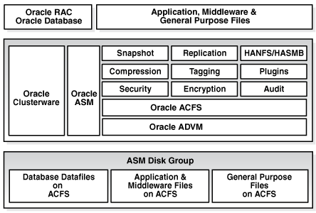

Oracle Advanced Cluster File System (Oracle ACFS) is a multi-platform, scalable file system, and storage management technology that extends Oracle Automatic Storage Management (Oracle ASM) functionality to support all customer files.

Oracle ACFS supports Oracle Database files and application files, including executables, database data files, database trace files, database alert logs, application reports, BFILEs, and configuration files. Other supported files are video, audio, text, images, engineering drawings, and all other general-purpose application file data. Oracle ACFS conforms to POSIX standards for Linux and UNIX.

An Oracle ACFS file system communicates with Oracle ASM and is configured with Oracle ASM storage, as shown in the following figure.

Figure 1-1 Oracle ACFS Storage Layers

> This illustration shows Oracle ACFS storage layers.
>
> At the top are Oracle RAC, Oracle Database, and client applications.
>
> The middle layer includes Oracle Clusterware, Oracle ASM, Oracle Advanced Cluster File System (Oracle ACFS) file system, third-party file systems, and Oracle ASM Dynamic Volume Manager (Oracle ADVM).
>
> The layer at the bottom shows the Oracle ASM disk group and the files it may contain.

Oracle ACFS leverages Oracle ASM functionality that enables:

- Oracle ACFS dynamic file system resizing
- Maximized performance through direct access to Oracle ASM disk group storage
- Balanced distribution of Oracle ACFS across Oracle ASM disk group storage for increased I/O parallelism
- Data reliability through Oracle ASM mirroring protection mechanisms

Oracle ACFS establishes and maintains communication with the Oracle ASM instance to participate in Oracle ASM state transitions including Oracle ASM instance and disk group status updates and disk group rebalancing. Oracle Automatic Storage Management with Oracle ACFS and Oracle ASM Dynamic Volume Manager (Oracle ADVM) delivers support for all customer data and presents a common set of Oracle storage management tools and services across multiple vendor platforms and operating system environments on both Oracle Restart (standalone) and cluster configurations.

Oracle ACFS is tightly coupled with Oracle Clusterware technology, participating directly in Clusterware cluster membership state transitions and in Oracle Clusterware resource-based high availability (HA) management. In addition, Oracle installation, configuration, verification, and management tools have been updated to support Oracle ACFS.

Oracle ACFS can be accessed and managed using native operating system file system tools and standard application programming interfaces (APIs). Oracle ACFS can also be managed with Oracle ASM Configuration Assistant. Oracle ACFS can be accessed using industry standard Network Attached Storage (NAS) File Access Protocols: Network File System (NFS) and Common Internet File System (CIFS).

In addition to sharing file data, Oracle ACFS provides additional storage management services including support for the Oracle Grid Infrastructure clusterwide mount registry, dynamic online file system resizing, and multiple space efficient snapshots for each file system.

Oracle ACFS contributes to the overall Oracle storage management by providing:

- A general-purpose standalone server and cluster file system solution that is integrated with Oracle ASM and Oracle Clusterware technologies
- A common set of file system features across multiple vendor platforms and operating systems, offering an alternative to native operating system or third-party file system solutions
- Standalone and clusterwide shared Oracle Database homes, all Oracle Database files, and application data
- Uniform, coherent shared file access and clusterwide naming of all customer application files
- Integration with Oracle Clusterware High Availability Resources

Oracle ACFS accommodates large storage capacities and large numbers of cluster nodes. It efficiently manages large numbers of file systems, files, and supports both small and large sized files with exabyte-capable file and file system capacities. Oracle ACFS provides optimized fast directory lookup for large directories with millions of files.

Oracle ACFS provides support for sparse files. Oracle ACFS sparse files greatly benefit NFS client write operations which are commonly received out of order by the NFS server and the associated Oracle ACFS file system. Usually when an application writes beyond the end of file, storage is allocated and zeroes inserted beyond the old end of file and the beginning of the new. With this feature, a hole remains in the file instead of the inserted zeroes. Oracle ACFS then fills these holes with zeroes in memory when the holes are read. The sparse files feature benefits NFS performance and also the performance and disk utilization of other applications that intentionally perform this type of writing. In addition, there are also reduced time and storage benefits for files that are inherently sparse, meaning they have a lot of unused space, such as some image files for virtual machines. For sparse file support, the `COMPATIBLE.ADVM` disk group attribute must be set to `12.2` or greater.

Oracle ACFS file systems are generally mounted on all cluster nodes to deliver a single name space for the cluster so that each node maintains the same view and access capabilities to the mounted file systems. In the event of a member failure, another cluster member quickly recovers any outstanding metadata transactions on behalf of the failed member. Following recovery, access by other active cluster members and any remote client systems can resume.

The following list provides important information about Oracle ACFS:

- It is recommended to change your ADVM compatibility to the running release whenever possible for the latest performance benefits. This is not the default.
- For all applications, Oracle ACFS performance is best with larger write() sizes, such as 8 K or larger.
- For best performance with non-spinning disks, Oracle recommends setting the I/O scheduler to 'none'. For best performance with spinning disks, set the I/O scheduler to to 'mq-deadline' when available, otherwise 'none'.
- Oracle ACFS does not support any files associated with the management of Oracle ASM, such as files in the Oracle Grid Infrastructure home and in the Oracle ASM diagnostic directory.
- Oracle ACFS does not support Oracle Cluster Registry (OCR) and voting files.
- Oracle ACFS functionality requires that the disk group compatibility attributes for `ASM` and `ADVM` be set to `11.2` or higher.
- To use an Oracle ACFS file system for an Oracle Database home, the release level must be Oracle 11g Release 2 (11.2) or later.

Note:

The following features are desupported in Oracle ACFS 21c:

- Desupport of Oracle ACFS Replication Version 1
	Starting with Oracle ACFS 21c, Oracle ACFS replication protocol version 1 is desupported. Replication protocol version 1 has been replaced with snapshot-based replication version 2, introduced in Oracle ACFS 12c Release 2 (12.2.0.1).
- Desupport of Oracle ACFS Encryption on Solaris and Windows
	Starting with Oracle ACFS 21c, Oracle ACFS encryption is desupported on Solaris and Microsoft Windows operating systems.
	Oracle ACFS Encryption on Oracle Solaris and Microsoft Windows is based on RSA technology. Retirement of RSA technology has been announced. Oracle ACFS Encryption continues to be supported on Linux, and is unaffected by this deprecation, because Linux uses an alternative technology.
- Desupport of Oracle ACFS Security (Vault) and ACFS Auditing
	Starting with Oracle ACFS 21c, Oracle ACFS Security (Vault) and ACFS Auditing are desupported.
	Desupporting cluster features with limited adoption allows Oracle to focus on improving core scaling, availability, and manageability across all features and functionality. Oracle ACFS Security (Vault) and ACFS Auditing are desupported.
- Desupport of Oracle ACFS on Microsoft Windows
	Starting with Oracle ACFS 21c, Oracle ACFS is desupported on Windows.
	Oracle ACFS is used for two major use cases: Oracle Database Files for Oracle Real Application Clusters (Oracle RAC) and generic files (unstructured data) that need to be shared across multiple hosts. For Oracle Real Application Clusters files, Oracle recommends that you use Oracle ASM. For generic files, depending on your use case, Oracle recommends that you either move files to Oracle Database File System (DBFS), or move files to Microsoft Windows shared files.
- Desupport of Oracle ACFS Remote
	Starting with Oracle ACFS 21c, Oracle ACFS on Member Clusters (ACFS Remote) is desupported.
	Oracle ACFS on Member Clusters (ACFS Remote) is desupported. Desupporting certain clustering features with limited adoption allows Oracle to focus on improving core scaling, availability, and manageability across all features and functionality. Deprecating certain clustering features with limited adoption allows Oracle to focus on improving core scaling, availability, and manageability across all features and functionality.
- Desupport of Cluster Domain - Member Clusters
	Starting with Oracle Grid Infrastructure 21c, Member Clusters, which are part of the Oracle Cluster Domain architecture, are desupported.
	Desupporting certain clustering features with limited adoption allows Oracle to focus on improving core scaling, availability, and manageability across all features and functionality. Oracle Cluster Domains consist of a Domain Services Cluster (DSC) and Member Clusters. While Member Clusters were first introduced to simplify the management of larger cluster estates and minimize outage times for certain failures and configurations, additional enhancements in standalone clusters meanwhile provide the same benefits, making the use of Member Clusters unnecessary. Consequently, customers currently using Member Clusters are best advised to use Standalone Clusters going forward.

See Also:

- [Overview of Oracle ASM Dynamic Volume Manager](overview-advm.md) for an overview of Oracle ADVM
- [Oracle Clusterware Resources and Oracle ACFS Administration](understand-acfs-admin.md) for information Oracle Clusterware High Availability Resources
- [Oracle ACFS Features Enabled by Compatibility Attribute Settings](understand-acfs-admin.md) for information about Oracle ACFS features and disk group compatibility attribute settings
- [Managing Oracle ACFS with Command-Line Tools](manage-acfs-advm-commands.md) and [Using Views to Display Oracle ACFS Information](views-acfs-advm-info.md) for information about managing and monitoring Oracle ACFS