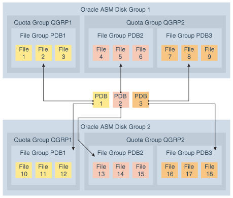

Oracle ASM provides database-oriented storage management with flex and extended disk groups.

An Oracle ASM flex disk group is a disk group type that supports Oracle ASM file groups. An Oracle ASM file group describes a group of files that belong to a database, and enables storage management to be performed at the file group, or database, level. An Oracle ASM extended disk group has all the features of a flex disk group, with a specific design to be highly available in an extended (or stretch) cluster environment.

This section discusses the following topics:

### About Oracle ASM Flex Disk Groups

An Oracle ASM flex disk group is a disk group type that supports Oracle ASM file groups and quota groups.

In general, a flex disk group enables users to manage storage at the granularity of the database, in addition to at the disk group level.

The following are characteristics of a flex disk group:

- The redundancy of files in a flex disk group is flexible and enables storage management at the database level.
- File groups of flex disk groups are used to describe database files.
	Each database has its own file group, and storage management can be done at the file group level, in addition to the disk group level. For example, you can specify different redundancy and rebalance settings for different file groups. File groups are associated with a quota group, enabling easy quota management.
- The redundancy setting of a flex disk group is set to `FLEX` `REDUNDANCY` and each file group of the flex disk group has its own redundancy property setting.
- A flex disk group generally tolerates two failures, the same as a `HIGH` redundancy disk group.
	However, if the disk group has fewer than five failure groups, then it can only tolerate one failure. This restriction is the result of the quorum requirement of the disk group.
- The failure tolerated by a database is dependent on the redundancy setting of its associated file group in the flex disk group.
- A flex disk group requires a minimum of three failure groups.
- If a disk group with `FLEX` `REDUNDANCY` has only two regular failure groups and one quorum failure group, then only two copies of the data are stored, even if `HIGH` `REDUNDANCY` is selected for a database file in the flex disk group. This behavior is a consequence of having only two regular failure groups. However, if an additional regular failure group is added later, then a third copy of the data is created automatically. After the addition of the regular failure group, if one failure group is lost and a rebalance completes successfully, then the disk group can remain mounted after a second failure group goes offline.
- Migrating (converting) to a flex disk group can be performed for a `NORMAL` or `HIGH` redundancy disk group with the `CONVERT` `REDUNDANCY` `TO` `FLEX` clause of the `ALTER` `DISKGROUP` SQL statement. You cannot migrate an `EXTERNAL` redundancy disk group to a `FLEX` redundancy disk group.
	Note:
	- When migrating to a flex disk group, a disk group with `NORMAL` redundancy must have a minimum of three failure groups and a disk group with `HIGH` redundancy must have a minimum of five failure groups.
	- The Virtual Allocation Metadata (VAM) migration disk group attribute must be enabled and the migration completed before migrating without the use of a restrictive mount.
- A flex disk group enables the creation of point-in-time database clones.
	A point-in-time database clone is a full copy of a specific database, not the underlying storage system. Only data files are copied. Other files are created, or referenced as required to create the clone. For information about flex disk groups and point-in-time database clones, refer to About Point-In-Time Database Cloning With Oracle ASM Flex Disk Groups.
- The default size of the allocation unit (AU) is 4 M.
- The Virtually Allocated Metadata (VAM) is enabled and required for a flex disk group.
- Flex disk groups require the `COMPATIBLE.ASM` and `COMPATIBLE.RDBMS` disk group attributes to be set at `12.2` or greater.
- To create an Oracle ADVM volume on a flex disk group, the `COMPATIBLE.ADVM` disk group attribute must be set to `12.2` or greater.

Note:

The `REQUIRED_MIRROR_FREE_MB` and `USABLE_FILE_MB` columns in the `V$ASM_DISKGROUP` view report no values for a flex disk group.

The following examples illustrate how to use SQL statements to:

- Create a flex disk group
- Migrate a normal disk group to a flex disk group

Example 4-13 Using CREATE DISKGROUP to create a flex disk group

```
SQL> CREATE DISKGROUP flex_data FLEX REDUNDANCY DISK my_disk_discovery_path;
```

Example 4-14 Using ALTER DISKGROUP to migrate a normal disk group to a flex disk group

```
SQL> CREATE DISKGROUP normaltoflex NORMAL REDUNDANCY
  DISK '/devices/diskm*'
  ATTRIBUTE 'au_size'='4M',
    'compatible.asm' = '19.0', 
    'compatible.rdbms' = '19.0',
    'compatible.advm' = '19.0';

Diskgroup created.

SQL> ALTER DISKGROUP normaltoflex CONVERT REDUNDANCY TO FLEX;

Diskgroup altered.

SQL> SELECT name, type FROM V$ASM_DISKGROUP WHERE name = 'NORMALTOFLEX';

NAME                           TYPE
------------------------------ ------
NORMALTOFLEX                   FLEX
```

### About Oracle ASM File Groups

An Oracle ASM file group is a group of files that share the same set of properties and characteristics.

Note:

A multitenant container database is the only supported architecture in Oracle Database 21c. While the documentation is being revised, legacy terminology may persist. In most cases, "database" and "non-CDB" refer to a CDB or PDB, depending on context. In some contexts, such as upgrades, "non-CDB" refers to a non-CDB from a previous release.

A major benefit of file groups is the ability to have a different availability specification for each database that shares the same disk group.

The set of properties for an Oracle ASM file group includes redundancy, rebalance rebuild priority, rebalance power limit, client compatibility, striping, quota group, and the access control list.

The following list provides important notes about file groups.

- A disk group contains at least one file group, the default file group.
- A disk group can contain multiple file groups.
- A disk group must have `FLEX` or `EXTENDED` redundancy to contain a file group.
- A disk group can store files belonging to multiple databases with each database having a separate file group.
- A database can have only one file group in a disk group.
- A database can span multiple disk groups with multiple file groups in different disk groups. The file groups belonging to a database in multiple disk groups should all have the same name for consistency and easy identification.
- A file group can belong to only one disk group.
- A file group can describe only one database, PDB, CDB, volume, or cluster.
- A file group of an Oracle ADVM volume in a flex disk group always has the name of the associated volume. There can be only one volume in a file group.
- A file group can belong to only one quota group.
- Automatically created file groups are associated with the generic quota group.
- When a database, PDB, or CDB is created, if an existing file group has a client ID or name that matches the ID or name of the database, PDB, or CDB, then that file group is used to describe its files. Otherwise, a new file group is created for the database, PDB, or CDB.
- A file group that is automatically created as a result of a create database operation is identified as system-created. This system-created file group is dropped when the database is dropped. However, if you manually create a file group, then that file group is not automatically dropped when you drop the related database. You must explicitly drop the manually-created file group.

The following figure illustrates the use of Oracle ASM file groups and quota groups in a multitenant environment. In this illustration, PDB3 could be a clone of PDB2. File groups and quota groups in different disk groups can have the same name.

Figure 4-1 Oracle ASM File Groups



> This illustration is described in the surrounding text.


In the figure, file groups named PDB1 in disk group 1 and disk group 2 are dedicated to pluggable database PDB1, file groups named PDB2 in disk group 1 and disk group 2 are dedicated to pluggable database PDB2, and file groups named PDB3 in disk group 1 and disk group 2 are dedicated to pluggable database PDB3.

File group PDB1 in disk group 1 belongs to quota group QGRP1 in disk group 1. File group PDB1 in disk group 2 belongs to quota group QGRP1 in disk group 2. File groups PDB2 and PDB3 in disk group 1 belong to quota group QGRP2 in disk group 1. File groups PDB2 and PDB3 in disk group 2 belong to quota group QGRP2 in disk group 2.

You can administer file groups with SQL statements. For example, you can use the `FILEGROUP` clause of the `ALTER DISKGROUP` SQL statement to administer file groups.

Example 4-15 Adding a File Group to a Database

This example shows how SQL statements are used to add a file group for a pluggable database. The SQL statements also associate the newly added file group to an existing quota group.

```
ALTER DISKGROUP DATA ADD FILEGROUP DATAFG1_PDB1
     DATABASE ORCL_PDB1 
     SET 'quota_group' = 'Quota_QGRP1';
```

Example 4-16 Modifying a File Group

This example shows how to modify the `redundancy` property for a specific file type in a file group.

```
ALTER DISKGROUP DATA MODIFY FILEGROUP DATAFG1_PDB1
    SET 'datafile.redundancy' = 'HIGH';
```

ASMCMD provides the following commands to manage and track file and quota groups.

- `chfg` and `chqg` to modify a file group or quota group
- `lsfg` and `lsqg` to list file groups or quota groups
- `mkfg` and `mkqg` to create a file group or quota group
- `rmfg` and `rmqg` to delete a file group or quota group
- `mvfg` to move a file group

You can drop a file group including its associated files (drop including content) using the `CASCADE` keyword with the `ALTER` `DISKGROUP`... `DROP` `FILEGROUP` SQL statement or the `—r` option with the ASMCMD `rmfg` command.

To monitor Oracle ASM file groups, you can check the `V$ASM_FILEGROUP`, `V$ASM_FILEGROUP_PROPERTY`, and `V$ASM_FILEGROUP_FILE` views. You can also display information about Oracle ASM file groups with the ASMCMD `lsfg` command.

See Also:

- About Quota Groups for Oracle ASM File Groups for information about quota groups.
- [ASMCMD File Group Management Commands](asmcmd-filegroup-commands.md) for information about ASMCMD commands to administer Oracle ASM File Groups
- [Oracle Database Reference](https://docs.oracle.com/pls/topic/lookup?ctx=en/database/oracle/oracle-database/21/ostmg&id=REFRN003) for information about the `V$ASM*` dynamic performance views

### About Oracle ASM File Group Properties

The following list summarizes the properties of file groups. You can create a customized a set of file group properties in a file group template that can be inherited by a number of databases. For more information, refer to File Group Property Templates.

- `COMPATIBLE.CLIENT`
	The current value of this file group property is the last known client compatibility during a file open operation.
	The `COMPATIBLE.RDBMS` disk group attribute must be set less than or equal to:
	- `COMPATIBLE.CLIENT` of each file group (when set)
		- `COMPATIBLE` database initialization parameter (for each database that is connected to Oracle ASM)
		- `COMPATIBLE.ASM` of the disk group
	You must be an Oracle ASM administrator to modify this property.
- `DBCLONE_STATUS`
	This file group property specifies the status of the database split operation. This property cannot be set manually.
	During the split operation of the database associated with this file group, the file group property contains one of the following values.
	- `PREPARING`
		The process to prepare the database for splitting has started, but the database is not yet ready to be split.
		- `PREPARED`
		The preparation process is complete and the database is ready to be split.
		- `SPLITTING`
		The process to split the database files has started.
		- `SPLIT COMPLETED`
		The database has been split.
		- `DROPPING`
		The process to drop the prepared database clone has started.
		- `FAILED`
		The clone operation has failed. The rebalance operation should drop the incomplete clone.
- `OWNER`
	This file group property specifies the `OWNER` setting. To set the `OWNER` property, the `ACCESS_CONTROL.ENABLED` disk group attribute must be set to `TRUE` to enable Oracle ASM File Access Control. The user specified as the owner must be a member of the disk group.
	Only the Oracle ASM administrator, the `OWNER`, the `OWNER` of the `USER_GROUP` associated with the file group, and a member of the `USER_GROUP` associated with the file group can modify the attributes of file groups that are labeled with `A database administrator can modify this property`. This is true only if `ACCESS_CONTROL.ENABLED` is true.
	You can display the owner with the `USER_NUMBER` and `USER_INCARNATION` columns of the `V$ASM_FILEGROUP` view. The values in `USER_NUMBER` and `USER_INCARNATION` can be joined with the `USER_NUMBER` and `INCARNATION` columns of the `V$ASM_USER` view to display the user names.
	The default value is `NULL`.
	You must be an Oracle ASM administrator to modify this property.
- `PARENT_FILEGROUP_NUMBER`
	This file group property specifies the Parent File Group number. This property cannot be set manually.
	When a database is prepared for split, a child file group is created for the shadow files. The child file group automatically has the `PARENT_FILEGROUP_NUMBER` property set.
- `POWER_LIMIT`
	This file group property specifies the rebalance power, which determines the number of parallel relocations for disk rebalancing of this file group. The valid settings are `1` to `1024`. When rebalancing a file group, the power limit value is applied as follows:
	1. If the power option has been explicitly specified in the `ALTER` `DISKGROUP` `REBALANCE` SQL statement or the ASMCMD `rebal` command, then the power value specified in the SQL rebalance statement or ASMCMD rebalance command is used for rebalancing all file groups.
		2. If the power option has not been specified in the SQL rebalance statement or ASMCMD rebalance command, then the file group `POWER_LIMIT` property value, if set, applies for the file group rebalance.
		3. If the power option has not been specified in the SQL rebalance statement or ASMCMD rebalance command, and the `POWER_LIMIT` property has not been set for the file group, then the power value defaults to the value of the `ASM_POWER_LIMIT` initialization parameter for the file group rebalance.
	You must be a database administrator to modify this property.
- `PRIORITY`
	This file group property specifies the rebalance priority and ensures that certain types of files are rebalanced before others. File groups with the highest priority are completely rebalanced first, then file groups with the next highest priority, and so on to the lowest priority.
	You can set the rebalance priority setting to `HIGHEST`, `HIGH`, `MEDIUM`, `LOW`, or `LOWEST`. The default value is `MEDIUM`.
	You must be a database administrator to modify this property.
- `QUOTA_GROUP`
	This file group property specifies the name of the quota group to which this file group belongs. The valid setting is an existing quota group name. The default value is `GENERIC`. Every file group in the disk group must be a member of a quota group.
	You must be an Oracle ASM administrator to modify this property.
- `REDUNDANCY`
	This file type property specifies the redundancy for the file group. The default redundancy setting for each file type is derived from the system templates. The valid settings are:
	- `HIGH`
		`HIGH` redundancy provides three-way mirroring for all files.
		- `MIRROR`
		`MIRROR` redundancy provides two-way mirroring for all files.
		- `PARITY`
		To reduce the overhead of data protection associated with Oracle ASM, parity protection is provided for FLEX redundancy disk groups. Parity redundancy is restricted to data not requiring ongoing updating to reduce the execution impact with parity protection. The `PARITY` setting is intended for write-once files, such as archive logs and backup sets and is not supported on data files and read/write files.
		- `DOUBLE`
		`DOUBLE` specifies double parity and tolerates double failures for FLEX redundancy disk groups.
		- `UNPROTECTED`
		`UNPROTECTED` does not provide mirroring by Oracle ASM.
	If a file is created as `UNPROTECTED`, `MIRROR`, or `HIGH` redundancy, its redundancy can change to `UNPROTECTED`, `MIRROR`, or `HIGH`. If redundancy has been changed, then the `REMIRROR` column of `V$ASM_FILE` contains `Y` to indicate that the file needs new mirroring, initiating a rebalance to put the new redundancy into effect. After the rebalance completes, the value in the `REMIRROR` column contains `N`.
	`PARITY` and `DOUBLE` redundancy are supported only on FLEX redundancy disk groups (not EXTENDED disk groups).
	When a file is created with `PARITY` or `DOUBLE` redundancy, that file can never change redundancy.
	`PARITY` requires a minimum of three regular (not quorum) failure groups in the flex disk group. `DOUBLE` requires a minimum of five regular (not quorum) failure groups in the flex disk group.
	- If there are three or more failure groups when the parity file is created, then each parity extent set has 2+1 single parity. This scenario incurs 50% redundancy overhead rather than 100% redundancy overhead for NORMAL redundancy (two-way mirror files).
		- If there are five or more failure groups when the parity file is created, then each parity extent set has 2+2 double parity. Double parity requires at least 5 failure groups. This scenario incurs 100% redundancy overhead rather than 200% redundancy overhead for HIGH redundancy (three-way mirror files).
	When the file group redundancy property is modified from a `HIGH`, `MIRROR`, or `UNPROTECTED` setting to a `PARITY` or `DOUBLE` setting, the redundancy of the existing files in the file group does not change. This behavior also applies to a change from `PARITY` or `DOUBLE` to a `HIGH`, `MIRROR`, or `UNPROTECTED` setting. However, any files created in the future adopt the new redundancy setting.
	Changing the file group redundancy may not modify the redundancy of files that are being created concurrently when the `ALTER` `DISKGROUP` `MODIFY` `FILEGROUP` SQL command is issued. To complete the redundancy change, issue the `ALTER` `DISKGROUP` `MODIFY` `FILEGROUP` SQL command again after those files have been created.
	If the redundancy in the file group is increased, then the value of the `REDUNDANCY` column of `V$ASM_FILE` is increased after rebalance completes. However, if the redundancy in the file group is decreased, then the value of the `REDUNDANCY` column of `V$ASM_FILE` is lowered immediately before rebalance is run.
	Changing the redundancy without specifying a file type affects all file types.
	You must be a database administrator to modify this property.
- `STRIPING`
	This file type property specifies the `STRIPING` setting for each file type. Usually the default value for each file type is sufficient and is not changed.
	Most files have a `COARSE` stripe, except for the control file which has a `FINE` stripe by default. The valid settings are `COARSE` and `FINE`. The default value is `COARSE` or derived from the file type template.
	`STRIPING` affects only newly-created files and cannot be changed after the file is created.
	You must be a database administrator to set this property.
- `USER_GROUP`
	This file group property specifies the `USER_GROUP` setting. To set the `USER_GROUP` property, the `ACCESS_CONTROL.ENABLED` disk group attribute must be set to `TRUE` to enable Oracle ASM File Access Control. The user group specified must be an existing user group.
	Only the Oracle ASM administrator, the `OWNER`, the `OWNER` of the `USER_GROUP` associated with the file group, and a member of the `USER_GROUP` associated with the file group can modify the attributes of file groups that are labeled with `A database administrator can modify this property`. This is true only if `ACCESS_CONTROL.ENABLED` is true.
	You can display the user group information with the `USERGROUP_NUMBER` and `USERGROUP_INCARNATION` columns of the `V$ASM_FILEGROUP` view. The values in `USERGROUP_NUMBER` and `USERGROUP_INCARNATION` can be joined with the `USERGROUP_NUMBER` and `INCARNATION` columns of the `V$ASM_USERGROUP` view to display the user group names.
	Files created in a file group inherit the `USER_GROUP` property setting.
	Clones inherit the `USER_GROUP` property setting.
	The default value is `NULL`.
	You must be an Oracle ASM administrator to modify this property.

Example 4-17 Setting a file group property for file types

The following SQL statements set the `REDUNDANCY` file group property for the `datafile` and `archivelog` file types.

```
ALTER DISKGROUP DATA MODIFY FILEGROUP DATAFG1_PDB1
          SET 'datafile.redundancy' = 'HIGH';

ALTER DISKGROUP DATA MODIFY FILEGROUP DATAFG1_PDB1
      SET 'archivelog.redundancy' = 'MIRROR';
```

Example 4-18 Setting the file group redundancy property for an ADVM volume

The following SQL statement sets the `REDUNDANCY` file group property for the Oracle ADVM volume. To enable Oracle ADVM volumes to change redundancy, both `COMPATIBLE.ASM` and `COMPATIBLE.ADVM` must be set to `18.1` or greater. For Oracle ADVM volumes, you cannot change the redundancy setting of individual file types.

```
SQL> ALTER DISKGROUP DATA MODIFY FILEGROUP volume1 SET 'redundancy'='high';
```

File Group Property Templates

You can create a file group template with the `ADD` `FILEGROUP` clause of `ALTER` `DISKGROUP` to customize a set of file group properties that can be inherited by multiple databases.

```
SQL> ALTER DISKGROUP data2 ADD FILEGROUP fg_template1 TEMPLATE SET 'datafile.redundancy'='unprotected';
```

You can customize a file group template similar to modifying a regular file group.

```
SQL> ALTER DISKGROUP data2 MODIFY FILEGROUP fg_template1 SET 'controlfile.redundancy'='high';
```

Multiple file groups can be created from a file group template to inherit the properties in the template. Using a file group template automatically creates a new file group for the database if one is not already created, and the new file group inherits the properties of the file group template.

```
SQL> ALTER DISKGROUP data2 ADD FILEGROUP fg_db DATABASE NONE FROM TEMPLATE fg_template2;
```

Note:

You can specify the name of an Oracle ASM file group as part of a file name. For example:

```
+diskgroup_name(fg$file_group_name)/file_name
```

Similar syntax is used for indicating the name of a file group rather than a template.

Multiple tablespaces or databases can be created to inherit customized properties from a file group template. In the example, the `fg$` prefix in `fg$fg_template2` is a fixed string that indicates the name of a file group rather than the name of a template.

```
SQL> CREATE TABLESPACE tbs1 datafile '+data2(fg$fg_template2)/dbs/tbs1.f' size 1M;
```

See Also:

- [What Types of Files Does Oracle ASM Support?](asm-files-directories-templates.md) for a list of Oracle ASM file types
- [Managing Oracle ASM File Access Control for Disk Groups](asm-access-control-diskgroups.md) for information about Oracle ASM File Access Control
- Oracle Database Reference for information about file group properties displayed in the [V$ASM\_FILEGROUP\_PROPERTY](https://docs.oracle.com/pls/topic/lookup?ctx=en/database/oracle/oracle-database/21/ostmg&id=REFRN-GUID-DA2152BF-2582-4E96-A2B6-5EB262113EEE) and [V$ASM\_FILEGROUP](https://docs.oracle.com/pls/topic/lookup?ctx=en/database/oracle/oracle-database/21/ostmg&id=REFRN-GUID-FCC3152C-7416-4322-A0F8-BB6A3AB2987E) dynamic performance views

### About Quota Groups for Oracle ASM File Groups

A quota group defines the quota allocated to a group of Oracle ASM File Groups. A file group belongs to only one quota group. For information about file groups, refer to About Oracle ASM File Groups.

A quota can describe an aggregate of space used by different databases.

The following list provides important notes about quota groups for file groups.

- A file group can belong to only one quota group.
- A quota group cannot span multiple disk groups.
- A quota group describes an aggregate of space used by one file group or multiple file groups in the same disk group.
	A file group for a PDB and a file group for a clone of that PDB could be a scenario where file groups would share a common quota group.
	A file group clone by default inherits the parent’s quota group. However, the clone could belong to a different quota group.
- A quota is enforced when a file is created and resized.
- A quota is a physical space.
	As a consequence, if the quota limit has been set to 10 M, then a two-way mirrored 6 M file exceeds the quota.
- Each quota group has two values: the limit and the current used space.
	The limit value can be set below the current used space. This action prevents any additional space being allocated for files described by file groups associated with this quota group.
- A file group can be moved from one quota group to another, regardless whether or not the target quota group has enough space for the file group.
	This capability enables an Oracle ASM administrator to stop any files described by a specific file group from allocating additional space.

You can administer quota groups with SQL and ASMCMD commands. The following examples illustrate how SQL statements are used to add a quota group to a disk group and how to move a file group from its current quota group to a new quota group.

Example 4-19 Adding a Quota Group to a Disk Group

```
ALTER DISKGROUP DATA ADD QUOTAGROUP Quota_QGRP1 
                SET 'quota'= 10m;
```

Example 4-20 Moving a File Group to a new Quota Group

```
ALTER DISKGROUP DATA MODIFY FILEGROUP DATAFG1_PDB1
               SET 'quota_group' = 'Quota_QGRP2';
```

### About Oracle ASM Extended Disk Groups

An Oracle ASM extended disk group has all the features of a flex disk group, with a specific design to be highly available in an extended (stretch) cluster environment, which contains nodes that span multiple physically separated sites.

The following are characteristics of an extended disk group:

- The redundancy setting of an extended disk group is set to `EXTENDED` `REDUNDANCY` and each file group of the extended disk group has its own redundancy property setting.
- The redundancy of files and file groups in an extended disk group is specified for each site, rather than for each disk group.
	This means that the number of copies determined by the `REDUNDANCY` setting is multiplied by the number of data sites. If the `REDUNDANCY` is set to `MIRROR`, then that specifies two copies, resulting in four copies total for two data sites.
- An extended disk group can tolerate the loss of an entire site, plus the loss of up to two failure groups in another site.
	This means that an extended disk group can tolerate failures at the site level in addition to the failure group level.
- All data sites must have the same number of failure groups during disk group creation.
- A quota group is specified for each disk group, rather than for each site.
- The quota group limit is the physical space required for all copies across all sites.
	For example, with two data sites, a 6 M file with redundancy set to `MIRROR` uses 24 M of the quota limit.
- There must be a total of three sites, two data sites and one quorum site, to create an extended disk group. Each data site should have three failure groups, and the quorum site should have one failure group.
- For database files, the redundancy setting is dictated by the redundancy setting of the file groups of the extended disk group.
- The `COMPATIBLE.ASM` and `COMPATIBLE.RDBMS` disk group attributes must be set to `12.2` or greater.
- The minimum allocation unit (AU) size is 4 M.
- Converting from another disk group type to an extended disk group is not supported.
- The `SITE` specification for failure groups can be inferred from cells if Oracle Exadata has been configured. Otherwise, the site specification can be specified with the SQL statement when creating a disk group.

Note:

The `REQUIRED_MIRROR_FREE_MB` and `USABLE_FILE_MB` columns in the `V$ASM_DISKGROUP` view report no values for an extended disk group.

The following example illustrates how to create an extended disk group with a SQL statement.

Example 4-21 Using CREATE DISKGROUP with extended disk groups

```
SQL> CREATE DISKGROUP extended_site_data EXTENDED REDUNDANCY 
        SITE NY FAILGROUP fg1 DISK '/devices/disks/disk01' 
                FAILGROUP fg2 DISK '/devices/disks/disk02' 
                FAILGROUP fg3 DISK '/devices/disks/disk03' 
        SITE NJ FAILGROUP fg4 DISK '/devices/disks/disk04' 
                FAILGROUP fg5 DISK '/devices/disks/disk05' 
                FAILGROUP fg6 DISK '/devices/disks/disk06' 
        SITE QM QUORUM 
                FAILGROUP fg7 DISK '/devices/disks/disk07';
```

### About Point-In-Time Database Cloning With Oracle ASM Flex Disk Groups

Before creating a point-in-time database clone, review the following requirements.

Note:

- Point-in-time database clones are supported only in Oracle ASM flex and extended disk groups.
- Point-in-time database clones are supported only with Oracle Database 18c, version 18.1 or higher.
- Point-in-time database clones require disk group compatibility attributes `COMPATIBLE.ASM` and `COMPATIBLE.RDBMS` be set to `18.0` or higher.
- The source database (parent) must be a pluggable database. The database clone (child) created is a pluggable database under the same container database or in a different container database.

Oracle ASM provides support for creating a point-in-time database clone which is a mirror copy of a pluggable database. All the data files of the database being cloned should be present in a single disk group. The cloning operation can be used for rapid configuration of identical copies. You can specify the redundancy setting of the database data files in the database clone, or the setting can default to the redundancy of the data files in the source database that is being the cloned.

The copy of data files created during the cloning process is initially identical to the source. However, after the cloning process has completed, updates to the source do not result in any change to the child that has been cloned. The `V$ASM_DBCLONE_INFO` view shows the relationship between the source database, the cloned database, and their file groups. The `V$ASM_DBCLONE_INFO` should be run on the Oracle ASM instance.

In the examples shown in this topic, the source database is present on the `DATA` flex disk group.

Database cloning has these steps:

1. Preparing the Mirrored Copy
	During this step, Oracle ASM allocates space for the additional copies of data. This process involves creating the cloned files and linking them with the source files. However, the data is not copied at this time; the copying is done during remirroring. Remirroring occurs during the prepare phase of rebalance, which is initiated as part of this step. Only one mirror copy can be in existence at any time. All the data files of the given database or the pluggable database should reside on a single disk group. The mirror copy must be used to create a database clone before another mirror copy can be created.
	A file group is created and all the cloned files are made part of this file group. The redundancy of the database data files in the file group is set to the value that you specify, or the value defaults to the redundancy setting of the source file group. The quota group associated with the clone is the same as that of the source database.
	Oracle ASM File Access Control properties associated with the clone are the same as those associated with the source database. For example, the file access control user group property for the database clone is same as that of the source database.
	At the end of this step and before you start the next step, you can drop the prepared mirror copy, as described in Dropping the Prepared Mirror Copy.
2. Splitting the Mirrored Copy and Creating the Database Clone
	The prepare and copy step must complete before starting this step. You can display the `V$ASM_DBCLONE_INFO` view on the Oracle ASM instance to query the status of the ongoing prepare operation. The `DBCLONE_STATUS` column of the `V$ASM_DBCLONE_INFO` view indicates `PREPARED` when the file group is ready to be split.
	The process initiated with `CREATE` `PLUGGABLE` `DATABASE` breaks the relationship between the source database files and the cloned database files.

Preparing the Mirrored Copy to Create a PDB in the Same Container Database

The following example prepares the mirrored copy and creates a file group on the `DATA` disk group. Before you issue the `ALTER` `PLUGGABLE` `DATABASE` `PREPARE` SQL command, you must connect to the source pluggable database (`pdb1` in the examples) that is being prepared for cloning.

```
SQL>  SHOW CON_NAME
CON_NAME
------------------------------
CDB$ROOT

SQL>  ALTER SESSION SET CONTAINER = pdb1;
Session altered.

SQL> SHOW CON_NAME
CON_NAME
------------------------------
PDB1

SQL> ALTER PLUGGABLE DATABASE PREPARE MIRROR COPY pdb1_mirror;
Pluggable database altered.
```

You can query the `V$ASM_DBCLONE_INFO` view on the Oracle ASM instance to check the status of the process.

```
SQL> SELECT * FROM V$ASM_DBCLONE_INFO;
GROUP_NUMBER DBCLONE_NAME MIRRORCOPY_NAME DBCLONE_STATUS PARENT_DBNAME PARENT_FILEGROUP_NAME CON_ID
------------ ------------ --------------- -------------- ------------- --------------------- ------
           1 DB_UNKNOWN   PDB1_MIRROR     PREPARED       ORCL_PDB1     ORCL_PDB1                  0
```

Preparing the Mirrored Copy to Create a PDB in a Different Container Database

The following example prepares the mirrored copy and creates a file group on the `DATA` disk group, to be used by a different container database. Before you issue the `ALTER` `PLUGGABLE` `DATABASE` `PREPARE` SQL command, you must connect to the source pluggable database (`pdb1` in the examples) that is being prepared for cloning.

```
SQL>  SHOW CON_NAME
CON_NAME
------------------------------
CDB$ROOT

SQL>  ALTER SESSION SET CONTAINER = pdb1;
Session altered.

SQL> SHOW CON_NAME
CON_NAME
------------------------------
PDB1

SQL> ALTER PLUGGABLE DATABASE PREPARE MIRROR COPY pdb2_mirror FOR DATABASE new_cdb;
Pluggable database altered.
```

You can query the `V$ASM_DBCLONE_INFO` view on the Oracle ASM instance to check the status of the process.

```
SQL> SELECT * FROM V$ASM_DBCLONE_INFO;
GROUP_NUMBER DBCLONE_NAME   MIRRORCOPY_NAME DBCLONE_STATUS PARENT_DBNAME PARENT_FILEGROUP_NAME CON_ID
------------ -------------- --------------- -------------- ------------- --------------------- ------
           1 FOR$DB$NEW_CDB PDB1_MIRROR     PREPARED       ORCL_PDB1     ORCL_PDB1                  0
```

Splitting the Mirrored Copy and Creating the Database Clone in the Same Container Database

The following example creates the `newpdb1` database clone using the mirror copy `pdb1_mirror`. `newpdb1` is a clone of `pdb1` pluggable database and is plugged into the CDB. The `CREATE` `PLUGGABLE` `DATABASE` SQL command must be run in the root container of the CDB.

```
SQL>  SHOW CON_NAME
CON_NAME
------------------------------
CDB$ROOT

SQL> CREATE PLUGGABLE DATABASE newpdb1 FROM pdb1 USING MIRROR COPY pdb1_mirror;
Pluggable database created.

SQL>  ALTER SESSION SET CONTAINER = newpdb1;
Session altered.

SQL> SHOW CON_NAME
CON_NAME
------------------------------
NEWPDB1
```

You can query the `V$ASM_DBCLONE_INFO`, `V$ASM_FILEGROUP`, and `V$ASM_FILEGROUP_PROPERTY` views on the Oracle ASM instance for additional information.

```
SQL> SELECT * FROM V$ASM_DBCLONE_INFO;
GROUP_NUMBER DBCLONE_NAME  MIRRORCOPY_NAME DBCLONE_STATUS  PARENT_DBNAME PARENT_FILEGROUP_NAME CON_ID
------------ ------------- --------------- --------------- ------------- --------------------- ------
           1 ORCL_NEWPDB1  PDB1_MIRROR     SPLIT COMPLETED ORCL_PDB1     ORCL_PDB1                  0

SQL> SELECT NAME, GROUP_NUMBER, FILEGROUP_NUMBER FROM V$ASM_FILEGROUP;
NAME                                 GROUP_NUMBER FILEGROUP_NUMBER
------------------------------------ ------------ ----------------
DEFAULT_FILEGROUP                               1                0
ORCL_CDB$ROOT                                   1                1
ORCL_PDB$SEED                                   1                2
ORCL_PDB1                                       1                3
PDB1_MIRROR                                     1                4

SQL> SELECT NAME, VALUE FROM V$ASM_FILEGROUP_PROPERTY WHERE FILEGROUP_NUMBER = 4;
NAME                                 VALUE
------------------------------------ ------------------------------------
PRIORITY                             MEDIUM
PARENT_FILEGROUP_NUMBER              3
DBCLONE_STATUS                       SPLIT COMPLETED
COMPATIBLE.CLIENT                    18.0.0.0.0
REDUNDANCY                           MIRROR
STRIPING                             FINE
...
```

Splitting the Mirrored Copy and Creating the Database Clone in a Different Container Database

The following example creates the `newpdb2` database clone using the mirror copy `pdb2_mirror`. `newpdb2` is a clone of `pdb1` pluggable database and is plugged into a different CDB `new_cdb`. The `CREATE` `PLUGGABLE` `DATABASE` SQL command must be run in the root container of `new_cdb`.

Before running the `CREATE` `PLUGGABLE` `DATABASE` command, you must create a database link that can connect to the source CDB, from where the prepare command was issued. The `CREATE` `PLUGGABLE` `DATABASE` SQL command must be run in `CDB$ROOT`. The database user that is used by the database link to connect to the source database must have the `CREATE` `PLUGGABLE` `DATABASE` system privilege, either granted commonly or granted locally in that application container, to run the command.

The following commands must be run in the source CDB.

```
SQL> SELECT NAME FROM V$DATABASE;
NAME
---------
SRC_CDB

SQL> SHOW CON_NAME
CON_NAME
------------------------------
CDB$ROOT

SQL> CREATE USER c##dbl_user IDENTIFIED BY password;
User created.

SQL> GRANT CREATE SESSION, CREATE PLUGGABLE DATABASE TO c##dbl_user CONTAINER=all ;
Grant succeeded.
```

The following commands must be run in the target CDB.

```
SQL> SELECT NAME FROM V$DATABASE;
NAME
---------
NEW_CDB

SQL> SHOW CON_NAME
CON_NAME
------------------------------
CDB$ROOT

SQL> CREATE DATABASE LINK cdb1_dblink CONNECT TO c##dbl_user IDENTIFIED BY password USING tns_alias_to_src_cdb;
Database link created.

SQL> CREATE PLUGGABLE DATABASE newpdb2 FROM pdb1@cdb1_dblink USING MIRROR COPY pdb2_mirror;
Pluggable database created.

SQL> ALTER SESSION SET CONTAINER = newpdb2;
Session altered.

SQL> SHOW CON_NAME
CON_NAME
------------------------------
NEWPDB2
```

You can query the `V$ASM_DBCLONE_INFO`, `V$ASM_FILEGROUP`, and `V$ASM_FILEGROUP_PROPERTY` views on the Oracle ASM instance for additional information.

```
SQL> SELECT * FROM V$ASM_DBCLONE_INFO;
GROUP_NUMBER DBCLONE_NAME  MIRRORCOPY_NAME DBCLONE_STATUS  PARENT_DBNAME PARENT_FILEGROUP_NAME CON_ID
------------ ------------- --------------- --------------- ------------- --------------------- ------
           1 ORCL_NEWPDB2  PDB2_MIRROR     SPLIT COMPLETED ORCL_PDB1     ORCL_PDB1                  0

SQL> SELECT NAME, GROUP_NUMBER, FILEGROUP_NUMBER FROM V$ASM_FILEGROUP;
NAME                                 GROUP_NUMBER FILEGROUP_NUMBER
------------------------------------ ------------ ----------------
DEFAULT_FILEGROUP                               1                0
ORCL_CDB$ROOT                                   1                1
ORCL_PDB$SEED                                   1                2
ORCL_PDB1                                       1                3
PDB2_MIRROR                                     1                4

SQL> SELECT NAME, VALUE FROM V$ASM_FILEGROUP_PROPERTY WHERE FILEGROUP_NUMBER = 4;
NAME                                 VALUE
------------------------------------ ------------------------------------
PRIORITY                             MEDIUM
PARENT_FILEGROUP_NUMBER              3
DBCLONE_STATUS                       SPLIT COMPLETED
COMPATIBLE.CLIENT                    18.0.0.0.0
REDUNDANCY                           MIRROR
STRIPING                             FINE
...
```

Dropping the Prepared Mirror Copy

After preparing the mirrored copy, and before splitting the mirrored copy and creating the database clone, you can drop the prepared mirror copy.

The drop action discards all the changes performed by the `ALTER` `PLUGGABLE` `DATABASE` `PREPARE` SQL command. Similar to the `PREPARE` SQL operation, the drop action also triggers a rebalance on the appropriate disk group. You can use the `V$ASM_DBCLONE_INFO` view to query the status of the ongoing drop operation. The `DBCLONE_STATUS` column of the `V$ASM_DBCLONE_INFO` view indicates `DROPPING` when the file group is being dropped and the entry is removed after all changes are discarded.

The following example illustrates how to drop the prepared mirror copy when you are connected to the source pluggable database (`pdb1` in the example).

```
SQL> ALTER SESSION SET CONTAINER = pdb1;
Session altered.

SQL> ALTER PLUGGABLE DATABASE DROP MIRROR COPY pdb1_mirror;
Pluggable database altered.
```

Cleaning Up After Failed Attempts

The `DBCLONE_STATUS` column of the `V$ASM_DBCLONE_INFO` view indicates `FAILED` when the point-in-time clone process is unsuccessful. If you experience a failed attempt to create a point-in-time clone, then you can resolve the problem by issuing a rebalance on the disk group to clean up the file group. For example, after connecting to the Oracle ASM instance, you can run the following:

```
SQL> ALTER DISKGROUP data REBALANCE WAIT;
```

See Also:

- [Oracle Multitenant Administrator's Guide](https://docs.oracle.com/pls/topic/lookup?ctx=en/database/oracle/oracle-database/21/ostmg&id=MULTI-GUID-267F7D12-D33F-4AC9-AA45-E9CD671B6F22) for information about multitenant databases
- [Oracle Database SQL Language Reference](https://docs.oracle.com/pls/topic/lookup?ctx=en/database/oracle/oracle-database/21/ostmg&id=SQLRF-GUID-F2DBA8DD-EEA8-4BB7-A07F-78DC04DB1FFC) for information about the `CREATE` `PLUGGABLE` `DATABASE` SQL statement
- [Oracle Database SQL Language Reference](https://docs.oracle.com/pls/topic/lookup?ctx=en/database/oracle/oracle-database/21/ostmg&id=SQLRF-GUID-D966642A-B19E-449D-9968-1121AF06D793) for information about the `CREATE` `DATABASE` `LINK` SQL statement
- [Oracle Database Reference](https://docs.oracle.com/pls/topic/lookup?ctx=en/database/oracle/oracle-database/21/ostmg&id=REFRN-GUID-434D0A47-A61C-4882-8FAC-9539F272E609) for information about the `V$ASM_DBCLONE_INFO` view