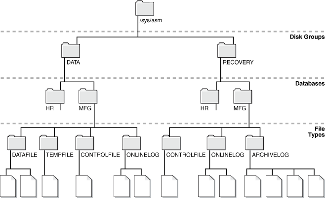

Administration of Oracle ASM includes the management of files, directories, and templates.

This chapter describes how to administer files when you use the Oracle Automatic Storage Management (Oracle ASM) storage option.

This chapter contains the following topics:

### What Types of Files Does Oracle ASM Support?

Oracle ASM supports most file types required by the database.

Table 5-1 lists file types that are supported directly by Oracle ASM and lists the system default template that provides the attributes for file creation. Some file types shown in the table are related to specific products or features, and are not discussed in this book.

Table 5-1 File types supported by Oracle ASM

| File Type | Default Templates |
| --- | --- |
| Archive log files | `ARCHIVELOG` |
| Oracle ASM Persistent initialization parameter file (SPFILE) | `ASMPARAMETERFILE` |
| Oracle ASM Persistent initialization parameter file (SPFILE) backup | `ASMPARAMETERFILEBACKUP` |
| Audit spill files | `AUDIT_SPILLFILES` |
| Automatically generated control file backup | `AUTOBACKUP` |
| Auto-login software keystore | `AUTOLOGIN_KEY_STORE` |
| Archive log backup piece | `BACKUPSET` |
| Data file backup pieces | `BACKUPSET` |
| Data file incremental backup pieces | `BACKUPSET` |
| Change tracking file | `CHANGETRACKING` |
| Control files | `CONTROLFILE` |
| Data file copy | `DATAFILE` |
| Data files | `DATAFILE` |
| Data Guard configuration file | `DATAGUARDCONFIG` |
| Data Pump dumpset | `DUMPSET` |
| Flashback logs | `FLASHBACK` |
| Flash file | `FLASHFILE` |
| Cross-platform transportable data files incremental backup | `INCR XTRANSPORT BACKUPSET` |
| Software keystore | `KEY_STORE` |
| Oracle Cluster Registry file | `OCRFILE` |
| Redo log files | `ONLINELOG` |
| Persistent initialization parameter file (SPFILE) | `PARAMETERFILE` |
| Temporary files | `TEMPFILE` |
| Voting files | `VOTINGFILE` |
| Cross-platform transportable data files | `XTRANSPORT` |
| Cross-platform transportable data files backup | `XTRANSPORT BACKUPSET` |
| Oracle ASM Dynamic Volume Manager volumes | n/a |

Oracle ASM cannot directly support some administrative file types on disk groups. These include trace files, audit files, alert logs, export files, tar files, and core files.

Note:

Oracle Advanced Cluster File System (Oracle ACFS) and Oracle ASM Dynamic Volume Manager (Oracle ADVM) extend Oracle ASM support to include database and application executables, database data files, database trace files, database alert logs, application reports, BFILEs, and configuration files. Other supported files are video, audio, text, images, engineering drawings, and other general-purpose application file data.

See Also:

- Managing Disk Group Templates for a description of the system default templates
- [lstmpl](asmcmd-template-commands.md) for an example of the output of the ASMCMD `lstmpl` command
- [Oracle Automatic Storage Management Cluster File System Administrator's Guide](https://docs.oracle.com/pls/topic/lookup?ctx=en/database/oracle/oracle-database/21/ostmg&id=ACFSG-GUID-7783FE8B-3BAD-4C4F-83C5-DF1426340290) for more information about Oracle ACFS and Oracle ADVM, including files supported by Oracle ACFS

### About Oracle ASM File Names

Every file created in Oracle ASM is provided a file name generated by Oracle Managed Files, known as a fully qualified file name (or system-generated file name). The fully qualified file name represents a complete path name in the Oracle ASM file system. An example of a fully qualified file name is:

`+data/orcl/controlfile/Current.256.541956473`

You can use the fully qualified file name to reference (read or retrieve) an Oracle ASM file. You can also use other abbreviated file name formats, such as an alias Oracle ASM file name, to reference an Oracle ASM file.

Oracle ASM generates a fully qualified file name upon any request to create a file. A creation request does not or cannot specify a fully qualified file name. Instead, it uses a simpler syntax to specify a file, such as an alias or just a disk group name. Oracle ASM then creates the file, placing it in the correct Oracle ASM path according to file type, and then assigns an appropriate fully qualified file name. If you specify an alias in the creation request, Oracle ASM also creates the alias so that it references the fully qualified file name.

Oracle ASM file creation requests are either single file creation requests or multiple file creation request.

Note:

- You can find the generated name in database views displaying Oracle file names, such as `V$DATAFILE` and `V$LOGFILE`. You can use this name, or an abbreviated form of it, if you later must reference an Oracle ASM file in a SQL statement. As with other Oracle Database file names, Oracle ASM file names are kept in the control file and the RMAN catalog.
- You can use fully qualified and numeric file names in single-file creation if you specify the `REUSE` keyword, as described in Using Oracle ASM File Names in SQL Statements.
- Forward slash (/) and backslash (\\) are interchangeable in file names. File names are case insensitive, but case retentive.

Table 5-2 specifies the valid usage for each file name form. If the form is used for file creation, the table specifies whether the created file is an Oracle Managed Files (OMF).

Table 5-2 Valid usage for Oracle ASM file name forms

| File Name Form | Reference to File? | Single-file Creation? | Multiple File Creation? | Created as OMF? |
| --- | --- | --- | --- | --- |
| Fully qualified file name | Yes | No | No | No |
| Alias file name | Yes | Yes | No | No |
| Alias with template file name | No | Yes | No | No |
| Incomplete file name | No | Yes | Yes | Yes |
| Incomplete file name with template | No | Yes | Yes | Yes |

This section contains the following topics:

- Single File Creation Form
- Multiple File Creation Form
- Fully Qualified File Name Form
- Alias Oracle ASM File Name Forms
- Creating a Tablespace in Oracle ASM: Using a Data File with an Alias Name
- Alias Oracle ASM File Name with Template Form
- Incomplete Oracle ASM File Name Form
- Incomplete Oracle ASM File Name with Template Form

#### Single File Creation Form

A single file creation form is used to create a single file, such as a data file or a control file. The form of the Oracle ASM file name in this type is either an alias, such as `+data/orcl/ctl.f`, or an incomplete file name, such as a disk group name preceded by a plus sign (`+data`). You use the alias or disk group name where a file name is called for in a SQL statement, such as `CREATE` `TABLESPACE`, `CREATE` `CONTROLFILE`.

#### Multiple File Creation Form

A multiple file creation form is used multiple times to create Oracle ASM files, such as when assigning a value to the initialization parameter `DB_CREATE_FILE_DEST`. You can also run a `CREATE TABLESPACE` statement (without a file name specification) multiple times. Each time, Oracle ASM creates a different unique data file name.

When using the multiple file creation form, you can use an incomplete file name form, such as a disk group name preceded by a plus sign (`+data`). In this case, you set `DB_CREATE_FILE_DEST` to an incomplete file name (for example, `+data`), and whenever a command is run that must create a database file in `DB_CREATE_FILE_DEST`, the file is created in the designated disk group and assigned a unique fully qualified name. You can use an incomplete file name in other `*_DEST` initialization parameters.

#### Fully Qualified File Name Form

You can use a fully qualified form for referencing existing Oracle ASM files in Oracle ASM operations, except for disk group creation. This form is the Oracle ASM file name that Oracle ASM automatically generates when an Oracle ASM file is created.

Note:

A multitenant container database is the only supported architecture in Oracle Database 21c. While the documentation is being revised, legacy terminology may persist. In most cases, "database" and "non-CDB" refer to a CDB or PDB, depending on context. In some contexts, such as upgrades, "non-CDB" refers to a non-CDB from a previous release.

A fully qualified file name has the following form in a non-multitenant environment:

```
+diskgroup/dbname/filetype/filetypetag.file.incarnation
```

With multitenant databases, a fully qualified file name has the following form:

```
+diskgroup/cdb/pdb_guid/filetype/filetypetag.file.incarnation
```

The fields of the fully qualified file name are:

- `+` `diskgroup` is the disk group name preceded by a plus sign.
	You can think of the plus sign (`+`) as the root directory of the Oracle ASM file system, similar to the slash (`/`) on UNIX or Linux computers.
- `dbname` is the `DB_UNIQUE_NAME` of the database to which the file belongs.
- `filetype` is the Oracle file type and can be one of the file types shown in Table 5-3.
- `filetypetag` is type-specific information about the file and can be one of the tags shown in Table 5-3.
- `file.incarnation` is the file/incarnation pair, used to ensure uniqueness.
- `cdb` is the name of the CDB
- `pdb_guid` is the PDB GUID value.

Examples of fully qualified Oracle ASM file names are:

```
SQL> SELECT NAME FROM V$DATAFILE; 

NAME
---------------------------------------------------------------------------
+DATA/ORCL/DATAFILE/system.257.967544915
+DATA/ORCL/DATAFILE/sysaux.258.967544961
+DATA/ORCL/DATAFILE/undotbs1.259.967544985
+DATA/ORCL/64A52F53A7693286E053CDA9E80AED76/DATAFILE/system.267.967545119
+DATA/ORCL/64A52F53A7693286E053CDA9E80AED76/DATAFILE/sysaux.266.967545119
+DATA/ORCL/DATAFILE/users.260.967544987
...
```

Table 5-3 Oracle file types and Oracle ASM file type tags

| Oracle ASM File Type | Description | Oracle ASM File Type Tag | Comments |
| --- | --- | --- | --- |
| `CONTROLFILE` | Control files and backup control files | Current  Backup | Archive  Backup |
| `DATAFILE` | Data files and data file copies | `tblspname` | Name of the tablespace into which the file is added |
| `ONLINELOG` | Online logs | `group_` `loggroup#` |  |
| `ARCHIVELOG` | Archive logs | `thread_` `thread#` `_seq_` `sequence#` |  |
| `TEMPFILE` | Tempfiles | `tsname` | Name of the tablespace into which the file is added |
| `BACKUPSET` | Data file and archive log backup pieces; data file incremental backup pieces | `spfile?`\_ `timestamp` | `spfile?` can take one of two values: `s` indicates that the backup set includes the `spfile`; `n` indicates that the backup set does not include the `spfile`.  `timestamp` is the time that the backup is started. |
| `PARAMETERFILE` | Persistent parameter files | `spfile` | Name of the SPFILE |
| `DATAGUARDCONFIG` | Data Guard configuration file | `db-unique-name` | Data Guard uses the value of the `DB_UNIQUE_NAME` initialization parameter. |
| `FLASHBACK` | Flashback logs | `log_` `flashbacklog#` |  |
| `CHANGETRACKING` | Block change tracking data | `ctf` | Used during incremental backups |
| `DUMPSET` | Data Pump dumpset | `user` \_ `obj#` \_ `file#` | Dump set files encode the user name, the job number that created the dump set, and the file number as part of the tag. |
| `XTRANSPORT` | Data file convert | `tblspname` | Name of the tablespace where the Oracle ASM metadata is added |
| `AUTOBACKUP` | Automatic backup files | `spfile?`\_ `timestamp` | `spfile?` can take one of two values: `s` indicates that the backup set includes the `spfile`; `n` indicates that the backup set does not include the `spfile`.  `timestamp` is the time that the backup is started. |
| `ASMPARAMETERFILE` | Oracle ASM persistent parameter files | `spfile` | Name of the Oracle ASM SPFILE |
| `OCRFILE` | Oracle Clusterware Registry files | `ocrfile` | Name of the OCR files |

#### Alias Oracle ASM File Name Forms

You can use Alias Oracle ASM file names both for referencing existing Oracle ASM files and for creating new Oracle ASM files. Alias names start with the disk group name preceded by a plus sign, after which you specify a name string. Alias file names are implemented using a hierarchical directory structure, with the slash (/) or backslash (\\) character separating name components. You can create an alias in any Oracle ASM directory generated by Oracle Managed Files (system-generated) or created by a user. An alias must include the disk group name; you cannot create an alias at the root level (`+`).

When you create an Oracle ASM file with an alias file name, the file is created with a fully qualified name, and the alias file name is additionally created. You can then access the file with either name.

Alias Oracle ASM file names are distinguished from fully qualified file names or numeric file names because they do not end in a dotted pair of numbers. It is an error to attempt to create an alias that ends in a dotted pair of numbers, such as in the format `USERS.259.685366091`. Examples of Oracle ASM alias file names are:

```
+data/orcl/control_file1
+fra/recover/second.dbf
```

Oracle Database references database files by their alias file names, but only if you create the database files with aliases. If you create database files without aliases and then add aliases later, the database references the files by their fully qualified file names. The following are examples of how the database uses alias file names:

- Alias file names appear in V$ views. For example, if you create a tablespace and use an alias file name for the data file, the `V$DATAFILE` view shows the alias file name.
- When a control file points to data files and online redo log files, it can use alias file names.
- The `CONTROL_FILES` initialization parameter can use the alias file names of the control files. Database Configuration Assistant (DBCA) creates control files with alias file names.

Note:

Files created using an alias file name are not considered Oracle Managed Files and might require manual deletion in the future if they are no longer needed.

For more information about alias file names, see Managing Alias Names for Oracle ASM File Names.

#### Creating a Tablespace in Oracle ASM: Using a Data File with an Alias Name

Example 5-1 creates an undo tablespace with a data file that has an alias name, and with attributes that are set by the user-defined template `my_undo_template`. This example assumes that a directory has been created in disk group `data` to contain the alias name and that the user-defined template exists.

Because an alias is used when creating the data file, the file is not an Oracle Managed Files (OMF) file and the file is not automatically deleted when the tablespace is dropped. To drop the file manually after the tablespace has been dropped, use the following SQL statement:

```
ALTER DISKGROUP data DROP FILE '+data/orcl/my_undo_ts';
```

Example 5-1 Creating a tablespace using an alias name

```
CREATE UNDO TABLESPACE myundo 
     DATAFILE '+data(my_undo_template)/orcl/my_undo_ts' SIZE 200M;
```

#### Alias Oracle ASM File Name with Template Form

An alias Oracle ASM file name with template is used only for Oracle ASM file creation operations. It has the following format:

`+` `diskgroup(templatename)/alias`

Alias file names with template behave identically to alias file names except that a file created with an alias file name with template receives the attributes specified by the named template. The template must belong to the disk group that the file is being created in.

An example of an alias Oracle ASM file name with template is:

`+data(mytemplate)/config1`

Explicitly specifying a template name, as in the previous example, overrides the system default template for the type of file being created.

Note:

Files created using an alias file name with template are not considered Oracle Managed Files and might require manual deletion in the future if they are no longer needed.

See Also:

- Example 5-1 for information about creating objects using an alias name
- Managing Disk Group Templates for information about the creation and maintenance of Oracle ASM templates

#### Incomplete Oracle ASM File Name Form

Incomplete Oracle ASM file names are used only for file creation operations and are used for both single and multiple file creation. They consist only of the disk group name. Oracle ASM uses a system default template to determine the Oracle ASM file mirroring and striping attributes. The system template that is used is determined by the file type that is being created. For example, if you are creating a data file for a tablespace, then the `DATAFILE` template is used.

An example of using an incomplete Oracle ASM file name is setting the `DB_CREATE_FILE_DEST` initialization parameter to:

`+data`

With this setting, every time you create a tablespace, a data file is created in the disk group `data`, and each data file is assigned a different fully qualified name. See Creating Oracle ASM Files Using a Default File Location for Disk Group Specification for more information.

#### Incomplete Oracle ASM File Name with Template Form

Incomplete Oracle ASM file names with templates are used only for file creation operations and are used for both single and multiple file creation. They consist of the disk group name followed by the template name in parentheses. When you explicitly specify a template in a file name, Oracle ASM uses the specified template instead of the default template for that file type to determine attributes for the file.

An example of using an incomplete Oracle ASM file name with template is setting the `DB_CREATE_FILE_DEST` initialization parameter to:

`+` `data(mytemplate)`

### Creating and Referencing Oracle ASM Files in the Database

An Oracle ASM file is an Oracle Managed File unless you created the file using an alias. Any Oracle Managed File is automatically deleted when it is no longer needed.

This section contains the following topics:

- Creating Oracle ASM Files Using a Default File Location for Disk Group Specification
- Using Oracle ASM File Names in SQL Statements
- Moving Data Files Between Disk Groups With ALTER DATABASE
- Oracle Database File Mapping for Oracle ASM Files

#### Creating Oracle ASM Files Using a Default File Location for Disk Group Specification

Using the Oracle Managed Files feature for operating system files, you can specify a directory as the default location for the creation of data files, temporary files, redo log files, and control files. Using the Oracle Managed Files feature for Oracle ASM, you can specify a disk group, in the form of an incomplete Oracle ASM file name, as the default location for creation of these files, and additional types of files, including archived log files. As for operating system files, the name of the default disk group is stored in an initialization parameter and is used whenever a file specification (for example, `DATAFILE` clause) is not explicitly specified during file creation.

The following initialization parameters accept the multiple file creation context form of Oracle ASM file names as a destination:

- `DB_CREATE_FILE_DEST`
	Specifies the default disk group location in which to create data and temp files.
- `DB_CREATE_ONLINE_LOG_DEST_` `n`
	Specifies the default disk group location in which to create redo log and control files.
- `DB_RECOVERY_FILE_DEST`
	Specifies a default disk group for a fast recovery area that contains a copy of the control file and redo log files if this parameter is specified and `DB_CREATE_ONLINE_LOG_DEST_` `n` and `CONTROL_FILES` are not specified.
- `CONTROL_FILES`
	Specifies a disk group in which to create control files.

The following initialization parameters accept the multiple file creation context form of the Oracle ASM file names and Oracle ASM directory names as a destination:

- `LOG_ARCHIVE_DEST_` `n`
	Specifies a default disk group or Oracle ASM directory as destination for archiving redo log files
- `LOG_ARCHIVE_DEST`
	Optional parameter to use to specify a default disk group or Oracle ASM directory as destination for archiving redo log files. Use when specifying only one destination.
- `STANDBY_ARCHIVE_DEST`
	Relevant only for a standby database. It specifies a default disk group or Oracle ASM directory that is the location of archive logs arriving from a primary database. Not discussed in this book. This parameter has been deprecated. See [Oracle Data Guard Concepts and Administration](https://docs.oracle.com/pls/topic/lookup?ctx=en/database/oracle/oracle-database/21/ostmg&id=SBYDB00400).

The following `CREATE` `TABLESPACE` SQL statement illustrates how an Oracle ASM file, in this case a data file, might be created in a default disk group. This example assumes that the `DB_CREATE_FILE_DEST` initialization parameter has been set to `+data`.

```
SQL> CREATE TABLESPACE mytblspace;
```

Oracle ASM automatically creates and manages the data file for `mytblspace` on Oracle ASM disks in the disk group `data`. File extents are stored using the attributes defined by the default template for a data file.

See Also:

- [Oracle Database Reference](https://docs.oracle.com/pls/topic/lookup?ctx=en/database/oracle/oracle-database/21/ostmg&id=REFRN001) for information about initialization parameters
- [Oracle Database Administrator's Guide](https://docs.oracle.com/pls/topic/lookup?ctx=en/database/oracle/oracle-database/21/ostmg&id=ADMIN002) for information about initialization parameter files

#### Using Oracle ASM File Names in SQL Statements

You can specify Oracle ASM file names in the file specification clause of your SQL statements. If you are creating a file for the first time, then use the creation form of an Oracle ASM file name. If the Oracle ASM file exists, then you must use the reference form of the file name, and if you are trying to re-create the file, you must add the `REUSE` keyword so that the space is reused for the new file. This usage might occur when, for example, trying to re-create a control file, as shown in [Creating Control Files in Oracle ASM](create-db-asm-sqlplus.md).

If a reference form is used with the `REUSE` keyword and the file does not exist, an error results.

Example 5-2 is an example of specifying an Oracle ASM file name in a SQL statement. In this case, it is used in the file creation form.

The tablespace `mytblspace` is created and comprises one data file of size 200 MB contained in the disk group `data`. The data file is set to auto-extensible with an unlimited maximum size. You can use an `AUTOEXTEND` clause to override this default.

For more examples of the use of Oracle ASM file name in SQL statements, see [Creating Database Files in Oracle ASM Using SQL\*Plus](create-db-asm-sqlplus.md).

Example 5-2 Using an Oracle ASM File name in a SQL statement

```
CREATE TABLESPACE mytblspace DATAFILE '+data' SIZE 200M AUTOEXTEND ON;
```

#### Moving Data Files Between Disk Groups With ALTER DATABASE

You can use the `ALTER` `DATABASE` `MOVE` `DATAFILE` SQL statement to move data files between disk groups while the database is open and users are accessing the data files.

Example 5-3 shows how you can move a data file from the `DATA` disk group to the `DATA2` disk group.

Example 5-3 Moving data files online with ALTER DATABASE MOVE DATAFILE

```
/* Create a new disk group DATA2 using ASMCA, ASMCMD, or SQL */
/* Then create appropriate directories in the DATA2 disk group */

ALTER DISKGROUP data2 ADD DIRECTORY '+DATA2/ORCL';

ALTER DISKGROUP data2 ADD DIRECTORY '+DATA2/ORCL/DATAFILE';

/* Move the EXAMPLE data file in DATA to EXAMPLE_STORAGE in DATA2
ALTER DATABASE MOVE DATAFILE '+DATA/ORCL/DATAFILE/EXAMPLE.266.798707687' 
      TO '+DATA2/ORCL/DATAFILE/EXAMPLE_STORAGE';

SELECT SUBSTR(name,1,64) FROM V$DATAFILE;
 
SUBSTR(NAME,1,64)
----------------------------------------------------------------
+DATA/ORCL/DATAFILE/system.258.798707555
+DATA2/ORCL/DATAFILE/example_storage
+DATA/ORCL/DATAFILE/sysaux.257.798707491
+DATA/ORCL/DATAFILE/undotbs1.260.798707621
+DATA/ORCL/DATAFILE/users.259.798707621
```

See Also:

- [Oracle Database Administrator’s Guide](https://docs.oracle.com/pls/topic/lookup?ctx=en/database/oracle/oracle-database/21/ostmg&id=ADMIN11430) for more information about using the `ALTER` `DATABASE` `MOVE` `DATAFILE` SQL statement to move data files
- [Oracle Database SQL Language Reference](https://docs.oracle.com/pls/topic/lookup?ctx=en/database/oracle/oracle-database/21/ostmg&id=SQLRF00802) for information about using the `ALTER` `DATABASE` SQL statement.
- [Moving Data Files Between Oracle ASM Disk Groups Using RMAN](asm-migration-rman.md) for information about using RMAN to move data files between disk groups

#### Oracle Database File Mapping for Oracle ASM Files

For an understanding of I/O performance, you must have detailed knowledge of the storage hierarchy in which files reside.

Oracle Database provides a set of dynamic performance views to show a complete mapping of a file to intermediate layers of logical volumes to actual physical devices. Using these dynamic views, you can locate the exact disk on which any block of a file resides.

Oracle Database communicates with a background process called `FMON` to manage the mapping information. Oracle provides the PL/SQL `DBMS_STORAGE_MAP` package to invoke mapping operations that populate the mapping views.

Oracle Database file mapping does not require third party libraries when mapping Oracle ASM files. In addition, Oracle Database supports Oracle ASM file mapping on all operating system platforms.

All the examples in this section are run on the Oracle Database instance.

This section contains the following topics:

- Enabling File Mapping With Oracle ASM Files
- Using File Mapping Views With Oracle ASM Files
- Using the DBMS\_STORAGE\_MAP Package With Oracle ASM Files

See Also:

- [Oracle Automatic Storage Management Cluster File System Administrator's Guide](https://docs.oracle.com/pls/topic/lookup?ctx=en/database/oracle/oracle-database/21/ostmg&id=ACFSG-GUID-20D76B99-571A-4F1B-8C4D-816D3A6C6157) for more information about Oracle ACFS and Oracle ADVM
- [Oracle Database Administrator’s Guide](https://docs.oracle.com/pls/topic/lookup?ctx=en/database/oracle/oracle-database/21/ostmg&id=ADMIN11442) for additional information about Oracle Database file mapping

##### Enabling File Mapping With Oracle ASM Files

To enable file mapping, set the `FILE_MAPPING` initialization parameter to `TRUE`. The database instance does not have to be shut down to set this parameter. You can set the parameter using the following `ALTER` `SYSTEM` statement:

```
SQL> ALTER SYSTEM SET FILE_MAPPING=TRUE;
```

Run the appropriate `DBMS_STORAGE_MAP` mapping procedure.

- In a cold startup scenario, the Oracle Database has just started and no mapping operation has been invoked yet. You can execute the `DBMS_STORAGE_MAP.MAP_ALL` procedure to build the mapping information for the entire I/O subsystem associated with the database.
	For example, the following command builds mapping information and provides for 10000 extents:
	```
	SQL> EXECUTE DBMS_STORAGE_MAP.MAP_ALL(10000);
	```
- In a warm start scenario where the mapping information has already been built, you have the option to invoke the `DBMS_STORAGE_MAP.MAP_SAVE` procedure to save the mapping information in the data dictionary.
	This procedure is invoked in `DBMS_STORAGE_MAP.MAP_ALL()` by default. This forces all of the mapping information in the SGA to be flushed to disk. The `DBMS_STORAGE_MAP.MAP_SAVE` procedure is invoked in `DBMS_STORAGE_MAP.MAP_ALL()` by default.

After you restart the database, use `DBMS_STORAGE_MAP.RESTORE()` to restore the mapping information into the SGA. If needed, `DBMS_STORAGE_MAP.MAP_ALL()` can be called to refresh the mapping information.

##### Using File Mapping Views With Oracle ASM Files

Mapping information generated by `DBMS_STORAGE_MAP` package is captured in dynamic performance views. These views include `V$MAP_COMP_LIST`, `V$MAP_ELEMENT`, `V$MAP_EXT_ELEMENT`, `V$MAP_FILE`, V `$MAP_FILE_EXTENT`, `V$MAP_FILE_IO_STACK`, `V$MAP_LIBRARY`, and `V$MAP_SUBELEMENT`.

For example, you can view file mappings with `V$MAP_FILE`.

```
SQL> SELECT FILE_MAP_IDX, SUBSTR(FILE_NAME,1,45), FILE_TYPE, FILE_STRUCTURE FROM V$MAP_FILE;

FILE_MAP_IDX SUBSTR(FILE_NAME,1,45)                        FILE_TYPE   FILE_STRU
------------ --------------------------------------------- ----------- ---------
           0 +DATA/ORCL/DATAFILE/system.258.841314095      DATAFILE    ASMFILE
           1 +DATA/ORCL/DATAFILE/sysaux.257.841314021      DATAFILE    ASMFILE
           2 +DATA/ORCL/DATAFILE/undotbs1.260.841314161    DATAFILE    ASMFILE
           3 +DATA/ORCL/DATAFILE/example.266.841314219     DATAFILE    ASMFILE
           4 +DATA/ORCL/DATAFILE/users.259.841314161       DATAFILE    ASMFILE
           5 +DATA/ORCL/ONLINELOG/group_3.264.841314209    LOGFILE     ASMFILE
           6 +FRA/ORCL/ONLINELOG/group_3.259.841314211     LOGFILE     ASMFILE
           7 +DATA/ORCL/ONLINELOG/group_2.263.841314207    LOGFILE     ASMFILE
           8 +FRA/ORCL/ONLINELOG/group_2.258.841314207     LOGFILE     ASMFILE
           9 +DATA/ORCL/ONLINELOG/group_1.262.841314203    LOGFILE     ASMFILE
          10 +FRA/ORCL/ONLINELOG/group_1.257.841314203     LOGFILE     ASMFILE
          11 +DATA/ORCL/TEMPFILE/temp.265.841314217        TEMPFILE    ASMFILE
          12 +DATA/ORCL/CONTROLFILE/current.261.841314199  CONTROLFILE ASMFILE
          13 +FRA/ORCL/CONTROLFILE/current.256.841314201   CONTROLFILE ASMFILE
```

See Also:

[Oracle Database Reference](https://docs.oracle.com/pls/topic/lookup?ctx=en/database/oracle/oracle-database/21/ostmg&id=REFRN003) for information about dynamic views

##### Using the DBMS\_STORAGE\_MAP Package With Oracle ASM Files

You can use the procedures in the `DBMS_STORAGE_MAP` PL/SQL package to control mapping operations. For example, you can use the `DBMS_STORAGE_MAP.MAP_OBJECT` procedure to build mapping information for the database object that is specified by object name, owner, and type. After the `DBMS_STORAGE_MAP.MAP_OBJECT` procedure is run, then you can create a query to display the mapping information contained in the `MAP_OBJECT` view.

```
SQL> EXECUTE DBMS_STORAGE_MAP.MAP_OBJECT('EMPLOYEES','HR','TABLE');

SQL> SELECT io.OBJECT_NAME o_name, io.OBJECT_OWNER o_owner, io.OBJECT_TYPE o_type,
       mf.FILE_NAME, me.ELEM_NAME, io.DEPTH,
      (SUM(io.CU_SIZE * (io.NUM_CU - DECODE(io.PARITY_PERIOD, 0, 0, 
                         TRUNC(io.NUM_CU / io.PARITY_PERIOD)))) / 2) o_size
   FROM MAP_OBJECT io, V$MAP_ELEMENT me, V$MAP_FILE mf
   WHERE io.OBJECT_NAME =  'EMPLOYEES'
   AND   io.OBJECT_OWNER = 'HR'
   AND   io.OBJECT_TYPE =  'TABLE'
   AND   me.ELEM_IDX = io.ELEM_IDX
   AND   mf.FILE_MAP_IDX = io.FILE_MAP_IDX
   GROUP BY io.ELEM_IDX, io.FILE_MAP_IDX, me.ELEM_NAME, mf.FILE_NAME, io.DEPTH,
         io.OBJECT_NAME, io.OBJECT_OWNER, io.OBJECT_TYPE
   ORDER BY io.DEPTH;
 
O_NAME    O_OWNER O_TYPE FILE_NAME                                 ELEM_NAME        DEPTH O_SIZE
--------- ------- ------ ----------------------------------------- ---------------- ----- ------
EMPLOYEES HR      TABLE  +DATA/ORCL/DATAFILE/example.266.841314219 +/devices/diskd2     0     64
EMPLOYEES HR      TABLE  +DATA/ORCL/DATAFILE/example.266.841314219 +/devices/diske2     0     64
```

See Also:

[Oracle Database PL/SQL Packages and Types Reference](https://docs.oracle.com/pls/topic/lookup?ctx=en/database/oracle/oracle-database/21/ostmg&id=ARPLS137) for information about the `DBMS_STORAGE_MAP` package

### Managing Alias Names for Oracle ASM File Names

Alias names, or aliases, are intended to provide a more user-friendly means of referring to Oracle ASM files, rather than using the system-generated file names.

You can create an alias for a file when you create it in the database, or you can add an alias to an existing file using the `ADD ALIAS` clause of the `ALTER` `DISKGROUP` statement. You can create an alias in any system-generated or user-created Oracle ASM directory. An alias must include the disk group name; you cannot create an alias at the root level (`+`).

This section contains the following sections:

- Adding an Alias Name for an Oracle ASM File Name
- Renaming an Alias Name for an Oracle ASM File Name
- Dropping an Alias Name for an Oracle ASM File Name
- Dropping Files and Associated Aliases from a Disk Group

See Also:

- [Oracle Database SQL Language Reference](https://docs.oracle.com/pls/topic/lookup?ctx=en/database/oracle/oracle-database/21/ostmg&id=SQLRF01113) for information about the `ALTER` `DISKGROUP` statement
- [mkalias](asmcmd-file-commands.md) for information about creating aliases with ASMCMD

#### Adding an Alias Name for an Oracle ASM File Name

Use the `ADD` `ALIAS` clause of the [`ALTER DISKGROUP`](https://docs.oracle.com/pls/topic/lookup?ctx=en/database/oracle/oracle-database/21/ostmg&id=SQLRF01113) statement to create an alias name for an Oracle ASM file name. The alias name must consist of the full directory path and the alias itself.

Example 5-4 adds a new alias name for a system-generated file name.

Example 5-4 Adding an alias name for an Oracle ASM file name

```
ALTER DISKGROUP data ADD ALIAS '+data/orcl/second.dbf'
     FOR '+data/orcl/datafile/mytable.342.123456789';
```

#### Renaming an Alias Name for an Oracle ASM File Name

Use the `RENAME ALIAS` clause of the [`ALTER DISKGROUP`](https://docs.oracle.com/pls/topic/lookup?ctx=en/database/oracle/oracle-database/21/ostmg&id=SQLRF01113) statement to rename an alias for an Oracle ASM file name. The old and the new alias names must consist of the full directory paths of the alias names.

Example 5-5 renames an alias.

Renaming an alias does not update the database reference to the alias.

Example 5-5 Renaming an alias name for an Oracle ASM file name

```
ALTER DISKGROUP data RENAME ALIAS '+data/orcl/datafile.dbf'
     TO '+data/payroll/compensation.dbf';
```

#### Dropping an Alias Name for an Oracle ASM File Name

Use the `DROP ALIAS` clause of the [`ALTER DISKGROUP`](https://docs.oracle.com/pls/topic/lookup?ctx=en/database/oracle/oracle-database/21/ostmg&id=SQLRF01113) statement to drop an alias for an Oracle ASM file name. The alias name must consist of the full directory path and the alias itself. The underlying file to which the alias refers is unchanged.

Example 5-6 drops an alias.

Example 5-7 fails because it attempts to drop a system-generated file name and this syntax is not allowed.

Example 5-6 Dropping an alias name for an Oracle ASM file name

```
ALTER DISKGROUP data DROP ALIAS '+data/payroll/compensation.dbf';
```

Example 5-7 Dropping an alias name for an Oracle ASM file name

```
ALTER DISKGROUP data 
     DROP ALIAS '+data/orcl/datafile/mytable.342.123456789';
```

#### Dropping Files and Associated Aliases from a Disk Group

You can delete Oracle ASM files and their associated aliases from a disk group using the `DROP` `FILE` clause of the [`ALTER DISKGROUP`](https://docs.oracle.com/pls/topic/lookup?ctx=en/database/oracle/oracle-database/21/ostmg&id=SQLRF01113) statement. You must use a fully qualified file name, or an alias name when specifying the file to delete. The underlying file on the file system is not dropped when the alias is dropped.

Some reasons why you may want to delete files include:

- A file created using aliases is not an Oracle Managed File. Consequently, it is not automatically deleted.
- A point-in-time-recovery of a database might restore the database to a time before a tablespace was created. The restore does not delete the tablespace, but there is no reference to the tablespace or its data file in the restored database. You could manually delete the data file.

In Example 5-8, the alias name for the file is used when deleting both the file and the alias from a disk group.

In Example 5-9, the Oracle Managed Files (system-generated) file name is used when dropping the file and any associated alias.

Example 5-8 Dropping a file and alias from a disk group using the alias name

```
ALTER DISKGROUP data DROP FILE '+data/payroll/compensation.dbf';
```

Example 5-9 Dropping a file and alias from a disk group using the system-generated name

```
ALTER DISKGROUP data
     DROP FILE '+data/orcl/datafile/mytable.342.123456789';
```

### Managing Disk Group Directories

Oracle ASM disk groups contain a system-generated hierarchical directory structure for storing Oracle ASM files. The system-generated file name that Oracle ASM assigns to each file represents a path in this directory hierarchy. The following is an example of a system-generated file name:

`+data/orcl/CONTROLFILE/Current.256.541956473`

The plus sign represents the root of the Oracle ASM file system. The `data` directory is the parent directory for all files in the `data` disk group. The `orcl` directory is the parent directory for all files in the `orcl` database, and the `CONTROLFILE` directory contains all control files for the `orcl` database.

You can create your own directories within this hierarchy to store aliases that you create. Thus, in addition to having user-friendly alias names for Oracle ASM files, you can have user-friendly paths to those names.

This section describes how to use the `ALTER DISKGROUP` statement to create a directory structure for aliases. It also describes how you can rename a directory or drop a directory. This section contains the following topics:

- Creating a Directory
- Renaming a Directory
- Dropping a Directory

#### Creating a Directory

Use the `ADD DIRECTORY` clause of the [`ALTER DISKGROUP`](https://docs.oracle.com/pls/topic/lookup?ctx=en/database/oracle/oracle-database/21/ostmg&id=SQLRF01113) statement to create a hierarchical directory structure for alias names for Oracle ASM files. Use the slash (/) or backslash (\\) character to separate components of the directory path. The directory path must start with the disk group name, preceded by a plus sign (+), followed by any subdirectory names of your choice.

The parent directory must exist before attempting to create a subdirectory or alias in that directory. A directory must be created below the disk group level.

Example 5-10 creates a hierarchical directory for disk group `data`, which can contain, for example, the alias name `+data/orcl/control_file1`.

Assuming no subdirectory exists under the directory `+data/orcl`, the SQL statement fails in Example 5-11.

Example 5-10 Creating a new directory

```
ALTER DISKGROUP data ADD DIRECTORY '+data/orcl';
```

Example 5-11 Creating a new subdirectory

```
ALTER DISKGROUP data
     ADD DIRECTORY '+data/orcl/first_dir/second_dir';
```

#### Renaming a Directory

The `RENAME DIRECTORY` clause of the [`ALTER DISKGROUP`](https://docs.oracle.com/pls/topic/lookup?ctx=en/database/oracle/oracle-database/21/ostmg&id=SQLRF01113) statement enables you to rename a directory. System-created directories (those containing system-generated names) cannot be renamed. The root level (disk group name) cannot be renamed.

Example 5-12 renames a directory.

Example 5-12 Renaming a directory

```
ALTER DISKGROUP data RENAME DIRECTORY '+data/mydir'
     TO '+data/yourdir';
```

#### Dropping a Directory

You can delete a directory using the `DROP DIRECTORY` clause of the [`ALTER DISKGROUP`](https://docs.oracle.com/pls/topic/lookup?ctx=en/database/oracle/oracle-database/21/ostmg&id=SQLRF01113) statement. You cannot drop a system-created directory. You cannot drop a directory containing alias names unless you also specify the `FORCE` clause.

Example 5-13 deletes a directory along with its contents.

Example 5-13 Dropping a directory

```
ALTER DISKGROUP data DROP DIRECTORY '+data/yourdir' FORCE;
```

### Accessing Oracle ASM Files with the XML DB Virtual Folder

Oracle ASM files and directories can be accessed through a virtual folder in the XML DB repository

. The repository path to the virtual folder is `/sys/asm`. The folder is virtual because its contents do not actually reside in the repository; they exist as normal Oracle ASM files and directories. For example, `/sys/asm` provides a means to access and manipulate the Oracle ASM files and directories with programmatic APIs such as the `DBMS_XDB` package and with XML DB protocols such as FTP and HTTP/WebDAV. You can also use the ASMCMD `cp` command to copy files.

A typical use for this capability might be to view `/sys/asm` as a Web Folder in a graphical user interface (with the WebDAV protocol), and then copy a Data Pump dumpset from an Oracle ASM disk group to an operating system file system by dragging and dropping.

You must log in as a user other than `SYS` and you must have been granted the `DBA` role to access `/sys/asm` with XML DB protocols.

Note:

For security reasons, FTP is disabled, by default. This is because the IETF FTP protocol specification requires that passwords be transmitted in clear text. Disabling is done by configuring the FTP server port as zero (0). To enable FTP, set the `ftp-port` parameter to the FTP port to use, such as `2100`.

See Also:

- [cp](asmcmd-file-commands.md) for information about the ASMCMD `cp` command.
- Inside /sys/asm for additional information about the `/sys/asm` folder
- [Oracle XML DB Developer’s Guide](https://docs.oracle.com/pls/topic/lookup?ctx=en/database/oracle/oracle-database/21/ostmg&id=ADXDB2500) for information about Oracle XML DB, including additional ways to configure port numbers for the XML DB protocol servers
- [Oracle Database PL/SQL Packages and Types Reference](https://docs.oracle.com/pls/topic/lookup?ctx=en/database/oracle/oracle-database/21/ostmg&id=ARPLS371) for information about the `DBMS_XDB` package

#### Inside /sys/asm

The Oracle ASM virtual folder is created by default during XML DB installation. If the database is not configured to use Oracle ASM, the folder is empty and no operations are permitted on it.

The Oracle ASM virtual folder contains folders and subfolders that follow the hierarchy defined by the structure of an Oracle ASM fully qualified file name. Figure 5-1 illustrates an example of this hierarchy, which for simplicity, excludes directories created for aliases.

The folder `/sys/asm` contains one subfolder for every mounted disk group, and each disk group folder contains one subfolder for each database that uses the disk group. In addition, a disk group folder might contain files and folders corresponding to aliases created by the administrator. Continuing the hierarchy, the database folders contain file type folders, which contain the Oracle ASM files.

Figure 5-1 Hierarchical Structure of Oracle ASM Folders in an XML DB Installation



> This image shows the hierarchical structure of the folders inside /sys/asm. It shows a folder tree with /sys/asm at the top.
>
> Underneath /sys/asm are two folders that represent the two disk groups, DATA and RECOVERY. Under each of the disk group folders are two folders representing two different databases, HR and MFG. Under each MFG folder are some file type folders, and under the file type folders, finally, come the files.
>
> It is implied that the structure under the MFG database folders is duplicated under the HR database folders. The file type folders in the DATA disk group are DATAFILE, TEMPFILE, CONTROLFILE, and ONLINELOG. The file type folders in the RECOVERY disk group are CONTROLFILE, ONLINELOG, and ARCHIVELOG. Notice that the CONTROLFILE and ONLINELOG files are mirrored by the database in both disk groups.


The following are usage restrictions on `/sys/asm`:

- You cannot create hard links to existing Oracle ASM files or directories with APIs such as `DBMS_XDB.LINK`.
- You cannot rename (move) an Oracle ASM file to another disk group or to a directory outside Oracle ASM.

You can use the directory `/sys/asm` for storing the names of disk groups. You cannot store other files in this directory. Within the disk group directories under `/sys/asm`, such as `/sys/asm/DATA`, you can only store database files in these sub-directories. Oracle ASM rejects attempts to store non-database files in these directories.

### Using DBMS\_FILE Transfer Utility for Oracle ASM

The `DBMS_FILE_TRANSFER` package provides procedures to copy Oracle ASM files within a database or to transfer binary files between databases that use Oracle ASM. The `DBMS_FILE_TRANSFER` package has the following procedures:

- `COPY_FILE` —Reads a file from a source directory and creates a copy of the file in a destination directory. The source and destination directories can both be in a local file system or in an Oracle ASM disk group. You can also use this procedure to copy between a local file system and an Oracle ASM disk group; the copy operation is valid in either direction.
- `GET_FILE` —Contacts a remote database to read a remote file and then creates a copy of the file in the local file system or Oracle ASM disk group.
- `PUT_FILE` —Reads a local file or Oracle ASM disk group and contacts a remote database to create a copy of the file in the remote file system.

See Also:

[Oracle Database PL/SQL Packages and Types Reference](https://docs.oracle.com/pls/topic/lookup?ctx=en/database/oracle/oracle-database/21/ostmg&id=ARPLS095) for more information about the `DBMS_FILE_TRANSFER` package

### Managing Disk Group Templates

Templates are used to set attributes of files created in an Oracle ASM disk group.

When a file is created, redundancy and striping attributes are set for that file based on an explicitly named template or the system template that is the default template for the file type.

When a disk group is created, Oracle ASM creates a set of default templates for that disk group. The set consists of one template for each file type (data file, control file, redo log file, and so on) that is supported by Oracle ASM. For example, a template named `ONLINELOG` provides the default file redundancy and striping attributes for all redo log files written to Oracle ASM disks. Default template settings depend on the disk group type. The default template for data files for a normal redundancy disk group sets two-way mirroring, while the corresponding default template in a high redundancy disk group sets three-way mirroring. You can modify these default templates.

For example, default redundancy for the online redo log files (`ONLINELOG` template) for a normal redundancy disk group is `MIRROR`. In [Example 4-1](create-diskgroups.md), this setting means that when one copy of a redo log file extent is written to a disk in failure group `controller1`, a mirrored copy of the file extent is written to a disk in failure group `controller2`. To support the default mirroring of a normal redundancy disk group, at least two failure groups must be defined.

Table 5-6 lists the default templates and the attributes that are associated to matching files. As the table shows, the initial redundancy value of each default template depends on the type of disk group that the template belongs to.

Using clauses of the `ALTER DISKGROUP` SQL statement, you can add new templates to a disk group, modify existing ones, or drop templates. The reason to add templates is to create the right combination of attributes to meet unique requirements. You can then reference a template name when creating a file, thereby assigning desired attributes based on an individual file rather than on the file type.

This section describes how to manage disk group templates under the following topics:

- Template Attributes
- Adding Templates to a Disk Group
- Modifying a Disk Group Template
- Dropping Templates from a Disk Group
- Creating Tablespaces in Oracle ASM: Specifying Attributes with Templates

See Also:

- [Oracle Database SQL Language Reference](https://docs.oracle.com/pls/topic/lookup?ctx=en/database/oracle/oracle-database/21/ostmg&id=SQLRF01113) for information about the `ALTER` `DISKGROUP` statement
- [Oracle Database Reference](https://docs.oracle.com/pls/topic/lookup?ctx=en/database/oracle/oracle-database/21/ostmg&id=REFRN30174) for information about the `V$ASM_TEMPLATE` view which lists all of the templates known to the Oracle ASM instance

#### Template Attributes

Table 5-4 shows the permitted striping attribute values and allocation unit size chunks. These values correspond to the `STRIPE` column of `V$ASM_TEMPLATE`.

Table 5-4 Permitted values for Oracle ASM template striping attribute

| Striping Attribute Value | Description |
| --- | --- |
| `FINE` | Striping in 128 KB chunks. |
| `COARSE` | Striping in 1 MB chunks. |

Table 5-5 shows the permitted redundancy values for Oracle ASM templates. These values correspond to the `REDUND` column of `V$ASM_TEMPLATE`.

Table 5-5 Permitted values for Oracle ASM template redundancy attribute

| Redundancy Attribute Value | Resulting Mirroring in Normal Redundancy Disk Group | Resulting Mirroring in High Redundancy Disk Group | Resulting Mirroring in External Redundancy Disk Group |
| --- | --- | --- | --- |
| `MIRROR` | Two-way mirroring | Three-way mirroring | (Not allowed) |
| `HIGH` | Three-way mirroring | Three-way mirroring | (Not allowed) |
| `UNPROTECTED` | No mirroring | (Not allowed) | No mirroring |

Table 5-6 shows the initial attribute settings for some default templates. The type of mirroring associated with the Mirroring column for normal, high, and external redundancy disk groups is specified in Table 5-5. For example, the Mirror column for high redundancy disk groups displays `MIRROR` in Table 5-6. In Table 5-5, the `MIRROR` value for high redundancy disk groups corresponds to `Three-way` `mirroring`.

Table 5-6 Oracle ASM system default templates attribute settings

| Template Name | File Striping | Mirroring, Normal Redundancy Disk Group | Mirroring, High Redundancy Disk Group | Mirroring, External Redundancy Disk Group | Primary Region | Mirror Region |
| --- | --- | --- | --- | --- | --- | --- |
| `ARCHIVELOG` | `COARSE` | `MIRROR` | `MIRROR` | `UNPROTECTED` | `COLD` | `MIRRORCOLD` |
| `ASMPARAMETERFILE` | `COARSE` | `MIRROR` | `MIRROR` | `UNPROTECTED` | `COLD` | `MIRRORCOLD` |
| `AUDIT_SPILLFILES` | `COARSE` | `MIRROR` | `MIRROR` | `UNPROTECTED` | `COLD` | `MIRRORCOLD` |
| `AUTOBACKUP` | `COARSE` | `MIRROR` | `MIRROR` | `UNPROTECTED` | `COLD` | `MIRRORCOLD` |
| `BACKUPSET` | `COARSE` | `MIRROR` | `MIRROR` | `UNPROTECTED` | `COLD` | `MIRRORCOLD` |
| `CHANGETRACKING` | `COARSE` | `MIRROR` | `MIRROR` | `UNPROTECTED` | `COLD` | `MIRRORCOLD` |
| `CONTROLFILE` | `FINE` | `HIGH` | `MIRROR` | `UNPROTECTED` | `COLD` | `MIRRORCOLD` |
| `DATAFILE` | `COARSE` | `MIRROR` | `MIRROR` | `UNPROTECTED` | `COLD` | `MIRRORCOLD` |
| `DATAGUARDCONFIG` | `COARSE` | `MIRROR` | `MIRROR` | `UNPROTECTED` | `COLD` | `MIRRORCOLD` |
| `DUMPSET` | `COARSE` | `MIRROR` | `MIRROR` | `UNPROTECTED` | `COLD` | `MIRRORCOLD` |
| `FLASHBACK` | `COARSE` | `MIRROR` | `MIRROR` | `UNPROTECTED` | `COLD` | `MIRRORCOLD` |
| `FLASHFILE` | `COARSE` | `MIRROR` | `MIRROR` | `UNPROTECTED` | `COLD` | `MIRRORCOLD` |
| `KEY_STORE` | `COARSE` | `MIRROR` | `MIRROR` | `UNPROTECTED` | `COLD` | `MIRRORCOLD` |
| `OCRFILE` | `COARSE` | `MIRROR` | `MIRROR` | `UNPROTECTED` | `COLD` | `MIRRORCOLD` |
| `ONLINELOG` | `COARSE` | `MIRROR` | `MIRROR` | `UNPROTECTED` | `COLD` | `MIRRORCOLD` |
| `PARAMETERFILE` | `COARSE` | `MIRROR` | `MIRROR` | `UNPROTECTED` | `COLD` | `MIRRORCOLD` |
| `TEMPFILE` | `COARSE` | `MIRROR` | `MIRROR` | `UNPROTECTED` | `COLD` | `MIRRORCOLD` |
| `VOTINGFILE` | `COARSE` | `MIRROR` | `MIRROR` | `UNPROTECTED` | `COLD` | `MIRRORCOLD` |
| `XTRANSPORT` | `COARSE` | `MIRROR` | `MIRROR` | `UNPROTECTED` | `COLD` | `MIRRORCOLD` |

`COLD` and `MIRRORCOLD` are the default values and the only permitted values for the `PRIMARY_REGION` and `MIRROR_REGION` attributes. These values specify the use of the inner most tracks (closest to spindle) on the disk drive.

#### Adding Templates to a Disk Group

To add a template to a disk group, use the `ADD TEMPLATE` clause of the `ALTER DISKGROUP` statement.

If the name of your new template is not listed in Table 5-6, then it is not used as a default template for database file types. To use the template, you must reference its name when creating a file.

When adding a template to a disk group, the attributes are optional. If no redundancy attribute is specified, then the value defaults to `MIRROR` for a normal redundancy disk group, `HIGH` for a high redundancy disk group, and `UNPROTECTED` for an external redundancy disk group. If you do not specify a striping attribute, then the value defaults to `COARSE`. If you do not specify a value for the primary or mirror region attributes, then the value defaults to `COLD` and `MIRRORCOLD` respectively.

Example 5-14 creates a new template named `reliable` for the normal redundancy disk group `data`.

Example 5-15 creates a new template named `unreliable` that specifies `UNPROTECTED` (no mirroring) for files.

Note:

Oracle discourages using unprotected files unless you have implemented hardware mirroring. The previous example is presented only to further illustrate how the attributes for templates are set.

Example 5-14 Adding a template with high redundancy to a disk group

```
ALTER DISKGROUP data ADD TEMPLATE reliable ATTRIBUTES (HIGH FINE);
```

Example 5-15 Adding a template with external redundancy to a disk group

```
ALTER DISKGROUP data ADD TEMPLATE unreliable ATTRIBUTES (UNPROTECTED);
```

See Also:

[Oracle Database SQL Language Reference](https://docs.oracle.com/pls/topic/lookup?ctx=en/database/oracle/oracle-database/21/ostmg&id=SQLRF01113) for more information about the `ALTER DISKGROUP...ADD TEMPLATE` command

#### Modifying a Disk Group Template

The `MODIFY TEMPLATE` clause of the [`ALTER DISKGROUP`](https://docs.oracle.com/pls/topic/lookup?ctx=en/database/oracle/oracle-database/21/ostmg&id=SQLRF01113) statement enables you to modify the attribute specifications of an existing system default or user-defined disk group template. Only specified template attributes are changed. Unspecified properties retain their current value. When you modify an existing template, only new files created by the template reflect the attribute changes. Existing files maintain their attributes.

Example 5-16 changes the striping attribute specification of the `reliable` template for disk group `data`.

Example 5-16 Modifying a disk group template

```
ALTER DISKGROUP data MODIFY TEMPLATE reliable 
     ATTRIBUTES (COARSE);
```

#### Dropping Templates from a Disk Group

Use the `DROP TEMPLATE` clause of the [`ALTER DISKGROUP`](https://docs.oracle.com/pls/topic/lookup?ctx=en/database/oracle/oracle-database/21/ostmg&id=SQLRF01113) statement to drop one or more templates from a disk group. You can only drop templates that are user-defined; you cannot drop system default templates.

Example 5-17 drops the previously created template `unreliable` from `data`:

Example 5-17 Dropping a template from a disk group

```
ALTER DISKGROUP data DROP TEMPLATE unreliable;
```

#### Creating Tablespaces in Oracle ASM: Specifying Attributes with Templates

Use the SQL `ALTER` `SYSTEM` and `CREATE` `TABLESPACE` statements to create a tablespace that uses a user-defined template to specify the attributes of the data file.

Example 5-18 assumes that the template (`mytemplate`) has been defined.

Example 5-18 Using a user-defined template to specify attributes

```
ALTER SYSTEM SET DB_CREATE_FILE_DEST = '+data(mytemplate)';

CREATE TABLESPACE mytblspace;
```