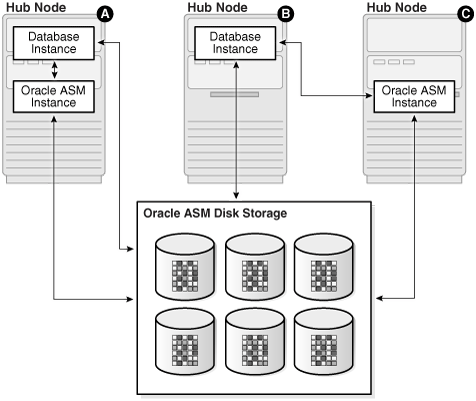
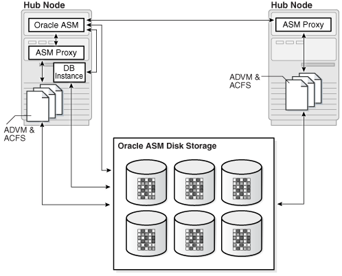
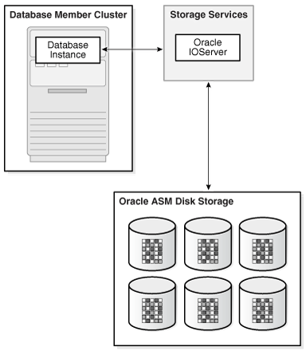

Oracle Flex ASM enables Oracle ASM instances to run on a separate physical server from the database servers.

This section discusses Oracle Flex ASM in the following topics:

See Also:

- [Oracle Clusterware Administration and Deployment Guide](https://docs.oracle.com/pls/topic/lookup?ctx=en/database/oracle/oracle-database/21/ostmg&id=CWADD-GUID-E1014B42-E671-4314-A2B0-D7B03EA4285F) for information about Oracle Flex Cluster support
- Articles at [My Oracle Support](https://support.oracle.com/) ([`https://support.oracle.com`](https://support.oracle.com/)) for information about configuring Oracle Flex ASM with Oracle ASM and Oracle ACFS
- [ASMCMD Client Cluster Management Commands](asmcmd-cluster-commands.md) for information about ASMCMD commands to manage client clusters
- [Oracle Grid Infrastructure Installation and Upgrade Guide](https://docs.oracle.com/pls/topic/lookup?ctx=en/database/oracle/oracle-database/21/ostmg&id=CWGEN) for information about installing and upgrading Oracle Grid Infrastructure

### Overview of Oracle Flex ASM

Note:

Starting with Oracle Grid Infrastructure 21c, Member Clusters, which are part of the Oracle Cluster Domain architecture, are desupported. However, Domain Services Clusters continues to support Members Clusters in releases previous to Oracle Grid Infrastructure 21c.

Note:

Starting with Oracle Grid Infrastructure 21c, Domain Services Cluster (DSC), which is part of the Oracle Cluster Domain architecture, is deprecated and can be desupported in a future release.

Oracle Flex ASM enables an Oracle ASM instance to run on a separate physical server from the database servers. With this deployment, larger clusters of Oracle ASM instances can support more database clients while reducing the Oracle ASM footprint for the overall system.

When using Oracle Flex ASM, Oracle ASM clients are configured with direct access to storage.

With Oracle Flex ASM, you can consolidate all the storage requirements into a single set of disk groups. All these disk groups are mounted by and managed by a small set of Oracle ASM instances running in a single cluster. You can specify the number of Oracle ASM instances with a cardinality setting. The default is three instances.

A cluster is a set of nodes that provide group membership services. Each cluster has a name that is globally unique. Every cluster has one or more Hub nodes. The Hub nodes have access to Oracle ASM disks. Every cluster has at least one private network and one public network. If the cluster is going to use Oracle ASM for storage, it has at least one Oracle ASM network. A single network can be used as both a private and an Oracle ASM network. For security reasons, an Oracle ASM network should never be public. There can be only one Oracle Flex ASM configuration running within a cluster.

An Oracle ASM instance can operate in several configurations in Oracle Flex ASM:

- Local Oracle ASM clients with direct access to Oracle ASM disks (Standard Oracle ASM cluster)
- Oracle Flex ASM clients with direct access to Oracle ASM disks
- Oracle ACFS access through the Oracle ASM proxy instance
- Network-based connectivity to Oracle ASM disk groups with Oracle IOServer (IOS)

These configurations are illustrated in Figure 11-1, Figure 11-2, and Figure 11-3.

Local Oracle ASM clients with direct access to Oracle ASM disks (Standard Oracle ASM cluster)

With this mode, illustrated as Hub Node A in Figure 11-1, Oracle ASM continues to support existing standard architecture in which database clients are running with an Oracle ASM instance on the same host computer. The local client architecture is only supported on a Hub node.

Figure 11-1 Oracle Flex ASM Client Configurations



> This figures shows the configurations that are possible with Oracle Flex ASM. The components (including hub nodes A, B, and C) in the illustration are described in the surrounding text.


In this configuration, the database instances are on the same Hub node as the Oracle ASM instance and are referred to as local Oracle ASM client instances. Oracle ASM metadata moves between Oracle ASM and the database instances. This client has direct I/O access to Oracle ASM disks.

Local mode does not use Oracle Flex ASM, so clusters configured with local Oracle ASM do not require an Oracle ASM network, nor do they contain other Oracle Flex ASM services.

Oracle Flex ASM clients with direct access to Oracle ASM disks

With this mode, illustrated as Hub Node B in Figure 11-1, database clients that are running on Hub nodes of the Oracle ASM cluster access Oracle ASM remotely for metadata, but perform block I/O operations directly to Oracle ASM disks. The hosts running the Oracle ASM server and the remote database client must both be Hub nodes. A Hub node is a node in an Oracle ASM cluster that is tightly connected with other servers and has direct access to a shared disk.

In this configuration, the database instances are on different host computers than the nearby Oracle ASM instance, as shown on Hub Node C in Figure 11-1, and are referred to as Oracle ASM client instances.

The databases are in the same Oracle ASM cluster as the Oracle ASM instance and the database instances are located on a Hub node. Oracle ASM metadata moves between Oracle ASM and the database instance. This client has direct I/O access to Oracle ASM disks.

Depending on the distribution of database instances and Oracle ASM instances, a database client may access Oracle ASM locally on the same node or remotely over the Oracle ASM network. This mode of operation is used by database clients on Hub nodes in the Oracle ASM cluster. Direct access mode is also the only Oracle Flex ASM configuration supported by Oracle ASM cluster file system.

Oracle ACFS access through the Oracle ASM proxy instance

An Oracle ASM proxy instance is an Oracle instance running on a Hub node with a direct Oracle ASM client. An Oracle ASM proxy instance provides support for Oracle Advanced Cluster File System (Oracle ACFS) and Oracle ASM Dynamic Volume Manager (Oracle ADVM).

Figure 11-2 shows the configuration of Oracle ACFS and Oracle ADVM with an Oracle ASM Proxy server in Oracle Flex ASM.

Figure 11-2 Oracle ACFS and Oracle ADVM in Oracle Flex ASM Configuration



> This figures shows a configuration option of Oracle ACFS and Oracle ADVM in Oracle Flex ASM. The components (including ASM Proxy) in the illustration are described in the surrounding text.


The `INSTANCE_TYPE` initialization parameter is set to `ASMPROXY` for Oracle ASM proxy instances.

Network-based connectivity to Oracle ASM disk groups with Oracle IOServer (IOS)

An Oracle IOServer (IOS) instance provides Oracle ASM file access for Oracle Database instances on nodes of Oracle member clusters that do not have connectivity to Oracle ASM managed disks. For member clusters that do have connectivity to Oracle ASM managed disks, IOServer could be configured as a backup in the event of failure. An Oracle IOServer instance is used only with Oracle member clusters.

Figure 11-3 shows the relationship of Oracle IOServer and an Oracle Database in a member cluster.

Figure 11-3 Oracle IOServer Configuration



> This illustration shows an Oracle IOServer instance on a cluster providing connectivity to Oracle ASM managed disks for an Oracle Database on a different cluster.


In addition, IOS enables you to configure client clusters on such nodes. On the storage cluster, an IOServer instance opens up network ports to which clients send their IO. The IOServer instance receives data packets from the client and performs the appropriate IO to Oracle ASM disks similar to any other database client. On the client side, databases can use dNFS to communicate with an IOServer instance. However, there is no client side configuration so you are not required to provide a server IP address or any additional configuration information. On nodes and clusters that are configured to access Oracle ASM files through IOServer, the discovery of the Oracle IOS instance occurs automatically.

The IOS instance contains the following processes:

- Network processes: These processes open up network ports and receive dNFS requests from the client side. These requests are then placed in a queue for IO and Identifier processes to pick up and process. Network processes also pick up responses from those other types of processes and send the response back to the client.
- Identifier processes: These processes pick up dNFS requests to create, delete, identify, unidentify, and resize Oracle ASM files.
- IO processes: These processes perform the actual IO on files that are identified by the local IOS instance.

The `ASM_IO_PROCESSES` initialization parameter specifies the number of IO worker processes to be started in an Oracle IO server instance. For information about the `ASM_IO_PROCESSES` initialization parameter, refer to [ASM\_IO\_PROCESSES](init-params-asm-instance.md).

### About Setting Up Oracle Flex ASM

To install an Oracle Flex ASM deployment, categorize the networks and choose the list of networks for use as Oracle ASM networks.

If you choose Oracle Flex ASM during a new installation, OUI requires you to choose the Oracle ASM networks.

The Oracle ASM listener resource is automatically created for each Oracle ASM network and then started on all nodes.

See Also:

[Oracle Grid Infrastructure Installation Guide](https://docs.oracle.com/pls/topic/lookup?ctx=en/database/oracle/oracle-database/21/ostmg&id=CWGEN) for information about Oracle Clusterware installation

### Administering Oracle Flex ASM

Oracle Flex ASM components are administered with ASMCA, ASMCMD CRSCTL, SQL\*Plus, and SRVCTL. In addition, you can set the `INSTANCE_TYPE` initialization parameter to specific instance types for use with Oracle Flex ASM.

- Displaying Information About Oracle Flex ASM
- SRVCTL and CRSCTL Commands to Administer Oracle Flex ASM
- Relocating a Client With ALTER SYSTEM
- ASMCMD Commands to Manage Client Clusters
- Initialization Parameters for Oracle Flex ASM

Displaying Information About Oracle Flex ASM

You can use the ASMCMD `showclustermode` command to determine whether Oracle Flex ASM is enabled. For example:

```
$ asmcmd showclustermode
ASM cluster : Flex mode enabled
```

You can view Oracle Flex ASM connections with SQL\*Plus and ASMCMD commands. Fore example:

```
SQL> SELECT instance_name, db_name, status FROM V$ASM_CLIENT;
INSTANCE_NAME   DB_NAME  STATUS
--------------- -------- ------------
+ASM1           +ASM     CONNECTED
orcl1           orcl     CONNECTED
orcl2           orcl     CONNECTED

$ asmcmd lsct data
DB_Name  Status    Software_Version  Compatible_version  Instance_Name  Disk_Group
+ASM     CONNECTED       19.0.0.0.0          19.0.0.0.0  +ASM           DATA
orcl     CONNECTED       19.0.0.0.0          19.0.0.0.0  orcl1          DATA
orcl     CONNECTED       19.0.0.0.0          19.0.0.0.0  orcl2          DATA
```

SRVCTL and CRSCTL Commands to Administer Oracle Flex ASM

SRVCTL is extended to enable an administrator to create or change attributes of Oracle Clusterware resources. You can use SRVCTL to determine the status of the instances in an Oracle Flex ASM configuration. For example:

```
$ srvctl status asm -detail
ASM is running on mynoden02,mynoden01
ASM is enabled.
```

You can also use SRVCTL to determine whether Oracle Flex ASM is enabled. If enabled, then `srvctl` `config` `asm` displays the number of Oracle ASM instances that has been specified for use with the Oracle Flex ASM configuration. For example:

```
$ srvctl config asm
ASM instance count: 3
```

You can modify the Oracle ASM instance count, or cardinality, with the SRVCTL `modify` `asm` command. For example:

```
$ srvctl modify asm -count 4

$ srvctl modify asm -count ALL
```

Clients are automatically relocated to another instance if an Oracle ASM instance fails. If necessary, clients can be manually relocated.

The `SRVCTL` `UPDATE` `INSTANCE` and `SRVCTL` `UPDATE` `IOSERVER` commands can change the Oracle ASM instance for a database, or the Oracle IOServer instance for a database, or the Oracle ASM instance for an Oracle IOServer. For example:

```
$ srvctl update instance -db my_orcl_db -instance my_instance_1 -targetinstance my_asm_instance_1

$ srvctl update ioserver -instance my_instance_2 -targetinstance my_asm_instance_2
```

You can run the `SRVCTL` `STATUS` commands with the `-detail` option to display which Oracle ASM instance or Oracle IOserver instance each client is connected to.

Every database user must have a wallet with credentials to connect to Oracle ASM. CRSCTL commands can be used by the database user to manage this wallet. All Oracle ASM user names and passwords are system generated.

You can run SRVCTL commands to manage Oracle ASM networks and listeners. For example, as the root user you can add an Oracle ASM network using `srvctl` `add` `asmnetwork`, with or without the optional network mask.

```
# srvctl add asmnetwork -netnum 1 -subnet nnn.nn.nn.n/255.255.255.0

# srvctl add asmnetwork -netnum 2 -subnet nnn.nn.nn.n
```

As the root or as CRS user, you can check the status or configure the Oracle ASM network with `srvctl` `config` `asmnetwork`.

```
$ srvctl config asmnetwork
ASM network 1 exists
Subnet IPv4: nnn.nn.nn.n/255.255.255.0/
Subnet IPv6:
Network is enabled
Network is individually enabled on nodes:
Network is individually disabled on nodes:
ASM network 2 exists
Subnet IPv4: nnn.nn.nn.n//
Subnet IPv6:
Network is enabled
Network is individually enabled on nodes:
Network is individually disabled on nodes:
```

As the CRS user, you can add an Oracle ASM listener with `srvctl` `add` `listener` You can use the default listener name (`LISTENER_ASM`) or specify a name for the listener.

```
$ srvctl add listener -asmlistener -netnum 1

$ srvctl add listener -asmlistener -netnum 2 -listener listener2
```

You can check the status of the Oracle ASM listener with `srvctl` `config` `listener`.

```
$ srvctl config listener -asmlistener
Name: LISTENER2_ASM
Type: ASM Listener
Owner: msmith
Subnet: nnn.nn.nn.n
Home: <CRS home>
End points: TCP:1526
Listener is enabled.
Listener is individually enabled on nodes:
Listener is individually disabled on nodes:
Name: LISTENER_ASM
Type: ASM Listener
Owner: msmith
Subnet: nnn.nn.nn.n
Home: CRS_hOME
End points: TCP:1525
Listener is enabled.
Listener is individually enabled on nodes:
Listener is individually disabled on nodes:
```

As the root user, you can run the `srvctl` `modify` `asmnetwork` command with the `-deptype` option to specify the dependency type (`mandatory` or `optional`) for Oracle ASM networks. The `-deptype` setting enables you to determine whether or not you want to tolerate the unavailability of any network.

- The `-deptype` `mandatory` option specifies a mandatory dependency on an Oracle ASM network. This means that the system does not tolerate the loss of that network. If only one of the Oracle ASM networks connects both the cluster nodes and Oracle ASM client clusters, then that network should be specified as `mandatory` because the Oracle ASM client clusters cannot run when that network is not available. For example:
	```
	# srvctl modify asmnetwork -netnum 2 -deptype mandatory
	```
- The `-deptype` `optional` option specifies an optional dependency on an Oracle ASM network. This means that the system can tolerate the loss of that network. If there are multiple Oracle ASM networks that only connect the cluster nodes, then you can specify them as `optional` to tolerate the failure of one of the networks. For example:
	```
	# srvctl modify asmnetwork -netnum 2 -deptype optional
	```
	The `optional` value is the default setting for `-deptype`.

Relocating a Client With ALTER SYSTEM

You can use the `ALTER` `SYSTEM` `RELOCATE` `CLIENT` command to relocate a client. For example:

```
SQL> ALTER SYSTEM RELOCATE CLIENT 'client-id';
```

In the previous SQL statement, `client-id` is of the form `instance_name``:``db_name`. The `INSTANCE_NAME` and `DB_NAME` columns are contained in the `V$ASM_CLIENT` view. You must connect as `SYSASM` to the Oracle ASM instance to run the SQL statement. When you issue this statement, the connection to the client is terminated and the client fails over to the least loaded instance. If the client is currently connected to the least loaded instance, then the connection to the client is terminated and the client fails over to that same instance.

ASMCMD Commands to Manage Client Clusters

You can use ASMCMD commands to administer the configuration of client clusters.

You can list client clusters with the `lscc` command and remove client clusters with the `rmcc` command.

You create a client cluster with the `mkcc` command or change a client cluster with the `chcc` command. For example, you can change the storage method from direct Oracle ASM to indirect Oracle ASM, or change from indirect Oracle ASM to direct Oracle ASM using the ASMCMD `chcc` and `mkcc` commands.

Initialization Parameters for Oracle Flex ASM

There are no new initialization parameters specifically for instances in an Oracle Flex ASM configuration; however, the settings of existing parameters should be reviewed and possibly adjusted for the Oracle Flex ASM environment.

The value of the `INSTANCE_TYPE` initialization parameter specifies the type of instance, including Oracle ASM proxy instances. In addition to `ASM` and `RDBMS` values, the `ASMPROXY` value identifies Oracle ASM proxy instances.

See Also:

- [Recommended Settings for Oracle ASM Initialization Parameters](init-params-asm-instance.md) for information about initialization parameters related to Oracle ASM
- [ASMCMD Client Cluster Management Commands](asmcmd-cluster-commands.md) for information about ASMCMD commands to manage client clusters
- [Oracle Database Reference](https://docs.oracle.com/pls/topic/lookup?ctx=en/database/oracle/oracle-database/21/ostmg&id=REFRN-GUID-BF533461-03CF-42B0-9D9E-1E0AA1190826) for more information about the `INSTANCE_TYPE` initialization parameter
- [Oracle Database SQL Language Reference](https://docs.oracle.com/pls/topic/lookup?ctx=en/database/oracle/oracle-database/21/ostmg&id=SQLRF-GUID-2C638517-D73A-41CA-9D8E-A62D1A0B7ADB) for information about the `ALTER` `SYSTEM` statement
- [Oracle Clusterware Administration and Deployment Guide](https://docs.oracle.com/pls/topic/lookup?ctx=en/database/oracle/oracle-database/21/ostmg&id=CWADD-GUID-1A6774CF-FD5F-463E-817F-34E4466443C7) for information about CRSCTL commands
- [Oracle Clusterware Administration and Deployment Guide](https://docs.oracle.com/pls/topic/lookup?ctx=en/database/oracle/oracle-database/21/ostmg&id=CWADD-GUID-1DCA9E3F-B929-4555-B673-921FF3588AC3) and [Oracle Real Application Clusters Administration and Deployment Guide](https://docs.oracle.com/pls/topic/lookup?ctx=en/database/oracle/oracle-database/21/ostmg&id=RACAD-GUID-3ED4DBCE-A148-462B-8A79-534A3F0D6E7D) for information about SRVCTL commands
- [Oracle Grid Infrastructure Installation and Upgrade Guide](https://docs.oracle.com/pls/topic/lookup?ctx=en/database/oracle/oracle-database/21/ostmg&id=CWGEN) for information about installing Oracle Clusterware