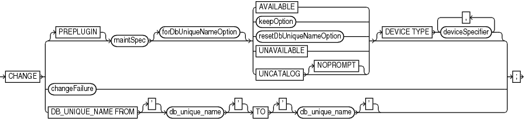
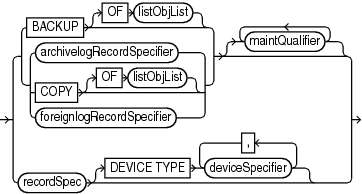
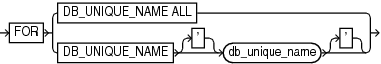
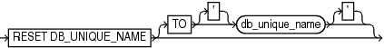
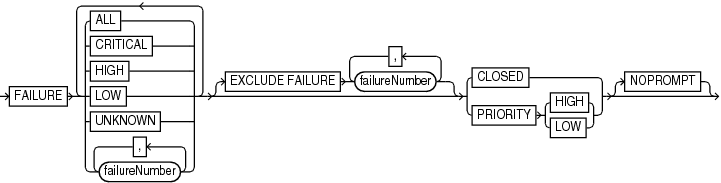

Purpose

Use the `CHANGE` command to perform the following tasks:

- Update the availability status of backups and copies recorded in the RMAN repository
- Change the priority of or close failures recorded in the automatic diagnostic repository
- Update the `DB_UNIQUE_NAME` recorded in the recovery catalog for the target database
- Associate the backup of a database in a Data Guard environment with a different database in the environment

See Also:

[Oracle Database Backup and Recovery User's Guide](https://docs.oracle.com/pls/topic/lookup?ctx=en/database/oracle/oracle-database/21/rcmrf&id=BRADV8173) to change the availability status of a backup or copy

Prerequisites

RMAN must be connected as `TARGET` to a database instance, which must be started.

Usage Notes

" [RMAN Backups in a Data Guard Environment](BACKUP.md) " explains the difference between the association and accessibility of a backup. In a Data Guard environment, the database that creates a backup or copy is associated with the file. You can use maintenance commands such as `CHANGE`, `DELETE`, and `CROSSCHECK` for backups when connected to any database in the Data Guard environment if the backups are accessible. In general, RMAN considers tape backups created on any database as accessible to all databases in the environment, whereas disk backups are accessible only to the database that created them.

For example, suppose that you connect RMAN as `TARGET` to standby database `standby1` and back it up to tape and disk. If the tape drive becomes unavailable, then you can connect RMAN as `TARGET` to any primary or standby database in the Data Guard environment to change the status of the tape backup to `UNAVAILABLE`. After the tape drive is repaired, you can connect RMAN as `TARGET` to any database to change the status of the tape backup back to `AVAILABLE`. However, if the disk backup is accidentally removed by an operating system utility, then RMAN can only change the status of the disk backup when connected as `TARGET` to `standby1`.

Syntax

change::=



> CHANGE {\[PREPLUGIN\] maintSpec \[forDbUniqueNameOption\] {AVAILABLE | keepOption | resetDbUniqueNameOption | UNAVAILABLE | UNCATALOG \[NOPROMPT\]} \[DEVICE TYPE deviceSpecifier \[, deviceSpecifier\]...\] | changeFailure | DB\_UNIQUE\_NAME FROM \['\] db\_unique\_name \['\] TO \['\] db\_unique\_name \['\]}
>
> [  
> Copyright © 2023, 2024, Oracle and/or its affiliates.](https://docs.oracle.com/en/database/oracle/oracle-database/dcommon/html/cpyr.htm)


(maintSpec::=, [forDbUniqueNameOption::=](forDbUniqueNameOption.md), [keepOption::=](keepOption.md), [deviceSpecifier::=](deviceSpecifier.md))

maintSpec::=



> {BACKUP \[OF listObjList\] | {archivelogRecordSpecifier | COPY \[OF listObjList\] | foreignlogRecordSpecifier}} \[ {maintQualifier}...\] | recordSpec \[DEVICE TYPE deviceSpecifier \[, deviceSpecifier\]...\]
>
> [  
> Copyright © 2023, 2024, Oracle and/or its affiliates.](https://docs.oracle.com/en/database/oracle/oracle-database/dcommon/html/cpyr.htm)


([listObjList::=](listObjList.md), [archivelogRecordSpecifier::=](archivelogRecordSpecifier.md), [maintQualifier::=](maintQualifier.md), [recordSpec::=](recordSpec.md), [deviceSpecifier::=](deviceSpecifier.md))

forDbUniqueNameOption::=



> FOR {DB\_UNIQUE\_NAME ALL | DB\_UNIQUE\_NAME \['\] db\_unique\_name \['\]}
>
> [  
> Copyright © 2023, 2024, Oracle and/or its affiliates.](https://docs.oracle.com/en/database/oracle/oracle-database/dcommon/html/cpyr.htm)


resetDbUniqueNameOption::=



> RESET DB\_UNIQUE\_NAME \[TO \['\] db\_unique\_name \['\]\]
>
> [  
> Copyright © 2023, 2024, Oracle and/or its affiliates.](https://docs.oracle.com/en/database/oracle/oracle-database/dcommon/html/cpyr.htm)


changeFailure::=



> FAILURE {ALL | CRITICAL | HIGH | LOW | UNKNOWN | failureNumber \[, failureNumber\]...} \[ {ALL | CRITICAL | HIGH | LOW | UNKNOWN | failureNumber \[, failureNumber\]...}\]... \[EXCLUDE FAILURE failureNumber \[, failureNumber\]...\] {CLOSED | PRIORITY {HIGH | LOW}} \[NOPROMPT\]
>
> [  
> Copyright © 2023, 2024, Oracle and/or its affiliates.](https://docs.oracle.com/en/database/oracle/oracle-database/dcommon/html/cpyr.htm)


Semantics

change

This clause enables you to change the status of RMAN repository records. To obtain the primary keys of RMAN repository records whose status you want to change, run a `LIST` command or query the recovery catalog views.

| Syntax Element | Description |
| --- | --- |
| `PREPLUGIN` | Specifies the preplugin files that you want to `CHANGE`. |
| `maintSpec` | Specifies which files you want to `CHANGE`.  The `maintQualifier` clause sets rules for the repository records that must be changed. To change the status of repository records associated with PDBs that were dropped, use the `GUID` clause to specify the GUID of the dropped PDB. The `dba_pdb_history` view contains the GUID of dropped PDBs.  See Also: `maintSpec` for descriptions of the options in this clause. |
| `   forDbUniqueNameOption` | Changes the metadata for objects that are exclusively associated with the specified `DB_UNIQUE_NAME` in a Data Guard environment.  See Also: `forDbUniqueNameOption` for descriptions of the options in this clause. |
| `   AVAILABLE` | Changes the status of a backup or copy to `AVAILABLE` in the repository. RMAN searches for the file and verifies that it exists.  This feature is useful when a previously unavailable file is made available again. You can also use this option to alter the repository status of backups and copies from prior incarnations.  This is the only `CHANGE` option that requires either a manual or automatic maintenance channel. A maintenance channel is not required, however, when `CHANGE ... AVAILABLE` is used with a file that is disk only (that is, an `ARCHIVELOG`, `DATAFILECOPY`, or `CONTROLFILECOPY`). If you use `CHANGE ... AVAILABLE` on files that are not disk-only, and have objects created on device types that are not configured for automatic channels, then issue manual maintenance commands on these channels. For example, if you created a backup on an `sbt` channel, but have only a `DISK` channel automatically configured, then you must manually allocate an `sbt` channel before `CHANGE ... AVAILABLE` can operate on the backup.  If you execute `CHANGE ... AVAILABLE` for a file in a Data Guard environment, then RMAN attempts to cross-check the file before updating its status to `AVAILABLE`. If the file is inaccessible, then RMAN prompts you to perform the same operation when connected as `TARGET` to the database associated with the file. If the file is accessible, then RMAN updates the status as requested.  Note: You can view the status of backups in the `LIST` output or recovery catalog views.  Note: `CHANGE ... AVAILABLE` is not valid for foreign archived redo log files, which are received by a logical standby database for a LogMiner session. Unlike normal archived redo log files, foreign archived redo log files have a different DBID. |
| `   keepOption` | Changes the exemption status of a backup or copy in relation to the configured retention policy. For example, specify ` CHANGE ... NOKEEP` to remove the `KEEP` attributes for a backup, making it subject to the backup retention policy.  The `KEEP FOREVER` clause requires use of a recovery catalog (see Example 2-47). The `RESTORE POINT` option is not valid with `CHANGE`. You cannot use `CHANGE ... UNAVAILABLE` or `KEEP` attributes for files stored in the fast recovery area.  See Also: `keepOption` |
| `resetDbUniqueNameOption` | Associates the files in `maintSpec` with a different database in a Data Guard environment.  See Also: `resetDbUniqueNameOption` |
| `   UNAVAILABLE` | Changes the status of a backup or copy to `UNAVAILABLE` in the repository (see Example 2-45). View the status in the `LIST` output or recovery catalog views.  This option is useful when a file cannot be found or has migrated offsite. RMAN does not use a file that is marked `UNAVAILABLE` in a `RESTORE` or `RECOVER` command. If the file is later found or returns to the main site, then use the `AVAILABLE` option to update its status. The `UNAVAILABLE` option is also useful when you do not want a specific backup or copy to be eligible to be restored but also do not want to delete it, or when you want to alter the repository status of backups and copies from prior incarnations.  `CHANGE ... UNAVAILABLE` is not valid for files in the fast recovery area. This command is also not valid for foreign archived redo log files, which are received by a logical standby database for a LogMiner session. Unlike normal archived redo log files, foreign archived redo log files have a different DBID.  Note: If you execute `CHANGE ... UNAVAILABLE` for a file in a Data Guard environment, then RMAN does not attempt to cross-check the file before updating its status to `UNAVAILABLE`. RMAN updates the status as requested regardless of whether the file physically exists.  Note: The `CHANGE ... UNAVAILABLE` command cannot be used when you back up target databases to Zero Data Loss Recovery Appliance, commonly known as Recovery Appliance. |
| `   UNCATALOG` | Removes references to a data file copy, backup piece, backup set, or archived redo log from the recovery catalog, and updates records in the target control file to status `DELETED` (see Example 2-46). Use `CHANGE BACKUPSET … UNCATALOG` to uncatalog all the backup pieces in a backupset.  The `CHANGE ... UNCATALOG` command does not touch physical backups and copies. Use this command to notify RMAN when a file is deleted by some means other than a `DELETE` command.  If you execute `CHANGE ... UNCATALOG` for a file in a Data Guard environment, then RMAN does not attempt to cross-check the file before removing its metadata from the recovery catalog. RMAN removes the metadata as requested regardless of whether the file physically exists.  Caution: If you resynchronize from a backup control file, or upgrade the recovery catalog, then records previously removed from the RMAN repository with `CHANGE ... UNCATALOG` may reappear in the recovery catalog.  Note: The `CHANGE ... UNCATALOG` command cannot be used when you back up target databases to Zero Data Loss Recovery Appliance, commonly known as Recovery Appliance. |
| `       NOPROMPT` | Does not display a prompt when performing an uncatalog operation with the recovery catalog. |
| `   DEVICE TYPE` `deviceSpecifier` | Executes the `CHANGE` for the specified device type only (see `deviceSpecifier`). This option is valid only if you have configured automatic channels and have not manually allocated channels. For example, if you run `CHANGE UNCATALOG ... DEVICE TYPE DISK`, then RMAN only uncatalogs files on disk. |
| `changeFailure` | Specifies changes for failures recorded by the Data Recovery Advisor.  Starting in Oracle Database 19c, the Data Recovery Advisor (DRA) feature is deprecated.  The deprecation of DRA includes deprecation of the following Oracle Recovery Manager (RMAN) commands: `LIST FAILURE`, `ADVISE FAILURE`, `REPAIR                     FAILURE`, and `CHANGE FAILURE`. Database administrators will no longer have access to these commands. There is no replacement feature for DRA. |
| `DB_UNIQUE_NAME` `FROM ` `db_unique_name` `TO ` `db_unique_name` | Updates the metadata in the recovery catalog to reflect a new `DB_UNIQUE_NAME` for a database in a Data Guard environment. The first value specifies the old `DB_UNIQUE_NAME` for the database currently recorded in the recovery catalog, whereas the second specifies the new `DB_UNIQUE_NAME`.  RMAN must be connected to a recovery catalog and a mounted target database. The target database must not have the `DB_UNIQUE_NAME` specified in the `FROM` `db_unique_name` parameter; otherwise, RMAN signals an error.  Typically, you use this command after you have changed the `DB_UNIQUE_NAME` initialization parameter of a database and must update its metadata in the recovery catalog. In general, do not run this command before performing any other RMAN operations on a renamed database. The recommended practice is to execute `LIST` `DB_UNIQUE_NAME` before `CHANGE DB_UNIQUE_NAME`.  Assume that you changed the `DB_UNIQUE_NAME` initialization parameter for a standby database from `standby_old` to `standby_new`. Typically, you execute `CHANGE DB_UNIQUE_NAME` in the following scenarios:  - A `LIST` `DB_UNIQUE_NAME` command shows the old `DB_UNIQUE_NAME` value but does not show the new one (see Example 2-50). - A `LIST` `DB_UNIQUE_NAME` command shows both the old and new `DB_UNIQUE_NAME` values. When RMAN connects as `TARGET` to a database with an unrecognized `DB_UNIQUE_NAME`, RMAN implicitly registers the instance as a new database. For this reason, `LIST` `DB_UNIQUE_NAME` command can show both the old and new names (in this example, `standby_old` and `standby_new`) for a database whose `DB_UNIQUE_NAME` initialization parameter has been changed.  In the scenario in which only the old name is listed, execute `CHANGE DB_UNIQUE_NAME FROM standby_old TO standby_new` so that RMAN changes the `DB_UNIQUE_NAME` for `standby_old` to `standby_new` in the recovery catalog.  In the scenario in which both the old and new names are listed, RMAN automatically executes the following commands when you run `CHANGE DB_UNIQUE_NAME FROM standby_old TO standby_new`:  1. `CHANGE ARCHIVELOG ALL FOR DB_UNIQUE_NAME standby_old RESET DB_UNIQUE_NAME` 2. `CHANGE BACKUP FOR DB_UNIQUE_NAME standby_old RESET DB_UNIQUE_NAME` 3. `UNREGISTER` `DB_UNIQUE_NAME standby_old`  Thus, RMAN changes the association of all backups for the `DB_UNIQUE_NAME` specified in the `FROM` clause to the `DB_UNIQUE_NAME` specified in the `TO` clause. |

resetDbUniqueNameOption

This clause enables you to associate backups made on one database in a Data Guard environment with a different database in the environment. The following table explains the RMAN behavior when different options are specified with `RESET DB_UNIQUE_NAME`.

Table 2-2 RESET DB\_UNIQUE\_NAME Options

| TO db\_unique\_name | FOR DB\_UNIQUE\_NAME | RMAN Behavior |
| --- | --- | --- |
| No | No | RMAN associates the `maintSpec` files with the target database. RMAN also changes the association of all backups that are not associated with any database.  Typically, you would execute `CHANGE` with these options after upgrading to an Oracle Database 11g or later recovery catalog schema, so that you can associate the backups with the target database. |
| Yes | No | RMAN associates the `maintSpec` files with the database indicated by the `TO` `db_unique_name`. RMAN also changes the association of all backups that are not associated with any database. |
| No | Yes | RMAN restricts its operations to `maintSpec` files that are associated with the database in the `FOR DB_UNIQUE_NAME` clause, and then associates these files with the target database. |
| Yes | Yes | RMAN restricts its operations to `maintSpec` files that are associated with the database in the `FOR DB_UNIQUE_NAME` clause, and then associates these files with the database specified by `TO` `db_unique_name`. |

| Syntax Element | Description |
| --- | --- |
| `RESET DB_UNIQUE_NAME` | Associates the files in `maintSpec` with the target database (see Example 2-49). Table 2-2 explains the RMAN behavior when different options are specified.  When changing the association of the files from one database to another database, RMAN deletes the duplicate names from the recovery catalog. For example, if you change the association of data file copy `/d1/df1.bak` from database `standby1` to database `prod`, then the recovery catalog has only one record for this file rather than two.  Use caution when specifying the `RESET DB_UNIQUE_NAME` option because you cannot undo the effect of this command. For example, after you have changed the association of the files associated with database `standby1` to database `prod`, the recovery catalog does not retain historical metadata about the database with which these files were previously associated. However, you can unregister database `standby1` and connect RMAN again to `standby1`, but the recovery catalog is updated with all metadata from the `standby1` control file. |
| `   TO` `db_unique_name` | Associates the files in `maintSpec` with the specified database in a Data Guard environment. |

changeFailure

This clause enables you to change the status of failures. Use the `LIST` `FAILURE` command to show the list of failures.

Note:

Starting in Oracle Database 19c, the Data Recovery Advisor (DRA) feature is deprecated.

The deprecation of DRA includes deprecation of the following Oracle Recovery Manager (RMAN) commands: `LIST FAILURE`, `ADVISE FAILURE`, `REPAIR                     FAILURE`, and `CHANGE FAILURE`. Database administrators will no longer have access to these commands. There is no replacement feature for DRA.

| Syntax Element | Description |
| --- | --- |
| `FAILURE` | Enables you to change priority or close failures recorded in the Automatic Diagnostic Repository. By default RMAN prompts for confirmation before performing the requested change.  The target database to which RMAN is connected must be a single-instance database and must not be a physical standby database. |
| `   ALL` | Changes only open failures. |
| `   CRITICAL` | Changes only critical failures. |
| `   HIGH` | Changes only failures with `HIGH` priority. |
| `   LOW` | Changes only failures with `LOW` priority. |
| `   UNKNOWN` | Changes only failures whose priority cannot be determined until the database is mounted. |
| `failnum` | Changes only the specified failure. |
| `EXCLUDE FAILURE`  `failnum` | Excludes the specified failures from the change. Use a comma-delimited list to specify multiple failures |
| `CLOSED` | Closes the specified failures by setting their status to `CLOSED`. |
| `PRIORITY` | Changes the priority of the specified failures to `LOW` or `HIGH`. |
| `NOPROMPT` | Does not prompt for confirmation before modifying the specified failures. |

Examples

Example 2-45 Updating Backups to Status UNAVAILABLE

Assume that you have temporarily moved backup set 4 to a different location because of a space issue on disk. The backup, which has the key 4, is still listed as available:

```
RMAN> LIST BACKUP SUMMARY;
```
```
List of Backups
===============
Key     TY LV S Device Type Completion Time #Pieces #Copies Compressed Tag
------- -- -- - ----------- --------------- ------- ------- ---------- ---
1       B  A  A DISK        24-FEB-13       1       1       NO         TAG20130427T115348
3       B  A  A DISK        24-MAR-13       1       1       NO         TAG20130427T115452
4       B  F  A DISK        24-APR-13       1       1       NO         TAG20130427T115456
```

You do not want to uncatalog the backup because you plan to move it back to its original location when more disk space is available. Thus, you make the backup unavailable as follows (sample output included):

```
RMAN> CHANGE BACKUPSET 4 UNAVAILABLE;
 
changed backup piece unavailable
backup piece handle=/disk2/backup/c-3257893776-20130424-00 RECID=4 STAMP=588858897
Changed 1 objects to UNAVAILABLE status
```

Example 2-46 Uncataloging and Recataloging Archived Redo Log Files

In this example, you move all archived redo log files to a new directory, uncatalog them, and then recatalog them in the new location:

```
RMAN> HOST '/bin/mv $ORACLE_HOME/dbs/*.arc /disk2/archlog/';
RMAN> CHANGE ARCHIVELOG ALL UNCATALOG;
RMAN> CATALOG START WITH '/disk2/archlog' NOPROMPT;
```

Example 2-47 Changing a Database Backup into an Archival Backup

Assume your goal to is to change a database backup into an archival backup, which you plan to store offsite. Because the backup is consistent and requires no recovery, you do not need to store archived redo log files with the backup. The example uses the `CHANGE ... KEEP FOREVER` command to specify that the backup is never obsolete.

```
RMAN> CONNECT TARGET /
RMAN> CONNECT CATALOG rco@catdb

recovery catalog database Password: password

RMAN> CHANGE BACKUP TAG 'consistent_db_bkup' KEEP FOREVER;
```

Example 2-48 Changing the Status of a Failure

In the following example, the `LIST` `FAILURE` command shows that a data file has corrupt blocks. The failure number is 5 and has a priority of `HIGH`. This data file contains nonessential data, so you decide to change the priority of this failure to low.

```
RMAN> LIST FAILURE;

List of Database Failures
Failure ID Priority Status    Time Detected Summary
---------- -------- --------- ------------- -------
5          HIGH     OPEN      11-DEC-13     datafile 8 contains corrupt blocks
 
RMAN> CHANGE FAILURE 5 PRIORITY LOW;
 
List of Database Failures
Failure ID Priority Status    Time Detected Summary
---------- -------- --------- ------------- -------
5          HIGH     OPEN      11-DEC-13     datafile 8 contains corrupt blocks
 
Do you really want to change the above failures (enter YES or NO)? YES
changed 1 failures to LOW priority
```

Note:

Starting in Oracle Database 19c, the Data Recovery Advisor (DRA) feature is deprecated.

The deprecation of DRA includes deprecation of the following Oracle Recovery Manager (RMAN) commands: `LIST FAILURE`, `ADVISE FAILURE`, `REPAIR                     FAILURE`, and `CHANGE FAILURE`. Database administrators will no longer have access to these commands. There is no replacement feature for DRA.

Example 2-49 Associating Backups with a New Database in a Data Guard Environment

Assume that `standby1`, `standby2`, and `standby3` are standby databases associated with primary database is `prod`. This example assumes that RMAN is connected to target database `prod` and a recovery catalog.

You are planning to remove `standby1` from your environment, so you want to associate the `standby1` backups with your primary database. You are also planning to remove `standby3` from your environment, so you want to associate the `standby3` backups with `standby2`. You execute the following commands:

```
CHANGE BACKUP FOR DB_UNIQUE_NAME standby1 RESET DB_UNIQUE_NAME;
CHANGE BACKUP FOR DB_UNIQUE_NAME standby3 RESET DB_UNIQUE_NAME TO standby2;
```

Example 2-50 Updating a DB\_UNIQUE\_NAME in the Recovery Catalog

Assume that a standby database has the `DB_UNIQUE_NAME` initialization parameter setting of `dgrdbms4`, which you decide to change to `sfrdbms4`. You shut down the standby instance, change the `DB_UNIQUE_NAME` initialization parameter to `sfrdbms4`, and restart the standby instance.

Later, to update the recovery catalog to reflect the changed unique name of the standby database, you connect RMAN to the primary database and recovery catalog, and then execute the `CHANGE` command as follows:

```
RMAN> CONNECT TARGET /
RMAN> CONNECT CATALOG rco@catdb

recovery catalog database Password: password
```
```
RMAN> CHANGE DB_UNIQUE_NAME FROM dgrdbms4 TO sfrdbms4;
```