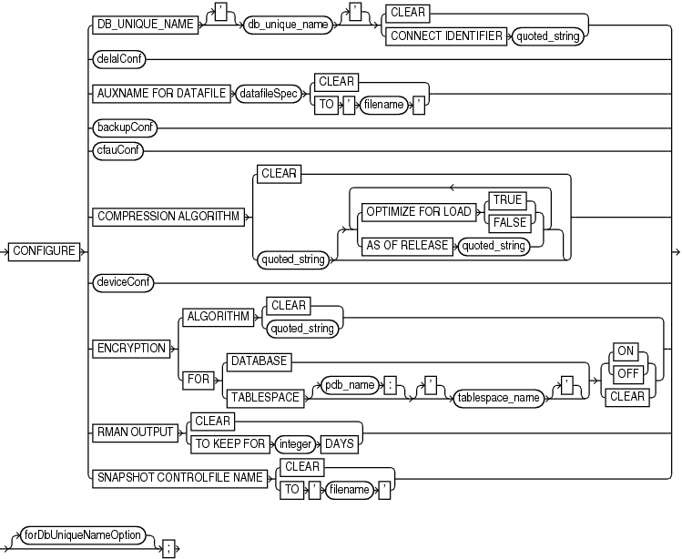
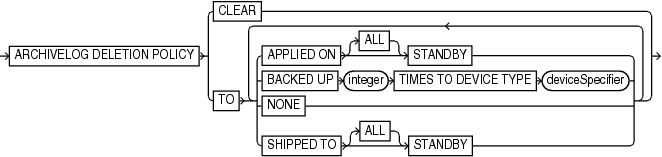
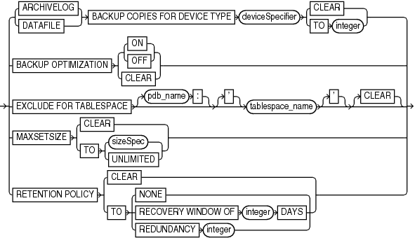
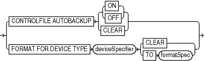
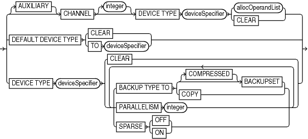

Purpose

Use the `CONFIGURE` command to create or change a persistent configuration affecting RMAN backup, restore, duplication, and maintenance jobs on a particular database. A configuration is in effect for any RMAN session on this database until the configuration is explicitly cleared or changed. You can use the `SHOW` command to display the configurations for one or more databases.

See Also:

[Oracle Database Backup and Recovery User's Guide](https://docs.oracle.com/pls/topic/lookup?ctx=en/database/oracle/oracle-database/21/rcmrf&id=BRADV8002) to learn how to configure the RMAN environment

Prerequisites

Execute this command only at the RMAN prompt.

Unless you specify the `FOR DB_UNIQUE_NAME` clause, an RMAN connection to a target database is required. The target database must be mounted or open.

In CDBs, you must connect to the root to create or change configuration settings. You cannot configure settings when connected to a PDB.

Usage Notes

The `CONFIGURE` command always stores a configuration for a target database in the target database control file. If you use RMAN with a recovery catalog, then RMAN also stores persistent configuration settings for each registered database in the catalog.

Default RMAN Configuration Settings

The RMAN `CONFIGURE` settings have defaults. You can return to the default for any `CONFIGURE` command by rerunning the command with the `CLEAR` option, but you cannot clear individual parameters in this way. For example, the following command is valid:

```
CONFIGURE CHANNEL DEVICE TYPE sbt CLEAR
```

However, the following command is invalid:

```
CONFIGURE CHANNEL DEVICE TYPE sbt MAXPIECESIZE 5M CLEAR
```

RMAN Configuration in a Data Guard Environment

In a Data Guard environment, Oracle recommends that you always use RMAN with a recovery catalog. You can use the `CONFIGURE` command to create persistent RMAN configurations for any individual primary or standby database in the Data Guard environment, except settings for backup retention policy, tablespace exclusion, and auxiliary names. Thus, the primary and standby databases can have different channel configurations, control file autobackup locations, and so on.

You can use the `FOR DB_UNIQUE_NAME` clause to configure a database to which RMAN is not connected as `TARGET`. You can use `CONFIGURE DB_UNIQUE_NAME` to make a new physical standby database known to the recovery catalog and implicitly register it.

Syntax

configure::=



> CONFIGURE {DB\_UNIQUE\_NAME \['\] db\_unique\_name \['\] {CLEAR | CONNECT IDENTIFIER quoted\_string} | delalConf | AUXNAME FOR DATAFILE datafileSpec {CLEAR | TO ' filename '} | backupConf | cfauConf | COMPRESSION ALGORITHM {CLEAR | quoted\_string \[ { {OPTIMIZE FOR LOAD {TRUE | FALSE} | AS OF RELEASE quoted\_string}}...\]} | deviceConf | ENCRYPTION {ALGORITHM {CLEAR | quoted\_string} | FOR {DATABASE | TABLESPACE \[pdb\_name:\] \['\] tablespace\_name \['\]} { {ON | OFF} | CLEAR}} | RMAN OUTPUT {CLEAR | TO KEEP FOR integer DAYS} | SNAPSHOT CONTROLFILE NAME {CLEAR | TO ' filename '}} \[forDbUniqueNameOption\]


([datafileSpec::=](datafileSpec.md), backupConf::=, cfauConf::=, deviceConf::=, [forDbUniqueNameOption::=](forDbUniqueNameOption.md))

delalConf::=



> ARCHIVELOG DELETION POLICY {CLEAR | TO {APPLIED ON \[ALL\] STANDBY | BACKED UP integer TIMES TO DEVICE TYPE deviceSpecifier | NONE | SHIPPED TO \[ALL\] STANDBY} \[ {APPLIED ON \[ALL\] STANDBY | BACKED UP integer TIMES TO DEVICE TYPE deviceSpecifier | NONE | SHIPPED TO \[ALL\] STANDBY}\]...}
>
> [  
> Copyright © 2023, 2024, Oracle and/or its affiliates.](https://docs.oracle.com/en/database/oracle/oracle-database/dcommon/html/cpyr.htm)


([deviceSpecifier::=](deviceSpecifier.md))

backupConf::=



> {ARCHIVELOG | DATAFILE} BACKUP COPIES FOR DEVICE TYPE deviceSpecifier {CLEAR | TO integer} | BACKUP OPTIMIZATION { {ON | OFF} | CLEAR} | EXCLUDE FOR TABLESPACE \[pdb\_name:\] \['\] tablespace\_name \['\] \[CLEAR\] | MAXSETSIZE {CLEAR | TO {sizeSpec | UNLIMITED}} | RETENTION POLICY {CLEAR | TO {NONE | RECOVERY WINDOW OF integer DAYS | REDUNDANCY integer}}


([deviceSpecifier::=](deviceSpecifier.md), [sizeSpec::=](sizeSpec.md))

cfauConf::=



> {CONTROLFILE AUTOBACKUP { {ON | OFF} | CLEAR} | FORMAT FOR DEVICE TYPE deviceSpecifier {CLEAR | TO formatSpec}}
>
> [  
> Copyright © 2023, 2024, Oracle and/or its affiliates.](https://docs.oracle.com/en/database/oracle/oracle-database/dcommon/html/cpyr.htm)


([deviceSpecifier::=](deviceSpecifier.md), [formatSpec::=](formatSpec.md))

deviceConf::=



> \[AUXILIARY\] CHANNEL \[integer\] DEVICE TYPE deviceSpecifier {allocOperandList | CLEAR} | DEFAULT DEVICE TYPE {CLEAR | TO deviceSpecifier} | DEVICE TYPE deviceSpecifier {CLEAR | {BACKUP TYPE TO {\[COMPRESSED\] BACKUPSET | COPY} | PARALLELISM integer | SPARSE {OFF | ON}} \[ {BACKUP TYPE TO {\[COMPRESSED\] BACKUPSET | COPY} | PARALLELISM integer | SPARSE {OFF | ON}}\]...}


([deviceSpecifier::=](deviceSpecifier.md), [allocOperandList::=](allocOperandList.md))

forDbUniqueNameOption::=


> FOR {DB\_UNIQUE\_NAME ALL | DB\_UNIQUE\_NAME \['\] db\_unique\_name \['\]}
>
> [  
> Copyright © 2023, 2024, Oracle and/or its affiliates.](https://docs.oracle.com/en/database/oracle/oracle-database/dcommon/html/cpyr.htm)


Semantics

configure

| Syntax Element | Description |
| --- | --- |
| `DB_UNIQUE_NAME` `db_unique_name` `CONNECT IDENTIFIER` `'` `connect_string` `'` | Specifies the net service name for the physical standby database specified by `DB_UNIQUE_NAME`. The `CONNECT IDENTIFIER` string must not include the database user name and password.  RMAN must also be connected to the primary database as `TARGET`. RMAN must be connected to a recovery catalog.  When you run the `RESYNC CATALOG` `FROM DB_UNIQUE_NAME` command, databases in a Data Guard environment use the net service name to connect with the `db_unique_name` database. For example, assume that a standby database has the unique name `standby1` and the net service name `sby1`. You connect RMAN as `TARGET` to the primary database and execute `CONFIGURE DB_UNIQUE_NAME 'standby1' CONNECT IDENTIFIER 'sby1'`. Every primary and standby database in the environment uses the net service name `sby1` when it needs to make an Oracle Net connection to `standby1`.  Note: When the target database needs to connect to other standby or primary databases, it connects as the `SYSDBA` or `SYSBACKUP` user by using the existing Data Guard authentication mechanisms.  Suppose that you recently connected RMAN as `TARGET` to the primary database and used `CONFIGURE ... FOR DB_UNIQUE_NAME standby_new` to configure backup settings for standby database `standby_new`. However, you have not yet connected RMAN as `TARGET` to `standby_new`. In this case, you can execute `RESYNC CATALOG FROM DB_UNIQUE_NAME standby_new`. The primary database uses the connect identifier to make an Oracle Net connection to the standby database. When you later connect RMAN to the standby database, RMAN pushes the configuration from the recovery catalog to the mounted control file.  Note: If the database specified by `CONFIGURE DB_UNIQUE_NAME` is not registered in the recovery catalog, then RMAN implicitly registers it. |
| `CLEAR` | Returns a parameter to its default setting. See the Usage Notes. |
| `delalConf` | Configures an archived redo log deletion policy. |
| `AUXNAME FOR DATAFILE` `datafileSpec ` `CLEAR \| TO ` `'` `filename` `'` | Configures the auxiliary file name for the specified target data file to `'` `filename` `'` (see Example 2-55). Specify `CLEAR` to unspecify the auxiliary file name.  If you are performing TSPITR or using `DUPLICATE`, then you can set `AUXNAME` to preconfigure the file names for use on the auxiliary database without manually specifying the auxiliary file names during the procedure. You cannot use `CONFIGURE AUXNAME` for recovery set, you must use `SET NEWNAME`.  For example, use this command during TSPITR if the data files are on raw disk and you must restore auxiliary data files to raw disk for performance reasons. Typically, you set the `AUXNAME` parameter in TSPITR for the data files of the `SYSTEM` and `SYSAUX` tablespaces and the tablespaces containing rollback or undo segments. Do not overlay files which are in use by the production database and can be discarded after TSPITR completes. In essence, the `AUXNAME` of a data file is the location where TSPITR can create a temporary copy of it.  When renaming files with the `DUPLICATE` command, `CONFIGURE` `AUXNAME` is an alternative to `SET` `NEWNAME`. The difference is that after you set the `AUXNAME` the first time, you do not need to reset the file name when you issue another `DUPLICATE` command: the `AUXNAME` setting remains in effect until you issue `CONFIGURE AUXNAME ... CLEAR`. In contrast, you must reissue the `SET NEWNAME` command every time you execute the `DUPLICATE` command.  See Also: [Oracle Database Backup and Recovery User’s Guide](https://docs.oracle.com/pls/topic/lookup?ctx=en/database/oracle/oracle-database/21/rcmrf&id=BRADV009) to learn how to perform RMAN TSPITR, and [Oracle Database Backup and Recovery User’s Guide](https://docs.oracle.com/pls/topic/lookup?ctx=en/database/oracle/oracle-database/21/rcmrf&id=BRADV-GUID-F31F9FCE-B610-49EB-B9DB-44B9AA4E838F) to learn how to duplicate a database with RMAN |
| `backupConf` | Configures default backup options such as duplexing, optimization, excluding tablespaces, backup set sizes, and retention policies. |
| `cfauConf` | Configures control file autobackup settings. |
| `COMPRESSION ALGORITHM` `'` `algorithm_name` `'` | Specifies the algorithm that RMAN uses to create compressed backup sets.  The default compression algorithm setting is `BASIC` and does not require the Advanced Compression Option.  If, however, you have enabled the Advanced Compression Option, you can choose from the following compression levels:  - `HIGH - ` Best suited for backups over slower networks where the limiting factor is network speed - `MEDIUM -` Recommended for most environments. Good combination of compression ratios and speed - `LOW` - Least impact on backup throughput and suited for environments where CPU resources are the limiting factor.  Note: The compression ratio generally increases from LOW to HIGH, with a trade-off of potentially consuming more CPU resources.  Since the performance of the various compression levels depends on the nature of the data in the database, network configuration, system resources and the type of computer system and its capabilities, Oracle cannot document universally applicable performance statistics. The decision about which level is best must factor in on how balanced your system is regarding bandwidth into the CPU and the actual speed of the CPU. It is highly recommended that you run tests with the different compression levels on the data in your environment. Choosing a compression level based on your environment, network traffic characteristics (workload) and data set is the only way to ensure that the backup set compression level can satisfy your organization's performance requirements and any applicable service level agreements.  Note: The `V$RMAN_COMPRESSION_ALGORITHM` view describes the supported algorithms.  See Also: Oracle Database Reference entry for `V$RMAN_COMPRESSION_ALGORITHM`. |
| `   OPTIMIZE FOR LOAD`  `    {TRUE\|FALSE}` | Specifies whether Oracle Database performs pre-compression block processing when compressed backups have been requested. `TRUE` is the default and `FALSE` enables pre-compression processing. The default behavior is not to perform pre-compression block processing. Such processing can consume extra CPU resources, and is not needed for blocks that contain all originally loaded data, and have never been the subject of single-row inserts and deletes. Specifying `FALSE` uses additional CPU resources to perform pre-compression block processing which consists of internal block cleanups and defragmentation that can result in improved levels of binary compression.  See Also: Oracle Database Backup and Recovery User's Guide to learn more about this option. |
| `  AS OF RELEASE   `  'version' | Specifies the release version. The version number uses the release number format and may use as many as 5 numbers to fully qualify the release. For example, 10.2.0.3.0 and 11.2 are acceptable values. This option ensures compression algorithm stability across future releases. |
| `deviceConf` | Configures default backup settings for devices, such as the default backup device, channel configurations for devices, default backup types for each device, and parallelism. |
| `ENCRYPTION` | Specifies transparent-mode encryption settings for the database or tablespaces.  This configuration applies unless overridden with the `SET` `ENCRYPTION` command. Options specified for an individual tablespace take precedence over options specified for the whole database.  See Also: " [Encryption of Backup Sets](BACKUP.md) " to learn about the different modes of backup encryption, and [Oracle Database Advanced Security Guide](https://docs.oracle.com/pls/topic/lookup?ctx=en/database/oracle/oracle-database/21/rcmrf&id=ASOAG10139) to learn about transparent data encryption |
| `   ALGORITHM` `'` `algorithm_name` `'` | Specifies the default algorithm to use for encryption when writing backup sets. Possible values are listed in `V$RMAN_ENCRYPTION_ALGORITHMS`. The `CLEAR` option resets the database to the default value. |
| `   FOR DATABASE` `[ON \| OFF \| CLEAR]` | Specifies whether to enable transparent encryption for the entire database. The options are as follows:  - `ON` enables encryption for all database files. - `OFF` turns off encryption for all database files. - `CLEAR` restores the default setting of `OFF`.  Note: You must use the `SET` `ENCRYPTION IDENTIFIED BY` command to enable password encryption. |
| `   FOR TABLESPACE` `tablespace_name` `[ON \| OFF \| CLEAR]` | Specifies whether to enable transparent encryption for one or more tablespaces. Configured settings for a tablespace always override configuration set at the database level. The options are as follows:  - `ON` enables encryption for the specified tablespace unless `SET` `ENCRYPTION OFF FOR ALL TABLESPACES` is used. - `OFF` disables encryption for the specified tablespace unless `SET ENCRYPTION ON FOR ALL TABLESPACES` is used. - `CLEAR` means that encryption for the specified tablespace is determined by the current default for the whole database.  Note: You must use the `SET ENCRYPTION IDENTIFIED BY` command to enable password encryption. |
| `FOR TABLESPACE` `pdb_name:tablespace_name` `[ON \| OFF \| CLEAR]` | The name of the tablespace in a CDB. Multiple databases can have tablespaces with the same name. A qualifier before the name uniquely identifies the tablespace. `pdb-name` is the name of a PDB.  See the previous description of `FOR TABLESPACE`. |
| `RMAN OUTPUT TO KEEP FOR ` `integer` ` DAYS` | Configures RMAN output logging to the number of days specified by `integer`. Information regarding the output of RMAN commands is stored in two views, `RC_RMAN_OUTPUT` and `V$RMAN_OUTPUT`. When you configure output logging to `integer` days, any logging entry that is older than `integer` days is deleted from both the `RC_RMAN_OUTPUT` and `V$RMAN_OUTPUT` views.  For example, assume that the existing output logging configuration is set to 20 days. You use the `CONFIGURE` command to change output logging to 10 days. Any logging entries that are older than 10 days are deleted from `RC_RMAN_OUTPUT` and `V$_RMAN_OUTPUT`.  To disable RMAN output logging, set `integer` to zero, as shown in the following example.  ``` CONFIGURE RMAN OUTPUT TO KEEP FOR 0 DAYS; ```  When you disable output logging, no logging information is stored in the `RC_RMAN_OUTPUT` and `V$RMAN_OUTPUT` views. Existing logging entries in `RC_RMAN_OUTPUT` are deleted. |
| `CLEAR` | Clears the existing RMAN output logging configuration and resets it to 7 days, which is the default.  RMAN stores output logging information in the `RC_RMAN_OUTPUT` and `V$RMAN_OUTPUT` views. When you clear the output logging configuration, any logging entry that is older than 7 days (the default value) is deleted from the `RC_RMAN_OUTPUT` view. Entries older than 7 days in the `V$RMAN_RMAN_OUTPUT` view are not deleted immediately. They are deleted only when the maximum number of rows permitted for this view is exceeded. |
| `SNAPSHOT CONTROLFILE` `NAME TO '` `filename` `'` | Configures the snapshot control file name and location to `'` `filename` `'`. If you run `CONFIGURE SNAPSHOT CONTROLFILE NAME CLEAR`, then RMAN sets the snapshot control file name to its default.  The default value for the snapshot control file name is platform-specific and dependent on Oracle home. For example, the default on some UNIX systems is `?/dbs/snapcf_@.f`. If you clear the control file name, and if you change Oracle home, then the default location of the snapshot control file changes as well.  The snapshot control file name is valid for this database only. Assume that you configure the snapshot control file name to a nondefault value on the primary database. If you use `DUPLICATE` to create a standby database, then the snapshot control file location on the standby database is set to the default value. If desired, you can then configure the snapshot location on the standby database to a nondefault value.  See Also: [Oracle Database Backup and Recovery User's Guide](https://docs.oracle.com/pls/topic/lookup?ctx=en/database/oracle/oracle-database/21/rcmrf&id=BRADV141) for more information about snapshot control files |
| `forDbUniqueNameOption` | Creates an RMAN configuration in the recovery catalog for the database in a Data Guard environment specified by `DB_UNIQUE_NAME`. You can specify a single database with `db_unique_name` or use `ALL` for all databases in the recovery catalog that share the DBID of the target database (or DBID specified by the `SET` `DBID` command).  A recovery catalog is required when performing operations in a Data Guard environment. RMAN must be connected as `TARGET` to a mounted or open database (which can be a primary or standby database), or you must identify the target database with the `SET` `DBID` command. Thus, you can use this clause to create a persistent configuration for a standby database without connecting as `TARGET` to the standby or primary database. For example, you can create a configuration for a standby database before its creation so that the configuration applies after the database is created (see Example 2-57).  When you specify `FOR DB_UNIQUE_NAME`, RMAN directly updates the configuration metadata in the recovery catalog. When RMAN connects as `TARGET` to a database whose configurations were changed with `FOR DB_UNIQUE_NAME`, RMAN updates the mounted control file with the configuration metadata from the recovery catalog.  Note: It is possible to run `CONFIGURE` locally on a standby database and then run `CONFIGURE FOR DB_UNIQUE_NAME` for the same database while RMAN is not connected to this database as `TARGET`. In this case, the configuration in the recovery catalog overrides the configuration in the control file for the specific database. |

delalConf

This subclause manages persistent configurations for archived redo log deletion policy.

| Syntax Element | Description |
| --- | --- |
| `ARCHIVELOG DELETION POLICY` | Determines when archived redo log files are eligible for deletion.  The archived log deletion policy applies to all log archiving destinations, including the fast recovery area. The policy does not apply to archived redo log files in backup sets.  Only archived redo log files in the fast recovery area are automatically deleted by the database. You can execute the `BACKUP` `... DELETE INPUT`, `DELETE` `ARCHIVELOG`, or `DELETE OBSOLETE` commands to delete logs manually from log archiving destinations, including the recovery area. If `FORCE` is not specified on the deletion commands, then these deletion commands obey the archived log deletion policy. If `FORCE` is specified, then the deletion commands ignore the archived log deletion policy.  In the recovery area, the database retains logs eligible for deletion if possible. The database deletes the oldest logs first when disk space is required. When the recovery area is under disk pressure, the database may delete archived redo log files that are reclaimable according to the fast recovery area rules.  Note: The deletion policy does not apply to foreign archived redo log files, which are logs received by a logical standby database for a LogMiner session. These logs are transferred from a primary database, but unlike ordinary archived redo log files they have a different DBID. Foreign archived redo log files cannot be backed up or restored on a logical standby database. |
| ` TO APPLIED ON` `[ALL] STANDBY` | Archived redo log files are eligible for deletion if both of the following conditions are met:  - The archived redo log files have been applied to the required standby databases. - The logs are not needed by the `BACKED UP ... TIMES TO DEVICE TYPE` deletion policy. If the `BACKED UP` policy is not set, then this condition is always met.  When valid standby remote databases exist, this policy is applicable to primary databases, standby databases, and `FAR SYNC` standby databases.  For primary databases, the archived redo log files are eligible for deletion after they are applied on the standby. If no valid standby database exists, then RMAN uses `TO NONE` as the policy. For standby databases, the archived redo log files are eligible for deletion after they are applied on the standby database and on any cascading standby databases.  Which remote destinations are considered depends on the following criteria:  - If you do not specify `ALL`, then archived redo log files are eligible for deletion after being applied to all mandatory remote destinations. - If you specify `ALL`, then archived redo log files are eligible after being applied or consumed on all remote destinations, whether mandatory or not. 	For example, standby database `sby1` may be the only remote destination receiving logs, but other remote destinations may apply logs by referring to the same location on `sby1`. With `ALL`, `sby1` marks the log on the primary database as consumed as soon as it is not required at `sby1`, but does not permit deletion of this log until it is applied or consumed by all other dependent remote destinations referring to the same location.  Note: It is invalid to specify the `TO APPLIED` clause in combination with either `NONE` or the `TO SHIPPED` clause.  See Also: [Oracle Data Guard Concepts and Administration](https://docs.oracle.com/pls/topic/lookup?ctx=en/database/oracle/oracle-database/21/rcmrf&id=SBYDB04700) for details |
| `   BACKED UP ` `integer` `TIMES TO DEVICE` `TYPE ` `deviceSpecifier` | Archived redo log files are eligible for deletion if both of the following conditions are met:  - The specified number of archived log backups exist on the specified device type. - The logs are not needed by the `TO SHIPPED TO ... STANDBY` or `TO APPLIED ON ... STANDBY` deletion policy. If the `TO SHIPPED TO` policy is not set, then this condition is always met.  If you configure the deletion policy with this clause, then a `BACKUP ARCHIVELOG` command copies the logs unless `integer` backups exist on the specified device type. If `integer` backups of the logs exist, then the `BACKUP ARCHIVELOG` command skips the logs. In this way, the archived log deletion policy functions as a default `NOT BACKED UP` `integer` `TIMES` clause on the `BACKUP ARCHIVELOG` command. You can override this deletion policy by specifying `FORCE` option on the `BACKUP` command.  See Also: `deviceSpecifier` |
| `   TO NONE` | Disables the archived log deletion policy. This is the default setting.  Archived redo log files can be located inside or outside of the fast recovery area. Logs in any location can be deleted by manual commands. Only logs in the fast recovery area can be deleted automatically by the database.  - When remote destinations are configured for the target database, archived redo log files, whether in the fast recovery area or outside of it, are eligible for deletion if have been transferred to the required remote destinations specified by `LOG_ARCHIVE_DEST_` `n`. - When no remote destinations are configured, archived redo log files in the fast recovery area are eligible for deletion if they have been backed up at least once to disk or SBT or the logs are obsolete according to the backup retention policy. 	The backup retention policy considers logs obsolete only if the logs are not needed by a guaranteed restore point and the logs are not needed by Flashback Database. Archived redo log files are needed by Flashback Database if the logs were created later than `SYSDATE-'DB_FLASHBACK_RETENTION_TARGET'`.  For example, suppose that archived redo log files have been transferred to required remote destinations. The logs are obsolete according to the recovery window retention policy, but have not been backed up. In this case, the logs are eligible for deletion. Alternatively, suppose that the logs are obsolete and have been backed up to SBT, but have not been transferred to required remote destinations. In this case, the logs are not eligible for deletion.  If the deletion policy is set to `NONE`, and if you execute a deletion command for archived redo log files outside the fast recovery area, then RMAN obeys only the conditions specified on the deletion command. |
| ` TO SHIPPED TO` ` [ALL] STANDBY` | Archived redo log files are eligible for deletion if both of the following conditions are met:  - The archived redo log files have been transferred to the required remote destinations. - The logs are not needed by the `BACKED UP ... TIMES TO DEVICE TYPE` deletion policy. If the `BACKED UP` deletion policy is not set, then this condition is always met.  When valid standby remote databases exist, this policy is applicable to primary databases, standby databases, and `FAR SYNC` standby databases.  - For primary databases: 	- If valid standby configurations exist, then the archived redo log files are eligible for deletion after they are shipped to the standby. 		- If no valid standby database exists, then RMAN uses `TO NONE` as the default policy. - For standby databases: 	- If valid cascading standby configurations exist, then the archived redo log files are eligible for deletion after they are shipped to the cascading standby database. 		- If no valid cascading standby configurations exist, then RMAN uses `TO NONE` as the default policy.  Which remote destinations are considered depends on the following criteria:  - If you do not specify `ALL`, then the archived redo log files are eligible for deletion after transfer to mandatory remote destinations only. - If you specify `ALL`, then the logs are eligible for deletion after transfer to all remote destinations, whether mandatory or not.  Note: It is invalid to specify the `TO SHIPPED` clause in combination with `NONE` or the `TO APPLIED` clause.  See Also: [Oracle Data Guard Concepts and Administration](https://docs.oracle.com/pls/topic/lookup?ctx=en/database/oracle/oracle-database/21/rcmrf&id=SBYDB04700) for details |

backupConf

This subclause manages persistent configurations relating to the `BACKUP` command. One configuration is backup optimization. If you enable backup optimization, then RMAN does not back up a file to a device type if the identical file is already backed up on the device type.

Table 2-3 explains the criteria used by backup optimization to determine whether a file is identical and can potentially be skipped. The table also explains the algorithm that RMAN uses when backup optimization is enabled and it needs to determine whether to skip the backup of an identical file. If RMAN does not skip a backup, then it makes the backup exactly as specified.

Table 2-3 Backup Optimization Algorithm

| File Type | Criteria for an Identical File | Backup Algorithm When Backup Optimization Is Enabled |
| --- | --- | --- |
| Data file | The data file must have the same DBID, checkpoint SCN, creation SCN, and `RESETLOGS` SCN and time as a data file already in a backup. The data file must be offline-normal, read-only, or closed normally. | If a recovery window-based retention policy is enabled, then whether RMAN skips a data file depends on the backup media.  For backups to tape, if the most recent backup is older than the recovery window, then RMAN takes another backup of a data file even if a backup of an identical data file exists. In this way, tapes can be recycled after they expire.  For backups to disk, RMAN skips the backup if an identical data file is available on disk, even if that backup is older than the beginning of the recovery window. The window-based retention policy causes RMAN to retain the old backup if it is needed.  If a retention policy is enabled with `CONFIGURE` `RETENTION` `POLICY` `TO` `REDUNDANCY` `r`, then RMAN skips backups only if at least n backups of an identical file exist on the specified device, where `n` = `r` +1.  If no retention policy is enabled, then RMAN skips a backup only if at least n backups of an identical file exist on the specified device. RMAN searches for values of n in this order of precedence (that is, values higher on the list override values lower on the list):  1. `BACKUP ... COPIES` `n` 2. `SET BACKUP COPIES` `n` 3. `CONFIGURE DATAFILE BACKUP COPIES FOR DEVICE TYPE ... TO` `n` 4. n=1 |
| Archived redo log | The archived redo log must have the same thread, sequence number, and `RESETLOGS` SCN and time as an archived log already in a backup. | RMAN skips a backup only if at least n backups of an identical file exist on the specified device. RMAN searches for values of n in this order of precedence (that is, values higher on the list override values lower on the list):  1. `BACKUP ... COPIES` `n` 2. `SET BACKUP COPIES` `n` 3. `CONFIGURE ARCHIVELOG BACKUP COPIES FOR DEVICE TYPE ... TO` `n` 4. n=1 |
| Backup set | The backup set must have the same record ID and stamp as an existing backup set. | RMAN skips a backup only if at least n backups of an identical file exist on the specified device. By default, n `=1`. RMAN searches for other values of n in this order of precedence (that is, values higher on the list override values lower on the list):  1. `BACKUP ... COPIES` `n` 2. `SET BACKUP COPIES` `n` 3. n=1 |

| Syntax Element | Description |
| --- | --- |
| `{ARCHIVELOG \| DATAFILE}` `BACKUP COPIES FOR DEVICE TYPE` `deviceSpecifier` `  TO  ` `integer` | Specifies the number of copies of each backup set for `DATAFILE` (both data files and control files) or `ARCHIVELOG` files on the specified device type (see Example 2-52). You can create from `1` (default) to `4` copies.  RMAN can duplex backups to either disk or tape, but cannot duplex backups to tape and disk simultaneously. When backing up to tape, ensure that the number of copies does not exceed the number of available tape devices. Also, if `COPIES` is greater than 1, then the `BACKUP_TAPE_IO_SLAVES` initialization parameter must be enabled on the target database.  Control file autobackups are never duplexed. Also, duplexing is not permitted in the fast recovery area.  If duplexing is specified in the `BACKUP` command or in a `SET` `BACKUP` `COPIES` command, then the `CONFIGURE` setting is overridden. |
| `BACKUP OPTIMIZATION` `[ON \| OFF \| CLEAR]` | Toggles backup optimization `ON` or `OFF` (default). Specify `CLEAR` to return optimization to its default value of `OFF`.  Backup optimization is enabled when all of the following conditions are met:  - The `CONFIGURE` `BACKUP` `OPTIMIZATION` `ON` command has been run. - You run `BACKUP` `DATABASE`, `BACKUP ARCHIVELOG` with the `ALL` or `LIKE` options, `BACKUP BACKUPSET ALL`, `BACKUP RECOVERY AREA`, `BACKUP RECOVERY FILES`, or `BACKUP DATAFILECOPY`. - The RMAN job uses a channel of only one device type.  Optimization prevents RMAN from backing up a file to a device type if the identical file is already backed up on the device type. RMAN does not signal an error if backup optimization causes all files to be skipped during a backup. The backup retention policy affects which files backup optimization skips.  For two files to be identical, their content must meet the requirements described in Table 2-3. When you create backup pieces on disk or on media managed by Oracle Secure Backup, optimization excludes undo data from the backup when the data does not belong to an active transaction.  Note: `BACKUP ... DELETE INPUT` deletes all specified archived redo log whether or not optimization would skip these files during a backup.  Note: You can override backup optimization with the `FORCE` option of the `BACKUP` command.  See Also: [Oracle Database Backup and Recovery User's Guide](https://docs.oracle.com/pls/topic/lookup?ctx=en/database/oracle/oracle-database/21/rcmrf&id=BRADV113) for a description of how RMAN determines that it can skip the backup of a file |
| `EXCLUDE FOR TABLESPACE` `tablespace_name` `[CLEAR]` | Excludes the specified tablespace from `BACKUP` `DATABASE` and `RESTORE DATABASE` commands (see Example 2-54). You cannot exclude the `SYSTEM` tablespace.  The `BACKUP` command default does not exclude tablespaces. You must declare the option to use it. The exclusion is stored as an attribute of the tablespace and not to the individual data files. In this manner, the exclusion applies not only to the present set of data files but also to any files that are added to this tablespace in the future. If you run `CONFIGURE ... CLEAR` on a tablespace after excluding it, then it returns to the default configuration of nonexclusion.  You can still back up an excluded tablespace by explicitly specifying it in a `BACKUP` command or by specifying the `NOEXCLUDE` option on a `BACKUP` `DATABASE` command. Similarly, you can restore an excluded tablespace by specifying it in the `RESTORE TABLESPACE` command. |
| `EXCLUDE FOR TABLESPACE` `pdb_name:tablespace_name` `[CLEAR]` | The name of the tablespace in a PDB. Multiple PDBs can have tablespaces with the same name. A qualifier before the name uniquely identifies the tablespace. `pdb-name` is the name of a PDB.  See the previous description of `EXCLUDE FOR TABLESPACE`. |
| `MAXSETSIZE` | Specifies the maximum size of each backup set created on a channel. Use the `CLEAR` option to return `MAXSETSIZE` to the default value of `UNLIMITED`.  Note: This option is ignored by `BACKUP` `AS` `COPY`. |
| `   TO` `sizeSpec` | Specifies the maximum size of each backup set as `integer` gigabytes, kilobytes, or megabytes. |
| `   TO UNLIMITED` | Specifies no size limit for backup sets. |
| `RETENTION POLICY` | Specifies a persistent, ongoing policy for backup sets and copies that RMAN marks as obsolete, that is, not needed and eligible for deletion.  As time passes, RMAN marks backup sets and copies as obsolete according to the criteria specified in the retention policy. RMAN automatically deletes obsolete backup sets and copies in the fast recovery area when space is needed. RMAN does not automatically delete obsolete files outside the fast recovery area: you must manually execute `DELETE` `OBSOLETE` to remove them.  For backups, the basic unit of the retention policy is a backup set (not a backup piece) or image copy. For example, `BACKUP AS BACKUPSET COPIES 4 TABLESPACE users` creates a single backup set that is duplexed into four identical backup pieces. The retention policy considers this as one backup, not four separate backups.  Note: Use the `CLEAR` option to return `RETENTION POLICY` to its default of `REDUNDANCY 1`. |
| `   TO NONE` | Disables the retention policy feature. RMAN does not consider any backup sets or copies as obsolete. |
| `   TO RECOVERY WINDOW OF` `integer` ` DAYS` | Specifies a time window in which RMAN can recover the database.  The window stretches from the current time (`SYSDATE`) to the point of recoverability, which is the earliest date to which you want to recover. The point of recoverability is `SYSDATE` - `integer` days in the past. Use this setting to restore or recover dropped tablespaces or data files.  Note: The `REDUNDANCY` and `RECOVERY WINDOW` options are mutually exclusive. Only one type of retention policy can be in effect at any time. |
| `   TO REDUNDANCY` `integer` | Retains `integer` full or level 0 backups of each data file and control file. The default retention policy setting is `REDUNDANCY 1`. This setting considers only the current set of data files.  If more than `integer` full or level 0 backups of a data file or control file exist, then RMAN marks these extra files as obsolete. RMAN then determines the oldest of the retained backups and marks all archived redo log files and log backups older than this backup as obsolete. The `DELETE OBSOLETE` command removes obsolete data file backups (full or incremental), control file backups, and archived log backups or image copies.  The following scenario illustrates how redundancy works in an incremental backup strategy. Assume that the redundancy level is 1. You run a level 0 database backup at noon Monday, a level 1 cumulative backup at noon on Tuesday and Wednesday, and a level 0 backup at noon on Thursday. Immediately after each daily backup you run a `DELETE` `OBSOLETE`. The Wednesday `DELETE` command does not remove the Tuesday level 1 backup because this backup is not redundant: the Tuesday level 1 backup could be used to recover the Monday level 0 backup to a time between noon on Tuesday and noon on Wednesday. However, the `DELETE` command on Thursday removes the previous level 0 and level 1 backups.  Note: The `REDUNDANCY` and `RECOVERY WINDOW` options are mutually exclusive. Only one type of retention policy can be in effect at any time. |

cfauConf

This subclause creates persistent configurations relating to control file autobackups.

| Syntax Element | Description |
| --- | --- |
| `CONTROLFILE AUTOBACKUP` | Controls the control file autobackup feature.  By default, control file autobackup is turned on when the `COMPATIBLE` initialization parameter is set to 12.2 or higher.  Note: Oracle recommends that you enable the control file autobackup feature. |
| `   ON` | Performs a control file autobackup in the following circumstances:  - After every `BACKUP` or `CREATE CATALOG` command issued at the RMAN prompt. - Whenever a `BACKUP` command within a `RUN` block is followed by a command that is not `BACKUP`. - At the end of every `RUN` block if the last command in the block was `BACKUP`. - After structural changes for databases in `ARCHIVELOG` mode. The autobackup after structural changes does not occur for databases in `NOARCHIVELOG` mode. 	Structural changes include adding tablespaces, altering the state of a tablespace or data file (for example, bringing it online), adding a new online redo log, renaming a file, adding a new redo thread, enabling or disabling Flashback Database, and so on. This type of autobackup, unlike autobackups that occur in the preceding circumstances, is only to disk. You can run `CONFIGURE CONTROLFILE AUTOBACKUP FOR DEVICE TYPE DISK` to set a nondefault disk location. 	Starting with Oracle 11g Release 2, RMAN creates a single autobackup file encompassing all of the structural changes that have occurred within a few minutes of each other rather than creating a new backup of the controlfile on each structural change to the database.  The first channel allocated during the backup or copy job creates the autobackup and places it into its own backup set; for post-structural autobackups, the default disk channel makes the backup. RMAN writes the control file and server parameter file to the same backup piece. After the control file autobackup completes, the database writes a message containing the complete path of the backup piece and the device type to the alert log.  The default location for the autobackup on disk is the fast recovery area (if configured) or a platform-specific location (if not configured). RMAN automatically backs up the current control file using the default format of [%F](formatSpec.md). You can change the location and file name format with the `CONFIGURE CONTROLFILE AUTOBACKUP FORMAT` and `SET                     CONTROLFILE AUTOBACKUP FORMAT` commands.  You cannot configure RMAN to write the autobackup to multiple locations. To create multiple control file backups, you can make the last command in your backup job a `BACKUP CURRENT CONTROLFILE FORMAT` command, which backs up the control file to the specified `FORMAT` location and then executes an autobackup.  Note: The `SET CONTROLFILE AUTOBACKUP FORMAT` command, which you can specify either within a `RUN` block or at the RMAN prompt, overrides the configured autobackup format in the session only. The order of precedence is:  1. `SET` within a `RUN` block 2. `SET` at `RMAN` prompt 3. `CONFIGURE CONTROLFILE AUTOBACKUP FORMAT`  You can configure the autobackup format even when `CONFIGURE CONTROLFILE                     AUTOBACKUP` is set to `OFF`, but RMAN does not generate autobackups in this case. For RMAN to make autobackups, you must set `CONFIGURE CONTROLFILE AUTOBACKUP` to `ON`. |
| `   OFF` | Disables the autobackup feature.  Any `BACKUP` command that includes data file `1` automatically includes the current control file and server parameter file in the backup set. Otherwise, RMAN does not include these files. |
| `   CLEAR` | Returns this configuration to its default setting of `ON`. |
| `   FORMAT FOR` ` DEVICE TYPE` `deviceSpecifier` ` TO` ` formatSpec` | Configures the default location and file name format for the control file autobackup on the specified device type (see Example 2-56).  By default, the format is [%F](formatSpec.md) for all devices. Any default format string specified with `CONFIGURE` must include the `%F` substitution variable. Use of any other substitution variable is an error. Specify `CLEAR` to return the format to the default `%F`.  If a fast recovery area is enabled, and if the format is the default `'%F'`, then RMAN creates the autobackup in the recovery area in a directory named `autobackup`. Otherwise, the default autobackup location is an operating system-specific location (`?/dbs` on UNIX, Linux, and Windows).  The string `# default` in the output of the `SHOW` command indicates when RMAN is using the default format. If you manually configure the disk format to `'%F'`, then RMAN creates the autobackups in the operating system-specific default location even though the recovery area is enabled. To change the format back to its default so that RMAN creates the autobackups in the recovery area, run `CONFIGURE AUTOBACKUP FORMAT FOR DEVICE TYPE DISK CLEAR`.  The `formatSpec` can specify an Automatic Storage Management disk group. The following example configures a channel for an ASM disk group:  ``` CONFIGURE CONTROLFILE AUTOBACKUP FOR DEVICE TYPE DISK TO '+dgroup1'; ```  See Also: `formatSpec` for the semantics of the `%F` substitution variable |

deviceConf

This subclause creates persistent configurations relating to channels and devices.

Names for Configured Channels

RMAN determines the names for configured channels. RMAN uses the following convention: `ORA_` `devicetype` `_` `n`, where `devicetype` refers to the user device type (such as `DISK` or `sbt_tape`) and `n` refers to the channel number. Channel names beginning with the `ORA_` prefix are reserved by RMAN for its own use. You cannot manually allocate a channel with a name that begins with `ORA_`.

Note:

The `sbt` and `sbt_tape` device types are synonymous, but RMAN output always displays `sbt_tape` whether the input is `sbt` or `sbt_tape`.

RMAN names the first `DISK` channel `ORA_DISK_1`, the second `ORA_DISK_2`, and so on. RMAN names the first `sbt` channel `ORA_SBT_TAPE_1`, the second `ORA_SBT_TAPE_2`, and so on. When you parallelize channels, RMAN always allocates channels in numeric order, starting with 1 and ending with the parallelism setting (`CONFIGURE DEVICE TYPE ... PARALLELISM` `n`).

To run `BACKUP` or jobs on specific configured channels, use the system-generated channel names. If you specify channel numbers in the `CONFIGURE CHANNEL` command (see the `deviceConf` clause), then RMAN uses the same numbers in the system-generated channel names.

Automatic channel allocation also applies to maintenance commands. If RMAN allocates an automatic maintenance channel, then it uses the same naming convention as any other automatically allocated channel.

Configured Channels in an Oracle RAC Environment

When using RMAN in an Oracle RAC environment, Oracle recommends that you specify a `TARGET` connect string that establishes sessions on various instances in the cluster, depending on their load and availability.

Oracle does not recommend using the `CONNECT` option to configure individual channels to connect to specific Oracle RAC instances, because they make your RMAN script dependent on the particular instances named in the channel configuration. If just one of those instances is unavailable, then your backup script fails to run. Using a load-balancing connect string makes your RMAN scripts both easier to code and more resilient to individual instance failures.

If you decide to use the `CONNECT` option to direct RMAN channels to specific nodes, then Oracle strongly recommends that you not use passwords in your channel configuration. If the password for the user with `SYSACKUP` privilege for every instance is the same as the password in the `TARGET` connection, you only need to configure your channels with `CONNECT "@` `nodename` `"`. RMAN connects to that channel with the user ID and password from the `TARGET` connection.

| Syntax Element | Description |
| --- | --- |
| `[AUXILIARY] CHANNEL [` `integer``]` `DEVICE TYPE` `deviceSpecifier` | Specifies the standard or `AUXILIARY` channel that you are configuring or clearing, and the device type of the channel.  Note: Channels allocated with `ALLOCATE CHANNEL` within a `RUN` command override configured automatic channels.  Either configure a generic channel or specify a channel number, where `integer` is less than `255`. See Example 2-54 for an illustration of numbered channels.  If `AUXILIARY` is specified, then this configuration is used only for channels allocated at the auxiliary instance. Specify configuration information for auxiliary channels if they require different parameters from the channels allocated at the target instance. If no auxiliary device configuration is specified, then RMAN configures any auxiliary channels using the target database device configuration.  You must specify at least one channel option. For example, you cannot issue a command such as `CONFIGURE CHANNEL 2 DEVICE TYPE DISK`, but you can issue a command such as `CONFIGURE CHANNEL 2 DEVICE TYPE DISK MAXPIECESIZE 2500K`.  For generic channels of a specified device type, a new command erases previous settings for this device type. Assume that you run these commands:  ``` CONFIGURE CHANNEL DEVICE TYPE sbt MAXPIECESIZE 1G; CONFIGURE CHANNEL DEVICE TYPE sbt FORMAT 'bkup_%U'; ```  The second command erases the `MAXPIECESIZE` setting of the first command.  Note: RMAN does not simultaneously allocate automatic channels for multiple device types in the `BACKUP` command.  See Also: [Oracle Database Backup and Recovery User's Guide](https://docs.oracle.com/pls/topic/lookup?ctx=en/database/oracle/oracle-database/21/rcmrf&id=BRADV134) to learn how configure automatic channels specified by channel number |
| `allocOperandList` | Specifies control options for the configured channel.  If you configure channels by using the nondefault `CONNECT` or `PARMS` options to create backups or copies, then you must either use the same configured channels or manually allocate channels with the same options to restore or cross-check these backups.  The `FORMAT` parameter can specify an Automatic Storage Management disk group. The following example configures a channel for an ASM disk group:  ``` CONFIGURE CHANNEL DEVICE TYPE DISK FORMAT '+dgroup1'; ```  See Also: `allocOperandList` |
| `   CLEAR` | Clears the specified channel. For example, `CONFIGURE CHANNEL 1 DEVICE TYPE DISK CLEAR` returns only channel 1 to its default, whereas `CONFIGURE CHANNEL DEVICE TYPE DISK CLEAR` returns the generic disk channel to its default. You cannot specify any other channel options (for example, `PARMS`) when you specify `CLEAR`. |
| `DEFAULT DEVICE TYPE TO` `deviceSpecifier` | Specifies the default device type for automatic channels. By default, `DISK` is the default device type. `CLEAR` returns the default device type to `DISK`.  By default, the `BACKUP` command only allocates channels of the default device type. For example, if you configure automatic channels for `DISK` and `sbt` and set the default device type to `sbt`, then RMAN only allocates tape channels when you run the `BACKUP DATABASE` command. You can override this behavior either by manually allocating channels in a `RUN` command, or by specifying `DEVICE TYPE` on the `BACKUP` command itself (see Example 2-52).  The `RESTORE` command allocates automatic channels of all configured device types, regardless of the default device type. The `RESTORE` command obeys the `PARALLELISM` setting for each configured device type. |
| `DEVICE TYPE` `deviceSpecifier` | Specifies the device type (disk or sbt) to which to apply the settings specified in this `CONFIGURE` command. The `CLEAR` option resets backup type and parallelism settings for this device to their defaults.  If you run the `CONFIGURE DEVICE TYPE` command to configure default settings for a device type and do not run `CONFIGURE CHANNEL` for this device type, then RMAN allocates all channels without other channel control options. Assume that you configure the `sbt` device and run a backup as follows:  ``` CONFIGURE DEVICE TYPE sbt PARALLELISM 1; BACKUP DEVICE TYPE sbt DATABASE; ```  In effect, RMAN does the following when executing this backup:  ``` RUN  {   ALLOCATE CHANNEL ORA_SBT_TAPE_1 DEVICE TYPE sbt;   BACKUP DATABASE; } ``` |
| `   BACKUP TYPE TO` `[[COMPRESSED]` `BACKUPSET \| COPY]` | Configures the default backup type for disk or tape backups. For SBT devices the `COPY` option is not supported. The default for disk is `BACKUPSET`.  If `BACKUP TYPE` is set to `BACKUPSET`, then the `BACKUP` command always produces backup sets regardless of which media the backup is created on. With the `COMPRESSED` option, the backup sets produced use binary compression.  The default location for disk backups is the fast recovery area, if one is configured; otherwise, RMAN stores backups in a platform-specific location. The default format for backup file names is `%U`. |
| `   PARALLELISM` `integer` | Configures the number of automatic channels of the specified device type allocated for RMAN jobs. By default, `PARALLELISM` is set to `1`.  Note: The `CONFIGURE ... PARALLELISM` parameter specifies channel parallelism, that is, the number of channels that RMAN allocates during backup and restore operations. The `RECOVERY_PARALLELISM` initialization parameter specifies the number of processes used in instance recovery.  Suppose you set `PARALLELISM` for disk backups to `2` (see Example 2-53). If you set the default device type as disk, then RMAN allocates two disk channels when you run `BACKUP DATABASE` at the RMAN prompt. RMAN always allocates the number of channels set by `PARALLELISM`, although it may use only a subset of these channels.  Note: If you configure `n` manually numbered channels, then the `PARALLELISM` setting can be greater than or less than `n`. For example, you can manually number 10 automatic channels and configure `PARALLELISM` to `2` or `12`.  To change the parallelism for a device type to `n`, run a new `CONFIGURE DEVICE TYPE ... PARALLELISM` `n` command. For example, you can change configure `PARALLELISM` to `3` for `sbt` and then change it to `2` as follows:  ``` CONFIGURE DEVICE TYPE sbt PARALLELISM 3; CONFIGURE DEVICE TYPE sbt PARALLELISM 2; ``` |
| `SPARSE [ON\|OFF]` | Configures the device type of the database as sparse or non-sparse before performing backup and recovery on sparse datafiles. This setting can only be used if the `COMPATIBLE` initialization parameter for the database is set to 12.2 or higher.  If the `SPARSE` setting is set to `ON`, then the `BACKUP` command creates sparse backups and the `RESTORE` command performs restore operations from sparse backups. If the `SPARSE` setting for the device is set to `OFF`, then RMAN continues to perform database backup and restore operations as before.  If `COMPATIBLE` is set to 12.2 or higher for the database, then `ON` is the default setting. This setting overrides the default sparseness mode of the database.  See Oracle Database Backup and Recovery User’s Guide for more information on sparse databases |

Examples

Example 2-51 Configuring Device and Backup Options

This example configures channels of device type `DISK` and `sbt` and sets the default device type as `sbt`. The example also enables backup optimization and configures a recovery windows of two weeks.

```
CONFIGURE CHANNEL DEVICE TYPE DISK FORMAT '/disk1/backups/%U';
CONFIGURE CHANNEL DEVICE TYPE sbt PARMS 'ENV=(OB_DEVICE_1=tape1)';
CONFIGURE DEFAULT DEVICE TYPE TO sbt;
CONFIGURE BACKUP OPTIMIZATION ON;
CONFIGURE RETENTION POLICY TO RECOVERY WINDOW OF 14 DAYS;
```

Example 2-52 Overriding the Default Device Type

This example configures duplexing to `2` for `DISK` backups of data files and control files (control file autobackups on disk are a special case and are never duplexed), then configures `sbt` as the default device.

```
CONFIGURE DATAFILE BACKUP COPIES FOR DEVICE TYPE DISK TO 2;
CONFIGURE CHANNEL DEVICE TYPE sbt PARMS 'ENV=(OB_DEVICE_1=tape1)';
CONFIGURE DEFAULT DEVICE TYPE TO sbt;
```

The first `BACKUP` command backs up the archived redo log files on the default `sbt` channel. The second `BACKUP` command backs up the database to disk locations. Because duplexing is enabled for disk backups, two copies of each output backup set are created.

```
BACKUP ARCHIVELOG ALL;
BACKUP DEVICE TYPE DISK 
  DATABASE
  FORMAT '/disk1/db_backup_%U','/disk2/db_backup_%U';
```

Example 2-53 Configuring Automatic Channels Across File Systems

This example configures automatic disk channels across two file systems:

```
CONFIGURE DEVICE TYPE DISK PARALLELISM 2;
CONFIGURE CHANNEL 1 DEVICE TYPE DISK FORMAT '/disk1/%U';
CONFIGURE CHANNEL 2 DEVICE TYPE DISK FORMAT '/disk2/%U';
```

Because `PARALLELISM` is set to `2`, the following command divides the output data between two file systems:

```
BACKUP DEVICE TYPE DISK
  DATABASE PLUS ARCHIVELOG;
```

The following `LIST` command shows how the data file backup was parallelized:

```
RMAN> LIST BACKUPSET 2031, 2032;
 
List of Backup Sets
===================
 
BS Key  Type LV Size       Device Type Elapsed Time Completion Time
------- ---- -- ---------- ----------- ------------ ---------------
2031    Full    401.99M    DISK        00:00:57     19-JAN-13
        BP Key: 2038   Status: AVAILABLE  Compressed: NO  Tag: TAG20130119T100532
        Piece Name: /disk1/24i7ssnc_1_1
  List of Datafiles in backup set 2031
  File LV Type Ckp SCN    Ckp Time  Name
  ---- -- ---- ---------- --------- ----
  1       Full 973497     19-JAN-13 /disk3/oracle/dbs/t_db1.f
  5       Full 973497     19-JAN-13 /disk3/oracle/dbs/tbs_112.f
 
BS Key  Type LV Size       Device Type Elapsed Time Completion Time
------- ---- -- ---------- ----------- ------------ ---------------
2032    Full    133.29M    DISK        00:00:57     19-JAN-13
        BP Key: 2039   Status: AVAILABLE  Compressed: NO  Tag: TAG20130119T100532
        Piece Name: /disk2/25i7ssnc_1_1
  List of Datafiles in backup set 2032
  File LV Type Ckp SCN    Ckp Time  Name
  ---- -- ---- ---------- --------- ----
  2       Full 973501     19-JAN-13 /disk3/oracle/dbs/t_ax1.f
  3       Full 973501     19-JAN-13 /disk3/oracle/dbs/t_undo1.f
  4       Full 973501     19-JAN-13 /disk3/oracle/dbs/tbs_111.f
```

Example 2-54 Configuring Automatic Channels in an Oracle Real Application Clusters (Oracle RAC) Configuration

This example assumes an Oracle RAC database with two nodes. Oracle Secure Backup is the media manager. Tape drive `tape1` is directly attached to `node1`, while tape drive `tape2` is directly attached to `node2`. The example configures an automatic SBT channel for each cluster node.

This example illustrates channel connections to Oracle RAC instances `node1` and `node2`. For both channel connections, RMAN uses the same user name and password that were entered for the target database connection.

```
CONFIGURE DEVICE TYPE sbt PARALLELISM 2;
CONFIGURE DEFAULT DEVICE TYPE TO sbt;
CONFIGURE CHANNEL 1 DEVICE TYPE sbt CONNECT '@node1'
  PARMS 'ENV=(OB_DEVICE=tape1)';
CONFIGURE CHANNEL 2 DEVICE TYPE sbt CONNECT '@node2'
  PARMS 'ENV=(OB_DEVICE=tape2)';
```

Example 2-55 Configuring Auxiliary File Names

This example uses `CONFIGURE AUXNAME` to specify new file names for the data files. The `DUPLICATE` command duplicates a database to a remote host with a different directory structure.

```
# set auxiliary names for the data files 
CONFIGURE AUXNAME FOR DATAFILE 1 TO '/oracle/auxfiles/aux_1.f'; 
CONFIGURE AUXNAME FOR DATAFILE 2 TO '/oracle/auxfiles/aux_2.f'; 
CONFIGURE AUXNAME FOR DATAFILE 3 TO '/oracle/auxfiles/aux_3.f'; 
CONFIGURE AUXNAME FOR DATAFILE 4 TO '/oracle/auxfiles/aux_4.f'; 

RUN
{  
  ALLOCATE AUXILIARY CHANNEL dupdb1 TYPE DISK;
  DUPLICATE TARGET DATABASE TO dupdb 
  LOGFILE
    GROUP 1 ('?/dbs/dupdb_log_1_1.f', 
             '?/dbs/dupdb_log_1_2.f') SIZE 4M,
    GROUP 2 ('?/dbs/dupdb_log_2_1.f', 
             '?/dbs/dupdb_log_2_2.f') SIZE 4M REUSE; 
}
# Unspecify the auxiliary names for the data files so that they are not 
# overwritten by mistake:
CONFIGURE AUXNAME FOR DATAFILE 1 CLEAR; 
CONFIGURE AUXNAME FOR DATAFILE 2 CLEAR; 
CONFIGURE AUXNAME FOR DATAFILE 3 CLEAR; 
CONFIGURE AUXNAME FOR DATAFILE 4 CLEAR;
```

Example 2-56 Specifying the Default Format for Control File Autobackup

The following example enables the autobackup feature and configures the default autobackup format for the `DISK` and `sbt` devices:

```
CONFIGURE CONTROLFILE AUTOBACKUP ON; 
CONFIGURE CONTROLFILE AUTOBACKUP FORMAT FOR DEVICE TYPE DISK TO '/disk2/%F';
CONFIGURE CONTROLFILE AUTOBACKUP FORMAT FOR DEVICE TYPE sbt TO 'cf_auto_%F';
```

Example 2-57 Creating Configurations for Standby Databases

Assume that primary database `prod` is associated with two standby databases with the `DB_UNIQUE_NAME` names `dgprod3` and `dgprod4`. Assume that you start RMAN and connect to `prod` as `TARGET` and connect to a recovery catalog. The following commands configure the default device type for databases `dgprod3` and `dgprod4`.

```
CONFIGURE DEFAULT DEVICE TYPE TO sbt
  FOR DB_UNIQUE_NAME dgprod3;
CONFIGURE DEVICE TYPE sbt PARALLELISM 2
  FOR DB_UNIQUE_NAME dgprod3;
CONFIGURE DEFAULT DEVICE TYPE TO DISK
  FOR DB_UNIQUE_NAME dgprod4;
```

The control files of the two standby databases are updated with the configuration only after the reverse resynchronization from the recovery catalog to the control file, which occurs the first time that the user connects to `dgprod3` and `dgprod4`.

The following `SHOW` command displays the persistent device type configurations for the database whose unique name is `dgprod3`:

```
RMAN> SHOW DEVICE TYPE FOR DB_UNIQUE_NAME dgprod3;
RMAN configuration parameters for database with db_unique_name DGPROD3 are:

CONFIGURE DEVICE TYPE 'SBT_TAPE' PARALLELISM 2 BACKUP TYPE TO BACKUPSET;
CONFIGURE DEVICE TYPE DISK PARALLELISM 1 BACKUP TYPE TO BACKUPSET; # default
```

The following `SHOW` command displays the persistent configurations for all databases known to the recovery catalog whose DBID is 3257174182 (the value specified by the preceding `SET DBID` command):

```
SHOW ALL FOR DB_UNIQUE_NAME ALL;
```

Example 2-58 Optimizing Backups

This scenario illustrates the backup optimization behavior described in Table 2-3. Assume that backup optimization is disabled. At 9 a.m., you back up three copies of all existing archived redo log files to tape. The `BACKUP_TAPE_IO_SLAVES` initialization parameter must be `true` when duplexing backups to tape.

```
BACKUP DEVICE TYPE sbt COPIES 3 ARCHIVELOG ALL;
```

At 11 a.m., you enable backup optimization:

```
CONFIGURE BACKUP OPTIMIZATION ON;
```

At noon, you run the following archived redo log backup:

```
BACKUP DEVICE TYPE sbt COPIES 2 ARCHIVELOG ALL;
```
```
Starting backup at 19-JAN-13
current log archived
using channel ORA_SBT_TAPE_1
skipping archived log file /d1/db1r_605ab325_1_34_612112605.arc; already backed up 3 time(s)
skipping archived log file /d1/db1r_605ab325_1_35_612112605.arc; already backed up 3 time(s)
skipping archived log file /d1/db1r_605ab325_1_36_612112605.arc; already backed up 3 time(s)
skipping archived log file /d1/db1r_605ab325_1_37_612112605.arc; already backed up 3 time(s)
skipping archived log file /d1/db1r_605ab325_1_38_612112605.arc; already backed up 3 time(s)
skipping archived log file /d1/db1r_605ab325_1_39_612112605.arc; already backed up 3 time(s)
channel ORA_SBT_TAPE_1: starting archived log backup set
channel ORA_SBT_TAPE_1: specifying archived log(s) in backup set
input archived log thread=1 sequence=40 RECID=170 STAMP=612270506
channel ORA_SBT_TAPE_1: starting piece 1 at 19-JAN-13
channel ORA_SBT_TAPE_1: finished piece 1 at 19-JAN-13 with 2 copies and tag TAG20130119T110827
piece handle=2hi7t0db_1_1 comment=API Version 2.0,MMS Version 10.1.0.0
piece handle=2hi7t0db_1_2 comment=API Version 2.0,MMS Version 10.1.0.0
```

In this case, the `BACKUP` `...` `COPIES` setting overrides the `CONFIGURE` `...` `COPIES` setting, so RMAN sets `n` `=2`. RMAN skips the backup of a log only if at least two copies of the log exist on the `sbt` device. Because three copies of each log exist on `sbt` of all the logs generated on or before 9 a.m., RMAN skips the backups of these logs. However, RMAN backs up two copies of all logs generated after 9 a.m. because these logs have not yet been backed up to tape.

Example 2-59 Configuring a Default Compression Algorithm

This example assumes that you have a license for the Advanced Compression Option (ACO) of the database.

If you want to make the `MEDIUM ` compression algorithm the default compression algorithm for all compressed backups, issue the following:

```
CONFIGURE COMPRESSION ALGORITHM 'MEDIUM';
```

From this point on, you can use the `MEDIUM ` compression algorithm by issuing the following command:

```
BACKUP AS COMPRESSED BACKUPSET DATABASE;
```

Example 2-60 Configuring Sparse Backups

This example creates a persistent configuration that, by default, creates sparse backups to disk and in the backup set format.

`CONFIGURE DEVICE TYPE DISK BACKUP TYPE TO BACKUPSET SPARSE ON; `