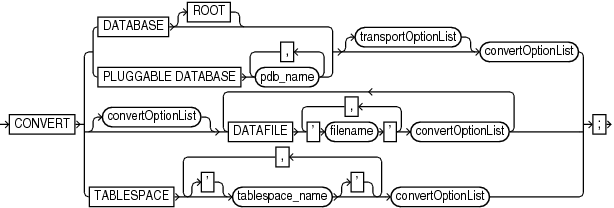
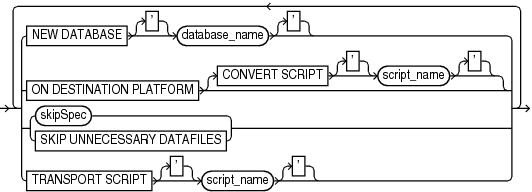
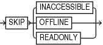
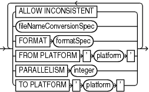

Purpose

Use the `CONVERT` command to convert a tablespace, data file, or database to the format of a destination platform in preparation for transport across different platforms.

The `CONVERT DATAFILE` or `CONVERT TABLESPACE` command is required in the following scenarios:

- Transporting data files between platforms for which the value in `V$TRANSPORTABLE_PLATFORM.ENDIAN_FORMAT` differs.
- Transporting tablespaces with undo segments (typically `SYSTEM` and `UNDO` tablespaces, but also tablespaces using rollback segments) between platforms, regardless of whether the `ENDIAN_FORMAT` is the same or different. Typically, the `SYSTEM` and `UNDO` tablespaces are converted only when converting the entire database.
- Performing any required conversion on other platform-specific data files, such as when converting to or from the HP Tru64 operating system.

One use of `CONVERT` is to transport a tablespace into a database stored in Oracle Automatic Storage Management (Oracle ASM). Native operating system commands such as Linux `cp` and Microsoft Windows `COPY` cannot read from or write to Oracle ASM disk groups.

Note that `CONVERT` cannot be used to convert a database from one Oracle Database version to another.

See Also:

[Oracle Database Backup and Recovery User's Guide](https://docs.oracle.com/pls/topic/lookup?ctx=en/database/oracle/oracle-database/21/rcmrf&id=BRADV05432) for a complete discussion of the use of `CONVERT DATAFILE`, `CONVERT TABLESPACE`, and `CONVERT DATABASE`

Prerequisites

The source and destination platforms must be supported by the `CONVERT` command. Query `V$TRANSPORTABLE_PLATFORM` to determine the supported platforms. Cross-platform tablespace transport is only supported when both the source and destination platforms are contained in this view.

Both source and destination databases must be running with initialization parameter `COMPATIBLE` set to 10.0.0 or higher. Note the following compatibility prerequisites:

- If `COMPATIBLE` is less than 11.0.0, then read-only tablespaces or existing transported tablespaces must have been made read/write at least once before they can be transported to a different platform. You can open a tablespace read/write and then immediately make it read-only again.
- If `COMPATIBLE` is 11.0.0 or higher, then the preceding read/write tablespace restriction does not apply. However, any existing transported tablespaces must have been made read/write with `COMPATIBLE` set to 10.0 before they were transported.

CONVERT TABLESPACE Prerequisites

You can only use `CONVERT TABLESPACE` when connected as `TARGET` to the source database and converting tablespaces on the source platform.

The source database must be mounted or open. The tablespaces to be converted must be read-only at the time of the conversion. The state of the destination database is irrelevant when converting tablespaces on the source database.

CONVERT DATAFILE Prerequisites

You can only use `CONVERT DATAFILE` when connected as `TARGET` to the destination database and converting data file copies on the destination platform.

If you run a `CONVERT DATAFILE` script generated by `CONVERT DATABASE ON DESTINATION`, then the destination database instance must be started with the `NOMOUNT` option. If you are not running a `CONVERT DATAFILE` script generated by `CONVERT DATABASE ON DESTINATION`, then the destination database can be started, mounted, or open.

The state of the source database is irrelevant when converting data file copies on the destination database. However, if you run a `CONVERT DATAFILE` script as part of a database conversion on the destination database, and if the script is directly accessing the data files on the source database (for example, through an NFS mount), then the source database must be open read-only.

When converting a tablespace on the destination host, you must use `CONVERT DATAFILE` rather than `CONVERT TABLESPACE` because the target database cannot associate the data files with tablespaces during the conversion. After you have converted the data files required for a tablespace, you can transport them into the destination database.

CONVERT DATABASE Prerequisites

You can only use `CONVERT DATABASE` when connected as `TARGET` to the source database, which must be opened read-only. The state of the destination database is irrelevant when executing `CONVERT DATABASE`, even if you run `CONVERT DATABASE ON DESTINATION`.

Because `CONVERT DATABASE` uses the same mechanism as `CONVERT TABLESPACE` and `CONVERT DATAFILE` to convert the data files, the usage notes and restrictions for tablespaces and data files also apply.

The primary additional prerequisite for `CONVERT DATABASE` is that the source and target platforms must share the same endian format. For example, you can transport a database from Microsoft Windows to Linux for x86 (both little-endian), or from HP-UX to AIX (both big-endian), but not from Solaris to Linux x86. You can create a new database on a target platform manually, however, and transport individual tablespaces from the source database with `CONVERT TABLESPACE` or `CONVERT DATAFILE`.

Even if the endian formats for the source and destination platform are the same, the data files for a transportable database must undergo a conversion on either the source or destination host. Unlike transporting tablespaces across platforms, where conversion is not necessary if the endian formats are the same, transporting an entire database requires that certain types of blocks, such as blocks in undo segments, be converted to ensure compatibility with the destination platform.

Usage Notes

Input files are not altered by `CONVERT` because the conversion is not performed in place. Instead, RMAN writes converted files to a specified output destination.

Data Type Restrictions

`CONVERT` does not perform endian conversions of data stored in the following data types:

- `RAW`
- `LONG` `RAW`
- `BLOB`
- `ANYTYPE` / `ANYDATA/ANYDATASET`
- User-defined types or Oracle abstract types (such as the ORDImage media type) that contain attributes of any of the above data types

Note:

Although the file locator within the `BFILE` data type is converted, the external file to which the `BFILE` points is not converted.

To transport objects between databases that are built on underlying types that store data in a platform-specific format, use the Data Pump Import and Export utilities.

Before Oracle Database 10g, CLOBs in a variable-width character set such as `UTF8` were stored in an endian-dependent fixed width format. The `CONVERT` command does not perform conversions on these CLOBs. Instead, RMAN captures the endian format of each LOB column and propagates it to the target database. Subsequent reads of this data by the SQL layer interpret the data correctly based on either endian format and write it out in an endian-independent way if the tablespace is writeable. CLOBs created in Oracle Database 10g and later releases are stored in character set `AL16UTF16`, which is platform-independent.

See Also:

[Oracle Database Administrator's Guide](https://docs.oracle.com/pls/topic/lookup?ctx=en/database/oracle/oracle-database/21/rcmrf&id=ADMIN01101) to learn how to transport tablespaces

Syntax

convert::=



> CONVERT { {DATABASE \[ROOT\] | PLUGGABLE DATABASE pdb\_name \[, pdb\_name\]...} \[transportOptionList\] convertOptionList | \[convertOptionList\] DATAFILE ' filename ' \[, ' filename '\]... convertOptionList \[DATAFILE ' filename ' \[, ' filename '\]... convertOptionList\]... | TABLESPACE \['\] tablespace\_name \['\] \[, \['\] tablespace\_name \['\]\]... convertOptionList}
>
> [  
> Copyright © 2023, 2024, Oracle and/or its affiliates.](https://docs.oracle.com/en/database/oracle/oracle-database/dcommon/html/cpyr.htm)


(transportOptionList::=, convertOptionList::=)

transportOptionList::=



> {NEW DATABASE \['\] database\_name \['\] | ON DESTINATION PLATFORM \[CONVERT SCRIPT \['\] script\_name \['\]\] | {skipSpec | SKIP UNNECESSARY DATAFILES} | TRANSPORT SCRIPT \['\] script\_name \['\]} \[ {NEW DATABASE \['\] database\_name \['\] | ON DESTINATION PLATFORM \[CONVERT SCRIPT \['\] script\_name \['\]\] | {skipSpec | SKIP UNNECESSARY DATAFILES} | TRANSPORT SCRIPT \['\] script\_name \['\]}\]...


(skipSpec::=)

skipSpec::=



> SKIP {INACCESSIBLE | OFFLINE | READONLY}
>
> [  
> Copyright © 2023, 2024, Oracle and/or its affiliates.](https://docs.oracle.com/en/database/oracle/oracle-database/dcommon/html/cpyr.htm)


convertOptionList::=



> {ALLOW INCONSISTENT | fileNameConversionSpec | FORMAT formatSpec | FROM PLATFORM ' platform ' | PARALLELISM integer | TO PLATFORM ' platform '} \[ {ALLOW INCONSISTENT | fileNameConversionSpec | FORMAT formatSpec | FROM PLATFORM ' platform ' | PARALLELISM integer | TO PLATFORM ' platform '}\]...
>
> [  
> Copyright © 2023, 2024, Oracle and/or its affiliates.](https://docs.oracle.com/en/database/oracle/oracle-database/dcommon/html/cpyr.htm)


([fileNameConversionSpec::=](fileNameConversionSpec.md), formatSpec::=)

formatSpec::=


> ' format\_string '
>
> [  
> Copyright © 2023, 2024, Oracle and/or its affiliates.](https://docs.oracle.com/en/database/oracle/oracle-database/dcommon/html/cpyr.htm)


Semantics

convert

This clause specifies the objects to be converted: data files, tablespaces, or database.

| Syntax Element | Description |
| --- | --- |
| `DATABASE` | Converts all the data files of a database to the format of the destination platform and ensures the creation of other required database files.  In a multitenant container database (CDB), converts all the data files in the CDB. You connect to the root to convert the whole CDB.  Note: Converting a PDB by connecting to the PDB and then using the `CONVERT DATABASE` command is not supported.  You use `CONVERT DATABASE` to transport an entire database from a source platform to a destination platform. The source and destination platforms must have the same endian format.  Depending on the situation, you can use `CONVERT DATABASE` on either the source or destination platform (see Example 2-69). The following parts of the database are not transported directly:  - Redo logs and control files from the source database are not transported. RMAN creates new control files and redo logs for the target database during the transport and performs an `OPEN RESETLOGS` after the new database is created. The control file for the converted database does not contain the RMAN repository from the source database. Backups from the source database are not usable with the converted database. - BFILEs are not transported. The `CONVERT DATABASE` output provides a list of objects that use the BFILE data type, but you must copy the BFILEs manually and fix their locations on the target platform. - Data files for locally managed temporary tablespaces are not transported. The temporary tablespaces are re-created at the target platform by running the transport script. - External tables and directories are not transported. The `CONVERT DATABASE` output shows a list of affected objects, but you must redefine these objects on the target platform. See [Oracle Database Administrator's Guide](https://docs.oracle.com/pls/topic/lookup?ctx=en/database/oracle/oracle-database/21/rcmrf&id=ADMIN01507) for more information on managing external tables and directories. - Password files are not transported. If a password file was used with the source database, then the output of `CONVERT DATABASE` includes a list of all user names and their associated privileges. Create a new password file on the target database with this information. See [Oracle Database Administrator's Guide](https://docs.oracle.com/pls/topic/lookup?ctx=en/database/oracle/oracle-database/21/rcmrf&id=ADMIN10241) for more information on managing password files.  When using `CONVERT DATABASE`, RMAN detects the following problems and does not proceed until they are fixed:  - The database has active or in-doubt transactions. - The database has save undo segments. - The database `COMPATIBILITY` setting is below 10. - Some tablespaces have not been open read/write when the database `COMPATIBILITY` setting is 10 or higher. |
| `DATABASE ROOT` | In a CDB, converts the data files of the root to the format of the destination platform and ensures the creation of other required database files. Connect to the root and convert the data files.  See the previous description of the `DATABASE` parameter for general information about converting databases. |
| `transportOptionList` | Specifies options that control the transport.  See Also: `transportOptionList` |
| `PLUGGABLE DATABASE ` `pdb_name` | This clause is not supported for converting one or more PDBs.  You can use the [BACKUP](BACKUP.md) command with the `FOR TRANSPORT` or `TO PLATFORM` clause to create backup sets that can be used to transport one or more PDBs. |
| `[``convertOptionList``]` `DATAFILE '` `filename` `'` `convertOptionList` | Specifies the name of a data file to be transported into a destination database (see Example 2-67). To transport a data file in a PDB, connect to the PDB.  Note: You cannot convert a tablespace that contains undo segments when connected as `TARGET` to a PDB.  The `CONVERT DATAFILE` command is only one part of a multiple-step procedure for transporting data files across platforms. You can transport data files using your live data files with the procedure described in [Oracle Database Administrator's Guide](https://docs.oracle.com/pls/topic/lookup?ctx=en/database/oracle/oracle-database/21/rcmrf&id=ADMIN01101) or from backups using the procedure described in [Oracle Database Backup and Recovery User's Guide](https://docs.oracle.com/pls/topic/lookup?ctx=en/database/oracle/oracle-database/21/rcmrf&id=BRADV05141). Refer to that document before attempting to transport a tablespace across platforms.  Use `FROM PLATFORM` in `convertOptionList` to identify the source platform of the data files to be converted. If you do not specify `FROM PLATFORM`, then the value defaults to the platform of the destination database, that is, the database to which RMAN is connected as `TARGET`. The destination platform is, implicitly, the platform of the destination host.  You can use `CONVERT DATAFILE` without `FROM PLATFORM` or `TO PLATFORM` to move data files into and out of ASM (see Example 2-68). In this case, `CONVERT DATAFILE` creates data files copies that do not belong to the target database. Thus, a `LIST` `DATAFILECOPY` command does not display them. The following query shows all converted data files that do not belong to the database:  ``` SELECT NAME  FROM   V$DATAFILE_COPY WHERE  CONVERTED_FILE='YES'; ```  The `CONVERT DATAFILE` syntax supports multiple format names, so that each data file can have a separate format. The `DATAFILE` syntax supports `convertOptionList` both immediately following the `CONVERT` keyword and after each `DATAFILE` `'` `filename` `'` clause. However, RMAN generates an error in the following situations:  - Any option in `convertOptionList` except `FORMAT` is specified more than once - Any option in `convertOptionList` except `FORMAT` is specified in the `DATAFILE` options list when multiple `DATAFILE` clauses are specified |
| `TABLESPACE` `tablespace_name` `convertOptionList` | Specifies the name of a tablespace in the source database that you intend to transport into the destination database on a different platform (see Example 2-66).  To transport a tablespace in a PDB, you must connect to the PDB.  Specify this option to produce data files for the specified tablespaces in the format of a different destination platform. You can then transport the converted files to the destination platform.  When connected to the root in a CDB, refers to tablespaces in the root. Refers to a tablespace in a PDB when connected directly to a PDB.  You can only use `CONVERT TABLESPACE` when connected as `TARGET` to the source database and converting on the source platform. The tablespaces to be converted must be read-only at the time of the conversion. You use `CONVERT TABLESPACE` when the data files that you intend to convert are known to the database.  Use `TO PLATFORM` to identify the destination platform of the tablespaces to be converted. If you do not specify `TO PLATFORM`, then the value defaults to the platform of the database to which RMAN is connected as `TARGET`. The source platform is, implicitly, the platform of the source host.  The `CONVERT TABLESPACE` command is only one part of a multiple-step process for transporting tablespaces across platforms. You can transport tablespaces using your live data files with the procedure described in [Oracle Database Administrator's Guide](https://docs.oracle.com/pls/topic/lookup?ctx=en/database/oracle/oracle-database/21/rcmrf&id=ADMIN01101) or from backups using the procedure described in [Oracle Database Backup and Recovery User's Guide](https://docs.oracle.com/pls/topic/lookup?ctx=en/database/oracle/oracle-database/21/rcmrf&id=BRADV05141). Refer to that document before attempting to transport a tablespace across platforms.  Note: To convert the data files of a tablespace on the source host, use `CONVERT TABLESPACE ... TO` and identify the tablespace to be converted and the destination platform. Do not convert individual data files on the source platform with `CONVERT DATAFILE` because RMAN does not verify that data files belong to a read-only tablespace, which means you might convert active data files. |
| `convertOptionList` | Specifies options that control the conversion.  See Also: `convertOptionList` |

transportOptionList

This clause specifies options for the data files, tablespaces, or database to be transported.

| Syntax Element | Description |
| --- | --- |
| `NEW DATABASE` `database_name` | Specifies the `DB_NAME` for the new database produced by the `CONVERT` `DATABASE` command. |
| `ON DESTINATION PLATFORM` | Generates a convert script of `CONVERT DATAFILE` commands (see `CONVERT SCRIPT` parameter) that you can run on the destination host to create the database.  Note: When this option is specified, `CONVERT` generates a script but does not generate converted data file copies.  This option is useful for avoiding the overhead of the conversion on the source platform, or in cases in which you do not know the destination platform. For example, you may want to publish a transportable tablespace to be used by recipients with many different target platforms.  When you run `CONVERT` with the `ON DESTINATION PLATFORM` option, the source database must be open read-only. However, the script generated by `CONVERT ON DESTINATION PLATFORM` must be run on a database instance that is started `NOMOUNT`. If the convert script reads data files from the source database during execution of the `CONVERT DATAFILE` commands, then the source database must not be open read/write during the execution. |
| `   CONVERT SCRIPT` `script_name` | Specifies the location of the file to contain the convert script generated by `CONVERT DATABASE ... ON TARGET PLATFORM`.  If not specified, the convert script is not generated. |
| `skipSpec` | `CONVERT DATABASE` skips inaccessible, offline, or read-only data files during the conversion process. |
| `SKIP UNNECESSARY DATAFILES` | Converts only data files with undo segments. If converting at the destination platform then the generated `CONVERT` script only includes data files with undo segments. Data files without undo segments do not need to be converted and can be copied directly from the source database to the destination database. If the command is converting from or to hp Tru64, data files with ASSM segment headers must also be converted. |
| `TRANSPORT SCRIPT` `script_name` | Specifies the location of the file to contain the transport script generated by `CONVERT DATABASE`. If omitted, the transport script is not generated. |

skipSpec

This subclause specifies which files are excluded from the conversion.

| Syntax Element | Description |
| --- | --- |
| `SKIP` | Excludes data files according to the criteria specified by the following keywords. |
| `INACCESSIBLE` | Excludes data files that cannot be read due to I/O errors.  A data file is only considered inaccessible if it cannot be read. Some offline data files can still be read because they still exist on disk. Others have been deleted or moved and so cannot be read, making them inaccessible. |
| `OFFLINE` | Excludes offline data files. |
| `READONLY` | Excludes read-only data files. |

convertOptionList

This subclause specifies input and output options for the conversion.

You can use either the `FORMAT` or `fileNameConversionSpec` arguments to control the names of the output files generated by the `CONVERT` command. If you do not specify either, then the rules governing the location of the output files equal those governing the output files from a `BACKUP` ` AS COPY` operation. These rules are described in the `backupTypeSpec` entry.

| Syntax Element | Description |
| --- | --- |
| `ALLOW INCONSISTENT` | Enables you to create a inconsistent backup of tablespaces that are not in read-only mode. Although the backup is created, you cannot plug in these tablespaces directly into the target database.  Note: You cannot use `ALLOW INCONSISTENT` for cross-platform database backups. |
| `fileNameConversionSpec` | A set of string pairs. Whenever an input file name contains the first half of a pair anywhere in the file name, it is replaced with the second half of the same pair. You can use as many pairs of replacement strings as required. You can use single or double quotation marks.  See Also: " [Duplication with Oracle Managed Files](DUPLICATE.md) " to learn about restrictions related to ASM and Oracle Managed Files |
| `FORMAT` `formatSpec` | Specifies the name template for the output files. See the `BACKUP` `AS COPY` command for the format values that are valid here.  If the database to which RMAN is connected as `TARGET` uses a recovery area, then you must specify the `FORMAT` clause.  You can use `CONVERT ... FORMAT` without specifying `FROM PLATFORM` or `TO PLATFORM`. If you do not specify platforms, then running `CONVERT TABLESPACE` on the source database generates data file copies that are not cataloged. If you run `CONVERT DATAFILE` on the destination database, and if the data file copy uses the same endianess, then the command generates another data file copy.  As shown in Example 2-68, you can use `CONVERT DATAFILE ... FORMAT` to convert a data file into ASM format. For very large data files, copying data files between hosts consumes a large amount of space. Consider using NFS or disk sharing. You can create a backup on the source host, mount the disk containing the backups on the destination host, and then convert the data file into ASM. |
| `FROM PLATFORM` `'` `platform` `'` | Specifies the name of the source platform. If not specified, the default is the platform of the database to which RMAN is connected as `TARGET`.  The specified platform must be a platform listed in the `PLATFORM_NAME` column of `V$TRANSPORTABLE_PLATFORM`. You must use the exact name of the source or target platform as a parameter to the `CONVERT` command. The following statement queries supported Linux platforms:  ``` SELECT PLATFORM_NAME, ENDIAN_FORMAT FROM   V$TRANSPORTABLE_PLATFORM  WHERE  UPPER(PLATFORM_NAME) LIKE 'LINUX%'; ``` |
| `PARALLELISM ` `integer` | Specifies the number of channels to be used to perform the operation. If not used, then channels allocated or configured for disk determine the number of channels. |
| `TO PLATFORM` `'` `platform` `'` | Specifies the name of the destination platform. If not specified, the default is the platform of the database to which RMAN is connected as `TARGET`.  The specified platform must be a platforms listed in the `PLATFORM_NAME` column of `V$TRANSPORTABLE_PLATFORM`. You must use the exact name of the source or target platform as a parameter to the `CONVERT` command. The following SQL statement queries supported Linux platforms:  ``` SELECT PLATFORM_NAME, ENDIAN_FORMAT FROM   V$TRANSPORTABLE_PLATFORM  WHERE  UPPER(PLATFORM_NAME) LIKE 'LINUX%'; ``` |

Examples

Example 2-66 Converting Tablespaces on the Source Platform

Suppose you must convert tablespaces `finance` and `hr` in source database `prodlin` to the platform format of destination database `prodsun`. The `finance` tablespace includes data files `/disk2/orahome/fin/fin01.dbf` and `/disk2/orahome/fin/fin02.dbf`. The `hr` tablespace includes data files `/disk2/orahome/fin/hr01.dbf` and `/disk2/orahome/fin/hr02.dbf`.

The `prodlin` database runs on Linux host `lin01`. You query `V$DATABASE` and discover that platform name is `Linux IA (32-bit)` and uses a little-endian format. The `prodsun` database runs on Solaris host `sun01`. You query `V$TRANSPORTABLE_PLATFORM` and discover that the `PLATFORM_NAME` for the Solaris host is `Solaris[tm] OE (64-bit)`, which uses a big-endian format.

You plan to convert the tablespaces on the source host and store the converted data files in `/tmp/transport_to_solaris/` on host `lin01`. The example assumes that you have set `COMPATIBLE` is to 10.0 or greater on the source database.

On source host `lin01`, you start the RMAN client and run the following commands, where `SBU` is any user with the `SYSBACKUP` privilege:

```
CONNECT TARGET "sbu@prodlin AS SYSBACKUP"

target database Password: password
connected to target database: PRODLIN (DBID=39525561)

ALTER TABLESPACE finance READ ONLY;
ALTER TABLESPACE hr READ ONLY;
CONVERT TABLESPACE finance, hr
  TO PLATFORM 'Solaris[tm] OE (64-bit)'
  FORMAT '/tmp/transport_to_solaris/%U';
```

The result is a set of converted data files in the `/tmp/transport_to_solaris/` directory, with data in the right endian-order for the Solaris 64-bit platform.

From this point, you can follow the rest of the general outline for tablespace transport. Use the Data Pump Export utility to create the file of structural information, move the structural information file and the converted data files from `/tmp/transport_to_solaris/` to the desired directories on the destination host, and plug the tablespace into the new database with the Data Pump Import utility.

Example 2-67 Converting Data Files on the Destination Platform

This example assumes that you want to convert the `finance` and `hr` tablespaces from database `prodsun` on host `sun01` into a format usable by database `prodlin` on destination host `lin01`. You temporarily store the unconverted data files in directory `/tmp/transport_from_solaris/` on destination host `lin01` and perform the conversion with `CONVERT DATAFILE`. When you transport the data files into the destination database, they are stored in `/disk2/orahome/dbs`.

The example assumes that you have carried out the following steps in preparation for the tablespace transport:

- You used the Data Pump Export utility to create the structural information file (named, in our example, `expdat.dmp`).
- You made the `finance` and `hr` tablespaces read-only on the source database.
- You used an operating system utility to copy `expdat.dmp` and the unconverted data files to be transported to the destination host `lin01` in the `/tmp/transport_from_solaris` directory. The data files are stored as:
	- `/tmp/transport_from_solaris/fin/fin01.dbf`
		- `/tmp/transport_from_solaris/fin/fin02.dbf`
		- `/tmp/transport_from_solaris/hr/hr01.dbf`
		- `/tmp/transport_from_solaris/hr/hr02.dbf`
- You queried the name for the source platform in `V$TRANSPORTABLE_PLATFORM` and discovered that the `PLATFORM_NAME` is `Solaris[tm] OE (64-bit)`.

Note the following considerations when performing the conversion:

- Identify the data files by file name, not by tablespace name. Until the data files are plugged in, the local instance has no way of knowing the intended tablespace names.
- The `FORMAT` argument controls the name and location of the converted data files.
- When converting on the destination host, you must specify the source platform with the `FROM` argument. Otherwise, RMAN assumes that the source platform is also the platform of the host performing the conversion.

You start the RMAN client and connect to the destination database `prodlin` as `TARGET`. `sbu` is a user who is granted the `SYSBACKUP` privilege. The following `CONVERT` command converts the data files to be transported to the destination host format and deposits the results in `/disk2/orahome/dbs`:

```
CONNECT TARGET "sbu@prodlin AS SYSBACKUP"

target database Password: password
connected to target database: PRODLIN (DBID=39525561)

CONVERT DATAFILE
   '/tmp/transport_from_solaris/fin/fin01.dbf',
   '/tmp/transport_from_solaris/fin/fin02.dbf',
   '/tmp/transport_from_solaris/hr/hr01.dbf',
   '/tmp/transport_from_solaris/hr/hr02.dbf'
   DB_FILE_NAME_CONVERT
        '/tmp/transport_from_solaris/fin','/disk2/orahome/dbs/fin',
        '/tmp/transport_from_solaris/hr','/disk2/orahome/dbs/hr'
   FROM PLATFORM 'Solaris[tm] OE (64-bit)';
```

The result is that the following data files have been converted to the Linux format:

- `/disk2/orahome/dbs/fin/fin01.dbf`
- `/disk2/orahome/dbs/fin/fin02.dbf`
- `/disk2/orahome/dbs/hr/hr01.dbf`
- `/disk2/orahome/dbs/hr/hr02.dbf`

From this point, follow the rest of the general outline for tablespace transport. Use Data Pump Import to plug the converted tablespaces into the new database, and make the tablespaces read/write if applicable.

Example 2-68 Copying Data Files to and from ASM with CONVERT DATAFILE

This example illustrates copying data files into ASM from normal storage. The generated files are not considered data file copies that belong to the target database, so `LIST DATAFILECOPY` does not display them.

Use `CONVERT DATAFILE` without specifying a source or destination platform. Specify ASM disk group `+DATAFILE` for the output location, as shown here:

```
RMAN> CONVERT DATAFILE '/disk1/oracle/dbs/my_tbs_f1.df', 
   '/disk1/oracle/dbs/t_ax1.f'
   FORMAT '+DATAFILE';
 
Starting conversion at 29-MAY-13
using channel ORA_DISK_1
channel ORA_DISK_1: starting datafile conversion
input filename=/disk1/oracle/dbs/t_ax1.f
converted datafile=+DATAFILE/asmv/datafile/sysaux.280.559534477
channel ORA_DISK_1: datafile conversion complete, elapsed time: 00:00:16
channel ORA_DISK_1: starting datafile conversion
input filename=/disk1/oracle/dbs/my_tbs_f1.df
converted datafile=+DATAFILE/asmv/datafile/my_tbs.281.559534493
channel ORA_DISK_1: datafile conversion complete, elapsed time: 00:00:04
Finished conversion at 29-MAY-13
```

The following example illustrates copying the data files of a tablespace out of ASM storage to directory `/tmp`, with uniquely generated file names.

```
RMAN> CONVERT TABLESPACE tbs_2 FORMAT '/tmp/tbs_2_%U.df';
 
Starting conversion at 03-JUN-13
using target database control file instead of recovery catalog
allocated channel: ORA_DISK_1
channel ORA_DISK_1: sid=20 devtype=DISK
channel ORA_DISK_1: starting datafile conversion
input datafile fno=00006 name=+DATAFILE/tbs_21.f
converted datafile=/tmp/tbs_2_data_D-L2_I-2786301554_TS-TBS_2_FNO-6_11gm2fq9.df
channel ORA_DISK_1: datafile conversion complete, elapsed time: 00:00:01
channel ORA_DISK_1: starting datafile conversion
input datafile fno=00007 name=+DATAFILE/tbs_22.f
converted datafile=/tmp/tbs_2_data_D-L2_I-2786301554_TS-TBS_2_FNO-7_12gm2fqa.df
channel ORA_DISK_1: datafile conversion complete, elapsed time: 00:00:01
channel ORA_DISK_1: starting datafile conversion
input datafile fno=00019 name=+DATAFILE/tbs_25.f
converted datafile=/tmp/tbs_2_data_D-L2_I-2786301554_TS-TBS_2_FNO-19_13gm2fqb.df
channel ORA_DISK_1: datafile conversion complete, elapsed time: 00:00:01
channel ORA_DISK_1: starting datafile conversion
input datafile fno=00009 name=+DATAFILE/tbs_23.f
converted datafile=/tmp/tbs_2_data_D-L2_I-2786301554_TS-TBS_2_FNO-9_14gm2fqc.df
channel ORA_DISK_1: datafile conversion complete, elapsed time: 00:00:01
channel ORA_DISK_1: starting datafile conversion
input datafile fno=00010 name=+DATAFILE/tbs_24.f
converted datafile=/tmp/tbs_2_data_D-L2_I-2786301554_TS-TBS_2_FNO-10_15gm2fqd.df
channel ORA_DISK_1: datafile conversion complete, elapsed time: 00:00:01
Finished conversion at 03-JUN-13
```

Example 2-69 Transporting a Database to a Different Platform

The arguments to `CONVERT DATABASE` vary depending on whether you plan to convert the data files on the source or destination platform. For a description of the conversion process on source and destination platforms and extended examples, refer to [Oracle Database Backup and Recovery User's Guide](https://docs.oracle.com/pls/topic/lookup?ctx=en/database/oracle/oracle-database/21/rcmrf&id=BRADV05432). Read that discussion in its entirely before attempting a database conversion.

Assume that you want to transport database `prod` on a Linux host to a Windows host. You decide to convert the data files on the source host rather than on the destination host. The following example connects RMAN to the `PROD` database on the Linux host and uses `CONVERT DATABASE NEW DATABASE` to convert the data files and generate the transport script:

```
CONNECT TARGET "sbu@lin01 AS SYSBACKUP"

target database Password: password
connected to target database: PROD (DBID=39525561)

CONVERT DATABASE
  NEW DATABASE 'prodwin'
  TRANSPORT SCRIPT '/tmp/convertdb/transportscript'
  TO PLATFORM 'Microsoft Windows IA (32-bit)'
    DB_FILE_NAME_CONVERT '/disk1/oracle/dbs','/tmp/convertdb';
```

In the following variation, you want to transport a database running on a Linux host to a Windows host, but you want to convert the data files on the destination host rather than the source host. `sbu` is a user who is granted the `SYSBACKUP` privilege. The following example connects RMAN to the `prod` database on the Linux host and executes `CONVERT DATABASE ON DESTINATION PLATFORM`:

```
CONNECT TARGET "sbu@lin01 AS SYSBACKUP"

target database Password: password
connected to target database: PROD (DBID=39525561)

CONVERT DATABASE
  ON DESTINATION PLATFORM
  CONVERT SCRIPT '/tmp/convertdb/convertscript.rman'
  TRANSPORT SCRIPT '/tmp/convertdb/transportscript.sql'
  NEW DATABASE 'prodwin'
  FORMAT '/tmp/convertdb/%U';
```

The `CONVERT DATABASE ON DESTINATION PLATFORM` command, which is executed on a Linux database, generates a convert script that can be run on the Windows host to convert the data files to the Windows format. The `CONVERT DATABASE` command also generates a transport script.

Example 2-70 Transporting a Database to a Different Platform and Storage Type

In this scenario, you have a database `prod` on a Solaris host named `sun01` that you want to move to an AIX host named `aix01`. The Solaris data files are stored in a non-ASM file system, but you want to store the data files in ASM on the AIX host.

The following example connects to `sun01` and runs `CONVERT DATABASE` to generate the necessary scripts:

```
CONNECT TARGET "sbu@sun01 AS SYSBACKUP"

target database Password: password
connected to target database: PROD (DBID=39525561)

CONVERT DATABASE
  ON DESTINATION PLATFORM
  CONVERT SCRIPT '/tmp/convert_newdb.rman'
  TRANSPORT SCRIPT '/tmp/transport_newdb.sql'
  NEW DATABASE 'prodaix'
  DB_FILE_NAME_CONVERT '/u01/oradata/DBUA/datafile','+DATA';
```

The convert script contains statements of the following form, where your\_source\_platform stands for your source platform:

```
CONVERT DATAFILE '/u01/oradata/DBUA/datafile/o1_mf_system_2lg3905p_.dbf'
  FROM PLATFORM 'your_source_platform'
  FORMAT '+DATA/o1_mf_system_2lg3905p_.dbf';
```

To reduce downtime for the conversion, you can use NFS rather than copying data files over the network or restoring a backup. For example, you could mount the Solaris files system on the AIX host as `/net/solaris/oradata`. In this case, you would edit the convert script to reference the NFS-mounted directory as the location of the source data files to convert, putting the commands into the following form:

```
CONVERT DATAFILE '/net/solaris/oradata/DBUA/datafile/o1_mf_system_2lg3905p_.dbf'
  FROM PLATFORM 'your_source_platform'
  FORMAT '+DATA/o1_mf_system_2lg3905p_.dbf';
```

You then connect RMAN to the destination database instance, in this case the instance on host `aix01`, and convert the data files. During the conversion, the database at host sun01 remains in open read only mode. Afterward, you connect SQL\*Plus to the database instance on `aix01` and run the transport script to create the database.