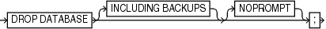

Purpose

Use the `DROP DATABASE` command to delete the target database and, if RMAN is connected to a recovery catalog, unregister it. RMAN removes the server parameter file, all data files, online redo logs, and control files belonging to the target database. By default, RMAN prompts for confirmation.

Note:

This command cannot be used to delete a protected database that is configured to create backups to Zero Data Loss Recovery Appliance, commonly known as Recovery Appliance.

Prerequisites

Execute this command only at the RMAN prompt. You must be connected to a target database. The target database must be mounted exclusive and not open, and started in `RESTRICT` mode.

Syntax

dropDatabase::=



> DROP DATABASE \[INCLUDING BACKUPS\] \[NOPROMPT\]
>
> [  
> Copyright © 2023, 2024, Oracle and/or its affiliates.](https://docs.oracle.com/en/database/oracle/oracle-database/dcommon/html/cpyr.htm)


Semantics

| Syntax Element | Description |
| --- | --- |
| `INCLUDING BACKUPS` | Deletes backup sets, proxy copies, image copies, and archived redo log files associated with the target database from all configured device types.  Note: If you use a recovery catalog but run RMAN in `NOCATALOG` mode when you drop the database, then RMAN does not delete any backups which are known to the recovery catalog but no longer exist in the target database control file. |
| `NOPROMPT` | Does not prompt for confirmation before deleting the database. |

Example

Example 2-83 Deleting a Database

In this example, you want to delete a test database called `test1` that is registered in the recovery catalog. You start the RMAN client, connect to database `test1` as `TARGET`, and connect to the recovery catalog. You then run the following commands to delete the target database files, and all backups, copies, and archived redo log files associated with the database:

```
RMAN> CONNECT TARGET "sbu@test1 AS SYSBACKUP"

target database Password: password
connected to target database: TEST1 (DBID=39525561)

RMAN> STARTUP FORCE MOUNT
RMAN> ALTER SYSTEM ENABLE RESTRICTED SESSION;
RMAN> DROP DATABASE INCLUDING BACKUPS NOPROMPT;
```