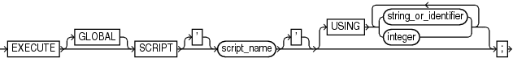

Purpose

Use the `EXECUTE SCRIPT` command to run a local or global RMAN script stored in the recovery catalog.

See Also:

- [Oracle Database Backup and Recovery User's Guide](https://docs.oracle.com/pls/topic/lookup?ctx=en/database/oracle/oracle-database/21/rcmrf&id=BRADV182) to learn how to use stored scripts
- `CREATE SCRIPT` and `REPLACE SCRIPT`

Prerequisites

Use `EXECUTE SCRIPT` only within the braces of a `RUN` command. RMAN must be connected to the recovery catalog with the `CATALOG` command-line option or the `CONNECT` `CATALOG` command. The recovery catalog database must be open.

Usage Notes

When you run an `EXECUTE SCRIPT` command within a `RUN` block, RMAN places the contents of the script in that `RUN` block. Therefore, do not allocate a channel within the `RUN` block if you also allocate it in the script.

If `GLOBAL` is specified, then a global script with this name must exist in the recovery catalog; otherwise, RMAN returns error `RMAN-06004`. If `GLOBAL` is not specified, then RMAN searches for a local stored script defined for the current target database. If no local script with this name is found, then RMAN searches for a global script by the same name and executes it if one is found.

Syntax

executeScript::=



> EXECUTE \[GLOBAL\] SCRIPT \['\] script\_name \['\] \[USING {string\_or\_identifier | integer} \[ {string\_or\_identifier | integer}\]...\]
>
> [  
> Copyright © 2023, 2024, Oracle and/or its affiliates.](https://docs.oracle.com/en/database/oracle/oracle-database/dcommon/html/cpyr.htm)


Semantics

| Syntax Element | Description |
| --- | --- |
| `GLOBAL` | Specifies the execution of a global stored script instead of a local one.  See Also: " [Usage Notes](CREATE-SCRIPT.md) " for an explanation of the difference between global and local scripts |
| `SCRIPT` `script_name` | Specifies the name of the stored script to execute. Quotes must be used around the script name when the name contains either spaces or reserved words. |
| `USING` `[``string_or_identifier` `\|` `integer``]` | Specifies one or more values for use in substitution variables in a stored script (see Example 2-99).  See Also: `CREATE SCRIPT` to learn how to create a stored script with substitution variables, and [RMAN](RMAN.md) and `@ (at sign)` to learn how to use substitution variables with RMAN |

Example

Example 2-98 Executing a Stored Script

This example uses [LIST](LIST.md) to list the script stored in the recovery catalog and `PRINT SCRIPT` to show the contents of `global_backup_db`, which was created in [Example 2-74](CREATE-SCRIPT.md). Finally, the example runs `global_backup_db` to back up the database.

```
RMAN> LIST SCRIPT NAMES;
 
List of Stored Scripts in Recovery Catalog

    Global Scripts

       Script Name
       Description
       -----------------------------------------------------------------------
       global_backup_db
       back up any database from the recovery catalog, with logs

RMAN> PRINT SCRIPT global_backup_db;

printing stored global script: global_backup_db
{
    BACKUP DATABASE PLUS ARCHIVELOG;
}

RMAN> RUN { EXECUTE GLOBAL SCRIPT global_backup_db; }

executing global script: global_backup_db

Starting backup at 07-JUN-13
current log archived
allocated channel: ORA_DISK_1
channel ORA_DISK_1: SID=120 device type=DISK
.
.
.
```

Example 2-99 Creating and Executing a Stored Script That Uses Substitution Variables

After starting RMAN and connecting to a target database and recovery catalog, use `REPLACE SCRIPT` to create a backup script that includes three substitution variables. RMAN prompts you to enter initial values for the variables (user input is in bold).

```
RMAN> REPLACE SCRIPT 
2>  backup_df { BACKUP DATAFILE &1 TAG &2.1 FORMAT '/disk1/&3_%U'; }
 Enter value for 1: 1
 
Enter value for 2: df1_backup
 
Enter value for 3: df1

starting full resync of recovery catalog
full resync complete
created script backup_df
```

Later, you can execute the `backup_df` script with different values. The following example passes the values `3`, `test_backup`, and `test` to the substitution variables in the stored script:

```
RMAN> RUN { EXECUTE SCRIPT backup_df USING 3 test_backup df3; }
```

After the values are substituted, RMAN executes the `BACKUP` command as follows:

```
BACKUP DATAFILE 3 TAG test_backup1 FORMAT '/disk1/df3_%U';
```