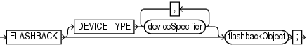
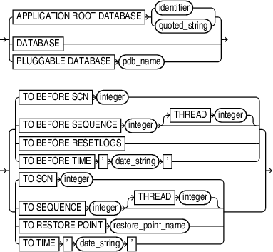

Purpose

Use the `FLASHBACK DATABASE` command to rewind the database to a target time, SCN, log sequence number, or restore point.

This command undoes changes made by Oracle Database to the data files that exist when you run the command. Flashback can fix logical failures, but not physical failures. As a result, you cannot use the command to recover from disk failures or the accidental deletion of data files.

`FLASHBACK DATABASE` is usually much faster than a `RESTORE` operation followed by point-in-time recovery because no data files are restored. The time needed to perform `FLASHBACK DATABASE` depends on the number of changes made to the database since the desired flashback time. On the other hand, the time needed to do a traditional point-in-time recovery from restored backups depends on the size of the database.

Flashback Database operations also have several uses in a Data Guard environment.

Note:

Flashback operations on a proxy PDB are not supported.

See Also:

- [Oracle Database SQL Language Reference](https://docs.oracle.com/pls/topic/lookup?ctx=en/database/oracle/oracle-database/21/rcmrf&id=SQLRF01801) for a complete list of command prerequisites and usage notes for `FLASHBACK DATABASE`
- [Oracle Data Guard Concepts and Administration](https://docs.oracle.com/pls/topic/lookup?ctx=en/database/oracle/oracle-database/21/rcmrf&id=SBYDB00717) to learn about uses of Flashback Database in a Data Guard environment

Prerequisites

- You can run this command from the RMAN prompt or from within a `RUN` command.
- RMAN must be connected as `TARGET` to a database, which must be Oracle Database 10g or later. The target database must be mounted with a current control file, that is, the control file cannot be a backup or re-created.
- The database must run in `ARCHIVELOG` mode.
- The fast recovery area must be configured to enable flashback logging.
	Flashback logs are stored as Oracle-managed files in the fast recovery area and cannot be created if no fast recovery area is configured.
- You must enable flashback logging before the target time for flashback by issuing the SQL statement `ALTER DATABASE ... FLASHBACK ON`.
	Query `V$DATABASE.FLASHBACK_ON` to see whether flashback logging has been enabled.
- You cannot use `FLASHBACK DATABASE` to return to a point in time before the restore or re-creation of a control file. If the database control file is restored from backup or re-created, then all existing flashback log information is discarded.
- The database must contain no online tablespaces for which flashback functionality was disabled with the SQL statement `ALTER TABLESPACE ... FLASHBACK OFF`.

Prerequisites for Flashback Operations on PDBs

The following are additional prerequisites for performing flashback operations on a pluggable database (PDB):

- The `COMPATIBLE` initialization parameter must be set to 12.2.0.0 or higher.
- RMAN must be connected to the root as a common user with the `SYSDBA` or `SYSBACKUP` privilege.
- The PDB on which a Flashback Database operation is being performed must be closed. Other PDBs may be open and operational.
- The root must be open when opening the PDB with resetlogs.

Usage Notes

A Flashback Database operation applies to the whole database. You cannot flash back individual tablespaces. A Flashback Database operation is similar to a database point-in-time recovery (DBPITR) performed with `RECOVER`, but RMAN uses **flashback logs** to undo changes to a point before the target time or SCN. RMAN automatically restores from backup any archived redo log files that are needed and recovers the database to make it consistent. RMAN never flashes back data for temporary tablespaces.

The earliest SCN that can be used for a Flashback Database operation depends on the setting of the `DB_FLASHBACK_RETENTION_TARGET ` initialization parameter, and on the actual retention of flashback logs permitted by available disk. View the current database SCN in `V$DATABASE.CURRENT_SCN`.

In a multitenant environment, you can perform a flashback database operation either for the whole CDB or for a particular PDB. When using restore points, you can rewind the PDB either to a PDB restore point or CDB restore point.

See Also:

- “Overview of Restore Points in a Multitenant Environment” in [Oracle Database Backup and Recovery User’s Guide](https://docs.oracle.com/pls/topic/lookup?ctx=en/database/oracle/oracle-database/21/rcmrf&id=BRADV-GUID-1150031F-3C15-40C8-BA91-A387F75DC49A) for information about PDB restore points and CDB restore points
- ”Performing Point-in-Time Recovery of CDBs and PDBs” in [Oracle Database Backup and Recovery User’s Guide](https://docs.oracle.com/pls/topic/lookup?ctx=en/database/oracle/oracle-database/21/rcmrf&id=BRADV-GUID-26CD7EC8-12AC-4073-BB8D-A68502112E48) for the steps to rewind a PDB to a specific point in time

Effect of NOLOGGING Operations on Flashback Database

When using `FLASHBACK DATABASE` with a target time at which a `NOLOGGING` operation was in progress, block corruption is likely in the database objects and data files affected by the `NOLOGGING` operation. For example, assume that you do a direct-path `INSERT` operation in `NOLOGGING` mode and that the operation runs from 9:00 to 9:15 on April 3. If you later use Flashback Database to return to 09:07 on this date, then the objects and data files updated by the direct-path `INSERT` may be left with block corruption after Flashback Database completes.

If possible, avoid using `FLASHBACK DATABASE` with a target time or SCN that coincides with a `NOLOGGING` operation. Also, perform a full or incremental backup of the affected data files immediately after any `NOLOGGING` operation to ensure recoverability to points in time after the operation. If you expect to use `FLASHBACK DATABASE` to return to a point in time during an operation such as a direct-path `INSERT`, then consider performing the operation in `LOGGING` mode.

See Also:

The discussion of `logging_clause` in [Oracle Database SQL Language Reference](https://docs.oracle.com/pls/topic/lookup?ctx=en/database/oracle/oracle-database/21/rcmrf&id=SQLRF021) for more information about operations that support `NOLOGGING` mode

Effect of Data File Status Changes on Flashback Database

The `FLASHBACK DATABASE` command does not start modifying the database until it has made sure that it has all the files and resources that it needs. A Flashback Database operation does not fail due to missing data files, redo log files, or flashback logs.

If a data file has changed status between the current SCN and the target SCN of the flashback, then the `FLASHBACK DATABASE` command behaves differently depending on the nature of the status change. Refer to Table 2-8 for details.

Table 2-8 How FLASHBACK DATABASE Responds to Data File Status Changes

| If this data file operation occurred during the flashback window... | Then the FLASHBACK DATABASE command... |
| --- | --- |
| Added | Removes the data file record from the control file. |
| Dropped | Adds the data file to the control file, but marks it as offline and does not flash it back. You can then restore and recover the data file to the same time or SCN. |
| Renamed | Ignores the renaming. The data file retains its current name. |
| Resized | May fail. You can take the data file offline and then rerun the `FLASHBACK DATABASE` command. The data file is not flashed back. You can then restore and recover the data file to the same time or SCN. |
| Taken offline | Ignores the operation. The data file retains its current online status. |
| Brought online | Ignores the operation. The data file retains its current offline status. |
| Made read-only or read/write | Changes the status of the data file in the control file. |

Tablespaces with Flashback Logging Disabled

It is possible for the `ALTER TABLESPACE ... FLASHBACK OFF` statement to have been executed for some tablespaces. If `FLASHBACK DATABASE` has insufficient flashback data to rewind a tablespace to the target SCN, then RMAN issues an error and does not modify the database. Whenever `FLASHBACK DATABASE` fails or is interrupted, the database is left mounted.

In this scenario, query `V$TABLESPACE` to determine which tablespaces have flashback logging disabled. You have the following options:

- Take the data files in the affected tablespaces offline. Afterwards, run `RESTORE` and then `RECOVER` to bring these data files to the same point in time as the rest of the database.
- Drop the affected data files with the `ALTER DATABASE DATAFILE ... OFFLINE FOR DROP` statement. You can then open the database with the `RESETLOGS` option. After the database is open, execute `DROP TABLESPACE` statements for the tablespaces that contain the dropped data files.

State of the Database After Flashback Database

After running `FLASHBACK DATABASE`, the database may not be left at the SCN most immediately before the target time. Events other than transactions can cause the database SCN to be updated. If you use the `FLASHBACK DATABASE TO` form of the command, and if a transaction is associated with the target SCN, then after the flashback the database includes all changes up to and including this transaction. Otherwise, all changes up to but not including this transaction are included in the data files, whether you use the `FLASHBACK DATABASE TO` or `FLASHBACK DATABASE TO BEFORE` form of the command. Changes after the specified target SCN are never applied because of `FLASHBACK DATABASE`.

After `FLASHBACK DATABASE` completes, you may want to open the database read-only and run queries to ensure that you achieved the intended result. If you are not satisfied, then you can use `RECOVER` `DATABASE` to recover the database to its state when you started the flashback. You can then rerun `FLASHBACK DATABASE`.

If you are satisfied with the results of the flashback, then you can `OPEN RESETLOGS` to abandon all changes after the target time. Alternatively, you can use Data Pump to export lost data, use `RECOVER DATABASE` to return the database to its state before the flashback operation, and then use Data Pump to reimport the lost data.

Syntax

flashback::=



> FLASHBACK \[DEVICE TYPE deviceSpecifier \[, deviceSpecifier\]...\] flashbackObject
>
> [  
> Copyright © 2023, 2024, Oracle and/or its affiliates.](https://docs.oracle.com/en/database/oracle/oracle-database/dcommon/html/cpyr.htm)


flashbackObject::=



> {APPLICATION ROOT DATABASE {identifier | quoted\_string} | DATABASE | PLUGGABLE DATABASEpdb\_name} { {TO BEFORE SCNinteger | TO BEFORE SEQUENCEinteger \[THREADinteger\] | TO BEFORE RESETLOGS | TO BEFORETIME ' date\_string '} | {TO SCNinteger | TO SEQUENCEinteger \[THREADinteger\] | TORESTORE POINTrestore\_point\_name | TO TIME ' date\_string '}}
>
> [  
> Copyright © 2023, 2024, Oracle and/or its affiliates.](https://docs.oracle.com/en/database/oracle/oracle-database/dcommon/html/cpyr.htm)


([deviceSpecifier::=](deviceSpecifier.md))

Semantics

flashback::=

| Syntax Element | Description |
| --- | --- |
| `DEVICE TYPE` `deviceSpecifier` | Allocates automatic channels for the specified device type only. For example, if you configure automatic disk and tape channels, and issue `FLASHBACK ... DEVICE TYPE DISK`, then RMAN allocates only disk channels. RMAN may need to restore redo logs from backup during the flashback database process. Changes between the last flashback log and the target time must be re-created based on the archived redo log. If no automatic channels are allocated for tape and a needed redo log is on tape, then the `FLASHBACK DATABASE` operation fails.  See Also: `deviceSpecifier` |

flashbackObject::=

| Syntax Element | Description |
| --- | --- |
| `DATABASE` | Rewinds the entire CDB, including the root and all PDBs. |
| `PLUGGABLE DATABASE` pdb\_name | Rewinds the specified PDB. All other PDBs can be open and operational, but the specified PDB must be closed.  When the CDB uses shared undo, an auxiliary destination is used to store temporary files used during the flashback operation. The default auxiliary destination is the fast recovery area. You can use the `AUXILIARY DESTINATION` clause to explicitly specify an alternate auxiliary destination that is not the fast recovery area. |
| `TO BEFORE SCN` `integer` | Returns the database to its state just before the specified SCN. Any changes at an SCN lower than that specified are applied, but if there is a change associated with the specified SCN it is not applied. By default, the provided SCN resolves to the current or ancestor incarnation. You can override the default by using the `RESET DATABASE` `INCARNATION` command.  Query `OLDEST_FLASHBACK_SCN` in `V$FLASHBACK_DATABASE_LOG` to see the approximate lowest SCN to which you can flash back. |
| `TO BEFORE SEQUENCE` `integer` `[THREAD ` `integer`\] | Specifies a redo log sequence number and thread as an upper limit. RMAN applies changes up to (but not including) the last change in the log with the specified sequence and thread number. |
| `TO BEFORE RESETLOGS` | Returns the database to its state including all changes up to the SCN of the most recent `OPEN RESETLOGS`.  Note: `FLASHBACK DATABASE` can only return the database to a point before the most recent `OPEN RESETLOGS` operation if your database has been upgraded to Oracle Database 10g Release 2 or later.  For PDBs, the Flashback Operation must return the PDB to its state including all changes up to the most recent `OPEN RESETLOGS` operation on the CDB or the most recent `OPEN RESETLOGS` operation on the PDB, whichever of the two is more recent. |
| `TO BEFORE TIME` `'` `date_string` `'` | Returns the database to its state including all changes up to but not including changes at the specified time.  Query `OLDEST_FLASHBACK_TIME` in `V$FLASHBACK_DATABASE_LOG` to see the approximate lowest time to which you can flash back. |
| `TO SCN` `integer` | Returns the database to the point up to (and including) the specified SCN. By default, the provided SCN resolves to the current or ancestor incarnation. You can override the default by using the RMAN `RESET DATABASE` command to set the recovery target incarnation.  Query `OLDEST_FLASHBACK_SCN` in `V$FLASHBACK_DATABASE_LOG` to see the approximate lowest SCN to which you can flash back. |
| `TO SEQUENCE` `integer` `THREAD` `integer` | Specifies a redo log sequence number and thread as an upper limit. RMAN applies changes up to (and including) the last change in the log with the specified sequence and thread number. |
| `TO RESTORE POINT` `restore_point_name` | Returns the database to the SCN associated with the specified restore point. This can be an ordinary restore point or a guaranteed restore point.  For CDBs, you must specify a CDB restore point. The entire CDB is returned to the SCN associated with the specified CDB restore point.  For PDBs, you can specify either a CDB restore point, PDB restore point, or a clean PDB restore point. RMAN returns the PDB to the SCN associated with the specified restore point. The remaining PDBs in the CDB are not impacted by a flashback operation on a particular PDB. |
| `TO TIME` `'` `date_string` `'` | Returns the database to its state at the specified time. You can use any SQL `DATE` expressions to convert the time to the current format, for example, `FLASHBACK DATABASE TO TIME 'SYSDATE-7'`.  Query `OLDEST_FLASHBACK_TIME` in `V$FLASHBACK_DATABASE_LOG` to see the approximate lowest time to which you can flash back. |
| `AUXILIARY DESTINATION` `’location'` | Specifies the location where temporary database files used during flashback database operations in a multitenant environment are stored. When a CDB uses shared undo, you must specify an auxiliary destination. For CDBs that use local undo, specifying an auxiliary destination is optional. |

Examples

Example 2-101 FLASHBACK DATABASE to a Specific SCN

Assume that you inserted corrupted rows in many tables at 5:00 p.m. on February 14. You connect SQL\*Plus to the database and query the earliest SCN in the flashback window:

```
SQL> SELECT OLDEST_FLASHBACK_SCN, OLDEST_FLASHBACK_TIME
  2  FROM   V$FLASHBACK_DATABASE_LOG;

OLDEST_FLASHBACK_SCN OLDEST_FLASHBACK
-------------------- ----------------
              411010 2013/02/14 16:49
```

You then open a new terminal, start the RMAN client, and connect to the target database and recovery catalog. You enter RMAN commands as follows (sample output for the `FLASHBACK DATABASE` is included):

```
RMAN> SHUTDOWN IMMEDIATE
RMAN> STARTUP MOUNT
RMAN> FLASHBACK DATABASE TO SCN 411010;
 
Starting flashback at 15-FEB-13
allocated channel: ORA_DISK_1
channel ORA_DISK_1: SID=104 device type=DISK
 
 
starting media recovery
media recovery complete, elapsed time: 00:00:07
 
Finished flashback at 15-FEB-13
 
RMAN> ALTER DATABASE OPEN RESETLOGS;
```

Example 2-102 FLASHBACK DATABASE to a Restore Point

Assume that you are preparing to load a massive number of updates to the database. You create a guaranteed restore point before the performing the updates:

```
SQL> CREATE RESTORE POINT before_update GUARANTEE FLASHBACK DATABASE;
```

The bulk update fails, leaving the database with extensive corrupted data. You start an RMAN session, connect to the target database and recovery catalog, and list the guaranteed restore points:

```
RMAN> LIST RESTORE POINT ALL;

SCN              RSP Time  Type       Time      Name
---------------- --------- ---------- --------- ----
412742                     GUARANTEED 15-FEB-13 BEFORE_UPDATE
```

You mount the database, flash back the database to the restore point (sample output included), and then open the database with the `RESETLOGS` option:

```
RMAN> SHUTDOWN IMMEDIATE
RMAN> STARTUP MOUNT
RMAN> FLASHBACK DATABASE TO RESTORE POINT BEFORE_UPDATE;
 
Starting flashback at 15-FEB-13
allocated channel: ORA_DISK_1
channel ORA_DISK_1: SID=104 device type=DISK
 
 
starting media recovery
 
archived log for thread 1 with sequence 34 is already on disk as file /disk2/oracle/oradata/prod/arch/archive1_34_614598462.dbf
media recovery complete, elapsed time: 00:00:01
Finished flashback at 15-FEB-13
 
RMAN> ALTER DATABASE OPEN RESETLOGS;
```

Example 2-103 FLASHBACK DATABASE for a PDB to a Guaranteed PDB Restore Point

Assume that you need to upgrade an application that performs DML operations on the tables in the PDB `hr_pdb`. Before you perform the application upgrade, you create a guaranteed PDB restore point in `hr_pdb` when connected to the PDB (the PDB is mounted):

```
SQL> CREATE RESTORE POINT hr_pdb_grp_before_upgrade GUARENTEE FLASHBACK DATABASE;
```

The application upgrade fails leaving the PDB with corrupted data. You want to rewind the PDB to its state before the upgrade failure. You start SQL\*Plus, connect to the CDB as a common user with the `SYSDBA` or `SYSBACKUP` privilege, and then run the following command to view all the restore points:

```
SQL> SELECT name, guarantee_flashback_database, pdb_restore_point, con_id 
     FROM v$restore_point;

NAME                          GUARANTEE_FLASHBACK_DATABASE PDB_RESTORE_POINT  CON_ID
----------------------------- ---------------------------  -----------------  ------
CDB_GRP_BEFORE_PATCH                 YES                           NO              0
HR_PDB_GRP_BEFORE_UPGRADE            YES                           YES             1
```

The output indicates that the restore point `HR_PDB_GRP_BEFORE_UPGRADE` is a guaranteed PDB restore point. You can reverse the effects of data corruption by rewinding `hr_pdb` to this guaranteed PDB restore point. To perform a flashback operation for `hr_pdb`, this PDB must be closed. All other PDBs in the CDB can remain open and operational.

You place the CDB in mount mode, flash back the PDB to the guaranteed PDB restore point, and then open the PDB with resetlogs. In this example, the CDB uses shared undo and, therefore, an auxiliary instance is used to store temporary files during the flashback operation.

```
RMAN> SHUTDOWN IMMEDIATE;
RMAN> STARTUP MOUNT;
RMAN> FLASHBACK PLUGGABLE DATABASE hr_pdb TO RESTORE POINT hr_pdb_grp_before_upgrade 
      AUXILIARY DESTINATION '/temp/aux_dest';
RMAN> ALTER PLUGGABLE DATABASE hr_pdb OPEN RESETLOGS;
```