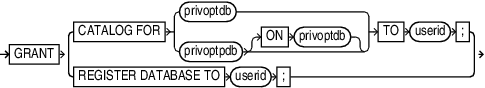
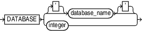
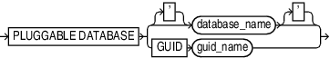

Purpose

Use the `GRANT` command to assign privileges for a virtual private catalog schema to a database user. By default, a virtual catalog user has no access to the base recovery catalog.

Prerequisites

Execute this command at the RMAN prompt.

A base recovery catalog must have been created with `CREATE CATALOG` before you can use `GRANT` to assign privileges for a virtual private catalog.

Usage Notes

The best practice is to create a **base recovery catalog** that stores metadata for all databases. You can then create an Oracle Database user to own the virtual private catalog schema. In Oracle Database 12c Release 1 (12.1.0.1), the virtual private catalog user must be granted the `RECOVERY_CATALOG_OWNER` role. Starting with Oracle Database 12c Release 1 (12.1.0.2), the virtual private catalog user only needs the `CREATE SESSION` privilege.

Connect RMAN to the base recovery catalog and use the `GRANT` command to assign recovery catalog privileges to the virtual catalog owner. Afterwards, run `CREATE VIRTUAL CATALOG` to create a virtual catalog schema for this user. You can use `REVOKE` to revoke catalog privileges.

Relationship Between Users with CATALOG Privileges on the Same Database

As an illustration of `GRANT` usage, suppose databases `prod1` and `prod2` are registered in the base recovery catalog. While logged in as a user with the `SYSBACKUP` or `SYSDBA` privilege to the base recovery catalog, you create two virtual private catalog users: `VPC1` and `VPC2`. You grant both users `CATALOG FOR DATABASE` access for database `PROD1`, but not `PROD2`.

In this scenario, both `VPC1` and `VPC2` can access the metadata for backups of `PROD1` made by the base recovery catalog owner. Both users can also access the metadata for backups of `PROD1` made by each other. Neither `VPC1` nor `VPC2` can access backup metadata for database `PROD2`.

Relationship Between GRANT REGISTER and GRANT CATALOG

When you grant `REGISTER DATABASE` to a user, RMAN implicitly grants recovery `CATALOG FOR DATABASE` privileges for any database registered by this user. If you `REVOKE` only the `REGISTER DATABASE` privilege from a user (for example, `VIRTCAT`), then it does not implicitly revoke the `CATALOG FOR DATABASE` privilege for a database registered by `virtcat` (for example, `PROD`). Because the `CATALOG FOR DATABASE` privilege includes registration privileges for `prod`, `virtcat` can continue to unregister and register `prod`. To prevent `VIRTCAT` from performing any operations on `prod`, including reregistering it, `REVOKE ALL PRIVILEGES` from `VIRTCAT`.

Syntax

grant::=



> GRANT {CATALOG FOR DATABASE {\['\] database\_name \['\] | integer} TO | REGISTER DATABASE TO} userid
>
> [  
> Copyright © 2023, 2024, Oracle and/or its affiliates.](https://docs.oracle.com/en/database/oracle/oracle-database/dcommon/html/cpyr.htm)


privoptdb::=



> DATABASE {\['\] database\_name\['\] | integer}
>
> [  
> Copyright © 2023, 2024, Oracle and/or its affiliates.](https://docs.oracle.com/en/database/oracle/oracle-database/dcommon/html/cpyr.htm)


privoptpdb::-



> PLUGGABLE DATABASE {\['\] database\_name \['\] | GUID guid\_name}
>
> [  
> Copyright © 2023, 2024, Oracle and/or its affiliates.](https://docs.oracle.com/en/database/oracle/oracle-database/dcommon/html/cpyr.htm)


Semantics

| Syntax Element | Description |
| --- | --- |
| `CATALOG FOR DATABASE` `[``database_name` `  \|  ` `integer``]` `TO` `userid` | Grants recovery catalog access for the specified database to the specified user.  Note: The catalog operations granted on the specified database include registering and unregistering this database.  Specify the database by either database name or DBID. If you specify a name when multiple databases with this name are registered in the catalog, then RMAN returns an error. In this case, specify the database by DBID.  To grant access to databases that are registered in the recovery catalog, you must use the `GRANT CATALOG` command. You can also grant access for a target database that is not yet registered in the catalog, thereby enabling a virtual private catalog user to register a database. You must grant access by using the DBID of the database that has not yet been registered. |
| `CATALOG FOR PLUGGABLE DATABASE` `[``database_name` ` \| GUID` ` guid_name``]` `TO` `userid` | Grants recovery catalog access for the specified pluggable database (PDB) to the specified user.  Specify the PDB by using either the PDB name or the PDB GUID. If you specify a PDB name when multiple PDBs with this name are registered in the recovery catalog, then RMAN returns an error. In this case, specify the GUID of the PDB.  Note: The catalog operations granted on the specified database include registering and unregistering this database. |
| `REGISTER DATABASE` `TO` `userid` | Grants the specified user the ability to use `REGISTER DATABASE` to register databases that are currently unknown to the recovery catalog.  When you grant `REGISTER DATABASE` to a user, RMAN implicitly grants recovery `CATALOG FOR DATABASE` privileges for any database registered by the user. The `CATALOG FOR DATABASE` privileges on the database include registering and unregistering this database.  For example, assume that user `virtcat` is granted `REGISTER DATABASE` and registers database `prod` in the catalog. RMAN implicitly grants recovery `CATALOG FOR DATABASE` privileges for `prod` to `virtcat`. |

Examples

Example 2-104 Granting Privileges for a Virtual Private Catalog

Assume that database user `RCO` owns the base recovery catalog in database `CATDB`. This base recovery catalog stores the RMAN metadata for a large number of databases in a data center. Your goal is to create virtual private catalogs for two backup operators in the data center. The database version is Oracle Database 12c Release 1 (12.1.0.2).

You start SQL\*Plus and connect to the `CATDB` database as `SYS`. You then use the `CREATE USER` statement to create the `BCKOP2` and `BCKOP3` users on `CATDB`. You can grant the `CREATE SESSION` privilege to these users as follows:

```
SQL> GRANT CREATE SESSION TO bckop2, bckop3;
SQL> EXIT
```

You then start the RMAN client and connect to the recovery catalog database as user `RCO`. You use the RMAN `GRANT` command to give `BCKOP2` the ability to register any database in her virtual private catalog, but grant `BCKOP3` access to only a subset of the databases in the data center:

```
RMAN> CONNECT CATALOG rco@catdb

recovery catalog database Password: password
connected to recovery catalog database

RMAN> GRANT REGISTER DATABASE TO bckop2;
RMAN> GRANT CATALOG FOR DATABASE prod TO bckop3;
RMAN> GRANT CATALOG FOR DATABASE prodb TO bckop3;
RMAN> EXIT;
```

You start a new RMAN session and connect as user `BCKOP2`. When you connect for the first time, RMAN automatically creates the virtual private catalog. You must exit and restart RMAN after creating each virtual catalog.

```
RMAN> CONNECT CATALOG bckop2@catdb

recovery catalog database Password: password
connected to recovery catalog database

RMAN> EXIT;
```

You start a new RMAN session and connect as user `BCKOP3` to create the virtual private catalog associated with this user:

```
RMAN> CONNECT CATALOG bckop3@catdb

recovery catalog database Password: password
connected to recovery catalog database

RMAN> EXIT;
```

In the following example, backup operator `DBA1` uses her virtual private catalog, which is stored in the `BCKOP3` schema on `CATDB`, to store the metadata for a backup of a target database:

```
RMAN> CONNECT TARGET /
RMAN> CONNECT CATALOG bckop3@catdb

recovery catalog database Password: password
connected to recovery catalog database

RMAN> BACKUP DATABASE PLUS ARCHIVELOG;
```

Example 2-105 Granting Privileges for a PDB

Assume that the recovery catalog owner, in the database `catdb`, is `rco` and the VPC user `vpc1`. You need to grant access to the PDB `mypdb` to `vpc1`.

Connect to the base recovery catalog `rco` by using the following command:
```
RMAN> CONNECT CATALOG rco@catdb

recovery catalog database Password: password
connected to recovery catalog database
```

Use the following command to grant privileges to the access metadata for the PDB `mypdb` to the VPC user `vpc1`:

```
RMAN> GRANT CATALOG FOR PLUGGABLE DATABASE mypdb TO vpc1;
```