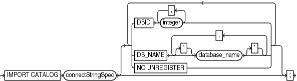

Purpose

Use the `IMPORT CATALOG` command to import the metadata from one recovery catalog schema into a different catalog schema. If you created catalog schemas of different versions to store metadata for multiple target databases, then this command enables you to maintain a single catalog schema for all databases.

See Also:

`CREATE CATALOG`

Prerequisites

RMAN must be connected to the destination recovery catalog, which is the catalog into which you want to import catalog data. This recovery catalog must not be a virtual private catalog.

No target database connection is needed to merge catalog schemas. Execute this command at the RMAN prompt.

The version of the source recovery catalog schema must be equal to the current version of the destination recovery catalog schema. If they are not equal, then upgrade the schemas to the same version.

Ensure that the same database is not registered in both the source recovery catalog schema and destination catalog schema. If a database is registered in both schemas, then `UNREGISTER` this database from source recovery catalog and execute the `IMPORT` command again.

Usage Notes

If the operation fails in the middle of the import, then the import is rolled back. Thus, a partial import is not permitted. The unregister operation is separate from the import. By default, the imported database IDs are unregistered from the source recovery catalog schema after a successful import.

Stored scripts are either global or local. It is possible for global scripts, but not local scripts, to have name conflicts during import because the destination schema contains an object with the same name. In this case, RMAN renames the global script name to `COPY OF` `script_name`. For example, RMAN renames `bp_cmd` to `COPY OF bp_cmd`.

If the renamed global script is still not unique, then RMAN renames it to `COPY(2) OF` `script_name`. If this script name also exists, then RMAN renames the script to `COPY(3) OF ` `script_name`. RMAN continues the `COPY(``n``) OF` pattern until the script is uniquely named.

Syntax

import::=



> IMPORT CATALOG connectStringSpec \[ { {DBID integer \[, integer\]... | DB\_NAME \['\] database\_name \['\] \[, \['\] database\_name \['\]\]... | NO UNREGISTER}}...\]
>
> [  
> Copyright © 2023, 2024, Oracle and/or its affiliates.](https://docs.oracle.com/en/database/oracle/oracle-database/dcommon/html/cpyr.htm)


([connectStringSpec::=](connectStringSpec.md))

Semantics

| Syntax Element | Description |
| --- | --- |
| `connectStringSpec` | Specifies the connection string for the source recovery catalog, which is the catalog whose metadata is imported. |
| `DBID` `integer` | Specifies the list of DBIDs for the databases whose metadata is imported from the source catalog schema (see Example 2-109).  When not specified, RMAN merges metadata for all database IDs from the source catalog schema into the destination catalog schema. RMAN issues an error if the database whose metadata is merged is already registered in the recovery catalog schema. |
| `DB_NAME` `database_name` | Specifies the list of databases whose metadata is imported from the source catalog schema (see Example 2-109).  When not specified, RMAN merges metadata for all databases from the source catalog schema into the destination catalog schema. RMAN issues an error if the same DBID is registered in both recovery catalogs. |
| `NO UNREGISTER` | Forces RMAN to keep imported database IDs in the source catalog schema. By default, the imported database IDs are unregistered from source recovery catalog schema. |

Examples

Example 2-108 Importing Metadata for All Registered Databases

In this example, database `prod` contains a 10.2 catalog schema owned by user `rcat`, while database `catdb` contains an 11.1 catalog schema owned by user `rco`. RMAN imports metadata for all database IDs registered in `rcat` into the recovery catalog owned by `rco`. All target databases registered in `rcat` are unregistered.

```
RMAN> CONNECT CATALOG rco@catdb

recovery catalog database Password: password
connected to recovery catalog database
 
RMAN> IMPORT CATALOG rcat@prod;
 
Starting import catalog at 15-FEB-13
source recovery catalog database Password: password
connected to source recovery catalog database
import validation complete
database unregistered from the source recovery catalog
Finished import catalog at 15-FEB-13
```

Example 2-109 Importing Metadata for a Subset of Registered Databases

This example is a variation on Example 2-108. Instead of importing the entire recovery catalog, it imports only the metadata for the database with DBID 1618984270.

```
RMAN> CONNECT CATALOG rco@catdb

recovery catalog database Password: password
connected to recovery catalog database
 
RMAN> IMPORT CATALOG rcat@inst1 DBID=1618984270;
 
Starting import catalog at 15-FEB-13
source recovery catalog database Password: password
connected to source recovery catalog database
import validation complete
database unregistered from the source recovery catalog
Finished import catalog at 15-FEB-13
```