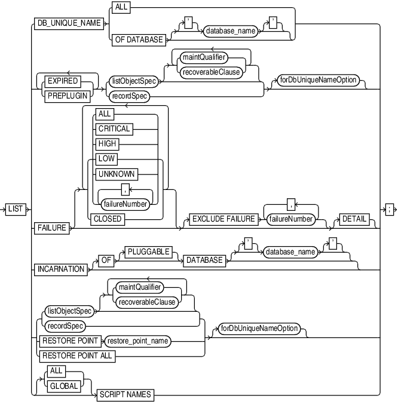
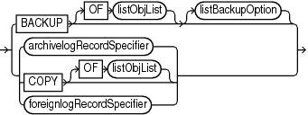
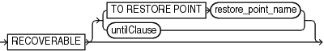
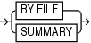

Purpose

Use the `LIST` command to display backups and information about other objects recorded in the RMAN repository.

See Also:

[Oracle Database Backup and Recovery User's Guide](https://docs.oracle.com/pls/topic/lookup?ctx=en/database/oracle/oracle-database/21/rcmrf&id=BRADV8007) to learn how to make lists and reports, and `REPORT`

Prerequisites

Execute `LIST` only at the RMAN prompt. Either of the following conditions must be met:

- RMAN must be connected to a target database. If RMAN is not connected to a recovery catalog, and if you are not executing the `LIST FAILURE` command, then the target database must be mounted or open. If RMAN is connected to a recovery catalog, then the target database instance must be started.
- RMAN must be connected to a recovery catalog and `SET` `DBID` must have been run.

To list preplugin backups, you must connect to the root as a common user with the `SYSDBA` or `SYSBACKUP` privilege.

Usage Notes

Except for `LIST FAILURE`, the `LIST` command displays the backups and copies against which you can run `CROSSCHECK` and `DELETE` commands. The `LIST FAILURE` command displays failures against which you can run the `ADVISE FAILURE` and `REPAIR FAILURE` commands.

Note:

Starting in Oracle Database 19c, the Data Recovery Advisor (DRA) feature is deprecated.

The deprecation of DRA includes deprecation of the following Oracle Recovery Manager (RMAN) commands: `LIST FAILURE`, `ADVISE FAILURE`, `REPAIR                     FAILURE`, and `CHANGE FAILURE`. Database administrators will no longer have access to these commands. There is no replacement feature for DRA.

" [RMAN Backups in a Data Guard Environment](BACKUP.md) " explains how RMAN handles backups in a Data Guard environment. In general, RMAN considers tape backups created on one database in the environment as accessible to all databases in the environment, whereas disk backups are accessible only to the database that created them. In a Data Guard environment, `LIST` displays those files that are accessible to the connected target database.

RMAN prints the `LIST` output to either standard output or the message log, but not to both at the same time.

Syntax

list::=



> LIST {DB\_UNIQUE\_NAME {ALL | OFDATABASE \[\['\] database\_name \['\]\]} | {EXPIRED | PREPLUGIN} \[ {EXPIRED | PREPLUGIN}\]... {listObjectSpec \[ { {maintQualifier | recoverableClause}}...\] | recordSpec} \[forDbUniqueNameOption\] | FAILURE \[ { { {ALL | CRITICAL | HIGH | LOW | UNKNOWN | failureNumber \[, failureNumber\]...} | CLOSED}}...\] \[EXCLUDEFAILUREfailureNumber \[, failureNumber\]...\] \[DETAIL\] | INCARNATION \[OF \[PLUGGABLE\] DATABASE \[\['\] database\_name \['\]\]\] | { {listObjectSpec \[ { {maintQualifier | recoverableClause}}...\] | recordSpec} | RESTOREPOINTrestore\_point\_name | RESTOREPOINTALL} \[forDbUniqueNameOption\] | \[ {ALL | GLOBAL}\] SCRIPTNAMES}


(listObjectSpec::=, [recordSpec::=](recordSpec.md), [maintQualifier::=](maintQualifier.md), [forDbUniqueNameOption::=](forDbUniqueNameOption.md), [untilClause::=](untilClause.md))

maintQualifier::=


> completedTimeSpec | DEVICE TYPE deviceSpecifier \[, deviceSpecifier\]... | LIKE ' string\_pattern ' | GUID guid\_name | BACKED UP integer TIMES TO DEVICE TYPE deviceSpecifier | TAG \['\] tag\_name \['\]
>
> [  
> Copyright © 2023, 2024, Oracle and/or its affiliates.](https://docs.oracle.com/en/database/oracle/oracle-database/dcommon/html/cpyr.htm)


([completedTimeSpec::=](completedTimeSpec.md), [deviceSpecifier::=](deviceSpecifier.md))

listObjectSpec::=



> BACKUP \[OF listObjList\] \[listBackupOption\] | {archivelogRecordSpecifier | COPY \[OF listObjList\] | foreignlogRecordSpecifier}
>
> [  
> Copyright © 2023, 2024, Oracle and/or its affiliates.](https://docs.oracle.com/en/database/oracle/oracle-database/dcommon/html/cpyr.htm)


([listObjList::=](listObjList.md), listBackupOption::=, [archivelogRecordSpecifier::=](archivelogRecordSpecifier.md), [foreignlogRecordSpecifier::=](foreignlogRecordSpecifier.md))

recoverableClause::=



> RECOVERABLE \[ {TO RESTORE POINT restore\_point\_name | untilClause}\]
>
> [  
> Copyright © 2023, 2024, Oracle and/or its affiliates.](https://docs.oracle.com/en/database/oracle/oracle-database/dcommon/html/cpyr.htm)


([untilClause::=](untilClause.md))

listBackupOption::=



> BY FILE | SUMMARY
>
> [  
> Copyright © 2023, 2024, Oracle and/or its affiliates.](https://docs.oracle.com/en/database/oracle/oracle-database/dcommon/html/cpyr.htm)


Semantics

list

| Syntax Element | Description |
| --- | --- |
| `DB_UNIQUE_NAME` | Lists the `DB_UNIQUE_NAME` of one or more databases registered in the recovery catalog.  RMAN must be connected to a recovery catalog. RMAN must also be connected to a mounted or open target database, or you must identify the target database with the `SET` `DBID` command. The DBID for a primary database is identical to the DBID of its associated standby databases: they are distinguished by `DB_UNIQUE_NAME`.  See Also: Table 2-28 for a description of the output |
| `   ALL` | Lists the `DB_UNIQUE_NAME` of every database registered in the RMAN repository. |
| `   OF DATABASE` `database_name` | Lists the `DB_UNIQUE_NAME` of every database with the specified `DB_NAME`. |
| `EXPIRED` | Displays backup sets, proxy copies, and image copies marked in the repository as `EXPIRED`, which means they were not found. See Table 2-9 for a description of the output.  To ensure that `LIST EXPIRED` shows up-to-date output, use a `CROSSCHECK` command periodically. When you use a `CROSSCHECK` command, RMAN searches disk and tape for backups and copies recorded in the repository. If it does not find them, then it updates their repository records to status `EXPIRED`. |
| `PREPLUGIN` | Lists preplugin backups. |
| `listObjectSpec` | Specifies the type of expired object or objects that you are listing.  See Also: `listObjectSpec` |
| `   maintQualifier` | Restricts the range of the listing.  See Also: `maintQualifier`  To display backups of PDBs that were dropped, use the `GUID` option with the `LIST` command and specify the GUID of the dropped PDB. Query the `dba_pdb_history` view to determine the GUID, of dropped PDBs. |
| `   recordSpec` | Specifies the expired object or objects that you are listing.  See Also: `recordSpec` |
| `forDbUniqueNameOption` | Lists the expired files in `listObjectSpec` or `recordSpec` that are exclusively associated with the specified `DB_UNIQUE_NAME` in a Data Guard environment.  You can specify a database with `db_unique_name` or use `ALL` for all uniquely named databases recorded in the catalog for a particular DBID. A database is uniquely identified in the recovery catalog by a DBID and the value of the `DB_UNIQUE_NAME` initialization parameter.  RMAN must be connected to a recovery catalog. RMAN must also be connected to a mounted or open target database, or you must have run the `SET` `DBID` command.  See Also: `forDbUniqueNameOption` for descriptions of the options in this clause |
| `FAILURE` | Lists failures recorded by the Data Recovery Advisor. The database to which RMAN is connected must be a single-instance database and must not be a physical standby database.  See Also: " [Oracle RAC and Data Recovery Advisor](ADVISE-FAILURE.md) "  The Data Recovery Advisor can detect and repair a wide variety of physical problems that cause data loss and corruption. Physical corruptions are typically caused by faulty I/O subsystems or human error. The Data Recovery Advisor may not detect or handle some types of logical corruptions. Corruptions of this type require help from Oracle Support Services.  For Data Recovery Advisor, a failure is a persistent data corruption that is mapped to a set of repair actions. Data failures are detected by checks, which are diagnostic procedures that assess the health of the database or its components. Each check can diagnose one or more failures, which are mapped to a set of repairs.  The typical use case is to run `LIST FAILURE` to list any failures, then use `ADVISE FAILURE` to display repair options, and `REPAIR FAILURE` to fix the failures. Run these commands in the same RMAN session.  Starting in Oracle Database 19c, the Data Recovery Advisor (DRA) feature is deprecated.  The deprecation of DRA includes deprecation of the following Oracle Recovery Manager (RMAN) commands: `LIST FAILURE`, `ADVISE FAILURE`, `REPAIR                     FAILURE`, and `CHANGE FAILURE`. Database administrators will no longer have access to these commands. There is no replacement feature for DRA.  If no options are specified on `LIST FAILURE`, then the command lists only the highest priority failures that have status `OPEN`. Therefore, `CRITICAL` and `HIGH` failures are always listed in the command output if they exist. Failures with `LOW` priority are listed only if no `CRITICAL` or `HIGH` priority failures exist. Failures are sorted in reverse order of occurrence, with the most recent failure listed first.  The `LIST FAILURE` command does not initiate checks to diagnose new failures; rather, it lists the results of previously executed assessments. Thus, repeatedly executing `LIST FAILURE` reveals new failures only if the database automatically diagnosed them in response to errors that occurred in between command executions. However, `LIST FAILURE` revalidates all existing failures when the command is issued. If a user fixed failures manually, or if the failures were transient problems that disappeared, then Data Recovery Advisor removes these failures from the `LIST FAILURE` output.  See Also: Table 2-27 for an explanation of the column headings of the `LIST` `FAILURE` output table and Example 2-115 for an illustration |
| `   ALL` | Lists failures with all priorities and status `OPEN`. |
| `   CRITICAL` | Lists only critical failures with status `OPEN`. |
| `   HIGH` | Lists only failures with `HIGH` priority and status `OPEN`. |
| `   LOW` | Lists only failures with `LOW` priority with status `OPEN`. |
| `UNKNOWN` | Lists only failures whose priority cannot be determined until the database is mounted. |
| `failureNumber` | Specifies the failures by failure number. |
| `   CLOSED` | Lists only closed failures. |
| `   EXCLUDE FAILURE` `failureNumber` | Excludes the specified failures from the list. |
| `   DETAIL` | Lists failures by expanding the consolidated failure. For example, if multiple block corruptions existed in a file, then specifying the `DETAIL` option would list each of the block corruptions. |
| `INCARNATION` | Displays information about the incarnations of a database.  Whenever you open a database with the `RESETLOGS` option, you create a new incarnation of the database. If `LIST INCARNATION` displays `n` incarnations of a database, then you have reset the online redo logs for this database `n` -1 times.  The `LIST` output includes the primary keys of all database incarnation records for the specified database name (in the column `Inc Key`, which contains the incarnation key). Use the key in a `RESET DATABASE` command to change the incarnation that RMAN considers to be current to a previous incarnation.  See Also: Table 2-24 for an explanation of the column headings of the `LIST` `INCARNATION` output table and Example 2-114 for an illustration |
| `   OF DATABASE` `database_name` | Specifies the name of the database. If you do not specify the `OF DATABASE` option, then `LIST` displays all databases registered in the recovery catalog. |
| `   OF PLUGGABLE DATABASE` `pluggable_database_name` | Specifies the name of the PDB. Information about all incarnations of the specified PDB is displayed. You must connect to the root as a common user with the `SYSDBA` or `SYSBACKUP` privilege. |
| `listObjectSpec` | Specifies the type of expired object or objects that you are listing.  See Also: `listObjectSpec` |
| `   maintQualifier` | Restricts the range of the listing.  See Also: `maintQualifier` |
| `recoverableClause` | Restricts the list to data file backups or copies whose status in the repository is `AVAILABLE` and which can be used for restore and recovery in the current incarnation of the target database.  See Also: `recoverableClause` |
| `recordSpec` | Specifies the object or objects that you are listing.  See Also: `recordSpec` |
| `   untilClause` | Specifies an end time, SCN, or log sequence number.  See Also: `untilClause` |
| `RESTORE POINT` | Displays restore points known to the RMAN repository.  See Also: Table 2-26 for an explanation of the column headings of the `LIST` `RESTORE POINT` output table |
| `restore_point_name` | Displays the specified restore point. |
| `   ALL` | Displays all restore points known to the RMAN repository. |
| `forDbUniqueNameOption` | Lists the backups and restore points that are exclusively associated with the specified `DB_UNIQUE_NAME` in a Data Guard environment.  You can specify a database with `db_unique_name` or use `ALL` for all uniquely named databases recorded in the catalog for a particular DBID. A database is uniquely identified in the recovery catalog by a DBID and the value of the `DB_UNIQUE_NAME` initialization parameter.  RMAN must be connected to a recovery catalog. RMAN must also be connected to a mounted or open target database.  See Also: `forDbUniqueNameOption` for descriptions of the options in this clause |
| `ALL SCRIPT NAMES` | RMAN lists all global and local scripts defined for all databases in the connected recovery catalog, along with any descriptive comments.  You must be connected to a recovery catalog, but you do not need to be connected to a target database. |
| `GLOBAL SCRIPT NAMES` | RMAN lists only global scripts defined in the connected recovery catalog, along with any descriptive comments.  You must be connected to a recovery catalog, but you do not need to be connected to a target database. |
| `SCRIPT NAMES` | Lists local and global scripts that can be executed on the current target database.  You must be connected to a target database and a recovery catalog to use this form of the command.  See Also: Table 2-25 for a description of the output and [Example 3-19](REPLACE-SCRIPT.md) for an illustration |

listObjectSpec

This subclause specifies the type of object or objects that you are listing.

| Syntax Element | Description |
| --- | --- |
| `BACKUP` | Displays information about backup sets (including detail on backup pieces) and proxy copies.  See Also: Table 2-9 for a description of `LIST BACKUP` output and Example 2-110 for an illustration |
| `   OF` `listObjList` | Restricts the list of objects operated on to the object type specified in the `listObjList` clause. If you do not specify an object, then `LIST` defaults to `OF DATABASE CONTROLFILE ARCHIVELOG ALL`.  Note: The `LIST BACKUP ... LIKE` command is not valid. The only valid exception is `LIST BACKUP OF ARCHIVELOG LIKE`.  See Also: `listObjList` |
| `listBackupOption` | Specifies whether to list summary information about backups or detailed information. |
| `archivelogRecordSpecifier` | Displays information about a range of archived redo log files. |
| `COPY` | Displays only information about data file copies, archived redo log files, and image copies of archived redo log files. By default, `LIST COPY` displays copies of all database files and archived redo log files. Both usable and unusable image copies are included in the output, even those that cannot be restored or are expired or unavailable.  See Also: Table 2-21 and Table 2-23 for an explanation of the column headings of the `LIST COPY` output tables |
| `   OF` `listObjList` | Restricts the list of objects operated on to the object type specified in the `listObjList` clause.  See Also: `listObjList` |
| `foreignlogRecordSpecifier` | Displays information about a range of foreign archived redo log files. |

recoverableClause

This subclause specifies recoverable backups.

| Syntax Element | Description |
| --- | --- |
| `RECOVERABLE` | Restricts the list to expired data file backups or copies whose status in the repository is `AVAILABLE` and which can be used for restore and recovery in the current incarnation of the target database. This list includes all backups and copies except the incremental backups that have no valid parent to which the incremental can be applied. |
| `  TO RESTORE POINT`  `restore_point_name` | Specifies a restore point, with the SCN at which the restore point was created as the upper, inclusive limit. Because the limit is inclusive, RMAN only lists files that are recoverable up to and including the SCN corresponding to the restore point. |
| `untilClause` | Specifies an end time, SCN, or log sequence number.  See Also: `untilClause` |

listBackupOption

Specifies whether to summarize backups or list the backups for a particular data file.

| Syntax Element | Description |
| --- | --- |
| `BY FILE` | Lists backups of each data file, archived redo log file, control file, and server parameter file.  See Also: Table 2-18, Table 2-19, and Table 2-20 for a description of `LIST BACKUP ... BY FILE` output |
| `SUMMARY` | Gives a one-line summary for each backup.  See Also: Table 2-16 for a description of `LIST BACKUP ... SUMMARY` output and Example 2-111 for sample output |

LIST Command Output

The information that appears in the output is described in the following tables:

Table 2-9 List of Backup Sets (for data file backup sets)

| Column | Indicates |
| --- | --- |
| `BS Key` | A unique key identifying this backup set.  If RMAN is connected to a recovery catalog, then `BS` `Key` is the primary key of the backup set in the catalog. It corresponds to `BS_KEY` in the `RC_BACKUP_SET` view. If RMAN is connected in the default `NOCATALOG` mode, then `BS` `Key` displays the `RECID` from `V$BACKUP_SET`. |
| `Type` | The type of backup: `Full` or `Incr` (incremental).  Note: Column only included in data file backup sets. |
| `LV` | The level of the backup: `NULL` for nonincrementals, level `0` or level 1 for incrementals.  Note: Column only included in data file backup sets. |
| `Size` | The size of the backup in bytes.  Note: Column only included in data file backup sets. |
| `Device Type` | The type of device on which the backup was made, for example, `DISK` or `sbt`. |
| `Elapsed Time` | The duration of the backup. |
| `Completion Time` | The date and time that the backup set completed. The format of this field depends on the `NLS_LANG` and `NLS_DATE_FORMAT` environment settings. |
| `List of data files in backup set ...` | See Table 2-11 |

Table 2-10 List of Backup Pieces (for sets with only one piece)

| Column | Indicates |
| --- | --- |
| `BP Key` | A unique identifier for this backup piece in the recovery catalog or target database control file.  If RMAN is connected to a recovery catalog, then `BP` `Key` is the primary key of the backup piece in the catalog. It corresponds to `BP_KEY` in the `RC_BACKUP_PIECE` view. If RMAN is connected in `NOCATALOG` mode, then `BP` `Key` displays the `RECID` from `V$BACKUP_PIECE`.  Note: The values for `KEY` in the recovery catalog and the control file are different. |
| `Status` | The backup piece status: `AVAILABLE`, `UNAVAILABLE`, or `EXPIRED` (refer to the `CHANGE`, `CROSSCHECK`, and `DELETE` commands for an explanation of each status). |
| `Compressed` | Whether the backup piece is compressed (`YES` or `NO`). |
| `Tag` | The tag applied to the backup set. Tag names are not case sensitive and appear in all uppercase. |
| `Piece Name/Handle` | The file name or handle of the backup piece. If the backup piece is on SBT, then the Media ID is displayed with the name. |
| `SPFILE Included` | A server parameter file is included in the backup. |
| `Control File Included` | A control file is included in the backup.  Note: This row appears only if the current control file is included in the backup. |
| `Ckp SCN` | The SCN of the backup control file checkpoint. All database changes recorded in the redo records before the specified SCN are reflected in this control file.  Note: This row appears only if the current control file is included in the backup. |
| `Ckp time` | The time of the backup control file checkpoint. All database changes recorded in the redo records before the specified time are reflected in this control file.  Note: This row appears only if the current control file is included in the backup. |

Table 2-11 List of Data Files in backup set...

| Column | Indicates |
| --- | --- |
| `File` | The number of the file that was backed up. |
| `LV` | The level of the backup: `NULL` for nonincrementals, level 0 or 1 for incrementals. |
| `Type` | The type of backup: `Full` or `Incr` (incremental). |
| `Ckp SCN` | The checkpoint of the data file at the time it was backed up. All database changes before the SCN were written to the file; changes after the specified SCN were not written to the file. |
| `Ckp Time` | The checkpoint of the data file at the time it was backed up. All database changes before the time were written to the file; changes after the specified time were not written to the file. |
| `Name` | The location where this file would be restored now if it were restored from this backup set and no `SET` `NEWNAME` command was entered.  See Also: `SET` |

Table 2-12 List of Archived Logs in backup set...

| Column | Indicates |
| --- | --- |
| `Thrd` | The thread number of the redo log. |
| `Seq` | The log sequence number of the archived log. |
| `Low SCN` | The lowest SCN in the archived log. |
| `Low Time` | The time when the database switched into the redo log having this sequence number. |
| `Next SCN` | The low SCN of the next archived log sequence. |
| `Next Time` | The low time of the next archived log sequence. |

Table 2-13 Backup Set Copy... of backup set... (only if multiple pieces)

| Column | Indicates |
| --- | --- |
| `Device Type` | The type of device on which the backup was made, for example, `DISK` or `sbt`. |
| `Elapsed Time` | The duration of the backup. |
| `Completion Time` | The date and time that the backup set completed. The format of this field depends on the `NLS_LANG` and `NLS_DATE_FORMAT` environment settings. |
| `Tag` | The tag applied to the backup set. Tag names are not case sensitive and appear in all uppercase. |

Table 2-14 List of Backup Pieces for backup set... Copy... (if multiple pieces)

| Column | Indicates |
| --- | --- |
| `BP Key` | A unique identifier for this backup piece in the recovery catalog or target database control file.  If RMAN is connected to a recovery catalog, then `BP Key` is the primary key of the backup piece in the catalog. It corresponds to `BP_KEY` in the `RC_BACKUP_PIECE` view. If RMAN is connected in `NOCATALOG` mode, then `BP Key` displays the `RECID` from `V$BACKUP_PIECE`.  Note: The values for `KEY` in the recovery catalog and the control file are different. |
| `Pc#` | The number of the backup piece in the backup set. |
| `Status` | The backup piece status: `AVAILABLE`, `UNAVAILABLE`, or `EXPIRED` (refer to the `CHANGE`, `CROSSCHECK`, and `DELETE` commands for an explanation of each status). |
| `Piece Name` | The file name or handle of the backup piece. If the backup piece is stored on SBT, then the media ID is also displayed. |

Table 2-15 List of Proxy Copies

| Column | Indicates |
| --- | --- |
| `PC Key` | A unique key identifying this proxy copy.  If RMAN is connected to a catalog, then `PC` `Key` is the primary key of the proxy copy in the catalog. It corresponds to `XDF_KEY` in the `RC_PROXY_DATAFILE` view or `XCF_KEY` in the `RC_PROXY_CONTROLFILE` view. If RMAN is connected in `NOCATALOG` mode, then `PC` `Key` displays the `RECID` from `V$PROXY_DATAFILE`. |
| `File` | The absolute data file number of the file that was copied. |
| `Status` | The proxy copy status: `AVAILABLE`, `UNAVAILABLE`, or `EXPIRED` (refer to the `CHANGE`, `CROSSCHECK`, and `DELETE` commands for an explanation of each status). |
| `Completion Time` | The date and time that the backup set completed. The format of this field depends on the `NLS_LANG` and `NLS_DATE_FORMAT` environment settings. |
| `Ckp SCN` | The SCN of the proxy copy control file checkpoint. All database changes recorded in the redo records before the specified SCN are reflected in this control file. |
| `Ckp time` | The time of the proxy copy control file checkpoint. All database changes recorded in the redo records before the specified time are reflected in this control file. |
| `Datafile name` | The location where this file would be restored now if it were restored from this backup set and no `SET NEWNAME` command was entered.  See Also: `SET` command |
| `Handle` | The media manager's handle for the proxy copy. If the object is on sbt, then the media ID is also displayed. |
| `Tag` | The tag applied to the proxy copy. Tag names are not case sensitive and appear in all uppercase. |

Table 2-16 List of Backup Sets (LIST BACKUP... SUMMARY)

| Column | Indicates |
| --- | --- |
| `Key` | A unique key identifying this backup set.  If RMAN is connected to a recovery catalog, then `BS Key` is the primary key of the backup set in the catalog. It corresponds to `BS_KEY` in the `RC_BACKUP_SET` view. If RMAN is connected in `NOCATALOG` mode, then `BS Key` displays the `RECID` from `V$BACKUP_SET`. |
| `TY` | The type of backup: backup set (`B`) or proxy copy (`P`). |
| `LV` | For incremental backups, the incremental backup level (`0` or `1`).  For backup sets containing full backups of data files, `F`.  For backup sets containing archived redo log files, `A`. |
| `S` | The status of the backup: `A` (available), `U` (unavailable), or `X` (all backup pieces in set expired). Refer to the `CHANGE`, `CROSSCHECK`, and `DELETE` commands for an explanation of each status. |
| `Device Type` | The type of device on which the backup was made, for example, `DISK` or `sbt`. |
| `Completion Time` | The date and time that the backup set completed. The format of this field depends on the `NLS_LANG` and `NLS_DATE_FORMAT` environment settings. |
| `#Pieces` | The number of backup pieces in the backup set. |
| `#Copies` | The number of copies made of each backup piece in the set. The number is `1` if no duplexing was performed. Otherwise, the value ranges from `2` to `4`. |
| `Compressed` | `YES` if the backup set was compressed by RMAN; `NO` if not compressed by RMAN. |
| `Tag` | The tag applied to the backup set. An asterisk (\*) indicates that backup pieces have different tags within the same backup set, which occurs when a user changes the tag when using `CATALOG` or `BACKUP BACKUPSET`. Tag names are not case sensitive and appear in all uppercase. |

Table 2-17 List of Backup Pieces (LIST BACKUPPIECE...)

| Column | Indicates |
| --- | --- |
| `BP Key` | A unique identifier for this backup piece in the recovery catalog or target database control file.  If RMAN is connected to a catalog, then `BP Key` is the primary key of the backup piece in the catalog. It corresponds to `BP_KEY` in the `RC_BACKUP_PIECE` view. If RMAN is connected in `NOCATALOG` mode, then `BP Key` displays the `RECID` from `V$BACKUP_PIECE`.  Note: The values for `KEY` in the recovery catalog and the control file are different. |
| `BS Key` | A unique key identifying this backup set.  If RMAN is connected to a recovery catalog, then `BS Key` is the primary key of the backup set in the catalog. It corresponds to `BS_KEY` in the `RC_BACKUP_SET` view. If RMAN is connected in `NOCATALOG` mode, then `BS Key` displays the `RECID` from `V$BACKUP_SET`. |
| `Pc#` | The number of the backup piece in the backup set. |
| `Cp#` | The copy number of this backup piece in the backup set. The number is `1` if no duplexing was performed. Otherwise, the value ranges from `2` to `4`. |
| `Status` | The backup piece status: `AVAILABLE`, `UNAVAILABLE`, or `EXPIRED` (refer to the `CHANGE`, `CROSSCHECK`, and `DELETE` commands for an explanation of each status). |
| `Device Type` | The type of device on which the backup was made, for example, `DISK` or `sbt`. |
| `Piece Name` | The file name or handle of the backup piece. If the piece is stored on SBT, then the Handle and media ID are displayed. |

Table 2-18 List of Datafile Backups (LIST BACKUP... BY FILE)

| Column | Indicates |
| --- | --- |
| `File` | The absolute data file number. |
| `Key` | A unique key identifying this backup set.  If RMAN is connected to a recovery catalog, then `Key` is the primary key of the backup set in the catalog. It corresponds to `BS_KEY` in the `RC_BACKUP_SET` view. If RMAN is connected to a target database in `NOCATALOG` mode, then `Key` displays the `RECID` from `V$BACKUP_SET`. |
| `TY` | The type of backup: backup set (`B`) or proxy copy (`P`). |
| `LV` | The backup level: `F` for nonincrementals, level `0` or `1` for incrementals. |
| `S` | The status of the backup: `A` (available), `U` (unavailable), or `X` (all backup pieces in set expired). Refer to the `CHANGE`, `CROSSCHECK`, and `DELETE` commands for an explanation of each status. |
| `Ckp SCN` | The checkpoint of the data file at the time it was backed up. All database changes prior to the SCN have been written to the file; changes after the specified SCN have not been written to the file. |
| `Ckp Time` | The checkpoint of the data file at the time it was backed up. All database changes prior to the time have been written to the file; changes after the specified time have not been written to the file. |
| `#Pieces` | The number of backup pieces in the backup set. |
| `#Copies` | The number of copies made of each backup piece in the set. The number is `1` if no duplexing was performed. Otherwise, the value ranges from `2` to `4`. |
| `Compressed` | `YES` if the backup was compressed by RMAN; `NO` if not compressed by RMAN. |
| `Tag` | The tag applied to the backup set. An asterisk (\*) indicates that backup pieces have different tags within the same backup set, which occurs when a user changes the tag when using `CATALOG` or `BACKUP BACKUPSET`. Tag names are not case sensitive and appear in all uppercase. |

Table 2-19 List of Archived Log Backups (LIST BACKUP... BY FILE)

| Column | Indicates |
| --- | --- |
| `Thrd` | The thread number of the redo log. |
| `Seq` | The log sequence number of the archived log. |
| `Low SCN` | The lowest SCN in the archived log. |
| `Low Time` | The time when the database switched into the redo log having this sequence number. |
| `BS Key` | A unique key identifying this backup set.  If RMAN is connected to a recovery catalog, then `BS Key` is the primary key of the backup set in the catalog. It corresponds to `BS_KEY` in the `RC_BACKUP_SET` view. If RMAN is connected in `NOCATALOG` mode, then `BS Key` displays the `RECID` from `V$BACKUP_SET`. |
| `S` | The status of the backup: `A` (available), `U` (unavailable), or `X` (all backup pieces in set expired). Refer to the `CHANGE`, `CROSSCHECK`, and `DELETE` commands for an explanation of each status. |
| `#Pieces` | The number of backup pieces in the backup set. |
| `#Copies` | The number of copies made of each backup piece in the set. The number is `1` if no duplexing was performed. Otherwise, the value ranges from `2` to `4`. |
| `Compressed` | `YES` if the backup was compressed by RMAN; `NO` if not compressed by RMAN. |
| `Tag` | The tag applied to the backup set. Tag names are not case sensitive and appear in all uppercase. |

Table 2-20 List of Control File Backups (LIST BACKUP... BY FILE)

| Column | Indicates |
| --- | --- |
| `CF Ckp SCN` | Checkpoint SCN of the control file. |
| `Ckp Time` | The log sequence number of the archived log. |
| `BS Key` | A unique key identifying this backup set.  If RMAN is connected to a recovery catalog, then `BS Key` is the primary key of the backup set in the catalog. It corresponds to `BS_KEY` in the `RC_BACKUP_SET` view. If RMAN is connected in `NOCATALOG` mode, then `BS Key` displays the `RECID` from `V$BACKUP_SET`. |
| `S` | The status of the backup: `A` (available), `U` (unavailable), or `X` (all backup pieces in set expired). Refer to the `CHANGE`, `CROSSCHECK`, and `DELETE` commands for an explanation of each status. |
| `#Pieces` | The number of backup pieces in the backup set. |
| `#Copies` | The number of copies made of each backup piece in the set. The number is `1` if no duplexing was performed. Otherwise, the value ranges from `2` to `4`. |
| `Compressed` | `YES` if the backup was compressed by RMAN; `NO` if not compressed by RMAN. |
| `Tag` | The tag applied to the backup set. Tag names are not case sensitive and appear in all uppercase. |

Table 2-21 List of Datafile Copies

| Column | Indicates |
| --- | --- |
| `Key` | The unique identifier for the data file copy. Use this value in a `CHANGE` command to alter the status of the data file copy.  If RMAN is connected to a recovery catalog, then `Key` is the primary key of the data file copy in the catalog. It corresponds to `CDF_KEY` in the `RC_DATAFILE_COPY` view. If RMAN is connected in `NOCATALOG` mode, then `Key` displays the `RECID` from `V$DATAFILE_COPY`.  Note: The values for `KEY` in the recovery catalog and the control file are different. |
| `File` | The file number of the data file from which this copy was made. |
| `S` | The status of the copy: `A` (available), `U` (unavailable), or `X` (expired). Refer to the `CHANGE`, `CROSSCHECK`, and `DELETE` commands for an explanation of each status. |
| `Completion Time` | The date and time that the copy completed. The value of this field is sensitive to the `NLS_LANG` and `NLS_DATE_FORMAT` environment variables. |
| `Ckp SCN` | The checkpoint of this data file when it was copied. All database changes prior to this SCN have been written to this data file. |
| `Ckp TIME` | The checkpoint of this data file when it was copied. All database changes prior to this time have been written to this data file. |
| `Name` | The file name of the data file copy. |
| `Tag` | The tag applied to the data file copy. Tag names are not case sensitive and appear in all uppercase. |

Table 2-22 List of Control File Copies

| Column | Indicates |
| --- | --- |
| `Key` | The unique identifier for the control file copy. Use this value in a `CHANGE` command to alter the status of the copy.  If RMAN is connected to a recovery catalog, then `Key` is the primary key of the control file copy in the catalog. It corresponds to `CCF_KEY` in the `RC_CONTROLFILE_COPY` view. If RMAN is connected in `NOCATALOG` mode, then `Key` displays the `RECID` from `V$DATAFILE_COPY`.  Note: The values for `Key` in the recovery catalog and the control file are different. |
| `S` | The status of the copy: `A` (available), `U` (unavailable), or `X` (expired). Refer to the `CHANGE`, `CROSSCHECK`, and `DELETE` commands for an explanation of each status. |
| `Completion Time` | The date and time that the copy completed. The value of this field is sensitive to the `NLS_LANG` and `NLS_DATE_FORMAT` environment variables. |
| `Ckp SCN` | The checkpoint of this control file when it was copied. |
| `Ckp TIME` | The checkpoint of this control file when it was copied. |
| `Name` | The file name of the control file copy. |
| `Tag` | The tag applied to the control file copy. Tag names are not case sensitive and appear in all uppercase. |

Table 2-23 List of Archived Log Copies

| Column | Indicates |
| --- | --- |
| `Key` | The unique identifier for this archived redo log copy. Use this value in a `CHANGE` command to alter the status of the copy.  If RMAN is connected to a recovery catalog, then `Key` is the primary key of the backup set in the catalog. It corresponds to `AL_KEY` in the `RC_ARCHIVED_LOG` view. If RMAN is connected in `NOCATALOG` mode, then `Key` displays the `RECID` from `V$ARCHIVED_LOG`.  Note: The values for `Key` in the recovery catalog and the control file are different. |
| `Thrd` | The redo log thread number. |
| `Seq` | The log sequence number. |
| `S` | The status of the copy: `A` (available), `U` (unavailable), or `X` (expired). Refer to the `CHANGE`, `CROSSCHECK`, and `DELETE` commands for an explanation of each status. |
| `Low Time` | The time when the database switched into the redo log having this sequence number. |
| `Name` | The file name of the archived redo log copy. |

Table 2-24 List of Database Incarnations

| Column | Indicates |
| --- | --- |
| `DB Key` | When combined with the `Inc Key`, the unique key by which RMAN identifies the database incarnation in the recovery catalog. Use this key to unregister a database from a recovery catalog, that is, delete all the rows associated with that database from the recovery catalog. |
| `Inc Key` | When combined with `DB` `Key`, the unique key by which RMAN identifies the database incarnation in the recovery catalog. Use this key in `RESET DATABASE` `TO INCARNATION` when recovering the database to a time before the most recent `RESETLOGS`. |
| `DB Name` | The database name as listed in the `DB_NAME` parameter. |
| `DB ID` | The database identification number, which the database generates automatically at database creation. |
| `STATUS` | `CURRENT` for the current incarnation, `PARENT` for the parent incarnations of the current incarnation, and `ORPHAN` for orphaned incarnations. |
| `Reset SCN` | The SCN at which the incarnation was created. |
| `Reset Time` | The time at which the incarnation was created. |

Table 2-25 List of Stored Scripts in the Recovery Catalog (LIST SCRIPT NAMES)

| Column | Indicates |
| --- | --- |
| `Script Name` | The name of the stored script. |
| `Description` | The comment provided when the script was created. |

Table 2-26 List of Restore Points (LIST RESTORE POINT)

| Column | Indicates |
| --- | --- |
| `SCN` | The SCN for the restore point. |
| `RSP Time` | The time specified in the `CREATE RESTORE POINT` statement; otherwise null. |
| `Type` | `GUARANTEED` if a guaranteed restore point; null if a normal restore point. |
| `Time` | The time that the restore point was created. |
| `Name` | The name of the restore point. |

Table 2-27 List of Failures

| Column | Indicates |
| --- | --- |
| `Failure ID` | The unique identifier for a failure. |
| `Priority` | The priority of the failure: `CRITICAL`, `HIGH`, or `LOW`.  Failures with `CRITICAL` priority require immediate attention because they make the whole database unavailable. Typically, critical failures bring down the instance and are diagnosed during the subsequent startup. The database is not available until all critical failures are fixed (see `ADVISE FAILURE`).  Failures with `HIGH` priority make a database partially unavailable or unrecoverable, and usually have to be repaired in a reasonably short time. Examples of such failures include physical data block corruptions, nonfatal I/O errors, missing archived redo log files or backup files, and so on.  Failures with `LOW` priority can be ignored until more important failures are fixed. For example, a block corruption is initially assigned a high priority, but if this block is not important for the database availability, you can use `CHANGE` `FAILURE` to change the priority to `LOW`. |
| `Status` | The repair status of the failure. The status of a failure is `OPEN` (not repaired) until the appropriate repair action is invoked. The failure status changes to `CLOSED` when the repair is completed. |
| `Time Detected` | The date when the failure was diagnosed. |
| `Summary` | Summary of the failure. |

Note:

Starting in Oracle Database 19c, the Data Recovery Advisor (DRA) feature is deprecated.

The deprecation of DRA includes deprecation of the following Oracle Recovery Manager (RMAN) commands: `LIST FAILURE`, `ADVISE FAILURE`, `REPAIR                     FAILURE`, and `CHANGE FAILURE`. Database administrators will no longer have access to these commands. There is no replacement feature for DRA.

Table 2-28 List of Databases (LIST DB\_UNIQUE\_NAME)

| Column | Indicates |
| --- | --- |
| `DB Key` | When combined with `Inc Key`, the unique key by which RMAN identifies the database incarnation in the recovery catalog. Primary and standby databases share the same `DB Key` value. |
| `DB Name` | The `DB_NAME` of the database. Primary and standby databases share the same `DB Name` value. |
| `DB ID` | The DBID of the database. Primary and standby databases share the same DBID. |
| `Database Role` | `PRIMARY` if the database is a primary database; `STANDBY` if it is a standby database. |
| `Db_unique_name` | The `DB_UNIQUE_NAME` of the database. Primary and standby databases have different `DB_UNIQUE_NAME` values. |

Examples

Example 2-110 Listing Backups

This example lists all backups. The output shows two backup sets on disk: one containing data files and the other containing autobackups. The output also shows one SBT backup containing archived redo log files.

```
RMAN> LIST BACKUP;
```
```
List of Backup Sets
===================
 
BS Key  Type LV Size       Device Type Elapsed Time Completion Time
------- ---- -- ---------- ----------- ------------ ---------------
200     Full    509.78M    DISK        00:01:03     15-FEB-13
        BP Key: 202   Status: AVAILABLE  Compressed: NO  Tag: TAG20130215T171219
        Piece Name: /disk2/PROD/backupset/2013_02_15/o1_mf_nnndf_TAG20130215T171219_2xb17nbb_.bkp
  List of Datafiles in backup set 200
  File LV Type Ckp SCN    Ckp Time  Name
  ---- -- ---- ---------- --------- ----
  1       Full 421946     15-FEB-13 /disk1/oradata/prod/system01.dbf
  2       Full 421946     15-FEB-13 /disk1/oradata/prod/sysaux01.dbf
  3       Full 421946     15-FEB-13 /disk1/oradata/prod/undotbs01.dbf
  4       Full 421946     15-FEB-13 /disk1/oradata/prod/cwmlite01.dbf
  5       Full 421946     15-FEB-13 /disk1/oradata/prod/drsys01.dbf
  6       Full 421946     15-FEB-13 /disk1/oradata/prod/example01.dbf
  7       Full 421946     15-FEB-13 /disk1/oradata/prod/indx01.dbf
  8       Full 421946     15-FEB-13 /disk1/oradata/prod/tools01.dbf
  9       Full 421946     15-FEB-13 /disk1/oradata/prod/users01.dbf
 
BS Key  Type LV Size       Device Type Elapsed Time Completion Time
------- ---- -- ---------- ----------- ------------ ---------------
201     Full    7.98M      DISK        00:00:03     15-FEB-13
        BP Key: 203   Status: AVAILABLE  Compressed: NO  Tag: TAG20130215T171219
        Piece Name: /disk2/PROD/backupset/2013_02_15/o1_mf_ncsnf_TAG20130215T171219_2xb19prg_.bkp
  SPFILE Included: Modification time: 15-FEB-13
  SPFILE db_unique_name: PROD
  Control File Included: Ckp SCN: 421968       Ckp time: 15-FEB-13
 
BS Key  Size       Device Type Elapsed Time Completion Time
------- ---------- ----------- ------------ ---------------
227     30.50M     SBT_TAPE    00:00:11     15-FEB-13
        BP Key: 230   Status: AVAILABLE  Compressed: NO  Tag: TAG20130215T171334
        Handle: 0bia4rtv_1_1   Media:
 
  List of Archived Logs in backup set 227
  Thrd Seq     Low SCN    Low Time  Next SCN   Next Time
  ---- ------- ---------- --------- ---------- ---------
  1    5       389156     15-FEB-13 411006     15-FEB-13
  1    6       411006     15-FEB-13 412972     15-FEB-13
  1    7       412972     15-FEB-13 417086     15-FEB-13
  1    8       417086     15-FEB-13 417114     15-FEB-13
  1    9       417114     15-FEB-13 417853     15-FEB-13
  1    10      417853     15-FEB-13 421698     15-FEB-13
  1    11      421698     15-FEB-13 421988     15-FEB-13
```

Example 2-111 Listing a Summary of Backups

This example summarizes the RMAN backups listed in Example 2-110.

```
RMAN> LIST BACKUP SUMMARY;
 
List of Backups
===============
Key     TY LV S Device Type Completion Time #Pieces #Copies Compressed Tag
------- -- -- - ----------- --------------- ------- ------- ---------- ---
200     B  F  A DISK        15-FEB-13       1       1       NO         TAG20130215T171219
201     B  F  A DISK        15-FEB-13       1       1       NO         TAG20130215T171219
227     B  A  A SBT_TAPE    15-FEB-13       1       1       NO         TAG20130215T171334
```

Example 2-112 Listing Backups by File

This example groups all backups by file. The tag column of the data file backup indicates that one backup set contains backup pieces with different tags. The status column of the archived log backup indicates that the backup set is unavailable.

```
RMAN> LIST BACKUP BY FILE;
```
```
List of Datafile Backups
========================
 
File Key     TY LV S Ckp SCN    Ckp Time  #Pieces #Copies Compressed Tag
---- ------- -  -- - ---------- --------- ------- ------- ---------- ---
1    329     B  F  A 454959     16-FEB-13 1       1       NO         DF1
2    349     B  F  A 454997     16-FEB-13 1       1       NO         DF2
3    527     B  F  A 455218     16-FEB-13 1       1       NO         FRI_BKP
     368     B  F  A 455022     16-FEB-13 1       1       NO         DF3
4    387     B  F  X 455042     16-FEB-13 1       1       NO         DF4
5    407     B  F  A 455063     16-FEB-13 1       1       NO         DF5
6    428     B  F  A 455083     16-FEB-13 1       2       NO         *
7    450     B  F  X 455103     16-FEB-13 1       1       NO         DF7
8    473     B  F  A 455123     16-FEB-13 1       1       NO         DF8
9    497     B  F  A 455143     16-FEB-13 1       1       NO         DF9
 
List of Archived Log Backups
============================
 
Thrd Seq     Low SCN    Low Time  BS Key  S #Pieces #Copies Compressed Tag
---- ------- ---------- --------- ------- - ------- ------- ---------- ---
1    5       389156     15-FEB-13 227     U 1       1       NO         TAG20130215T171334
1    6       411006     15-FEB-13 227     U 1       1       NO         TAG20130215T171334
1    7       412972     15-FEB-13 227     U 1       1       NO         TAG20130215T171334
1    8       417086     15-FEB-13 227     U 1       1       NO         TAG20130215T171334
1    9       417114     15-FEB-13 227     U 1       1       NO         TAG20130215T171334
1    10      417853     15-FEB-13 227     U 1       1       NO         TAG20130215T171334
1    11      421698     15-FEB-13 227     U 1       1       NO         TAG20130215T171334
 
List of Control File Backups
============================
 
CF Ckp SCN Ckp Time  BS Key  S #Pieces #Copies Compressed Tag
---------- --------- ------- - ------- ------- ---------- ---
454974     16-FEB-13 330     A 1       1       NO         DF1
421968     15-FEB-13 201     A 1       1       NO         TAG20130215T171219
List of SPFILE Backups
======================
 
Modification Time BS Key  S #Pieces #Copies Compressed Tag
----------------- ------- - ------- ------- ---------- ---
15-FEB-13         330     A 1       1       NO         DF1
15-FEB-13         201     A 1       1       NO         TAG20130215T171219
```

Example 2-113 Listing Image Copies

The following example lists all data file, control file, and archived redo log copies known to RMAN:

```
RMAN> LIST COPY;
```
```
List of Datafile Copies
=======================
 
Key     File S Completion Time Ckp SCN    Ckp Time
------- ---- - --------------- ---------- ---------------
618     1    A 16-FEB-13       461057     16-FEB-13
        Name: /disk2/PROD/datafile/o1_mf_system_2xdbrg13_.dbf
        Tag: TAG20130216T140706
 
631     2    A 16-FEB-13       461163     16-FEB-13
        Name: /disk2/PROD/datafile/o1_mf_sysaux_2xdbzybx_.dbf
        Tag: TAG20130216T141109
 
List of Control File Copies
===========================
 
Key     S Completion Time Ckp SCN    Ckp Time
------- - --------------- ---------- ---------------
619     A 16-FEB-13       461133     16-FEB-13
        Name: /disk2/PROD/controlfile/o1_mf_TAG20130216T140706_2xdbz5tb_.ctl
        Tag: TAG20130216T140706
 
594     A 16-FEB-13       460650     16-FEB-13
        Name: /disk2/PROD/controlfile/o1_mf_TAG20130216T135954_2xdbbz99_.ctl
        Tag: TAG20130216T135954
 
List of Archived Log Copies for database with db_unique_name PROD
=====================================================================
 
Key     Thrd Seq     S Low Time
------- ---- ------- - ---------
105     1    5       A 15-FEB-13
        Name: /disk1/oradata/prod/arch/archive1_5_614616887.dbf
 
122     1    6       A 15-FEB-13
        Name: /disk1/oradata/prod/arch/archive1_6_614616887.dbf
 
123     1    7       A 15-FEB-13
        Name: /disk1/oradata/prod/arch/archive1_7_614616887.dbf
 
124     1    8       A 15-FEB-13
        Name: /disk1/oradata/prod/arch/archive1_8_614616887.dbf
 
125     1    9       A 15-FEB-13
        Name: /disk1/oradata/prod/arch/archive1_9_614616887.dbf
 
185     1    10      A 15-FEB-13
        Name: /disk1/oradata/prod/arch/archive1_10_614616887.dbf
 
221     1    11      A 15-FEB-13
        Name: /disk1/oradata/prod/arch/archive1_11_614616887.dbf
 
262     1    12      A 15-FEB-13
        Name: /disk1/oradata/prod/arch/archive1_12_614616887.dbf
 
263     1    13      A 15-FEB-13
        Name: /disk1/oradata/prod/arch/archive1_13_614616887.dbf
```

Example 2-114 Listing Database Incarnations

This example lists all database incarnations recorded in the recovery catalog.

```
RMAN> LIST INCARNATION;

List of Database Incarnations
DB Key  Inc Key DB Name  DB ID            STATUS  Reset SCN  Reset Time
------- ------- -------- ---------------- --- ---------- ----------
78      94      PROD     1619073740       PARENT  1          14-FEB-13
78      79      PROD     1619073740       CURRENT 388003     15-FEB-13
```

Example 2-115 Listing Failures

This example lists all failures regardless of their priority. If you do not specify `ALL`, then `LIST FAILURE` output does not include failures with `LOW` priority.

```
RMAN> LIST FAILURE ALL;
 
List of Database Failures
=========================
 
Failure ID Priority Status    Time Detected Summary
---------- -------- --------- ------------- -------
142        HIGH     OPEN      23-APR-13     One or more non-system datafiles are missing
101        HIGH     OPEN      23-APR-13     Datafile 1: '/disk1/oradata/prod/system01.dbf'
                                            contains one or more corrupt blocks
```

Example 2-116 Listing Information About PDB Incarnations

This example lists details about all the incarnations of PDB `my_pdb`.

```
LIST INCARNATION OF PLUGGABLE DATABASE my_pdb;
```