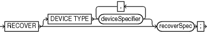
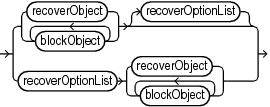
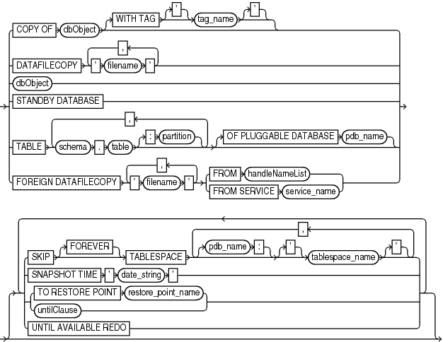
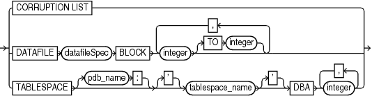
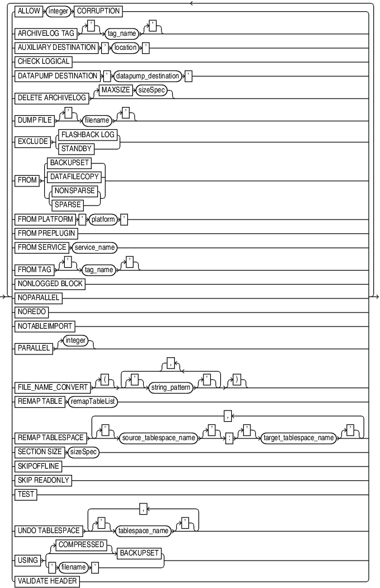
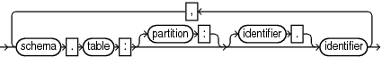

Purpose

Use the `RECOVER` command to perform one of the following distinct tasks:

- Perform complete recovery of a whole multitenant container database (CDB), the root, one or more pluggable databases (PDBs), one or more tablespaces, or one or more restored data files
- Perform point-in-time recovery of a whole multitenant container database (CDB), one or more pluggable databases (PDBs), one or more tablespaces, tables, or table partitions
- Apply incremental backups to a data file image copy (not a restored data file) to roll it forward in time
- Recover a corrupt data block or set of data blocks within a data file

See Also:

[Oracle Database Backup and Recovery User's Guide](https://docs.oracle.com/pls/topic/lookup?ctx=en/database/oracle/oracle-database/21/rcmrf&id=BRADV8005) to learn how to recover data files

Prerequisites

All redo or incremental changes required for the recovery must exist on disk or in SBT. If RMAN needs to restore incremental backups or archived redo log files during recovery, then you must either have automatic channels configured or manually allocate channels of the same type that created these backups.

If you perform media recovery on an encrypted database or tablespace, then the Oracle keystore must be open when performing media recovery. See [Oracle Database Administrator's Guide](https://docs.oracle.com/pls/topic/lookup?ctx=en/database/oracle/oracle-database/21/rcmrf&id=ADMIN12327) to learn about encrypted tablespaces.

To perform recovery in a destination CDB using preplugin backups, the root must be open and you must connect to the root as a common user with the `SYSDBA` or `SYSBACKUP` privilege.

In a CDB that uses shared undo, to perform point-in-time recovery of one or more PDBs, backups of the root and the seed database of the CDB that contains the listed PDBs must be available.

To perform TSPITR of tablespaces in a PDB, backups of the root and the seed database (`PDB$SEED`) of the CDB that contains the PDBs must be available.

Prerequisites Specific to RECOVER BLOCK

The following prerequisites apply to `RECOVER BLOCK`:

- The target database must run in `ARCHIVELOG` mode and be open or mounted with a current control file.
- RMAN can only recover blocks marked media corrupt. The `V$DATABASE_BLOCK_CORRUPTION` view indicates which blocks in a file were marked corrupt since the most recent `BACKUP` or `BACKUP ... VALIDATE` command was run against the file.
- The backups of the data files containing the corrupt blocks must be full backups and not proxy backups. If only proxy backups exist, then you can restore them to a nondefault location on disk, in which case RMAN considers them data file copies. You can then use the data file copies for block media recovery.
- RMAN can use only archived redo log files for recovery. Block media recovery cannot survive a missing or inaccessible log, although it can sometimes survive missing or inaccessible records (see [Oracle Database Backup and Recovery User's Guide](https://docs.oracle.com/pls/topic/lookup?ctx=en/database/oracle/oracle-database/21/rcmrf&id=BRADV118)).
- For RMAN to be able to search the flashback logs for good copies of corrupt blocks, Flashback Database must be enabled on the target database.
- For RMAN to be able to search a standby database for good copies of corrupt blocks, the target database must be associated with a physical standby database in a Data Guard environment. In addition, the physical standby database must be open read-only in managed recovery.

Note:

An active Data Guard license is required for this operation.

Usage Notes

By default, RMAN performs complete recovery. For point-in-time recovery, the best practice is to enter a `SET` `UNTIL` command before both the `RESTORE` and `RECOVER` commands in a `RUN` command so that the `UNTIL` time applies to both commands. If you run `SET UNTIL` after restoring the database, then you may not be able to recover the database to the target time because the restored files may have timestamps later than the target time.

Note:

You must open the database with the `RESETLOGS` option after incomplete recovery or recovery with a backup control file.

RMAN enables you to recover a whole multitenant container database (CDB), the root, one or more PDBs, and tablespaces in a root or PDB. You can perform complete recovery or point-in-time recovery for PDBs and CDBs. However, you cannot recover the root to a specified point in time.

To recover the whole CDB, the root, or multiple PDBs, you connect to the root. To recover a particular PDB, connect to that PDB. To recover PDBs, you use the `RECOVER PLUGGABLE DATABASE` command. To recover a whole CDB, use the `RECOVER DATABASE` command and to recover the root, use the `RECOVER           DATABASE ROOT` command.

See Also:

[Oracle Database Backup and Recovery User’s Guide](https://docs.oracle.com/pls/topic/lookup?ctx=en/database/oracle/oracle-database/21/rcmrf&id=BRADV-GUID-1F744C63-2D4C-4F65-8773-1340A85993ED) for information about performing recovery of CDBs PDBs

In a Data Guard environment, you may need to restore the entire CDB after the point-in-time recovery of a primary database, for the standby database to follow the primary database.

Incremental Backups and Archived Redo Log Files

Except for `RECOVER BLOCK`, RMAN can use both incremental backups and archived redo log files for recovery. RMAN uses the following search order:

1. Incremental backup sets on disk or tape
2. Archived redo log files on disk
3. Archived redo log backups on disk
4. Archived redo log backup sets on tape

When RMAN chooses a destination to restore archived redo log files, it uses the following order of precedence:

1. `SET` `ARCHIVELOG DESTINATION`
2. The `LOG_ARCHIVE_DEST_` `n` parameter whose value is set to `LOCATION=USE_DB_RECOVERY_FILE_DEST`
3. `LOG_ARCHIVE_DEST_1`

RMAN can apply incremental backups to data files that were not restored from an incremental backup. If overlapping levels of incremental backup exist, then RMAN automatically chooses the level covering the longest period of time.

Recovery Using Storage Snapshots

Storage Snapshot Optimization enables you to use third-party technologies to take storage snapshots without putting the database or associated data files in `BACKUP` mode. When recovering the database using a storage snapshot, specify the `SNAPSHOT TIME` option.

See Also:

[Oracle Database Backup and Recovery User's Guide](https://docs.oracle.com/pls/topic/lookup?ctx=en/database/oracle/oracle-database/21/rcmrf&id=BRADV727) for information about specifying the snapshot time

To be usable in recovery operations, the snapshots must conform to the following requirements. Ask your vendor for a guarantee of compliance.

- The database is crash consistent during the snapshot.
- The snapshot preserves write order for each file.
- The snapshot technology stores the time at which the snapshot is completed.

Caution:

Take care that the database snapshots are usable. Oracle Database does not use a snapshot for recovery if structural changes were made during the snapshot. Some SQL operations can make database structural changes and should not be used during a snapshot. A few examples of such operations include the `OFFLINE`, `ONLINE`, `READONLY`, `DROP`, `RENAME`, `SHRINK`, and `ADD` clauses.

See Also:

`ALTER DATABASE` and `ALTER TABLESPACE` commands in [Oracle Database SQL Language Reference](https://docs.oracle.com/pls/topic/lookup?ctx=en/database/oracle/oracle-database/21/rcmrf&id=SQLRF01402) for information about clauses that make database structural changes

Recovery Through RESETLOGS

You must `RESTORE` data files before you can recover them. RMAN can recover through `RESETLOGS` operations transparently if the data files to be recovered are from a parent incarnation. If required, the `RECOVER` command can also restore and apply archived redo log files and incremental backups from previous database incarnations, even if those logs were generated in previous releases of Oracle Database.

When recovering through an `OPEN RESETLOGS`, ensure that you have all logs needed for recovery. In a previous database incarnation, you must have the logs from the time of the backup until the SCN that is 1 less than the `RESETLOGS SCN`. The incarnation table must have a complete history of `RESETLOGS` operations from the creation time of the database backup. If the complete metadata is not found in `V$DATABASE_INCARNATION`, then you can re-create this metadata by using `CATALOG` for the archived redo log files from the missing incarnations.

See Also:

`RESTORE` command for explanation of the default location for restoring archived redo log files. RMAN automatically specifies the `MAXSIZE` option when staging logs in the fast recovery area.

Recovery of Sparse Databases

RMAN also enables you to perform point-in-time recovery for sparse databases when the `COMPATIBLE` initialization parameter is set to 12.2 or higher. For complete recovery, RMAN recovers data files by applying archived redo log files and online redo logs. Therefore, the `FROM SPARSE` and `FROM NONSPARSE` clauses are not applicable to complete recovery. For point-in-time recovery, RMAN first restores data files and then recovers them, and therefore, the `FROM SPARSE` and `FROM NONSPARSE` clauses are applicable to PITR.

Syntax

recover::=



> RECOVER \[DEVICE TYPE deviceSpecifier \[, deviceSpecifier\]...\] recoverSpec
>
> [  
> Copyright © 2023, 2024, Oracle and/or its affiliates.](https://docs.oracle.com/en/database/oracle/oracle-database/dcommon/html/cpyr.htm)


([deviceSpecifier::=](deviceSpecifier.md), recoverObject::=, recoverOptionList::=)

recoverSpec::=



> {recoverObject | blockObject \[blockObject\]...} \[recoverOptionList\] | recoverOptionList {recoverObject | blockObject \[blockObject\]...}
>
> [  
> Copyright © 2023, 2024, Oracle and/or its affiliates.](https://docs.oracle.com/en/database/oracle/oracle-database/dcommon/html/cpyr.htm)


(recoverObject::=, blockObject::=, recoverOptionList::=)

recoverObject::=



> {COPY OF dbObject \[WITH TAG \['\] tag\_name \['\]\] | DATAFILECOPY ' filename ' \[, ' filename '\]... | dbObject | STANDBY DATABASE | TABLE schema. table \[: partition\] \[, schema. table \[: partition\]\]... \[OF PLUGGABLE DATABASE pdb\_name\] | FOREIGN DATAFILECOPY ' filename ' \[, ' filename '\]... {FROM handleNameList | FROM SERVICE service\_name}} \[ { {SKIP \[FOREVER\] TABLESPACE \[pdb\_name:\] \['\] tablespace\_name \['\] \[, \[pdb\_name:\] \['\] tablespace\_name \['\]\]... | SNAPSHOT TIME ' date\_string ' | {TO RESTORE POINT restore\_point\_name | untilClause} | UNTIL AVAILABLE REDO}}...\]


(dbObject, [untilClause::=](untilClause.md))

dbObject::=


> {APPLICATION ROOT DATABASE {identifier | quoted\_string} \[, {identifier | quoted\_string}\]... | DATABASE \[ROOT\] | PLUGGABLE DATABASEpdb\_name \[, pdb\_name\]...} | DATAFILEdatafileSpec \[, datafileSpec\]... | TABLESPACE \[pdb\_name:\] \['\] tablespace\_name \['\] \[, \[pdb\_name:\] \['\] tablespace\_name \['\]\]...
>
> [  
> Copyright © 2023, 2024, Oracle and/or its affiliates.](https://docs.oracle.com/en/database/oracle/oracle-database/dcommon/html/cpyr.htm)


blockObject::=



> CORRUPTION LIST | DATAFILE datafileSpec BLOCK integer \[TO integer\] \[, integer \[TO integer\]\]... | TABLESPACE \[pdb\_name:\] \['\] tablespace\_name \['\] DBA integer \[, integer\]...
>
> [  
> Copyright © 2023, 2024, Oracle and/or its affiliates.](https://docs.oracle.com/en/database/oracle/oracle-database/dcommon/html/cpyr.htm)


([datafileSpec::=](datafileSpec.md))

recoverOptionList::=



> {ALLOW integer CORRUPTION | ARCHIVELOG TAG \['\] tag\_name \['\] | AUXILIARY DESTINATION ' location ' | CHECK LOGICAL | DATAPUMP DESTINATION ' datapump\_destination ' | DELETE ARCHIVELOG \[MAXSIZE sizeSpec\] | DUMP FILE \['\] filename \['\] | EXCLUDE {FLASHBACK LOG | STANDBY} | FROM {BACKUPSET | DATAFILECOPY | {NONSPARSE | SPARSE}} | FROM PLATFORM ' platform ' | FROM PREPLUGIN | FROM SERVICE service\_name | FROM TAG \['\] tag\_name \['\] | NONLOGGED BLOCK | NOPARALLEL | NOREDO | NOTABLEIMPORT | PARALLEL \[integer\] | FILE\_NAME\_CONVERT \[{\] {\['\] string\_pattern \['\]}/ \[,\] \[}\] | REMAP TABLE remapTableList | REMAP TABLESPACE \['\] source\_tablespace\_name \['\]: \['\] target\_tablespace\_name \['\] \[, \['\] source\_tablespace\_name \['\]: \['\] target\_tablespace\_name \['\]\]... | SECTION SIZE sizeSpec | SKIPOFFLINE | SKIP READONLY | TEST | UNDO TABLESPACE \['\] tablespace\_name \['\] \[, \['\] tablespace\_name \['\]\]... | USING {\[COMPRESSED\] BACKUPSET | ' filename '} | VALIDATE HEADER} \[ {ALLOW integer CORRUPTION | ARCHIVELOG TAG \['\] tag\_name \['\] | AUXILIARY DESTINATION ' location ' | CHECK LOGICAL | DATAPUMP DESTINATION ' datapump\_destination ' | DELETE ARCHIVELOG \[MAXSIZE sizeSpec\] | DUMP FILE \['\] filename \['\] | EXCLUDE {FLASHBACK LOG | STANDBY} | FROM {BACKUPSET | DATAFILECOPY | {NONSPARSE | SPARSE}} | FROM PLATFORM ' platform ' | FROM PREPLUGIN | FROM SERVICE service\_name | FROM TAG \['\] tag\_name \['\] | NONLOGGED BLOCK | NOPARALLEL | NOREDO | NOTABLEIMPORT | PARALLEL \[integer\] | FILE\_NAME\_CONVERT \[{\] {\['\] string\_pattern \['\]}/ \[,\] \[}\] | REMAP TABLE remapTableList | REMAP TABLESPACE \['\] source\_tablespace\_name \['\]: \['\] target\_tablespace\_name \['\] \[, \['\] source\_tablespace\_name \['\]: \['\] target\_tablespace\_name \['\]\]... | SECTION SIZE sizeSpec | SKIPOFFLINE | SKIP READONLY | TEST | UNDO TABLESPACE \['\] tablespace\_name \['\] \[, \['\] tablespace\_name \['\]\]... | USING {\[COMPRESSED\] BACKUPSET | ' filename '} | VALIDATE HEADER}\]...


(remapTableList::=, [sizeSpec::=](sizeSpec.md))

remapTableList::=



> schema. table: \[partition:\] \[identifier.\] identifier \[, schema. table: \[partition:\] \[identifier.\] identifier\]...
>
> [  
> Copyright © 2023, 2024, Oracle and/or its affiliates.](https://docs.oracle.com/en/database/oracle/oracle-database/dcommon/html/cpyr.htm)


Semantics

recover

| Syntax Element | Description |
| --- | --- |
| `DEVICE TYPE` `deviceSpecifier` | Allocates automatic channels for the specified device type only. For example, if you configure automatic disk and tape channels, and if you issue `RECOVER DEVICE TYPE DISK`, then RMAN allocates only disk channels.  You configure a device type with the `CONFIGURE` `DEVICE TYPE` command (except for `DISK`, which is preconfigured) before specifying the `DEVICE TYPE` option.  Note: You cannot manually allocate channels and then run `RECOVER DEVICE TYPE`.  See Also: `deviceSpecifier` |
| `recoverSpec` | Specifies the type of object being recovered. |

recoverSpec

| Syntax Element | Description |
| --- | --- |
| `recoverObject` | Specifies the type of object being recovered. |
| `blockObject` | Specifies the blocks to be recovered with block media recovery. |
| `recoverOptionList` | Specifies recovery options. |

recoverObject

This subclause specifies which files to recover. Refer to recoverObject::= for the syntax diagram.

| Syntax Element | Description |
| --- | --- |
| `COPY OF` `dbObject` | Applies incremental backups to the specified image copy to roll it forward to any time equal to or before the most recent incremental backup of the file. The existing image copy is overwritten and remains in a fuzzy state during the recovery. RMAN makes an autobackup after recovering the image copy.  This command updates a data file copy and is not a media recovery of a current database file. This command is meant to be used with the `BACKUP ... FOR RECOVER OF COPY` syntax to implement a strategy using incrementally updated backups.  The following requirements must be met:  - At least one copy of each data file that you are recovering must exist. - Incremental backups taken after the image copy that you are recovering must exist.  RMAN selects one suitable copy if there are multiple possible copies to which the incremental backups can be applied to carry out the operation.  Note: RMAN issues a warning (not an error) if it cannot recover to the specified time because no incremental backups are available. |
| `   WITH TAG` `tag_name` | Specifies a tag name to identify the image copy to be rolled forward. |
| `DATAFILECOPY` `'` `filename` `'` | Applies incremental backups to the specified data file image copy (see Example 3-4). Refer to description of `RECOVER COPY OF`. |
| `dbObject` | Specifies the data blocks that require recovery. |
| `STANDBY DATABASE` | Applies incremental backups, rolls forward, and then restarts the physical standby database.  Use the `FROM SERVICE` clause to specify the primary database required to refresh the standby database. First, connect to the physical standby database as target, and then specify the net service name of the primary database using the `FROM SERVICE` clause.  Note: `PFILE` and `FROM SERVICE` are the only allowed options for the `STANDBY DATABASE` clause. |
| `FOREIGN DATAFILECOPY ` `'` `filename` `'` | Specifies the names of the foreign data file copies that need to be made consistent by applying an incremental backup. These foreign data file copies were created during an inconsistent cross-platform backup by using either the `CONVERT` or `BACKUP` command with the `ALLOW INCONSISTENT` clause. |
| `FROM BACKUPSET` `'` `filename` `'` | Specifies the name of the backup set containing the cross-platform incremental backup that must be applied to the foreign data file copies specified using the FOREIGN DATAFILECOPY 'filename' clause.  The following conditions must be satisfied for a cross-platform incremental backup to be applied:  - The start SCN of each data file in the cross-platform incremental backup must be less than the current checkpoint SCN of the foreign data file copy. - The foreign data file copy must not be modified. 	For example, it should not have been plugged in to the target database, changed to read-write mode, and then changed back to read-only mode. This changes the database ID and file number in the foreign data file copy header.  If these conditions are not met, an error occurs and the cross-platform incremental backup is not applied to the foreign data file copies.  Note: You cannot apply an incremental backup consisting of multiple backup sets to a set of foreign data files. |
| `TABLE` `schema.table` `[:``partition``]` | Specifies the tables or table partitions that must be recovered. The target database must be in read-write mode.  Before performing the recovery, RMAN checks if there is sufficient space on the target host to store files for the auxiliary instance that is used during recovery. If sufficient space does not exist, then RMAN displays an error message and exits.  You can assign new names for recovered tables or table partitions in the target database by using the `REMAP TABLE` option.  When the recovered tables are imported into the target database, if a table with the same name exists in the target database, an error message is displayed indicating that the `REMAP TABLE` clause must be used to rename the tables.  When you recover only certain partitions from a partitioned table, each partition is imported into the target database as separate table. If `REMAP TABLE` is not used to rename recovered objects, RMAN names each table by using a concatenation of the table name and partition name. The table names of the recovered objects are in the format `tablename_partitionname`. If a table with this name exists in the target database, RMAN appends \_1 to the generated table name. If a table with this name too exists, RMAN appends \_2 to the table name, and so on.  See Example 3-8 |
| ` OF PLUGGABLE DATABASE` `pdb_name` | In a CDB, the name of a PDB in which the table or table partition that must be recovered resides. To recover tables or table partitions in a PDB, you must connect to the root. |
| `SKIP` | Takes the data files in the specified tablespaces offline before starting media recovery. These files are left offline after the media recovery is complete.  This option is useful for avoiding recovery of tablespaces containing only temporary data or for postponing recovery of some tablespaces. |
| `   FOREVER` | Takes the data files offline with the `DROP` option (see Example 3-3). Use `SKIP FOREVER TABLESPACE` when you intend to drop the specified tablespaces after opening the database with the `RESETLOGS` option.  Note: If you perform incomplete recovery, then `SKIP` requires the `FOREVER` option. |
| `TABLESPACE` `tablespace_name` | Specifies the name of the tablespace to take offline. |
| `TABLESPACE ` `pdb_name``:``tablespace_name` | The name of a tablespace in a PDB. |
| `SNAPSHOT TIME` `'` `date_string` `'` | Specifies time-based recovery from a snapshot backup that was created using Storage Snapshot Optimization. date\_string is the time at which the snapshot was completed and is specified in RMAN `TIME` format (defined by `NLS_DATE_FORMAT` environment variable).  You can combine `SNAPSHOT TIME` with `UNTIL TIME` or `UNTIL SCN` to do a database point-in-time recovery (DBPITR). However, you can only do a DBPITR to a time or an SCN greater than specified snapshot completion time.  See Also: " Recovery Using Storage Snapshots " for information about the requirements of the snapshot system and how to specify the snapshot time. |
| `TO RESTORE POINT` `restore_point_name` | Specifies a restore point for termination of the `RECOVER` command, with the SCN at which the restore point was created as the upper, inclusive limit. Because the limit is inclusive, RMAN selects only files that it can use to recover up to and including the SCN corresponding to the restore point. |
| `untilClause` | Specifies a past time, SCN, or log sequence number for termination of the `RECOVER` command.  When used with one or more tablespaces, the clause indicates a tablespace point-in-time recovery (TSPITR) operation for the named tablespaces. Do not use this clause with `RECOVER DATAFILE` or for `RECOVER DATABASE` (see " Usage Notes "). After database point-in-time recovery (DBPITR), you must open the database with the `RESETLOGS` option.  See Also: `untilClause` |
| `UNTIL AVAILABLE REDO` | Finds the last available archived redo log and online redo logs, and recovers the database to the point where a log is missing.  You can use this option only while performing recovery for a whole database. You cannot recover a data file, tablespace, or PDB using the `UNTIL AVAILABLE REDO` option.  To perform point-in-time recovery for a PDB, you must specify the SCN for recovery. |

dbObject

This subclause specifies whether to recover the database or a subset of the database. Refer to dbObject::= for the syntax diagram.

| Syntax Element | Description |
| --- | --- |
| `APPLICATION ROOT DATABASE` | Specifies all data files in the application root.  Connect to the CDB root as a common user with the `SYSDBA` or `SYSBACKUP` privilege. Or, connect to application root as an application common user with the `SYSDBA` or `SYSBACKUP` privilege. |
| `DATABASE` | Specifies the entire database CDB. To recover the entire CDB, you must connect to the root as a common user with the `SYSDBA` or `SYSBACKUP` privilege.  In an application container, recovers the entire application container to the specified point in time. This includes the application root and all application PDBs that belong to this application root. You connect to the application root as an application common user with the `SYSDBA` or `SYSBACKUP` privilege.  By default, the `RECOVER DATABASE` command does not recover files that are offline normal at the point in time to which the files are being recovered. RMAN omits offline normal files with no further checking.  When recovering after the loss of control files, RMAN automatically updates the control file to point to the actual location of the data files on disk (see Example 3-5).  If RMAN encounters redo for adding a data file, then RMAN automatically creates a new data file unless the tablespace containing the added data file is skipped during recovery. This situation can arise when a backup control file is restored before recovery and the backup control file does not contain a record of the recently-added data file. |
| `DATABASE ROOT` | Specifies only the root in a CDB. Connect to the root as a common user with the `SYSDBA` or `SYSBACKUP` privilege.  In an application container, recovers online data files belonging to the application root and all the application PDBs. Connect to the application root as an application common user with the `SYSDBA` or `SYSBACKUP` privilege. |
| `PLUGGABLE DATABASE` `pdb_name` | Specifies one or more PDBs in a CDB. No other PDBs are affected; they can remain open and operational. Use a comma-delimited list to specify multiple PDBs. To recover multiple PDBs, connect to the root as a common user with the `SYSDBA` or `SYSBACKUP` privilege. To perform complete recovery of a particular PDB, connect to the PDB as a common user or local user with the `SYSDBA` or `SYSBACKUP` privilege.  You must connect to the root, as a common user with the `SYSDBA` or `SYSBACKUP` privileges, to perform any of the following operations for PDBs: point-in-time recovery, table recovery, TSPITR, or duplication.  In an application container, connect to the CDB root as a common user with the `SYSDBA` or `SYSBACKUP` privilege and specify the name of the application root in `pdb_name` to recover the application root and all application PDBs.  To recover an application PDB, connect to the application root as an application common user with the `SYSDBA` or `SYSBACKUP` privilege. To recover multiple application PDBs, specify a common-separated list of application PDB names. |
| `DATAFILE` `datafileSpec` | Specifies a list of one or more data files by either file name or absolute data file number.  The target database must be mounted or open. If the database is open, then the data files to be recovered must be offline.  If you are not using a recovery catalog, then the file name must be the name of the data file as recorded in the control file. If you are using a recovery catalog, then the file name of the data file must be the most recent name recorded in the catalog, even if the name in the control file has been updated more recently. For example, assume that a data file was renamed in the control file, but the instance fails before you resynchronize the catalog. Specify the old name of the data file in the `RECOVER` command because this is the name recorded in the catalog.  Note: You cannot arbitrarily recover individual data files to different points in time, although you can recover the whole database to a single point in time or recover wholly contained tablespaces to a point in time different from the rest of the database (TSPITR). For more information on TSPITR, see the procedure described in [Oracle Database Backup and Recovery User's Guide](https://docs.oracle.com/pls/topic/lookup?ctx=en/database/oracle/oracle-database/21/rcmrf&id=BRADV009).  See Also: `datafileSpec` |
| `TABLESPACE` `tablespace_name` | Specifies a list of one or more tablespaces. The target database must be mounted or open. If the database is open, then the tablespaces to be recovered must be offline.  When connected to the root, specifies the tablespaces in the root container. Specifies the names of tablespaces in a PDB when connected to a PDB.  Note: If the RMAN encounters redo for adding a data file, then RMAN automatically creates a new data file. This situation can arise when a backup control file is restored before recovery and the backup control file does not contain a record of the recently-added data file. |
| `TABLESPACE ` `pdb-name``:``tablespace_name` | The name of the tablespace in a PDB. Multiple PDBs can have tablespaces with the same name. A qualifier before the name uniquely identifies the tablespace. This syntax is needed only when connected to the root. When connected directly to a PDB, use `TABLESPACE` `tablespace_name`. `pdb-name` is the name of a PDB.  See the previous description for `TABLESPACE` for general information. |

blockObject

This subclause specifies the data blocks that require recovery. Refer to blockObject::= for the syntax diagram. Refer to " Prerequisites Specific to RECOVER BLOCK " for prerequisites specific to block media recovery.

You can either use `RECOVER CORRUPTION LIST` to recover all blocks reported in the `V$DATABASE_BLOCK_CORRUPTION` view, or specify the data file number and block number or the tablespace and data block address (DBA). RMAN can only perform complete recovery of individual blocks.

By default, if Flashback Database is enabled, then RMAN searches the flashback logs for good copies of corrupt blocks. By default, if the target database exists in a Data Guard environment, then `RECOVER BLOCK` command can automatically retrieve blocks from a physical standby database to a primary database and vice-versa.

| Syntax Element | Description |
| --- | --- |
| `CORRUPTION LIST` | Recovers all physically corrupt blocks listed in the `V$DATABASE_BLOCK_CORRUPTION` view. Block media recovery may not be able to repair all listed logically corrupt blocks. In these cases, alternate recovery methods, such as tablespace point-in-time recovery, or dropping and recreating the affected objects, may repair the corruption.  The `V$DATABASE_BLOCK_CORRUPTION` view displays blocks marked corrupt by Oracle Database components such as RMAN commands, `ANALYZE`, SQL queries, and so on. In short, any process that encounters an `ORA-1578` error records the block corruption in this view. The following types of corruption result in rows added to this view:  - Physical corruption (sometimes called media corruption). The database does not recognize the block at all: the checksum is invalid, the block contains all zeros, or the header and footer of the block do not match. - Logical corruption. The block has a valid checksum, the header and footer match, and so forth, but the contents are logically inconsistent.  The view does not record corruptions that can be detected by validating relationships between blocks and segments, but cannot be detected by a check of an individual block.  Note: Any RMAN command that fixes or detects that a block is repaired updates `V$DATABASE_BLOCK_CORRUPTION`. For example, RMAN updates the repository at the end of successful block media recovery. If a `BACKUP`, `RESTORE`, or `VALIDATE` command detects that a block is no longer corrupted, then it removes the repaired block from the view. |
| `DATAFILE ` `datafileSpec`  `   BLOCK` `integer` `TO` `integer` | Recovers an individual data block or set of data blocks within a data file. It can copy blocks from either a standby or a primary database. The `TO` range is inclusive, so that `BLOCK 10 TO BLOCK 20` includes both block 10 and block 20.  Block media recovery is useful when the data loss or corruption applies to a small number of blocks rather than to an entire data file. Typically, block corruption is reported in error messages in trace files or by the `ADVISE FAILURE` command. Block-level data loss usually results from:  - I/O errors causing minor data loss - Memory corruptions that get written to disk  If you do not specify an option from `recoverOptionList`, and if Flashback Database is enabled on the database, then `RECOVER BLOCK` first searches the flashback logs and then the backups for a good version of the block to restore.  Blocks marked media corrupt are not accessible until recovery completes.  Note: You can only perform complete recovery of individual blocks. In other words, you cannot stop recovery before all redo has been applied to the block.  See Also: `datafileSpec` |
| `TABLESPACE` `tablespace_name` `DBA` `integer` | Specifies the tablespace name or number containing the corrupt blocks and the data block address (DBA) of the corrupt block. You can only perform block media recovery on corrupt blocks.  Note: The data file header block (block 1) cannot be recovered. |
| `TABLESPACE` `pdb-name``:``tablespace_name` `DBA` `integer` | The name of the tablespace in a PDB. Multiple PDBs can have tablespaces with the same name. A qualifier before the name uniquely identifies the tablespace. `pdb-name` is the name of a PDB.  See the previous description of `TABLESPACE` for general information. |

recoverOptionList

This subclause specifies various recovery options. Refer to recoverOptionList::= for the syntax diagram.

| Syntax Element | Description |
| --- | --- |
| `ALLOW` `integer` `CORRUPTION` | Specifies the number of corrupt blocks that can be tolerated while allowing recovery to proceed. You can set this parameter in case of redo log corruption. |
| `ARCHIVELOG TAG` `tag_name` | Specifies the tag for an archived log backup to be used during recovery. Tag names are not case sensitive and display in all uppercase. If the tagged backup does not contain all the necessary archived redo log files for recovery, then RMAN uses logs or incremental backups as needed from whatever is available. |
| `AUXILIARY DESTINATION` `'` `location` `'` | Specifies a location where auxiliary set data files, control files, and online redo logs are created during TSPITR if another location for an individual file is not explicitly specified.  If you do not specify `AUXILIARY DESTINATION` for a TSPITR, then you must specify the naming of individual auxiliary set data files, control files, and online redo logs before executing `RECOVER TABLESPACE` with the `UNTIL` clause. Otherwise, TSPITR fails.  While performing point-in-time recovery of PDBs, if no auxiliary destination is specified, then the fast recovery area is used as the auxiliary destination. When an auxiliary destination is not specified and a fast recovery area is not configured, the recovery of the PDB fails.  See also: The chapter on TSPITR in [Oracle Database Backup and Recovery User's Guide](https://docs.oracle.com/pls/topic/lookup?ctx=en/database/oracle/oracle-database/21/rcmrf&id=BRADV009) for more details about the auxiliary destination |
| `CHECK LOGICAL` | Tests data and index blocks that pass physical corruption checks for logical corruption, for example, corruption of a row piece or index entry. If RMAN finds logical corruption, then it logs the block in the `alert.log` and server session trace file.  The `SET` `MAXCORRUPT` setting represents the total number of physical and logical corruptions permitted on a file. By default, `MAXCORRUPT` is `0`, so that if any corrupt blocks exist, media recovery fails. If recovery including corrupt blocks is permissible, then set `MAXCORRUPT` to the smallest number of corrupt blocks that causes media recovery to fail. For example, to tolerate one corrupt block, set `MAXCORRUPT` to 1.  If the total number of physical and logical corruptions detected for a file is less than its `MAXCORRUPT` setting, then the RMAN command completes and the database populates `V$DATABASE_BLOCK_CORRUPTION` with corrupt block ranges. Otherwise, the command terminates without populating `V$DATABASE_BLOCK_CORRUPTION`. |
| `DATAPUMP DESTINATION` `'` `datapump_destination` `'` | Specifies the location of the Data Pump export dump file that contains the tables or table partitions that are recovered from an RMAN backup.  If you do not specify a Data Pump destination, RMAN creates the export dump file in the destination indicated by `AUXILARY DESTINATION`. If no auxiliary destination is specified, RMAN creates the dump file in a default operating system-specific location. On Linux, the default location is `$ORACLE_HOME/dbs`. On Windows the default location is `%ORACLE_HOME\database`. |
| `DELETE ARCHIVELOG` | Deletes archived redo log files restored from backups or copies that are no longer needed. RMAN does not delete archived redo log files that were on disk before the `RESTORE` command started. If you do not specify `MAXSIZE`, then RMAN deletes restored archived redo log files as they are applied.  Note: If archived redo log files are restored to the fast recovery area, then the `DELETE ARCHIVELOG` option is enabled by default. |
| `   MAXSIZE` `sizeSpec` | Does not use more than `sizeSpec` amount of disk space for restored archived redo log files. If recovery requires the restore of a log larger than the `MAXSIZE` value, then RMAN reports an error indicating that you must increase the `MAXSIZE` value. If `MAXSIZE` is smaller than the backup set containing the logs, then RMAN must read the backup set more than once to extract the logs. In this situation, RMAN issues a warning to increase `MAXSIZE`.  Note: To conserve space during tablespace recovery, consider using the `DELETE ARCHIVELOG` option and the `MAXSIZE` option. This approach may help to avoid recovery failure caused due to space constraints, but may increase the potential recovery time.  This example recovers a tablespace `users` and allocates 100K disk space for archived redo log files. If recovery requires the restore of a log larger than 100K, then RMAN reports an error indicating that you must increase the `MAXSIZE` value.  `RECOVER TABLESPACE users DELETE ARCHIVELOG MAXSIZE 100K;` |
| `DUMP FILE` `'` `filename` `'` | Specifies the name of the Data Pump export dump file that contains the recovered tables or table partitions. If you do not specify a name for the dump file, RMAN assigns a default name based on the operating system of the target database. The default name is `tspitr_` `SID-of-clone_n.dmp` where `SID-of-clone` is the Oracle SID of the auxiliary database used by RMAN for recovery and `n` is a randomly-generated number. The dump file is created in the location specified by `DATAPUMP DESTINATION`.  If `DATAPUMP DESTINATION` contains a file with the name specified in `DUMP FILE`, the recovery process fails.  See Also: DATAPUMP DESTINATION |
| `EXCLUDE FLASHBACK LOG` | Does not search the flashback logs for blocks to restore. By default, RMAN searches the flashback logs if Flashback Database is enabled. |
| `EXCLUDE STANDBY` | Does not search a physical standby database for blocks to restore. By default, in a Data Guard environment RMAN searches the blocks from a physical standby database. |
| `FROM BACKUPSET` | Specifies that only backup sets are restored. This clause is supported only while performing block media recovery. The `RECOVER ... BLOCK` command is used to perform block media recovery. |
| `FROM DATAFILECOPY` | Restores only data file image copies.  This clause is supported only while performing block media recovery. The `RECOVER ... ``BLOCK` command is used to perform block media recovery. |
| `FROM SPARSE` | Recovers data files from archive logs and redo logs after restoring data files from the selected sparse backup. RMAN first restores data files from sparse backups and then recovers the data files.  To perform recovery with the `FROM SPARSE` clause, the `COMPATIBLE` initialization parameter of the sparse database being restored must be 12.2 or higher.  Note: This clause can be used only when performing point-in-time recovery. |
| `FROM NONSPARSE` | Performs traditional complete recovery for the specified non-sparse database. Data files are first restored from non-sparse backups and then recovered. To perform point-in-time recovery with the `FROM NONSPARSE` clause, the `COMPATIBLE` initialization parameter of the sparse database being restored must be set to 12.2 or higher. Data files are restored from non-sparse backups first and then recovered.  Note: This clause can be used only when performing point-in-time recovery. |
| `FROM PLATFORM` `'` `platform` `'` | Specifies the name of the source platform on which the cross-platform backup was created. The platform name specified must match the platform identifier stored in the cross-platform backup header.  This clause is required when conversion is performed on the destination database. If conversion is performed on the source database (by using the `TO PLATFORM` clause in the `BACKUP` command), then this clause is optional. When this clause is omitted, you can still recover a cross-platform backup by specifying the `FOREIGN DATAFILECOPY` clause with the `FROM BACKUPSET` clause.  To perform cross-platform tablespace transport by connecting over the network to a remote database, use the `FROM PLATFORM` clause with the `FROM SERVICE` clause. RMAN then creates the required backup sets on the source database, transfers them to the destination database, and then restores them on the destination.  See FOREIGN DATAFILECOPY 'filename'.  See Also: [Oracle Database Backup and Recovery User’s Guide](https://docs.oracle.com/pls/topic/lookup?ctx=en/database/oracle/oracle-database/21/rcmrf&id=BRADV-GUID-65AADCB6-CC9A-4229-9AB8-805C37E4471F) for more information about source and destination platform conversion. |
| `FROM PREPLUGIN` | Uses preplugin incremental backups and preplugin archive redo log backups to recover a PDB. The PDB may be a source non-CDB or a PDB that was plugged in to the current CDB. |
| `FROM SERVICE` `service_name` | Recovers data files using backup sets that are transferred, over the network, from a remote database. `service_name` specifies the service name of the remote database.  See " [Restoring Data Files and Control Files Using Files from a Remote Host](RESTORE.md) ".  To perform cross-platform tablespace transport by connecting over the network to a remote database, use the `FROM PLATFORM` clause with the `FROM SERVICE` clause. RMAN connects to the source database, creates the required backups, transfers them to the destination, and then restores the backups on the destination. |
| `NONLOGGED BLOCK` | Extends the recovery to nonlogged blocks which are listed in the `V$NONLOGGED_BLOCK` view. RMAN first performs a validation to determine the nonlogged block ranges and then uses these ranges to perform recovery of the objects specified in the dbObject clause. In Oracle Database 11.2 and earlier releases, information about nonlogged blocks was available in the `V$DATABASE_BLOCK_CORRUPTION` view.  When run on a physical standby database, `RECOVER` fetches data blocks from the primary database. When run on a primary database, data blocks are fetched from the most appropriate standby database. In this case, the primary database must be mounted.  You must stop standby recovery before issuing a `RECOVER` command with this option.  If the target database does not use Automatic Memory Management and the `SGA_TARGET` parameter is not set, then you must specify a value for the `DATA_TRANSFER_CACHE_SIZE` initialization parameter.  See Also: [Oracle Data Guard Concepts and Administration](https://docs.oracle.com/pls/topic/lookup?ctx=en/database/oracle/oracle-database/21/rcmrf&id=SBYSB-GUID-AE2B1237-57A1-4745-A04C-4246A831A963)  See Also: [Oracle Database Administrator’s Guide](https://docs.oracle.com/pls/topic/lookup?ctx=en/database/oracle/oracle-database/21/rcmrf&id=ADMIN-GUID-0E201F66-D280-472A-AD80-20AB8F7E9C01)  See Also: [Oracle Database Reference](https://docs.oracle.com/pls/topic/lookup?ctx=en/database/oracle/oracle-database/21/rcmrf&id=REFRN-GUID-322093B7-1673-490D-8A1A-5F461D7897DD) |
| `FROM TAG` `'` `tag_name` `'` | Specifies the tag for an incremental backup to be used during recovery. If the tagged backup does not contain all the necessary incrementals for recovery, then RMAN uses logs or incremental backups as needed from whatever is available. Tag names are not case sensitive and display in all uppercase.  See Also: `BACKUP` to learn how a tag can be applied to an individual copy of a duplexed backup set, and to learn about the default file name format for backup tags |
| `NOPARALLEL` | Does not perform media recovery in parallel. Parallel execution is the default for `RECOVER` (see the description of the `RECOVER ... PARALLEL` option). |
| `NOREDO` | Suppresses the application of redo logs during recovery. Only incremental backups are applied.  One use of this option is to use incremental backups to update full backups of `NOARCHIVELOG` databases (see Example 3-6). The `NOREDO` options is required if redo logs are not available. If you do not specify `NOREDO` when recovering a `NOARCHIVELOG` database, then RMAN ends recovery and issues an error.  Note: Incremental backups of `NOARCHIVELOG` databases can only be taken after a consistent shutdown.  Another use is to update standby or duplicate databases. Incremental backups created with the `BACKUP INCREMENTAL FROM SCN` command can be applied at a standby or duplicate database. The standby database procedure is described in [Oracle Data Guard Concepts and Administration.](https://docs.oracle.com/pls/topic/lookup?ctx=en/database/oracle/oracle-database/21/rcmrf&id=SBYDB04700) |
| `NOTABLEIMPORT` | Specifies that RMAN must not import recovered tables or table partitions into the target database.  The recovered objects are stored in an Data Pump export dump file that is specified using `DUMP FILE` and `DATAPUMP DESTINATION`. If these clauses are omitted, the export dump file is created in a default location.  When required, you need to explicitly import the tables or table partitions contained in the export dump file into the target database. Use the Data Pump import utility to import the recovered objects.  Note: You cannot use `NOTABLEIMPORT` with the `REMAP TABLE` or `REMAP TABLESPACE` clauses. |
| `PARALLEL` | Specifies parallel recovery (default).  By default, the database uses parallel media recovery to improve performance of the roll forward phase of media recovery. To override the default behavior of performing parallel recovery, use the `RECOVER` with the `NOPARALLEL` option, or `RECOVER PARALLEL 0`.  In parallel media recovery, the database uses a "division of labor" approach to allocate different processes to different data blocks while rolling forward, thereby making the operation more efficient. The number of processes is derived from the `CPU_COUNT` initialization parameter, which by default equals the number of CPUs on the system. For example, if parallel recovery is performed on a system where `CPU_COUNT` is 4, and only one data file is recovered, then four spawned processes read blocks from the data file and apply redo.  Typically, recovery is I/O-bound on reads from and writes to data blocks. Parallelism at the block level may only help recovery performance if it increases total I/Os, for example, by bypassing operating system restrictions on asynchronous I/Os. Systems with efficient asynchronous I/O see little benefit from parallel media recovery.  Note: The `RECOVERY_PARALLELISM` initialization parameter controls instance or crash recovery only. Media recovery is not affected by the value used for `RECOVERY_PARALLELISM`.  See Also: The description of the `PARALLEL` clause in the discussion of `CREATE TABLE` in [Oracle Database SQL Language Reference](https://docs.oracle.com/pls/topic/lookup?ctx=en/database/oracle/oracle-database/21/rcmrf&id=SQLRF01402) |
| `integer` | Specifies the `integer` degree of parallelism.  Each parallel thread may use one or two parallel execution servers. Optional. |
| `FILE_NAME_CONVERT` | Specifies how database file names on the source CDB map to the corresponding files on the destination CDB during cross-platform transport of a PDB to a destination CDB.  Specify the pairs of strings used to convert the file names. You can use as many pairs of source and destination replacement strings as required. For example, you can set the string pattern to a value such as:  ``` FILE_NAME_CONVERT = ('str1','str2','str3', 'str4' ...) ``` |
| `REMAP TABLE` | Renames recovered tables or table partitions in the target database.  The recovered tables or table partitions can be mapped to a target database schema that is different from the one in which they originally existed. While recovering tables or table partitions into a different schema, you can either rename the objects or retain the original object names. You can import all the specified objects into the same target schema or into different target schemas.  A single `RECOVER` command can contain tables and table partitions belonging to different source schemas.  When you recover a partitioned table, if you remap only some partitions in the table, then all the table partitions are imported as separate tables. Named constraints and indexes are not imported when you use the `REMAP TABLE` option.  Note: You cannot remap a table or partition that is not listed in the `TABLE` clause of the `RECOVER` command. |
| `REMAP TABLESPACE` `source_tablespace_name:target_tablespace_name` | Imports the recovered tables or table partitions into a tablespace that is different from the one to which they belonged in the source database.  `source_tablespace_name` refers to the name of the tablespace in which the tables or partitions resided in the source database and `target_tablespace_name` refers to the name of the tablespace into which the tables or table partitions must be imported.  Named constraints and indexes are not imported when you use the REMAP option. |
| `SECTION SIZE` `sizeSpec` | Parallelizes the validation by dividing each file into the specified section size.  See " [SECTION SIZE sizeSpec](BACKUP.md) ". |
| `SKIP OFFLINE` | Skips offline data files during recovery. |
| `SKIP READONLY` | Omits read-only files from the recovery. |
| `TEST` | Initiates a trial recovery.  A trial recovery is useful if a normal recovery procedure has encountered a problem. It enables the database to look ahead into the redo stream to detect possible problems. The trial recovery applies redo in a way similar to normal recovery, but it does not write changes to disk and it rolls back its changes at the end of the trial recovery.  Note: You can use this clause only if you have restored a backup taken since the last `RESETLOGS` operation. Otherwise, the database returns an error. |
| `UNDO TABLESPACE` `tablespace_name` | Specifies a list of tablespaces with undo segments at the target time. Only for use with `RECOVER TABLESPACE`.  During TSPITR, RMAN needs information about which tablespaces had undo segments at the TSPITR target time. This information is usually available in the recovery catalog, if one is used.  If there is no recovery catalog, or if the information is not found in the recovery catalog, then RMAN proceeds if the set of tablespaces with undo segments at the target time equals the set of tablespaces with undo segments now. If this assumption is not correct, then TSPITR fails with an error. In such a case, you can use `UNDO TABLESPACE`. |
| `USING [COMPRESSED] BACKUPSET` | Specifies that the files being recovered must be transferred from the remote database as compressed backup sets, if `USING COMPRESSED BACKUPSET` is used. By default, RMAN transfers files as backup sets. Therefore, even if you do not use the `USING BACKUPSET` clause, the files are transferred as backup sets. The compression algorithm from the RMAN configuration is used to perform compression. You can use a different compression algorithm by running the `SET COMPRESSION ALGORITHM` before your `RECOVER` command. |
| `USING` `‘filename’` | Performs cross-platform transport of a PDB into a different destination CDB. The XML file that contains the metadata required to plug the PDB into the destination CDB is specified using `filename`. |
| `VALIDATE HEADER` | Reports and validates—but does not restore—the backups that RMAN could use to restore files needed for the recovery.  When you run `RECOVER` with `VALIDATE HEADER`, RMAN performs the same functions as when you specify the `RESTORE ...` `PREVIEW` option. However, in addition to listing the files needed for restore and recovery, RMAN validates the backup file headers to determine whether the files on disk or in the media management catalog correspond to the metadata in the RMAN repository.  See Also: The description of the `RESTORE ...` `PREVIEW` option |

remapTableList

This subclause specifies the tables or table partitions that must be recovered.

| Syntax Element | Description |
| --- | --- |
| `old_schema` | Name of the schema that contains the tables or table partitions that are being recovered. |
| `old_tablename` | Name of the table that must be recovered. |
| `partition` | Name of the table partition that must be recovered. |
| `new_schema` | Name of the schema into which the tables and table partitions must be recovered. |
| `new_tablename` | Name of the recovered table or table partitions in the target database. |

Examples

Example 3-1 Recovering a Tablespace in an Open Database

Assume that the disk containing the data files for tablespace `users` becomes unavailable because of a hardware error, but is repaired after a few minutes. This example takes tablespace `users` offline, uses automatic channels to restore the data files to their default location and recover them (deleting the logs that it restored from tape), then brings the tablespace back online.

```
ALTER TABLESPACE users OFFLINE IMMEDIATE;
RESTORE TABLESPACE users;
RECOVER TABLESPACE users DELETE ARCHIVELOG MAXSIZE 2M;
ALTER TABLESPACE users ONLINE;
```

Example 3-2 Recovering Data Files Restored to New Locations

This example uses the preconfigured disk channel and manually allocates one media management channel to use data file copies on disk and backups on tape, and restores a data file in tablespace `USERS` to a different location.

```
RUN
{  
  ALLOCATE CHANNEL ch1 DEVICE TYPE sbt;  
  ALTER TABLESPACE users OFFLINE IMMEDIATE;  
  SET NEWNAME FOR DATAFILE '/disk1/oradata/prod/users01.dbf' 
    TO '/disk2/users01.dbf';
  RESTORE TABLESPACE users;
  SWITCH DATAFILE ALL;
  RECOVER TABLESPACE users;
  ALTER TABLESPACE users ONLINE;
}
```

Example 3-3 Performing DBPITR with a Backup Control File and Recovery Catalog

Assume that all data files, all control files, and archived redo log 58 were lost due to a disk failure. Also assume that you do not have incremental backups. You must recover the database with available archived redo log files. You do not need to restore tablespace `TOOLS` because it has been read-only since before the most recent backup. After connecting RMAN to the target database and recovery catalog, issue the following commands:

```
STARTUP FORCE NOMOUNT;
RUN
{  
  SET UNTIL SEQUENCE 40 THREAD 1;  # Recover database until log sequence 40 
  RESTORE CONTROLFILE;
  ALTER DATABASE MOUNT;
  RESTORE DATABASE SKIP TABLESPACE tools;
  RECOVER DATABASE SKIP TABLESPACE tools;
}
ALTER DATABASE OPEN RESETLOGS;
```

RMAN automatically skips the restore and recovery of data file `8`, which is the data file in the read-only tablespace. The following portion of sample output indicates the skip:

```
using channel ORA_DISK_1
allocated channel: ORA_SBT_TAPE_1
channel ORA_SBT_TAPE_1: SID=104 device type=SBT_TAPE
channel ORA_SBT_TAPE_1: Oracle Secure Backup
 
skipping datafile 8; already restored to file /disk1/oradata/prod/tools01.dbf
channel ORA_DISK_1: starting datafile backup set restore
.
.
.
Finished restore at 19-FEB-13 

Starting recover at 19-FEB-13
using channel ORA_DISK_1
using channel ORA_SBT_TAPE_1
datafile 8 not processed because file is read-only
```

Example 3-4 Incrementally Updating Backups

By incrementally updating backups, you can avoid the overhead of making full image copy backups of data files, while also minimizing time required for media recovery of your database. This example enables you to recover to any SCN within the previous week, but enables you to avoid having to apply more than one day of redo.

Assume you run the following script daily. On first execution, the script creates an image copy backup of the database on disk with the specified tag. On the second through the seventh executions, the script creates a level 1 differential backup of the database. On the eighth and all subsequent executions, RMAN applies the level 1 incremental to the data file copy made 7 days ago and then makes a new level 1 backup with the changes from the previous day.

```
RUN
{
  RECOVER COPY OF DATABASE 
    WITH TAG 'incr_update' 
    UNTIL TIME 'SYSDATE - 7';
  BACKUP
    INCREMENTAL LEVEL 1 
    FOR RECOVER OF COPY WITH TAG 'incr_update'
    DATABASE;
}
```

Example 3-5 Recovery from Loss of a Control File on a Standby Database

Assume that the standby database `dgprod3` control files are lost because of a media failure. The primary and standby database share SBT storage. A backup of the primary database control file exists on tape.

You start the RMAN client and connect to `dgprod3` as `TARGET` and connect to the recovery catalog. The following RMAN commands restore a control file that is usable by the standby database, update the file names to existing files on disk, and recover the standby database:

```
RESTORE CONTROLFILE;
ALTER DATABASE MOUNT;
RECOVER DATABASE;
```

You can then start redo apply on the standby database.

Example 3-6 Recovering a NOARCHIVELOG Database

You can perform limited recovery of changes to a database running in `NOARCHIVELOG` mode by applying incremental backups. The incremental backups must be consistent, like all backups of a database run in `NOARCHIVELOG` mode, so you cannot back up the database when it is open.

Assume that you run database `prod` in `NOARCHIVELOG` mode with a recovery catalog. You shut down the database consistently and make a level 0 backup of database `prod` to tape on Sunday afternoon. You shut down the database consistently and make a level 1 differential incremental backup to tape at 3:00 a.m. on Wednesday and Friday.

On Saturday, a media failure destroys half of the data files and all the online redo logs. Because the online logs are lost, you must specify the `NOREDO` option in the `RECOVER` command. Otherwise, RMAN searches for the redo logs after applying the Friday incremental backup and issues an error message when it does not find them.

After connecting RMAN to `prod` and the catalog database, recover as follows:

```
STARTUP FORCE NOMOUNT;
RESTORE CONTROLFILE;      # restore control file from consistent backup
ALTER DATABASE MOUNT;
RESTORE DATABASE;         # restore data files from consistent backup
RECOVER DATABASE NOREDO;  # specify NOREDO because online redo logs are lost
ALTER DATABASE OPEN RESETLOGS;
```

The recovered database reflects only changes up through the time of the Friday incremental backup. Because there are no archived redo log files, there is no way to recover changes made after the incremental backup.

Example 3-7 Recovering All Block Corruption in the Database

This example runs a backup validation to populate the `V$DATABASE_BLOCK_CORRUPTION` view, then recovers any corrupt blocks recorded in the view. Sample output is included for both commands.

```
RMAN> VALIDATE DATABASE;
 
Starting validate at 19-FEB-13
using channel ORA_DISK_1
channel ORA_DISK_1: starting validation of datafile
channel ORA_DISK_1: specifying datafile(s) for validation
.
.
.
List of Datafiles
=================
File Status Marked Corrupt Empty Blocks Blocks Examined High SCN
---- ------ -------------- ------------ --------------- ----------
1    FAILED 0              4070         57600           555975
  File Name: /disk1/oradata/prod/system01.dbf
  Block Type Blocks Failing Blocks Processed
  ---------- -------------- ----------------
  Data       1              41550
  Index      0              7677
  Other      0              4303
.
.
.
RMAN> RECOVER CORRUPTION LIST;
 
Starting recover at 19-FEB-13
using channel ORA_DISK_1
allocated channel: ORA_SBT_TAPE_1
channel ORA_SBT_TAPE_1: SID=104 device type=SBT_TAPE
channel ORA_SBT_TAPE_1: Oracle Secure Backup
searching flashback logs for block images until SCN 547548
finished flashback log search, restored 1 blocks
 
starting media recovery
media recovery complete, elapsed time: 00:00:03
 
Finished recover at 19-FEB-13
```

Example 3-8 Recovering Tables Partitions from a Backup

This example recovers the partitions `sales_2009` and `sales_2010` from the table `SALES` to the time when the SCN of the target database was 34582. In the source database, the tables are owned by the schema `SH`. While importing these partitions into the target database, the partitions are created as tables named `historic_sales_2009` and `historic_sales_2010`.

```
RECOVER TABLE SH.SALES:SALES_2009, SH.SALES:SALES_2010
     UNTIL SCN 34582
     AUXILIARY DESTINATION '/tmp/oracle/recover'
     REMAP TABLE 'SH'.'SALES':'SALES_2009':'HISTORIC_SALES_2009', 'SH'.'SALES':'SALES_2010':'HISTORIC_SALES_2010';
```

Example 3-9 Recovering Tables to a Specified Log Sequence and Renaming the Tables

This example uses an auxiliary instance to recover the table `EMP` from the `SCOTT` schema to the time when the log sequence number of the database was 5466. After the `EMP` table is recovered, it is imported into the target database using the name `MY_EMP`.

```
RECOVER TABLE SCOTT.EMP
     UNTIL SEQUENCE 5466
     AUXILARY DESTINATION '/tmp/recover'
     REMAP TABLE 'SCOTT'.'EMP':'MY_EMP';
```

Example 3-10 Recovering Tables to a Specified Time and Into a Different Tablespace

This example recovers tables `EMP` and `DEPT` to the point in time specified by the `UNTIL TIME` clause. The tables were originally part of the `EXAMPLE_TBS` tablespace. However, after the recovery operation, they are mapped to the tablespace `MY_TBS` in the target database.

```
RECOVER TABLE SCOTT.EMP, SCOTT.DEPT
      UNTIL TIME "TO_CHAR('12/23/2012 12:00:00','mm/dd/yyyy hh24:mi:ss')"
      AUXILIARY DESTINATION '/tmp/oracle/recover'
      REMAP TABLESPACE 'EXAMPLE_TBS':'MY_TBS';
```

Example 3-11 Recovering Multiple Tables Into a Different Schema

This example recovers the tables `HR.EMPLOYEES` and `SH.CHANNELS` tables until the specified SCN. The recovered `EMPLOYEES` table is mapped to the EXAMPLES schema and the recovered CHANNELS table is mapped to the `TEST` schema. These schemas are already created in the target database. The `CHANNELS` table was stored in the `SALES_TBS` tablespace. After the table is recovered, it is mapped to the `NEW_SALES_TBS` tablespace. An auxiliary destination is used to store the temporary database files created as part of the table recovery process.

To recover this table, you must have a backup of the `SYSTEM`, `SYSAUX`, undo, `HR`, and `SH` tablespaces. The database must be in `ARCHIVELOG` mode when the backup was created.

```
RECOVER TABLE hr.employees, sh.channels
UNTIL SCN 3456
REMAP TABLE hr.employees:examples.employees, sh.channels:test.channels
REMAP TABLESPACE 'SALES_TBS':'NEW_SALES_TBS'
AUXILIARY DESTINATION '/tmp/auxdest';
```

Example 3-12 Recovering Table Partitions into a Different Schema

This example recovers the partitions `SALES_H1_1997` and `SALES_H2_1997` in the `SH` schema to a previous point in time that is specified using an SCN. The partitions are renamed as `historic_sales_h1_1997` and `historic_sales_h2_1997` respectively. The recovered partitions must be imported into the schema `new_sh`, which exists in the target database.

`COMPATIBLE` must be set to 11.1.0 or higher because partitions are being recovered. A backup of the `SYSTEM`, `SYSAUX`, `UNDO`, and `SH` tablespaces at the specified recovery SCN exists. The database must be in `ARCHIVELOG` mode when the backup was created.

```
RECOVER TABLE sh.sales:sales_h1_1997, sh.sales:sales_h2_1997 
UNTIL SCN 810234878
REMAP TABLE sh.sales:sales_h1_1997:sh.historic_sales_h1_1997, sh.sales:sales_h2_1997:sh.historic_sales_h2_1997
AUXILIARY DESTINATION '/tmp/auxdest/';
```

Example 3-13 Recovering a Cross-platform Backup of a PDB Into a Destination CDB

This example restores a cross-platform consistent incremental level 1 backup of the PDB `pdb2` on a destination database. The destination CDB and the source CDB are on different platforms, but use the same endian format.

The `USING` clause specifies the name of the XML file that contains metadata required to plug the PDB into a destination CDB. The `FOREIGN DATAFILECOPY` clause lists all the data files that were created when this PDB’s data files were restored. Recovery needs to be performed for all these data files. The `FILE_NAME_CONVERT` clause specifies how file names on the source CDB must be renamed in the destination CDB

```
RECOVER 
FROM PLATFORM 'Linux x86 64-bit’
USING '/u02/backup_restore/metadata_pdb2.xml’
FILE_NAME_CONVERT = ('/u01/oradata','/u02/oradata/cdb')
FOREIGN DATAFILECOPY '/u02/oradata/pdb1.dbf’,’/u02/oradata/pdb1_tmp.dbf’
FROM BACKUPSET '/u02/backup_restore/bkup_level1_pdb1.bck’;
```