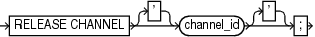

Purpose

Use the `RELEASE CHANNEL` command to release a normal or maintenance channel while maintaining a connection to a target database instance. A normal channel is allocated with `ALLOCATE CHANNEL`, whereas a maintenance channel is allocated with `ALLOCATE CHANNEL FOR MAINTENANCE`.

Prerequisites

To release a normal channel, use the syntax shown in the release::= diagram. Execute this form of `RELEASE CHANNEL` only within a `RUN` command and specify the channel name with the same identifier used in the `ALLOCATE CHANNEL` command.

To release a maintenance channel, use the syntax shown in the releaseForMaint::= diagram. Execute this form of `RELEASE CHANNEL` only at the RMAN prompt, not within a `RUN` command.

Usage Notes

Maintenance channels are unaffected by `ALLOCATE CHANNEL` and `RELEASE CHANNEL` commands issued within a `RUN` command.

Using `RELEASE CHANNEL` to release channels within `RUN` is optional, because RMAN automatically releases all normal channels when a `RUN` command terminates.

Syntax

release::=



> RELEASE CHANNEL \['\] channel\_id \['\]
>
> [  
> Copyright © 2023, 2024, Oracle and/or its affiliates.](https://docs.oracle.com/en/database/oracle/oracle-database/dcommon/html/cpyr.htm)


releaseForMaint::=


> RELEASE CHANNEL
>
> [  
> Copyright © 2023, 2024, Oracle and/or its affiliates.](https://docs.oracle.com/en/database/oracle/oracle-database/dcommon/html/cpyr.htm)


Semantics

| Syntax Element | Description |
| --- | --- |
| `channel_id` | Specifies the case-sensitive channel ID used in the `ALLOCATE CHANNEL` command (see Example 3-15). |

Examples

Example 3-15 Releasing a Channel Allocated in a RUN Command

This example allocates an SBT channel named `ch1` with parameters for a set of tapes intended for daily backups, backs up the database, and then releases this channel. The example then allocates an SBT channel named `ch1` with parameters for a set of tapes intended for weekly backups, and makes another database backup:

```
RUN
{
  ALLOCATE CHANNEL ch1 DEVICE TYPE sbt 
    PARMS='ENV=(OB_MEDIA_FAMILY=daily_bkp)';
  BACKUP DATABASE;
  RELEASE CHANNEL ch1;
  ALLOCATE CHANNEL ch1 DEVICE TYPE sbt 
    PARMS='ENV=(OB_MEDIA_FAMILY=weekly_bkp)';
  BACKUP DATABASE;
}
```

A `RELEASE CHANNEL` command at the end of the `RUN` command is optional because RMAN automatically releases channel `ch1`.

Example 3-16 Releasing a Maintenance Channel

This example shows the transcript of an RMAN session. The example allocates an SBT maintenance channel and then crosschecks and deletes backups on tape. After the SBT channel is released, RMAN uses the default disk channel to back up the database.

```
RMAN> ALLOCATE CHANNEL FOR MAINTENANCE DEVICE TYPE sbt;
 
allocated channel: ORA_MAINT_SBT_TAPE_1
channel ORA_MAINT_SBT_TAPE_1: SID=105 device type=SBT_TAPE
channel ORA_MAINT_SBT_TAPE_1: Oracle Secure Backup
 
RMAN> CROSSCHECK BACKUP;
 
crosschecked backup piece: found to be 'AVAILABLE'
backup piece handle=1jiah8ln_1_1 RECID=25 STAMP=615031479
crosschecked backup piece: found to be 'AVAILABLE'
backup piece handle=1kiah8pk_1_1 RECID=26 STAMP=615031612
crosschecked backup piece: found to be 'AVAILABLE'
backup piece handle=1niah973_1_1 RECID=28 STAMP=615032036
Crosschecked 3 objects
 
RMAN> DELETE BACKUP;
  
List of Backup Pieces
BP Key  BS Key  Pc# Cp# Status      Device Type Piece Name
------- ------- --- --- ----------- ----------- ----------
1333    1331    1   1   AVAILABLE   SBT_TAPE    1jiah8ln_1_1
1334    1332    1   1   AVAILABLE   SBT_TAPE    1kiah8pk_1_1
1427    1423    1   1   AVAILABLE   SBT_TAPE    1niah973_1_1
 
Do you really want to delete the above objects (enter YES or NO)? YES
deleted backup piece
backup piece handle=1jiah8ln_1_1 RECID=25 STAMP=615031479
deleted backup piece
backup piece handle=1kiah8pk_1_1 RECID=26 STAMP=615031612
deleted backup piece
backup piece handle=1niah973_1_1 RECID=28 STAMP=615032036
Deleted 3 objects
 
RMAN> RELEASE CHANNEL;
 
released channel: ORA_MAINT_SBT_TAPE_1
 
RMAN> BACKUP DATABASE;
 
Starting backup at 20-FEB-13
allocated channel: ORA_DISK_1
channel ORA_DISK_1: SID=105 device type=DISK
channel ORA_DISK_1: starting full datafile backup set
channel ORA_DISK_1: specifying datafile(s) in backup set
```