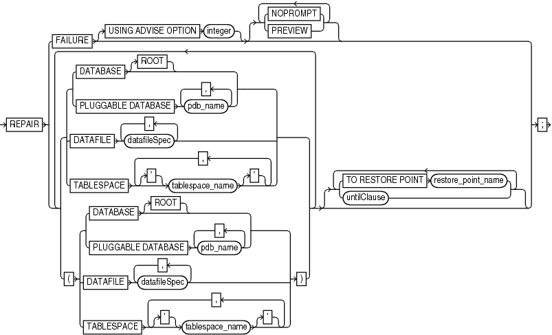

Purpose

Use the `REPAIR FAILURE` command to repair database failures identified by the Data Recovery Advisor.

The recommended workflow is to run `LIST` `FAILURE` to display failures, `ADVISE FAILURE` to display repair options, and `REPAIR FAILURE` to fix the failures.

Note:

Starting in Oracle Database 19c, the Data Recovery Advisor (DRA) feature is deprecated.

The deprecation of DRA includes deprecation of the following Oracle Recovery Manager (RMAN) commands: `LIST FAILURE`, `ADVISE FAILURE`, `REPAIR                     FAILURE`, and `CHANGE FAILURE`. Database administrators will no longer have access to these commands. There is no replacement feature for DRA.

Prerequisites

The target database instance must be started. The database must be a single-instance database and must not be a physical standby database.

Ensure that only one RMAN session is running the `REPAIR FAILURE` command. The only exception is `REPAIR FAILURE ... PREVIEW`, which is permitted in concurrent RMAN sessions.

To perform an automated repair, the Data Recovery Advisor may require specific backups and archived redo log files. If the files needed for recovery are not available, then recovery is not possible.

Usage Notes

Repairs are consolidated whenever possible so that a single repair can fix multiple failures. Be advised that `REPAIR FAILURE` requires you to explicitly run `ADVISE FAILURE` in the current session to successfully repair each of the identified failures. You typically iterate through a `REPAIR` session with the following commands:

- `REPAIR FAILURE;`
- `LIST FAILURE;`
- `ADVISE FAILURE;`
- `REPAIR FAILURE;`

RMAN always verifies that failures are still relevant and automatically closes fixed failures. RMAN does not attempt to repair a failure that is fixed, nor does it repair a failure that is obsolete because new failures were introduced after `ADVISE FAILURE` ran.

By default, `REPAIR FAILURE` prompts for confirmation before it begins executing. After executing a repair, RMAN reevaluates all existing failures on the chance that they may also have been fixed.

See Also:

Example 3-17 for a complete example on using the Data Recovery Advisor to diagnose and repair failures

Oracle RAC and Data Recovery Advisor

If a data failure brings down all instances of an Oracle RAC database, then you can mount the database in single-instance mode and use Data Recovery Advisor to detect and repair control file, `SYSTEM` data file, and dictionary failures. You can also initiate health checks to test other database components for data failures. This approach does not detect data failures that are local to other cluster instances, for example, an inaccessible data file.

Syntax

repair::=



> REPAIR {FAILURE \[USING ADVISE OPTION integer\] \[ { {NOPROMPT | PREVIEW}}...\] | { { {DATABASE \[ROOT\] | PLUGGABLE DATABASE pdb\_name \[, pdb\_name\]...} | DATAFILE datafileSpec \[, datafileSpec\]... | TABLESPACE \['\] tablespace\_name \['\] \[, \['\] tablespace\_name \['\]\]...} | { { {DATABASE \[ROOT\] | PLUGGABLE DATABASE pdb\_name \[, pdb\_name\]...} | DATAFILE datafileSpec \[, datafileSpec\]... | TABLESPACE \['\] tablespace\_name \['\] \[, \['\] tablespace\_name \['\]\]...} }} \[ { { {DATABASE \[ROOT\] | PLUGGABLE DATABASE pdb\_name \[, pdb\_name\]...} | DATAFILE datafileSpec \[, datafileSpec\]... | TABLESPACE \['\] tablespace\_name \['\] \[, \['\] tablespace\_name \['\]\]...} | { { {DATABASE \[ROOT\] | PLUGGABLE DATABASE pdb\_name \[, pdb\_name\]...} | DATAFILE datafileSpec \[, datafileSpec\]... | TABLESPACE \['\] tablespace\_name \['\] \[, \['\] tablespace\_name \['\]\]...} }}\]... \[ { {TO RESTORE POINT restore\_point\_name | untilClause}}...\]}


Semantics

repair

| Syntax Element | Description |
| --- | --- |
| `REPAIR FAILURE` | Repairs failures recorded in the Automated Diagnostic Repository.  If you execute `REPAIR FAILURE` with no other command options, then RMAN uses the first repair option of the most recent `ADVISE FAILURE` command in the current session. |
| `   USING ADVISE OPTION` `integer` | Specifies a repair option by its option number (not its failure number). You can obtain repair option numbers from the `ADVISE FAILURE` command. |
| `   NOPROMPT` | Suppresses the confirmation prompt.  This is the default option if you run `REPAIR FAILURE` in a command file. |
| `   PREVIEW` | Does not make any repairs and generates a script with all repair actions and comments. By default the script is displayed to standard output. You can use the `SPOOL` command to write the script to an editable file (see Example 3-18). |
| `DATABASE` | Repairs all data files of the selected database. To repair all data files of a CDB, run the `REPAIR DATABASE` command when connected to root.  Where possible, `REPAIR` also automatically takes a file offline, restores and recovers it, and then brings it back online again. |
| `PLUGGABLE DATABASE pdb_name` | Repairs all data files in one or more PDBs specified in a comma-delimited list. |
| `DATABASE ROOT` | Repairs data files in the CDB root. Connect to the root as a common user with the `SYSDBA` or `SYSBACKUP` privilege. |
| `DATAFILE datafileSpec` | Specifies a list of one or more data files for repair. See [datafileSpec](datafileSpec.md) for more information on how you can list the data files. |
| `TABLESPACE tablespace_name` | Specifies the names of one or more tablespaces for repair. RMAN translates tablespace names internally into a list of data files while repairing the tablespace.  In a CDB, it repairs the tablespaces in the root. In a PDB, it repairs the tablespaces in that selected PDB. |
| `TO RESTORE POINT` `restore_point_name` | Specifies a restore point as an upper, inclusive limit for data files that will be repaired. |
| `untilClause` | Sets the end time, SCN, or log sequence number for repair. See [untilClause](untilClause.md) for more information on how to use this clause. |

Examples

Example 3-17 Repairing Failures

This example repairs all failures known to the Data Recovery Advisor. The example repairs two failures: missing data files and a data file with corrupt blocks. After the recovery, RMAN asks whether it should open the database (user-entered text is in bold).

```
RMAN> LIST FAILURE;
 
List of Database Failures
=========================
 
Failure ID Priority Status    Time Detected Summary
---------- -------- --------- ------------- -------
142        HIGH     OPEN      23-APR-13     One or more non-system datafiles are missing
101        HIGH     OPEN      23-APR-13     Datafile 1: '/disk1/oradata/prod/system01.dbf' 
                                            contains one or more corrupt blocks
 
RMAN> ADVISE FAILURE;
 
List of Database Failures
=========================
 
Failure ID Priority Status    Time Detected Summary
---------- -------- --------- ------------- -------
142        HIGH     OPEN      23-APR-13     One or more non-system datafiles 
                                            are missing
101        HIGH     OPEN      23-APR-13     Datafile 1: '/disk1/oradata/prod/system01.dbf' 
                                            contains one or more corrupt blocks
 
analyzing automatic repair options; this may take some time
using channel ORA_DISK_1
analyzing automatic repair options complete
 
Mandatory Manual Actions
========================
no manual actions available
 
Optional Manual Actions
=======================
1. If file /disk1/oradata/prod/users01.dbf was unintentionally renamed or moved, restore it
 
Automated Repair Options
========================
Option Repair Description
------ ------------------
1      Restore and recover datafile 28; Perform block media recovery of 
       block 56416 in file 1
  Strategy: The repair includes complete media recovery with no data loss
  Repair script: /disk1/oracle/log/diag/rdbms/prod/prod/hm/reco_660500184.hm

RMAN> REPAIR FAILURE;
 
Strategy: The repair includes complete media recovery with no data loss
Repair script: /disk1/oracle/log/diag/rdbms/prod/prod/hm/reco_475549922.hm
contents of repair script:
   # restore and recover datafile
   alter database datafile 28 offline;
   restore datafile 28;
   recover datafile 28;
   alter database datafile 28 online;
   # block media recovery
   recover datafile 1 block 56416;
 
Do you really want to execute the above repair (enter YES or NO)? YES
executing repair script
 
sql statement: alter database datafile 28 offline
 
Starting restore at 23-APR-13
using channel ORA_DISK_1
 
channel ORA_DISK_1: starting datafile backup set restore
channel ORA_DISK_1: specifying datafile(s) to restore from backup set
channel ORA_DISK_1: restoring datafile 00028 to /disk1/oradata/prod/users01.dbf
channel ORA_DISK_1: reading from backup piece /disk2/PROD/backupset/2013_04_18/o1_mf_nnndf_TAG20130418T182042_32fjzd3z_.bkp
channel ORA_DISK_1: piece handle=/disk2/PROD/backupset/2013_04_18/o1_mf_nnndf_TAG20130418T182042_32fjzd3z_.bkp tag=TAG20130418T182042
channel ORA_DISK_1: restored backup piece 1
channel ORA_DISK_1: restore complete, elapsed time: 00:00:03
Finished restore at 23-APR-13
 
Starting recover at 23-APR-13
using channel ORA_DISK_1
 
starting media recovery
media recovery complete, elapsed time: 00:00:01
 
Finished recover at 23-APR-13
 
sql statement: alter database datafile 28 online
 
Starting recover at 23-APR-13
using channel ORA_DISK_1
searching flashback logs for block images until SCN 429690
finished flashback log search, restored 1 blocks
 
starting media recovery
media recovery complete, elapsed time: 00:00:03
 
Finished recover at 23-APR-13
repair failure complete
```

Example 3-18 Previewing a Repair

The following example previews a repair of the first repair option of the most recent `ADVISE FAILURE` command in the current session. The sample output for the `LIST FAILURE` and `ADVISE FAILURE` commands is not shown in the example.

```
RMAN> LIST FAILURE;
.
.
.
RMAN> ADVISE FAILURE;
.
.
.
RMAN> REPAIR FAILURE PREVIEW;

Strategy: The repair includes complete media recovery with no data loss
Repair script: /disk1/oracle/log/diag/rdbms/prod/prod/hm/reco_3200987003.hm

contents of repair script:
   # block media recovery
   recover datafile 1 block 56416;
```

You can use `SPOOL` with `REPAIR FAILURE ... PREVIEW` to write a repair script to a file. You can then edit this script and execute it manually. The following example spools a log a repair preview to `/tmp/repaircmd.dat`.

```
RMAN> SPOOL LOG TO '/tmp/repaircmd.dat';
RMAN> REPAIR FAILURE PREVIEW;
RMAN> SPOOL LOG OFF;
```