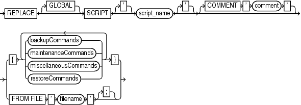

Purpose

Use the `REPLACE SCRIPT` command to replace an existing script stored in the recovery catalog. If the script does not exist, then `REPLACE SCRIPT` creates it.

See Also:

`CREATE SCRIPT` to learn how to create stored scripts

Prerequisites

Execute `REPLACE SCRIPT` only at the RMAN prompt. RMAN must be connected to a target database and a recovery catalog. The recovery catalog database must be open.

If you are replacing a local script, then you must be connected to the target database that you connected to when you created the script.

Substitution Variables in Stored Scripts

RMAN supports the use of substitution variables in a stored script. `&1` indicates where to place the first value, `&2` indicate where to place the second value, and so on. Special characters must be quoted.

The substitution variable syntax is `&` `integer` followed by an optional period, for example, `&1.3`. The optional period is part of the variable and replaced with the value, thus enabling the substitution text to be immediately followed by another integer. For example, if you pass the value `mybackup` to a command file that contains the substitution variable `&1.3`, then the result of the substitution is `mybackup3`. To create the result `mybackup.3`, you use two periods in `&1..3`.

When you create a stored script with substitution variables, you must provide example values at create time. You can provide these values with the `USING` clause when starting RMAN (see `RMAN`) or enter them when prompted (see [Example 2-75](CREATE-SCRIPT.md)).

Syntax

replaceScript::=

> REPLACE \[GLOBAL\] SCRIPT \['\] script\_name \['\] \[COMMENT ' comment '\]
>
> [  
> Copyright © 2023, 2024, Oracle and/or its affiliates.](https://docs.oracle.com/en/database/oracle/oracle-database/dcommon/html/cpyr.htm)

([backupCommands::=](RUN.md), [maintenanceCommands::=](RUN.md), [miscellaneousCommands::=](RUN.md), [restoreCommands::=](RUN.md))

Semantics

| Syntax Element | Description |
| --- | --- |
| `GLOBAL` | Identifies the script as global.  Note: A virtual private catalog has read-only access to global scripts. Creating or updating global scripts must be done while RMAN is connected to the base recovery catalog.  See Also: " [Usage Notes](CREATE-SCRIPT.md) " for an explanation of the difference between global and local scripts |
| `SCRIPT` ` script_name` | Identifies the local or global script being replaced. |
| `   COMMENT` `'` |  |