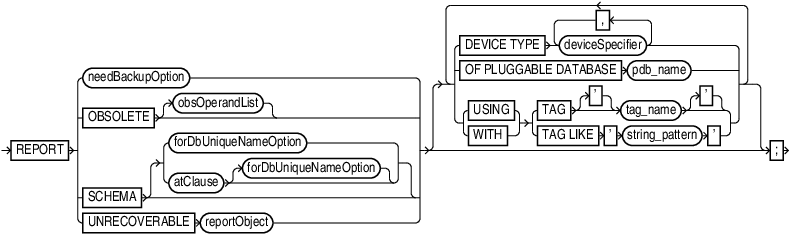
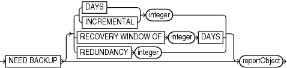
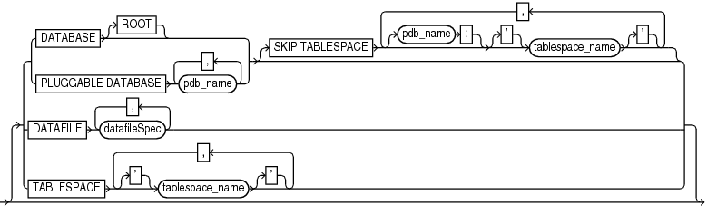
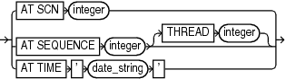

Purpose

Use the `REPORT` command to perform detailed analyses of the RMAN repository. RMAN writes the report to standard output or the message log file.

See Also:

[Oracle Database Backup and Recovery User's Guide](https://docs.oracle.com/pls/topic/lookup?ctx=en/database/oracle/oracle-database/21/rcmrf&id=BRADV8137) to learn how to create RMAN reports

Prerequisites

Execute this command only at the RMAN prompt. Either of the following conditions must be met:

- RMAN must be connected to a target database.
- RMAN must be connected to a recovery catalog and `SET` `DBID` must have been run.

Syntax

report::=



> REPORT {needBackupOption | OBSOLETE \[obsOperandList\] | SCHEMA \[ {forDbUniqueNameOption | atClause \[forDbUniqueNameOption\]}\] | UNRECOVERABLEreportObject} \[ { {DEVICETYPEdeviceSpecifier \[, deviceSpecifier\]... | OFPLUGGABLEDATABASEpdb\_name | TAG \['\] tag\_name \['\] | TAGLIKE ' string\_pattern ' | {USING | WITH} {TAG \['\] tag\_name \['\] | TAGLIKE ' string\_pattern '}}}...\]
>
> [  
> Copyright © 2023, 2024, Oracle and/or its affiliates.](https://docs.oracle.com/en/database/oracle/oracle-database/dcommon/html/cpyr.htm)


(needBackupOption::=, atClause::=, reportObject::=, [obsOperandList::=](obsOperandList.md), [deviceSpecifier::=](deviceSpecifier.md))

needBackupOption::=



> NEED BACKUP \[ { {DAYS | INCREMENTAL} integer | RECOVERY WINDOW OF integer DAYS | REDUNDANCY integer}\] reportObject
>
> [  
> Copyright © 2023, 2024, Oracle and/or its affiliates.](https://docs.oracle.com/en/database/oracle/oracle-database/dcommon/html/cpyr.htm)


(reportObject::=)

reportObject::=



> \[ { {DATABASE \[ROOT\] | PLUGGABLE DATABASE pdb\_name \[, pdb\_name\]...} \[SKIP TABLESPACE \[pdb\_name:\] \['\] tablespace\_name \['\] \[, \[pdb\_name:\] \['\] tablespace\_name \['\]\]...\] | DATAFILE datafileSpec \[, datafileSpec\]... | TABLESPACE \['\] tablespace\_name \['\] \[, \['\] tablespace\_name \['\]\]...}\]
>
> [  
> Copyright © 2023, 2024, Oracle and/or its affiliates.](https://docs.oracle.com/en/database/oracle/oracle-database/dcommon/html/cpyr.htm)


([datafileSpec::=](datafileSpec.md))

atClause::=



> AT SCN integer | AT SEQUENCE integer \[THREAD integer\] | AT TIME ' date\_string '
>
> [  
> Copyright © 2023, 2024, Oracle and/or its affiliates.](https://docs.oracle.com/en/database/oracle/oracle-database/dcommon/html/cpyr.htm)


Semantics

report

This clause specifies the type of report.

| Syntax Element | Description |
| --- | --- |
| `needBackupOption` | Lists files that require backups.  See Also: `needBackupOption` |
| `OBSOLETE` `obsOperandList` | Lists full backups, data file copies, and archived redo log files recorded in the RMAN repository that can be deleted because they are no longer needed. See Table 3-6 for description of output. The command works in two steps:  1. For each data file that has been backed up, RMAN identifies the oldest full backup, level 0 backup, or image copy that is not obsolete under the retention policy. Any backup of the data file older than the one identified in this step is considered obsolete. 2. Any archived redo log files and level 1 incremental backups that are older than the oldest nonobsolete full backup are considered obsolete. These files are obsolete because no full or level 0 backup exists to which they can be applied. Incremental level 1 backups or archived redo log files are not considered obsolete if they can be applied to nonobsolete level 0 or full backups.  The subclause `obsOperandList` describes the criteria that RMAN uses to determine what is obsolete. If you do not specify parameters in `obsOperandList`, then RMAN uses the options specified in `CONFIGURE` `RETENTION POLICY` (see Example 3-22). If you use this option with `DEVICE TYPE`, then RMAN only considers backups and copies created on the specified device. If the retention policy is disabled, then RMAN does not consider any backups as obsolete. Thus, RMAN issues an error when you run `REPORT OBSOLETE` with no other options and the retention policy is `NONE`.  Note: A backup made with the `KEEP UNTIL TIME` clause is obsolete after the `KEEP` time passes, regardless of the configured retention policy settings. |
| `SCHEMA` | Lists the names of all data files (permanent and temporary) and tablespaces for the target database at the specified point in time. See Table 3-1 for description of output.  For `REPORT SCHEMA` without [forDbUniqueNameOption](forDbUniqueNameOption.md), a target database connection is required, but a recovery catalog connection is optional. |
| `forDbUniqueNameOption` | Reports the names of all data files and tablespaces for the database specified by its `DB_UNIQUE_NAME`.  You can specify a database with `db_unique_name` or use `ALL` for all uniquely named databases recorded in the catalog for a particular DBID. A database is uniquely identified in the recovery catalog by a DBID and the value of the `DB_UNIQUE_NAME` initialization parameter.  RMAN must be connected to a recovery catalog. RMAN must be connected to a target database or `SET` `DBID` must have been run.  See Also: `forDbUniqueNameOption` for descriptions of the options in this clause |
| `atClause` | Specifies an SCN, log sequence number, or time. |
| `UNRECOVERABLE` `reportObject` | Lists all unrecoverable data files. See Table 3-7 for description of output.  A data file is considered unrecoverable if an unrecoverable operation has been performed against an object residing in the data file since the last backup of the data file. In an unrecoverable operation, redo is not generated. Examples are direct load of table data and updates with the `NOLOGGING` option.  Note: The nonexistence of any backup of a data file is not sufficient reason to consider it unrecoverable. Such data files can be recovered with the `CREATE DATAFILE` command, if redo logs starting from when the file was created still exist. |
| `   DEVICE TYPE` `deviceSpecifier` | Specifies the type of storage device. RMAN only considers backups and copies available on the specified device for its report. |
| `   OF PLUGGABLE DATABASE` `pdb_name` | Reports the backups and copies for the PDB specified by `pdb_name`. |
| `   TAG` `tag_name` | Reports the backups and copies with tag specified by `tag_name`. |
| `   TAG LIKE` `string_pattern` | Reports the backups and copies whose tag matches the pattern specified by `string_pattern`. |

needBackupOption

This clause reports only on files that need backups.

| Syntax Element | Description |
| --- | --- |
| `NEED BACKUP` | Lists all data files in the specified `reportObject` that require a new backup.  The report assumes that you restore the most recent backup. If you do not specify any option, then RMAN uses the current retention policy configuration. If the retention policy is disabled (`CONFIGURE` `RETENTION` `POLICY` `TO` `NONE`), then RMAN generates an error. |
| `   DAYS ` `integer` | Lists all data files requiring more than the specified number of days' worth of archived redo log files for complete recovery. For example, `REPORT NEED BACKUP DAYS 7 DATABASE` shows the data files whose recovery requires more than seven days' worth of archived redo log files. See Table 3-2 for description of output.  If the target database control file is mounted and current, then RMAN makes the following optimizations to this report:  - Files that are offline and whose most recent backup contains all changes to the file are not included. - Files that were offline and are now online, and whose most recent backup contains all changes up to the offline time, are only reported if they have been online for more than the specified number of days. |
| `   INCREMENTAL` `integer` | Specifies a threshold number of incremental backups required for recovery (see Example 3-21). If complete recovery of a data file requires more than `integer` incremental backups, then the data file requires a new full backup. See Table 3-3 for description of output.  Note: Files for which no backups exist do not appear in this list: issue the `REPORT NEED BACKUP REDUNDANCY` command to display them. |
| `   RECOVERY WINDOW` `OF` `integer` `DAYS` | Reports data files for which there are not sufficient backups to satisfy a recovery window-based retention policy for the specified number of days, that is, data files without sufficient backups for point-in-time recovery to any point back to the time `SYSDATE -` `integer`. See Table 3-4 for description of output. |
| `   REDUNDANCY ` `integer` | Specifies the minimum number of backups or copies that must exist for a data file to be considered not in need of a backup. In other words, a data file needs a backup if there are fewer than `integer` backups or copies of this file. For example, `REDUNDANCY 2` means that if there are fewer than two copies or backups of a data file, then it needs a new backup. See Table 3-5 for description of output. |
| `reportObject` | Specifies the object for which you are generating the report. |

reportObject

This subclause specifies the data files to be included in the report. The report can include the entire database (optionally skipping certain tablespaces), a list of tablespaces, or a list of data files. RMAN includes objects from prior incarnations.

| Syntax Element | Description |
| --- | --- |
| `DATABASE` | Lists backups or data file copies of all files in the database.  Note: Specify ` SKIP TABLESPACE` `tablespace_name` to exclude the specified tablespace from the `DATABASE` specification. |
| `DATABASE ROOT` | Specifies the root in a CDB. Connect to the root. |
| `PLUGGABLE DATABASE ` `pdb_name` | Lists backups or data file copies in one or more PDBs in a CDB. Use a comma-delimited list to specify multiple PDBs. Connect to the root to report on one or more PDBs using this syntax,. |
| `DATAFILE ` `datafileSpec` | Lists the specified data files. RMAN reports on backups or data file copies that contain at least one specified data file. |
| `TABLESPACE` `tablespace_name` | Lists data files in the specified tablespace. RMAN reports on backups or data file copies that include at least one data file from a specified tablespace.  When connected to the root in a CDB, refers to tablespaces in the root. Refers to tablespaces in a PDB when connected directly to a PDB. |

atClause

This subclause specifies a point in time as a time, SCN, or log sequence number. You must be connected to a recovery catalog when issuing a `REPORT SCHEMA` command with an `AT` clause.

| Syntax Element | Description |
| --- | --- |
| `AT SCN` `integer` | Specifies an SCN. |
| `AT SEQUENCE` `integer` | Specifies a log sequence number. The integer indicates the time when the specified log was first opened. |
| `   THREAD` `integer` | Specifies a redo `THREAD` number. The integer indicates the time when the thread was first opened. |
| `AT TIME` `'` `date_string` `'` | Specifies a date (see Example 3-20). The `NLS_LANG` and `NLS_DATE_FORMAT` environment variables specify the format for the time. |

Report Output

The information that appears in the output is described in the following tables:

- Table 3-1
- Table 3-2
- Table 3-3
- Table 3-4
- Table 3-5
- Table 3-6
- Table 3-7

Table 3-1 Report of Database Schema

| Column | Indicates |
| --- | --- |
| `File` | The absolute data file number. |
| `Size(MB)` | The size of the file in megabytes. |
| `Tablespace` | The tablespace name. |
| `RB segs` | For data files only. `YES` if rollback segments exist in the tablespace and `NO` if they do not (only if connected to the recovery catalog). If RMAN is not connected to the catalog, then `***` is displayed. |
| `Datafile Name` | For permanent data files only. The name of the data file. |
| `Maxsize(MB)` | For temp files only. The maximum size of the temp file. |
| `Tempfile Name` | For temp files only. The name of the temp file. |

Table 3-2 Report of Files Whose Recovery Needs More Than n Days of Archived Logs

| Column | Indicates |
| --- | --- |
| `File` | The absolute file number of a data file that requires more than n days of archived redo log files for recovery. |
| `Days` | The number of days of archived redo data required for recovery. |
| `Name` | The name of the data file. |

Table 3-3 Report of Files That Need More than n Incrementals During Recovery

| Column | Indicates |
| --- | --- |
| `File` | The absolute file number of a data file that requires more than n incrementals for complete recovery. |
| `Incrementals` | The number of incremental backups required for complete recovery. |
| `Name` | The name of the data file. |

Table 3-4 Report of Files That Must Be Backed Up to Satisfy n Days Recovery Window

| Column | Indicates |
| --- | --- |
| `File` | The absolute file number of a data file that must be backed up to satisfy a recovery window of n days. |
| `Days` | The number of days required for complete recovery. |
| `Name` | The name of the data file that requires backup. |

Table 3-5 Report of Files with Fewer Than n Redundant Backups

| Column | Indicates |
| --- | --- |
| `File` | The absolute data file number of a data file with less than n redundant backups. |
| `#bkps` | The number of backups that exist for this file. |
| `Name` | The name of the file. |

Table 3-6 Report of Obsolete Backups and Copies

| Column | Indicates |
| --- | --- |
| `Type` | Whether the object is a backup set, backup piece, proxy copy, or data file copy. |
| `Key` | A unique key that identifies this backup in the target database control file. |
| `Completion Time` | The time that the backup or copy completed. |
| `Filename/handle` | The file name or media handle of the backup or data file copy. |

Table 3-7 Report of Files that Need Backup Due to Unrecoverable Operations

| Column | Indicates |
| --- | --- |
| `File` | The absolute number of the data file that needs a new backup due to unrecoverable operations. |
| `Type Of Backup Required` | `FULL` or `INCREMENTAL`, depending on which type of backup is necessary to ensure the recoverability of all of the data in this file. If `FULL`, then create a full backup, level 0 backup, or a data file copy. If `INCREMENTAL`, then an incremental backup also suffices. |
| `Name` | The name of the data file. |

Examples

Example 3-20 Reporting a Database Schema

This example, which requires a recovery catalog, reports the names of all data files and tablespaces 20 minutes ago.

```
RMAN> REPORT SCHEMA AT TIME 'sysdate-20/1440';

Report of database schema for database with db_unique_name PROD
 
List of Permanent Datafiles
===========================
File Size(MB) Tablespace           RB segs Datafile Name
---- -------- -------------------- ------- ------------------------
1    450      SYSTEM               YES     /disk1/oradata/prod/system01.dbf
2    197      SYSAUX               YES     /disk1/oradata/prod/sysaux01.dbf
3    20       UNDOTBS              YES     /disk1/oradata/prod/undotbs01.dbf
4    10       CWMLITE              YES     /disk1/oradata/prod/cwmlite01.dbf
5    10       DRSYS                YES     /disk1/oradata/prod/drsys01.dbf
6    10       EXAMPLE              YES     /disk1/oradata/prod/example01.dbf
7    10       INDX                 YES     /disk1/oradata/prod/indx01.dbf
8    10       TOOLS                YES     /disk1/oradata/prod/tools01.dbf
9    10       USERS                YES     /disk1/oradata/prod/users01.dbf
 
List of Temporary Files
=======================
File Size(MB) Tablespace           Maxsize(MB) Tempfile Name
---- -------- -------------------- ----------- --------------------
1    40       TEMP                 32767       /disk1/oradata/prod/temp01.dbf
```

Example 3-21 Reporting Data Files Needing Incremental Backups

This example reports all data files in the database that require the application of one or more incremental backups to be recovered to their current state:

```
RMAN> REPORT NEED BACKUP INCREMENTAL 1;
 
Report of files that need more than 1 incrementals during recovery
File Incrementals Name
---- ------------ ----------------------------------------------
1    2            /disk1/oradata/prod/system01.dbf
2    2            /disk1/oradata/prod/sysaux01.dbf
3    2            /disk1/oradata/prod/undotbs01.dbf
4    2            /disk1/oradata/prod/cwmlite01.dbf
5    2            /disk1/oradata/prod/drsys01.dbf
6    2            /disk1/oradata/prod/example01.dbf
7    2            /disk1/oradata/prod/indx01.dbf
9    2            /disk1/oradata/prod/users01.dbf
```

Example 3-22 Reporting Obsolete Backups and Copies

The following example reports obsolete backups and copies that are redundant according to the current retention policy. The retention policy is set to redundancy 1.

```
RMAN> REPORT OBSOLETE;
```
```
RMAN retention policy will be applied to the command
RMAN retention policy is set to redundancy 1
Report of obsolete backups and copies
Type                 Key    Completion Time    Filename/Handle
-------------------- ------ ------------------ --------------------
Archive Log          1022   19-FEB-13          /disk1/prod/arch/archive1_59_614712405.dbf
Archive Log          1023   19-FEB-13          /disk1/prod/arch/archive1_61_614712405.dbf
Archive Log          1024   19-FEB-13          /disk1/prod/arch/archive1_60_614712405.dbf
Archive Log          1025   19-FEB-13          /disk1/prod/arch/archive1_55_614712405.dbf
Backup Set           1032   19-FEB-13
  Backup Piece       1050   19-FEB-13         
 /disk2/PROD/backupset/2013_02_19/o1_mf_nnndf_TAG20130219T173839_2xnpmp0l_.bkp
Datafile Copy        1073   19-FEB-13         
 /disk2/PROD/datafile/o1_mf_system_2xmz5l5m_.dbf
Backup Set           1035   19-FEB-13
  Backup Piece       1053   19-FEB-13         
 /disk2/PROD/backupset/2013_02_19/o1_mf_nnndf_TAG20130219T111434_2xnpozym_.bkp
Datafile Copy        1074   19-FEB-13         
 /disk2/PROD/datafile/o1_mf_sysaux_2xmz6zdg_.dbf
Datafile Copy        1075   19-FEB-13         
 /disk2/PROD/datafile/o1_mf_undotbs_2xmz7rof_.dbf
Datafile Copy        1076   19-FEB-13         
 /disk2/PROD/datafile/o1_mf_cwmlite_2xmz7vrg_.dbf
Datafile Copy        1077   19-FEB-13          /disk2/PROD/datafile/o1_mf_drsys_2xmz7wyc_.dbf
Datafile Copy        1078   19-FEB-13         
 /disk2/PROD/datafile/o1_mf_example_2xmz7y5s_.dbf
Datafile Copy        1079   19-FEB-13          /disk2/PROD/datafile/o1_mf_indx_2xmz81jg_.dbf
Datafile Copy        1081   19-FEB-13          /disk2/PROD/datafile/o1_mf_users_2xmz85vo_.dbf
Datafile Copy        1777   20-FEB-13          /disk2/users01.dbf
```