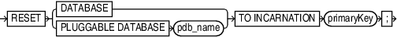

Purpose

Use the `RESET DATABASE TO INCARNATION` command to reset the incarnation of the target database in the RMAN repository to a previous database incarnation. You are only required to use this command in the following scenarios:

- You use `RESTORE` or `RECOVER` to return the database to an SCN before the current `RESETLOGS` timestamp.
- You use `FLASHBACK DATABASE` to rewind the database to an orphaned database incarnation.

See Also:

[Oracle Database Backup and Recovery User's Guide](https://docs.oracle.com/pls/topic/lookup?ctx=en/database/oracle/oracle-database/21/rcmrf&id=BRADV1171) to learn about the circumstances in which it is necessary to use the `RESET DATABASE` command

Prerequisites

Execute `RESET DATABASE TO INCARNATION` only at the RMAN prompt. RMAN must be connected to a target database.

If RMAN runs in `NOCATALOG` mode, then the target database must be mounted. The mounted control file must contain a record of the specified database incarnation.

If RMAN runs in `CATALOG` mode, then the target database can be mounted or unmounted. If the database is mounted, then the control file must contain a record of the specified database incarnation.

Usage Notes

When you use RMAN in `NOCATALOG` mode, the `RESET DATABASE TO INCARNATION` command is persistent across RMAN sessions.

Usage Notes for CDBs

The initial incarnation number of a pluggable database (PDB) is 0. Subsequent incarnation numbers are unique, but not always sequential.

Syntax

reset::=



> RESET {DATABASE | PLUGGABLEDATABASEpdb\_name} TOINCARNATIONprimaryKey
>
> [  
> Copyright © 2023, 2024, Oracle and/or its affiliates.](https://docs.oracle.com/en/database/oracle/oracle-database/dcommon/html/cpyr.htm)


Semantics

| Syntax Element | Description |
| --- | --- |
| `DATABASE` | Specifies the whole multitenant container database (CDB). |
| `PLUGGABLE DATABASE` | Specifies the incarnation of the pluggable database (PDB). Use this clause to perform flashback or recovery of a PDB to an orphan PDB incarnation or an ancestor PDB incarnation. You need `SYSDBA` privileges to run this command.  Note: This clause is not supported on a standby database. |
| `primaryKey` | Changes the current incarnation to a noncurrent database incarnation specified by the primary key of the `DBINC` record for the database incarnation. An incarnation key is used to uniquely tag and identify a stream of redo.  Run `LIST` `INCARNATION OF DATABASE` to obtain possible key values. After you issue `RESET DATABASE TO INCARNATION`, you can run RMAN commands such as `FLASHBACK DATABASE`, `RESTORE`, and `RECOVER`. |

Examples

Example 3-23 Resetting RMAN to a Previous Incarnation in NOCATALOG Mode

In `NOCATALOG` mode, you must mount a control file that contains information about the incarnation that you want to recover. The following scenario resets the database to an abandoned incarnation of database `trgt` and performs incomplete recovery.

```
CONNECT TARGET / NOCATALOG

# step 1: start and mount a control file that knows about the incarnation to which
# you want to return. Refer to the RESTORE command for appropriate options.
STARTUP NOMOUNT;
RESTORE CONTROLFILE FROM AUTOBACKUP;
ALTER DATABASE MOUNT;

# step 2: obtain the primary key of old incarnation
LIST INCARNATION OF DATABASE trgt;

List of Database Incarnations
DB Key  Inc Key DB Name  DB ID            STATUS   Reset SCN  Reset Time
------- ------- -------- -------------    -------  ---------- ----------
1       2       TRGT     1334358386       PARENT   154381     OCT 30 2013 16:02:12
1       116     TRGT     1334358386       CURRENT  154877     OCT 30 2013 16:37:39

# step 3: in this example, reset database to incarnation key 2
RESET DATABASE TO INCARNATION 2;

# step 4: restore and recover the database to a point before the RESETLOGS
RESTORE DATABASE UNTIL SCN 154876;
RECOVER DATABASE UNTIL SCN 154876;

# step 5: make this incarnation the current incarnation and list incarnations:
ALTER DATABASE OPEN RESETLOGS;
LIST INCARNATION OF DATABASE trgt;

List of Database Incarnations
DB Key  Inc Key DB Name  DB ID            STATUS  Reset SCN  Reset Time
------- ------- -------- ---------------- ------- ---------- ----------
1       2       TRGT     1334358386       PARENT  154381     OCT 30 2013 16:02:12
1       116     TRGT     1334358386       PARENT  154877     OCT 30 2013 16:37:39
1       311     TRGT     1334358386       CURRENT 156234     AUG 13 2013 17:17:03
```

Example 3-24 Resetting the PDB Incarnation

This example resets the pluggable database `my_pdb` to an orphan incarnation, 3.

```
RESET PLUGGABLE DATABASE TO INCARNATION 3;
```