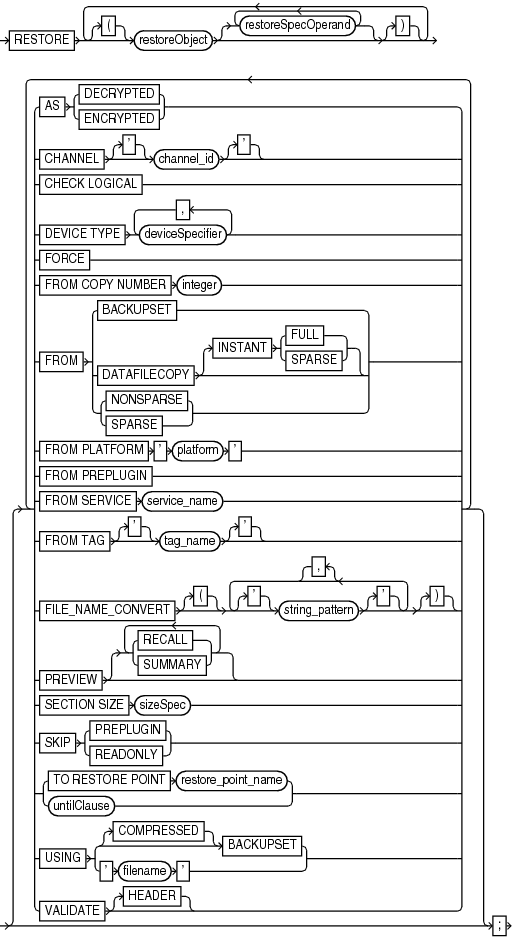
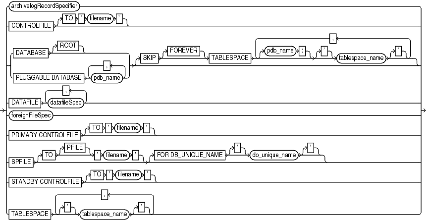
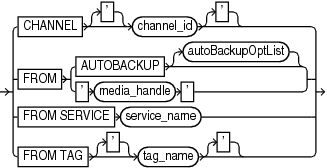
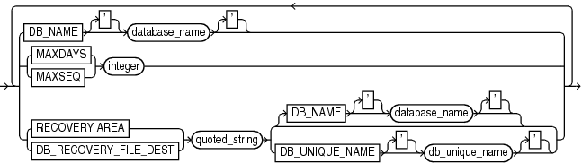

Purpose

Use the `RESTORE` command to restore, validate, or preview RMAN backups. Typically, you restore backups when a media failure has damaged a current data file, control file, or archived redo log or before performing a point-in-time recovery.

Prerequisites

To restore data files to their current location, the database must be started, mounted, or open with the tablespaces or data files to be restored offline.

If you use RMAN in a Data Guard environment, then connect RMAN to a recovery catalog.

If you are performing a trial restore of the production database, then perform either of the following actions before restoring the database in the test environment:

- If the test database uses a fast recovery area that is physically different from the recovery area used by the production database, then set `DB_RECOVERY_FILE_DEST` in the test database instance to the new location.
- If the test database uses a fast recovery area that is physically the same as the recovery area used by the production database, then set `DB_UNIQUE_NAME` in the test database instance to a different name from the production database.

If you do not perform either of the preceding actions, then RMAN assumes that you are restoring the production database and deletes flashback logs from the fast recovery area because they are considered unusable.

If you restore encrypted databases or tablespaces, then the Oracle keystore must be open before performing the restore operation.

To restore data files in a destination CDB using preplugin backups, the root must be open and you must connect to the root as a common user with the `SYSDBA` or `SYSBACKUP` privilege.

Usage Notes

The `RESTORE` command restores full backups, level 0 incremental backups, or image copies. You can restore files to their default location or a different location.

By default, RMAN examines read-only data files to make sure they exist, are readable, and have the correct checkpoint. If any of the conditions is not met, then RMAN restores the files. If all of the conditions are met, then RMAN does not restore the files.

You cannot use a single `RESTORE` command to restore data files belonging to more than one PDB backups.

Backup Selection

By default, `RESTORE` chooses the most recent backup set or file copy, that is, the file copy or backup set that needs the least media recovery. RMAN only restores backups created on the same type of channels allocated by the `RESTORE` command. For example, if you made backups of a data file with `DISK` and `sbt` channels, and if only a `DISK` channel is allocated for the `RESTORE` command, then RMAN does not restore the `sbt` backups. If you do not manually allocate channels, then RMAN allocates all automatic channels that it possibly needs, subject to any restrictions imposed by the `DEVICE TYPE` option.

In an Oracle RAC configuration, RMAN automatically restores backups, control file copies, and data file copies from channels that can read the files on tape or a local file system. For example, if channel `ch1` connected to `inst1` can read log 1000 from its tape drive, but channel `ch2` connected to `inst2` cannot read the same log from its tape drive, then `ch2` cannot participate in restoring the log and so `ch1` restores the log. Autolocation is automatically enabled when the channels have different `PARMS` or `CONNECT` settings.

If data file names are symbolic links, then the control file stores the file names of the link files but RMAN performs I/O on the data files pointed to by the link files. If a link file is lost and you restore a data file without re-creating the symbolic link, then RMAN restores the data file to the location of the link file rather than to the location pointed to by the link file.

See Also:

[Oracle Database Backup and Recovery User's Guide](https://docs.oracle.com/pls/topic/lookup?ctx=en/database/oracle/oracle-database/21/rcmrf&id=BRADV30001) for details on restore failover

Restore Operations for Sparse Databases

To restore sparse databases, the `COMPATIBLE` initialization parameter must be set to 12.2 or higher. You can perform a sparse restore of a data file, tablespace, PDB, or a whole CDB.

By default, RMAN determines the most appropriate backup (backup set or image copy) of the specified object. The selected backup may be a sparse backup or a non-sparse backup. To specify that a sparse backup must be used, include the `FROM           SPARSE` clause in the `RESTORE` command. To specify that a non-sparse backup must be used, include the `FROM NONSPARSE` clause in the `RESTORE` command.

For non-temp sparse files, if the sparse data file was originally on a sparse disk group but the alternate location specified by `DB_CREATE_FILE_DEST` is a non-sparse disk group, then RMAN creates the data file in its original disk group (instead of the diskgroup specified by `DB_CREATE_FILE_DEST`).

Restore Operations Using Encrypted Backup Sets

As explained in " [Encryption of Backup Sets](BACKUP.md) ", how RMAN handles encrypted backup sets during restore operations depends on the encryption mode with which the backup was created. You can use `CONFIGURE` and `SET` to manage the RMAN backup encryption settings for your database. Note the following restore considerations:

- For transparent-mode encrypted backups, the required passwords must be available in the Oracle software keystore. The same keystore used when creating the backup must be open and available when restoring it. If a password-based keystore was used while creating the backups, then you must use `SET DECRYPTION WALLET OPEN IDENTIFIED BY` to provide the password used to open the keystore.
- For password-mode encrypted backups, the required passwords must be provided with `SET DECRYPTION`.
- For dual-mode encrypted backups, the required passwords must be available in the Oracle software keystore or provided with `SET DECRYPTION`.

Note:

Keystore-based encryption is more secure than password-based encryption because no passwords are involved. Use password-based encryption only when absolutely necessary because your backups must be transportable.

Restore Failover

If a backup piece, image copy or proxy copy is inaccessible or if a block is corrupted, then RMAN performs restore failover. The `RESTORE` command automatically looks for another usable copy of a backup or image copy on the same device and other devices. If no usable copies are available, then RMAN searches for previous backups. RMAN continuously searches for previous usable backups until it has exhausted all possibilities. RMAN automatically uses eligible backups from previous database incarnations if required.

If you are restoring a data file for which no backups are available, then RMAN creates an empty data file with the checkpoint change as creation SCN. During recovery, all archived redo log files back to the creation of the data file are restored, and all changes during the history of the data file are reapplied to re-create its contents.

See Also:

" [Encryption of Backup Sets](BACKUP.md) " and the extended discussion in [Oracle Database Backup and Recovery User's Guide](https://docs.oracle.com/pls/topic/lookup?ctx=en/database/oracle/oracle-database/21/rcmrf&id=BRADV72450)

Location of Restored Data Files

If you restore data files to the default location, then RMAN overwrites files with the same file names. By default, RMAN does not restore a data file if it is in the correct place and its header contains the expected data. RMAN does not scan the data file body for corrupt blocks.

If RMAN detects that the default file name cannot be used (for example, the file may be an Oracle-managed file or on an Automatic Storage Management disk group), then RMAN attempts to create a new file in the same location or disk group.

RMAN restores data files to the location currently stored in the recovery catalog. This default behavior eliminates problems with restoring data files to locations that may have become obsolete since the time of the original backup. It also means that if you have changed the location of the data files from their original backup location, that RMAN restores the files to the most current or changed location.

To restore files to a nondefault location, use `SET` `NEWNAME` commands to rename the restored files and then use a `SWITCH` command to make the restored files current (as illustrated in Example 3-26). If you do not issue `SWITCH` commands, then RMAN considers the restored files as valid copies for use in future restore operations. Table 3-8 describes the behavior of the `RESTORE`, `SET NEWNAME`, and `SWITCH` commands.

Table 3-8 SET NEWNAME, SWITCH, and RESTORE

| SET NEWNAME Run | SWITCH Run | RESTORE Behavior |
| --- | --- | --- |
| No | N/A | RMAN restores the files to the most recent location stored in the recovery catalog. |
| Yes | Yes | RMAN restores the files to the path names specified by `SET` `NEWNAME`. RMAN replaces the current data file names in the control file with the names of the restored files. RMAN records the data files with the old names as data file copies. |
| Yes | No | RMAN restores the files to the path names specified by `SET` `NEWNAME`. RMAN does not update the current data file names in the control file. The restored files are listed in the RMAN repository as data file copies. |

Because temp files cannot be backed up and because no redo is ever generated for them, RMAN never restores or recovers temp files. RMAN does track the names of temp files, but only so that it can automatically re-create them when needed.

RMAN Behavior When Restoring Control Files

The behavior of RMAN when restoring control files depend on a variety of factors, which are summarized in Table 3-9. Required commands and options for restoring autobackups are summarized in Table 3-10.

Table 3-9 RESTORE CONTROLFILE Scenarios

| RMAN Connection | RESTORE CONTROLFILE; | RESTORE CONTROLFILE FROM AUTOBACKUP; | RESTORE CONTROLFILE... TO 'filename'; | RESTORE CONTROLFILE... FROM 'media\_handle' or TAG 'user\_tag'; |
| --- | --- | --- | --- | --- |
| No catalog, target database started in `NOMOUNT` state | Error. Must specify `FROM AUTOBACKUP`. | Restores to `CONTROL_FILES` locations. See Table 3-10 for required commands and options. | Must specify `FROM AUTOBACKUP`. Restores only to `filename`. | First run `SET` `DBID`. Restores from specified file (cannot restore from `TAG`). If `TO` ' `filename` ' not used, restores to all `CONTROL_FILES` locations. |
| No catalog, target database mounted or open | Error. Must use `TO` ' `filename` ', where `filename` is not in `CONTROL_FILES` list. | Error. Must use `TO` ' `filename` ', where `filename` is not in `CONTROL_FILES` list. | Restores only to `filename`, where `filename` is not in `CONTROL_FILES` list. | RMAN issues error `RMAN-06496`. Use `TO` ' `filename` ' instead. |
| Catalog, target database started in `NOMOUNT` state | Restores to `CONTROL_FILES` locations. Run `SET` `DBID` only if `DB_NAME` not unique in catalog. | Only use with recovery catalog for testing. | Restores only to `filename`, where `filename` is not in `CONTROL_FILES` list. | Restores from specified file. If `TO` ' `filename` ' not used, restores to all `CONTROL_FILES` locations. |
| Catalog, target database mounted or open | Error. Must use `TO` ' `filename` ', where `filename` is not in `CONTROL_FILES` list. | Do not use with recovery catalog. | Restores only to `filename`, where `filename` is not in `CONTROL_FILES` list. | RMAN issues error `RMAN-06496`. Use `TO` ' `filename` ' instead. |

If you use RMAN in a Data Guard environment, then RMAN transparently converts primary control files to standby control files and vice versa. RMAN automatically updates file names for data files, online redo logs, standby redo logs, and temp files when you issue `RESTORE` and `RECOVER`. The recovery catalog always contains the correct information about the backup file names for each database, as explained in " [RMAN Backups in a Data Guard Environment](BACKUP.md) ".

Control File and Server Parameter File Autobackup Options

When restoring an autobackup, the commands and options that you use depend on the autobackup type (control file or server parameter file) and location (inside or outside fast recovery area). The options are summarized in Table 3-10.

Table 3-10 RESTORE... FROM AUTOBACKUP

| Restore Object | Autobackup Location | Run SET DBID? | Specify RECOVERY AREA on RESTORE? | Specify DB\_NAME or DB\_UNIQUE\_NAME on RESTORE? | Run SET CONTROLFILE AUTOBACKUP FORMAT? |
| --- | --- | --- | --- | --- | --- |
| SPFILE | Recovery area | No | Yes | Yes | No |
| SPFILE | Outside recovery area | Yes | No | No | Only if autobackup is not in default location |
| Control file | Recovery area | No | Only if autobackup is in noncurrent recovery area | Only if autobackup is in noncurrent recovery area and uses a noncurrent `DB_UNIQUE_NAME` | No |
| Control file | Outside recovery area | Yes | No | No | Only if autobackup is not in default location |

Restoring Control Files From Archived Backups in NOCATALOG Mode

You can offload backups stored on disk either to tape or Oracle Cloud. When control file autobackup is enabled, and you use one of the following commands to archive disk backups to tape or Oracle Cloud, RMAN includes a backup of the latest control file to tape or Oracle Cloud:

- `BACKUP BACKUPSET ALL`
- `BACKUP RECOVERY AREA`
- `BACKUP DATAFILE COPY ALL`

To restore these backups, when a recovery catalog is not used, you must configure one or more disk and SBT channels (for tape or Oracle Cloud).

See Example 3-30.

Restoring Data Files and Control Files Using Files from a Remote Host

Starting with Oracle Database 12c, you can restore a database, data files, control files, tablespaces, or an spfile using files from a remote database. RMAN connects to the remote database and transfers the required files, over the network, to the target database using backup sets. This is very useful in a Data Guard environment. You can restore data files on a primary database by connecting to a standby database over the network. You can also restore data files on a standby database by connecting to the primary database.

While restoring files from a remote host over the network, you must use `FROM SERVICE` to specify the service name of the remote host from which the files are obtained. Optionally, use `SECTION SIZE` to restore files from the source database as multisection backup sets. You can compress the transferred files by specifying the `USING COMPRESSED BACKUPSET`.

To encrypt the files being transferred from the source database, use the `SET ENCRYPTION` command before the RESTORE command. You can also use `SET COMPRESSION ALGORITHM` to specify the algorithm used to compress the backup sets before transferring them over the network.

Prerequisites for Restoring Files Using a Remote Host

- The password file on the source database and the target database must be the same.
- The `tnsnames.ora` file in the target database must contain an entry that corresponds to the remote database.

Syntax

restore::=



> RESTORE {\[{\] restoreObject \[ {restoreSpecOperand}... \[}\] \[ \[}\]\]... \[ { {AS {DECRYPTED | ENCRYPTED} | CHANNEL \['\] channel\_id \['\] | CHECK LOGICAL | DEVICE TYPE deviceSpecifier \[, deviceSpecifier\]... | FORCE | FROM COPY NUMBER integer | FROM {BACKUPSET | DATAFILECOPY \[INSTANT {FULL | SPARSE}\] | {NONSPARSE | SPARSE}} | FROM PLATFORM ' platform ' | FROM PREPLUGIN | FROM SERVICE service\_name | FROM TAG \['\] tag\_name \['\] | FILE\_NAME\_CONVERT \[{\] {\['\] string\_pattern \['\]}/ \[,\] \[}\] | PREVIEW \[ { {RECALL | SUMMARY}}... | SECTION SIZE sizeSpec | SKIP {PREPLUGIN | READONLY} | {TO RESTORE POINT restore\_point\_name | untilClause} | USING {\[COMPRESSED\] BACKUPSET | ' filename '} | VALIDATE \[HEADER\]} \[ | SECTION SIZE sizeSpec | SKIP {PREPLUGIN | READONLY} | {TO RESTORE POINT restore\_point\_name | untilClause} | USING {\[COMPRESSED\] BACKUPSET | ' filename '} | VALIDATE \[HEADER\]}\]...\]


(restoreObject::=, restoreSpecOperand::=, [deviceSpecifier::=](deviceSpecifier.md), [untilClause::=](untilClause.md))

restoreObject::=



> archivelogRecordSpecifier | CONTROLFILE \[TO ' filename '\] | {DATABASE \[ROOT\] | PLUGGABLE DATABASE pdb\_name \[, pdb\_name\]...} \[SKIP \[FOREVER\] TABLESPACE \[pdb\_name:\] \['\] tablespace\_name \['\] \[, \[pdb\_name:\] \['\] tablespace\_name \['\]\]...\] | DATAFILE datafileSpec \[, datafileSpec\]... | foreignFileSpec | PRIMARY CONTROLFILE \[TO ' filename '\] | SPFILE \[TO \[PFILE\] ' filename '\] \[FOR DB\_UNIQUE\_NAME \['\] db\_unique\_name \['\]\] | STANDBY CONTROLFILE \[TO ' filename '\] | TABLESPACE \['\] tablespace\_name \['\] \[, \['\] tablespace\_name \['\]\]...


([archivelogRecordSpecifier::=](archivelogRecordSpecifier.md), [datafileSpec::=](datafileSpec.md), [foreignFileSpec::=](foreignFileSpec.md))

restoreSpecOperand::=



> CHANNEL \['\] channel\_id \['\] | FROM {AUTOBACKUP \[autoBackupOptList\] | ' media\_handle '} | FROM SERVICE service\_name | FROM TAG \['\] tag\_name \['\]
>
> [  
> Copyright © 2023, 2024, Oracle and/or its affiliates.](https://docs.oracle.com/en/database/oracle/oracle-database/dcommon/html/cpyr.htm)


autoBackupOptList::=



> {DB\_NAME \['\] database\_name \['\] | {MAXDAYS | MAXSEQ} integer | {RECOVERY AREA | DB\_RECOVERY\_FILE\_DEST} quoted\_string {\[DB\_NAME \['\] database\_name \['\]\] | DB\_UNIQUE\_NAME \['\] db\_unique\_name \['\]}} \[ {DB\_NAME \['\] database\_name \['\] | {MAXDAYS | MAXSEQ} integer | {RECOVERY AREA | DB\_RECOVERY\_FILE\_DEST} quoted\_string {\[DB\_NAME \['\] database\_name \['\]\] | DB\_UNIQUE\_NAME \['\] db\_unique\_name \['\]}}\]...
>
> [  
> Copyright © 2023, 2024, Oracle and/or its affiliates.](https://docs.oracle.com/en/database/oracle/oracle-database/dcommon/html/cpyr.htm)


Semantics

restore

This clause enables you to select which files you want to restore and specify parameters that control the behavior of the restore operation.

| Syntax Element | Description |
| --- | --- |
| `restoreObject` | Specifies the files to be restored. |
| `restoreSpecOperand` | Specifies options for the `restoreObject` clause. |
| `AS ENCRYPTED` | Restores backups of a database or specified tablespaces by encrypting the restored data file blocks. This is useful when you want use existing RMAN backups to move an on-premises database to Oracle Cloud. The on-premises database and its backups are unencrypted. Restoring these backups using `AS ENCRYPTED` ensures that the Oracle Cloud database is encrypted. RMAN uses the database key to encrypt the data.  The target database must be mounted. The wallet must be created and open before you run the `RESTORE...AS ENCRYPTED` command.  To use this clause, the `COMPATIBLE` parameter of the target database must be set to 12.2 or higher and the backups used must be created with `COMPATIBLE` set to 11.2 or higher.  Note: This clause is supported only when restoring whole databases or tablespaces.  Note: You cannot use the `DATAFILE`, `FOREIGN DATAFILE`, `ARCHIVELOG`, `FOREIGN ARCHIVELOG`, `SPFILE`, and `CONTROLFILE` clauses with `AS ENCRYPTED`. |
| `AS DECRYPTED` | Restores backups of an encrypted database or tablespace such that the restored data blocks are not encrypted. This is useful when moving a database on Oracle Cloud to an on-premises environment by using existing RMAN backups. Encryption is used for data files and backups to Oracle Cloud. You can choose to restore the backups of the encrypted database or tablespace that were created on Oracle Cloud and create an on-premises database that does not use encryption. The target database must be mounted.  You can only restore tablespaces encrypted with the database key as unencrypted backups. This includes tablespaces that were previously restored with encryption or tablespaces created on Oracle Cloud without an explicit encryption clause. Tablespaces that are created as encrypted or that are explicitly rekeyed after a restore operation with encryption will not be decrypted.  To use this clause, the `COMPATIBLE` parameter must be set to 12.2 or higher and the backups must be created with `COMPATIBLE` set to 12.2 or higher.  Note: It is recommended that you do not decrypt the `SYSTEM` and `UNDO` tablespaces after they have been encrypted. This would result in rollback segments for encrypted tablespaces being decrypted.  Note: This clause is supported only when restoring whole databases or tablespaces.  Note: You cannot use the `DATAFILE`, `FOREIGN DATAFILE`, `ARCHIVELOG`, `FOREIGN ARCHIVELOG`, `SPFILE`, and `CONTROLFILE` clauses with `AS DECRYPTED`. |
| `CHANNEL` `channel_id` | Refer to the `restoreSpecOperand` clause. |
| `CHECK LOGICAL` | Tests data and index blocks that pass physical corruption checks for logical corruption, for example, corruption of a row piece or index entry. If RMAN finds logical corruption, then it logs the block in the alert log and server session trace file.  If the total number of physical and logical corruptions detected in a file is less than its `SET` `MAXCORRUPT` setting, then the RMAN command completes and the database populates the `V$DATABASE_BLOCK_CORRUPTION` view with corrupt block ranges. If `MAXCORRUPT` is exceeded, then the command terminates without populating the views.  When restoring a backup data file, RMAN honors the `DB_BLOCK_CHECKSUM` initialization parameter setting. RMAN clears the checksum if `DB_BLOCK_CHECKSUM` is set to `false`. If set to `typical`, then RMAN verifies the checksum when restoring from the backup and writing to the data file. If the initialization parameter `DB_BLOCK_CHECKSUM=typical`, and if `MAXCORRUPT` is not set, then specifying `CHECK LOGICAL` detects all types of corruption that are possible to detect.  Note: The `MAXCORRUPT` setting represents the total number of physical and logical corruptions permitted on a file. |
| `DEVICE TYPE ` `deviceSpecifier` | Allocates automatic channels for the specified device type only. For example, if you configure automatic disk and tape channels, and issue `RESTORE ... DEVICE TYPE DISK`, then RMAN allocates only disk channels. You must configure a device type by using `CONFIGURE` (except for `DISK`, which is preconfigured) before specifying the `DEVICE TYPE` option.  Note: You cannot manually allocate channels within a `RUN` block and then run `RESTORE` with the `DEVICE TYPE` clause.  See Also: `deviceSpecifier` |
| `FORCE` | Overrides the restartable restore feature and restores all files regardless of whether they must be restored. If you do not specify `FORCE`, then RMAN restores a file only if its header information does not match the information in the control file. |
| `FROM COPY NUMBER integer` | Specifies the copy number of the backup piece within a set of duplexed backup pieces. If no duplexing was performed, the copy number is `1`. Otherwise, the copy number value ranges from `2` to `4`. |
| `FROM BACKUPSET` | Restores from backup sets only. By default `RESTORE` chooses the file copy or backup set that needs the least media recovery.  If you use the `FROM BACKUPSET` option, then channels for the appropriate type of storage devices must be allocated for the backup sets that must be restored. For example, if needed backups are only available on tape, and no `sbt` channels have been allocated, then RMAN cannot find a candidate backup set to restore, and the `RESTORE` command fails. |
| `FROM DATAFILECOPY` | Restores data file copies only. By default `RESTORE` chooses the file copy or backup set that needs the least media recovery. If you use the `FROM DATAFILECOPY` option, then the allocated channels must be of `DEVICE TYPE DISK`. |
| `FROM SPARSE` | Restores data files from the appropriate sparse backup set or image copy of the selected backup. The restored data files are sparse. If no sparse backup is available for this operation, the restore will fail.  The database compatibility parameter must be set to 12.2 or higher to perform `RESTORE FROM SPARSE`. |
| `FROM NONSPARSE` | Restores data files from the appropriate non-sparse backup. This selected backup can be in either the backup set format or image copy format. The restored data files are non-sparse. If no non-sparse backup is available for this operation, the restore will fail. |
| `   INSTANT FULL` | This clause is reserved for a future release. |
| `   INSTANT SPARSE` | This clause is reserved for a future release. |
| `FROM PLATFORM` `platform` | Specifies the name of the platform on which the cross platform backup was created. Cross-platform data transportation is supported starting with Oracle Database 12c Release 1 (12.1). This clause must be accompanied by a `foreignFileSpec` that specifies the backup sets that contain the data to be restored. The `FROM PLATFORM` clause is optional. You can restore a cross-platform backup by specifying only a `foreignFileSpec`. However, if you specify a platform name using `FROM PLATFORM`, the name must match the platform identifier stored in the cross-platform backup header.  To perform cross-platform tablespace transport by connecting over the network to a remote database, use the `FROM PLATFORM` clause with the `FROM SERVICE` clause. RMAN then creates the required backup sets on the source database, transfers them to the destination database, and then restores them on the destination. |
| `FROM PREPLUGIN` | Restores data files and archived redo log files in the target CDB by using preplugin backups that were created before a source non-CDB or PDB was plugged in to the target CDB as a PDB. |
| `FROM SERVICE` `service_name` | Restores data files, control files, or the spfile on the target database using files transferred over the network from a remote database. `service_name` specifies the service name of the remote database.  To perform cross-platform tablespace transport by connecting over the network to a remote database, use the `FROM PLATFORM` clause with the `FROM SERVICE` clause. RMAN connects to the source database, creates the required backups, transfers them to the destination, and then restores the backups on the destination. |
| `FROM TAG` `tag_name` | Refer to the `restoreSpecOperand` clause. |
| `FILE_NAME_CONVERT` `string_pattern` | Specifies how Oracle Database file names on the source CDB map to the corresponding files on the destination CDB during cross-platform transport of a PDB to a destination CDB.  Specifies pairs of strings used to convert the file names. You can use as many pairs of source and destination replacement strings as required. For example, you can set the string pattern to a value such as:  `FILE_NAME_CONVERT = ('str1','str2','str3', 'str4' ...)` |
| `PREVIEW` | Reports—but does not restore—the backups and archived redo log files that RMAN could use to restore and recover the database to the specified time. RMAN queries the metadata and does not actually read the backup files.  The `RESTORE ... PREVIEW` output is in the same format as the `LIST` `BACKUP` output (see Example 3-32).  Some media managers provide status information to RMAN about which backups are offsite. Offsite backups are stored in a remote location, such as a secure storage facility, and cannot be used without retrieving media.  Offsite backups are marked as `AVAILABLE` in the RMAN repository even though the media must be retrieved from storage before the backup can be restored. If RMAN attempts to restore a offsite backup, then the restore operation fails. `RESTORE ... PREVIEW` can identify backups needed for a `RESTORE` operation that are stored on media that requires retrieval. The output indicates whether backups are stored offsite.  If a needed backup is stored offsite, but the media manager does not support offsite backups, then your options are:  - Use `CHANGE` `... UNAVAILABLE` to prevent RMAN from selecting the needed offsite backups, and attempt the `RESTORE ... PREVIEW` operation again to determine whether RMAN selects another offsite backup. When RMAN does not select any offsite backups, you can perform the restore operation. - Use `RESTORE ... PREVIEW` with the `RECALL` option.  See Also: `LIST`, specifically the `BACKUPS` and `SUMMARY` options, and the `RECOVER` `... VALIDATE HEADER` command |
| `   RECALL` | Instructs the media manager to retrieve the backup media needed for the specified restore operation from offsite storage (see Example 3-33).  When restoring backups that are stored in archive storage in Oracle Cloud Infrastructure Classic, use this option to first recall backups before you restore them.  Note: This option only works if your media manager supports this functionality. You can use `RESTORE ... PREVIEW` periodically to monitor whether the needed backups are stored locally again. |
| `   SUMMARY` | Summarizes the backups that RMAN would restore. The output is in the same format as the output of the `LIST BACKUPS ... SUMMARY` command. |
| `SECTION SIZE` | Restores a multi-section backup. |
| `SKIP PREPLUGIN` | Excludes preplugin data files. |
| `SKIP READONLY` | Does not restore read-only files. |
| `TO RESTORE POINT` `restore_point_name` | Specifies a restore point, with the SCN at which the restore point was created as the upper, inclusive limit. Because the limit is inclusive, RMAN selects only files that it can use to restore files up to and including the SCN corresponding to the restore point. |
| `untilClause` | Limits the selection to backup sets or file copies that are suitable for a point-in-time recovery to the specified time, SCN, or log sequence number.  In the absence of any other criteria, RMAN selects the most current file copy or backup set to restore. The time specified in the `UNTIL` clause must fall within the current database incarnation.  See Also: `untilClause` |
| `USING [COMPRESSED] BACKUPSET` | Specifies that the files being restored, over the network, must be transferred from the remote database as compressed backup sets. By default, RMAN transfers files as backup sets. Therefore, even when you omit the `USING BACKUPSET` clause, the files are transferred as backup sets. By default, compression is performed by using the compression algorithm that is set in the RMAN configuration. You can use a different compression algorithm by executing the `SET COMPRESSION ALGORITHM` command before executing the `RESTORE` command. |
| `VALIDATE` | RMAN identifies which backup sets, data file copies, and archived redo log files must be restored, and then validates them (see Example 3-34). No files are restored.  For files on both disk and tape, RMAN reads all blocks in the backup piece or image copy. RMAN also validates offsite backups. The validation is identical to a real restore operation except that RMAN does not write output files.  Note: If you use `RESTORE` with the `VALIDATE` option, then the database can be open with data files online.  See Also: `VALIDATE` |
| `   HEADER` | Reports and validates—but does not restore—the backups that RMAN could use to restore to the specified time.  When you specify this option, RMAN performs the same functions as when you run `RESTORE` with the `PREVIEW` option. However, in addition to listing the files needed for restore and recovery, RMAN validates the backup file headers to determine whether the files on disk or in the media management catalog correspond to the metadata in the RMAN repository.  See Also: The descriptions of the `RESTORE` `PREVIEW` option and the `RECOVER` `... VALIDATE HEADER` option |

restoreObject

This subclause specifies the objects to be restored: control files, data files, archived redo log files, or the server parameter file. RMAN does not support backup and recovery of the change tracking file. RMAN re-creates the change tracking file after database restore and recovery; the next incremental backup after any recovery can use the file. Thus, restore and recovery has no user-visible effect on change tracking.

| Syntax Element | Description |
| --- | --- |
| `archivelogRecordSpecifier` | Restores the specified range of archived redo log files.  The default restore location is `DB_RECOVERY_FILE_DEST` (if one of `LOG_ARCHIVE_DEST_n` is configured to `USE_DB_RECOVERY_FILE_DEST` either implicitly or explicitly). Otherwise, the default restore file names are constructed with the `LOG_ARCHIVE_FORMAT` and `LOG_ARCHIVE_DEST_1` initialization parameters of the target database. These parameters combine in a port-specific fashion to derive the name of the restored log. You can override the default location with the `SET` `ARCHIVELOG DESTINATION` command.  Because the `RECOVER` command automatically restores archived redo log files as needed, you seldom need to restore logs manually. Possible reasons for manually restoring archived redo log files are to speed up recovery, to stage the logs to multiple destinations, or to analyze the log contents after a point-in-time recovery. To restore logs from a previous incarnation without shutting down the database, you can use `RESTORE ARCHIVELOG` with:  - ... `FROM SCN` - ..`.SCN BETWEEN... AND` - `FROM SCN ... INCARNATION <integer>` - `FROM SCN... INCARNATION ALL`  Note: The database can be started, mounted, or open for this operation.  See Also: `archivelogRecordSpecifier`. |
| `CONTROLFILE` | Restores either a standby or backup control file depending on the target database role.  If the control file is lost, then restore the control file (see Table 3-9) and restore the database after mounting the restored control file. You must always run the `RECOVER` command after mounting a restored control file and you must open the database with the `RESETLOGS` option.  Note: If the target database is not mounted, and if RMAN is not connected to a recovery catalog, then you must specify the `FROM AUTOBACKUP` clause with `RESTORE CONTROLFILE`. If the autobackup is in a nondefault format, then first use the `SET CONTROLFILE AUTOBACKUP FORMAT` command to specify the format. If the target database is mounted or open, then you must specify the `TO` `filename` clause with `RESTORE CONTROLFILE`.  When you run `RESTORE` with a backup control file while connected to a recovery catalog (see Example 3-27), RMAN automatically updates the control file to reflect the structure of the restored database based on the metadata in the catalog. |
| `   TO` `'` `filename` `'` | Restores the control file to the specified file name.  Table 3-9 explains RMAN behavior when restoring the control file with the `TO` clause. |
| `APPLICATION ROOT DATABASE` | Specifies all data files in the application root.  Connect to the CDB root as a common user with the `SYSDBA` or `SYSBACKUP` privilege. Or, connect to application root as an application common user with the `SYSDBA` or `SYSBACKUP` privilege. |
| `DATABASE` | Restores all data files in the a whole CDB or a PDB, except those that are offline. By default, RMAN restores data files in read-only tablespaces. To restore data files in a CDB, connect to the root as a common user with the `SYSDBA` or `SYSBACKUP` privilege. To restore data files in a single PDB, connect to the PDB as a common user or local user with the `SYSDBA` or `SYSBACKUP` privilege.  In an application container, restores the entire application container. This includes the application root and all application PDBs that belong to this application root. You connect to the application root as an application common user with the `SYSDBA` or `SYSBACKUP` privilege.  Unlike `BACKUP` `DATABASE`, `RESTORE DATABASE` does not automatically include the control file and the server parameter file—you must issue additional `RESTORE CONTROLFILE` and `RESTORE SPFILE` commands to restore these files.  Note: To restore offline data files you must use `RESTORE DATAFILE` or `RESTORE TABLESPACE`. |
| `DATABASE ROOT` | Restores all online data files belonging to the root. Connect to the root as a common user with the `SYSDBA` or `SYSBACKUP` privilege..  In an application container, restores online data files belonging to the application root and all application PDBs. Connect to the application root as an application common user with the `SYSDBA` or `SYSBACKUP` privilege. |
| `PLUGGABLE DATABASE` `pdb_name` | Restores all data files belonging to the specified PDB. No other PDBs are affected; they can remain open and operational. Use a comma-separated list to restore multiple PDBs. Connect to the root as common user with the `SYSDBA` or `SYSBACKUP` privilege.  In an application container, connect to the CDB root as a common user with the `SYSDBA` or `SYSBACKUP` privilege and specify the name of the application root in `pdb_name` to restore data files belonging to the application root and all application PDBs.  To restore all data files belonging to a specified application PDB, connect to the application root as an application common user with the `SYSDBA` or `SYSBACKUP` privilege. To restore files for multiple application PDBs, specify a common-separated list of application PDB names. |
| `   SKIP [FOREVER]` ` TABLESPACE` `tablespace_name` | Excludes the specified tablespaces from the restore operation. This option is useful to avoid restoring tablespaces containing temporary data. In a CDB, refers to a tablespace in the root when connected to the root, and refers to a tablespace in a PDB when connected directly to the PDB.  Specifying the `FOREVER` keyword does not change the behavior of `SKIP`. The `FOREVER` keyword exists solely to maintain compatible syntax between `RESTORE SKIP FOREVER` and `RECOVER SKIP FOREVER`. |
| `SKIP` `   TABLESPACE ` `pdb_name``:``tablespace_name` | Excludes the specified tablespaces in the named PDB from the restore operation. This syntax is required only when connected to the root. When connected directly to a PDB, use `TABLESPACE` `tablespace_name`. |
| `TABLESPACE` `pdb_name``:``tablespace_name` | In a CDB, restores all data files belonging to the specified PDB. No other PDBs are affected; they can remain open and operational. Use a comma separated list to restore multiple PDBs. Connect to the root as described in [CONNECT](CONNECT.md).  This syntax is required only when connected to the root. When connected directly to a PDB, use `TABLESPACE` `tablespace_name`. |
| `DATAFILE` `datafileSpec` | Restores the data files specified by file name or absolute data file number (see Example 3-26).  Note: Do not specify a data file more than once in a restore job. For example, the following command is invalid because data file 1 is both specified explicitly and implied by the `SYSTEM` tablespace:  ``` RESTORE TABLESPACE SYSTEM DATAFILE 1; ```  See Also: `datafileSpec` |
| `foreignFileSpec` | Restores a cross-platform backup that uses backup sets. Specifying `foreignFileSpec` is mandatory when you perform a cross-platform restore operation. This clause specifies the data that must be restored (data files, tablespaces, or entire database) and the backup sets that contain the data to be restored. The cross-platform backup that is being restored can consist of multiple backup sets or multiple backup pieces.  Use the `BACKUPSET` syntax to specify the backup set to be restored. To restore data files, use `ALL FOREIGN DATAFILES` or `FOREIGN DATAFILE`. To restore tablespaces. use `FOREIGN TABLESPACE`. To restore an entire database, use `FOREIGN DATABASE`.  To plug the restored tablespaces in to the destination database, you use the export dump file containing the tablespace metadata that was created along with the backup. Use `DUMP FILE` to indicate that the backup contains an export dump file and `BACKUPSET` to specify the backup set that contains the export dump file.  Note: This clause can be used only to restore data that was backed up using backup sets. It cannot be used for backups created as image copies.  See Also: `foreignFileSpec` |
| `FOREIGN PLUGGABLE DATABASE` `pdb_name` FROM SERVICE |  |
| `PRIMARY CONTROLFILE` | Restores a control file for a primary database in a Data Guard environment.  RMAN restores either a normal or standby control file as appropriate, depending on the most recent database role known to the recovery catalog (`RC_SITE``.DATABASE_ROLE`) for the target database. The purpose of this option to override the default setting in cases where the most recent database role is out-of-date.  Assume that you perform a switchover from primary database `dgny` to standby database `dgsf`, so that `dgsf` is the new primary database. You want to restore a control file on `dgsf`, but the recovery catalog was not resynchronized and still shows `dgsf` as a standby database. In this case, you can specify `PRIMARY CONTROLFILE` to override the default RMAN behavior and restore a normal control file. |
| `SPFILE` | Restores a primary or standby server parameter file to the location from which it was backed up. RMAN cannot overwrite a server parameter file currently in use by the target database.  By default RMAN restores the most current server parameter file. Specify the `UNTIL` or `TAG` options to restore older versions of the server parameter file.  If the server parameter file is lost, then connect RMAN to the target database (and recovery catalog if used) and run `SET` `DBID`. Run `STARTUP` `FORCE NOMOUNT` before running `RESTORE SPFILE`. Then run `STARTUP FORCE` to restart the database instance with the restored server parameter file.  Note: If the target database is not mounted, and if RMAN is not connected to a recovery catalog, then you must specify the `FROM AUTOBACKUP` clause with `RESTORE SPFILE`. If the autobackup is in a nondefault format, then first use the `SET CONTROLFILE AUTOBACKUP FORMAT` command to specify the format. If the target database is started, mounted, or open, and if the database was started with a server parameter file, then you must specify the `TO` `filename` clause with `RESTORE SPFILE`. |
| `   TO [PFILE]` `'` `filename` `'` | Restores a primary or standby server parameter file to the location specified by the `TO` clause. Specify `PFILE` to save the server parameter file as a text-based initialization parameter file. |
| `   FOR DB_UNIQUE_NAME` `db_unique_name` | Specifies the `DB_UNIQUE_NAME` for the target database when the instance is not started. This parameter is only useful in a Data Guard environment.  When `FOR DB_UNIQUE_NAME` is specified, RMAN can locate the correct RMAN configurations for the host on which the `SPFILE` is being restored and use them to access backup devices. Otherwise, RMAN cannot choose the correct channel configurations and returns an `RMAN-6758` error.  In a Data Guard environment, the primary and standby hosts may have different channel configurations for communicating with their associated SBT backup and disk devices. If both the primary and standby databases are known to the recovery catalog, then the configuration settings for both databases are recorded in the recovery catalog. Because the two databases have the same `DB_NAME`, the records in the recovery catalog can only be distinguished with the `DB_UNIQUE_NAME` initialization parameter.  Note: Using `RESTORE SPFILE` when the `DB_NAME` is not unique in the recovery catalog produces an `RMAN-6758` error.  See Also: [Oracle Data Guard Concepts and Administration](https://docs.oracle.com/pls/topic/lookup?ctx=en/database/oracle/oracle-database/21/rcmrf&id=SBYDB04700) for a detailed procedure for restoring the server parameter file in a Data Guard environment |
| `   TO` `'` `filename` `'` | Restores the standby control file to the specified file name. Table 3-9 explains the RMAN behavior when restoring the control file with the `TO` clause. |
| `STANDBY CONTROLFILE` | Restores a control file for a standby database. RMAN can transparently restore a normal control file backup and make it usable for a standby database.  RMAN restores either a normal or standby control file as appropriate, depending on the most recent database role known to the recovery catalog (`RC_SITE``.DATABASE_ROLE`) for the target database. The purpose of this option to override the default setting in cases where the most recent database role is out-of-date. Assume that you perform a switchover from primary database `dgny` to standby database `dgsf`, so that `dgsf` is the new primary database. Later, you make `dgny` a standby database for `dgsf`. You want to restore a control file on `dgny`, but the recovery catalog was not resynchronized and still shows `dgny` as a primary database. In this case, you can specify `STANDBY CONTROLFILE` to override the default RMAN behavior and restore a standby control file.  If you restore the control file of a database whose `DB_UNIQUE_NAME` is known to the recovery catalog, then RMAN updates all file names in the control file to file names known to the recovery catalog. Any file names explicitly renamed with `ALTER DATABASE RENAME FILE` take precedence over the file names in the recovery catalog.  See Also: Table 3-9 for restrictions and usage notes  Note: You must always run the `RECOVER` command after mounting a restored control file, and must also always open the database with the `RESETLOGS` option. |
| `TABLESPACE` `tablespace_name` | Restores all data files in the specified tablespaces (see Example 3-25).  RMAN translates the tablespace name internally into a list of data files. If you rename a tablespace (for example, from `users` to `customers`), then so long as an additional tablespace with the old name (`users`) has not been created, you can use either the old name (`users`) or the new name (`customers`) for the tablespace. RMAN detects that the tablespace has changed its name and updates the recovery catalog on the next resynchronization.  Note: RMAN can back up and restore dictionary-managed temporary tablespaces, but it cannot back up locally managed temporary tablespaces. However, RMAN automatically re-creates locally managed temporary tablespaces after restoring the database. |

restoreSpecOperand

This subclause specifies options for the restoreObject clause. These parameters override the parameters with the same name at the `RESTORE` command level.

| Syntax Element | Description |
| --- | --- |
| `CHANNEL` `channel_id` | Specifies the case-sensitive name of a channel to use for this restore operation. If you do not specify a channel, then `RESTORE` uses any available channel allocated with the correct device type. |
| `FROM AUTOBACKUP` | Restores a control file autobackup (see Example 3-28).  This option is only valid on the `RESTORE CONTROLFILE` and `RESTORE SPFILE` commands. When restoring either type of file in `NOCATALOG` mode, the `FROM AUTOBACKUP` clause is required.  RMAN begins the search on the current day or on the day specified with the `SET` `UNTIL`. On the first day searched, the search begins with sequence number 256 (or the sequence number specified by `MAXSEQ`, if provided) and counts back to sequence 0. If no autobackup is found in the current or `SET UNTIL` day, then RMAN checks preceding days, starting with sequence 256 and counting back to 0. The search continues up to `MAXDAYS` days (default of 7, maximum of 366) before the current or `SET UNTIL` day. If no autobackup is found within `MAXDAYS` days, then RMAN signals an error and the command stops.  See Also: Table 3-9 for restrictions and usage notes. |
| `autoBackupOptList` | Specifies parameters that control the search for a control file autobackup. |
| `'` `media_handle` `'` | Specifies the name of the control file copy or backup piece containing a control file. The `media_handle` can be any backup piece that contains a backup of a control file: the control file backup does not need to be an autobackup.  See Also: Table 3-9 for restrictions and usage notes. |
| `FROM SERVICE` `service_name` | Restores data files or control files using backups transferred, over the network, from the remote database. `service_name` specifies the service name of the remote database. |
| `FROM TAG` `tag_name` | Overrides the default selection of the most recent backups or file copy available. The tag restricts the automatic selection to backup sets or file copies created with the specified tag. If multiple backup sets or copies have a matching tag, then RMAN selects the most recent one. Tag names are not case sensitive.  See Also: `BACKUP` for a description of how a tag can be applied to an individual copy of a duplexed backup set, and for a description of the default file name format for tags. |

autoBackupOptList

This subclause specifies parameters that control the search for a control file autobackup.

| Syntax Element | Description |
| --- | --- |
| `DB_NAME` `database_name` | Provides a `DB_NAME` to be used in searching for control file autobackups. See Table 3-10 to determine when to set this parameter.  The default value of the `DB_UNIQUE_NAME` initialization parameter is the `DB_NAME` initialization parameter setting. If no `DB_UNIQUE_NAME` initialization parameter is set for a target database, then use either `RESTORE ... DB_NAME` or `RESTORE ... DB_UNIQUE_NAME`. If the `DB_UNIQUE_NAME` initialization parameter setting for a target database is different from `DB_NAME`, then use `RESTORE ... DB_UNIQUE_NAME`. |
| `MAXDAYS` `integer` | Limits the search for a control file autobackup to within the specified number of days earlier. |
| `MAXSEQ` `integer` | Specifies the highest sequence number for the control file autobackup search. |
| `RECOVERY AREA` `'` `pathname` `'` | Specifies a path to the fast recovery area to search for autobackups. `RECOVERY AREA` and `DB_RECOVERY_FILE_DEST` are synonyms. See Table 3-10 to determine when to set this parameter. |
| `DB_RECOVERY_FILE_DEST` `'` `pathname` `'` | `RECOVERY AREA` and `DB_RECOVERY_FILE_DEST` are synonyms. |
| `   DB_NAME` `database_name` | Provides a `DB_NAME` to be used in searching for control file autobackups. See Table 3-10 to determine when to set this parameter.  The default value of the `DB_UNIQUE_NAME` initialization parameter is the `DB_NAME` initialization parameter setting. If no `DB_UNIQUE_NAME` initialization parameter is set for a target database, then use either `RESTORE ... DB_NAME` or `RESTORE ... DB_UNIQUE_NAME`. If the `DB_UNIQUE_NAME` initialization parameter setting for a target database is different from `DB_NAME`, then use `RESTORE ... DB_UNIQUE_NAME`. |
| `   DB_UNIQUE_NAME`  `db_unique_name` | Specifies the `DB_UNIQUE_NAME ` of the database in the specified fast recovery area that is the target of the restore operation.  The default value of the `DB_UNIQUE_NAME` initialization parameter is the `DB_NAME` initialization parameter setting. If no `DB_UNIQUE_NAME` initialization parameter is set for a target database, then use either `RESTORE ... DB_NAME` or `RESTORE ... DB_UNIQUE_NAME`. If the `DB_UNIQUE_NAME` initialization parameter setting for a target database is different from `DB_NAME`, then use `RESTORE ... DB_UNIQUE_NAME`. |

Examples

Example 3-25 Restoring a Tablespace

This example takes a tablespace offline, restores it, then performs media recovery.

```
ALTER TABLESPACE users OFFLINE IMMEDIATE; 
RESTORE TABLESPACE users; 
RECOVER TABLESPACE users;  
ALTER TABLESPACE users ONLINE;
```

Example 3-26 Setting a New Name for a Restored Data File

Assume that `/disk1`, which contains data file `9`, suffers a media failure. This example specifies a new name for the data file, restores it, updates the control file to use the new name, recovers it, and then brings it online:

```
RUN
{
  ALTER DATABASE DATAFILE 9 OFFLINE;
  SET NEWNAME FOR DATAFILE 9 TO '/disk2/users01.dbf';
  RESTORE DATAFILE 9;
  SWITCH DATAFILE ALL;
  RECOVER DATAFILE 9;
  ALTER DATABASE DATAFILE 9 ONLINE;
}
```

Example 3-27 Restoring the Control File When Using a Recovery Catalog

Assume that you want to restore the control file backup with the tag `monday_cf_backup`. You start the RMAN client, connect to the target and recovery catalog databases, and run the following commands:

```
RUN
{ # SET DBID is not necessary when RMAN is connected to a recovery catalog
  STARTUP FORCE NOMOUNT;
  RESTORE CONTROLFILE FROM TAG 'monday_cf_backup';
  ALTER DATABASE MOUNT;
  RESTORE DATABASE;
  RECOVER DATABASE;
}
ALTER DATABASE OPEN RESETLOGS; # required after recovery with backup control file
```

RMAN restores the control file to its default location and replicates it automatically to all `CONTROL_FILES` locations. RMAN mounts the control file and restores and recovers the database. RMAN automatically updates the control file to reflect the structure of the restored database based on the metadata in the recovery catalog.

Example 3-28 Recovering the Database with a Control File Autobackup

Assume that the control file and some data files are lost and must be restored from tape. Because RMAN does not use a recovery catalog in this scenario, the [SET](SET.md) `DBID` command is necessary to identify the control file to be restored. The example restores the control file from tape, mounts the database, and then restores and recovers the database.

```
CONNECT TARGET /
STARTUP FORCE NOMOUNT;
SET DBID 36508508;  # required when restoring control file in NOCATALOG mode
RUN
{
  ALLOCATE CHANNEL c1 DEVICE TYPE sbt;
  RESTORE CONTROLFILE FROM AUTOBACKUP;
  ALTER DATABASE MOUNT;
  RESTORE DATABASE;
  RECOVER DATABASE;
}
ALTER DATABASE OPEN RESETLOGS;
```

Example 3-29 Restoring a Control File Autobackup to a Nondefault Location

This example is a variation on Example 3-28. In this scenario, the control file autobackup is located on disk in a nondefault location. RMAN starts searching for backups with a sequence number of 20, and searches backward for 5 months:

```
CONNECT TARGET /
STARTUP FORCE NOMOUNT
SET DBID 36508508;  # required when restoring control file in NOCATALOG mode
RUN
{
  SET CONTROLFILE AUTOBACKUP FORMAT FOR DEVICE TYPE DISK 
    TO '/disk1/prod_cf_auto_%F';
  RESTORE CONTROLFILE TO '/tmp/cf_auto.dbf' FROM AUTOBACKUP 
    MAXSEQ 20 MAXDAYS 150;
  ALTER DATABASE MOUNT;
  RESTORE DATABASE;
  RECOVER DATABASE;
}
ALTER DATABASE OPEN RESETLOGS;
```

Example 3-30 Restoring Control File Autobackups Stored on Tape or Oracle Cloud

Database backups are created on disk according to a backup schedule. Control file autobackups are enabled, but a recovery catalog is not used. Subsequently, these backup sets are backed up to Oracle Cloud using the `BACKUP BACKUPSET ALL` command. This example restores a control file using the autobackup that was created on Oracle Cloud. RMAN scans both disk and Oracle Cloud backups and then retrieves the latest control file autobackup. You must configure one disk channel and one SBT channel, for Oracle Cloud.

```
RUN
{
SET DBID 1928835918;
ALLOCATE CHANNEL disk1 DEVICE TYPE DISK;
ALLOCATE CHANNEL sbt1 DEVICE TYPE 'SBT_TAPE' PARMS 'SBT_LIBRARY=/disk1/oss/libopc.so ENV=(OPC_PFILE=/disk1/oss/opc_sbt.ora)';
RESTORE CONTROLFILE FROM AUTOBACKUP;
}
```

Example 3-31 Restoring a Server Parameter File Autobackup to the Current Location

The following series of commands restores the current server parameter file in `NOCATALOG` mode and then starts the instance with the restored server parameter file.

```
CONNECT TARGET /
SET DBID 1620189241; # set dbid to dbid of target database
STARTUP FORCE NOMOUNT; # start instance with dummy SPFILE
RUN
{
  ALLOCATE CHANNEL c1 DEVICE TYPE sbt;
  RESTORE SPFILE FROM AUTOBACKUP; # FROM AUTOBACKUP needed in NOCATALOG mode
  STARTUP FORCE; # startup with restored SPFILE
}
```

Example 3-32 Previewing Backups

This example shows the results of a `RESTORE ... PREVIEW` command, which identifies the backup sets RMAN selects for use in restoring archived redo log files.

```
RMAN> RESTORE ARCHIVELOG ALL DEVICE TYPE sbt PREVIEW;
 
Starting restore at 01-MAR-13
released channel: ORA_SBT_TAPE_1
allocated channel: ORA_SBT_TAPE_1
channel ORA_SBT_TAPE_1: SID=85 device type=SBT_TAPE
channel ORA_SBT_TAPE_1: Oracle Secure Backup
 
List of Backup Sets
===================
 
BS Key  Size       Device Type Elapsed Time Completion Time
------- ---------- ----------- ------------ ---------------
53      1.25M      SBT_TAPE    00:00:18     01-MAR-13
        BP Key: 53   Status: AVAILABLE  Compressed: NO  Tag: TAG20130301T150155
        Handle: 2aibhej3_1_1   Media: RMAN-DEFAULT-000001
 
  List of Archived Logs in backup set 53
  Thrd Seq     Low SCN    Low Time  Next SCN   Next Time
  ---- ------- ---------- --------- ---------- ---------
  1    8       526376     01-MAR-13 527059     01-MAR-13
  1    9       527059     01-MAR-13 527074     01-MAR-13
  1    10      527074     01-MAR-13 527091     01-MAR-13
  1    11      527091     01-MAR-13 527568     01-MAR-13
  1    12      527568     01-MAR-13 527598     01-MAR-13
validation succeeded for backup piece
Finished restore at 01-MAR-13
```

Example 3-33 Recalling Offsite Backups from Offsite Storage

When used with a media manager that reports information about offsite storage of backups and supports recalling offsite backups, `RESTORE ... PREVIEW RECALL` requests that any media needed to restore archived redo log files from backup be recalled from offsite storage.

```
RMAN> RESTORE ARCHIVELOG ALL PREVIEW RECALL;

Starting restore at 10-JUN-13
using channel ORA_DISK_1
using channel ORA_SBT_TAPE_1
 
 
List of Backup Sets
===================
 
BS Key  Size       Device Type Elapsed Time Completion Time
------- ---------- ----------- ------------ ---------------
31      12.75M     SBT_TAPE    00:00:02     10-JUN-13     
        BP Key: 33   Status: AVAILABLE  Compressed: NO  Tag: TAG20130610T152755
        Handle: 15gmknbs   Media: /v1,15gmknbs
 
  List of Archived Logs in backup set 31
  Thrd Seq     Low SCN    Low Time  Next SCN   Next Time
  ---- ------- ---------- --------- ---------- ---------
  1    1       221154     06-JUN-13 222548     06-JUN-13
  1    2       222548     06-JUN-13 222554     06-JUN-13
  1    3       222554     06-JUN-13 222591     06-JUN-13
  1    4       222591     06-JUN-13 246629     07-JUN-13
  1    5       246629     07-JUN-13 262451     10-JUN-13
 
BS Key  Size       Device Type Elapsed Time Completion Time
------- ---------- ----------- ------------ ---------------
32      256.00K    SBT_TAPE    00:00:01     10-JUN-13     
        BP Key: 34   Status: AVAILABLE  Compressed: NO  Tag: TAG20130610T153105
        Handle: 17gmknhp_1_1   Media: /v1,17gmknhp_1_1
 
  List of Archived Logs in backup set 32
  Thrd Seq     Low SCN    Low Time  Next SCN   Next Time
  ---- ------- ---------- --------- ---------- ---------
  1    6       262451     10-JUN-13 262547     10-JUN-13
  1    7       262547     10-JUN-13 262565     10-JUN-13
 
Initiated recall for the following list of offsite backup files
==========================================================
        Handle: 15gmknbs   Media: /v1,15gmknbs
Finished restore at 10-JUN-13
```

Example 3-34 Validating the Restore of a Backup

The following example illustrates using `RESTORE... VALIDATE` to confirm that backups required to restore the database are present on disk or tape, readable, and not corrupted:

```
RMAN> RESTORE DATABASE VALIDATE;
 
Starting restore at 01-MAR-13
using channel ORA_DISK_1
allocated channel: ORA_SBT_TAPE_1
channel ORA_SBT_TAPE_1: SID=85 device type=SBT_TAPE
channel ORA_SBT_TAPE_1: Oracle Secure Backup
 
channel ORA_DISK_1: starting validation of datafile backup set
channel ORA_DISK_1: reading from backup piece /disk2/PROD/backupset/2013_03_01/o1_mf_nnndf_TAG20130301T161038_2ygtvzg0_.bkp
channel ORA_DISK_1: piece handle=/disk2/PROD/backupset/2013_03_01/o1_mf_nnndf_TAG20130301T161038_2ygtvzg0_.bkp tag=TAG20130301T161038
channel ORA_DISK_1: restored backup piece 1
channel ORA_DISK_1: validation complete, elapsed time: 00:00:16
Finished restore at 01-MAR-13
```

Example 3-35 Restoring Data Files on the Primary Database Using the Standby

This example restores the data file `users.dbf` that was lost on the primary database by restoring it, over the network, from the standby database:

```
RESTORE DATAFILE '/oradata/files/users.dbf'
          FROM SERVICE standby_tns
          SECTION SIZE 200M
          USING COMPRESSED BACKUPSET;
```

The service name of the remote database that contains the data file to be restored is `standby_tns`. The `SECTION SIZE` clause indicates that the data file is restored using multisection backup sets. The `USING COMPRESSED BACKUPSET` clause specifies that the backup sets are compressed using the default compression algorithm that is configured for RMAN.

Example 3-36 Restoring a Database from a Cross-Platform Database Backup

This example restores the database using a cross-platform backup that was created in [Example 2-34](BACKUP.md). This backup was created on a Microsoft Windows IA (32-bit) platform and is being restored on Linux x86 64-bit. The backup set containing the database is stored in `/tmp/xplat_restores/full_db.bck`. The restored data files are stored in `/oradata/datafiles` using unique file names that begin with `df_`

```
RESTORE 
   FROM PLATFORM 'Microsoft Windows IA (32-bit)'
   ALL FOREIGN DATAFILES
   FORMAT '/oradata/datafiles/df_%U'
   FROM BACKUPSET '/tmp/xplat_restores/full_db.bck';
```

Example 3-37 Restoring a Tablespace from a Cross-Platform Tablespace Backup

This example restores the tablespace `example` from the cross-platform backup created in [Example 2-35](BACKUP.md). The backup set containing the tablespace to be restored is stored in `/tmp/xplat_restores/example_readonly.bck`. The restored data files use unique names that being with `example_readonly_`. The metadata required to plug this tablespace into the target database is stored in the backup set `/tmp/xplat_restores/example_dmp.bck`.

```
RESTORE
   FOREIGN TABLESPACE example
   FORMAT '/tmp/xplat_restores/example_readonly_%U_%n'
   FROM BACKUPSET '/tmp/xplat_restores/example_readonly.bck'   DUMP FILE
   DATAPUMP DESTINATION '/tmp/datapump'
   FROM BACKUPSET '/tmp/xplat_restores/example_dmp.bck';
```

See Also:

[Oracle Database Backup and Recovery User's Guide](https://docs.oracle.com/pls/topic/lookup?ctx=en/database/oracle/oracle-database/21/rcmrf&id=BRADV-GUID-7E1B3B10-CDA2-4E79-9F4C-AC8E51BCDE54) for an example of backing up and restoring multiple tablespaces

Example 3-38 Restoring a Tablespace Using a Cross-Platform Backup Consisting of Multiple Backup Sets

This example restores the tablespace `example` from a cross-platform backup consisting of multiple backup sets that was created in [Example 2-36](BACKUP.md). You must use a separate `BACKUPSET` clause for each backup set. The backup sets must be listed in the order in which they were created, starting with the first backup set.

```
RESTORE
   BACKUPSET '/tmp/xplat_restores/db_multiple_59nkcln6_1_1'
   BACKUPSET '/tmp/xplat_restores/db_multiple_5ankcln7_1_1'
   BACKUPSET '/tmp/xplat_restores/db_multiple_5bnkcln8_1_1'
   BACKUPSET '/tmp/xplat_restores/db_multiple_5cnkcln9_1_1'
   DUMP FILE
       FROM BACKUPSET '/tmp/xplat_restores/db_multiple.dmp';
```

Example 3-39 Restoring a Tablespace Using a Cross-Platform Consistent Backup that Contains Multiple Backup Pieces

This example restores the tablespace `example` from a cross-platform backup consisting of multiple backup pieces that was created in [Example 2-37](BACKUP.md). The export dump file containing the metadata of the tablespace is stored in `/tmp/xplat_restores/example_mutli-piece_dmp.bck`. The `FROM BACKUPSET` clause contains a comma-separated list of all the backup pieces. List the backup pieces in the same order in which they were created.

```
RESTORE
   FOREIGN TABLESPACE sales
   FORMAT '/tmp/xplat_restores/datafiles/example_mult_%u'
   FROM BACKUPSET 
       '/tmp/xplat_restores/example_multi-piece_0lnjnujs_1_1',
       '/tmp/xplat_restores/example_multi-piece_0lnjnujs_2_1',
       '/tmp/xplat_restores/example_multi-piece_0lnjnujs_3_1'
   DUMP FILE 
   FROM BACKUPSET '/tmp/xplat_restores/example_multi-piece_dmp.bck';
```

Example 3-40 Restoring a Cross-Platform Inconsistent Tablespace Backup

This example restores the tablespace `example` from the cross-platform inconsistent backup created in [Example 2-38](BACKUP.md). The restored data files are stored using unique names that begin with `inconsist_`. Because the tablespace was not read-only when the backup was created, you cannot directly plug it into the target database. You must apply an incremental backup of the tablespace taken when the tablespace is read-only to the recovered foreign data files.

```
RESTORE
    FOREIGN TABLESPACE example
    FORMAT '/tmp/xplat_restores/datafiles/inconsist_%u'
    FROM BACKUPSET '/tmp/xplat_backups/example_inconsist.bck';
```

Example 3-41 Restoring a PDB into a New CDB Using Cross-platform Backups of the PDB

This example restores a cross-platform backup of the pluggable database (PDB) `pdb3` on the destination CDB. The destination CDB and the source CDB are on different platforms, but use the same endian format.

The destination CDB is open in read-write mode. The backup set contained the cross-platform backup of the source PDB is stored in `/u02/backups/backup_full_pdb3.bck`. The metadata required to plug the source PDB into the destination CDB is stored in `/u02/backups/metadata_pdb3.xml`. The `FILE_NAME_CONVERT` clause specifies how file names on the source CDB must be renamed in the destination CDB.

```
RESTORE FROM PLATFORM 'Linux x86 64-bit’
USING '/u02/backups/metadata_pdb3.xml’
FILE_NAME_CONVERT = ('/u01/oradata’,’/u02/oradata/cdb’)
FOREIGN PLUGGABLE DATABASE pdb3 FORMAT '/u02/oradata/cdb/pdb3_%U’
FROM BACKUPSET '/u02/backups/backup_full_pdb3.bck’;
```

Example 3-42 Moving an On-premises Database to Oracle Cloud with Encryption

This example moves an on-premises Oracle Database to Oracle Cloud by restoring database backups. The on-premises database does not use encryption and the database backups are also not encrypted. However, the database on Oracle Cloud must use encryption. Therefore, to maintain consistency and security, the backups of the unencrypted database must be restored on Oracle Cloud using encryption. You can achieve this by using the `AS ENCRYPTED` clause with the `RESTORE` command. The Oracle keystore must be open before the `RESTORE...AS ENCRYPTED` command is run.

The `COMPATIBLE` parameter for the on-premises database is set to 12.2 and the backups are created with `COMPATIBLE` set to 11.2 or higher. The following commands restore the unencrypted backups to create a database on Oracle Cloud with encryption:

```
SELECT ts#, encryptionalg, encryptedts, key_version, status FROM v$encrypted_tablespaces;
STARTUP FORCE MOUNT;
RESTORE DATABASE AS ENCRYPTED;
RECOVER DATABASE;
ALTER DATABASE OPEN;
```

Example 3-43 Moving a Database from Oracle Cloud to an On-premises Environment

This example moves a database from Oracle Cloud, which uses encryption, to an on-premises Oracle Database. Because encryption is not mandatory for on-premises databases, you decide to restore the encrypted backups from Oracle Cloud without using encryption. Use the `AS DECRYPTED` clause of the `RESTORE` command to perform this restore operation.

The `COMPATIBLE` parameter for the on-premises database is set to 12.2. Backups were created with `COMPATIBLE` set to 12.2. The following commands restore the encrypted backups from Oracle Cloud to an on-premises database and without using encryption:

```
SELECT ts#, encryptionalg, encryptedts, key_version, status FROM v$encrypted_tablespaces;
STARTUP FORCE MOUNT;
RESTORE DATABASE AS DECRYPTED
RECOVER DATABASE;
ALTER DATABASE OPEN;
```