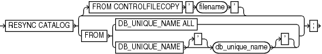

Purpose

Use the `RESYNC CATALOG` command to perform a full resynchronization of metadata in a recovery catalog schema with metadata in a target database control file. You can also use the `FROM CONTROLFILECOPY` clause to resynchronize the current control file with the RMAN metadata in a control file copy.

Typically, you run `RESYNC CATALOG` in the following situations:

- The recovery catalog was unavailable when you executed RMAN commands that automatically perform a resynchronization.
- The target database is running in `ARCHIVELOG` mode, because the recovery catalog is not updated automatically when an online redo log switch occurs or when a redo log is archived.
- You made changes to the physical structure of the target database such as adding or dropping a tablespace. As with log archiving, the recovery catalog is not updated automatically when the physical schema changes.
- RMAN is connected as `TARGET` to a standby database. You want to update the recovery catalog with metadata about RMAN operations performed on this database.
- RMAN is connected as `TARGET` to a standby database. You want to update the recovery catalog with metadata about a physical change on the primary database (see Example 3-46).

Prerequisites

RMAN must be connected as `TARGET` to a mounted or open database and connected as `CATALOG` to a recovery catalog database. When running `RESYNC CATALOG` with multiple databases, a network connection is required for each target database.

Usage Notes

Resynchronizations are full or partial. If full, and if the target database has mounted the current control file (but not a newly created control file or a control file that is less current than a control file that was used previously), then RMAN updates all changed records for the physical schema: data files, tablespaces, redo threads, and online redo logs. If the database is open, then RMAN also obtains data about rollback segments. If the resynchronization is partial, then RMAN does not resynchronize metadata about the physical schema or rollback segments.

If the target control file is mounted and the catalog database is available at command execution, then RMAN automatically resynchronizes the recovery catalog as needed when you use RMAN commands. RMAN performs a full resynchronization after structural changes to database (adding or dropping database files, creating new incarnation, and so on) or after changes to the RMAN persistent configuration.

Starting with Oracle Database 11g, a single recovery catalog schema can keep track of database file names for all databases in a Data Guard environment. This catalog schema also keeps track of where the online redo logs, standby redo logs, temp files, archived redo log files, backup sets, and image copies are created for all databases. If RMAN is connected as `TARGET` to a standby database, then RMAN implicitly executes a full resynchronization if the standby control file contains information about a physical schema change on the primary database.

See Also:

[Oracle Database Backup and Recovery User's Guide](https://docs.oracle.com/pls/topic/lookup?ctx=en/database/oracle/oracle-database/21/rcmrf&id=BRADV181) for more information about catalog resynchronization

Syntax

resync::=



> RESYNC CATALOG {\[FROM CONTROLFILECOPY ' filename '\] | FROM {DB\_UNIQUE\_NAME ALL | DB\_UNIQUE\_NAME \['\] db\_unique\_name \['\]}}
>
> [  
> Copyright © 2023, 2024, Oracle and/or its affiliates.](https://docs.oracle.com/en/database/oracle/oracle-database/dcommon/html/cpyr.htm)


Semantics

| Syntax Element | Description |
| --- | --- |
| `RESYNC CATALOG` | Updates the recovery catalog with RMAN metadata in the current control file of the target database (default).  RMAN creates a snapshot control file to obtain a read-consistent view of the control file, then updates the recovery catalog with any new information from the snapshot. The `RESYNC CATALOG` command updates the following classes or records:  - Log history records, which are created when a log switch occurs. Log history records describe an online log switch, not a log archival. - Archived redo log records, which are associated with archived redo log files created by archiving an online redo log, copying an existing archived log, or restoring backups of archived redo log files. - Backup records, which are records of backup sets, backup pieces, proxy copies, and image copies. - Physical schema records, which are associated with data files and tablespaces. If the target database is open, then rollback segment information is also updated. |
| `FROM CONTROLFILECOPY` ` '` `filename` `'` | Updates the current control file and recovery catalog with RMAN metadata from a control file copy (see Example 3-45). Use `filename` to specify the name of the control file copy to use for resynchronization.  The primary use for `FROM CONTROLFILECOPY` occurs when you re-create the control file, which causes you to lose RMAN records stored in the control file. You can then resynchronize the newly created control file with an old copy. Physical schema information is not updated when you use this option.  Note: The control file copy can either be in the current database incarnation, or created in a prior incarnation (that is, before the most recent `OPEN` `RESETLOGS`). |
| ` FROM DB_UNIQUE_NAME` `  {ALL \|` ` db_unique_name` `}` | Resynchronizes the recovery catalog with control file metadata in the specified database or databases (see Example 3-47).  When the `FROM DB_UNIQUE_NAME ALL` option is used to perform resynchronization, you must connect to the target database as the `SYS` user and using password file authentication.  You can specify a single database with `db_unique_name` or use `ALL` for all databases in the recovery catalog that share the DBID of the target database. If you specify `ALL`, then RMAN resynchronizes all databases in the Data Guard environment that are known to the recovery catalog.  Note: You must have previously used `CONFIGURE DB_UNIQUE_NAME ... CONNECT IDENTIFIER` to specify a net service name to be used for an Oracle Net connection to the database specified in `FROM DB_UNIQUE_NAME`.  When you run `RESYNC FROM DB_UNIQUE_NAME` for a specified database, RMAN performs both a normal resynchronization and a reverse resynchronization. In a normal resynchronization, RMAN updates the recovery catalog with metadata from the control file. In a reverse resynchronization, RMAN updates the persistent configurations in the control file if they do not match the information in the recovery catalog for the specified database.  For a sample use case, suppose that you recently connected RMAN as `TARGET` to the primary database and ran `CONFIGURE` to create an RMAN configuration for standby database `standby_new`. However, you have not yet connected RMAN as `TARGET` to `standby_new`. In this case, you can run `RESYNC CATALOG FROM DB_UNIQUE_NAME standby_new`. When you later connect RMAN to `standby_new` as `TARGET`, RMAN pushes the configuration from the recovery catalog to the mounted control file of `standby_new`.  Note: The password file must be identical on all of the remote databases for this feature to work properly. You must manually copy it to all the remote databases in the configuration. |

Examples

Example 3-44 Resynchronizing the Recovery Catalog in ARCHIVELOG Mode

This example performs a full resynchronization of the target database after archiving all unarchived redo log files.

```
RMAN> CONNECT TARGET "sbu@prod AS SYSBACKUP"
RMAN> CONNECT CATALOG rco@catdb

recovery catalog database Password: password
connected to recovery catalog database

RMAN> ALTER SYSTEM ARCHIVE LOG CURRENT;
RMAN> RESYNC CATALOG;
```

Example 3-45 Resynchronizing the Recovery Catalog from a Control File Copy

Suppose you want to retrieve some backup information from a control file copy.

Assume that you start the RMAN client and connect to a target database and recovery catalog. The following commands shut down and mount the target database, update the RMAN repository in the current control file with metadata from a backup control file, and then open the database.

```
STARTUP FORCE MOUNT
RESYNC CATALOG FROM CONTROLFILECOPY '/disk1/cfile.dbf';
ALTER DATABASE OPEN;
```

Example 3-46 Resynchronizing the Recovery Catalog After a Structural Change

Suppose you have the following:

- A Data Guard environment containing primary database `prod` and standby database `standby3`
- Both the primary and the standby databases are registered with the catalog
- You take a backup of the database and archive logs
- You start SQL\*Plus, connect to database `prod`, and add a data file to tablespace `users` as follows:
```
SQL> ALTER TABLESPACE users ADD DATAFILE '?/oradata/prod/users03.dbf' 
  2  SIZE 1M AUTOEXTEND ON 
  3  NEXT 10K MAXSIZE 10M;
```

The goal is to update the recovery catalog with metadata about this change. After the change is propagated to `standby3`, you start the RMAN client, connect to `standby3` as `TARGET`, and connect to the recovery catalog.

The next step is to define the connect identifiers for the standby database in your Data Guard environment with the `CONNECT IDENTIFIER` clause of the ` CONFIGURE` command:

```
CONFIGURE DB_UNIQUE_NAME standby3 CONNECT IDENTIFIER 'inst2';
```

At this point, you use the `RESYNC CATALOG ... ALL` command to resynchronize the recovery catalog with changes for all the databases in the Data Guard environment. While you can resynchronize the catalog with a specific standby site's information, Oracle recommends you use the `ALL` option to keep the recovery catalog schema current with any database changes that may have occurred within your Data Guard environment:

```
RMAN> RESYNC CATALOG FROM DB_UNIQUE_NAME ALL;
```

The recovery catalog is updated with metadata about the data file added to the `users` tablespace of database `prod`.

Example 3-47 Resynchronizing the Recovery Catalog with a Standby Database

Suppose that primary database `prod` and standby database `dgprod3` exist in a Data Guard environment. Your goal is to create an RMAN configuration for `dgprod3`.

You connect RMAN to database `prod` as `TARGET` and then connect to the recovery catalog. You use `CONFIGURE` to update the persistent RMAN configuration for `dgprod3` in the recovery catalog as follows:

```
CONFIGURE DEFAULT DEVICE TYPE TO sbt FOR DB_UNIQUE_NAME dgprod3;
CONFIGURE DB_UNIQUE_NAME dgprod3 CONNECT IDENTIFIER 'inst3';
```

You have not yet performed any backups or other RMAN operations on `dgprod3`, so the control file of `dgprod3` and the recovery catalog metadata for `dgprod3` are not synchronized. In the same RMAN session, you synchronize the `dgprod3` control file with the recovery catalog as follows:

```
RESYNC CATALOG FROM DB_UNIQUE_NAME dgprod3;
```

RMAN updates the default device type to SBT at `dgprod3` and also updates the recovery catalog with the names from the `dgprod3` control file.