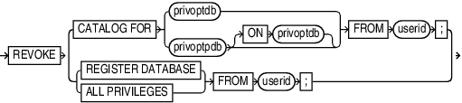

Purpose

Use the `REVOKE` command to revoke recovery catalog privileges previously granted with the `GRANT` command.

Prerequisites

Execute this command at the RMAN prompt only.

Usage Notes

Assume that a virtual private catalog user is granted the `REGISTER DATABASE` privilege, which implicitly grants the `CATALOG FOR DATABASE` privilege for any registered database. This user registers multiple databases. If you `REVOKE` the `REGISTER DATABASE` privilege from this user, then this user retains `CATALOG FOR DATABASE` privileges for the registered databases. The `CATALOG` privileges include registering and unregistering the specified databases.

To prevent this user from accessing the metadata for any databases or registering additional databases, execute `REVOKE ALL PRIVILEGES` for this user. To revoke `CATALOG` privileges for a subset of the databases registered by this user, execute `REVOKE CATALOG FOR DATABASE` for each database in the subset.

Syntax

revoke::=



> REVOKE {CATALOG FOR DATABASE {\['\] database\_name \['\] | integer} | REGISTER DATABASE | ALL PRIVILEGES} FROM userid
>
> [  
> Copyright © 2023, 2024, Oracle and/or its affiliates.](https://docs.oracle.com/en/database/oracle/oracle-database/dcommon/html/cpyr.htm)


privoptdb::=


> DATABASE {\['\] database\_name\['\] | integer}
>
> [  
> Copyright © 2023, 2024, Oracle and/or its affiliates.](https://docs.oracle.com/en/database/oracle/oracle-database/dcommon/html/cpyr.htm)


privoptpdb::-


> PLUGGABLE DATABASE {\['\] database\_name \['\] | GUID guid\_name}
>
> [  
> Copyright © 2023, 2024, Oracle and/or its affiliates.](https://docs.oracle.com/en/database/oracle/oracle-database/dcommon/html/cpyr.htm)


Semantics

| Syntax Element | Description |
| --- | --- |
| `CATALOG FOR DATABASE ` `{` `databasename` `  \|  ` `integer` `}` | Revokes recovery catalog access for the specified database from the specified user.  You can specify the database by either database name or DBID. If you specify a database name when multiple databases with this name are registered in the recovery catalog, then RMAN returns an error. In this case, specify the database by DBID. |
| `CATALOG FOR PLUGGABLE DATABASE ` `{` `database_name` `  \| GUID  ` `guid_name` `}` | Revokes recovery catalog access for the specified pluggable database (PDB) from the specified user.  You can specify the PDB either by the name or GUID of the PDB. If you specify a PDB name when multiple PDBs with this name are registered in the recovery catalog, then RMAN returns an error. In this case, specify the PDB using the GUID. |
| `REGISTER DATABASE` | Revokes the ability to for the specified user to register new databases in this recovery catalog (see Example 3-48). |
| `ALL PRIVILEGES` | Revokes all `CATALOG` and `REGISTER` privileges from the specified user. |
| `   FROM` `userid` | Specifies the name of the user from which you are revoking privileges. |

Examples

Example 3-48 Revoking Privileges from a Virtual Private Catalog User

Assume that you connect RMAN to a base recovery catalog as the recovery catalog owner `rco`. As the base catalog owner, you use the RMAN `GRANT` command as follows to give `bckop2` the ability to register any database in her virtual private catalog, but grant `bckop3` access to only a subset of the databases in the data center:

```
RMAN> CONNECT CATALOG rco@catdb

recovery catalog database Password: password
connected to recovery catalog database

RMAN> GRANT REGISTER DATABASE TO bckop2;
RMAN> GRANT CATALOG FOR DATABASE prod TO bckop3;
RMAN> GRANT CATALOG FOR DATABASE prodb TO bckop3;
RMAN> EXIT;
```

Later, you want to restrict the privileges for user `BCKOP2` so that this user cannot register new databases, so you connect to the base catalog as `rco` and execute a `REVOKE` command. `BCKOP2` retains catalog privileges on the database that this user registered.

```
RMAN> CONNECT CATALOG rco@catdb

recovery catalog database Password: password
connected to recovery catalog database

RMAN> REVOKE REGISTER DATABASE FROM bckop2;
```