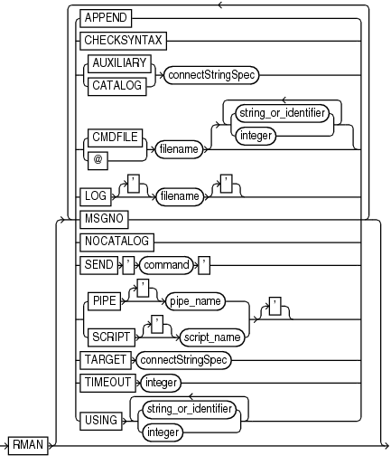

Purpose

Use the `RMAN` command to start RMAN from the operating system command line.

Prerequisites

You must issue the `RMAN` command and any options at the operating system command line rather than at the RMAN prompt.

RMAN connections to a database are specified and authenticated in the same way as SQL\*Plus connections to a database. The only difference is that RMAN connections to a target or auxiliary database require the `SYSBACKUP` privilege.

See Also:

- [Oracle Database Administrator’s Guide](https://docs.oracle.com/pls/topic/lookup?ctx=en/database/oracle/oracle-database/21/rcmrf&id=ADMIN-GUID-7842AF72-DA25-4559-A8E7-9883D0C63BF2) to learn about database connection options when using SQL\*Plus
- [Oracle Database Backup and Recovery User’s Guide](https://docs.oracle.com/pls/topic/lookup?ctx=en/database/oracle/oracle-database/21/rcmrf&id=BRADV8123) to learn about using the `SYSBACKUP` administrative privilege

Caution:

Good security practice requires that passwords are not entered in plain text on the command line. Enter passwords in RMAN only when requested by an RMAN prompt. See [Oracle Database Security Guide](https://docs.oracle.com/pls/topic/lookup?ctx=en/database/oracle/oracle-database/21/rcmrf&id=DBSEG0032) to learn about password protection.

Usage Notes

The command name that you enter at the operating system prompt is operating system-dependent. For example, enter `rman` in lowercase on Linux and UNIX systems.

If you start RMAN without specifying either `CATALOG` or `NOCATALOG` on the operating system command line, then the RMAN session is effectively in `NOCATALOG` mode unless you execute a `CONNECT` `CATALOG` command (see Example 3-49). If you maintain a recovery catalog, then the best practice is to connect RMAN to the recovery catalog before performing RMAN operations.

Syntax

cmdLine::=



> RMAN \[ { {APPEND | CHECKSYNTAX | {AUXILIARY | CATALOG} connectStringSpec | {CMDFILE | @} filename \[ { {string\_or\_identifier | integer}}...\] | LOG \['\] filename \['\] | MSGNO | NOCATALOG | SEND ' command ' | {PIPE \['\] pipe\_name | SCRIPT \['\] script\_name} \['\] | TARGET connectStringSpec | TIMEOUT integer | USING {string\_or\_identifier | integer} \[ {string\_or\_identifier | integer}\]... \[\]...\]


Semantics

cmdLine

| Syntax Element | Description |
| --- | --- |
| `APPEND` | Causes new output to be appended to the end of the message log file. If you do not specify this parameter, and if a file with the same name as the message log file exists, then RMAN overwrites it. |
| `CHECKSYNTAX` | Causes RMAN to start in a mode in which commands entered are checked for syntax errors, but no other processing is performed (see Example 3-52). If used with a `CMDFILE` or `@` argument, then the RMAN client starts, checks all commands in the file, then exits. If used without specifying a command file, then RMAN prompts the user for input and parses each command until the user exits the RMAN client.  RMAN reports an `RMAN-0558` error for each command that is not syntactically correct. |
| `AUXILIARY` `connectStringSpec` | Specifies a connect string to an auxiliary database, for example, `AUXILIARY` `sbu@dupdb`.  See Also: `connectStringSpec` |
| `CATALOG` `connectStringSpec` | Specifies a connect string to the database containing the recovery catalog, for example, `CATALOG` `rco@inst2`.  See Also: `connectStringSpec` |
| `CMDFILE` `filename` | Parses and compiles all RMAN commands in a file and then sequentially executes each command in the file. RMAN exits if it encounters a syntax error during the parse phase or if it encounters a runtime error during the execution phase. If no errors are found, then RMAN exits after the job completes.  If the first character of the file name is alphabetic, then you can omit the quotes around the file name. The contents of the command file are identical to commands entered at the RMAN prompt.  Note: If you run a command file at the RMAN prompt rather than as an option on the operating system command line, then RMAN does not run the file as a single job. RMAN reads each line sequentially and executes it, only exiting when it reaches the last line of the script. |
| `@` `filename` | Equivalent to `CMDFILE`. |
| `{` `string_or_identifier` `   \| ` `integer` `}` | Equivalent to options specified after `USING` syntax. |
| `LOG` `filename` | Specifies the file where RMAN records its output, that is, the commands that were processed and their results. RMAN displays command input at the prompt but does not display command output, which is written to the log file. By default RMAN writes its message log file to standard output.  RMAN output is also stored in the `V$RMAN_OUTPUT` view, which is a memory-only view for jobs in progress, and in `V$RMAN_STATUS`, which is a control file view for completed jobs and jobs in progress.  The `LOG` parameter does not cause RMAN to terminate if the specified file cannot be opened. Instead, RMAN writes to standard output.  Note: The easiest way to send RMAN output both to a log file and to standard output is to use the Linux `tee` command or its equivalent. For example:  ``` % rman \| tee rman.log ``` |
| `MSGNO` | Causes RMAN to print message numbers, that is, `RMAN-` `xxxx`, for the output of all commands. By default, RMAN does not print the `RMAN-` `xxxx` prefix. |
| `NOCATALOG` | Indicates that you are using RMAN without a recovery catalog. |
| `SEND` `'` `command` `'` | Sends a vendor-specific command string to all allocated channels.  See Also: Your media management documentation to determine whether this feature is supported, and `SEND` |
| `PIPE` `pipe_name` | Invokes the RMAN pipe interface. RMAN uses two public pipes: one for receiving commands and the other for sending output. The names of the pipes are derived from the value of the `PIPE` parameter. For example, you can invoke the RMAN pipe interface with the following options: `PIPE rpi TARGET /`.  RMAN opens the following pipes in the target database:  - `ORA$RMAN_RPI_IN`, which RMAN uses to receive user commands - `ORA$RMAN_RPI_OUT`, which RMAN uses to send all output  All messages on both the input and output pipes are of type `VARCHAR2`.  See Also: [Oracle Database Backup and Recovery User’s Guide](https://docs.oracle.com/pls/topic/lookup?ctx=en/database/oracle/oracle-database/21/rcmrf&id=BRADV130) to learn how to pass commands to RMAN through a pipe |
| `SCRIPT` `script_name` | Specifies the name of a stored script.  After connecting to a target database and recovery catalog (which must be specified with the `TARGET` and `CATALOG` options), RMAN runs the named stored script from the recovery catalog against the target database. If both a global script and a local stored script exist on the target database with the name `script_name`, then RMAN runs the local script.  The single quotes around the stored script name are required when the script name either begins with a number or is an RMAN reserved word (see " [RMAN Reserved Words](about-rman-commands.md) "). Avoid using such names.  See Also: `CREATE SCRIPT` for more details about stored scripts |
| `TARGET` `connectStringSpec` | Specifies a connect string to the target database, for example, `TARGET /`.  See Also: `connectStringSpec` |
| `TIMEOUT` `integer` | Causes RMAN to exit automatically if it does not receive input from an input pipe within `integer` seconds. The `PIPE` parameter must be specified when using `TIMEOUT`.  See Also: [Oracle Database Backup and Recovery User’s Guide](https://docs.oracle.com/pls/topic/lookup?ctx=en/database/oracle/oracle-database/21/rcmrf&id=BRADV130) to learn how to pass commands to RMAN through a pipe |
| `USING` `{` `string_or_identifier` `\|` `integer` `}` | Specifies one or more values for use in substitution variables in a command file. As in SQL\*Plus, `&1` indicates where to place the first value, `&2` indicate where to place the second value, and so on. Example 3-51 illustrates how to pass values specified in a `USING` clause to an RMAN command file.  The substitution variable syntax is `&` `integer` followed by an optional dot, for example, `&1.3`. The optional dot is part of the variable and replaced with the value, thus enabling the substitution text to be immediately followed by another integer. For example, if you pass the value `mybackup` to a command file that contains the substitution variable `&1.3`, then the result of the substitution is `mybackup3`.  See Also: `EXECUTE SCRIPT` to learn how to specify the `USING` clause when executing a stored script |

Examples

Example 3-49 Connecting RMAN to a Target Database in Default NOCATALOG Mode

In this example, you start the RMAN client without specifying database connection options at the operating system prompt. At the RMAN prompt, you run the `CONNECT` command to connect to a target database. Because `CONNECT` ` CATALOG` was not run at the RMAN prompt, RMAN connects in default `NOCATALOG` mode when the first command requiring a repository connection is run, which in this case is the `BACKUP DATABASE` command.

```
% rman
RMAN> CONNECT TARGET /
RMAN> BACKUP DATABASE;
```

Example 3-50 Connecting RMAN to an Auxiliary Database Instance

This example connects to target database `prod` and recovery catalog database `catdb` with net service names, and connects to an auxiliary database instance with operating system authentication. `sbu` is a user who is granted the `SYSBACKUP` privilege.

```
$ RMAN TARGET "sbu@prod AS SYSBACKUP"
 
Recovery Manager: Release 12.1.0.1.0 - Production on Wed Jan 16 09:29:02 2013
 
Copyright (c) 1982, 2013, Oracle and/or its affiliates.  All rights reserved.
 
target database Password: password
connected to target database: REL12 (DBID=3152825380)
 
RMAN> CONNECT CATALOG rco@catdb
 
recovery catalog database Password: password
connected to recovery catalog database
 
RMAN> CONNECT AUXILIARY /
 
connected to auxiliary database: REL12 (DBID=3152825380)
```

Example 3-51 Specifying Substitution Variables

Suppose that you want to create a Linux shell script that backs up the database. You want to use shell variables so that you can pass arguments to the RMAN backup script at run time. Substitution variables solve this problem. First, you create a command file named `whole_db.cmd` with the following contents:

```
cat > /tmp/whole_db.cmd <<EOF
# name: whole_db.cmd
CONNECT TARGET /
BACKUP TAG &1 COPIES &2 DATABASE FORMAT '/disk2/db_%U';
EXIT;
EOF
```

Next, you write the following Linux shell script, which sets `csh` shell variables `tagname` and `copies`. The shell script starts RMAN, connects to target database `prod1`, and runs `whole_db.cmd`. The `USING` clause passes the values in the variables `tagname` and `copies` to the RMAN command file at execution time.

```
#!/bin/csh
# name: runbackup.sh
# usage: use the tag name and number of copies as arguments
set tagname = $argv[1]
set copies = $argv[2]
rman @'/tmp/whole_db.cmd' USING $tagname $copies LOG /tmp/runbackup.out
# the preceding line is equivalent to:
# rman @'/tmp/whole_db.cmd' $tagname $copies LOG /tmp/runbackup.out
```

Finally, you execute the shell script `runbackup.sh` from a Linux shell as follows to create two backups of the database with the tag `Q106`:

```
% runbackup.sh Q106 2
```

Example 3-52 Checking the Syntax of a Command File

Suppose that you create command file `backup_db.cmd` as follows:

```
cat > /tmp/backup_db.cmd <<EOF
CONNECT TARGET /
BACKUP DATABASE;
EXIT;
EOF
```

The following example checks the syntax of the contents of command file `backup_db.cmd` (sample output included):

```
% rman CHECKSYNTAX @'/tmp/backup_db.cmd'

Recovery Manager: Release 12.1.0.1.0 - Production on Wed Jan 16 17:51:30 2013
 
Copyright (c) 1982, 2013, Oracle and/or its affiliates.  All rights reserved.
 
RMAN> CONNECT TARGET *
2> BACKUP DATABASE;
3> EXIT;
The cmdfile has no syntax errors
 
Recovery Manager complete.
```

Example 3-53 Running a Stored Script and Appending Output to a Message Log

This example connects to a target database using operating system authentication and then runs stored script `wdbb`. RMAN writes output to message log `/tmp/wdbb.log`.

```
% rman TARGET / SCRIPT wdbb LOG /tmp/wdbb.log
```

Example 3-54 Invoking the RMAN Pipe Interface

This example invokes the RMAN pipe `newpipe` with a 90 second timeout option.

```
% rman PIPE newpipe TARGET / TIMEOUT 90
```